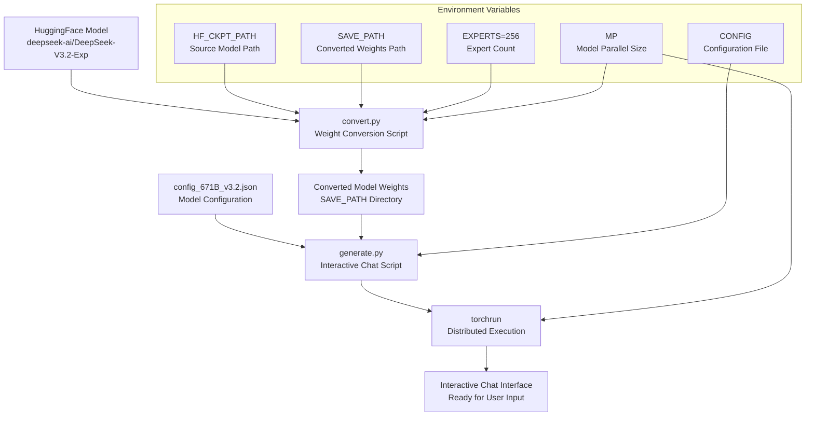
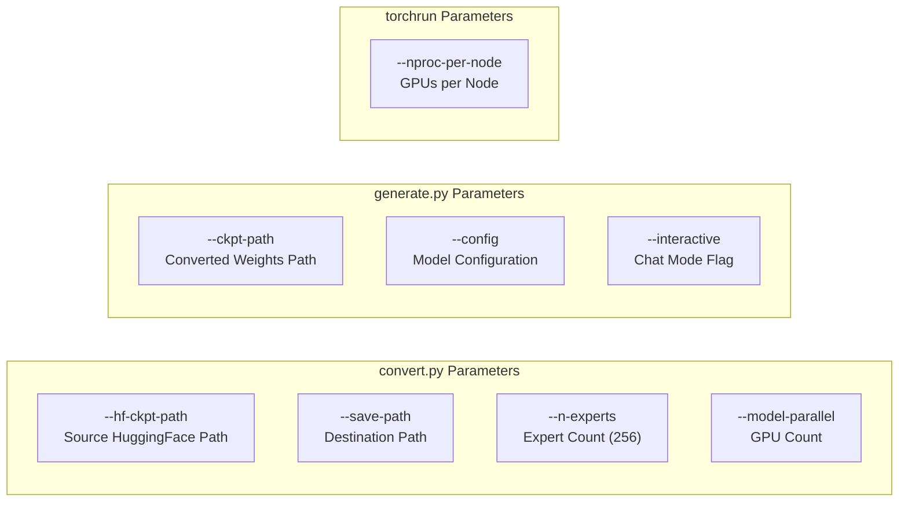

<!-- source: DeepWiki mcp.deepwiki.com · repo deepseek-ai/DeepSeek-V3.2-Exp · page 2.1 Getting Started · fetched 2026-10-30 -->

# Getting Started

<details>
<summary>Relevant source files</summary>

The following files were used as context for generating this wiki page:

- [inference/README.md](inference/README.md)
- [inference/requirements.txt](inference/requirements.txt)

</details>


This document provides a step-by-step guide to set up and run inference with DeepSeek-V3.2-Exp locally. It covers the essential workflow from model weight conversion to launching an interactive chat interface. For detailed technical information about model configuration parameters, see [Model Configuration](#2.2). For production deployment options, see [Production Deployment](#3.2).

## Prerequisites

Before beginning, ensure you have the required dependencies installed. The inference system requires several key packages as specified in the requirements file.

| Package | Purpose |
|---------|---------|
| `torch` | PyTorch framework for model execution |
| `transformers` | HuggingFace model loading and tokenization |
| `safetensors` | Secure tensor serialization format |
| `fast_hadamard_transform` | Optimized mathematical operations |
| `tilelang==0.1.6` | GPU kernel optimization framework |

Install dependencies using the requirements file: [inference/requirements.txt:1-5]()

## Quick Start Workflow

The getting started process involves two main stages: weight conversion and inference execution.

### Inference Setup Flow



Sources: [inference/README.md:1-14]()

## Step-by-Step Setup

### Step 1: Prepare Environment Variables

Set up the required environment variables for the conversion and inference process:

```bash
export HF_CKPT_PATH=/path/to/huggingface/model
export SAVE_PATH=/path/to/converted/weights
export EXPERTS=256
export MP=8  # Set to match your available GPU count
export CONFIG=config_671B_v3.2.json
```

The `MP` variable should match the number of GPUs available for distributed inference. The model requires multiple GPUs due to its 671B parameter size.

### Step 2: Convert Model Weights

Navigate to the inference directory and run the weight conversion script:

```bash
cd inference
python convert.py --hf-ckpt-path ${HF_CKPT_PATH} --save-path ${SAVE_PATH} --n-experts ${EXPERTS} --model-parallel ${MP}
```

This step transforms the HuggingFace checkpoint format into the format required by the inference system. For detailed information about the conversion process, see [Weight Conversion](#2.3.1).

### Step 3: Launch Interactive Chat

Start the interactive chat interface using distributed execution:

```bash
torchrun --nproc-per-node ${MP} generate.py --ckpt-path ${SAVE_PATH} --config ${CONFIG} --interactive
```

The `torchrun` command launches the inference system across multiple GPUs specified by the `MP` parameter.

### Key Script Parameters



Sources: [inference/README.md:7-8](), [inference/README.md:13]()

## Next Steps

Once the interactive chat is running, you can:

- Explore the model's capabilities through the chat interface
- Learn about advanced configuration options in [Model Configuration](#2.2)
- Understand the technical details of the generation pipeline in [Text Generation](#2.3.2)
- Set up production deployment using [Production Deployment](#3.2)

The interactive interface provides immediate access to the DeepSeek-V3.2-Exp model's capabilities, allowing you to test its performance on various tasks and evaluate the benefits of the DeepSeek Sparse Attention mechanism.

Sources: [inference/README.md:1-14](), [inference/requirements.txt:1-5]()

---

