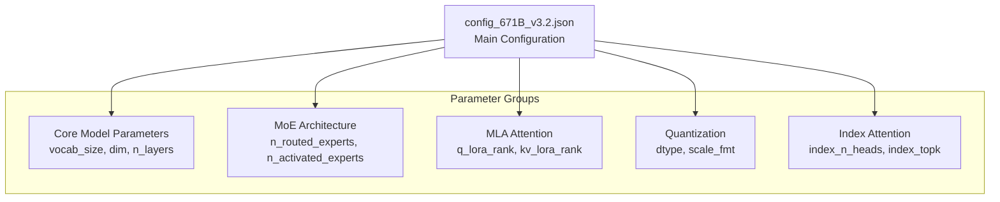
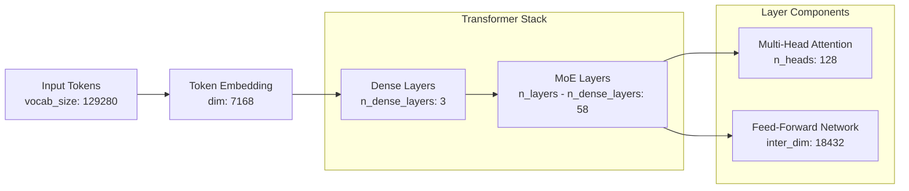
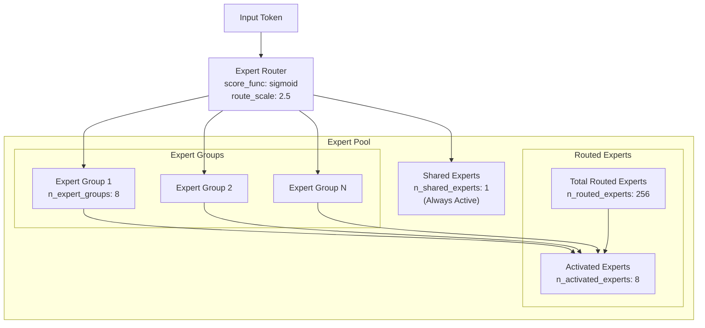
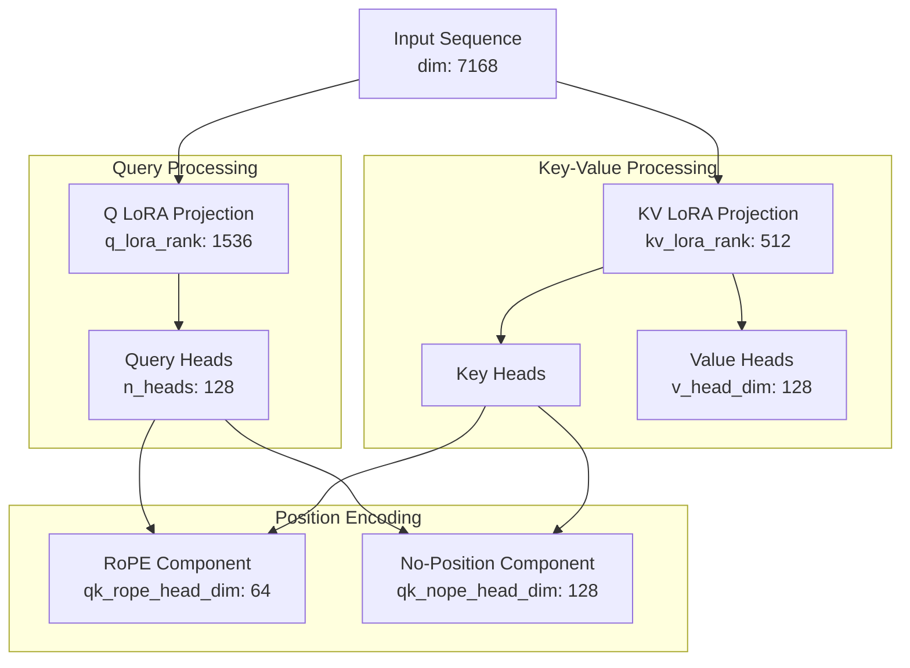
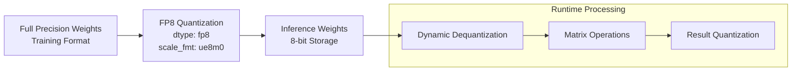
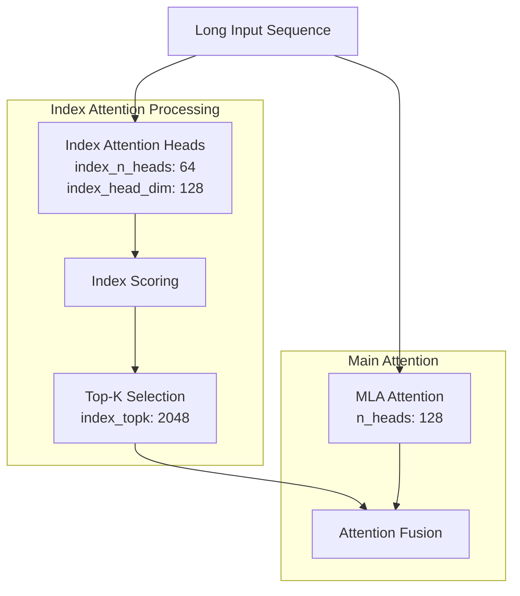
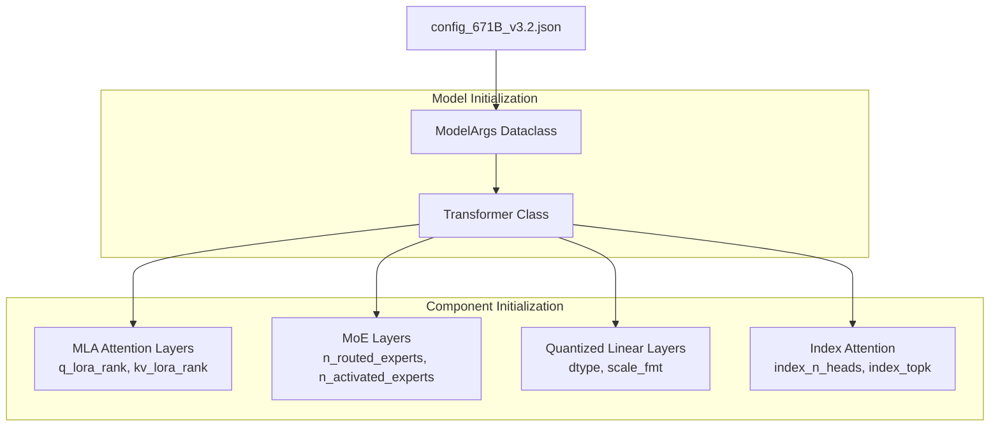

<!-- source: DeepWiki mcp.deepwiki.com · repo deepseek-ai/DeepSeek-V3.2-Exp · page 2.2 Model Configuration · fetched 2026-10-30 -->

# Model Configuration

Relevant source files

The following files were used as context for generating this wiki page:

- [inference/config_671B_v3.2.json](inference/config_671B_v3.2.json)

This document provides a detailed explanation of the 671B parameter MoE model configuration used by DeepSeek-V3.2-Exp. It covers the JSON configuration file structure, parameter definitions, and their role in defining the model architecture including quantization settings, MLA attention mechanisms, and MoE expert routing.

For information about how these configuration parameters are used during inference execution, see [Core Components](#2.3). For details about the underlying MoE architecture concepts, see [MoE Architecture Details](#4.1).

## Configuration File Structure

The model configuration is defined in a single JSON file that specifies all architectural parameters required for model initialization. The configuration follows a hierarchical structure organizing parameters by functional area.

**Configuration File Location and Structure**

Sources: [inference/config_671B_v3.2.json:1-26]()

## Core Model Parameters

The foundational model architecture is defined by these primary parameters that establish the overall scale and structure of the transformer model.

| Parameter | Value | Description |
|-----------|--------|-------------|
| `vocab_size` | 129,280 | Token vocabulary size |
| `dim` | 7,168 | Model hidden dimension |
| `inter_dim` | 18,432 | Feed-forward intermediate dimension |
| `n_layers` | 61 | Total number of transformer layers |
| `n_dense_layers` | 3 | Number of dense (non-MoE) layers |
| `n_heads` | 128 | Number of attention heads |

The model uses a 671B parameter architecture with 61 total layers, where 3 layers are dense and the remaining layers utilize the MoE architecture. The hidden dimension of 7,168 with 128 attention heads results in a head dimension of 56 per attention head.

**Core Architecture Flow**

Sources: [inference/config_671B_v3.2.json:2-7]()

## MoE Architecture Parameters

The Mixture-of-Experts configuration defines how the model distributes computation across multiple expert networks, enabling efficient scaling while maintaining quality.

| Parameter | Value | Description |
|-----------|--------|-------------|
| `moe_inter_dim` | 2,048 | MoE expert intermediate dimension |
| `n_routed_experts` | 256 | Total number of routed experts |
| `n_shared_experts` | 1 | Number of shared experts (always active) |
| `n_activated_experts` | 8 | Experts activated per token |
| `n_expert_groups` | 8 | Number of expert groups |
| `n_limited_groups` | 4 | Groups with limited expert selection |
| `route_scale` | 2.5 | Routing score scaling factor |
| `score_func` | "sigmoid" | Expert scoring function |

The MoE architecture uses 256 total experts with only 8 activated per token, achieving approximately 21B active parameters from the 671B total parameter model. The routing mechanism employs sigmoid scoring with expert grouping to ensure load balancing.

**MoE Expert Routing Architecture**

Sources: [inference/config_671B_v3.2.json:5,9-15]()

## MLA Attention Parameters

The Multi-Head Latent Attention (MLA) mechanism uses LoRA-style decomposition to efficiently compute attention while maintaining performance. The configuration defines rank parameters for different attention components.

| Parameter | Value | Description |
|-----------|--------|-------------|
| `q_lora_rank` | 1,536 | Query LoRA rank dimension |
| `kv_lora_rank` | 512 | Key-Value LoRA rank dimension |
| `qk_nope_head_dim` | 128 | Query-Key head dimension (no position) |
| `qk_rope_head_dim` | 64 | Query-Key RoPE head dimension |
| `v_head_dim` | 128 | Value head dimension |

The MLA mechanism decomposes attention computation using different rank settings for queries versus key-value pairs. The total attention head dimension is split between position-encoded (RoPE) and non-position components.

**MLA Attention Decomposition**

Sources: [inference/config_671B_v3.2.json:16-20]()

## Quantization Configuration

The model uses FP8 quantization for efficient inference while maintaining numerical precision. The quantization configuration specifies the data type and scaling format used throughout the model.

| Parameter | Value | Description |
|-----------|--------|-------------|
| `dtype` | "fp8" | Primary data type for model weights |
| `scale_fmt` | "ue8m0" | FP8 scaling format specification |

The FP8 quantization uses the "ue8m0" format, which refers to an 8-bit exponent with 0 mantissa bits in the scaling factors. This provides memory and computational efficiency while preserving model quality.

**Quantization Data Flow**

Sources: [inference/config_671B_v3.2.json:21-22]()

## Index Attention Parameters

The index attention mechanism provides an additional attention pathway optimized for long-context scenarios. This complements the main MLA attention mechanism with specialized parameters.

| Parameter | Value | Description |
|-----------|--------|-------------|
| `index_n_heads` | 64 | Number of index attention heads |
| `index_head_dim` | 128 | Dimension per index attention head |
| `index_topk` | 2,048 | Top-k selection for index attention |

The index attention uses 64 heads with 128 dimensions each, totaling 8,192 dimensions. The top-k selection of 2,048 enables efficient attention over long sequences by focusing on the most relevant positions.

**Index Attention Architecture**

Sources: [inference/config_671B_v3.2.json:23-25]()

## Configuration Usage in Code

The configuration parameters are loaded and processed by the model implementation to initialize the transformer architecture. The configuration directly maps to model component initialization and runtime behavior.

**Configuration to Code Mapping**

The configuration file is typically loaded during model initialization and converted into structured parameters that control every aspect of the model's architecture and behavior during inference.

Sources: [inference/config_671B_v3.2.json:1-26]()

---

