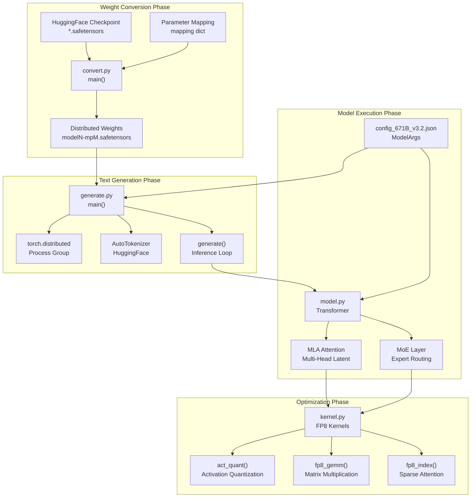
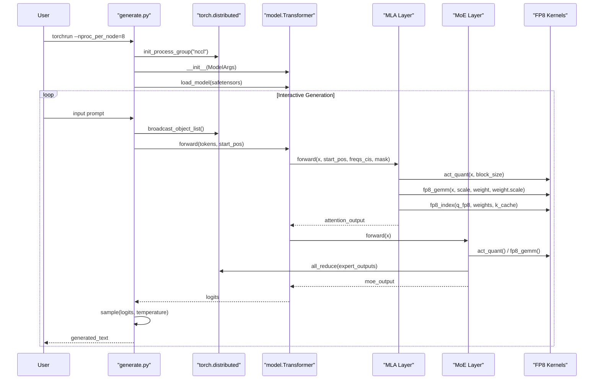

<!-- source: DeepWiki mcp.deepwiki.com · repo deepseek-ai/DeepSeek-V3.2-Exp · page 2.3 Core Components · fetched 2026-10-30 -->

# Core Components

Relevant source files

The following files were used as context for generating this wiki page:

- [inference/convert.py](inference/convert.py)
- [inference/generate.py](inference/generate.py)
- [inference/model.py](inference/model.py)

This document provides an overview of the main components in the DeepSeek-V3.2-Exp inference pipeline and their interactions. The inference system is built around four primary modules that work together to enable distributed text generation: weight conversion, text generation orchestration, model implementation, and optimization kernels.

For detailed implementation of individual components, see [Weight Conversion](#2.3.1), [Text Generation](#2.3.2), [Model Implementation](#2.3.3), and [Optimization Kernels](#2.3.4). For initial setup instructions, see [Getting Started](#2.1).

## System Architecture Overview

The inference pipeline follows a modular design where each component has distinct responsibilities but integrates seamlessly with others through well-defined interfaces.

Sources: [inference/convert.py:37-100](), [inference/generate.py:81-160](), [inference/model.py:18-92]()

## Component Interaction Flow

The components interact through a well-defined sequence during inference execution, with each component responsible for specific aspects of the distributed inference process.

Sources: [inference/generate.py:100-160](), [inference/model.py:878-902](), [inference/model.py:537-597](), [inference/model.py:769-793]()

## Core Component Mapping

The following table maps high-level system concepts to specific code entities:

| System Component | Primary Class/Function | Key Responsibilities | File Location |
|------------------|------------------------|---------------------|---------------|
| Weight Conversion | `main()` | Parameter mapping, expert sharding | [inference/convert.py:37-100]() |
| Text Generation | `generate()`, `main()` | Distributed inference orchestration | [inference/generate.py:31-78](), [inference/generate.py:81-160]() |
| Transformer Model | `Transformer` | Model architecture, forward pass | [inference/model.py:843-902]() |
| MLA Attention | `MLA` | Multi-head latent attention | [inference/model.py:491-597]() |
| MoE Routing | `MoE`, `Gate` | Expert selection and routing | [inference/model.py:736-793](), [inference/model.py:635-698]() |
| FP8 Optimization | `act_quant`, `fp8_gemm`, `fp8_index` | Quantization and optimized ops | [inference/model.py:11]() |
| Parameter Configuration | `ModelArgs` | Model hyperparameters | [inference/model.py:18-92]() |

Sources: [inference/convert.py:37-100](), [inference/generate.py:31-160](), [inference/model.py:11-902]()

## Data Flow Architecture

The inference pipeline processes data through several transformation stages, with each component handling specific tensor operations and distributed coordination.

```mermaid
flowchart LR
    subgraph "Input Processing"
        UserPrompt["User Prompt<br/>String"]
        TokenizerApply["tokenizer.apply_chat_template()"] 
        PromptTokens["prompt_tokens<br/>List[int]"]
    end
    
    subgraph "Model Forward Pass"
        TokensTensor["tokens<br/>torch.Tensor"]
        EmbedLayer["ParallelEmbedding<br/>embed(tokens)"]
        TransformerLayers["Transformer Blocks<br/>layers[0...60]"]
        OutputNorm["RMSNorm<br/>norm(hidden_states)"]
        LMHead["ColumnParallelLinear<br/>head(normalized)"]
        LogitsTensor["logits<br/>torch.Tensor"]
    end
    
    subgraph "Distributed Coordination"
        AllGather["dist.all_gather()<br/>Collect Logits"]
        AllReduce["dist.all_reduce()<br/>Expert Outputs"]
        Broadcast["dist.broadcast_object_list()<br/>Prompt Sharing"]
    end
    
    subgraph "Output Generation"
        SampleFunc["sample(logits, temperature)"]
        NextToken["next_token<br/>torch.Tensor"] 
        TokenDecode["tokenizer.decode()"]
        ResponseText["Response Text<br/>String"]
    end
    
    UserPrompt --> TokenizerApply
    TokenizerApply --> PromptTokens
    PromptTokens --> TokensTensor
    
    TokensTensor --> EmbedLayer
    EmbedLayer --> TransformerLayers
    TransformerLayers --> OutputNorm
    OutputNorm --> LMHead
    LMHead --> LogitsTensor
    
    LogitsTensor --> AllGather
    AllGather --> SampleFunc
    TransformerLayers --> AllReduce
    PromptTokens --> Broadcast
    
    SampleFunc --> NextToken
    NextToken --> TokenDecode
    TokenDecode --> ResponseText
```

Sources: [inference/generate.py:31-78](), [inference/model.py:878-902](), [inference/model.py:93-132]()

## Module Dependencies

The core components have specific dependency relationships that define the system's modularity and testability.

| Component | Direct Dependencies | Key Imports |
|-----------|-------------------|-------------|
| `convert.py` | `torch`, `safetensors`, `tqdm` | `safe_open`, `save_file` |
| `generate.py` | `torch.distributed`, `transformers`, `model.py` | `Transformer`, `ModelArgs`, `AutoTokenizer` |
| `model.py` | `torch`, `einops`, `kernel.py` | `act_quant`, `fp8_gemm`, `fp8_index` |
| `kernel.py` | TileLang JIT, CUDA kernels | Optimization primitives |

The dependency flow ensures that optimization kernels can be swapped independently, the model implementation is decoupled from the generation interface, and weight conversion is a standalone preprocessing step.

Sources: [inference/convert.py:1-10](), [inference/generate.py:1-11](), [inference/model.py:1-12]()

---

