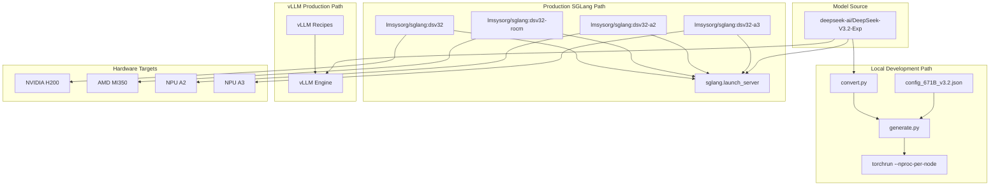
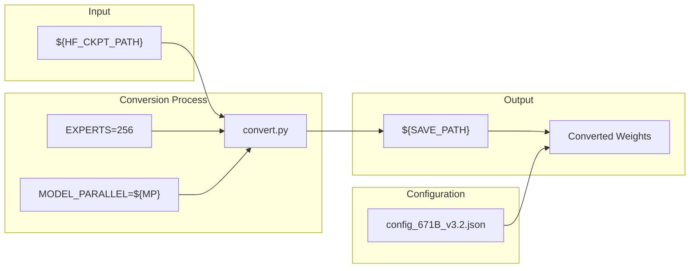
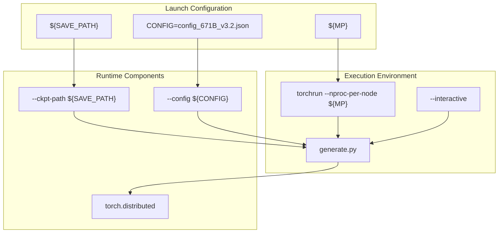
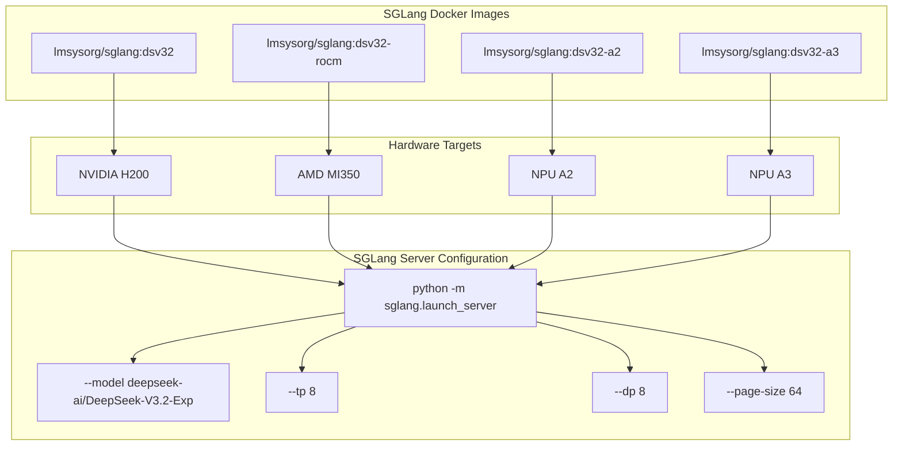
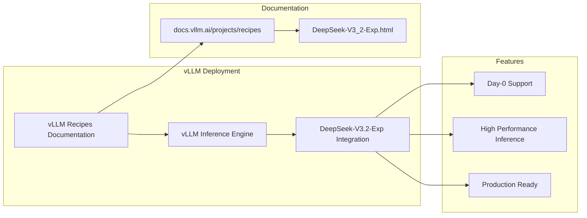

<!-- source: DeepWiki mcp.deepwiki.com · repo deepseek-ai/DeepSeek-V3.2-Exp · page 3 Deployment Guide · fetched 2026-10-30 -->

# Deployment Guide

<details>
<summary>Relevant source files</summary>

The following files were used as context for generating this wiki page:

- [LICENSE](LICENSE)
- [README.md](README.md)

</details>


This document provides comprehensive instructions for deploying DeepSeek-V3.2-Exp across different environments and hardware configurations. The guide covers local development setups for experimentation and research, as well as production deployment options for serving the model at scale.

The deployment guide focuses on the practical aspects of running the 671B parameter MoE model with its DeepSeek Sparse Attention mechanism. For technical details about the model architecture, see [System Architecture](#1.1). For understanding the inference pipeline components, see [Inference Pipeline](#2).

## Deployment Architecture Overview

DeepSeek-V3.2-Exp supports multiple deployment pathways, each optimized for different use cases and hardware configurations. The deployment ecosystem is built around three primary approaches: local HuggingFace inference for development, SGLang for production serving, and vLLM for high-performance inference.

### Deployment Options Matrix

| Deployment Method | Use Case | Hardware Support | Key Features |
|-------------------|----------|------------------|--------------|
| HuggingFace Local | Development, Research | Multi-GPU | Weight conversion, Interactive chat |
| SGLang | Production, Serving | H200, MI350, NPU A2/A3 | Docker containers, Multi-hardware |
| vLLM | High-performance Inference | Standard GPUs | Day-0 support, Production ready |

### Overall Deployment Architecture



Sources: [README.md:88-127]()

## Local Development

Local development deployment enables researchers and developers to run DeepSeek-V3.2-Exp on their own hardware for experimentation and testing. This approach uses the HuggingFace model format with custom conversion and generation scripts.

### Weight Conversion Process

The local deployment begins with converting HuggingFace model weights to the format required by the inference system. The `convert.py` script handles the transformation and sharding across multiple GPUs.



The conversion command structure:

```bash
export EXPERTS=256
python convert.py --hf-ckpt-path ${HF_CKPT_PATH} --save-path ${SAVE_PATH} --n-experts ${EXPERTS} --model-parallel ${MP}
```

Key parameters:
- `EXPERTS=256`: Configures the number of MoE experts
- `MP`: Model parallel degree matching available GPU count
- Output format optimized for distributed inference

Sources: [README.md:90-95]()

### Interactive Generation Setup

After weight conversion, the system launches an interactive chat interface using `torchrun` for multi-GPU execution:



Launch command:
```bash
export CONFIG=config_671B_v3.2.json
torchrun --nproc-per-node ${MP} generate.py --ckpt-path ${SAVE_PATH} --config ${CONFIG} --interactive
```

Sources: [README.md:97-101]()

## Production Deployment

Production deployment options are designed for serving the model at scale with high availability and performance. The system supports both SGLang and vLLM frameworks with specialized configurations for different hardware platforms.

### SGLang Deployment

SGLang provides Docker-based deployment with specialized images for different hardware architectures. Each Docker image is optimized for specific hardware capabilities and includes all necessary dependencies.

#### Docker Image Architecture



#### Hardware-Specific Deployment

| Hardware | Docker Image | Optimization Features |
|----------|--------------|----------------------|
| NVIDIA H200 | `lmsysorg/sglang:dsv32` | CUDA optimizations, high memory bandwidth |
| AMD MI350 | `lmsysorg/sglang:dsv32-rocm` | ROCm support, AMD GPU acceleration |
| NPU A2 | `lmsysorg/sglang:dsv32-a2` | Specialized AI chip optimization |
| NPU A3 | `lmsysorg/sglang:dsv32-a3` | Advanced NPU architecture support |

Docker pull commands:
```bash
# H200
docker pull lmsysorg/sglang:dsv32

# MI350
docker pull lmsysorg/sglang:dsv32-rocm

# NPUs
docker pull lmsysorg/sglang:dsv32-a2
docker pull lmsysorg/sglang:dsv32-a3
```

#### SGLang Server Configuration

The SGLang server launch command provides fine-grained control over parallelization and memory management:

```bash
python -m sglang.launch_server --model deepseek-ai/DeepSeek-V3.2-Exp --tp 8 --dp 8 --page-size 64
```

Configuration parameters:
- `--tp 8`: Tensor parallelism degree for model sharding
- `--dp 8`: Data parallelism for batch processing
- `--page-size 64`: Memory page size for attention computation
- `--model`: Direct HuggingFace model identifier

Sources: [README.md:104-122]()

### vLLM Integration

vLLM provides day-0 support for DeepSeek-V3.2-Exp with optimized inference capabilities. The integration offers high-performance serving with minimal configuration requirements.



The vLLM integration provides immediate compatibility without requiring specialized Docker images or complex configuration. Detailed deployment instructions are available in the official vLLM recipes documentation.

Sources: [README.md:124-126]()

### Deployment Comparison

| Aspect | SGLang | vLLM | Local HF |
|--------|--------|------|----------|
| Setup Complexity | Medium | Low | High |
| Hardware Support | Specialized | Standard | Multi-GPU |
| Production Readiness | High | High | Development |
| Docker Support | Yes | Standard | No |
| Custom Optimization | Hardware-specific | General | Research-focused |

The choice of deployment method depends on specific requirements: SGLang for specialized hardware optimization, vLLM for standard production deployment, and local HuggingFace inference for development and research workflows.

Sources: [README.md:88-127]()

---

