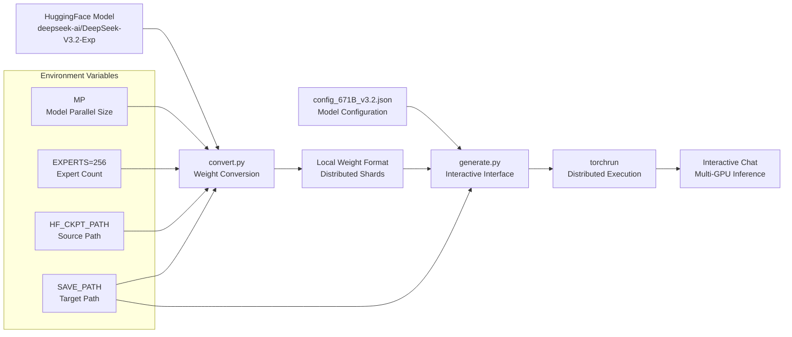
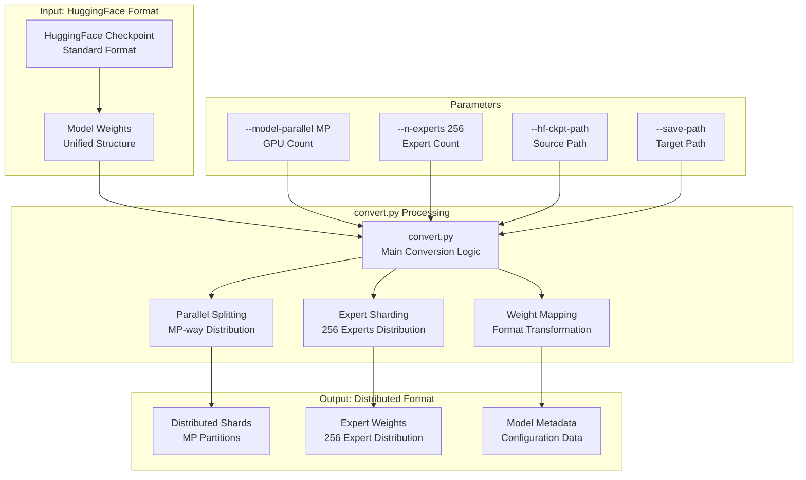
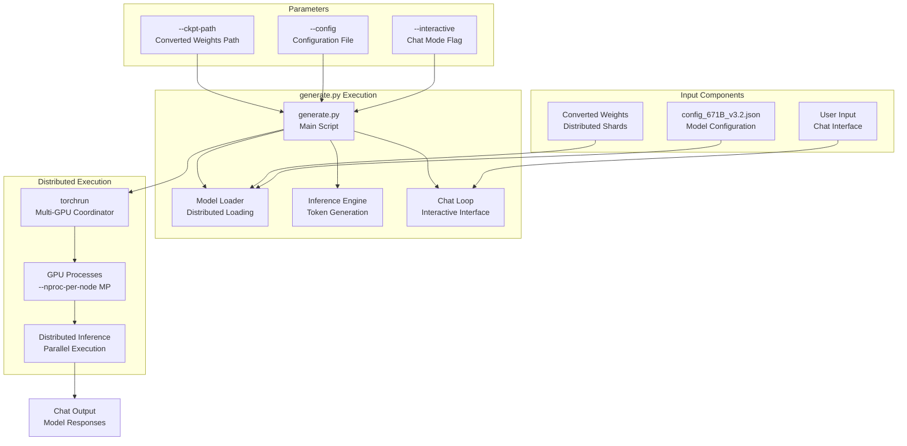

<!-- source: DeepWiki mcp.deepwiki.com · repo deepseek-ai/DeepSeek-V3.2-Exp · page 3.1 Local Development · fetched 2026-10-30 -->

# Local Development

<details>
<summary>Relevant source files</summary>

The following files were used as context for generating this wiki page:

- [LICENSE](LICENSE)
- [README.md](README.md)
- [inference/README.md](inference/README.md)

</details>


This document covers setting up DeepSeek-V3.2-Exp for local development and inference using the HuggingFace demo implementation. This approach is ideal for researchers, developers, and users who want to run the model locally for experimentation, testing, or development purposes.

For production deployment scenarios using SGLang or vLLM, see [Production Deployment](#3.2). For detailed technical documentation of the inference pipeline components, see [Inference Pipeline](#2).

## Overview

Local development with DeepSeek-V3.2-Exp involves two primary steps: converting HuggingFace model weights to the inference demo format, and launching an interactive chat interface. This process enables distributed inference across multiple GPUs using PyTorch's `torchrun` utility.

## Development Workflow

The local development process follows a straightforward pipeline from model acquisition to interactive inference:



**Sources:** [README.md:85-101](), [inference/README.md:1-14]()

## Prerequisites

Before setting up local development, ensure you have:

| Requirement | Description | Notes |
|-------------|-------------|-------|
| **Hardware** | Multiple NVIDIA GPUs | GPU count determines `MP` parameter |
| **Python Environment** | PyTorch with CUDA support | Required for distributed execution |
| **Storage** | Sufficient disk space | Model weights require substantial storage |
| **HuggingFace Model** | Access to deepseek-ai/DeepSeek-V3.2-Exp | Source model for conversion |

The model's distributed architecture requires multiple GPUs for optimal performance, with the model parallel size (`MP`) matching your available GPU count.

**Sources:** [README.md:90-94](), [README.md:100]()

## Weight Conversion Process

### Conversion Script Architecture

The weight conversion process transforms HuggingFace checkpoint format into the distributed format required by the inference demo:



**Sources:** [README.md:90-95](), [inference/README.md:3-8]()

### Conversion Command

Execute the conversion with appropriate environment variables:

```bash
cd inference
export EXPERTS=256
python convert.py --hf-ckpt-path ${HF_CKPT_PATH} --save-path ${SAVE_PATH} --n-experts ${EXPERTS} --model-parallel ${MP}
```

| Parameter | Purpose | Example Value |
|-----------|---------|---------------|
| `HF_CKPT_PATH` | Source HuggingFace checkpoint path | `/path/to/huggingface/model` |
| `SAVE_PATH` | Target directory for converted weights | `/path/to/converted/weights` |
| `EXPERTS` | Number of MoE experts | `256` |
| `MP` | Model parallel size (GPU count) | `8` |

The conversion process handles the complex task of distributing the 671B parameter model across multiple GPUs while preserving the MoE expert structure.

**Sources:** [README.md:90-95](), [inference/README.md:3-8]()

## Interactive Chat Setup

### Generation Script Architecture

The interactive chat interface provides a user-friendly way to interact with the converted model:



**Sources:** [README.md:97-101](), [inference/README.md:10-14]()

### Launch Command

Start the interactive chat interface using `torchrun` for distributed execution:

```bash
export CONFIG=config_671B_v3.2.json
torchrun --nproc-per-node ${MP} generate.py --ckpt-path ${SAVE_PATH} --config ${CONFIG} --interactive
```

| Component | Function | Details |
|-----------|----------|---------|
| `torchrun` | PyTorch distributed launcher | Coordinates multiple GPU processes |
| `--nproc-per-node ${MP}` | Process count per node | Must match conversion `MP` parameter |
| `--ckpt-path ${SAVE_PATH}` | Path to converted weights | Output from conversion step |
| `--config ${CONFIG}` | Model configuration file | Defines architecture parameters |
| `--interactive` | Interactive mode flag | Enables chat interface |

**Sources:** [README.md:99-101](), [inference/README.md:11-14]()

## Configuration Management

The model configuration is controlled through the `config_671B_v3.2.json` file, which defines the architecture parameters for the 671B parameter MoE model. This configuration must be consistent between conversion and generation phases to ensure proper model loading and execution.

Key configuration aspects include:
- Model architecture parameters
- MoE expert configuration (256 experts)
- Attention mechanism settings
- Quantization parameters

For detailed configuration documentation, see [Model Configuration](#2.2).

**Sources:** [README.md:99](), [inference/README.md:12]()

## Environment Variables Reference

| Variable | Required | Purpose | Example |
|----------|----------|---------|---------|
| `EXPERTS` | Yes | Number of MoE experts | `256` |
| `MP` | Yes | Model parallel size | `8` |
| `HF_CKPT_PATH` | Yes | HuggingFace checkpoint path | `/models/deepseek-v3.2` |
| `SAVE_PATH` | Yes | Converted weights output path | `/converted/deepseek-v3.2` |
| `CONFIG` | Yes | Configuration file name | `config_671B_v3.2.json` |

These environment variables provide flexibility in deployment while maintaining consistency across the conversion and generation processes.

**Sources:** [README.md:90-101](), [inference/README.md:3-14]()

## Troubleshooting

### Common Issues

| Issue | Cause | Solution |
|-------|-------|----------|
| **GPU Memory Errors** | Insufficient VRAM | Increase `MP` to distribute across more GPUs |
| **Path Not Found** | Incorrect environment variables | Verify `HF_CKPT_PATH` and `SAVE_PATH` |
| **Process Count Mismatch** | Inconsistent `MP` values | Use same `MP` for conversion and generation |
| **Configuration Errors** | Missing config file | Ensure `config_671B_v3.2.json` is accessible |

### Performance Optimization

- Ensure adequate GPU memory for the distributed model shards
- Use fast storage for model weights to reduce loading time
- Match `MP` parameter to available GPU count for optimal distribution
- Monitor GPU utilization to ensure balanced load across devices

**Sources:** [README.md:90-101]()

---

