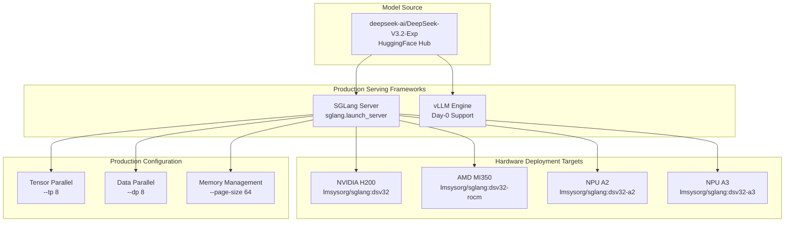
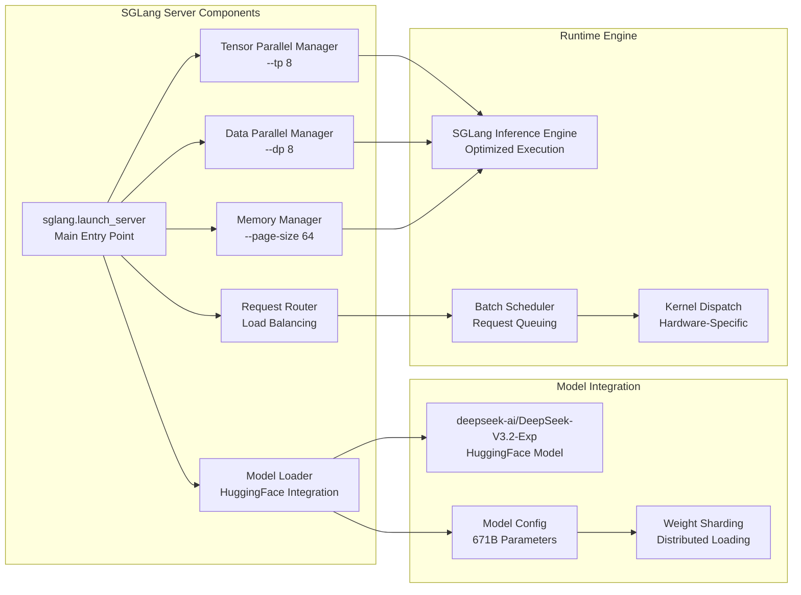
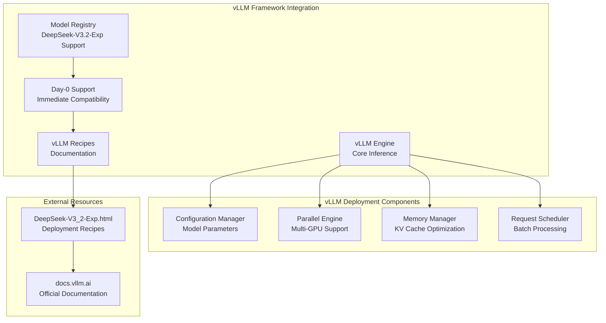

<!-- source: DeepWiki mcp.deepwiki.com · repo deepseek-ai/DeepSeek-V3.2-Exp · page 3.2 Production Deployment · fetched 2026-10-30 -->

# Production Deployment

<details>
<summary>Relevant source files</summary>

The following files were used as context for generating this wiki page:

- [LICENSE](LICENSE)
- [README.md](README.md)

</details>


This document covers production deployment options for DeepSeek-V3.2-Exp using enterprise-ready serving frameworks. It focuses on scalable, multi-GPU deployment configurations suitable for production workloads.

For local development and testing, see [Local Development](#3.1). For detailed model implementation and optimization details, see [Technical Deep Dive](#4).

## Deployment Architecture Overview

DeepSeek-V3.2-Exp supports production deployment through two primary serving frameworks: SGLang and vLLM. Both frameworks provide multi-GPU tensor parallelism, distributed serving capabilities, and hardware-specific optimizations.



Sources: [README.md:103-126]()

## SGLang Production Deployment

SGLang provides the primary production deployment path for DeepSeek-V3.2-Exp, offering pre-built Docker images optimized for different hardware architectures and comprehensive distributed serving capabilities.

### Docker Image Configuration

SGLang maintains hardware-specific Docker images that include optimized kernels and drivers for different accelerator types:

| Hardware Platform | Docker Image | Driver Support |
|-------------------|--------------|----------------|
| NVIDIA H200 | `lmsysorg/sglang:dsv32` | CUDA optimized |
| AMD MI350 | `lmsysorg/sglang:dsv32-rocm` | ROCm support |
| NPU A2 | `lmsysorg/sglang:dsv32-a2` | NPU-specific |
| NPU A3 | `lmsysorg/sglang:dsv32-a3` | NPU-specific |

### Deployment Commands

```bash
# Pull hardware-specific Docker image
docker pull lmsysorg/sglang:dsv32

# Launch production server with distributed configuration
python -m sglang.launch_server \
  --model deepseek-ai/DeepSeek-V3.2-Exp \
  --tp 8 \
  --dp 8 \
  --page-size 64
```

### SGLang Server Architecture



Sources: [README.md:103-122]()

### Production Configuration Parameters

The SGLang deployment uses several key parameters for production optimization:

- **`--tp 8`**: Tensor parallelism across 8 GPUs for model sharding
- **`--dp 8`**: Data parallelism with 8 parallel inference instances  
- **`--page-size 64`**: Memory page size for efficient attention computation
- **`--model deepseek-ai/DeepSeek-V3.2-Exp`**: Direct HuggingFace model loading

Sources: [README.md:121]()

## vLLM Production Deployment

vLLM provides day-0 support for DeepSeek-V3.2-Exp with comprehensive documentation and deployment recipes.

### vLLM Integration Features



Sources: [README.md:124-126]()

## Production Scaling Considerations

### Multi-GPU Configuration

Both SGLang and vLLM support distributed deployment patterns for the 671B parameter model:

| Configuration | SGLang | vLLM | Use Case |
|---------------|---------|------|----------|
| Single-node 8xGPU | `--tp 8` | Supported | Small-scale production |
| Multi-node distributed | `--tp 8 --dp 8` | Supported | High-throughput serving |
| Mixed precision | FP8 kernels | Supported | Memory optimization |

### Hardware Requirements

DeepSeek-V3.2-Exp production deployment requires substantial computational resources due to its 671B parameter scale:

- **Memory**: Minimum 8x80GB GPUs for full precision inference
- **Interconnect**: High-bandwidth GPU interconnect (NVLink, Infinity Fabric)
- **Storage**: High-speed storage for model checkpoint loading
- **Network**: Low-latency networking for multi-node deployments

### Performance Optimization

Production deployments leverage several optimization strategies:

- **FP8 quantization**: Reduced memory footprint via `kernel.py` optimizations
- **Sparse attention**: DeepSeek Sparse Attention for long-context efficiency
- **Expert routing**: MoE architecture with selective expert activation
- **Memory management**: Paged attention with configurable page sizes

Sources: [README.md:42-53](), [README.md:77-81]()

## Deployment Verification

### Health Check Endpoints

Production deployments should implement monitoring for:

- Model loading completion
- GPU memory utilization
- Request throughput metrics
- Error rates and latency percentiles

### Integration Testing

Verify production deployment with:

- Load testing with representative request patterns
- Multi-GPU communication validation
- Memory leak detection during extended operation
- Failover behavior testing

Sources: [README.md:103-126]()

---

