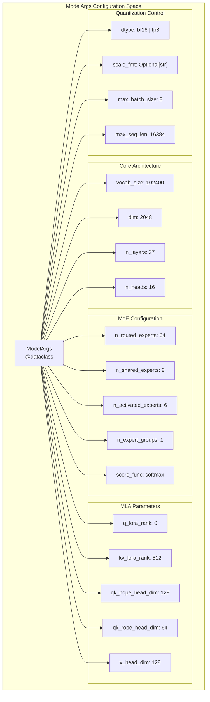
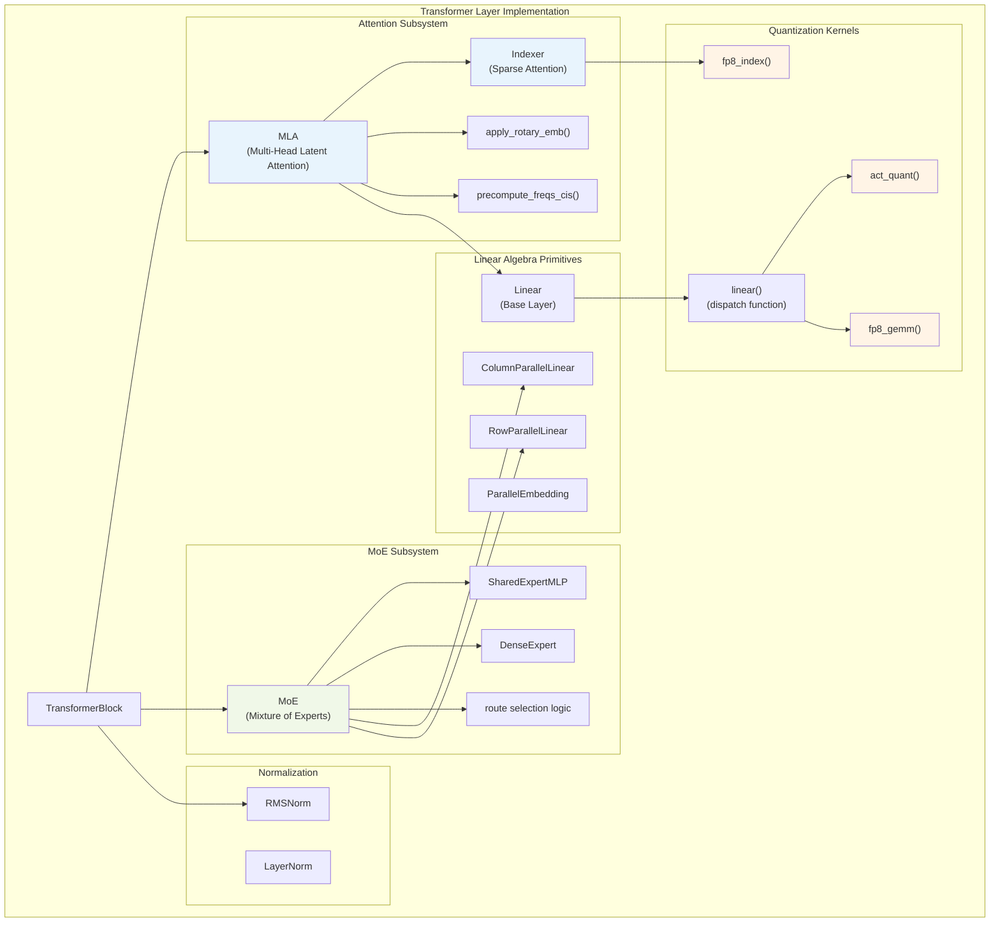
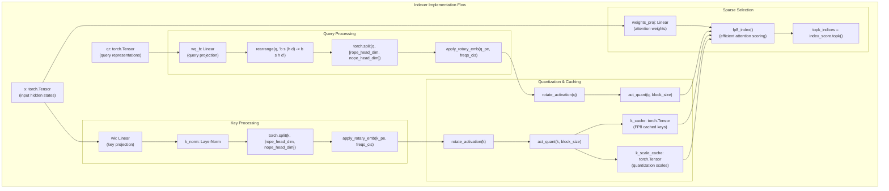
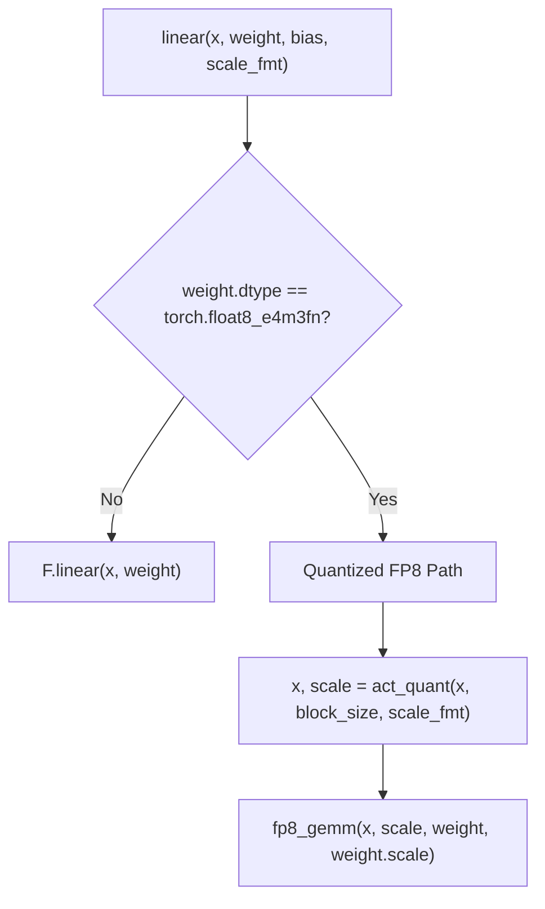
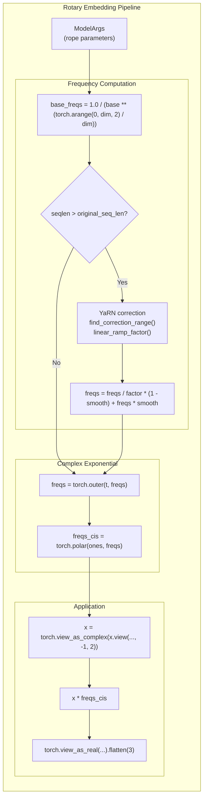

<!-- source: DeepWiki mcp.deepwiki.com · repo deepseek-ai/DeepSeek-V3.2-Exp · page 4 Technical Deep Dive · fetched 2026-10-30 -->

# Technical Deep Dive

Relevant source files

The following files were used as context for generating this wiki page:

- [DeepSeek_V3_2.pdf](DeepSeek_V3_2.pdf)
- [cost.jpg](cost.jpg)
- [inference/model.py](inference/model.py)

## Purpose and Scope

This document provides advanced technical analysis of DeepSeek-V3.2-Exp's architecture, focusing on the implementation details of core innovations, optimization strategies, and their performance implications. It bridges high-level architectural concepts with their concrete code implementations.

For detailed MoE architecture analysis, see [MoE Architecture Details](#4.1). For quantization implementation specifics, see [Quantization and Performance](#4.2). For economic and operational considerations, see [Cost Analysis](#4.3).

## Core Architectural Innovations

### DeepSeek Sparse Attention (DSA)

DeepSeek-V3.2-Exp introduces DeepSeek Sparse Attention as its primary innovation, enabling efficient long-context processing while maintaining quality comparable to the dense V3.1-Terminus model. The implementation centers around selective attention mechanisms that reduce computational overhead through learned sparsity patterns.

### Advanced Model Configuration

The system supports extensive configuration through the `ModelArgs` dataclass, enabling flexible deployment across different hardware configurations and use cases.

Sources: [inference/model.py:18-92]()

## Implementation Architecture Mapping

The following diagram maps core architectural concepts to their concrete implementations in the codebase:

Sources: [inference/model.py:491-580](), [inference/model.py:431-481](), [inference/model.py:93-133](), [inference/model.py:167-271]()

## Sparse Attention Implementation Details

### Indexer Architecture

The `Indexer` class implements the core sparse attention mechanism, using quantized operations and caching strategies for efficiency:

Sources: [inference/model.py:431-481]()

## Advanced Linear Algebra Infrastructure

The system implements a sophisticated hierarchy of linear layers supporting distributed computation and quantization:

| Component | Purpose | Key Features |
|-----------|---------|--------------|
| `Linear` | Base linear transformation | FP8 quantization support, custom `linear()` dispatch |
| `ColumnParallelLinear` | Distributed output features | Splits `out_features` across processes |
| `RowParallelLinear` | Distributed input features | Splits `in_features` across processes, optional reduction |
| `ParallelEmbedding` | Distributed embeddings | Vocabulary sharding across processes |

### Quantization Dispatch Logic

Sources: [inference/model.py:135-165]()

## Rotary Positional Embedding System

The implementation includes advanced rotary embeddings with YaRN (Yet another RoPE extension method) for extended context lengths:

Sources: [inference/model.py:325-422]()

## Performance Optimization Strategies

### Memory Management

The system implements several memory optimization strategies:

1. **Quantized Caching**: Keys are stored in FP8 format with separate scale tensors
2. **Block-wise Quantization**: Uses configurable `block_size = 128` for granular quantization
3. **Distributed Parameter Storage**: Parameters are sharded across processes to reduce memory footprint per device

### Computational Efficiency

1. **Kernel Fusion**: Custom kernels (`act_quant`, `fp8_gemm`, `fp8_index`) optimize common operations
2. **Sparse Attention**: `Indexer` class implements top-k selection to reduce attention computation
3. **Mixed Precision**: Supports both BF16 and FP8 data types for optimal speed-accuracy tradeoffs

## System Integration Points

The technical architecture integrates with the broader system through several key interfaces:

- **Configuration**: `ModelArgs` provides centralized parameter management
- **Quantization**: `scale_fmt` parameter controls quantization behavior across layers  
- **Distribution**: Global `world_size` and `rank` variables coordinate multi-process execution
- **Kernels**: Import from `kernel` module provides optimized CUDA implementations

Sources: [inference/model.py:1-17]()

This technical foundation enables the advanced capabilities detailed in the specialized sections covering MoE architecture ([MoE Architecture Details](#4.1)), quantization systems ([Quantization and Performance](#4.2)), and cost implications ([Cost Analysis](#4.3)).

---

