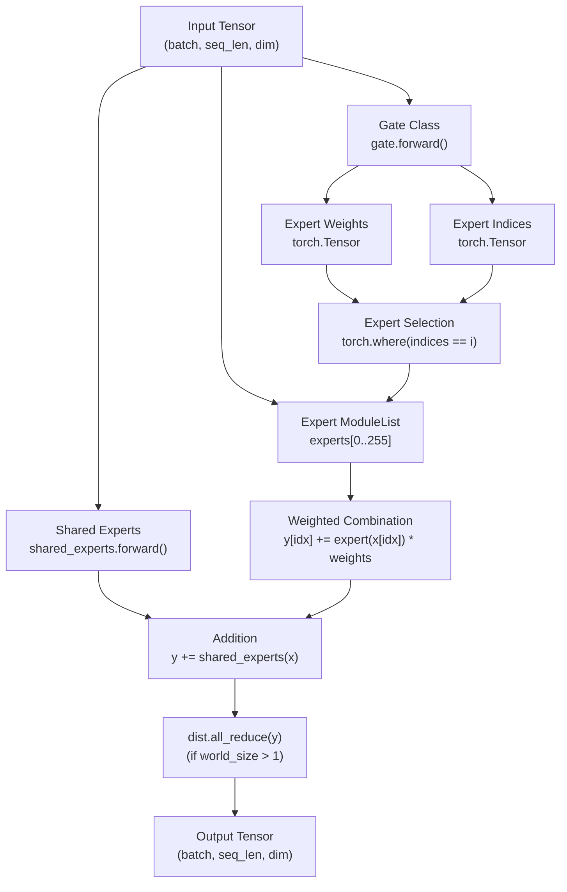
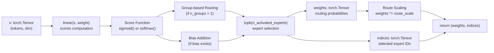
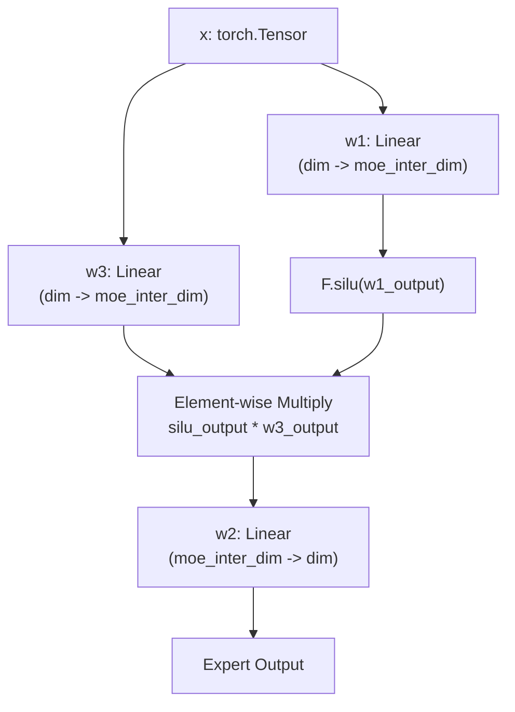
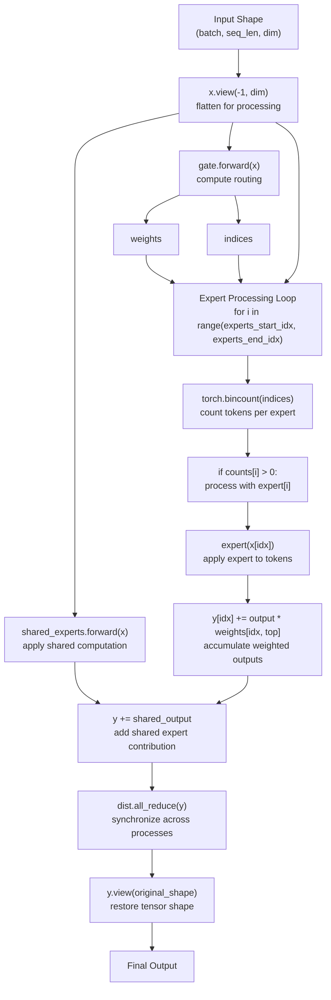
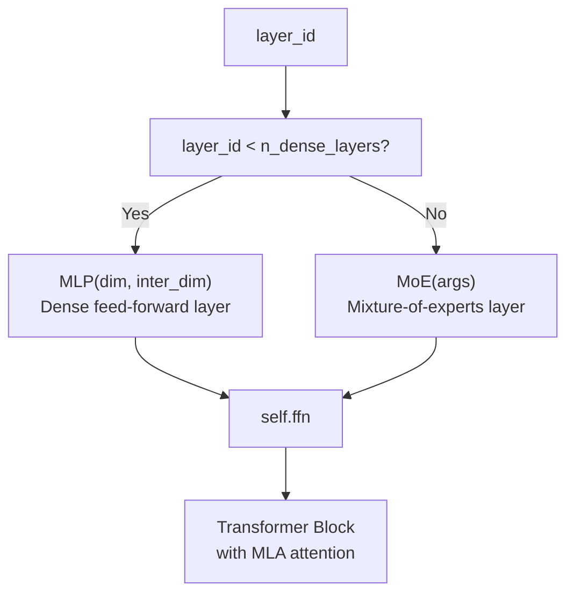

<!-- source: DeepWiki mcp.deepwiki.com · repo deepseek-ai/DeepSeek-V3.2-Exp · page 4.1 MoE Architecture Details · fetched 2026-10-30 -->

# MoE Architecture Details

Relevant source files

The following files were used as context for generating this wiki page:

- [DeepSeek_V3_2.pdf](DeepSeek_V3_2.pdf)
- [cost.jpg](cost.jpg)
- [inference/config_671B_v3.2.json](inference/config_671B_v3.2.json)
- [inference/model.py](inference/model.py)

## Purpose and Scope

This document provides detailed technical documentation of the Mixture-of-Experts (MoE) architecture implementation in DeepSeek-V3.2-Exp. It covers the expert routing mechanisms, individual expert implementations, and integration within the transformer architecture. For general system architecture information, see [System Architecture](#1.1). For quantization and performance optimization details, see [Quantization and Performance](#4.2).

The MoE architecture enables the 671B parameter model to achieve efficient inference by activating only 8 out of 256 experts per token, resulting in approximately 21B active parameters during forward passes while maintaining the full model capacity.

## MoE Architecture Overview

The MoE implementation consists of three primary components that work together to provide selective expert activation:

Sources: [inference/model.py:736-794]()

The architecture supports distributed execution where experts are sharded across multiple processes, with each process handling a subset of the 256 total experts.

## Expert Routing Mechanism

The `Gate` class implements the core routing logic that determines which experts process each input token:

Sources: [inference/model.py:635-699]()

### Key Routing Parameters

| Parameter | Configuration Value | Purpose |
|-----------|-------------------|---------|
| `n_routed_experts` | 256 | Total number of available experts |
| `n_activated_experts` | 8 | Number of experts activated per token |
| `n_expert_groups` | 8 | Number of expert groups for hierarchical routing |
| `n_limited_groups` | 4 | Number of groups that can be selected |
| `score_func` | "sigmoid" | Scoring function for expert selection |
| `route_scale` | 2.5 | Scaling factor applied to routing weights |

Sources: [inference/config_671B_v3.2.json:9-14]()

The gating mechanism supports hierarchical routing where experts are organized into groups, and the routing first selects which groups to activate before selecting individual experts within those groups.

## Individual Expert Implementation

Each expert is implemented as a standard MLP with SiLU activation:

Sources: [inference/model.py:701-734]()

### Expert Configuration

The expert architecture uses the following dimensions:
- Input/Output dimension: `dim` (7168 for 671B model)
- Intermediate dimension: `moe_inter_dim` (2048)
- Activation function: SiLU (Swish)

Sources: [inference/config_671B_v3.2.json:5,5](), [inference/model.py:710-722]()

## MoE Layer Integration

The `MoE` class orchestrates the complete mixture-of-experts computation:

Sources: [inference/model.py:769-794]()

### Distributed Expert Allocation

Each process in a distributed setup handles a contiguous range of experts:

| Process Rank | Expert Range | Total Experts per Process |
|-------------|--------------|--------------------------|
| 0 | 0-31 | 32 |
| 1 | 32-63 | 32 |
| ... | ... | ... |
| 7 | 224-255 | 32 |

Sources: [inference/model.py:758-766]()

The distributed implementation uses `torch.distributed.all_reduce` to combine outputs from experts across all processes.

## Shared Experts

In addition to routed experts, the MoE layer includes shared experts that process all input tokens:

- Number of shared experts: 1
- Shared expert architecture: Standard MLP with `n_shared_experts * moe_inter_dim` intermediate dimension
- The shared expert output is added to the routed expert outputs without weighting

Sources: [inference/config_671B_v3.2.json:10](), [inference/model.py:767,790]()

## Integration with Transformer Blocks

MoE layers are selectively integrated within the transformer architecture:

Sources: [inference/model.py:816](), [inference/config_671B_v3.2.json:7]()

The first 3 layers use dense MLP layers (`n_dense_layers: 3`), while the remaining 58 layers use MoE for scalable capacity expansion.

## Performance Characteristics

The MoE architecture achieves efficiency through:

- **Sparse Activation**: Only 8/256 experts active per token (3.125% expert utilization)
- **Parameter Efficiency**: 21B active parameters from 671B total parameters
- **Load Balancing**: Hierarchical routing with group-based constraints prevents expert over-concentration
- **Distributed Scaling**: Expert parallelism across multiple GPUs/nodes

Sources: [inference/config_671B_v3.2.json:9,11]()

The sigmoid scoring function and route scaling factor (2.5) help maintain balanced expert utilization across different input distributions.

---

