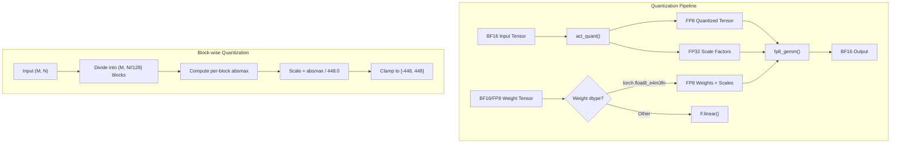
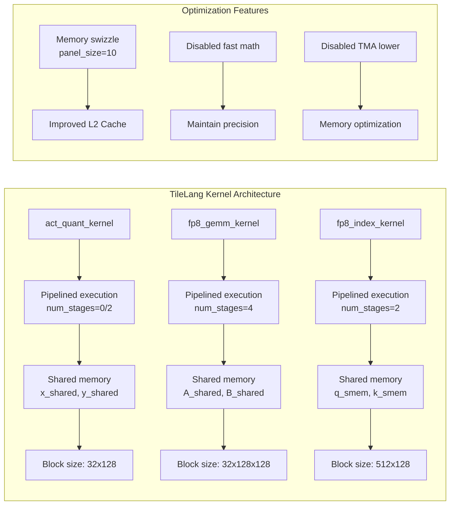
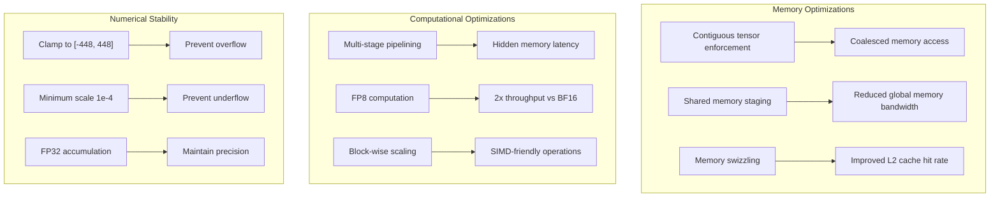
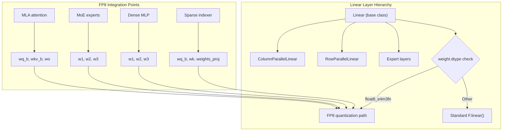

<!-- source: DeepWiki mcp.deepwiki.com · repo deepseek-ai/DeepSeek-V3.2-Exp · page 4.2 Quantization and Performance · fetched 2026-10-30 -->

# Quantization and Performance

Relevant source files

The following files were used as context for generating this wiki page:

- [inference/kernel.py](inference/kernel.py)
- [inference/model.py](inference/model.py)

This document covers the FP8 quantization strategy and performance optimizations implemented in DeepSeek-V3.2-Exp. It details the block-wise quantization approach, TileLang kernel implementations, and their integration with the transformer architecture to achieve efficient inference at scale.

For information about the overall model architecture and MoE design, see [MoE Architecture Details](#4.1). For deployment considerations and operational costs, see [Cost Analysis](#4.3).

## FP8 Quantization Strategy

DeepSeek-V3.2-Exp implements a sophisticated FP8 quantization system using block-wise quantization with a default block size of 128 elements. The quantization strategy operates on activations and weights to reduce memory bandwidth and computational requirements while maintaining model quality.

The quantization process uses the `float8_e4m3` format with a maximum representable value of 448.0. Each block of 128 elements shares a single FP32 scaling factor, computed as the absolute maximum divided by the FP8 maximum value.

Sources: [inference/kernel.py:15-17](), [inference/kernel.py:87-111](), [inference/model.py:135-165]()

## TileLang Kernel Implementation

The quantization kernels are implemented using TileLang, a GPU kernel development framework that provides just-in-time compilation and optimization. Three core kernels handle the quantization operations:

### Activation Quantization Kernel

The `act_quant_kernel` performs block-wise quantization of activations with configurable rounding strategies:

- **Block processing**: 32x128 thread blocks with 128 threads per block
- **Scale computation**: Per-block absolute maximum with optional rounding to power-of-2
- **Memory pattern**: Pipelined loads with shared memory staging

Sources: [inference/kernel.py:36-84]()

### FP8 GEMM Kernel

The `fp8_gemm_kernel` implements matrix multiplication between FP8 tensors with scaling factor integration:

- **Block dimensions**: 32x128x128 for optimal memory coalescing
- **Pipeline depth**: 4 stages for hiding memory latency
- **Scale handling**: Dynamic scale multiplication during accumulation
- **Memory optimization**: L2 cache swizzling with panel size 10

Sources: [inference/kernel.py:114-168]()

### FP8 Index Kernel

The `fp8_index_kernel` computes attention scores for the sparse attention indexer:

- **Two-level blocking**: 512x128 outer/inner block structure  
- **Score computation**: FP8 Q×K multiplication with scale application
- **Reduction**: Sum reduction across attention heads

Sources: [inference/kernel.py:199-274]()

## Performance Optimizations

The quantization system incorporates several performance optimizations to maximize throughput while maintaining numerical stability:

### Memory Access Patterns

The kernels enforce strict memory layout requirements to ensure optimal performance:

- **Contiguous tensors**: All input tensors must be contiguous in memory
- **Block alignment**: Input dimensions must be divisible by block size (128)
- **Coalesced access**: Memory access patterns optimized for GPU architectures

Sources: [inference/kernel.py:102-105](), [inference/kernel.py:186-189]()

### Scale Format Options

The quantization system supports different scale formats controlled by the `scale_fmt` parameter:

- **Standard scaling**: `scale = absmax / fp8_max`
- **Rounded scaling**: `scale = round_to_power_of_2(absmax / fp8_max)` for hardware efficiency

Sources: [inference/kernel.py:71-74]()

## Model Integration

The quantization system integrates seamlessly with the transformer architecture through the `linear` function and `Linear` class hierarchy:

### Runtime Weight Detection

The system automatically detects FP8 weights at runtime and routes to appropriate execution paths:

- **Element size check**: `weight.element_size() == 1` indicates FP8 format
- **Scale parameter**: FP8 weights include associated scale tensors
- **Fallback handling**: Non-FP8 weights use standard PyTorch operations

Sources: [inference/model.py:160-164]()

### Distributed Quantization

Quantization works seamlessly with the model's distributed execution:

- **Column parallel**: Output features distributed across processes
- **Row parallel**: Input features distributed with all-reduce on outputs  
- **Scale synchronization**: Scaling factors properly handled in distributed context

Sources: [inference/model.py:209-270]()

## Performance Characteristics

The FP8 quantization system delivers significant performance improvements while maintaining model quality:

| Operation | Memory Reduction | Compute Throughput | Numerical Impact |
|-----------|-----------------|-------------------|------------------|
| Activation Quantization | 50% (BF16→FP8) | 2x matrix multiply | Minimal with proper scaling |
| Weight Storage | 50% (BF16→FP8) | 2x bandwidth savings | Block-wise scaling maintains precision |
| Attention Indexing | 50% score computation | 2x attention scoring | ReLU clamping preserves sparsity |

### Block Size Considerations

The default block size of 128 elements balances several factors:

- **Hardware alignment**: Matches GPU warp/wavefront sizes
- **Scale granularity**: Sufficient for maintaining numerical precision
- **Memory efficiency**: Minimizes scale tensor overhead

Sources: [inference/model.py:16](), [inference/kernel.py:46](), [inference/kernel.py:119]()

### TileLang JIT Compilation

The TileLang kernels provide runtime optimization advantages:

- **Just-in-time compilation**: Kernels optimized for specific tensor shapes
- **Pass configuration**: Disabled optimizations that could affect numerical stability
- **GPU-specific tuning**: Optimized for target hardware architectures

Sources: [inference/kernel.py:9-13](), [inference/kernel.py:36]()

---

