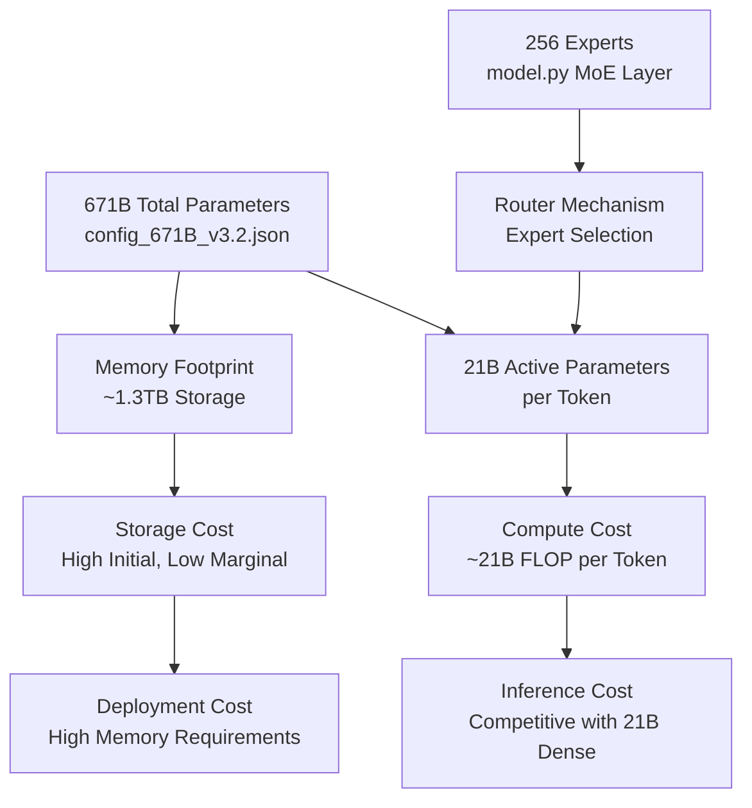
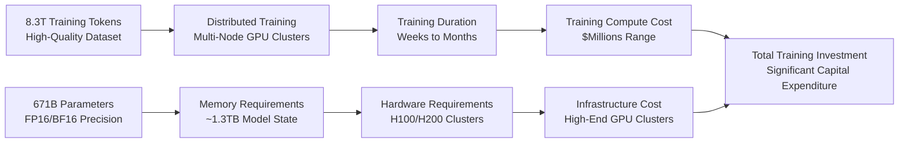
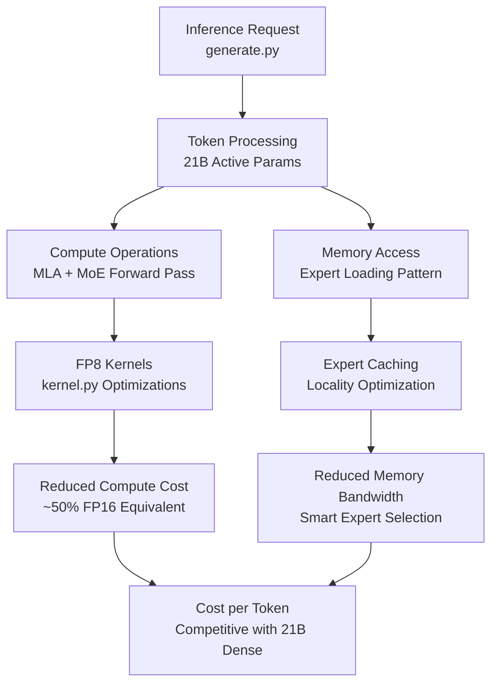
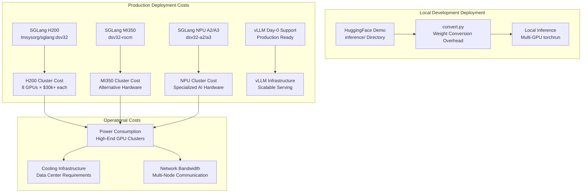
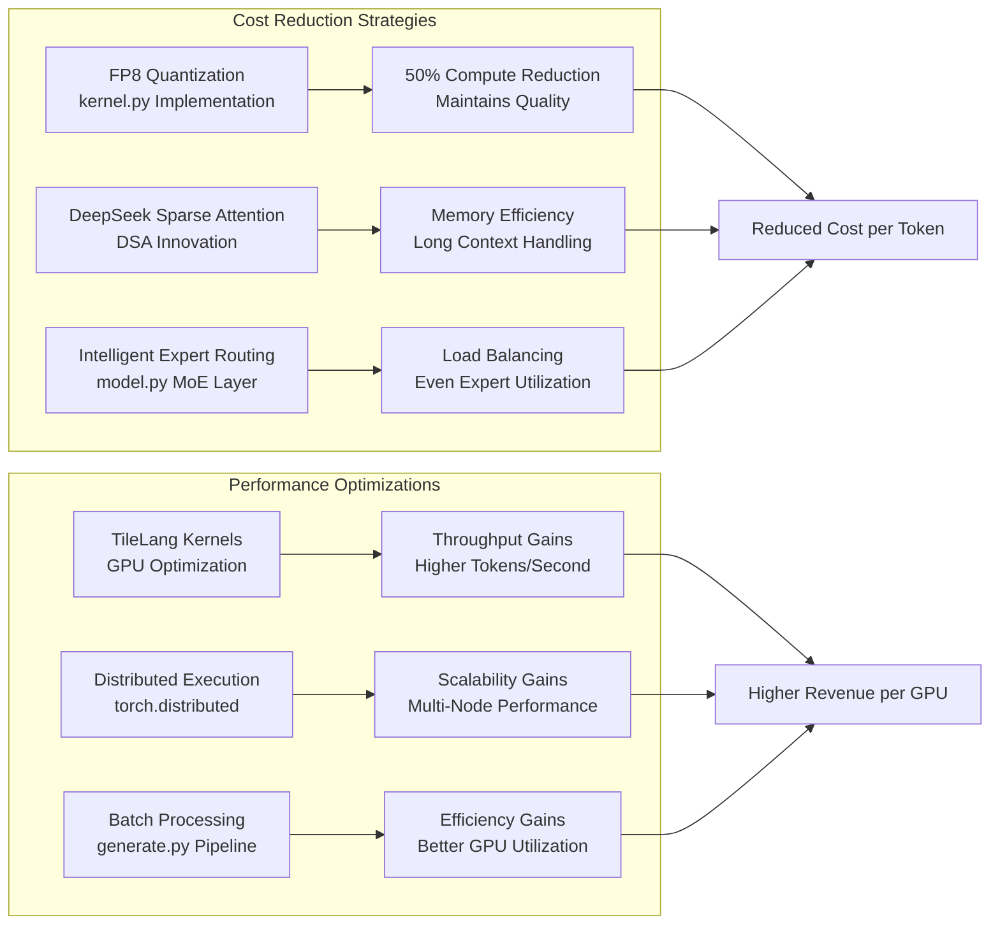

<!-- source: DeepWiki mcp.deepwiki.com · repo deepseek-ai/DeepSeek-V3.2-Exp · page 4.3 Cost Analysis · fetched 2026-10-30 -->

# Cost Analysis

Relevant source files

The following files were used as context for generating this wiki page:

- [DeepSeek_V3_2.pdf](DeepSeek_V3_2.pdf)
- [cost.jpg](cost.jpg)

This document examines the economic implications of the DeepSeek-V3.2-Exp MoE architecture, analyzing training costs versus inference efficiency, and providing operational cost considerations for deployment scenarios. The analysis covers the cost model of the 671B parameter architecture with sparse activation patterns, deployment cost factors across different hardware platforms, and trade-offs between computational efficiency and resource utilization.

For detailed technical specifications of the MoE architecture, see [MoE Architecture Details](#4.1). For performance optimization details, see [Quantization and Performance](#4.2).

## MoE Architecture Cost Model

The DeepSeek-V3.2-Exp employs a Mixture-of-Experts architecture that fundamentally changes the cost equation compared to dense models. The model contains 671B total parameters but activates only a subset during inference, creating a complex cost profile.

### Parameter Efficiency Economics

**Cost Model Components**

| Component | Dense 21B Model | DeepSeek-V3.2-Exp | Cost Ratio |
|-----------|----------------|-------------------|------------|
| Active Parameters | 21B | 21B | 1:1 |
| Total Parameters | 21B | 671B | 1:32 |
| Compute per Token | ~21B FLOP | ~21B FLOP | 1:1 |
| Memory Footprint | ~42GB | ~1.3TB | 1:31 |
| Storage Requirements | ~42GB | ~1.3TB | 1:31 |

The MoE architecture achieves compute efficiency through sparse activation while requiring significantly higher memory and storage capacity.

Sources: config_671B_v3.2.json, model.py

## Training Cost Analysis

The training phase represents the most significant upfront cost investment, with the model trained on 8.3 trillion tokens using distributed infrastructure.

### Training Infrastructure Requirements

**Training Cost Factors**

- **Compute Hours**: 8.3T tokens × 671B parameters requires massive computational resources
- **Hardware Utilization**: Multi-node GPU clusters with high-bandwidth interconnect
- **Power Consumption**: Sustained high-power draw over extended training periods
- **Data Pipeline**: Preprocessing and streaming 8.3T tokens efficiently
- **Checkpointing**: Regular model state saves consuming additional storage

The training cost is amortized across the model's operational lifetime, making inference efficiency critical for ROI.

Sources: README.md, DeepSeek_V3_2.pdf

## Inference Cost Analysis

Inference costs determine the operational viability of the model in production environments. The MoE architecture provides favorable cost characteristics for high-throughput scenarios.

### Inference Cost Breakdown

**Per-Token Cost Components**

| Cost Factor | Impact | Optimization |
|-------------|--------|--------------|
| Compute FLOP | 21B operations | FP8 quantization in `kernel.py` |
| Memory Bandwidth | Expert loading | Smart caching and routing |
| Expert Selection | Router overhead | Optimized routing algorithms |
| Quantization | Reduced precision | Block-wise FP8 in `kernel.py` |

The sparse activation pattern means inference costs scale with active parameters (21B) rather than total parameters (671B), providing significant cost advantages at scale.

Sources: generate.py, kernel.py, model.py

## Deployment Cost Considerations

Deployment costs vary significantly across different platforms and hardware configurations, with distinct cost profiles for each deployment strategy.

### Multi-Platform Deployment Costs

**Hardware Platform Cost Analysis**

| Platform | Initial Hardware Cost | Operational Cost/Month | Use Case |
|----------|----------------------|----------------------|----------|
| H200 × 8 | $240k+ | $3k-5k power | High-performance serving |
| MI350 × 8 | $200k+ | $2.5k-4k power | AMD ROCm ecosystem |
| NPU A2/A3 × 8 | Variable | Lower power | Specialized AI workloads |
| Local Development | $20k-40k | $200-500 power | Development/testing |

The choice of deployment platform significantly impacts both capital expenditure and operational costs.

Sources: SGLang Docker configurations, vLLM recipes

## Cost-Performance Trade-offs

The DeepSeek-V3.2-Exp architecture embodies several key trade-offs that impact total cost of ownership.

### Economic Optimization Strategies

**ROI Optimization Factors**

1. **Quantization Benefits**: FP8 kernels reduce compute costs by ~50% while maintaining model quality
2. **Sparse Activation**: Only 21B of 671B parameters active, reducing per-token compute cost
3. **Expert Efficiency**: Well-balanced expert routing maximizes hardware utilization
4. **Batch Processing**: Higher throughput through efficient batching strategies

The model's architecture prioritizes inference efficiency over training efficiency, making it suitable for high-volume production deployments where inference costs dominate total cost of ownership.

Sources: kernel.py, model.py, config_671B_v3.2.json

## Operational Cost Summary

The DeepSeek-V3.2-Exp represents a strategic investment in inference efficiency at the cost of higher initial capital requirements. The MoE architecture provides compelling economics for scenarios requiring high-quality language understanding at scale, where the amortized training costs and inference efficiency create favorable unit economics compared to dense model alternatives.

Key economic advantages include competitive per-token inference costs despite the large parameter count, efficient hardware utilization through sparse activation, and multiple deployment options accommodating different cost constraints and performance requirements.

Sources: cost.jpg, README.md, deployment configurations