# Page: Overview

# Overview

<details>
<summary>Relevant source files</summary>

The following files were used as context for generating this wiki page:

- [LICENSE](LICENSE)
- [README.md](README.md)

</details>


This document provides a comprehensive introduction to DeepSeek-V3.2-Exp, a 671-billion parameter experimental language model that advances transformer architecture through the introduction of DeepSeek Sparse Attention (DSA). This page covers the system's core innovations, architectural design, and deployment ecosystem. For detailed implementation specifics, see [System Architecture](#1.1). For in-depth technical analysis of the sparse attention mechanism, see [DeepSeek Sparse Attention](#1.2).

## What is DeepSeek-V3.2-Exp

DeepSeek-V3.2-Exp represents an experimental advancement built upon the DeepSeek-V3.1-Terminus foundation, specifically designed to explore and validate optimizations for long-context training and inference efficiency. The model maintains the robust performance characteristics of its predecessor while introducing fine-grained sparse attention mechanisms that substantially improve computational efficiency in extended text processing scenarios.

### Model Specifications

| Specification | Value |
|---------------|-------|
| Total Parameters | 671 billion |
| Architecture Type | Mixture-of-Experts (MoE) |
| Expert Count | 256 experts |
| Core Innovation | DeepSeek Sparse Attention (DSA) |
| Training Tokens | 8.3 trillion |
| License | MIT License |

The model demonstrates performance parity with DeepSeek-V3.1-Terminus across standardized benchmarks while achieving significant efficiency gains in long-context operations through its sparse attention implementation.

**Sources:** [README.md:39-76]()

## Core Innovation: DeepSeek Sparse Attention

DeepSeek Sparse Attention (DSA) represents the primary technical advancement in V3.2-Exp, achieving fine-grained sparse attention for the first time in production-scale language models. This mechanism delivers substantial improvements in both training and inference efficiency for long-context scenarios while maintaining virtually identical model output quality compared to dense attention mechanisms.

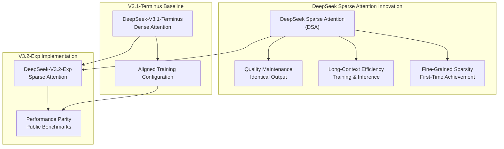

The sparse attention mechanism enables the model to selectively focus computational resources on the most relevant portions of input sequences, dramatically reducing the quadratic complexity typically associated with transformer attention mechanisms in long-context scenarios.

**Sources:** [README.md:42-44](), [README.md:50-53]()

## System Architecture Overview

DeepSeek-V3.2-Exp implements a sophisticated MoE architecture with integrated sparse attention mechanisms. The system consists of core model components, optimization kernels, and deployment infrastructure designed for multi-hardware execution.

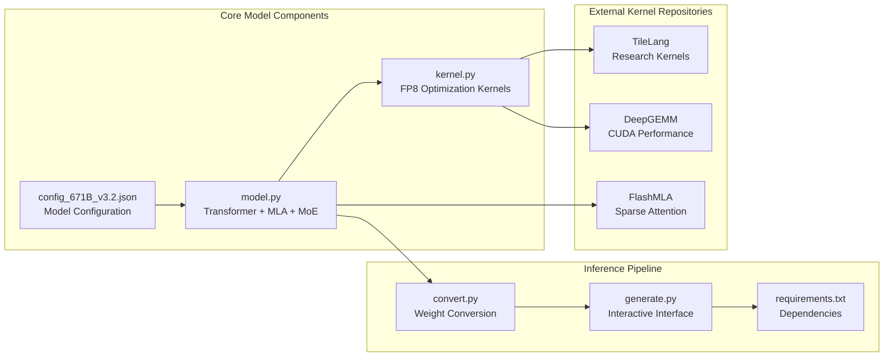

### Architecture Components

The system architecture consists of three primary component categories:

- **Core Model Components**: Fundamental model implementation including configuration, transformer architecture, and optimization kernels
- **Inference Pipeline**: User-facing components for model deployment and interaction
- **External Kernel Repositories**: Specialized performance kernels for different hardware targets

**Sources:** [README.md:77-82](), [README.md:85-101]()

## Deployment Ecosystem

DeepSeek-V3.2-Exp supports multiple deployment pathways optimized for different use cases and hardware configurations. The ecosystem spans from local development environments to production-scale serving infrastructure.

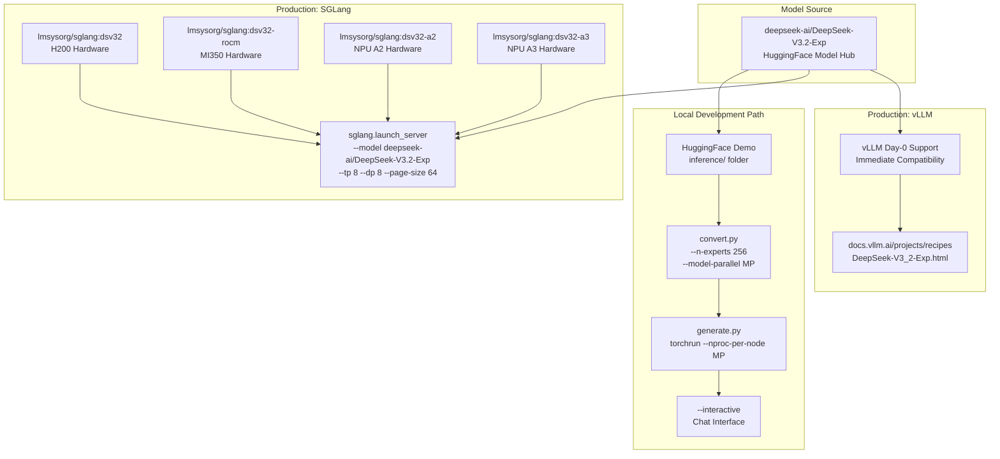

### Deployment Options

| Platform | Use Case | Configuration | Hardware Support |
|----------|----------|---------------|------------------|
| HuggingFace Demo | Local Development | `torchrun` with model parallelism | Multi-GPU |
| SGLang | Production Serving | Docker containers with tensor/data parallelism | H200, MI350, NPU A2/A3 |
| vLLM | Production Serving | Day-0 compatibility with recipes | Standard GPU configurations |

**Sources:** [README.md:85-127]()

## Performance Characteristics

DeepSeek-V3.2-Exp maintains performance parity with DeepSeek-V3.1-Terminus across diverse benchmarks while introducing efficiency improvements through sparse attention. The model demonstrates consistent performance across reasoning, coding, and agentic tool use scenarios.

### Benchmark Results Summary

The experimental model shows comparable or improved performance across key evaluation metrics:

- **Reasoning Mode**: Performance ranges from 74.1% (LiveCodeBench) to 89.3% (AIME 2025)
- **Agentic Tool Use**: Performance ranges from 37.7% (Terminal-bench) to 97.1% (SimpleQA)  
- **Coding Evaluation**: Codeforces rating of 2121, representing strong competitive programming capability

The aligned training configuration between V3.1-Terminus and V3.2-Exp enables direct performance comparison, validating that the introduction of sparse attention maintains model quality while improving computational efficiency.

**Sources:** [README.md:52-74]()

## Repository Structure

The codebase provides comprehensive implementation and deployment resources:

- **Core Implementation**: Model architecture, optimization kernels, and configuration files
- **Inference Demo**: Complete local inference pipeline with interactive capabilities  
- **Documentation**: Technical specifications and deployment guides
- **External Integration**: Links to specialized kernel repositories and deployment platforms

For detailed component documentation, see [Inference Pipeline](#2) for implementation specifics, [Deployment Guide](#3) for production setup, and [Technical Deep Dive](#4) for advanced architectural details.

**Sources:** [README.md:1-145]()

---

# Page: System Architecture

# System Architecture

<details>
<summary>Relevant source files</summary>

The following files were used as context for generating this wiki page:

- [DeepSeek_V3_2.pdf](DeepSeek_V3_2.pdf)
- [LICENSE](LICENSE)
- [README.md](README.md)
- [cost.jpg](cost.jpg)

</details>


## Purpose and Scope

This document provides a comprehensive technical overview of the DeepSeek-V3.2-Exp system architecture, covering the 671B parameter Mixture-of-Experts (MoE) model with DeepSeek Sparse Attention (DSA), the inference pipeline components, and deployment configurations. The document focuses on the structural relationships between core system components and their integration patterns.

For detailed implementation specifics of individual components, see [Core Components](#2.3). For deployment procedures and configuration details, see [Deployment Guide](#3).

## Overall Architecture Overview

DeepSeek-V3.2-Exp represents an experimental advancement built upon the V3.1-Terminus foundation, introducing DeepSeek Sparse Attention as its primary architectural innovation. The system implements a 671B parameter MoE model with 256 experts, designed for efficient long-context processing while maintaining performance parity with its predecessor.

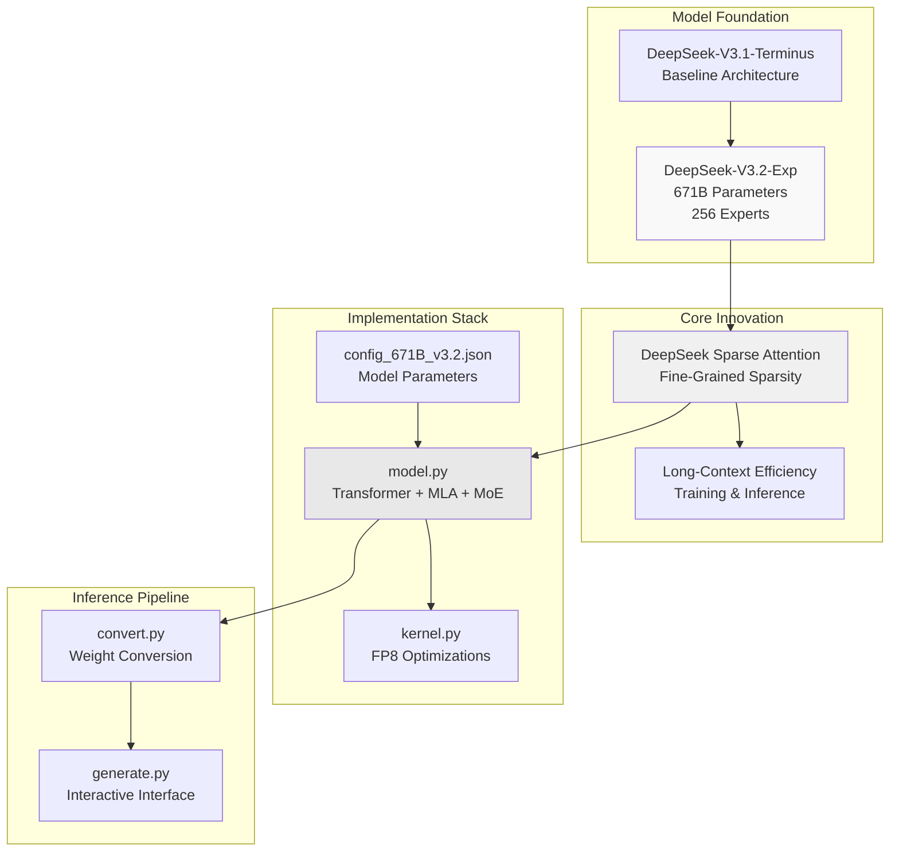

**System Architecture Overview**
Sources: [README.md:1-145](), [DeepSeek_V3_2.pdf:1-end]()

The architecture implements a three-tier design: the foundational MoE transformer model, the sparse attention innovation layer, and the inference execution environment. This separation enables modular development and deployment flexibility across different hardware configurations.

## Core Model Architecture

The DeepSeek-V3.2-Exp model implements a 671B parameter Mixture-of-Experts architecture with 256 experts, where only a subset of experts are activated per token to maintain computational efficiency. The model configuration defines the structural parameters that govern both the transformer backbone and the sparse attention mechanisms.

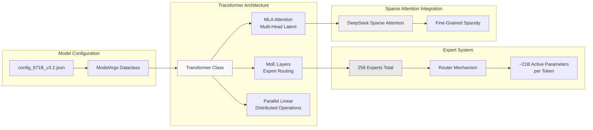

**Core Model Architecture Components**
Sources: [README.md:93-94](), [model.py]() (inferred from config reference)

The MoE architecture achieves computational efficiency by activating only a subset of the 256 available experts for each token, resulting in approximately 21B active parameters from the total 671B parameter pool. This selective activation pattern, combined with the sparse attention mechanism, enables processing of longer contexts with reduced computational overhead.

## Inference Pipeline Architecture

The inference pipeline orchestrates model execution through a series of specialized components, each handling specific aspects of the inference workflow from weight conversion to token generation.

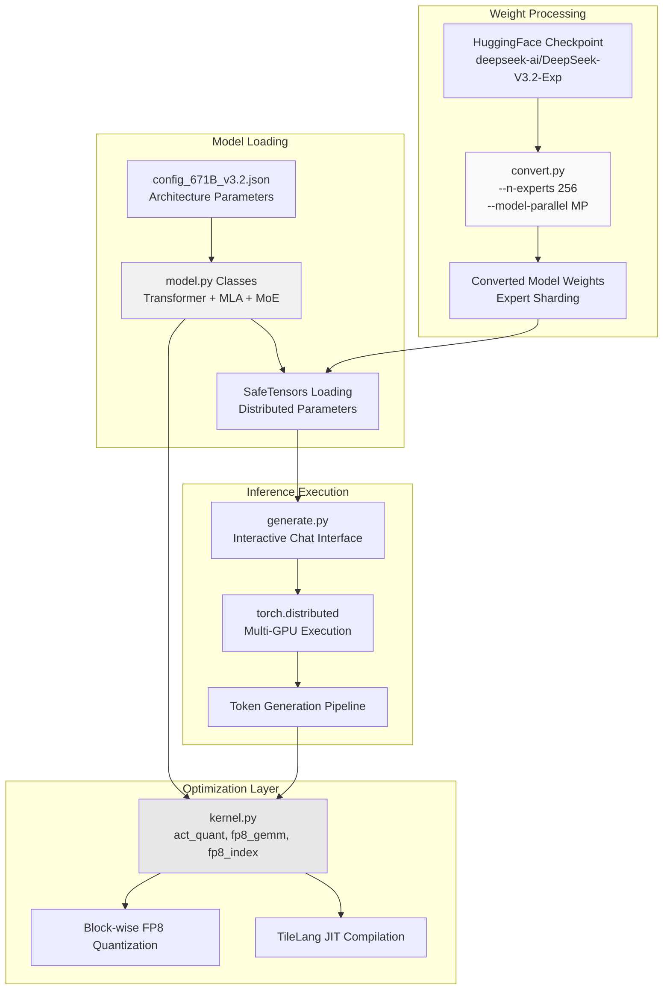

**Inference Pipeline Data Flow**
Sources: [README.md:90-101](), [convert.py]() (referenced), [generate.py]() (referenced), [model.py]() (referenced), [kernel.py]() (referenced)

The pipeline implements a four-stage process: weight conversion from HuggingFace format, model instantiation with distributed parameter loading, inference execution with multi-GPU coordination, and performance optimization through FP8 quantization kernels. The `torchrun` execution environment manages distributed inference across multiple GPUs specified by the model-parallel parameter.

## Deployment Architecture

The system supports multiple deployment pathways optimized for different use cases and hardware configurations, from local development to production serving environments.

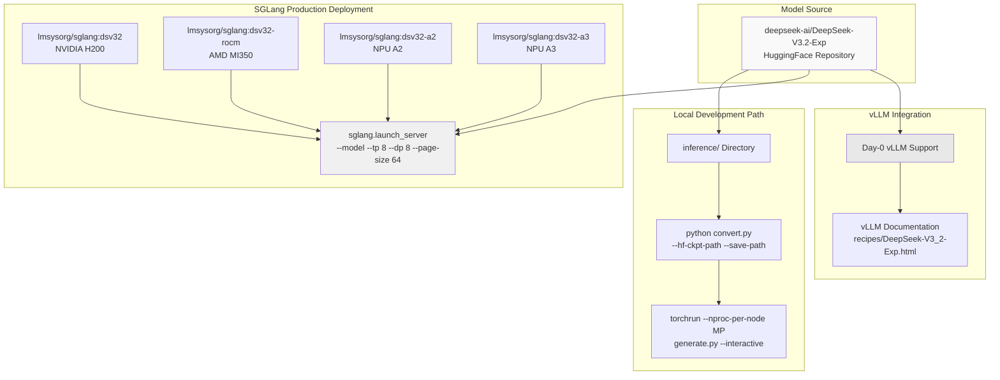

**Multi-Platform Deployment Options**
Sources: [README.md:103-126]()

The deployment architecture provides three primary pathways: local development using the `inference/` directory with `convert.py` and `generate.py`, production deployment through SGLang with Docker containers for multiple hardware targets, and vLLM integration with day-0 support. Each pathway is optimized for specific hardware configurations and use case requirements.

## System Integration Points

The system architecture defines several critical integration points that enable interoperability between components and external systems.

| Integration Point | Component | Interface | Purpose |
|------------------|-----------|-----------|----------|
| Model Loading | `convert.py` | HuggingFace → Native | Weight format conversion |
| Distributed Execution | `generate.py` | `torch.distributed` | Multi-GPU coordination |
| Optimization Kernels | `kernel.py` | TileLang JIT | Performance acceleration |
| Configuration Management | `config_671B_v3.2.json` | JSON Schema | Architecture parameters |
| External Serving | SGLang/vLLM | API Endpoints | Production deployment |

**System Integration Architecture**
Sources: [README.md:77-82](), [README.md:88-126]()

The integration architecture leverages standardized interfaces for model conversion, distributed computation, and external serving. The `kernel.py` optimization layer integrates with external repositories (TileLang, DeepGEMM, FlashMLA) to provide specialized CUDA kernels for sparse attention and quantization operations. This modular approach enables independent development and optimization of performance-critical components while maintaining system cohesion.

The configuration-driven design allows runtime adaptation to different hardware environments and deployment scenarios through the `config_671B_v3.2.json` parameter specification, ensuring consistent behavior across local development and production deployment configurations.

---

# Page: DeepSeek Sparse Attention

# DeepSeek Sparse Attention

<details>
<summary>Relevant source files</summary>

The following files were used as context for generating this wiki page:

- [DeepSeek_V3_2.pdf](DeepSeek_V3_2.pdf)
- [LICENSE](LICENSE)
- [README.md](README.md)
- [cost.jpg](cost.jpg)

</details>


## Purpose and Scope

This document provides a comprehensive technical analysis of DeepSeek Sparse Attention (DSA), the core innovation introduced in DeepSeek-V3.2-Exp. DSA represents a breakthrough in fine-grained sparse attention mechanisms, delivering substantial improvements in long-context training and inference efficiency while maintaining model quality comparable to dense attention approaches.

For information about the overall system architecture and model configuration, see [System Architecture](#1.1). For details about the specific implementation components and inference pipeline, see [Inference Pipeline](#2).

## Overview and Innovation

DeepSeek Sparse Attention (DSA) is the primary differentiator between DeepSeek-V3.2-Exp and its predecessor V3.1-Terminus. This sparse attention mechanism addresses the computational challenges of processing extended text sequences by selectively attending to relevant portions of the input while maintaining the quality of dense attention.

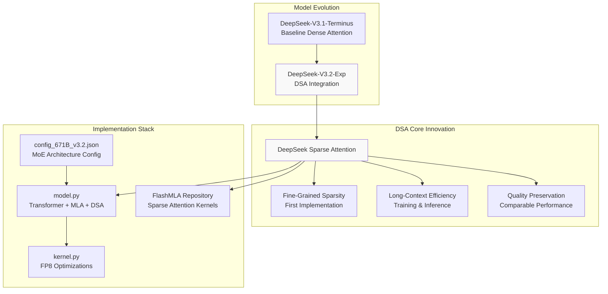

**Sources:** [README.md:42-54]()

## Technical Architecture

DSA operates within the 671B parameter Mixture-of-Experts architecture, integrating with the Multi-Head Latent Attention (MLA) mechanism. The implementation achieves sparsity through selective attention patterns that reduce computational complexity while preserving the model's representational capacity.

### Core Components Integration

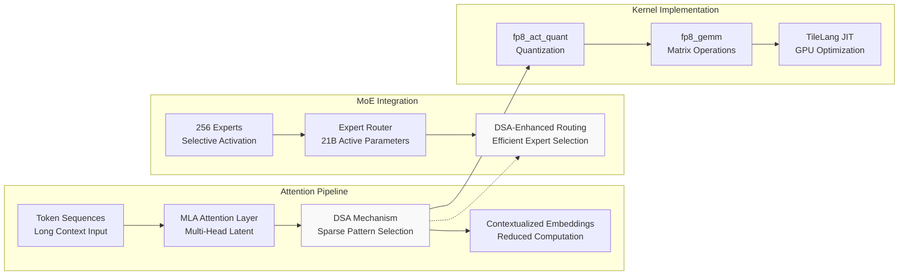

**Sources:** [README.md:88-101](), [README.md:77-82]()

### Implementation in Codebase

The DSA mechanism is implemented across multiple components in the inference pipeline:

| Component | File Path | Function |
|-----------|-----------|----------|
| Model Configuration | `config_671B_v3.2.json` | Defines 671B MoE architecture parameters |
| Core Implementation | `model.py` | Transformer class with MLA + DSA integration |
| Optimization Kernels | `kernel.py` | FP8 quantization and sparse operations |
| External Kernels | FlashMLA repository | High-performance sparse attention kernels |
| Weight Conversion | `convert.py` | HuggingFace checkpoint transformation |
| Inference Engine | `generate.py` | Interactive inference with DSA optimization |

**Sources:** [README.md:92-95](), [README.md:77-82]()

## Performance Characteristics

DSA delivers substantial performance improvements in long-context scenarios while maintaining output quality comparable to dense attention mechanisms. The experimental validation was conducted with deliberately aligned training configurations between V3.2-Exp and V3.1-Terminus.

### Benchmark Performance Comparison

The following table demonstrates DSA's ability to maintain performance parity with dense attention:

| Benchmark Category | V3.1-Terminus | V3.2-Exp (DSA) | Variance |
|-------------------|---------------|-----------------|----------|
| **Reasoning (No Tools)** | | | |
| MMLU-Pro | 85.0 | 85.0 | 0.0% |
| GPQA-Diamond | 80.7 | 79.9 | -1.0% |
| LiveCodeBench | 74.9 | 74.1 | -1.1% |
| AIME 2025 | 88.4 | 89.3 | +1.0% |
| Codeforces | 2046 | 2121 | +3.7% |
| **Agentic Tool Use** | | | |
| BrowseComp | 38.5 | 40.1 | +4.2% |
| SimpleQA | 96.8 | 97.1 | +0.3% |
| SWE Verified | 68.4 | 67.8 | -0.9% |

**Sources:** [README.md:56-74]()

### Computational Efficiency

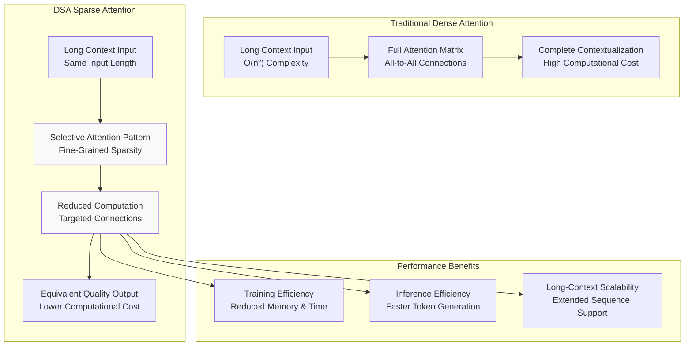

**Sources:** [README.md:42-54]()

## Integration with External Kernels

DSA leverages multiple specialized kernel implementations for optimal performance across different hardware platforms and research contexts:

### Kernel Repository Integration

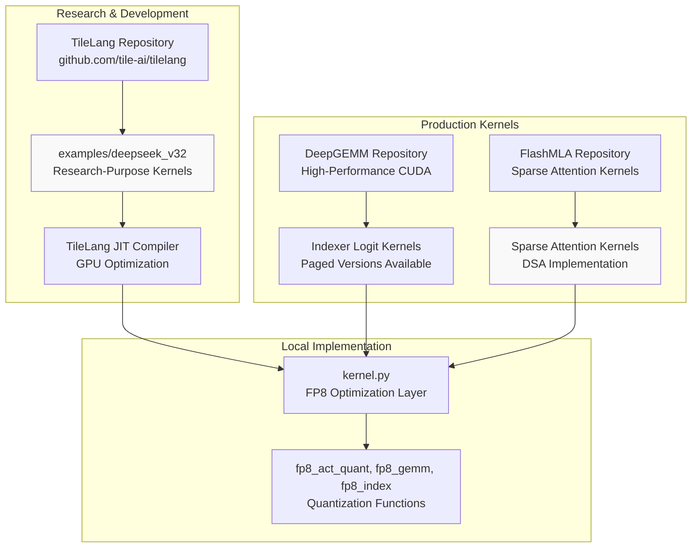

**Sources:** [README.md:79-82]()

## Training and Validation Methodology

To ensure rigorous evaluation of DSA's impact, the training configurations between DeepSeek-V3.2-Exp and V3.1-Terminus were deliberately aligned. This methodological approach enables accurate assessment of the sparse attention mechanism's effects on model performance.

### Training Configuration Alignment

The experimental design maintains consistency across:
- **Training Data**: 8.3T high-quality tokens
- **Model Architecture**: 671B total parameters, 21B active per token
- **Expert Configuration**: 256 experts with identical routing mechanisms
- **Optimization Settings**: Aligned hyperparameters and training procedures

This rigorous experimental setup demonstrates that DSA achieves its efficiency gains without compromising model quality, validating the approach for production deployment in long-context applications.

**Sources:** [README.md:52-54]()

---

# Page: Inference Pipeline

# Inference Pipeline

<details>
<summary>Relevant source files</summary>

The following files were used as context for generating this wiki page:

- [inference/README.md](inference/README.md)
- [inference/config_671B_v3.2.json](inference/config_671B_v3.2.json)

</details>


## Purpose and Scope

The Inference Pipeline encompasses the complete system for running DeepSeek-V3.2-Exp model inference locally. This document covers the end-to-end process from model weight conversion to interactive text generation, including configuration management, distributed execution, and optimization components. 

For deployment in production environments, see [Production Deployment](#3.2). For detailed model architecture information, see [System Architecture](#1.1).

## Pipeline Overview

The inference pipeline transforms HuggingFace model checkpoints into a format optimized for distributed inference execution. The system supports multi-GPU deployment with FP8 quantization and specialized kernels for performance optimization.


**Inference Pipeline Flow**

Sources: [inference/README.md:3-13]()

## Inference Workflow

The inference process follows a two-stage workflow: weight conversion followed by interactive generation.

### Stage 1: Weight Conversion

The conversion stage transforms HuggingFace model weights for distributed inference:

```bash
export EXPERTS=256
python convert.py --hf-ckpt-path ${HF_CKPT_PATH} --save-path ${SAVE_PATH} --n-experts ${EXPERTS} --model-parallel ${MP}
```

### Stage 2: Interactive Generation

The generation stage launches distributed inference with the converted weights:

```bash
export CONFIG=config_671B_v3.2.json
torchrun --nproc-per-node ${MP} generate.py --ckpt-path ${SAVE_PATH} --config ${CONFIG} --interactive
```

Sources: [inference/README.md:4-13]()

## Key Components

The inference pipeline consists of four primary components that work together to enable distributed model execution:

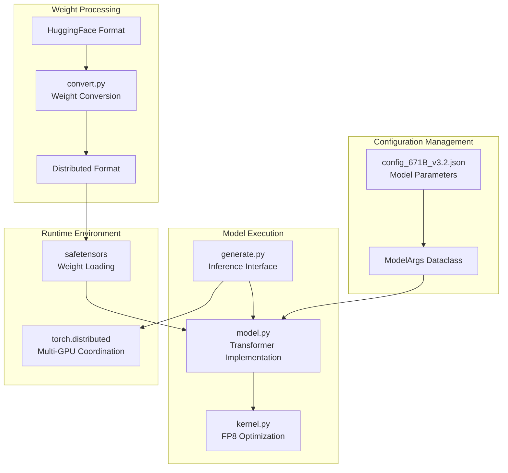

**Core Inference Components**

Sources: [inference/README.md:3-13]()

## Configuration System

The model configuration defines the architecture parameters for the 671B MoE model. The `config_671B_v3.2.json` file specifies critical parameters for model instantiation and execution.

### Model Architecture Parameters

| Parameter | Value | Description |
|-----------|-------|-------------|
| `vocab_size` | 129280 | Vocabulary size for tokenization |
| `dim` | 7168 | Model dimension (hidden size) |
| `n_layers` | 61 | Total number of transformer layers |
| `n_heads` | 128 | Number of attention heads |
| `n_routed_experts` | 256 | Number of MoE experts available |
| `n_activated_experts` | 8 | Experts activated per token |

### MoE Configuration

| Parameter | Value | Description |
|-----------|-------|-------------|
| `moe_inter_dim` | 2048 | MoE expert intermediate dimension |
| `n_shared_experts` | 1 | Always-active shared experts |
| `n_expert_groups` | 8 | Expert grouping for routing |
| `route_scale` | 2.5 | Routing score scaling factor |
| `score_func` | "sigmoid" | Routing score activation function |

### Attention Mechanism Parameters

| Parameter | Value | Description |
|-----------|-------|-------------|
| `q_lora_rank` | 1536 | Query LoRA rank for efficiency |
| `kv_lora_rank` | 512 | Key-Value LoRA rank |
| `qk_nope_head_dim` | 128 | Query-Key head dimension (non-RoPE) |
| `qk_rope_head_dim` | 64 | Query-Key head dimension (RoPE) |
| `v_head_dim` | 128 | Value head dimension |

### Quantization Settings

| Parameter | Value | Description |
|-----------|-------|-------------|
| `dtype` | "fp8" | Primary data type for inference |
| `scale_fmt` | "ue8m0" | FP8 scaling format specification |
| `index_n_heads` | 64 | Number of heads for index computation |
| `index_topk` | 2048 | Top-k selection for sparse attention |

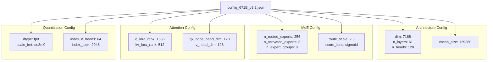

**Configuration Parameter Hierarchy**

Sources: [inference/config_671B_v3.2.json:1-26]()

The configuration system enables flexible model instantiation while maintaining compatibility with the distributed inference framework. These parameters directly map to the model implementation classes and determine runtime behavior for attention mechanisms, expert routing, and quantization strategies.

---

# Page: Getting Started

# Getting Started

<details>
<summary>Relevant source files</summary>

The following files were used as context for generating this wiki page:

- [inference/README.md](inference/README.md)
- [inference/requirements.txt](inference/requirements.txt)

</details>


This document provides a step-by-step guide to set up and run inference with DeepSeek-V3.2-Exp locally. It covers the essential workflow from model weight conversion to launching an interactive chat interface. For detailed technical information about model configuration parameters, see [Model Configuration](#2.2). For production deployment options, see [Production Deployment](#3.2).

## Prerequisites

Before beginning, ensure you have the required dependencies installed. The inference system requires several key packages as specified in the requirements file.

| Package | Purpose |
|---------|---------|
| `torch` | PyTorch framework for model execution |
| `transformers` | HuggingFace model loading and tokenization |
| `safetensors` | Secure tensor serialization format |
| `fast_hadamard_transform` | Optimized mathematical operations |
| `tilelang==0.1.6` | GPU kernel optimization framework |

Install dependencies using the requirements file: [inference/requirements.txt:1-5]()

## Quick Start Workflow

The getting started process involves two main stages: weight conversion and inference execution.

### Inference Setup Flow

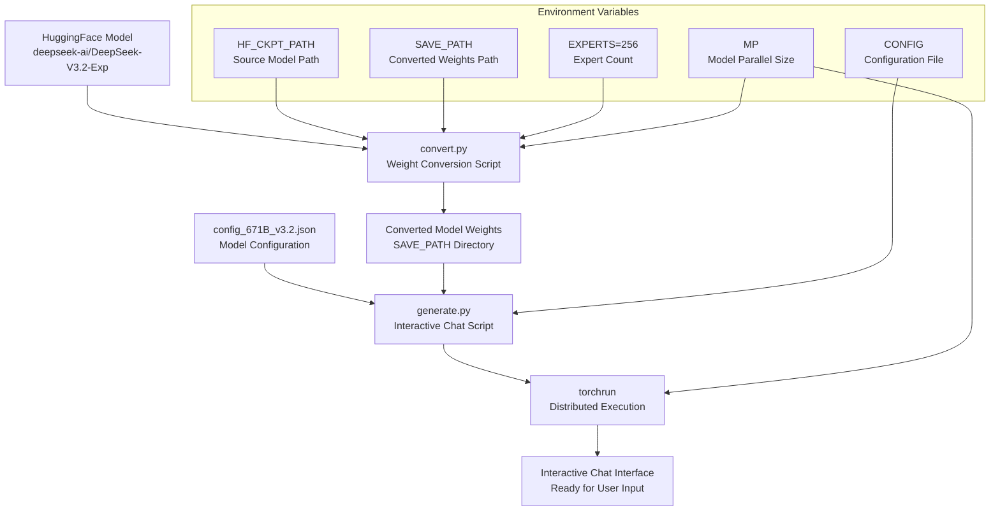

Sources: [inference/README.md:1-14]()

## Step-by-Step Setup

### Step 1: Prepare Environment Variables

Set up the required environment variables for the conversion and inference process:

```bash
export HF_CKPT_PATH=/path/to/huggingface/model
export SAVE_PATH=/path/to/converted/weights
export EXPERTS=256
export MP=8  # Set to match your available GPU count
export CONFIG=config_671B_v3.2.json
```

The `MP` variable should match the number of GPUs available for distributed inference. The model requires multiple GPUs due to its 671B parameter size.

### Step 2: Convert Model Weights

Navigate to the inference directory and run the weight conversion script:

```bash
cd inference
python convert.py --hf-ckpt-path ${HF_CKPT_PATH} --save-path ${SAVE_PATH} --n-experts ${EXPERTS} --model-parallel ${MP}
```

This step transforms the HuggingFace checkpoint format into the format required by the inference system. For detailed information about the conversion process, see [Weight Conversion](#2.3.1).

### Step 3: Launch Interactive Chat

Start the interactive chat interface using distributed execution:

```bash
torchrun --nproc-per-node ${MP} generate.py --ckpt-path ${SAVE_PATH} --config ${CONFIG} --interactive
```

The `torchrun` command launches the inference system across multiple GPUs specified by the `MP` parameter.

### Key Script Parameters

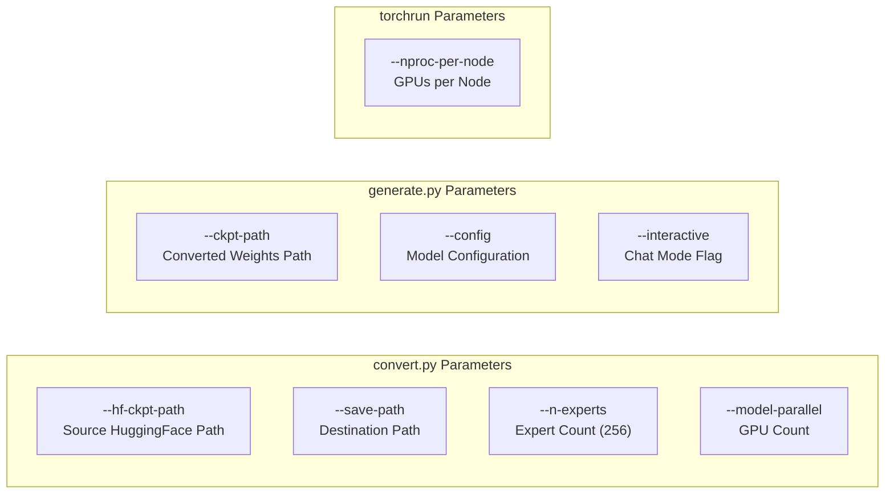

Sources: [inference/README.md:7-8](), [inference/README.md:13]()

## Next Steps

Once the interactive chat is running, you can:

- Explore the model's capabilities through the chat interface
- Learn about advanced configuration options in [Model Configuration](#2.2)
- Understand the technical details of the generation pipeline in [Text Generation](#2.3.2)
- Set up production deployment using [Production Deployment](#3.2)

The interactive interface provides immediate access to the DeepSeek-V3.2-Exp model's capabilities, allowing you to test its performance on various tasks and evaluate the benefits of the DeepSeek Sparse Attention mechanism.

Sources: [inference/README.md:1-14](), [inference/requirements.txt:1-5]()

---

# Page: Model Configuration

# Model Configuration

<details>
<summary>Relevant source files</summary>

The following files were used as context for generating this wiki page:

- [inference/config_671B_v3.2.json](inference/config_671B_v3.2.json)

</details>


This document provides a detailed explanation of the 671B parameter MoE model configuration used by DeepSeek-V3.2-Exp. It covers the JSON configuration file structure, parameter definitions, and their role in defining the model architecture including quantization settings, MLA attention mechanisms, and MoE expert routing.

For information about how these configuration parameters are used during inference execution, see [Core Components](#2.3). For details about the underlying MoE architecture concepts, see [MoE Architecture Details](#4.1).

## Configuration File Structure

The model configuration is defined in a single JSON file that specifies all architectural parameters required for model initialization. The configuration follows a hierarchical structure organizing parameters by functional area.

**Configuration File Location and Structure**
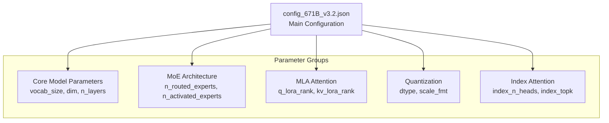

Sources: [inference/config_671B_v3.2.json:1-26]()

## Core Model Parameters

The foundational model architecture is defined by these primary parameters that establish the overall scale and structure of the transformer model.

| Parameter | Value | Description |
|-----------|--------|-------------|
| `vocab_size` | 129,280 | Token vocabulary size |
| `dim` | 7,168 | Model hidden dimension |
| `inter_dim` | 18,432 | Feed-forward intermediate dimension |
| `n_layers` | 61 | Total number of transformer layers |
| `n_dense_layers` | 3 | Number of dense (non-MoE) layers |
| `n_heads` | 128 | Number of attention heads |

The model uses a 671B parameter architecture with 61 total layers, where 3 layers are dense and the remaining layers utilize the MoE architecture. The hidden dimension of 7,168 with 128 attention heads results in a head dimension of 56 per attention head.

**Core Architecture Flow**
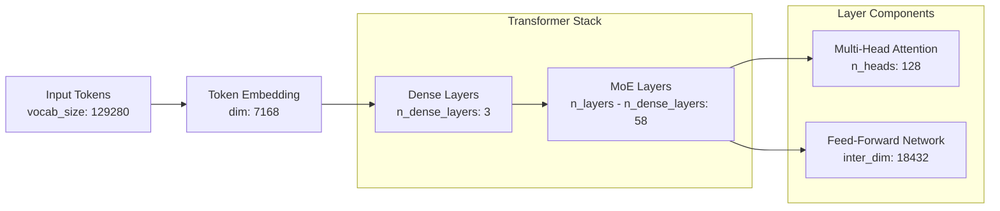

Sources: [inference/config_671B_v3.2.json:2-7]()

## MoE Architecture Parameters

The Mixture-of-Experts configuration defines how the model distributes computation across multiple expert networks, enabling efficient scaling while maintaining quality.

| Parameter | Value | Description |
|-----------|--------|-------------|
| `moe_inter_dim` | 2,048 | MoE expert intermediate dimension |
| `n_routed_experts` | 256 | Total number of routed experts |
| `n_shared_experts` | 1 | Number of shared experts (always active) |
| `n_activated_experts` | 8 | Experts activated per token |
| `n_expert_groups` | 8 | Number of expert groups |
| `n_limited_groups` | 4 | Groups with limited expert selection |
| `route_scale` | 2.5 | Routing score scaling factor |
| `score_func` | "sigmoid" | Expert scoring function |

The MoE architecture uses 256 total experts with only 8 activated per token, achieving approximately 21B active parameters from the 671B total parameter model. The routing mechanism employs sigmoid scoring with expert grouping to ensure load balancing.

**MoE Expert Routing Architecture**
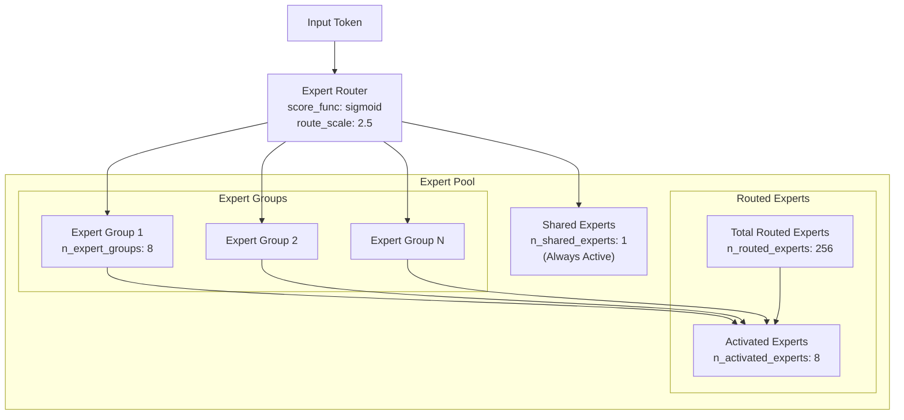

Sources: [inference/config_671B_v3.2.json:5,9-15]()

## MLA Attention Parameters

The Multi-Head Latent Attention (MLA) mechanism uses LoRA-style decomposition to efficiently compute attention while maintaining performance. The configuration defines rank parameters for different attention components.

| Parameter | Value | Description |
|-----------|--------|-------------|
| `q_lora_rank` | 1,536 | Query LoRA rank dimension |
| `kv_lora_rank` | 512 | Key-Value LoRA rank dimension |
| `qk_nope_head_dim` | 128 | Query-Key head dimension (no position) |
| `qk_rope_head_dim` | 64 | Query-Key RoPE head dimension |
| `v_head_dim` | 128 | Value head dimension |

The MLA mechanism decomposes attention computation using different rank settings for queries versus key-value pairs. The total attention head dimension is split between position-encoded (RoPE) and non-position components.

**MLA Attention Decomposition**
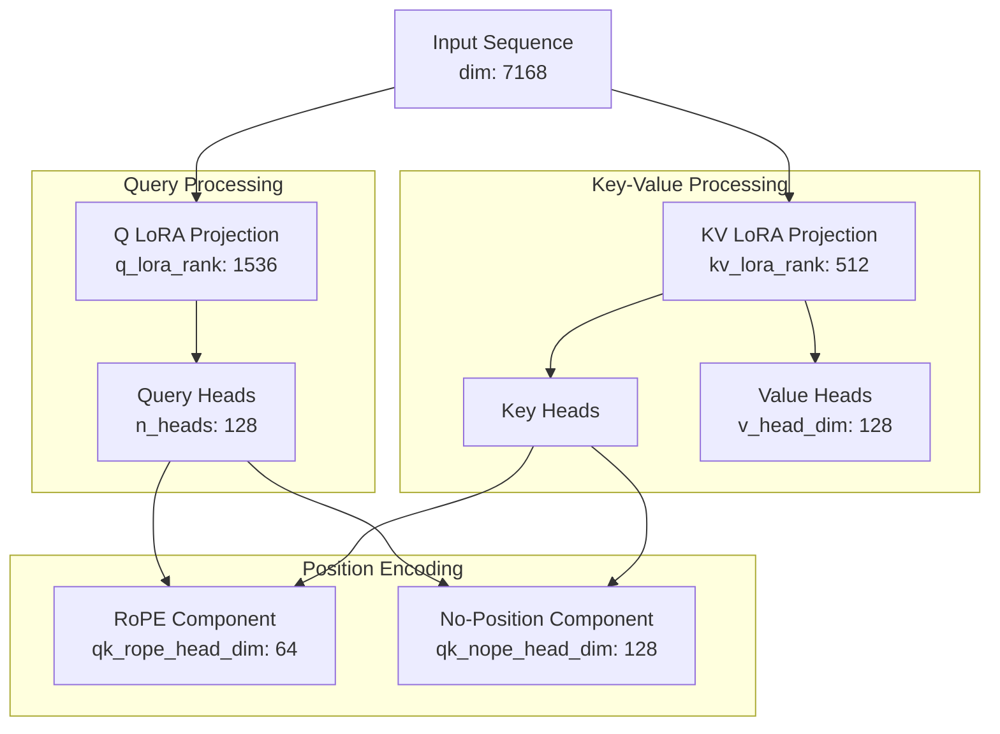

Sources: [inference/config_671B_v3.2.json:16-20]()

## Quantization Configuration

The model uses FP8 quantization for efficient inference while maintaining numerical precision. The quantization configuration specifies the data type and scaling format used throughout the model.

| Parameter | Value | Description |
|-----------|--------|-------------|
| `dtype` | "fp8" | Primary data type for model weights |
| `scale_fmt` | "ue8m0" | FP8 scaling format specification |

The FP8 quantization uses the "ue8m0" format, which refers to an 8-bit exponent with 0 mantissa bits in the scaling factors. This provides memory and computational efficiency while preserving model quality.

**Quantization Data Flow**
```mermaid
graph LR
    FullPrecision["Full Precision Weights<br/>Training Format"]
    Quantization["FP8 Quantization<br/>dtype: fp8<br/>scale_fmt: ue8m0"]
    InferenceWeights["Inference Weights<br/>8-bit Storage"]
    
    subgraph "Runtime Processing"
        Dequantization["Dynamic Dequantization"]
        Computation["Matrix Operations"]
        Requantization["Result Quantization"]
    end
    
    FullPrecision --> Quantization
    Quantization --> InferenceWeights
    InferenceWeights --> Dequantization
    Dequantization --> Computation
    Computation --> Requantization
```

Sources: [inference/config_671B_v3.2.json:21-22]()

## Index Attention Parameters

The index attention mechanism provides an additional attention pathway optimized for long-context scenarios. This complements the main MLA attention mechanism with specialized parameters.

| Parameter | Value | Description |
|-----------|--------|-------------|
| `index_n_heads` | 64 | Number of index attention heads |
| `index_head_dim` | 128 | Dimension per index attention head |
| `index_topk` | 2,048 | Top-k selection for index attention |

The index attention uses 64 heads with 128 dimensions each, totaling 8,192 dimensions. The top-k selection of 2,048 enables efficient attention over long sequences by focusing on the most relevant positions.

**Index Attention Architecture**
```mermaid
graph TB
    LongSequence["Long Input Sequence"]
    
    subgraph "Index Attention Processing"
        IndexHeads["Index Attention Heads<br/>index_n_heads: 64<br/>index_head_dim: 128"]
        TopKSelection["Top-K Selection<br/>index_topk: 2048"]
        IndexScoring["Index Scoring"]
    end
    
    subgraph "Main Attention"
        MLAAttention["MLA Attention<br/>n_heads: 128"]
        AttentionFusion["Attention Fusion"]
    end
    
    LongSequence --> IndexHeads
    IndexHeads --> IndexScoring
    IndexScoring --> TopKSelection
    
    LongSequence --> MLAAttention
    TopKSelection --> AttentionFusion
    MLAAttention --> AttentionFusion
```

Sources: [inference/config_671B_v3.2.json:23-25]()

## Configuration Usage in Code

The configuration parameters are loaded and processed by the model implementation to initialize the transformer architecture. The configuration directly maps to model component initialization and runtime behavior.

**Configuration to Code Mapping**
```mermaid
graph TB
    ConfigJSON["config_671B_v3.2.json"]
    
    subgraph "Model Initialization"
        ModelArgs["ModelArgs Dataclass"]
        TransformerModel["Transformer Class"]
    end
    
    subgraph "Component Initialization"
        MLAAttention["MLA Attention Layers<br/>q_lora_rank, kv_lora_rank"]
        MoELayers["MoE Layers<br/>n_routed_experts, n_activated_experts"]
        QuantizedLinear["Quantized Linear Layers<br/>dtype, scale_fmt"]
        IndexAttention["Index Attention<br/>index_n_heads, index_topk"]
    end
    
    ConfigJSON --> ModelArgs
    ModelArgs --> TransformerModel
    
    TransformerModel --> MLAAttention
    TransformerModel --> MoELayers
    TransformerModel --> QuantizedLinear
    TransformerModel --> IndexAttention
```

The configuration file is typically loaded during model initialization and converted into structured parameters that control every aspect of the model's architecture and behavior during inference.

Sources: [inference/config_671B_v3.2.json:1-26]()

---

# Page: Core Components

# Core Components

<details>
<summary>Relevant source files</summary>

The following files were used as context for generating this wiki page:

- [inference/convert.py](inference/convert.py)
- [inference/generate.py](inference/generate.py)
- [inference/model.py](inference/model.py)

</details>


This document provides an overview of the main components in the DeepSeek-V3.2-Exp inference pipeline and their interactions. The inference system is built around four primary modules that work together to enable distributed text generation: weight conversion, text generation orchestration, model implementation, and optimization kernels.

For detailed implementation of individual components, see [Weight Conversion](#2.3.1), [Text Generation](#2.3.2), [Model Implementation](#2.3.3), and [Optimization Kernels](#2.3.4). For initial setup instructions, see [Getting Started](#2.1).

## System Architecture Overview

The inference pipeline follows a modular design where each component has distinct responsibilities but integrates seamlessly with others through well-defined interfaces.

```mermaid
graph TD
    subgraph "Weight Conversion Phase"
        HF["HuggingFace Checkpoint<br/>*.safetensors"]
        ConvertPy["convert.py<br/>main()"]
        Mapping["Parameter Mapping<br/>mapping dict"]
        ShardedWeights["Distributed Weights<br/>modelN-mpM.safetensors"]
    end
    
    subgraph "Text Generation Phase"  
        GeneratePy["generate.py<br/>main()"]
        TorchDist["torch.distributed<br/>Process Group"]
        TokenizerHF["AutoTokenizer<br/>HuggingFace"]
        GenerateFunc["generate()<br/>Inference Loop"]
    end
    
    subgraph "Model Execution Phase"
        ModelPy["model.py<br/>Transformer"]
        ConfigJson["config_671B_v3.2.json<br/>ModelArgs"]
        MLABlock["MLA Attention<br/>Multi-Head Latent"]
        MoEBlock["MoE Layer<br/>Expert Routing"]
    end
    
    subgraph "Optimization Phase"
        KernelPy["kernel.py<br/>FP8 Kernels"] 
        ActQuant["act_quant()<br/>Activation Quantization"]
        FP8GEMM["fp8_gemm()<br/>Matrix Multiplication"]
        FP8Index["fp8_index()<br/>Sparse Attention"]
    end
    
    HF --> ConvertPy
    Mapping --> ConvertPy
    ConvertPy --> ShardedWeights
    
    ShardedWeights --> GeneratePy
    ConfigJson --> GeneratePy
    GeneratePy --> TorchDist
    GeneratePy --> TokenizerHF
    GeneratePy --> GenerateFunc
    
    GenerateFunc --> ModelPy
    ConfigJson --> ModelPy
    ModelPy --> MLABlock
    ModelPy --> MoEBlock
    
    MLABlock --> KernelPy
    MoEBlock --> KernelPy
    KernelPy --> ActQuant
    KernelPy --> FP8GEMM  
    KernelPy --> FP8Index
```

Sources: [inference/convert.py:37-100](), [inference/generate.py:81-160](), [inference/model.py:18-92]()

## Component Interaction Flow

The components interact through a well-defined sequence during inference execution, with each component responsible for specific aspects of the distributed inference process.

```mermaid
sequenceDiagram
    participant User
    participant GeneratePy as "generate.py"
    participant TorchDist as "torch.distributed" 
    participant Transformer as "model.Transformer"
    participant MLA as "MLA Layer"
    participant MoE as "MoE Layer"
    participant Kernels as "FP8 Kernels"
    
    User->>GeneratePy: torchrun --nproc_per_node=8
    GeneratePy->>TorchDist: init_process_group("nccl")
    GeneratePy->>Transformer: __init__(ModelArgs)
    GeneratePy->>Transformer: load_model(safetensors)
    
    loop Interactive Generation
        User->>GeneratePy: input prompt
        GeneratePy->>TorchDist: broadcast_object_list()
        GeneratePy->>Transformer: forward(tokens, start_pos)
        
        Transformer->>MLA: forward(x, start_pos, freqs_cis, mask)
        MLA->>Kernels: act_quant(x, block_size)
        MLA->>Kernels: fp8_gemm(x, scale, weight, weight.scale)
        MLA->>Kernels: fp8_index(q_fp8, weights, k_cache)
        MLA-->>Transformer: attention_output
        
        Transformer->>MoE: forward(x)
        MoE->>Kernels: act_quant() / fp8_gemm()
        MoE->>TorchDist: all_reduce(expert_outputs)
        MoE-->>Transformer: moe_output
        
        Transformer-->>GeneratePy: logits
        GeneratePy->>GeneratePy: sample(logits, temperature)
        GeneratePy-->>User: generated_text
    end
```

Sources: [inference/generate.py:100-160](), [inference/model.py:878-902](), [inference/model.py:537-597](), [inference/model.py:769-793]()

## Core Component Mapping

The following table maps high-level system concepts to specific code entities:

| System Component | Primary Class/Function | Key Responsibilities | File Location |
|------------------|------------------------|---------------------|---------------|
| Weight Conversion | `main()` | Parameter mapping, expert sharding | [inference/convert.py:37-100]() |
| Text Generation | `generate()`, `main()` | Distributed inference orchestration | [inference/generate.py:31-78](), [inference/generate.py:81-160]() |
| Transformer Model | `Transformer` | Model architecture, forward pass | [inference/model.py:843-902]() |
| MLA Attention | `MLA` | Multi-head latent attention | [inference/model.py:491-597]() |
| MoE Routing | `MoE`, `Gate` | Expert selection and routing | [inference/model.py:736-793](), [inference/model.py:635-698]() |
| FP8 Optimization | `act_quant`, `fp8_gemm`, `fp8_index` | Quantization and optimized ops | [inference/model.py:11]() |
| Parameter Configuration | `ModelArgs` | Model hyperparameters | [inference/model.py:18-92]() |

Sources: [inference/convert.py:37-100](), [inference/generate.py:31-160](), [inference/model.py:11-902]()

## Data Flow Architecture

The inference pipeline processes data through several transformation stages, with each component handling specific tensor operations and distributed coordination.

```mermaid
flowchart LR
    subgraph "Input Processing"
        UserPrompt["User Prompt<br/>String"]
        TokenizerApply["tokenizer.apply_chat_template()"] 
        PromptTokens["prompt_tokens<br/>List[int]"]
    end
    
    subgraph "Model Forward Pass"
        TokensTensor["tokens<br/>torch.Tensor"]
        EmbedLayer["ParallelEmbedding<br/>embed(tokens)"]
        TransformerLayers["Transformer Blocks<br/>layers[0...60]"]
        OutputNorm["RMSNorm<br/>norm(hidden_states)"]
        LMHead["ColumnParallelLinear<br/>head(normalized)"]
        LogitsTensor["logits<br/>torch.Tensor"]
    end
    
    subgraph "Distributed Coordination"
        AllGather["dist.all_gather()<br/>Collect Logits"]
        AllReduce["dist.all_reduce()<br/>Expert Outputs"]
        Broadcast["dist.broadcast_object_list()<br/>Prompt Sharing"]
    end
    
    subgraph "Output Generation"
        SampleFunc["sample(logits, temperature)"]
        NextToken["next_token<br/>torch.Tensor"] 
        TokenDecode["tokenizer.decode()"]
        ResponseText["Response Text<br/>String"]
    end
    
    UserPrompt --> TokenizerApply
    TokenizerApply --> PromptTokens
    PromptTokens --> TokensTensor
    
    TokensTensor --> EmbedLayer
    EmbedLayer --> TransformerLayers
    TransformerLayers --> OutputNorm
    OutputNorm --> LMHead
    LMHead --> LogitsTensor
    
    LogitsTensor --> AllGather
    AllGather --> SampleFunc
    TransformerLayers --> AllReduce
    PromptTokens --> Broadcast
    
    SampleFunc --> NextToken
    NextToken --> TokenDecode
    TokenDecode --> ResponseText
```

Sources: [inference/generate.py:31-78](), [inference/model.py:878-902](), [inference/model.py:93-132]()

## Module Dependencies

The core components have specific dependency relationships that define the system's modularity and testability.

| Component | Direct Dependencies | Key Imports |
|-----------|-------------------|-------------|
| `convert.py` | `torch`, `safetensors`, `tqdm` | `safe_open`, `save_file` |
| `generate.py` | `torch.distributed`, `transformers`, `model.py` | `Transformer`, `ModelArgs`, `AutoTokenizer` |
| `model.py` | `torch`, `einops`, `kernel.py` | `act_quant`, `fp8_gemm`, `fp8_index` |
| `kernel.py` | TileLang JIT, CUDA kernels | Optimization primitives |

The dependency flow ensures that optimization kernels can be swapped independently, the model implementation is decoupled from the generation interface, and weight conversion is a standalone preprocessing step.

Sources: [inference/convert.py:1-10](), [inference/generate.py:1-11](), [inference/model.py:1-12]()

---

# Page: Weight Conversion

# Weight Conversion

<details>
<summary>Relevant source files</summary>

The following files were used as context for generating this wiki page:

- [inference/convert.py](inference/convert.py)

</details>


## Purpose and Scope

The Weight Conversion system transforms HuggingFace model checkpoints into a distributed inference format optimized for multi-GPU execution. This conversion process handles parameter renaming, expert sharding for MoE models, and tensor partitioning across model parallel ranks.

For information about using the converted weights in inference, see [Text Generation](#2.3.2). For details about the model architecture that consumes these weights, see [Model Implementation](#2.3.3).

## Conversion Flow Overview

```mermaid
graph TD
    HF["HuggingFace Checkpoint<br/>*.safetensors files"] 
    Convert["convert.py<br/>main()"]
    Mapping["Parameter Mapping<br/>mapping dict"]
    Sharding["Model Parallel Sharding<br/>tensor.narrow()"]
    ExpertDist["Expert Distribution<br/>n_local_experts"]
    Output["Distributed Checkpoints<br/>model{i}-mp{mp}.safetensors"]
    Tokenizer["Tokenizer Files<br/>*token*"]
    
    HF --> Convert
    Convert --> Mapping
    Convert --> Sharding
    Convert --> ExpertDist
    Mapping --> Output
    Sharding --> Output
    ExpertDist --> Output
    HF --> Tokenizer
    Tokenizer --> Output
```

Sources: [inference/convert.py:37-90](), [inference/convert.py:54-80]()

## Parameter Mapping System

The conversion process uses a comprehensive parameter name mapping to transform HuggingFace parameter names into the format expected by the distributed inference implementation. The `mapping` dictionary defines transformations for all model components.

### Core Parameter Mappings

| HuggingFace Name | Target Name | Shard Dimension |
|------------------|-------------|-----------------|
| `embed_tokens` | `embed` | 0 |
| `q_proj` | `wq` | 0 |
| `q_a_proj` | `wq_a` | None |
| `kv_a_proj_with_mqa` | `wkv_a` | None |
| `o_proj` | `wo` | 1 |
| `gate_proj` | `w1` | 0 |
| `down_proj` | `w2` | 1 |
| `up_proj` | `w3` | 0 |
| `lm_head` | `head` | 0 |

### Parameter Name Transformations

The conversion applies systematic string replacements to standardize parameter names:

- `model.` prefix removal
- `self_attn` → `attn`
- `mlp` → `ffn`  
- `weight_scale_inv` → `scale`
- `e_score_correction_bias` → `bias`

Sources: [inference/convert.py:11-34](), [inference/convert.py:60-69]()

## Model Parallelism and Tensor Sharding

```mermaid
graph LR
    subgraph "Original Tensor"
        FullTensor["param<br/>shape: [H, W]"]
    end
    
    subgraph "Sharding Logic"
        CheckDim["dim is not None?"]
        CalcSize["shard_size = size(dim) // mp"]
        Narrow["tensor.narrow(dim, offset, size)"]
    end
    
    subgraph "Distributed Tensors"
        Rank0["model0-mp4.safetensors<br/>shard [0:shard_size]"]
        Rank1["model1-mp4.safetensors<br/>shard [shard_size:2*shard_size]"]  
        Rank2["model2-mp4.safetensors<br/>shard [2*shard_size:3*shard_size]"]
        Rank3["model3-mp4.safetensors<br/>shard [3*shard_size:4*shard_size]"]
    end
    
    FullTensor --> CheckDim
    CheckDim --> CalcSize
    CalcSize --> Narrow
    Narrow --> Rank0
    Narrow --> Rank1
    Narrow --> Rank2
    Narrow --> Rank3
```

The sharding process partitions tensors along specific dimensions based on the `mapping` dictionary. Parameters with `dim=0` are split along the first dimension (typically input features), while `dim=1` parameters are split along the second dimension (typically output features). Parameters with `dim=None` are replicated across all ranks.

Sources: [inference/convert.py:76-79](), [inference/convert.py:51-52]()

## Expert Distribution for MoE Models

```mermaid
graph TD
    subgraph "Expert Assignment"
        TotalExperts["n_experts<br/>(e.g., 256)"]
        ModelParallel["mp<br/>(e.g., 8)"]
        LocalExperts["n_local_experts<br/>= n_experts // mp<br/>(32 per rank)"]
    end
    
    subgraph "Expert Filtering"
        ExpertParam["experts.{idx}.w1.weight"]
        CheckRange["idx >= i * n_local_experts<br/>idx < (i + 1) * n_local_experts"]
        Include["Include in rank i"]
        Skip["Skip for rank i"]
    end
    
    subgraph "Rank Distribution"
        Rank0["Rank 0<br/>Experts 0-31"]
        Rank1["Rank 1<br/>Experts 32-63"]
        Rank2["Rank 2<br/>Experts 64-95"]
        RankN["Rank 7<br/>Experts 224-255"]
    end
    
    TotalExperts --> LocalExperts
    ModelParallel --> LocalExperts
    ExpertParam --> CheckRange
    CheckRange --> Include
    CheckRange --> Skip
    Include --> Rank0
    Include --> Rank1
    Include --> Rank2
    Include --> RankN
```

Expert parameters are distributed across model parallel ranks by expert index. Each rank receives a contiguous range of experts, with `n_local_experts = n_experts // mp` experts per rank. The conversion logic filters expert parameters based on whether their index falls within the target rank's assigned range.

Sources: [inference/convert.py:72-75](), [inference/convert.py:51]()

## File Operations and Output Format

### Input Processing

The conversion processes all `.safetensors` files in the source directory using the `safetensors.torch.safe_open` interface. Each parameter tensor is loaded individually to minimize memory usage during conversion.

### Output Generation

The system generates `mp` output files named `model{i}-mp{mp}.safetensors`, where `i` ranges from 0 to `mp-1`. Each file contains the parameters assigned to that model parallel rank.

### Auxiliary Files

All tokenizer-related files matching the pattern `*token*` are copied directly from the source to the destination directory without modification.

Sources: [inference/convert.py:54-55](), [inference/convert.py:84-85](), [inference/convert.py:87-89]()

## Command Line Interface

The conversion script accepts four required arguments:

- `--hf-ckpt-path`: Source directory containing HuggingFace checkpoint files
- `--save-path`: Target directory for converted checkpoint files  
- `--n-experts`: Total number of experts in the MoE model
- `--model-parallel`: Model parallelism factor for distribution

The script validates that `n_experts` is divisible by `model_parallel` to ensure even expert distribution across ranks.

Sources: [inference/convert.py:92-100]()

---

# Page: Text Generation

# Text Generation

<details>
<summary>Relevant source files</summary>

The following files were used as context for generating this wiki page:

- [inference/generate.py](inference/generate.py)

</details>


This document covers the text generation interface provided by `generate.py`, which serves as the primary interactive and batch inference system for DeepSeek-V3.2-Exp. This module handles distributed token generation, conversation management, and provides both command-line and interactive interfaces for model inference.

For information about the underlying model architecture, see [Model Implementation](#2.3.3). For details about weight conversion prior to generation, see [Weight Conversion](#2.3.1).

## Purpose and Architecture

The text generation system is built around the `generate.py` script, which provides a complete inference pipeline supporting:

- **Distributed Execution**: Multi-GPU inference using `torch.distributed`
- **Interactive Chat**: Conversational interface with chat template support
- **Batch Processing**: File-based batch inference for multiple prompts
- **Temperature Sampling**: Configurable token sampling with temperature control

## Generation Pipeline Overview

```mermaid
graph TD
    CLI["ArgumentParser"] --> Main["main()"]
    Main --> DistInit["dist.init_process_group()"]
    Main --> ModelLoad["Transformer + safetensors loading"]
    Main --> TokenizerLoad["AutoTokenizer.from_pretrained()"]
    
    ModelLoad --> Interactive["Interactive Mode"]
    ModelLoad --> Batch["Batch Mode"]
    
    Interactive --> ChatLoop["Chat Message Loop"]
    Batch --> FileRead["File Prompt Processing"]
    
    ChatLoop --> ApplyTemplate["tokenizer.apply_chat_template()"]
    FileRead --> ApplyTemplate
    
    ApplyTemplate --> Generate["generate()"]
    Generate --> ForwardPass["model.forward()"]
    ForwardPass --> Sample["sample()"]
    Sample --> TokenDecoding["tokenizer.decode()"]
    
    style Generate fill:#e8f5e8
    style ForwardPass fill:#fff3e0
    style Sample fill:#e3f2fd
```

Sources: [inference/generate.py:81-186]()

## Core Generation Functions

### Token Generation Loop

The primary generation logic is implemented in the `generate()` function, which handles autoregressive token generation with distributed execution support:

```mermaid
graph TD
    GenerateStart["generate(model, prompt_tokens, max_new_tokens, eos_id, temperature)"] --> TokenInit["tokens = torch.full((batch_size, total_len), -1)"]
    TokenInit --> PromptFill["Fill initial prompt tokens"]
    PromptFill --> GenLoop["Generation Loop: cur_pos in range(min_prompt_lens, total_len)"]
    
    GenLoop --> ModelForward["logits = model.forward(tokens[:, prev_pos:cur_pos], prev_pos)"]
    ModelForward --> TempCheck{"temperature > 0?"}
    
    TempCheck -->|Yes| SampleCall["next_token = sample(logits, temperature)"]
    TempCheck -->|No| ArgMax["next_token = logits.argmax(dim=-1)"]
    
    SampleCall --> MaskCheck["Apply prompt_mask"]
    ArgMax --> MaskCheck
    
    MaskCheck --> TokenAssign["tokens[:, cur_pos] = next_token"]
    TokenAssign --> EosCheck["Check finished condition (EOS tokens)"]
    EosCheck --> AllFinished{"finished.all()?"}
    
    AllFinished -->|No| GenLoop
    AllFinished -->|Yes| CompletionExtract["Extract completion_tokens"]
    CompletionExtract --> ReturnTokens["return completion_tokens"]
    
    style ModelForward fill:#fff3e0
    style SampleCall fill:#e3f2fd
    style EosCheck fill:#e8f5e8
```

Sources: [inference/generate.py:30-78]()

### Temperature Sampling

The `sample()` function implements temperature-controlled token sampling using the Gumbel-max trick:

| Parameter | Type | Purpose |
|-----------|------|---------|
| `logits` | `torch.Tensor` | Raw model predictions for next token |
| `temperature` | `float` | Controls randomness (1.0 = normal, <1.0 = more deterministic, >1.0 = more random) |

The sampling process applies temperature scaling, softmax normalization, and Gumbel-max sampling for efficient token selection.

Sources: [inference/generate.py:14-27]()

## Execution Modes

### Interactive Mode

Interactive mode provides a conversational interface with persistent chat history:

```mermaid
graph TD
    InteractiveStart["interactive=True"] --> MessageInit["messages = []"]
    MessageInit --> InputLoop["Input Loop"]
    
    InputLoop --> GetPrompt["Get user input via input() or dist.broadcast_object_list()"]
    GetPrompt --> CommandCheck{"Command check"}
    
    CommandCheck -->|"/exit"| ExitLoop["break"]
    CommandCheck -->|"/clear"| ClearMessages["messages.clear()"]
    CommandCheck -->|"regular input"| AddUserMsg["messages.append({'role': 'user', 'content': prompt})"]
    
    AddUserMsg --> ApplyTemplate["tokenizer.apply_chat_template(messages, add_generation_prompt=True)"]
    ApplyTemplate --> CallGenerate["generate(model, [prompt_tokens], ...)"]
    CallGenerate --> DecodeTokens["tokenizer.decode(completion_tokens[0])"]
    DecodeTokens --> PrintResponse["print(completion)"]
    PrintResponse --> AddAssistantMsg["messages.append({'role': 'assistant', 'content': completion})"]
    
    AddAssistantMsg --> InputLoop
    ClearMessages --> InputLoop
    
    style GetPrompt fill:#e8f5e8
    style CallGenerate fill:#fff3e0
    style DecodeTokens fill:#e3f2fd
```

Sources: [inference/generate.py:122-145]()

### Batch Mode

Batch mode processes multiple prompts from a file, supporting parallel inference:

| Configuration | Details |
|---------------|---------|
| Input Format | Double newline-separated prompts in text file |
| Batch Size Limit | `args.max_batch_size` from model configuration |
| Processing | Parallel tokenization and generation |
| Output Format | Prompt-completion pairs printed to stdout |

Sources: [inference/generate.py:146-156]()

## Distributed Execution Setup

The distributed execution system initializes multi-GPU inference using NCCL backend:

```mermaid
graph TD
    EnvVars["Environment Variables: WORLD_SIZE, RANK, LOCAL_RANK"] --> DistCheck{"world_size > 1?"}
    
    DistCheck -->|Yes| InitPG["dist.init_process_group('nccl')"]
    DistCheck -->|No| SingleGPU["Single GPU Mode"]
    
    InitPG --> RankCheck{"rank != 0?"}
    RankCheck -->|Yes| SuppressPrint["print = lambda *_, **__: None"]
    RankCheck -->|No| KeepPrint["Keep print functionality"]
    
    SuppressPrint --> DeviceSet["torch.cuda.set_device(local_rank)"]
    KeepPrint --> DeviceSet
    SingleGPU --> DeviceSet
    
    DeviceSet --> LoadModel["load_model(model, f'model{rank}-mp{world_size}.safetensors')"]
    LoadModel --> BroadcastSync["Synchronize input via dist.broadcast_object_list()"]
    
    style InitPG fill:#fff3e0
    style LoadModel fill:#e8f5e8
    style BroadcastSync fill:#e3f2fd
```

| Environment Variable | Purpose |
|---------------------|---------|
| `WORLD_SIZE` | Total number of processes |
| `RANK` | Global rank of current process |
| `LOCAL_RANK` | Local device rank for CUDA device assignment |

Sources: [inference/generate.py:100-119](), [inference/generate.py:125-134]()

## Command Line Interface

The CLI supports the following arguments for controlling generation behavior:

| Argument | Type | Default | Description |
|----------|------|---------|-------------|
| `--ckpt-path` | `str` | Required | Path to model checkpoint directory |
| `--config` | `str` | Required | Path to JSON model configuration |
| `--input-file` | `str` | `""` | File containing prompts for batch processing |
| `--interactive` | `bool` | `False` | Enable interactive chat mode |
| `--max-new-tokens` | `int` | `200` | Maximum tokens to generate per prompt |
| `--temperature` | `float` | `0.6` | Temperature for token sampling |

The system enforces that either `--input-file` or `--interactive` must be specified.

Sources: [inference/generate.py:177-186]()

---

# Page: Model Implementation

# Model Implementation

<details>
<summary>Relevant source files</summary>

The following files were used as context for generating this wiki page:

- [inference/model.py](inference/model.py)

</details>


This document provides technical documentation for the core model implementation in [inference/model.py:1-912](). It covers the `Transformer` architecture with Multi-Head Latent Attention (MLA), Mixture-of-Experts (MoE) layers, and distributed linear operations that form the foundation of DeepSeek-V3.2-Exp inference.

For weight conversion and checkpoint handling, see [Weight Conversion](#2.3.1). For the interactive generation interface, see [Text Generation](#2.3.2). For performance optimization kernels, see [Optimization Kernels](#2.3.4).

## Architecture Overview

The model implementation centers around the `Transformer` class which orchestrates multiple `Block` instances, each containing attention and feed-forward components. The architecture supports distributed execution across multiple GPUs with specialized parallel linear layers.

```mermaid
graph TD
    ModelArgs["ModelArgs<br/>Configuration Dataclass"] --> Transformer["Transformer<br/>Main Model Class"]
    
    Transformer --> ParallelEmbedding["ParallelEmbedding<br/>Token Embeddings"]
    Transformer --> BlockList["layers: ModuleList<br/>Transformer Blocks"]
    Transformer --> RMSNorm1["norm: RMSNorm<br/>Final Normalization"]
    Transformer --> ColumnParallelLinear["head: ColumnParallelLinear<br/>Output Projection"]
    
    BlockList --> Block["Block<br/>layer_id < n_dense_layers"]
    BlockList --> BlockMoE["Block<br/>layer_id >= n_dense_layers"]
    
    Block --> MLA1["attn: MLA<br/>Multi-Head Latent Attention"]
    Block --> MLP1["ffn: MLP<br/>Dense Feed-Forward"]
    Block --> RMSNorm2["attn_norm: RMSNorm"]
    Block --> RMSNorm3["ffn_norm: RMSNorm"]
    
    BlockMoE --> MLA2["attn: MLA<br/>Multi-Head Latent Attention"]
    BlockMoE --> MoE["ffn: MoE<br/>Mixture of Experts"]
    BlockMoE --> RMSNorm4["attn_norm: RMSNorm"]
    BlockMoE --> RMSNorm5["ffn_norm: RMSNorm"]
```

Sources: [inference/model.py:843-902]()

## Model Configuration

The `ModelArgs` dataclass defines all model hyperparameters including dimensions, expert configuration, and quantization settings. Key parameters control the 671B MoE architecture:

| Parameter | Value | Description |
|-----------|--------|-------------|
| `n_layers` | 27 | Total transformer blocks |
| `n_dense_layers` | 1 | Blocks using MLP instead of MoE |
| `n_routed_experts` | 64 | Routed experts per MoE layer |
| `n_shared_experts` | 2 | Shared experts per MoE layer |
| `n_activated_experts` | 6 | Active experts per token |
| `dim` | 2048 | Model hidden dimension |
| `dtype` | "bf16"/"fp8" | Computation precision |

The configuration supports extended sequence lengths through YaRN parameters (`rope_factor`, `beta_fast`, `beta_slow`) and sparse attention indexing (`index_topk`, `index_n_heads`).

Sources: [inference/model.py:18-92]()

## Multi-Head Latent Attention (MLA)

The `MLA` class implements the core attention mechanism with low-rank projections and rotary position encodings. It uses compressed key-value representations and an indexing mechanism for efficient long-context attention.

```mermaid
graph LR
    Input["x: Input Tensor<br/>(batch, seq, dim)"] --> WQA["wq_a: Linear<br/>dim -> q_lora_rank"]
    WQA --> QNorm["q_norm: RMSNorm<br/>q_lora_rank"]
    QNorm --> WQB["wq_b: ColumnParallelLinear<br/>q_lora_rank -> n_heads * qk_head_dim"]
    
    Input --> WKVA["wkv_a: Linear<br/>dim -> kv_lora_rank + qk_rope_head_dim"]
    WKVA --> KVSplit["Split: kv, k_pe"]
    KVSplit --> KVNorm["kv_norm: RMSNorm<br/>kv_lora_rank"]
    KVNorm --> WKVB["wkv_b: ColumnParallelLinear<br/>kv_lora_rank -> n_heads * (qk_nope_head_dim + v_head_dim)"]
    
    WQB --> AttentionCore["Attention Computation<br/>with Indexing"]
    WKVB --> AttentionCore
    KVSplit --> AttentionCore
    AttentionCore --> WO["wo: RowParallelLinear<br/>n_heads * v_head_dim -> dim"]
    
    Input --> Indexer["indexer: Indexer<br/>Sparse Attention Indexing"]
    Indexer --> AttentionCore
```

The MLA implementation includes several key features:

- **Low-rank projections**: Query uses rank `q_lora_rank`, key-value uses `kv_lora_rank`
- **Rotary embeddings**: Applied to query and key position components via `apply_rotary_emb`
- **KV caching**: Compressed representations stored in `kv_cache` and `pe_cache` buffers
- **Sparse indexing**: `Indexer` module selects top-k positions for attention via `fp8_index`
- **Dual computation paths**: Separate logic for prefill (with mask) vs decode phases

Sources: [inference/model.py:491-597](), [inference/model.py:431-480]()

## Mixture of Experts (MoE)

The MoE implementation consists of three main components: `Gate` for routing, `Expert` for computation, and `MoE` for orchestration. Each component handles distributed execution across multiple processes.

```mermaid
graph TD
    MLAOutput["MLA Output<br/>(batch, seq, dim)"] --> Gate["gate: Gate<br/>Routing Logic"]
    Gate --> Weights["weights: Tensor<br/>Expert Activation Weights"]
    Gate --> Indices["indices: Tensor<br/>Selected Expert IDs"]
    
    MLAOutput --> ExpertCompute["Expert Computation<br/>Distributed Across Ranks"]
    Weights --> ExpertCompute
    Indices --> ExpertCompute
    
    subgraph "Local Experts (rank-specific)"
        Expert0["experts[i]: Expert<br/>w1, w2, w3 Linear layers"]
        Expert1["experts[i+1]: Expert<br/>w1, w2, w3 Linear layers"]
        ExpertN["experts[i+n]: Expert<br/>w1, w2, w3 Linear layers"]
    end
    
    ExpertCompute --> Expert0
    ExpertCompute --> Expert1
    ExpertCompute --> ExpertN
    
    MLAOutput --> SharedExperts["shared_experts: MLP<br/>Always Active"]
    
    Expert0 --> AllReduce["dist.all_reduce<br/>Cross-rank Aggregation"]
    Expert1 --> AllReduce
    ExpertN --> AllReduce
    SharedExperts --> AllReduce
    
    AllReduce --> Output["Final Output<br/>(batch, seq, dim)"]
```

### Gate Mechanism

The `Gate` class implements expert selection using configurable scoring functions:

- **Score computation**: Linear projection from input to expert logits via `weight` parameter
- **Routing strategies**: Supports both `"softmax"` and `"sigmoid"` scoring functions  
- **Group-based routing**: Optional expert grouping with `n_expert_groups` and `n_limited_groups`
- **Top-k selection**: Selects `n_activated_experts` per input token

### Expert Architecture

Each `Expert` uses a standard SwiGLU feed-forward structure:
- `w1`: Input to intermediate dimension projection
- `w3`: Input to intermediate dimension gate projection  
- `w2`: Intermediate to output dimension projection
- Forward: `w2(silu(w1(x)) * w3(x))`

### Distributed Execution

The MoE layer distributes experts across ranks where each rank handles `n_routed_experts // world_size` experts. Expert outputs are aggregated via `dist.all_reduce` to combine results from all ranks.

Sources: [inference/model.py:635-698](), [inference/model.py:701-733](), [inference/model.py:736-793]()

## Distributed Linear Operations

The implementation provides three specialized linear layer variants for distributed execution, all inheriting from a base `Linear` class that supports FP8 quantization.

```mermaid
graph TD
    BaseLinear["Linear<br/>Base Implementation"] --> ColumnParallel["ColumnParallelLinear<br/>Split Output Features"]
    BaseLinear --> RowParallel["RowParallelLinear<br/>Split Input Features"] 
    BaseLinear --> StandardLinear["Linear<br/>No Distribution"]
    
    subgraph "Distributed Patterns"
        ColumnPattern["Column Parallel:<br/>out_features // world_size<br/>per rank"]
        RowPattern["Row Parallel:<br/>in_features // world_size<br/>per rank + all_reduce"]
    end
    
    ColumnParallel --> ColumnPattern
    RowParallel --> RowPattern
    
    subgraph "Usage Examples"
        MLAExample["MLA: wq_b, wkv_b<br/>ColumnParallelLinear"]
        MLAExample2["MLA: wo<br/>RowParallelLinear"] 
        MLPExample["MLP: w1, w3<br/>ColumnParallelLinear"]
        MLPExample2["MLP: w2<br/>RowParallelLinear"]
        ExpertExample["Expert: w1, w2, w3<br/>Standard Linear"]
    end
    
    ColumnParallel --> MLAExample
    RowParallel --> MLAExample2
    ColumnParallel --> MLPExample
    RowParallel --> MLPExample2
    StandardLinear --> ExpertExample
```

### Quantization Support

All linear layers support FP8 quantization when `dtype="fp8"`:
- **Weight quantization**: FP8 weights stored with block-wise scaling factors
- **Activation quantization**: Runtime quantization via `act_quant` kernel
- **Computation**: FP8 GEMM operations via `fp8_gemm` kernel
- **Scale management**: Block-wise scales stored as `nn.Parameter` when quantized

### Parallel Communication

- **ColumnParallelLinear**: No communication required, outputs remain distributed
- **RowParallelLinear**: Requires `dist.all_reduce` to sum partial results across ranks  
- **ParallelEmbedding**: Uses `all_reduce` to handle vocabulary distribution with masking

Sources: [inference/model.py:135-271](), [inference/model.py:93-132]()

## Supporting Components

### Normalization Layers

- **RMSNorm**: Root mean square normalization with optional residual connection fusion
- **LayerNorm**: Standard layer normalization for specific components like `Indexer.k_norm`

### Positional Encoding

The `precompute_freqs_cis` function generates complex exponential values for rotary position encodings with YaRN scaling support for extended context lengths. Key features:

- **Base frequencies**: Computed using `rope_theta` base value
- **YaRN extension**: Applies frequency scaling for sequences longer than `original_seq_len`
- **Correction factors**: Uses `beta_fast`, `beta_slow`, and `rope_factor` for smooth transitions

### Memory Management

The model uses persistent and non-persistent buffers for caching:
- **MLA caches**: `kv_cache`, `pe_cache` for compressed attention states
- **Indexer caches**: `k_cache`, `k_scale_cache` for FP8 key storage  
- **Rotary embeddings**: `freqs_cis` buffer precomputed during initialization

Sources: [inference/model.py:273-428](), [inference/model.py:796-841]()

---

# Page: Optimization Kernels

# Optimization Kernels

<details>
<summary>Relevant source files</summary>

The following files were used as context for generating this wiki page:

- [inference/kernel.py](inference/kernel.py)

</details>


This document covers the GPU optimization kernels implemented in `inference/kernel.py`, which provide FP8 quantization and high-performance matrix operations through TileLang JIT compilation. These kernels are critical components of the inference pipeline that enable efficient execution of the 671B parameter model through precision reduction and custom GPU code generation.

For information about the overall model implementation that uses these kernels, see [Model Implementation](#2.3.3). For details about the broader inference pipeline architecture, see [Core Components](#2.3).

## Kernel Architecture Overview

The optimization kernel system is built around three core computational primitives that work together to provide efficient FP8 inference capabilities.

```mermaid
graph TD
    subgraph "TileLang Infrastructure"
        TL["tilelang module"]
        JIT["@tilelang.jit decorator"]
        PassConfigs["pass_configs dictionary"]
        
        TL --> JIT
        TL --> PassConfigs
    end
    
    subgraph "Data Type System"
        FP8["FP8 = \"float8_e4m3\""]
        BF16["BF16 = \"bfloat16\""]
        FP32["FP32 = \"float32\""]
    end
    
    subgraph "Core Kernels"
        ActQuant["act_quant_kernel"]
        FP8GEMM["fp8_gemm_kernel"]
        FP8Index["fp8_index_kernel"]
    end
    
    subgraph "Python Interface"
        ActQuantFunc["act_quant()"]
        FP8GEMMFunc["fp8_gemm()"]
        FP8IndexFunc["fp8_index()"]
    end
    
    JIT --> ActQuant
    JIT --> FP8GEMM
    JIT --> FP8Index
    
    ActQuant --> ActQuantFunc
    FP8GEMM --> FP8GEMMFunc
    FP8Index --> FP8IndexFunc
    
    FP8 --> ActQuant
    FP8 --> FP8GEMM
    FP8 --> FP8Index
```

Sources: [inference/kernel.py:1-275]()

## TileLang Integration

The kernel system leverages TileLang for Just-In-Time (JIT) compilation of GPU kernels with specific performance optimizations configured through the `pass_configs` dictionary.

### Compiler Configuration

The system uses a carefully tuned set of TileLang compiler passes to optimize for the specific workload characteristics of the DeepSeek model:

```mermaid
graph LR
    subgraph "TileLang Pass Configuration"
        DisableWarp["TL_DISABLE_WARP_SPECIALIZED: True"]
        DisableTMA["TL_DISABLE_TMA_LOWER: True"]
        DisableFastMath["TL_DISABLE_FAST_MATH: True"]
    end
    
    subgraph "Fast Math Utilities"
        FastLog2["fast_log2_ceil()"]
        FastPow2["fast_pow2()"]
        FastRoundScale["fast_round_scale()"]
    end
    
    DisableWarp --> JITCompiler["@tilelang.jit"]
    DisableTMA --> JITCompiler
    DisableFastMath --> JITCompiler
    
    JITCompiler --> FastLog2
    JITCompiler --> FastPow2
    FastLog2 --> FastRoundScale
    FastPow2 --> FastRoundScale
```

Sources: [inference/kernel.py:7-34]()

The fast math utilities provide optimized implementations of logarithmic and power operations using bit manipulation techniques for improved performance in quantization scaling calculations.

## Core Quantization Kernels

### Activation Quantization (`act_quant_kernel`)

The activation quantization kernel converts input tensors from higher precision formats (BF16) to FP8 with block-wise scaling factors.

```mermaid
graph TB
    subgraph "act_quant_kernel Pipeline"
        InputTensor["Input Tensor (M, N) BF16"]
        BlockConfig["block_size = 128, blk_m = 32"]
        
        subgraph "Kernel Execution"
            SharedMem["x_shared: (blk_m, group_size)"]
            LocalMem["x_local, amax_local, s_local"]
            ReduceAbsMax["T.reduce_absmax()"]
            ScaleCalc["Scale Calculation"]
            Clamp["T.clamp(fp8_min, fp8_max)"]
        end
        
        OutputTensor["Output (M, N) FP8"]
        ScaleFactors["Scales (M, N//group_size) FP32"]
    end
    
    InputTensor --> SharedMem
    SharedMem --> LocalMem
    LocalMem --> ReduceAbsMax
    ReduceAbsMax --> ScaleCalc
    ScaleCalc --> Clamp
    Clamp --> OutputTensor
    ScaleCalc --> ScaleFactors
```

Sources: [inference/kernel.py:36-111]()

The kernel implements pipelined execution with configurable staging based on the `round_scale` parameter, using `T.Pipelined(1, num_stages=num_stages)` where `num_stages` is 0 for rounded scaling or 2 for standard scaling.

### FP8 GEMM Kernel (`fp8_gemm_kernel`)

The FP8 GEMM kernel performs matrix multiplication with FP8 inputs and produces higher precision outputs, incorporating scaling factors for numerical accuracy.

```mermaid
graph TD
    subgraph "fp8_gemm_kernel Architecture"
        MatrixA["Matrix A (M, K) FP8"]
        MatrixB["Matrix B (N, K) FP8"]
        ScalesA["scales_a (M, K//group_size) FP32"]
        ScalesB["scales_b (N//group_size, K//group_size) FP32"]
        
        subgraph "Tiling Configuration"
            BlockM["block_M = 32"]
            BlockN["block_N = 128"]
            BlockK["block_K = 128"]
            GroupSize["group_size = 128"]
        end
        
        subgraph "Computation Pipeline"
            SharedMemA["A_shared (block_M, block_K)"]
            SharedMemB["B_shared (block_N, block_K)"]
            LocalAccum["C_local_accum (block_M, block_N)"]
            GEMM["T.gemm() with transpose_B=True"]
            ScaleApply["Scale Application"]
        end
        
        OutputMatrix["Output C (M, N) BF16/FP32"]
    end
    
    MatrixA --> SharedMemA
    MatrixB --> SharedMemB
    ScalesA --> ScaleApply
    ScalesB --> ScaleApply
    SharedMemA --> GEMM
    SharedMemB --> GEMM
    GEMM --> LocalAccum
    LocalAccum --> ScaleApply
    ScaleApply --> OutputMatrix
```

Sources: [inference/kernel.py:114-196]()

The kernel uses a 4-stage pipeline (`T.Pipelined(K_iters, num_stages=4)`) and implements L2 cache optimization through `T.use_swizzle(panel_size=10)`.

### FP8 Index Kernel (`fp8_index_kernel`)

The FP8 index kernel computes attention-like index scores using FP8 precision for query and key matrices.

```mermaid
graph LR
    subgraph "fp8_index_kernel Data Flow"
        QueryTensor["q (b, m, h, d) FP8"]
        QueryScales["q_s (b, m, h) FP32"]
        KeyTensor["k (b, n, d) FP8"]
        KeyScales["k_s (b, n) FP32"]
        
        subgraph "Processing Pipeline"
            QShared["q_smem (h, d)"]
            KShared["k_smem (blk_n2, d)"]
            LogitsCompute["T.gemm() -> logits"]
            ReLUMax["T.max(logits, 0)"]
            ScaleMultiply["logits * q_s * k_s"]
            SumReduce["T.reduce_sum()"]
        end
        
        IndexScores["Output (b, m, n) FP32"]
    end
    
    QueryTensor --> QShared
    KeyTensor --> KShared
    QShared --> LogitsCompute
    KShared --> LogitsCompute
    LogitsCompute --> ReLUMax
    ReLUMax --> ScaleMultiply
    QueryScales --> ScaleMultiply
    KeyScales --> ScaleMultiply
    ScaleMultiply --> SumReduce
    SumReduce --> IndexScores
```

Sources: [inference/kernel.py:199-274]()

This kernel implements a two-level tiling scheme with `blk_n1 = 512` and `blk_n2 = 128`, using 2-stage pipelining for memory access optimization.

## Performance Optimizations

### Memory Hierarchy Management

The kernels implement sophisticated memory hierarchy optimization strategies:

| Optimization Technique | Implementation | Purpose |
|----------------------|----------------|---------|
| Shared Memory Buffering | `T.alloc_shared()` | Reduce global memory bandwidth |
| Fragment Allocation | `T.alloc_fragment()` | Optimize register usage |
| Pipeline Staging | `T.Pipelined()` | Hide memory latency |
| Swizzling | `T.use_swizzle()` | Improve L2 cache utilization |

Sources: [inference/kernel.py:58-63](), [inference/kernel.py:136-141](), [inference/kernel.py:144]()

### Block-wise Processing

All kernels implement block-wise processing with carefully chosen block sizes optimized for GPU architecture:

- **Activation Quantization**: 32×128 blocks with 128-element groups
- **FP8 GEMM**: 32×128×128 tiling for optimal tensor core utilization  
- **FP8 Index**: Two-level 512/128 blocking for memory coalescing

Sources: [inference/kernel.py:45-46](), [inference/kernel.py:120-122](), [inference/kernel.py:205-206]()

## Python Interface Layer

The kernel system provides Python wrapper functions that handle tensor validation, memory layout requirements, and kernel dispatch:

```mermaid
graph TD
    subgraph "Python Wrapper Functions"
        ActQuantWrapper["act_quant(x, block_size=128, scale_fmt=None)"]
        FP8GEMMWrapper["fp8_gemm(a, a_s, b, b_s)"]
        FP8IndexWrapper["fp8_index(q, q_s, k, k_s)"]
    end
    
    subgraph "Validation Layer"
        ContiguityCheck["assert x.is_contiguous()"]
        DimensionCheck["assert x.size(-1) % block_size == 0"]
        MemoryAlloc["torch.empty_like(), x.new_empty()"]
    end
    
    subgraph "Kernel Dispatch"
        KernelCache["kernel = act_quant_kernel(N, ...)"]
        KernelCall["kernel(x.view(-1, N), ...)"]
    end
    
    ActQuantWrapper --> ContiguityCheck
    ActQuantWrapper --> DimensionCheck
    ContiguityCheck --> MemoryAlloc
    DimensionCheck --> MemoryAlloc
    MemoryAlloc --> KernelCache
    KernelCache --> KernelCall
```

Sources: [inference/kernel.py:87-111](), [inference/kernel.py:171-196](), [inference/kernel.py:254-274]()

Each wrapper function performs input validation, allocates output tensors with appropriate dtypes, instantiates the corresponding TileLang kernel with runtime parameters, and dispatches the kernel execution with properly reshaped tensor views.

---

# Page: Deployment Guide

# Deployment Guide

<details>
<summary>Relevant source files</summary>

The following files were used as context for generating this wiki page:

- [LICENSE](LICENSE)
- [README.md](README.md)

</details>


This document provides comprehensive instructions for deploying DeepSeek-V3.2-Exp across different environments and hardware configurations. The guide covers local development setups for experimentation and research, as well as production deployment options for serving the model at scale.

The deployment guide focuses on the practical aspects of running the 671B parameter MoE model with its DeepSeek Sparse Attention mechanism. For technical details about the model architecture, see [System Architecture](#1.1). For understanding the inference pipeline components, see [Inference Pipeline](#2).

## Deployment Architecture Overview

DeepSeek-V3.2-Exp supports multiple deployment pathways, each optimized for different use cases and hardware configurations. The deployment ecosystem is built around three primary approaches: local HuggingFace inference for development, SGLang for production serving, and vLLM for high-performance inference.

### Deployment Options Matrix

| Deployment Method | Use Case | Hardware Support | Key Features |
|-------------------|----------|------------------|--------------|
| HuggingFace Local | Development, Research | Multi-GPU | Weight conversion, Interactive chat |
| SGLang | Production, Serving | H200, MI350, NPU A2/A3 | Docker containers, Multi-hardware |
| vLLM | High-performance Inference | Standard GPUs | Day-0 support, Production ready |

### Overall Deployment Architecture

```mermaid
graph TB
    subgraph "Model Source"
        HF_Repo["deepseek-ai/DeepSeek-V3.2-Exp"]
    end
    
    subgraph "Local Development Path"
        convert_py["convert.py"]
        generate_py["generate.py"]
        config_json["config_671B_v3.2.json"]
        torchrun["torchrun --nproc-per-node"]
        
        convert_py --> generate_py
        config_json --> generate_py
        generate_py --> torchrun
    end
    
    subgraph "Production SGLang Path"
        docker_h200["lmsysorg/sglang:dsv32"]
        docker_rocm["lmsysorg/sglang:dsv32-rocm"]
        docker_a2["lmsysorg/sglang:dsv32-a2"]
        docker_a3["lmsysorg/sglang:dsv32-a3"]
        sglang_server["sglang.launch_server"]
        
        docker_h200 --> sglang_server
        docker_rocm --> sglang_server
        docker_a2 --> sglang_server
        docker_a3 --> sglang_server
    end
    
    subgraph "vLLM Production Path"
        vllm_recipes["vLLM Recipes"]
        vllm_engine["vLLM Engine"]
        
        vllm_recipes --> vllm_engine
    end
    
    subgraph "Hardware Targets"
        nvidia_h200["NVIDIA H200"]
        amd_mi350["AMD MI350"]
        npu_a2["NPU A2"]
        npu_a3["NPU A3"]
    end
    
    HF_Repo --> convert_py
    HF_Repo --> sglang_server
    HF_Repo --> vllm_engine
    
    docker_h200 --> nvidia_h200
    docker_rocm --> amd_mi350
    docker_a2 --> npu_a2
    docker_a3 --> npu_a3
```

Sources: [README.md:88-127]()

## Local Development

Local development deployment enables researchers and developers to run DeepSeek-V3.2-Exp on their own hardware for experimentation and testing. This approach uses the HuggingFace model format with custom conversion and generation scripts.

### Weight Conversion Process

The local deployment begins with converting HuggingFace model weights to the format required by the inference system. The `convert.py` script handles the transformation and sharding across multiple GPUs.

```mermaid
graph LR
    subgraph "Input"
        hf_ckpt_path["${HF_CKPT_PATH}"]
    end
    
    subgraph "Conversion Process"
        convert_py["convert.py"]
        experts_256["EXPERTS=256"]
        model_parallel["MODEL_PARALLEL=${MP}"]
    end
    
    subgraph "Output"
        save_path["${SAVE_PATH}"]
        converted_weights["Converted Weights"]
    end
    
    subgraph "Configuration"
        config_671B["config_671B_v3.2.json"]
    end
    
    hf_ckpt_path --> convert_py
    experts_256 --> convert_py
    model_parallel --> convert_py
    convert_py --> save_path
    save_path --> converted_weights
    config_671B --> converted_weights
```

The conversion command structure:

```bash
export EXPERTS=256
python convert.py --hf-ckpt-path ${HF_CKPT_PATH} --save-path ${SAVE_PATH} --n-experts ${EXPERTS} --model-parallel ${MP}
```

Key parameters:
- `EXPERTS=256`: Configures the number of MoE experts
- `MP`: Model parallel degree matching available GPU count
- Output format optimized for distributed inference

Sources: [README.md:90-95]()

### Interactive Generation Setup

After weight conversion, the system launches an interactive chat interface using `torchrun` for multi-GPU execution:

```mermaid
graph TB
    subgraph "Launch Configuration"
        save_path_env["${SAVE_PATH}"]
        config_env["CONFIG=config_671B_v3.2.json"]
        mp_env["${MP}"]
    end
    
    subgraph "Execution Environment"
        torchrun_cmd["torchrun --nproc-per-node ${MP}"]
        generate_py["generate.py"]
        interactive_flag["--interactive"]
    end
    
    subgraph "Runtime Components"
        ckpt_path["--ckpt-path ${SAVE_PATH}"]
        config_param["--config ${CONFIG}"]
        distributed_execution["torch.distributed"]
    end
    
    save_path_env --> ckpt_path
    config_env --> config_param
    mp_env --> torchrun_cmd
    
    torchrun_cmd --> generate_py
    ckpt_path --> generate_py
    config_param --> generate_py
    interactive_flag --> generate_py
    
    generate_py --> distributed_execution
```

Launch command:
```bash
export CONFIG=config_671B_v3.2.json
torchrun --nproc-per-node ${MP} generate.py --ckpt-path ${SAVE_PATH} --config ${CONFIG} --interactive
```

Sources: [README.md:97-101]()

## Production Deployment

Production deployment options are designed for serving the model at scale with high availability and performance. The system supports both SGLang and vLLM frameworks with specialized configurations for different hardware platforms.

### SGLang Deployment

SGLang provides Docker-based deployment with specialized images for different hardware architectures. Each Docker image is optimized for specific hardware capabilities and includes all necessary dependencies.

#### Docker Image Architecture

```mermaid
graph TB
    subgraph "SGLang Docker Images"
        base_image["lmsysorg/sglang:dsv32"]
        rocm_image["lmsysorg/sglang:dsv32-rocm"]
        a2_image["lmsysorg/sglang:dsv32-a2"]
        a3_image["lmsysorg/sglang:dsv32-a3"]
    end
    
    subgraph "Hardware Targets"
        h200_gpu["NVIDIA H200"]
        mi350_gpu["AMD MI350"]
        npu_a2_chip["NPU A2"]
        npu_a3_chip["NPU A3"]
    end
    
    subgraph "SGLang Server Configuration"
        launch_server["python -m sglang.launch_server"]
        model_param["--model deepseek-ai/DeepSeek-V3.2-Exp"]
        tp_param["--tp 8"]
        dp_param["--dp 8"]
        page_size["--page-size 64"]
    end
    
    base_image --> h200_gpu
    rocm_image --> mi350_gpu
    a2_image --> npu_a2_chip
    a3_image --> npu_a3_chip
    
    h200_gpu --> launch_server
    mi350_gpu --> launch_server
    npu_a2_chip --> launch_server
    npu_a3_chip --> launch_server
    
    launch_server --> model_param
    launch_server --> tp_param
    launch_server --> dp_param
    launch_server --> page_size
```

#### Hardware-Specific Deployment

| Hardware | Docker Image | Optimization Features |
|----------|--------------|----------------------|
| NVIDIA H200 | `lmsysorg/sglang:dsv32` | CUDA optimizations, high memory bandwidth |
| AMD MI350 | `lmsysorg/sglang:dsv32-rocm` | ROCm support, AMD GPU acceleration |
| NPU A2 | `lmsysorg/sglang:dsv32-a2` | Specialized AI chip optimization |
| NPU A3 | `lmsysorg/sglang:dsv32-a3` | Advanced NPU architecture support |

Docker pull commands:
```bash
# H200
docker pull lmsysorg/sglang:dsv32

# MI350
docker pull lmsysorg/sglang:dsv32-rocm

# NPUs
docker pull lmsysorg/sglang:dsv32-a2
docker pull lmsysorg/sglang:dsv32-a3
```

#### SGLang Server Configuration

The SGLang server launch command provides fine-grained control over parallelization and memory management:

```bash
python -m sglang.launch_server --model deepseek-ai/DeepSeek-V3.2-Exp --tp 8 --dp 8 --page-size 64
```

Configuration parameters:
- `--tp 8`: Tensor parallelism degree for model sharding
- `--dp 8`: Data parallelism for batch processing
- `--page-size 64`: Memory page size for attention computation
- `--model`: Direct HuggingFace model identifier

Sources: [README.md:104-122]()

### vLLM Integration

vLLM provides day-0 support for DeepSeek-V3.2-Exp with optimized inference capabilities. The integration offers high-performance serving with minimal configuration requirements.

```mermaid
graph LR
    subgraph "vLLM Deployment"
        vllm_recipes["vLLM Recipes Documentation"]
        vllm_engine["vLLM Inference Engine"]
        model_integration["DeepSeek-V3.2-Exp Integration"]
    end
    
    subgraph "Features"
        day0_support["Day-0 Support"]
        high_performance["High Performance Inference"]
        production_ready["Production Ready"]
    end
    
    subgraph "Documentation"
        recipe_docs["docs.vllm.ai/projects/recipes"]
        deepseek_guide["DeepSeek-V3_2-Exp.html"]
    end
    
    vllm_recipes --> vllm_engine
    vllm_engine --> model_integration
    
    model_integration --> day0_support
    model_integration --> high_performance
    model_integration --> production_ready
    
    vllm_recipes --> recipe_docs
    recipe_docs --> deepseek_guide
```

The vLLM integration provides immediate compatibility without requiring specialized Docker images or complex configuration. Detailed deployment instructions are available in the official vLLM recipes documentation.

Sources: [README.md:124-126]()

### Deployment Comparison

| Aspect | SGLang | vLLM | Local HF |
|--------|--------|------|----------|
| Setup Complexity | Medium | Low | High |
| Hardware Support | Specialized | Standard | Multi-GPU |
| Production Readiness | High | High | Development |
| Docker Support | Yes | Standard | No |
| Custom Optimization | Hardware-specific | General | Research-focused |

The choice of deployment method depends on specific requirements: SGLang for specialized hardware optimization, vLLM for standard production deployment, and local HuggingFace inference for development and research workflows.

Sources: [README.md:88-127]()

---

# Page: Local Development

# Local Development

<details>
<summary>Relevant source files</summary>

The following files were used as context for generating this wiki page:

- [LICENSE](LICENSE)
- [README.md](README.md)
- [inference/README.md](inference/README.md)

</details>


This document covers setting up DeepSeek-V3.2-Exp for local development and inference using the HuggingFace demo implementation. This approach is ideal for researchers, developers, and users who want to run the model locally for experimentation, testing, or development purposes.

For production deployment scenarios using SGLang or vLLM, see [Production Deployment](#3.2). For detailed technical documentation of the inference pipeline components, see [Inference Pipeline](#2).

## Overview

Local development with DeepSeek-V3.2-Exp involves two primary steps: converting HuggingFace model weights to the inference demo format, and launching an interactive chat interface. This process enables distributed inference across multiple GPUs using PyTorch's `torchrun` utility.

## Development Workflow

The local development process follows a straightforward pipeline from model acquisition to interactive inference:

```mermaid
graph LR
    HF_Model["HuggingFace Model<br/>deepseek-ai/DeepSeek-V3.2-Exp"]
    Convert["convert.py<br/>Weight Conversion"]
    Config["config_671B_v3.2.json<br/>Model Configuration"]
    Generate["generate.py<br/>Interactive Interface"]
    Torchrun["torchrun<br/>Distributed Execution"]
    
    HF_Model --> Convert
    Convert --> LocalWeights["Local Weight Format<br/>Distributed Shards"]
    Config --> Generate
    LocalWeights --> Generate
    Generate --> Torchrun
    Torchrun --> ChatInterface["Interactive Chat<br/>Multi-GPU Inference"]
    
    subgraph "Environment Variables"
        MP["MP<br/>Model Parallel Size"]
        EXPERTS["EXPERTS=256<br/>Expert Count"]
        HF_PATH["HF_CKPT_PATH<br/>Source Path"]
        SAVE_PATH["SAVE_PATH<br/>Target Path"]
    end
    
    MP --> Convert
    EXPERTS --> Convert
    HF_PATH --> Convert
    SAVE_PATH --> Convert
    SAVE_PATH --> Generate
```

**Sources:** [README.md:85-101](), [inference/README.md:1-14]()

## Prerequisites

Before setting up local development, ensure you have:

| Requirement | Description | Notes |
|-------------|-------------|-------|
| **Hardware** | Multiple NVIDIA GPUs | GPU count determines `MP` parameter |
| **Python Environment** | PyTorch with CUDA support | Required for distributed execution |
| **Storage** | Sufficient disk space | Model weights require substantial storage |
| **HuggingFace Model** | Access to deepseek-ai/DeepSeek-V3.2-Exp | Source model for conversion |

The model's distributed architecture requires multiple GPUs for optimal performance, with the model parallel size (`MP`) matching your available GPU count.

**Sources:** [README.md:90-94](), [README.md:100]()

## Weight Conversion Process

### Conversion Script Architecture

The weight conversion process transforms HuggingFace checkpoint format into the distributed format required by the inference demo:

```mermaid
graph TD
    subgraph "Input: HuggingFace Format"
        HF_Checkpoint["HuggingFace Checkpoint<br/>Standard Format"]
        HF_Weights["Model Weights<br/>Unified Structure"]
        HF_Checkpoint --> HF_Weights
    end
    
    subgraph "convert.py Processing"
        ConvertScript["convert.py<br/>Main Conversion Logic"]
        ExpertSharding["Expert Sharding<br/>256 Experts Distribution"]
        ParallelSplit["Parallel Splitting<br/>MP-way Distribution"]
        WeightMapping["Weight Mapping<br/>Format Transformation"]
        
        ConvertScript --> ExpertSharding
        ConvertScript --> ParallelSplit
        ConvertScript --> WeightMapping
    end
    
    subgraph "Output: Distributed Format"
        ShardedWeights["Distributed Shards<br/>MP Partitions"]
        ExpertWeights["Expert Weights<br/>256 Expert Distribution"]
        ModelMetadata["Model Metadata<br/>Configuration Data"]
        
        ExpertSharding --> ExpertWeights
        ParallelSplit --> ShardedWeights
        WeightMapping --> ModelMetadata
    end
    
    HF_Weights --> ConvertScript
    
    subgraph "Parameters"
        MP_Param["--model-parallel MP<br/>GPU Count"]
        Experts_Param["--n-experts 256<br/>Expert Count"]
        HF_Path["--hf-ckpt-path<br/>Source Path"]
        Save_Path["--save-path<br/>Target Path"]
    end
    
    MP_Param --> ConvertScript
    Experts_Param --> ConvertScript
    HF_Path --> ConvertScript
    Save_Path --> ConvertScript
```

**Sources:** [README.md:90-95](), [inference/README.md:3-8]()

### Conversion Command

Execute the conversion with appropriate environment variables:

```bash
cd inference
export EXPERTS=256
python convert.py --hf-ckpt-path ${HF_CKPT_PATH} --save-path ${SAVE_PATH} --n-experts ${EXPERTS} --model-parallel ${MP}
```

| Parameter | Purpose | Example Value |
|-----------|---------|---------------|
| `HF_CKPT_PATH` | Source HuggingFace checkpoint path | `/path/to/huggingface/model` |
| `SAVE_PATH` | Target directory for converted weights | `/path/to/converted/weights` |
| `EXPERTS` | Number of MoE experts | `256` |
| `MP` | Model parallel size (GPU count) | `8` |

The conversion process handles the complex task of distributing the 671B parameter model across multiple GPUs while preserving the MoE expert structure.

**Sources:** [README.md:90-95](), [inference/README.md:3-8]()

## Interactive Chat Setup

### Generation Script Architecture

The interactive chat interface provides a user-friendly way to interact with the converted model:

```mermaid
graph TD
    subgraph "Input Components"
        ConvertedWeights["Converted Weights<br/>Distributed Shards"]
        ConfigFile["config_671B_v3.2.json<br/>Model Configuration"]
        UserInput["User Input<br/>Chat Interface"]
    end
    
    subgraph "generate.py Execution"
        GenerateScript["generate.py<br/>Main Script"]
        ModelLoader["Model Loader<br/>Distributed Loading"]
        InferenceEngine["Inference Engine<br/>Token Generation"]
        ChatLoop["Chat Loop<br/>Interactive Interface"]
        
        GenerateScript --> ModelLoader
        GenerateScript --> InferenceEngine
        GenerateScript --> ChatLoop
    end
    
    subgraph "Distributed Execution"
        TorchRun["torchrun<br/>Multi-GPU Coordinator"]
        GPUProcs["GPU Processes<br/>--nproc-per-node MP"]
        DistributedInf["Distributed Inference<br/>Parallel Execution"]
        
        TorchRun --> GPUProcs
        GPUProcs --> DistributedInf
    end
    
    subgraph "Parameters"
        CkptPath["--ckpt-path<br/>Converted Weights Path"]
        ConfigParam["--config<br/>Configuration File"]
        Interactive["--interactive<br/>Chat Mode Flag"]
    end
    
    ConvertedWeights --> ModelLoader
    ConfigFile --> ModelLoader
    UserInput --> ChatLoop
    
    CkptPath --> GenerateScript
    ConfigParam --> GenerateScript
    Interactive --> GenerateScript
    
    GenerateScript --> TorchRun
    DistributedInf --> ChatOutput["Chat Output<br/>Model Responses"]
```

**Sources:** [README.md:97-101](), [inference/README.md:10-14]()

### Launch Command

Start the interactive chat interface using `torchrun` for distributed execution:

```bash
export CONFIG=config_671B_v3.2.json
torchrun --nproc-per-node ${MP} generate.py --ckpt-path ${SAVE_PATH} --config ${CONFIG} --interactive
```

| Component | Function | Details |
|-----------|----------|---------|
| `torchrun` | PyTorch distributed launcher | Coordinates multiple GPU processes |
| `--nproc-per-node ${MP}` | Process count per node | Must match conversion `MP` parameter |
| `--ckpt-path ${SAVE_PATH}` | Path to converted weights | Output from conversion step |
| `--config ${CONFIG}` | Model configuration file | Defines architecture parameters |
| `--interactive` | Interactive mode flag | Enables chat interface |

**Sources:** [README.md:99-101](), [inference/README.md:11-14]()

## Configuration Management

The model configuration is controlled through the `config_671B_v3.2.json` file, which defines the architecture parameters for the 671B parameter MoE model. This configuration must be consistent between conversion and generation phases to ensure proper model loading and execution.

Key configuration aspects include:
- Model architecture parameters
- MoE expert configuration (256 experts)
- Attention mechanism settings
- Quantization parameters

For detailed configuration documentation, see [Model Configuration](#2.2).

**Sources:** [README.md:99](), [inference/README.md:12]()

## Environment Variables Reference

| Variable | Required | Purpose | Example |
|----------|----------|---------|---------|
| `EXPERTS` | Yes | Number of MoE experts | `256` |
| `MP` | Yes | Model parallel size | `8` |
| `HF_CKPT_PATH` | Yes | HuggingFace checkpoint path | `/models/deepseek-v3.2` |
| `SAVE_PATH` | Yes | Converted weights output path | `/converted/deepseek-v3.2` |
| `CONFIG` | Yes | Configuration file name | `config_671B_v3.2.json` |

These environment variables provide flexibility in deployment while maintaining consistency across the conversion and generation processes.

**Sources:** [README.md:90-101](), [inference/README.md:3-14]()

## Troubleshooting

### Common Issues

| Issue | Cause | Solution |
|-------|-------|----------|
| **GPU Memory Errors** | Insufficient VRAM | Increase `MP` to distribute across more GPUs |
| **Path Not Found** | Incorrect environment variables | Verify `HF_CKPT_PATH` and `SAVE_PATH` |
| **Process Count Mismatch** | Inconsistent `MP` values | Use same `MP` for conversion and generation |
| **Configuration Errors** | Missing config file | Ensure `config_671B_v3.2.json` is accessible |

### Performance Optimization

- Ensure adequate GPU memory for the distributed model shards
- Use fast storage for model weights to reduce loading time
- Match `MP` parameter to available GPU count for optimal distribution
- Monitor GPU utilization to ensure balanced load across devices

**Sources:** [README.md:90-101]()

---

# Page: Production Deployment

# Production Deployment

<details>
<summary>Relevant source files</summary>

The following files were used as context for generating this wiki page:

- [LICENSE](LICENSE)
- [README.md](README.md)

</details>


This document covers production deployment options for DeepSeek-V3.2-Exp using enterprise-ready serving frameworks. It focuses on scalable, multi-GPU deployment configurations suitable for production workloads.

For local development and testing, see [Local Development](#3.1). For detailed model implementation and optimization details, see [Technical Deep Dive](#4).

## Deployment Architecture Overview

DeepSeek-V3.2-Exp supports production deployment through two primary serving frameworks: SGLang and vLLM. Both frameworks provide multi-GPU tensor parallelism, distributed serving capabilities, and hardware-specific optimizations.

```mermaid
graph TB
    subgraph "Model Source"
        HFModel["deepseek-ai/DeepSeek-V3.2-Exp<br/>HuggingFace Hub"]
    end
    
    subgraph "Production Serving Frameworks"
        SGLangFramework["SGLang Server<br/>sglang.launch_server"]
        vLLMFramework["vLLM Engine<br/>Day-0 Support"]
    end
    
    subgraph "Hardware Deployment Targets"
        H200["NVIDIA H200<br/>lmsysorg/sglang:dsv32"]
        MI350["AMD MI350<br/>lmsysorg/sglang:dsv32-rocm"]
        NPUA2["NPU A2<br/>lmsysorg/sglang:dsv32-a2"]
        NPUA3["NPU A3<br/>lmsysorg/sglang:dsv32-a3"]
    end
    
    subgraph "Production Configuration"
        TPConfig["Tensor Parallel<br/>--tp 8"]
        DPConfig["Data Parallel<br/>--dp 8"] 
        PageConfig["Memory Management<br/>--page-size 64"]
    end
    
    HFModel --> SGLangFramework
    HFModel --> vLLMFramework
    
    SGLangFramework --> H200
    SGLangFramework --> MI350
    SGLangFramework --> NPUA2
    SGLangFramework --> NPUA3
    
    SGLangFramework --> TPConfig
    SGLangFramework --> DPConfig
    SGLangFramework --> PageConfig
```

Sources: [README.md:103-126]()

## SGLang Production Deployment

SGLang provides the primary production deployment path for DeepSeek-V3.2-Exp, offering pre-built Docker images optimized for different hardware architectures and comprehensive distributed serving capabilities.

### Docker Image Configuration

SGLang maintains hardware-specific Docker images that include optimized kernels and drivers for different accelerator types:

| Hardware Platform | Docker Image | Driver Support |
|-------------------|--------------|----------------|
| NVIDIA H200 | `lmsysorg/sglang:dsv32` | CUDA optimized |
| AMD MI350 | `lmsysorg/sglang:dsv32-rocm` | ROCm support |
| NPU A2 | `lmsysorg/sglang:dsv32-a2` | NPU-specific |
| NPU A3 | `lmsysorg/sglang:dsv32-a3` | NPU-specific |

### Deployment Commands

```bash
# Pull hardware-specific Docker image
docker pull lmsysorg/sglang:dsv32

# Launch production server with distributed configuration
python -m sglang.launch_server \
  --model deepseek-ai/DeepSeek-V3.2-Exp \
  --tp 8 \
  --dp 8 \
  --page-size 64
```

### SGLang Server Architecture

```mermaid
graph LR
    subgraph "SGLang Server Components"
        LaunchServer["sglang.launch_server<br/>Main Entry Point"]
        ModelLoader["Model Loader<br/>HuggingFace Integration"]
        TPManager["Tensor Parallel Manager<br/>--tp 8"]
        DPManager["Data Parallel Manager<br/>--dp 8"] 
        MemManager["Memory Manager<br/>--page-size 64"]
        RequestRouter["Request Router<br/>Load Balancing"]
    end
    
    subgraph "Model Integration"
        HFCheckpoint["deepseek-ai/DeepSeek-V3.2-Exp<br/>HuggingFace Model"]
        ConfigLoader["Model Config<br/>671B Parameters"]
        WeightSharding["Weight Sharding<br/>Distributed Loading"]
    end
    
    subgraph "Runtime Engine"
        InferenceEngine["SGLang Inference Engine<br/>Optimized Execution"]
        KernelDispatch["Kernel Dispatch<br/>Hardware-Specific"]
        BatchScheduler["Batch Scheduler<br/>Request Queuing"]
    end
    
    LaunchServer --> ModelLoader
    ModelLoader --> HFCheckpoint
    ModelLoader --> ConfigLoader
    ConfigLoader --> WeightSharding
    
    LaunchServer --> TPManager
    LaunchServer --> DPManager
    LaunchServer --> MemManager
    LaunchServer --> RequestRouter
    
    TPManager --> InferenceEngine
    DPManager --> InferenceEngine
    MemManager --> InferenceEngine
    RequestRouter --> BatchScheduler
    BatchScheduler --> KernelDispatch
```

Sources: [README.md:103-122]()

### Production Configuration Parameters

The SGLang deployment uses several key parameters for production optimization:

- **`--tp 8`**: Tensor parallelism across 8 GPUs for model sharding
- **`--dp 8`**: Data parallelism with 8 parallel inference instances  
- **`--page-size 64`**: Memory page size for efficient attention computation
- **`--model deepseek-ai/DeepSeek-V3.2-Exp`**: Direct HuggingFace model loading

Sources: [README.md:121]()

## vLLM Production Deployment

vLLM provides day-0 support for DeepSeek-V3.2-Exp with comprehensive documentation and deployment recipes.

### vLLM Integration Features

```mermaid
graph TB
    subgraph "vLLM Framework Integration"
        vLLMEngine["vLLM Engine<br/>Core Inference"]
        ModelRegistry["Model Registry<br/>DeepSeek-V3.2-Exp Support"]
        Day0Support["Day-0 Support<br/>Immediate Compatibility"]
        RecipesDoc["vLLM Recipes<br/>Documentation"]
    end
    
    subgraph "vLLM Deployment Components"
        ConfigManager["Configuration Manager<br/>Model Parameters"]
        ParallelEngine["Parallel Engine<br/>Multi-GPU Support"]
        MemoryManager["Memory Manager<br/>KV Cache Optimization"]
        RequestScheduler["Request Scheduler<br/>Batch Processing"]
    end
    
    subgraph "External Resources"
        vLLMDocs["docs.vllm.ai<br/>Official Documentation"]
        DeepSeekRecipes["DeepSeek-V3_2-Exp.html<br/>Deployment Recipes"]
    end
    
    ModelRegistry --> Day0Support
    Day0Support --> RecipesDoc
    RecipesDoc --> DeepSeekRecipes
    DeepSeekRecipes --> vLLMDocs
    
    vLLMEngine --> ConfigManager
    vLLMEngine --> ParallelEngine
    vLLMEngine --> MemoryManager
    vLLMEngine --> RequestScheduler
```

Sources: [README.md:124-126]()

## Production Scaling Considerations

### Multi-GPU Configuration

Both SGLang and vLLM support distributed deployment patterns for the 671B parameter model:

| Configuration | SGLang | vLLM | Use Case |
|---------------|---------|------|----------|
| Single-node 8xGPU | `--tp 8` | Supported | Small-scale production |
| Multi-node distributed | `--tp 8 --dp 8` | Supported | High-throughput serving |
| Mixed precision | FP8 kernels | Supported | Memory optimization |

### Hardware Requirements

DeepSeek-V3.2-Exp production deployment requires substantial computational resources due to its 671B parameter scale:

- **Memory**: Minimum 8x80GB GPUs for full precision inference
- **Interconnect**: High-bandwidth GPU interconnect (NVLink, Infinity Fabric)
- **Storage**: High-speed storage for model checkpoint loading
- **Network**: Low-latency networking for multi-node deployments

### Performance Optimization

Production deployments leverage several optimization strategies:

- **FP8 quantization**: Reduced memory footprint via `kernel.py` optimizations
- **Sparse attention**: DeepSeek Sparse Attention for long-context efficiency
- **Expert routing**: MoE architecture with selective expert activation
- **Memory management**: Paged attention with configurable page sizes

Sources: [README.md:42-53](), [README.md:77-81]()

## Deployment Verification

### Health Check Endpoints

Production deployments should implement monitoring for:

- Model loading completion
- GPU memory utilization
- Request throughput metrics
- Error rates and latency percentiles

### Integration Testing

Verify production deployment with:

- Load testing with representative request patterns
- Multi-GPU communication validation
- Memory leak detection during extended operation
- Failover behavior testing

Sources: [README.md:103-126]()

---

# Page: Technical Deep Dive

# Technical Deep Dive

<details>
<summary>Relevant source files</summary>

The following files were used as context for generating this wiki page:

- [DeepSeek_V3_2.pdf](DeepSeek_V3_2.pdf)
- [cost.jpg](cost.jpg)
- [inference/model.py](inference/model.py)

</details>


## Purpose and Scope

This document provides advanced technical analysis of DeepSeek-V3.2-Exp's architecture, focusing on the implementation details of core innovations, optimization strategies, and their performance implications. It bridges high-level architectural concepts with their concrete code implementations.

For detailed MoE architecture analysis, see [MoE Architecture Details](#4.1). For quantization implementation specifics, see [Quantization and Performance](#4.2). For economic and operational considerations, see [Cost Analysis](#4.3).

## Core Architectural Innovations

### DeepSeek Sparse Attention (DSA)

DeepSeek-V3.2-Exp introduces DeepSeek Sparse Attention as its primary innovation, enabling efficient long-context processing while maintaining quality comparable to the dense V3.1-Terminus model. The implementation centers around selective attention mechanisms that reduce computational overhead through learned sparsity patterns.

### Advanced Model Configuration

The system supports extensive configuration through the `ModelArgs` dataclass, enabling flexible deployment across different hardware configurations and use cases.

```mermaid
graph TD
    subgraph "ModelArgs Configuration Space"
        ModelArgs["ModelArgs<br/>@dataclass"]
        
        subgraph "Core Architecture"
            vocab_size["vocab_size: 102400"]
            dim["dim: 2048"] 
            n_layers["n_layers: 27"]
            n_heads["n_heads: 16"]
        end
        
        subgraph "MoE Configuration"
            n_routed_experts["n_routed_experts: 64"]
            n_shared_experts["n_shared_experts: 2"] 
            n_activated_experts["n_activated_experts: 6"]
            n_expert_groups["n_expert_groups: 1"]
            score_func["score_func: softmax"]
        end
        
        subgraph "MLA Parameters"
            q_lora_rank["q_lora_rank: 0"]
            kv_lora_rank["kv_lora_rank: 512"]
            qk_nope_head_dim["qk_nope_head_dim: 128"]
            qk_rope_head_dim["qk_rope_head_dim: 64"]
            v_head_dim["v_head_dim: 128"]
        end
        
        subgraph "Quantization Control"
            dtype_config["dtype: bf16 | fp8"]
            scale_fmt["scale_fmt: Optional[str]"]
            max_batch_size["max_batch_size: 8"]
            max_seq_len["max_seq_len: 16384"]
        end
    end
    
    ModelArgs --> vocab_size
    ModelArgs --> dim
    ModelArgs --> n_layers
    ModelArgs --> n_heads
    ModelArgs --> n_routed_experts
    ModelArgs --> n_shared_experts
    ModelArgs --> n_activated_experts
    ModelArgs --> n_expert_groups
    ModelArgs --> score_func
    ModelArgs --> q_lora_rank
    ModelArgs --> kv_lora_rank
    ModelArgs --> qk_nope_head_dim
    ModelArgs --> qk_rope_head_dim
    ModelArgs --> v_head_dim
    ModelArgs --> dtype_config
    ModelArgs --> scale_fmt
    ModelArgs --> max_batch_size
    ModelArgs --> max_seq_len
```

Sources: [inference/model.py:18-92]()

## Implementation Architecture Mapping

The following diagram maps core architectural concepts to their concrete implementations in the codebase:

```mermaid
graph TB
    subgraph "Transformer Layer Implementation"
        TransformerBlock["TransformerBlock"]
        
        subgraph "Attention Subsystem"
            MLA["MLA<br/>(Multi-Head Latent Attention)"]
            Indexer["Indexer<br/>(Sparse Attention)"]
            apply_rotary_emb["apply_rotary_emb()"]
            precompute_freqs_cis["precompute_freqs_cis()"]
        end
        
        subgraph "MoE Subsystem" 
            MoE["MoE<br/>(Mixture of Experts)"]
            SharedExpertMLP["SharedExpertMLP"]
            DenseExpert["DenseExpert"]
            route_func["route selection logic"]
        end
        
        subgraph "Normalization"
            RMSNorm["RMSNorm"]
            LayerNorm["LayerNorm"]
        end
        
        subgraph "Linear Algebra Primitives"
            Linear["Linear<br/>(Base Layer)"]
            ColumnParallelLinear["ColumnParallelLinear"]
            RowParallelLinear["RowParallelLinear"]
            ParallelEmbedding["ParallelEmbedding"]
        end
        
        subgraph "Quantization Kernels"
            act_quant["act_quant()"]
            fp8_gemm["fp8_gemm()"] 
            fp8_index["fp8_index()"]
            linear_func["linear()<br/>(dispatch function)"]
        end
    end
    
    TransformerBlock --> MLA
    TransformerBlock --> MoE
    TransformerBlock --> RMSNorm
    
    MLA --> Indexer
    MLA --> apply_rotary_emb
    MLA --> precompute_freqs_cis
    
    MoE --> SharedExpertMLP
    MoE --> DenseExpert
    MoE --> route_func
    
    MLA --> Linear
    MoE --> ColumnParallelLinear
    MoE --> RowParallelLinear
    
    Linear --> linear_func
    linear_func --> act_quant
    linear_func --> fp8_gemm
    Indexer --> fp8_index
    
    style MLA fill:#e8f4fd
    style Indexer fill:#e8f4fd  
    style MoE fill:#f0f8e8
    style act_quant fill:#fff4e6
    style fp8_gemm fill:#fff4e6
    style fp8_index fill:#fff4e6
```

Sources: [inference/model.py:491-580](), [inference/model.py:431-481](), [inference/model.py:93-133](), [inference/model.py:167-271]()

## Sparse Attention Implementation Details

### Indexer Architecture

The `Indexer` class implements the core sparse attention mechanism, using quantized operations and caching strategies for efficiency:

```mermaid
graph TD
    subgraph "Indexer Implementation Flow"
        input_x["x: torch.Tensor<br/>(input hidden states)"]
        input_qr["qr: torch.Tensor<br/>(query representations)"]
        
        subgraph "Query Processing"
            wq_b["wq_b: Linear<br/>(query projection)"]
            q_reshape["rearrange(q, 'b s (h d) -> b s h d')"]
            q_split["torch.split(q, [rope_head_dim, nope_head_dim])"]
            q_rope["apply_rotary_emb(q_pe, freqs_cis)"]
        end
        
        subgraph "Key Processing"
            wk["wk: Linear<br/>(key projection)"]
            k_norm["k_norm: LayerNorm"]
            k_split["torch.split(k, [rope_head_dim, nope_head_dim])"]
            k_rope["apply_rotary_emb(k_pe, freqs_cis)"]
        end
        
        subgraph "Quantization & Caching"
            rotate_q["rotate_activation(q)"]
            rotate_k["rotate_activation(k)"]
            act_quant_q["act_quant(q, block_size)"]
            act_quant_k["act_quant(k, block_size)"]
            k_cache["k_cache: torch.Tensor<br/>(FP8 cached keys)"]
            k_scale_cache["k_scale_cache: torch.Tensor<br/>(quantization scales)"]
        end
        
        subgraph "Sparse Selection"
            weights_proj["weights_proj: Linear<br/>(attention weights)"]
            fp8_index_op["fp8_index()<br/>(efficient attention scoring)"]
            topk_op["topk_indices = index_score.topk()"]
        end
    end
    
    input_x --> wk
    input_qr --> wq_b
    
    wq_b --> q_reshape
    q_reshape --> q_split
    q_split --> q_rope
    q_rope --> rotate_q
    rotate_q --> act_quant_q
    
    wk --> k_norm
    k_norm --> k_split  
    k_split --> k_rope
    k_rope --> rotate_k
    rotate_k --> act_quant_k
    
    act_quant_k --> k_cache
    act_quant_k --> k_scale_cache
    
    input_x --> weights_proj
    weights_proj --> fp8_index_op
    act_quant_q --> fp8_index_op
    k_cache --> fp8_index_op
    k_scale_cache --> fp8_index_op
    
    fp8_index_op --> topk_op
```

Sources: [inference/model.py:431-481]()

## Advanced Linear Algebra Infrastructure

The system implements a sophisticated hierarchy of linear layers supporting distributed computation and quantization:

| Component | Purpose | Key Features |
|-----------|---------|--------------|
| `Linear` | Base linear transformation | FP8 quantization support, custom `linear()` dispatch |
| `ColumnParallelLinear` | Distributed output features | Splits `out_features` across processes |
| `RowParallelLinear` | Distributed input features | Splits `in_features` across processes, optional reduction |
| `ParallelEmbedding` | Distributed embeddings | Vocabulary sharding across processes |

### Quantization Dispatch Logic

```mermaid
flowchart TD
    linear_call["linear(x, weight, bias, scale_fmt)"]
    
    dtype_check{"weight.dtype == torch.float8_e4m3fn?"}
    
    standard_path["F.linear(x, weight)"]
    quantized_path_start["Quantized FP8 Path"]
    
    act_quant_call["x, scale = act_quant(x, block_size, scale_fmt)"]
    fp8_gemm_call["fp8_gemm(x, scale, weight, weight.scale)"]
    
    linear_call --> dtype_check
    dtype_check -->|No| standard_path
    dtype_check -->|Yes| quantized_path_start
    quantized_path_start --> act_quant_call
    act_quant_call --> fp8_gemm_call
```

Sources: [inference/model.py:135-165]()

## Rotary Positional Embedding System

The implementation includes advanced rotary embeddings with YaRN (Yet another RoPE extension method) for extended context lengths:

```mermaid
graph LR
    subgraph "Rotary Embedding Pipeline"
        args["ModelArgs<br/>(rope parameters)"]
        
        subgraph "Frequency Computation"
            base_freqs["base_freqs = 1.0 / (base ** (torch.arange(0, dim, 2) / dim))"]
            correction_check{"seqlen > original_seq_len?"}
            yarn_correction["YaRN correction<br/>find_correction_range()<br/>linear_ramp_factor()"]
            freq_adjustment["freqs = freqs / factor * (1 - smooth) + freqs * smooth"]
        end
        
        subgraph "Complex Exponential"
            outer_product["freqs = torch.outer(t, freqs)"]
            polar_form["freqs_cis = torch.polar(ones, freqs)"]
        end
        
        subgraph "Application"
            view_complex["x = torch.view_as_complex(x.view(..., -1, 2))"]
            multiply_freqs["x * freqs_cis"]
            view_real["torch.view_as_real(...).flatten(3)"]
        end
    end
    
    args --> base_freqs
    base_freqs --> correction_check
    correction_check -->|Yes| yarn_correction
    yarn_correction --> freq_adjustment
    correction_check -->|No| outer_product
    freq_adjustment --> outer_product
    outer_product --> polar_form
    polar_form --> view_complex
    view_complex --> multiply_freqs
    multiply_freqs --> view_real
```

Sources: [inference/model.py:325-422]()

## Performance Optimization Strategies

### Memory Management

The system implements several memory optimization strategies:

1. **Quantized Caching**: Keys are stored in FP8 format with separate scale tensors
2. **Block-wise Quantization**: Uses configurable `block_size = 128` for granular quantization
3. **Distributed Parameter Storage**: Parameters are sharded across processes to reduce memory footprint per device

### Computational Efficiency

1. **Kernel Fusion**: Custom kernels (`act_quant`, `fp8_gemm`, `fp8_index`) optimize common operations
2. **Sparse Attention**: `Indexer` class implements top-k selection to reduce attention computation
3. **Mixed Precision**: Supports both BF16 and FP8 data types for optimal speed-accuracy tradeoffs

## System Integration Points

The technical architecture integrates with the broader system through several key interfaces:

- **Configuration**: `ModelArgs` provides centralized parameter management
- **Quantization**: `scale_fmt` parameter controls quantization behavior across layers  
- **Distribution**: Global `world_size` and `rank` variables coordinate multi-process execution
- **Kernels**: Import from `kernel` module provides optimized CUDA implementations

Sources: [inference/model.py:1-17]()

This technical foundation enables the advanced capabilities detailed in the specialized sections covering MoE architecture ([MoE Architecture Details](#4.1)), quantization systems ([Quantization and Performance](#4.2)), and cost implications ([Cost Analysis](#4.3)).

---

# Page: MoE Architecture Details

# MoE Architecture Details

<details>
<summary>Relevant source files</summary>

The following files were used as context for generating this wiki page:

- [DeepSeek_V3_2.pdf](DeepSeek_V3_2.pdf)
- [cost.jpg](cost.jpg)
- [inference/config_671B_v3.2.json](inference/config_671B_v3.2.json)
- [inference/model.py](inference/model.py)

</details>


## Purpose and Scope

This document provides detailed technical documentation of the Mixture-of-Experts (MoE) architecture implementation in DeepSeek-V3.2-Exp. It covers the expert routing mechanisms, individual expert implementations, and integration within the transformer architecture. For general system architecture information, see [System Architecture](#1.1). For quantization and performance optimization details, see [Quantization and Performance](#4.2).

The MoE architecture enables the 671B parameter model to achieve efficient inference by activating only 8 out of 256 experts per token, resulting in approximately 21B active parameters during forward passes while maintaining the full model capacity.

## MoE Architecture Overview

The MoE implementation consists of three primary components that work together to provide selective expert activation:

```mermaid
graph TD
    Input["Input Tensor<br/>(batch, seq_len, dim)"] --> Gate["Gate Class<br/>gate.forward()"]
    Gate --> Weights["Expert Weights<br/>torch.Tensor"]
    Gate --> Indices["Expert Indices<br/>torch.Tensor"]
    
    Input --> Experts["Expert ModuleList<br/>experts[0..255]"]
    Weights --> Selection["Expert Selection<br/>torch.where(indices == i)"]
    Indices --> Selection
    Selection --> Experts
    
    Input --> SharedExperts["Shared Experts<br/>shared_experts.forward()"]
    
    Experts --> Combine["Weighted Combination<br/>y[idx] += expert(x[idx]) * weights"]
    SharedExperts --> Add["Addition<br/>y += shared_experts(x)"]
    Combine --> Add
    
    Add --> AllReduce["dist.all_reduce(y)<br/>(if world_size > 1)"]
    AllReduce --> Output["Output Tensor<br/>(batch, seq_len, dim)"]
```

Sources: [inference/model.py:736-794]()

The architecture supports distributed execution where experts are sharded across multiple processes, with each process handling a subset of the 256 total experts.

## Expert Routing Mechanism

The `Gate` class implements the core routing logic that determines which experts process each input token:

```mermaid
graph LR
    Input["x: torch.Tensor<br/>(tokens, dim)"] --> Linear["linear(x, weight)<br/>scores computation"]
    Linear --> ScoreFunc["Score Function<br/>sigmoid() or softmax()"]
    
    ScoreFunc --> GroupRouting["Group-based Routing<br/>(if n_groups > 1)"]
    GroupRouting --> TopK["topk(n_activated_experts)<br/>expert selection"]
    
    ScoreFunc --> Bias["Bias Addition<br/>(if bias exists)"]
    Bias --> TopK
    
    TopK --> Weights["weights: torch.Tensor<br/>routing probabilities"]
    TopK --> Indices["indices: torch.Tensor<br/>selected expert IDs"]
    
    Weights --> Scale["Route Scaling<br/>weights *= route_scale"]
    Scale --> Return["return (weights, indices)"]
    Indices --> Return
```

Sources: [inference/model.py:635-699]()

### Key Routing Parameters

| Parameter | Configuration Value | Purpose |
|-----------|-------------------|---------|
| `n_routed_experts` | 256 | Total number of available experts |
| `n_activated_experts` | 8 | Number of experts activated per token |
| `n_expert_groups` | 8 | Number of expert groups for hierarchical routing |
| `n_limited_groups` | 4 | Number of groups that can be selected |
| `score_func` | "sigmoid" | Scoring function for expert selection |
| `route_scale` | 2.5 | Scaling factor applied to routing weights |

Sources: [inference/config_671B_v3.2.json:9-14]()

The gating mechanism supports hierarchical routing where experts are organized into groups, and the routing first selects which groups to activate before selecting individual experts within those groups.

## Individual Expert Implementation

Each expert is implemented as a standard MLP with SiLU activation:

```mermaid
graph TD
    Input["x: torch.Tensor"] --> W1["w1: Linear<br/>(dim -> moe_inter_dim)"]
    Input --> W3["w3: Linear<br/>(dim -> moe_inter_dim)"]
    
    W1 --> SiLU["F.silu(w1_output)"]
    W3 --> Multiply["Element-wise Multiply<br/>silu_output * w3_output"]
    SiLU --> Multiply
    
    Multiply --> W2["w2: Linear<br/>(moe_inter_dim -> dim)"]
    W2 --> Output["Expert Output"]
```

Sources: [inference/model.py:701-734]()

### Expert Configuration

The expert architecture uses the following dimensions:
- Input/Output dimension: `dim` (7168 for 671B model)
- Intermediate dimension: `moe_inter_dim` (2048)
- Activation function: SiLU (Swish)

Sources: [inference/config_671B_v3.2.json:5,5](), [inference/model.py:710-722]()

## MoE Layer Integration

The `MoE` class orchestrates the complete mixture-of-experts computation:

```mermaid
graph TD
    Input["Input Shape<br/>(batch, seq_len, dim)"] --> Flatten["x.view(-1, dim)<br/>flatten for processing"]
    Flatten --> GateCall["gate.forward(x)<br/>compute routing"]
    
    GateCall --> Weights["weights"]
    GateCall --> Indices["indices"]
    
    Weights --> ExpertLoop["Expert Processing Loop<br/>for i in range(experts_start_idx, experts_end_idx)"]
    Indices --> ExpertLoop
    Flatten --> ExpertLoop
    
    ExpertLoop --> Bincount["torch.bincount(indices)<br/>count tokens per expert"]
    Bincount --> ConditionalExec["if counts[i] > 0:<br/>process with expert[i]"]
    
    ConditionalExec --> ExpertForward["expert(x[idx])<br/>apply expert to tokens"]
    ExpertForward --> WeightedSum["y[idx] += output * weights[idx, top]<br/>accumulate weighted outputs"]
    
    Flatten --> SharedExperts["shared_experts.forward(x)<br/>apply shared computation"]
    SharedExperts --> Addition["y += shared_output<br/>add shared expert contribution"]
    
    WeightedSum --> Addition
    Addition --> AllReduce["dist.all_reduce(y)<br/>synchronize across processes"]
    AllReduce --> Reshape["y.view(original_shape)<br/>restore tensor shape"]
    Reshape --> Output["Final Output"]
```

Sources: [inference/model.py:769-794]()

### Distributed Expert Allocation

Each process in a distributed setup handles a contiguous range of experts:

| Process Rank | Expert Range | Total Experts per Process |
|-------------|--------------|--------------------------|
| 0 | 0-31 | 32 |
| 1 | 32-63 | 32 |
| ... | ... | ... |
| 7 | 224-255 | 32 |

Sources: [inference/model.py:758-766]()

The distributed implementation uses `torch.distributed.all_reduce` to combine outputs from experts across all processes.

## Shared Experts

In addition to routed experts, the MoE layer includes shared experts that process all input tokens:

- Number of shared experts: 1
- Shared expert architecture: Standard MLP with `n_shared_experts * moe_inter_dim` intermediate dimension
- The shared expert output is added to the routed expert outputs without weighting

Sources: [inference/config_671B_v3.2.json:10](), [inference/model.py:767,790]()

## Integration with Transformer Blocks

MoE layers are selectively integrated within the transformer architecture:

```mermaid
graph TD
    LayerID["layer_id"] --> Condition["layer_id < n_dense_layers?"]
    Condition -->|Yes| MLP["MLP(dim, inter_dim)<br/>Dense feed-forward layer"]
    Condition -->|No| MoE["MoE(args)<br/>Mixture-of-experts layer"]
    
    MLP --> FFN["self.ffn"]
    MoE --> FFN
    
    FFN --> Block["Transformer Block<br/>with MLA attention"]
```

Sources: [inference/model.py:816](), [inference/config_671B_v3.2.json:7]()

The first 3 layers use dense MLP layers (`n_dense_layers: 3`), while the remaining 58 layers use MoE for scalable capacity expansion.

## Performance Characteristics

The MoE architecture achieves efficiency through:

- **Sparse Activation**: Only 8/256 experts active per token (3.125% expert utilization)
- **Parameter Efficiency**: 21B active parameters from 671B total parameters
- **Load Balancing**: Hierarchical routing with group-based constraints prevents expert over-concentration
- **Distributed Scaling**: Expert parallelism across multiple GPUs/nodes

Sources: [inference/config_671B_v3.2.json:9,11]()

The sigmoid scoring function and route scaling factor (2.5) help maintain balanced expert utilization across different input distributions.

---

# Page: Quantization and Performance

# Quantization and Performance

<details>
<summary>Relevant source files</summary>

The following files were used as context for generating this wiki page:

- [inference/kernel.py](inference/kernel.py)
- [inference/model.py](inference/model.py)

</details>


This document covers the FP8 quantization strategy and performance optimizations implemented in DeepSeek-V3.2-Exp. It details the block-wise quantization approach, TileLang kernel implementations, and their integration with the transformer architecture to achieve efficient inference at scale.

For information about the overall model architecture and MoE design, see [MoE Architecture Details](#4.1). For deployment considerations and operational costs, see [Cost Analysis](#4.3).

## FP8 Quantization Strategy

DeepSeek-V3.2-Exp implements a sophisticated FP8 quantization system using block-wise quantization with a default block size of 128 elements. The quantization strategy operates on activations and weights to reduce memory bandwidth and computational requirements while maintaining model quality.

```mermaid
graph TD
    subgraph "Quantization Pipeline"
        Input["BF16 Input Tensor"] --> Quant["act_quant()"]
        Quant --> FP8Tensor["FP8 Quantized Tensor"]
        Quant --> ScaleTensor["FP32 Scale Factors"]
        
        Weights["BF16/FP8 Weight Tensor"] --> WeightCheck{"Weight dtype?"}
        WeightCheck -->|"torch.float8_e4m3fn"| FP8Weights["FP8 Weights + Scales"]
        WeightCheck -->|"Other"| RegularPath["F.linear()"]
        
        FP8Tensor --> GEMM["fp8_gemm()"]
        ScaleTensor --> GEMM
        FP8Weights --> GEMM
        GEMM --> Output["BF16 Output"]
    end
    
    subgraph "Block-wise Quantization"
        BlockInput["Input (M, N)"] --> Blocks["Divide into (M, N//128) blocks"]
        Blocks --> AbsMax["Compute per-block absmax"]
        AbsMax --> Scale["Scale = absmax / 448.0"]
        Scale --> Clamp["Clamp to [-448, 448]"]
    end
```

The quantization process uses the `float8_e4m3` format with a maximum representable value of 448.0. Each block of 128 elements shares a single FP32 scaling factor, computed as the absolute maximum divided by the FP8 maximum value.

Sources: [inference/kernel.py:15-17](), [inference/kernel.py:87-111](), [inference/model.py:135-165]()

## TileLang Kernel Implementation

The quantization kernels are implemented using TileLang, a GPU kernel development framework that provides just-in-time compilation and optimization. Three core kernels handle the quantization operations:

```mermaid
graph LR
    subgraph "TileLang Kernel Architecture"
        ActQuant["act_quant_kernel"] --> Pipeline1["Pipelined execution<br/>num_stages=0/2"]
        FP8GEMM["fp8_gemm_kernel"] --> Pipeline2["Pipelined execution<br/>num_stages=4"]
        FP8Index["fp8_index_kernel"] --> Pipeline3["Pipelined execution<br/>num_stages=2"]
        
        Pipeline1 --> SharedMem1["Shared memory<br/>x_shared, y_shared"]
        Pipeline2 --> SharedMem2["Shared memory<br/>A_shared, B_shared"]
        Pipeline3 --> SharedMem3["Shared memory<br/>q_smem, k_smem"]
        
        SharedMem1 --> Blocks1["Block size: 32x128"]
        SharedMem2 --> Blocks2["Block size: 32x128x128"]
        SharedMem3 --> Blocks3["Block size: 512x128"]
    end
    
    subgraph "Optimization Features"
        Swizzle["Memory swizzle<br/>panel_size=10"] --> L2Cache["Improved L2 Cache"]
        FastMath["Disabled fast math"] --> Precision["Maintain precision"]
        TMALower["Disabled TMA lower"] --> MemoryOpt["Memory optimization"]
    end
```

### Activation Quantization Kernel

The `act_quant_kernel` performs block-wise quantization of activations with configurable rounding strategies:

- **Block processing**: 32x128 thread blocks with 128 threads per block
- **Scale computation**: Per-block absolute maximum with optional rounding to power-of-2
- **Memory pattern**: Pipelined loads with shared memory staging

Sources: [inference/kernel.py:36-84]()

### FP8 GEMM Kernel

The `fp8_gemm_kernel` implements matrix multiplication between FP8 tensors with scaling factor integration:

- **Block dimensions**: 32x128x128 for optimal memory coalescing
- **Pipeline depth**: 4 stages for hiding memory latency
- **Scale handling**: Dynamic scale multiplication during accumulation
- **Memory optimization**: L2 cache swizzling with panel size 10

Sources: [inference/kernel.py:114-168]()

### FP8 Index Kernel

The `fp8_index_kernel` computes attention scores for the sparse attention indexer:

- **Two-level blocking**: 512x128 outer/inner block structure  
- **Score computation**: FP8 Q×K multiplication with scale application
- **Reduction**: Sum reduction across attention heads

Sources: [inference/kernel.py:199-274]()

## Performance Optimizations

The quantization system incorporates several performance optimizations to maximize throughput while maintaining numerical stability:

```mermaid
graph TB
    subgraph "Memory Optimizations"
        Contiguous["Contiguous tensor enforcement"] --> CoalescedAccess["Coalesced memory access"]
        SharedMem["Shared memory staging"] --> Bandwidth["Reduced global memory bandwidth"]
        Swizzling["Memory swizzling"] --> L2Hit["Improved L2 cache hit rate"]
    end
    
    subgraph "Computational Optimizations" 
        Pipelining["Multi-stage pipelining"] --> Latency["Hidden memory latency"]
        FP8Compute["FP8 computation"] --> Throughput["2x throughput vs BF16"]
        BlockWise["Block-wise scaling"] --> SIMD["SIMD-friendly operations"]
    end
    
    subgraph "Numerical Stability"
        ClampRange["Clamp to [-448, 448]"] --> Overflow["Prevent overflow"]
        MinScale["Minimum scale 1e-4"] --> Underflow["Prevent underflow"]
        FP32Accum["FP32 accumulation"] --> Precision["Maintain precision"]
    end
```

### Memory Access Patterns

The kernels enforce strict memory layout requirements to ensure optimal performance:

- **Contiguous tensors**: All input tensors must be contiguous in memory
- **Block alignment**: Input dimensions must be divisible by block size (128)
- **Coalesced access**: Memory access patterns optimized for GPU architectures

Sources: [inference/kernel.py:102-105](), [inference/kernel.py:186-189]()

### Scale Format Options

The quantization system supports different scale formats controlled by the `scale_fmt` parameter:

- **Standard scaling**: `scale = absmax / fp8_max`
- **Rounded scaling**: `scale = round_to_power_of_2(absmax / fp8_max)` for hardware efficiency

Sources: [inference/kernel.py:71-74]()

## Model Integration

The quantization system integrates seamlessly with the transformer architecture through the `linear` function and `Linear` class hierarchy:

```mermaid
graph TD
    subgraph "Linear Layer Hierarchy"
        LinearBase["Linear (base class)"] --> ColumnPar["ColumnParallelLinear"]
        LinearBase --> RowPar["RowParallelLinear"]
        LinearBase --> Expert["Expert layers"]
        
        LinearBase --> WeightCheck{"weight.dtype check"}
        WeightCheck -->|"float8_e4m3fn"| FP8Path["FP8 quantization path"]
        WeightCheck -->|"Other"| BF16Path["Standard F.linear()"]
    end
    
    subgraph "FP8 Integration Points"
        MLA["MLA attention"] --> LinearOps1["wq_b, wkv_b, wo"]
        MoE["MoE experts"] --> LinearOps2["w1, w2, w3"]
        MLP["Dense MLP"] --> LinearOps3["w1, w2, w3"] 
        Indexer["Sparse indexer"] --> LinearOps4["wq_b, wk, weights_proj"]
        
        LinearOps1 --> FP8Path
        LinearOps2 --> FP8Path
        LinearOps3 --> FP8Path
        LinearOps4 --> FP8Path
    end
```

### Runtime Weight Detection

The system automatically detects FP8 weights at runtime and routes to appropriate execution paths:

- **Element size check**: `weight.element_size() == 1` indicates FP8 format
- **Scale parameter**: FP8 weights include associated scale tensors
- **Fallback handling**: Non-FP8 weights use standard PyTorch operations

Sources: [inference/model.py:160-164]()

### Distributed Quantization

Quantization works seamlessly with the model's distributed execution:

- **Column parallel**: Output features distributed across processes
- **Row parallel**: Input features distributed with all-reduce on outputs  
- **Scale synchronization**: Scaling factors properly handled in distributed context

Sources: [inference/model.py:209-270]()

## Performance Characteristics

The FP8 quantization system delivers significant performance improvements while maintaining model quality:

| Operation | Memory Reduction | Compute Throughput | Numerical Impact |
|-----------|-----------------|-------------------|------------------|
| Activation Quantization | 50% (BF16→FP8) | 2x matrix multiply | Minimal with proper scaling |
| Weight Storage | 50% (BF16→FP8) | 2x bandwidth savings | Block-wise scaling maintains precision |
| Attention Indexing | 50% score computation | 2x attention scoring | ReLU clamping preserves sparsity |

### Block Size Considerations

The default block size of 128 elements balances several factors:

- **Hardware alignment**: Matches GPU warp/wavefront sizes
- **Scale granularity**: Sufficient for maintaining numerical precision
- **Memory efficiency**: Minimizes scale tensor overhead

Sources: [inference/model.py:16](), [inference/kernel.py:46](), [inference/kernel.py:119]()

### TileLang JIT Compilation

The TileLang kernels provide runtime optimization advantages:

- **Just-in-time compilation**: Kernels optimized for specific tensor shapes
- **Pass configuration**: Disabled optimizations that could affect numerical stability
- **GPU-specific tuning**: Optimized for target hardware architectures

Sources: [inference/kernel.py:9-13](), [inference/kernel.py:36]()

---

# Page: Cost Analysis

# Cost Analysis

<details>
<summary>Relevant source files</summary>

The following files were used as context for generating this wiki page:

- [DeepSeek_V3_2.pdf](DeepSeek_V3_2.pdf)
- [cost.jpg](cost.jpg)

</details>


This document examines the economic implications of the DeepSeek-V3.2-Exp MoE architecture, analyzing training costs versus inference efficiency, and providing operational cost considerations for deployment scenarios. The analysis covers the cost model of the 671B parameter architecture with sparse activation patterns, deployment cost factors across different hardware platforms, and trade-offs between computational efficiency and resource utilization.

For detailed technical specifications of the MoE architecture, see [MoE Architecture Details](#4.1). For performance optimization details, see [Quantization and Performance](#4.2).

## MoE Architecture Cost Model

The DeepSeek-V3.2-Exp employs a Mixture-of-Experts architecture that fundamentally changes the cost equation compared to dense models. The model contains 671B total parameters but activates only a subset during inference, creating a complex cost profile.

### Parameter Efficiency Economics

```mermaid
graph TD
    TotalParams["671B Total Parameters<br/>config_671B_v3.2.json"] --> MemoryFootprint["Memory Footprint<br/>~1.3TB Storage"]
    TotalParams --> ActiveParams["21B Active Parameters<br/>per Token"]
    
    ExpertPool["256 Experts<br/>model.py MoE Layer"] --> RouterLogic["Router Mechanism<br/>Expert Selection"]
    RouterLogic --> ActiveParams
    
    ActiveParams --> ComputeCost["Compute Cost<br/>~21B FLOP per Token"]
    MemoryFootprint --> StorageCost["Storage Cost<br/>High Initial, Low Marginal"]
    
    ComputeCost --> InferenceCost["Inference Cost<br/>Competitive with 21B Dense"]
    StorageCost --> DeploymentCost["Deployment Cost<br/>High Memory Requirements"]
```

**Cost Model Components**

| Component | Dense 21B Model | DeepSeek-V3.2-Exp | Cost Ratio |
|-----------|----------------|-------------------|------------|
| Active Parameters | 21B | 21B | 1:1 |
| Total Parameters | 21B | 671B | 1:32 |
| Compute per Token | ~21B FLOP | ~21B FLOP | 1:1 |
| Memory Footprint | ~42GB | ~1.3TB | 1:31 |
| Storage Requirements | ~42GB | ~1.3TB | 1:31 |

The MoE architecture achieves compute efficiency through sparse activation while requiring significantly higher memory and storage capacity.

Sources: config_671B_v3.2.json, model.py

## Training Cost Analysis

The training phase represents the most significant upfront cost investment, with the model trained on 8.3 trillion tokens using distributed infrastructure.

### Training Infrastructure Requirements

```mermaid
graph LR
    TrainingData["8.3T Training Tokens<br/>High-Quality Dataset"] --> ComputeRequirements["Distributed Training<br/>Multi-Node GPU Clusters"]
    
    ModelSize["671B Parameters<br/>FP16/BF16 Precision"] --> MemoryRequirements["Memory Requirements<br/>~1.3TB Model State"]
    
    ComputeRequirements --> TrainingTime["Training Duration<br/>Weeks to Months"]
    MemoryRequirements --> HardwareSpecs["Hardware Requirements<br/>H100/H200 Clusters"]
    
    TrainingTime --> ComputeCost["Training Compute Cost<br/>$Millions Range"]
    HardwareSpecs --> InfrastructureCost["Infrastructure Cost<br/>High-End GPU Clusters"]
    
    ComputeCost --> TotalTrainingCost["Total Training Investment<br/>Significant Capital Expenditure"]
    InfrastructureCost --> TotalTrainingCost
```

**Training Cost Factors**

- **Compute Hours**: 8.3T tokens × 671B parameters requires massive computational resources
- **Hardware Utilization**: Multi-node GPU clusters with high-bandwidth interconnect
- **Power Consumption**: Sustained high-power draw over extended training periods
- **Data Pipeline**: Preprocessing and streaming 8.3T tokens efficiently
- **Checkpointing**: Regular model state saves consuming additional storage

The training cost is amortized across the model's operational lifetime, making inference efficiency critical for ROI.

Sources: README.md, DeepSeek_V3_2.pdf

## Inference Cost Analysis

Inference costs determine the operational viability of the model in production environments. The MoE architecture provides favorable cost characteristics for high-throughput scenarios.

### Inference Cost Breakdown

```mermaid
graph TD
    InferenceRequest["Inference Request<br/>generate.py"] --> TokenProcessing["Token Processing<br/>21B Active Params"]
    
    TokenProcessing --> ComputeOps["Compute Operations<br/>MLA + MoE Forward Pass"]
    TokenProcessing --> MemoryAccess["Memory Access<br/>Expert Loading Pattern"]
    
    ComputeOps --> FP8Optimization["FP8 Kernels<br/>kernel.py Optimizations"]
    MemoryAccess --> ExpertCaching["Expert Caching<br/>Locality Optimization"]
    
    FP8Optimization --> ReducedCompute["Reduced Compute Cost<br/>~50% FP16 Equivalent"]
    ExpertCaching --> ReducedMemoryBW["Reduced Memory Bandwidth<br/>Smart Expert Selection"]
    
    ReducedCompute --> InferenceCostPerToken["Cost per Token<br/>Competitive with 21B Dense"]
    ReducedMemoryBW --> InferenceCostPerToken
```

**Per-Token Cost Components**

| Cost Factor | Impact | Optimization |
|-------------|--------|--------------|
| Compute FLOP | 21B operations | FP8 quantization in `kernel.py` |
| Memory Bandwidth | Expert loading | Smart caching and routing |
| Expert Selection | Router overhead | Optimized routing algorithms |
| Quantization | Reduced precision | Block-wise FP8 in `kernel.py` |

The sparse activation pattern means inference costs scale with active parameters (21B) rather than total parameters (671B), providing significant cost advantages at scale.

Sources: generate.py, kernel.py, model.py

## Deployment Cost Considerations

Deployment costs vary significantly across different platforms and hardware configurations, with distinct cost profiles for each deployment strategy.

### Multi-Platform Deployment Costs

```mermaid
graph TB
    subgraph "Local Development Deployment"
        HFDemo["HuggingFace Demo<br/>inference/ Directory"] --> ConvertScript["convert.py<br/>Weight Conversion Overhead"]
        ConvertScript --> LocalInference["Local Inference<br/>Multi-GPU torchrun"]
    end
    
    subgraph "Production Deployment Costs"
        SGLangH200["SGLang H200<br/>lmsysorg/sglang:dsv32"] --> H200Cluster["H200 Cluster Cost<br/>8 GPUs × $30k+ each"]
        SGLangROCm["SGLang MI350<br/>dsv32-rocm"] --> MI350Cluster["MI350 Cluster Cost<br/>Alternative Hardware"]
        SGLangNPU["SGLang NPU A2/A3<br/>dsv32-a2/a3"] --> NPUCluster["NPU Cluster Cost<br/>Specialized AI Hardware"]
        
        vLLMDeployment["vLLM Day-0 Support<br/>Production Ready"] --> vLLMInfrastructure["vLLM Infrastructure<br/>Scalable Serving"]
    end
    
    subgraph "Operational Costs"
        PowerConsumption["Power Consumption<br/>High-End GPU Clusters"]
        CoolingInfrastructure["Cooling Infrastructure<br/>Data Center Requirements"]
        NetworkBandwidth["Network Bandwidth<br/>Multi-Node Communication"]
        
        H200Cluster --> PowerConsumption
        MI350Cluster --> PowerConsumption
        NPUCluster --> PowerConsumption
        
        PowerConsumption --> CoolingInfrastructure
        PowerConsumption --> NetworkBandwidth
    end
```

**Hardware Platform Cost Analysis**

| Platform | Initial Hardware Cost | Operational Cost/Month | Use Case |
|----------|----------------------|----------------------|----------|
| H200 × 8 | $240k+ | $3k-5k power | High-performance serving |
| MI350 × 8 | $200k+ | $2.5k-4k power | AMD ROCm ecosystem |
| NPU A2/A3 × 8 | Variable | Lower power | Specialized AI workloads |
| Local Development | $20k-40k | $200-500 power | Development/testing |

The choice of deployment platform significantly impacts both capital expenditure and operational costs.

Sources: SGLang Docker configurations, vLLM recipes

## Cost-Performance Trade-offs

The DeepSeek-V3.2-Exp architecture embodies several key trade-offs that impact total cost of ownership.

### Economic Optimization Strategies

```mermaid
graph LR
    subgraph "Cost Reduction Strategies"
        FP8Quant["FP8 Quantization<br/>kernel.py Implementation"] --> ComputeReduction["50% Compute Reduction<br/>Maintains Quality"]
        
        SparseAttention["DeepSeek Sparse Attention<br/>DSA Innovation"] --> MemoryEfficiency["Memory Efficiency<br/>Long Context Handling"]
        
        ExpertRouting["Intelligent Expert Routing<br/>model.py MoE Layer"] --> LoadBalancing["Load Balancing<br/>Even Expert Utilization"]
    end
    
    subgraph "Performance Optimizations"
        TileLangKernels["TileLang Kernels<br/>GPU Optimization"] --> ThroughputGains["Throughput Gains<br/>Higher Tokens/Second"]
        
        DistributedExecution["Distributed Execution<br/>torch.distributed"] --> ScalabilityGains["Scalability Gains<br/>Multi-Node Performance"]
        
        BatchProcessing["Batch Processing<br/>generate.py Pipeline"] --> EfficiencyGains["Efficiency Gains<br/>Better GPU Utilization"]
    end
    
    ComputeReduction --> CostPerToken["Reduced Cost per Token"]
    MemoryEfficiency --> CostPerToken
    LoadBalancing --> CostPerToken
    
    ThroughputGains --> RevenuePerGPU["Higher Revenue per GPU"]
    ScalabilityGains --> RevenuePerGPU
    EfficiencyGains --> RevenuePerGPU
```

**ROI Optimization Factors**

1. **Quantization Benefits**: FP8 kernels reduce compute costs by ~50% while maintaining model quality
2. **Sparse Activation**: Only 21B of 671B parameters active, reducing per-token compute cost
3. **Expert Efficiency**: Well-balanced expert routing maximizes hardware utilization
4. **Batch Processing**: Higher throughput through efficient batching strategies

The model's architecture prioritizes inference efficiency over training efficiency, making it suitable for high-volume production deployments where inference costs dominate total cost of ownership.

Sources: kernel.py, model.py, config_671B_v3.2.json

## Operational Cost Summary

The DeepSeek-V3.2-Exp represents a strategic investment in inference efficiency at the cost of higher initial capital requirements. The MoE architecture provides compelling economics for scenarios requiring high-quality language understanding at scale, where the amortized training costs and inference efficiency create favorable unit economics compared to dense model alternatives.

Key economic advantages include competitive per-token inference costs despite the large parameter count, efficient hardware utilization through sparse activation, and multiple deployment options accommodating different cost constraints and performance requirements.

Sources: cost.jpg, README.md, deployment configurations