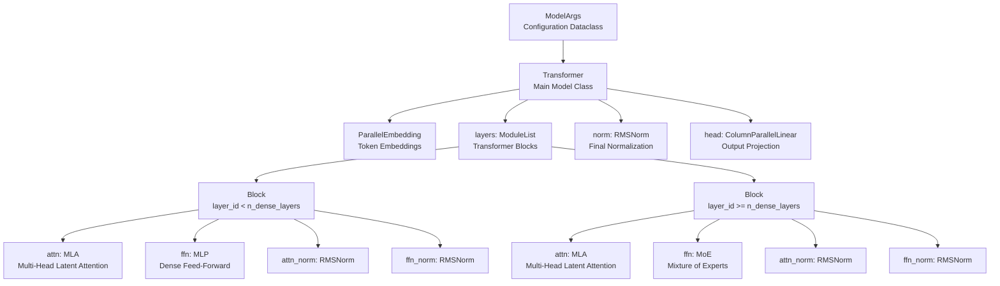
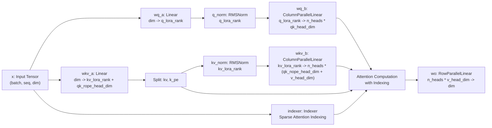
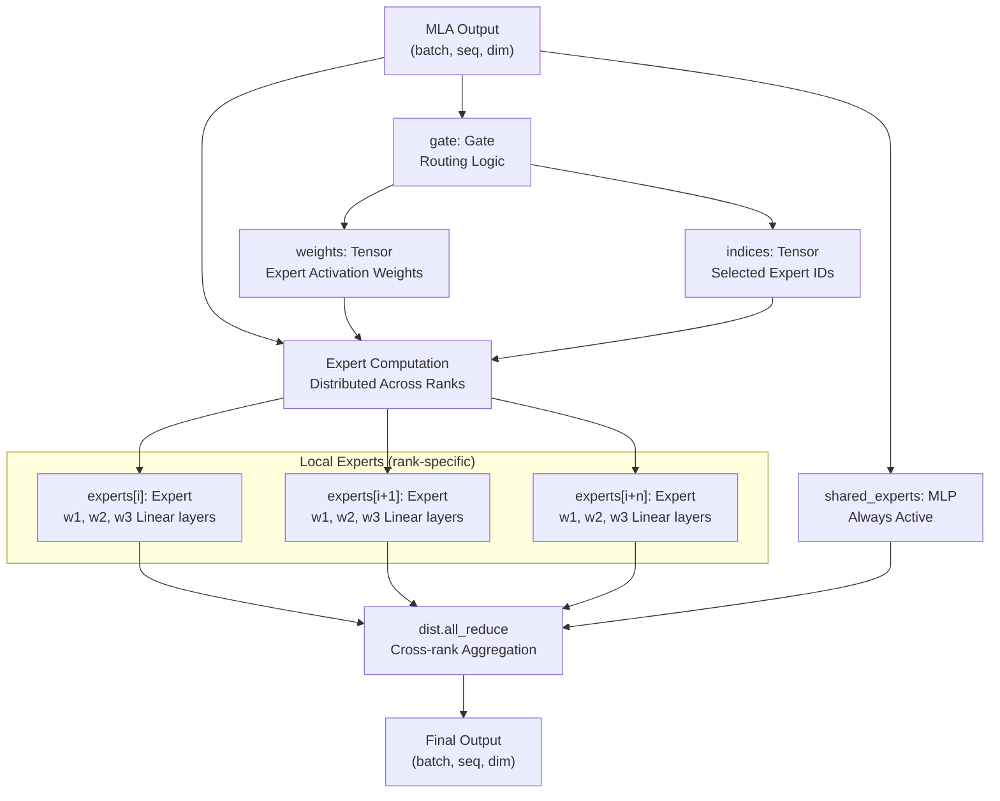
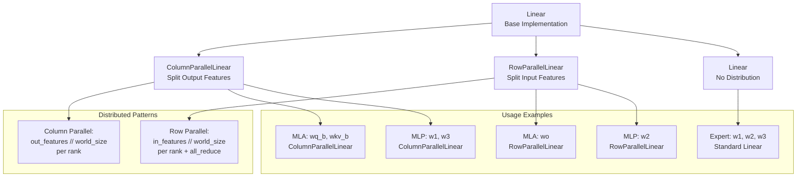

<!-- source: DeepWiki mcp.deepwiki.com · repo deepseek-ai/DeepSeek-V3.2-Exp · extra page Model Implementation · fetched 2026-10-30 -->

# Model Implementation

Relevant source files

The following files were used as context for generating this wiki page:

- [inference/model.py](inference/model.py)

This document provides technical documentation for the core model implementation in [inference/model.py:1-912](). It covers the `Transformer` architecture with Multi-Head Latent Attention (MLA), Mixture-of-Experts (MoE) layers, and distributed linear operations that form the foundation of DeepSeek-V3.2-Exp inference.

For weight conversion and checkpoint handling, see [Weight Conversion](#2.3.1). For the interactive generation interface, see [Text Generation](#2.3.2). For performance optimization kernels, see [Optimization Kernels](#2.3.4).

## Architecture Overview

The model implementation centers around the `Transformer` class which orchestrates multiple `Block` instances, each containing attention and feed-forward components. The architecture supports distributed execution across multiple GPUs with specialized parallel linear layers.

Sources: [inference/model.py:843-902]()

## Model Configuration

The `ModelArgs` dataclass defines all model hyperparameters including dimensions, expert configuration, and quantization settings. Key parameters control the 671B MoE architecture:

| Parameter | Value | Description |
|-----------|--------|-------------|
| `n_layers` | 27 | Total transformer blocks |
| `n_dense_layers` | 1 | Blocks using MLP instead of MoE |
| `n_routed_experts` | 64 | Routed experts per MoE layer |
| `n_shared_experts` | 2 | Shared experts per MoE layer |
| `n_activated_experts` | 6 | Active experts per token |
| `dim` | 2048 | Model hidden dimension |
| `dtype` | "bf16"/"fp8" | Computation precision |

The configuration supports extended sequence lengths through YaRN parameters (`rope_factor`, `beta_fast`, `beta_slow`) and sparse attention indexing (`index_topk`, `index_n_heads`).

Sources: [inference/model.py:18-92]()

## Multi-Head Latent Attention (MLA)

The `MLA` class implements the core attention mechanism with low-rank projections and rotary position encodings. It uses compressed key-value representations and an indexing mechanism for efficient long-context attention.

The MLA implementation includes several key features:

- **Low-rank projections**: Query uses rank `q_lora_rank`, key-value uses `kv_lora_rank`
- **Rotary embeddings**: Applied to query and key position components via `apply_rotary_emb`
- **KV caching**: Compressed representations stored in `kv_cache` and `pe_cache` buffers
- **Sparse indexing**: `Indexer` module selects top-k positions for attention via `fp8_index`
- **Dual computation paths**: Separate logic for prefill (with mask) vs decode phases

Sources: [inference/model.py:491-597](), [inference/model.py:431-480]()

## Mixture of Experts (MoE)

The MoE implementation consists of three main components: `Gate` for routing, `Expert` for computation, and `MoE` for orchestration. Each component handles distributed execution across multiple processes.

### Gate Mechanism

The `Gate` class implements expert selection using configurable scoring functions:

- **Score computation**: Linear projection from input to expert logits via `weight` parameter
- **Routing strategies**: Supports both `"softmax"` and `"sigmoid"` scoring functions  
- **Group-based routing**: Optional expert grouping with `n_expert_groups` and `n_limited_groups`
- **Top-k selection**: Selects `n_activated_experts` per input token

### Expert Architecture

Each `Expert` uses a standard SwiGLU feed-forward structure:
- `w1`: Input to intermediate dimension projection
- `w3`: Input to intermediate dimension gate projection  
- `w2`: Intermediate to output dimension projection
- Forward: `w2(silu(w1(x)) * w3(x))`

### Distributed Execution

The MoE layer distributes experts across ranks where each rank handles `n_routed_experts // world_size` experts. Expert outputs are aggregated via `dist.all_reduce` to combine results from all ranks.

Sources: [inference/model.py:635-698](), [inference/model.py:701-733](), [inference/model.py:736-793]()

## Distributed Linear Operations

The implementation provides three specialized linear layer variants for distributed execution, all inheriting from a base `Linear` class that supports FP8 quantization.

### Quantization Support

All linear layers support FP8 quantization when `dtype="fp8"`:
- **Weight quantization**: FP8 weights stored with block-wise scaling factors
- **Activation quantization**: Runtime quantization via `act_quant` kernel
- **Computation**: FP8 GEMM operations via `fp8_gemm` kernel
- **Scale management**: Block-wise scales stored as `nn.Parameter` when quantized

### Parallel Communication

- **ColumnParallelLinear**: No communication required, outputs remain distributed
- **RowParallelLinear**: Requires `dist.all_reduce` to sum partial results across ranks  
- **ParallelEmbedding**: Uses `all_reduce` to handle vocabulary distribution with masking

Sources: [inference/model.py:135-271](), [inference/model.py:93-132]()

## Supporting Components

### Normalization Layers

- **RMSNorm**: Root mean square normalization with optional residual connection fusion
- **LayerNorm**: Standard layer normalization for specific components like `Indexer.k_norm`

### Positional Encoding

The `precompute_freqs_cis` function generates complex exponential values for rotary position encodings with YaRN scaling support for extended context lengths. Key features:

- **Base frequencies**: Computed using `rope_theta` base value
- **YaRN extension**: Applies frequency scaling for sequences longer than `original_seq_len`
- **Correction factors**: Uses `beta_fast`, `beta_slow`, and `rope_factor` for smooth transitions

### Memory Management

The model uses persistent and non-persistent buffers for caching:
- **MLA caches**: `kv_cache`, `pe_cache` for compressed attention states
- **Indexer caches**: `k_cache`, `k_scale_cache` for FP8 key storage  
- **Rotary embeddings**: `freqs_cis` buffer precomputed during initialization

Sources: [inference/model.py:273-428](), [inference/model.py:796-841]()

---

