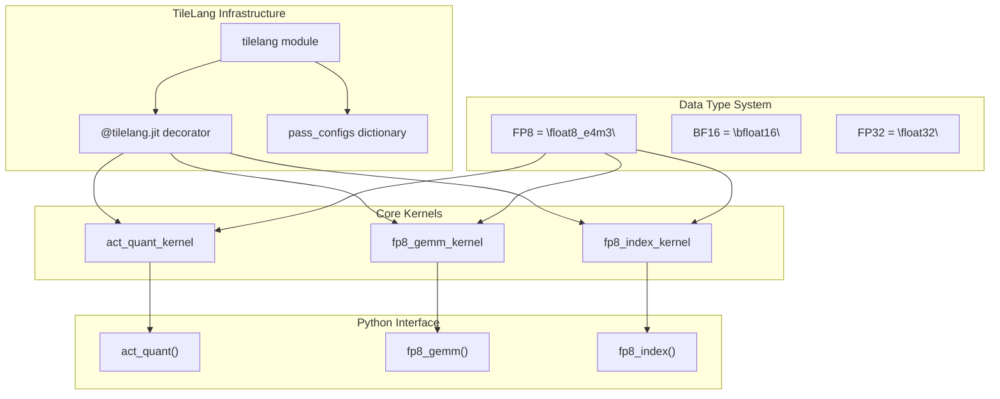
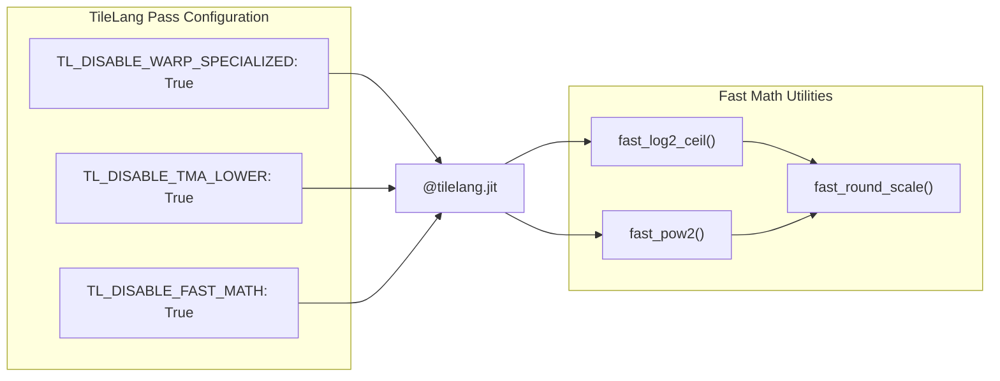
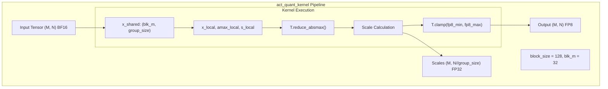
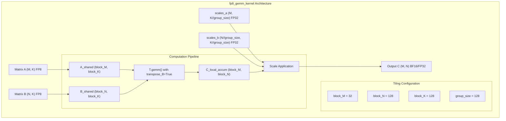
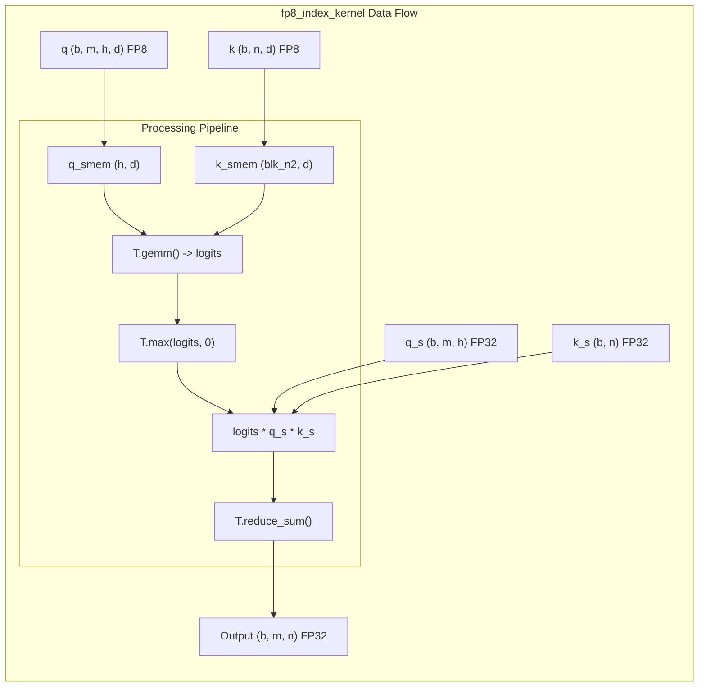
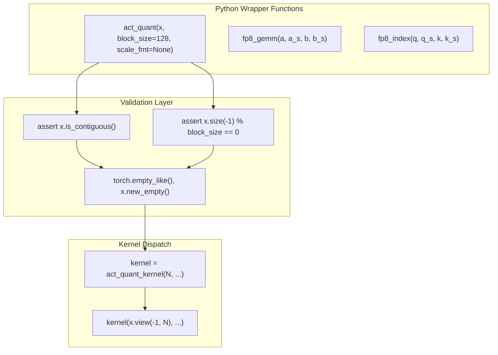

<!-- source: DeepWiki mcp.deepwiki.com · repo deepseek-ai/DeepSeek-V3.2-Exp · extra page Optimization Kernels · fetched 2026-10-30 -->

# Optimization Kernels

Relevant source files

The following files were used as context for generating this wiki page:

- [inference/kernel.py](inference/kernel.py)

This document covers the GPU optimization kernels implemented in `inference/kernel.py`, which provide FP8 quantization and high-performance matrix operations through TileLang JIT compilation. These kernels are critical components of the inference pipeline that enable efficient execution of the 671B parameter model through precision reduction and custom GPU code generation.

For information about the overall model implementation that uses these kernels, see [Model Implementation](#2.3.3). For details about the broader inference pipeline architecture, see [Core Components](#2.3).

## Kernel Architecture Overview

The optimization kernel system is built around three core computational primitives that work together to provide efficient FP8 inference capabilities.

Sources: [inference/kernel.py:1-275]()

## TileLang Integration

The kernel system leverages TileLang for Just-In-Time (JIT) compilation of GPU kernels with specific performance optimizations configured through the `pass_configs` dictionary.

### Compiler Configuration

The system uses a carefully tuned set of TileLang compiler passes to optimize for the specific workload characteristics of the DeepSeek model:

Sources: [inference/kernel.py:7-34]()

The fast math utilities provide optimized implementations of logarithmic and power operations using bit manipulation techniques for improved performance in quantization scaling calculations.

## Core Quantization Kernels

### Activation Quantization (`act_quant_kernel`)

The activation quantization kernel converts input tensors from higher precision formats (BF16) to FP8 with block-wise scaling factors.

Sources: [inference/kernel.py:36-111]()

The kernel implements pipelined execution with configurable staging based on the `round_scale` parameter, using `T.Pipelined(1, num_stages=num_stages)` where `num_stages` is 0 for rounded scaling or 2 for standard scaling.

### FP8 GEMM Kernel (`fp8_gemm_kernel`)

The FP8 GEMM kernel performs matrix multiplication with FP8 inputs and produces higher precision outputs, incorporating scaling factors for numerical accuracy.

Sources: [inference/kernel.py:114-196]()

The kernel uses a 4-stage pipeline (`T.Pipelined(K_iters, num_stages=4)`) and implements L2 cache optimization through `T.use_swizzle(panel_size=10)`.

### FP8 Index Kernel (`fp8_index_kernel`)

The FP8 index kernel computes attention-like index scores using FP8 precision for query and key matrices.

Sources: [inference/kernel.py:199-274]()

This kernel implements a two-level tiling scheme with `blk_n1 = 512` and `blk_n2 = 128`, using 2-stage pipelining for memory access optimization.

## Performance Optimizations

### Memory Hierarchy Management

The kernels implement sophisticated memory hierarchy optimization strategies:

| Optimization Technique | Implementation | Purpose |
|----------------------|----------------|---------|
| Shared Memory Buffering | `T.alloc_shared()` | Reduce global memory bandwidth |
| Fragment Allocation | `T.alloc_fragment()` | Optimize register usage |
| Pipeline Staging | `T.Pipelined()` | Hide memory latency |
| Swizzling | `T.use_swizzle()` | Improve L2 cache utilization |

Sources: [inference/kernel.py:58-63](), [inference/kernel.py:136-141](), [inference/kernel.py:144]()

### Block-wise Processing

All kernels implement block-wise processing with carefully chosen block sizes optimized for GPU architecture:

- **Activation Quantization**: 32×128 blocks with 128-element groups
- **FP8 GEMM**: 32×128×128 tiling for optimal tensor core utilization  
- **FP8 Index**: Two-level 512/128 blocking for memory coalescing

Sources: [inference/kernel.py:45-46](), [inference/kernel.py:120-122](), [inference/kernel.py:205-206]()

## Python Interface Layer

The kernel system provides Python wrapper functions that handle tensor validation, memory layout requirements, and kernel dispatch:

Sources: [inference/kernel.py:87-111](), [inference/kernel.py:171-196](), [inference/kernel.py:254-274]()

Each wrapper function performs input validation, allocates output tensors with appropriate dtypes, instantiates the corresponding TileLang kernel with runtime parameters, and dispatches the kernel execution with properly reshaped tensor views.

---

