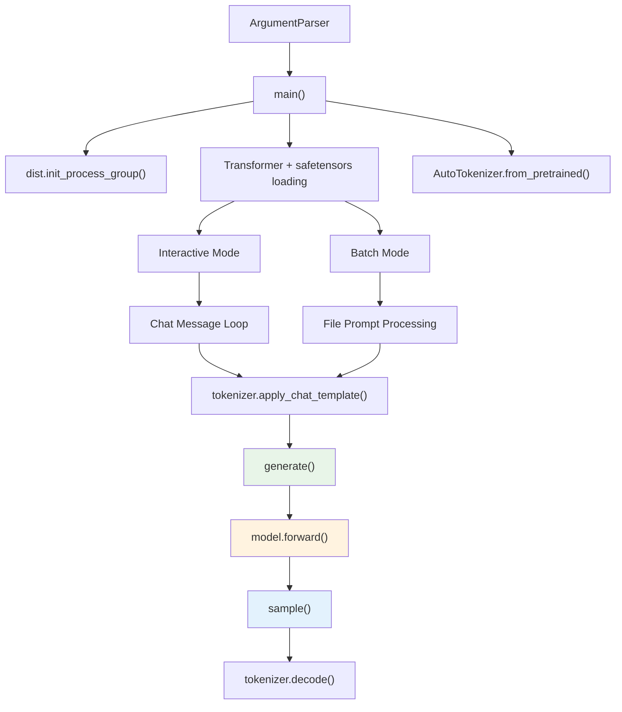
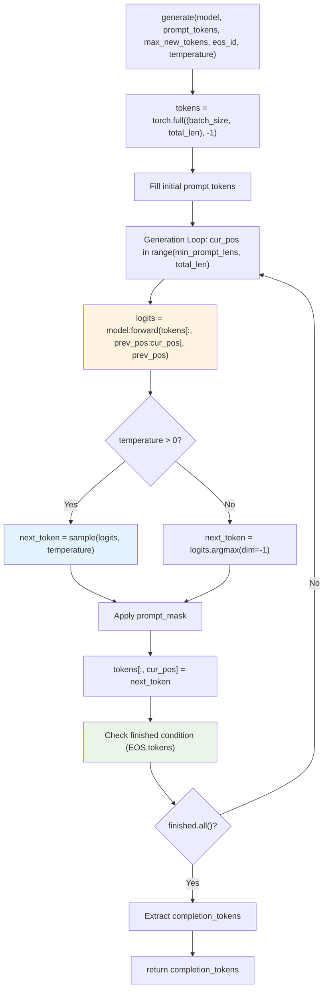
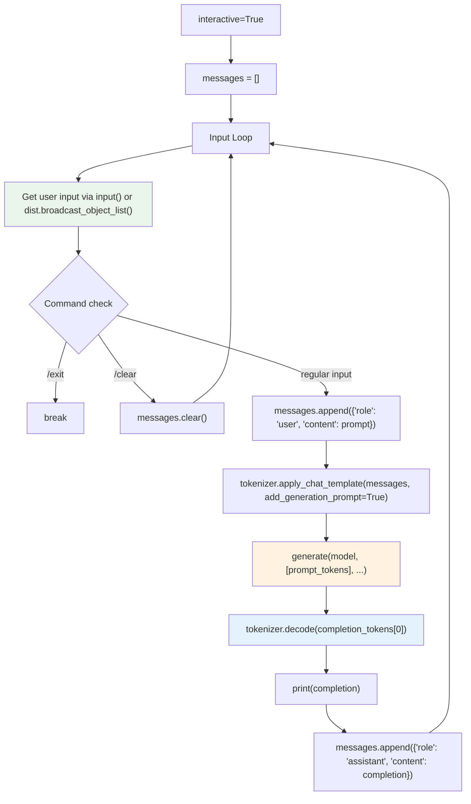
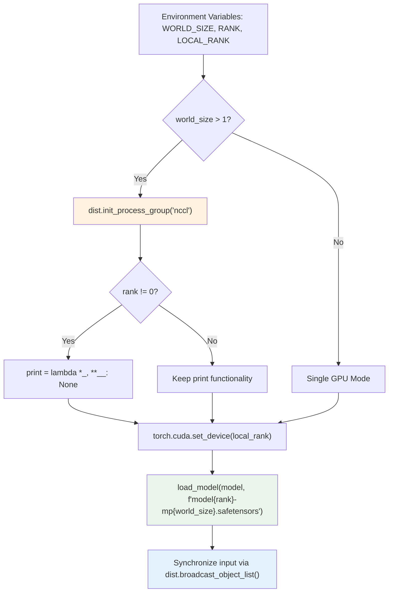

<!-- source: DeepWiki mcp.deepwiki.com · repo deepseek-ai/DeepSeek-V3.2-Exp · extra page Text Generation · fetched 2026-10-30 -->

# Text Generation

Relevant source files

The following files were used as context for generating this wiki page:

- [inference/generate.py](inference/generate.py)

This document covers the text generation interface provided by `generate.py`, which serves as the primary interactive and batch inference system for DeepSeek-V3.2-Exp. This module handles distributed token generation, conversation management, and provides both command-line and interactive interfaces for model inference.

For information about the underlying model architecture, see [Model Implementation](#2.3.3). For details about weight conversion prior to generation, see [Weight Conversion](#2.3.1).

## Purpose and Architecture

The text generation system is built around the `generate.py` script, which provides a complete inference pipeline supporting:

- **Distributed Execution**: Multi-GPU inference using `torch.distributed`
- **Interactive Chat**: Conversational interface with chat template support
- **Batch Processing**: File-based batch inference for multiple prompts
- **Temperature Sampling**: Configurable token sampling with temperature control

## Generation Pipeline Overview

Sources: [inference/generate.py:81-186]()

## Core Generation Functions

### Token Generation Loop

The primary generation logic is implemented in the `generate()` function, which handles autoregressive token generation with distributed execution support:

Sources: [inference/generate.py:30-78]()

### Temperature Sampling

The `sample()` function implements temperature-controlled token sampling using the Gumbel-max trick:

| Parameter | Type | Purpose |
|-----------|------|---------|
| `logits` | `torch.Tensor` | Raw model predictions for next token |
| `temperature` | `float` | Controls randomness (1.0 = normal, <1.0 = more deterministic, >1.0 = more random) |

The sampling process applies temperature scaling, softmax normalization, and Gumbel-max sampling for efficient token selection.

Sources: [inference/generate.py:14-27]()

## Execution Modes

### Interactive Mode

Interactive mode provides a conversational interface with persistent chat history:

Sources: [inference/generate.py:122-145]()

### Batch Mode

Batch mode processes multiple prompts from a file, supporting parallel inference:

| Configuration | Details |
|---------------|---------|
| Input Format | Double newline-separated prompts in text file |
| Batch Size Limit | `args.max_batch_size` from model configuration |
| Processing | Parallel tokenization and generation |
| Output Format | Prompt-completion pairs printed to stdout |

Sources: [inference/generate.py:146-156]()

## Distributed Execution Setup

The distributed execution system initializes multi-GPU inference using NCCL backend:

| Environment Variable | Purpose |
|---------------------|---------|
| `WORLD_SIZE` | Total number of processes |
| `RANK` | Global rank of current process |
| `LOCAL_RANK` | Local device rank for CUDA device assignment |

Sources: [inference/generate.py:100-119](), [inference/generate.py:125-134]()

## Command Line Interface

The CLI supports the following arguments for controlling generation behavior:

| Argument | Type | Default | Description |
|----------|------|---------|-------------|
| `--ckpt-path` | `str` | Required | Path to model checkpoint directory |
| `--config` | `str` | Required | Path to JSON model configuration |
| `--input-file` | `str` | `""` | File containing prompts for batch processing |
| `--interactive` | `bool` | `False` | Enable interactive chat mode |
| `--max-new-tokens` | `int` | `200` | Maximum tokens to generate per prompt |
| `--temperature` | `float` | `0.6` | Temperature for token sampling |

The system enforces that either `--input-file` or `--interactive` must be specified.

Sources: [inference/generate.py:177-186]()

---

