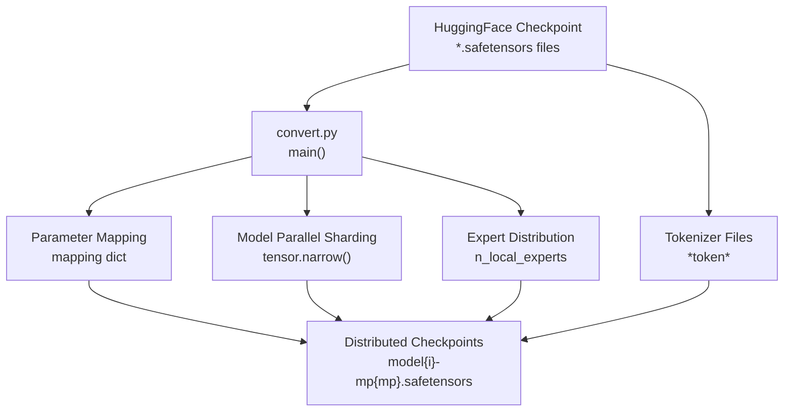
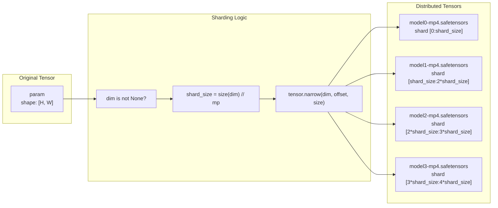
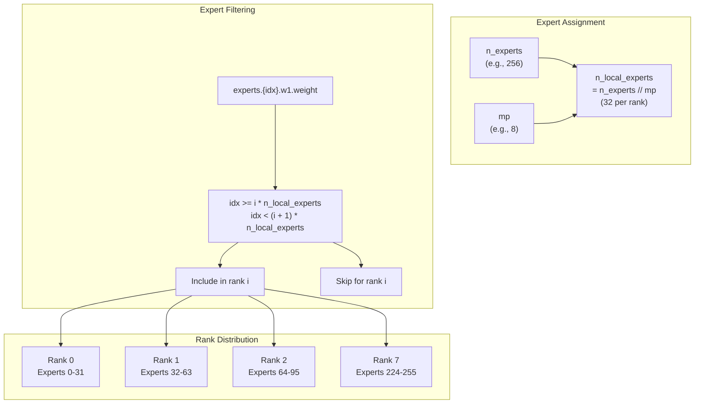

<!-- source: DeepWiki mcp.deepwiki.com · repo deepseek-ai/DeepSeek-V3.2-Exp · extra page Weight Conversion · fetched 2026-10-30 -->

# Weight Conversion

Relevant source files

The following files were used as context for generating this wiki page:

- [inference/convert.py](inference/convert.py)

## Purpose and Scope

The Weight Conversion system transforms HuggingFace model checkpoints into a distributed inference format optimized for multi-GPU execution. This conversion process handles parameter renaming, expert sharding for MoE models, and tensor partitioning across model parallel ranks.

For information about using the converted weights in inference, see [Text Generation](#2.3.2). For details about the model architecture that consumes these weights, see [Model Implementation](#2.3.3).

## Conversion Flow Overview

Sources: [inference/convert.py:37-90](), [inference/convert.py:54-80]()

## Parameter Mapping System

The conversion process uses a comprehensive parameter name mapping to transform HuggingFace parameter names into the format expected by the distributed inference implementation. The `mapping` dictionary defines transformations for all model components.

### Core Parameter Mappings

| HuggingFace Name | Target Name | Shard Dimension |
|------------------|-------------|-----------------|
| `embed_tokens` | `embed` | 0 |
| `q_proj` | `wq` | 0 |
| `q_a_proj` | `wq_a` | None |
| `kv_a_proj_with_mqa` | `wkv_a` | None |
| `o_proj` | `wo` | 1 |
| `gate_proj` | `w1` | 0 |
| `down_proj` | `w2` | 1 |
| `up_proj` | `w3` | 0 |
| `lm_head` | `head` | 0 |

### Parameter Name Transformations

The conversion applies systematic string replacements to standardize parameter names:

- `model.` prefix removal
- `self_attn` → `attn`
- `mlp` → `ffn`  
- `weight_scale_inv` → `scale`
- `e_score_correction_bias` → `bias`

Sources: [inference/convert.py:11-34](), [inference/convert.py:60-69]()

## Model Parallelism and Tensor Sharding

The sharding process partitions tensors along specific dimensions based on the `mapping` dictionary. Parameters with `dim=0` are split along the first dimension (typically input features), while `dim=1` parameters are split along the second dimension (typically output features). Parameters with `dim=None` are replicated across all ranks.

Sources: [inference/convert.py:76-79](), [inference/convert.py:51-52]()

## Expert Distribution for MoE Models

Expert parameters are distributed across model parallel ranks by expert index. Each rank receives a contiguous range of experts, with `n_local_experts = n_experts // mp` experts per rank. The conversion logic filters expert parameters based on whether their index falls within the target rank's assigned range.

Sources: [inference/convert.py:72-75](), [inference/convert.py:51]()

## File Operations and Output Format

### Input Processing

The conversion processes all `.safetensors` files in the source directory using the `safetensors.torch.safe_open` interface. Each parameter tensor is loaded individually to minimize memory usage during conversion.

### Output Generation

The system generates `mp` output files named `model{i}-mp{mp}.safetensors`, where `i` ranges from 0 to `mp-1`. Each file contains the parameters assigned to that model parallel rank.

### Auxiliary Files

All tokenizer-related files matching the pattern `*token*` are copied directly from the source to the destination directory without modification.

Sources: [inference/convert.py:54-55](), [inference/convert.py:84-85](), [inference/convert.py:87-89]()

## Command Line Interface

The conversion script accepts four required arguments:

- `--hf-ckpt-path`: Source directory containing HuggingFace checkpoint files
- `--save-path`: Target directory for converted checkpoint files  
- `--n-experts`: Total number of experts in the MoE model
- `--model-parallel`: Model parallelism factor for distribution

The script validates that `n_experts` is divisible by `model_parallel` to ensure even expert distribution across ranks.

Sources: [inference/convert.py:92-100]()

---

