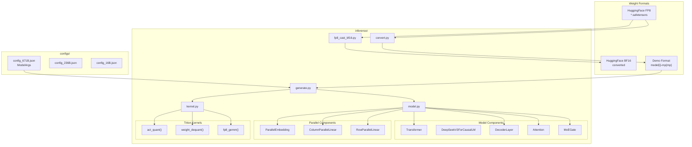
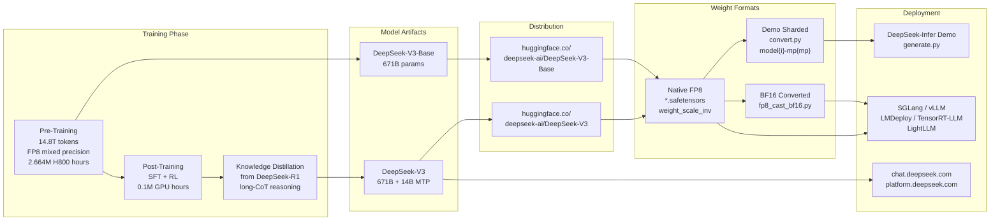
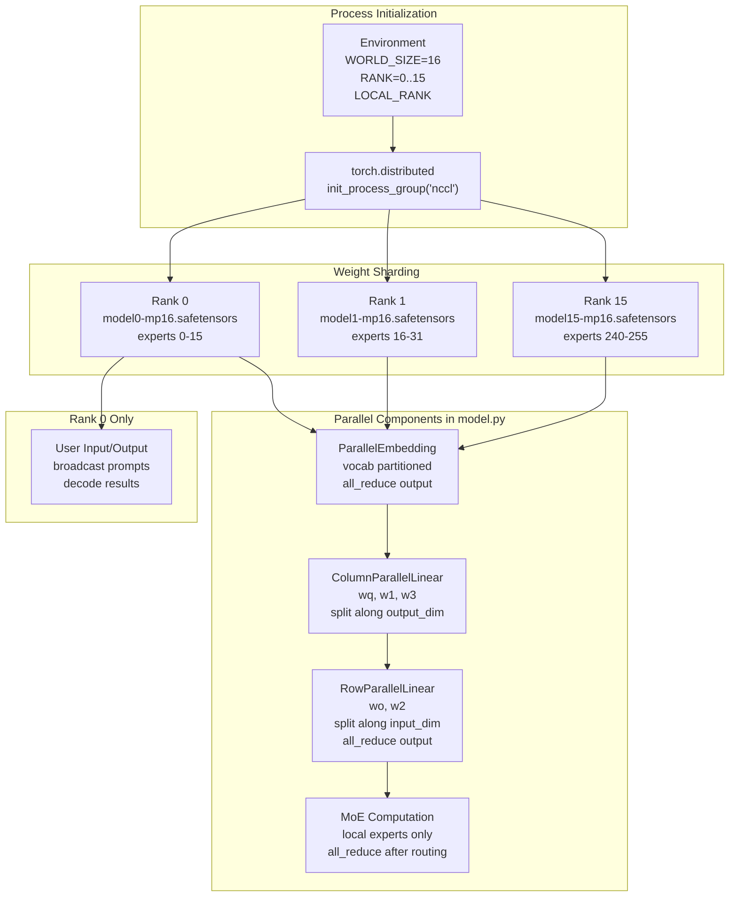

<!-- source: DeepWiki mcp.deepwiki.com · repo deepseek-ai/DeepSeek-V3 · page 1 Overview · fetched 2026-10-30 -->

# Overview

<details>
<summary>Relevant source files</summary>

The following files were used as context for generating this wiki page:

- [README.md](README.md)

</details>


DeepSeek-V3 is a Mixture-of-Experts (MoE) language model with 671B total parameters and 37B activated per token, designed to achieve performance comparable to leading closed-source models while maintaining efficient training and inference. This repository provides the inference implementation, weight conversion utilities, and integration guides for deploying DeepSeek-V3 across various hardware platforms.

## What is DeepSeek-V3?

DeepSeek-V3 represents a significant advancement in open-source large language models, combining architectural innovations with cost-effective training methodologies. The model was pre-trained on 14.8 trillion tokens using FP8 mixed precision (requiring 2.664M H800 GPU hours), followed by supervised fine-tuning, reinforcement learning, and knowledge distillation from DeepSeek-R1 (0.1M GPU hours). Two model variants are available:

- **DeepSeek-V3-Base**: Pre-trained foundation model (671B parameters)
- **DeepSeek-V3**: Chat-optimized model with Multi-Token Prediction module (671B + 14B MTP)

The model supports a 128K token context window and demonstrates state-of-the-art performance across code generation, mathematical reasoning, and multilingual tasks. Notably, the training process exhibited remarkable stability with no irrecoverable loss spikes or rollbacks throughout the entire training pipeline.

Sources: [README.md:45-54](), [README.md:91-99]()

## Key Architectural Innovations

DeepSeek-V3 builds upon four core innovations that differentiate it from previous large language models:

**1. Multi-head Latent Attention (MLA)**
- Reduces key-value cache memory requirements through latent projection
- Implements low-rank compression with separate LoRA ranks for queries (1536) and key-values (512)
- Uses hybrid RoPE (Rotary Position Embedding) and NOPE (No Position Embedding) for position encoding
- Implementation located in attention layers within [inference/model.py]()

**2. DeepSeekMoE Architecture**
- 256 experts per MoE layer with 8 experts activated per token
- Auxiliary-loss-free load balancing strategy using sigmoid-based routing with expert grouping
- Hybrid layer structure: 3 dense layers (layers 0-2) followed by 58 MoE layers (layers 3-60)
- Router uses `route_scale` parameter (2.5) with 8 expert groups for balanced computation
- Implementation in `DecoderLayer` and expert routing logic in [inference/model.py]()

**3. Multi-Token Prediction (MTP)**
- 14B parameter module that predicts multiple future tokens simultaneously
- Enables speculative decoding for inference acceleration
- Trained as an auxiliary objective alongside next-token prediction
- MTP weights stored separately and share embeddings with main model
- Module structure documented in `README_WEIGHTS.md`

**4. FP8 Mixed Precision Training and Inference**
- Native FP8 (UE8M0 format) training framework validated at extreme scale
- Block-wise quantization with 128×128 block scaling factors (`weight_scale_inv`)
- Optimized Triton kernels for quantization (`act_quant`), dequantization (`weight_dequant`), and matrix multiplication (`fp8_gemm`)
- Kernel implementations in [inference/kernel.py]()

These innovations collectively enable DeepSeek-V3 to achieve 671B total parameters with only 37B activation per token, significantly reducing computational costs while maintaining strong performance.

Sources: [README.md:63-67](), [README.md:48-49](), [README.md:73-76]()

## Repository Structure and Components

**DeepSeek-V3 Codebase Organization**



The repository is organized into three primary layers:

**Core Model Implementation** ([inference/model.py]())
- `Transformer`: Main model class with 61 layers (3 dense + 58 MoE)
- `DeepSeekV3ForCausalLM`: CausalLM wrapper for generation tasks
- `DecoderLayer`: Transformer decoder block containing attention and FFN/MoE
- `Attention`: MLA implementation with LoRA compression and hybrid position encoding
- `MoEGate`: Sigmoid-based expert routing with auxiliary-loss-free balancing

**Distributed Parallel Components** ([inference/model.py]())
- `ParallelEmbedding`: Vocabulary-partitioned embedding layer with all-reduce aggregation
- `ColumnParallelLinear`: Output-feature partitioned linear layer (used for `wq`, `w1`, `w3`)
- `RowParallelLinear`: Input-feature partitioned linear layer with all-reduce (used for `wo`, `w2`)

**FP8 Optimization Kernels** ([inference/kernel.py]())
- `act_quant(input, scale)`: Block-wise activation quantization to FP8
- `weight_dequant(weight, scale_inv)`: Weight dequantization with 128×128 block scaling
- `fp8_gemm(a, b, scale_a, scale_b)`: Fused FP8 matrix multiplication with autotuning

**Weight Conversion and Generation Utilities**
- `convert.py`: Transforms HuggingFace weights to model-parallel sharded format for distributed inference
- `fp8_cast_bf16.py`: Converts native FP8 weights to BF16 for frameworks requiring higher precision
- `generate.py`: Entry point for text generation with `torchrun` distributed execution

**Configuration Files** ([inference/configs/]())
- `config_671B.json`: ModelArgs for the full 671B model (128 attention heads, 256 experts)
- `config_236B.json`: Configuration for the 236B variant
- `config_16B.json`: Configuration for the 16B variant

Sources: [README.md:240-248](), [README.md:285-297]()

## Training to Deployment Lifecycle

**DeepSeek-V3 Development Pipeline**



DeepSeek-V3 progresses through a multi-stage training pipeline before deployment:

**Training Stages:**
1. **Pre-Training** (2.664M H800 GPU hours): Model trained on 14.8 trillion diverse tokens using FP8 mixed precision framework with auxiliary-loss-free MoE load balancing
2. **Post-Training** (0.1M GPU hours): Supervised fine-tuning and reinforcement learning to align model behavior
3. **Knowledge Distillation**: Transfer of long Chain-of-Thought reasoning capabilities from DeepSeek-R1 series models, incorporating verification and reflection patterns

**Model Variants:**
- **DeepSeek-V3-Base**: Foundation model from pre-training (671B parameters)
- **DeepSeek-V3**: Chat-optimized model with MTP module (671B + 14B = 685B total)

**Weight Distribution:**
Models are distributed via HuggingFace in native FP8 format as `*.safetensors` files with `weight_scale_inv` metadata. Users can convert to BF16 using [inference/fp8_cast_bf16.py]() or shard for distributed inference using [inference/convert.py]().

**Deployment Options:**
- **Reference Implementation**: DeepSeek-Infer Demo with [inference/generate.py]() for multi-node execution via `torchrun`
- **Community Frameworks**: SGLang, vLLM, LMDeploy, TensorRT-LLM, LightLLM with varying FP8/BF16/quantization support
- **Official Platforms**: chat.deepseek.com (web interface) and platform.deepseek.com (OpenAI-compatible API)

Sources: [README.md:71-82](), [README.md:91-103](), [README.md:223-226]()

## Model Configuration and Parameters

The model architecture is configured through `ModelArgs` dataclass in [inference/model.py]() and instantiated via JSON configuration files. The 671B model uses the following key parameters:

| **Parameter Category** | **Configuration** | **Value** |
|------------------------|-------------------|-----------|
| **Model Scale** | `dim` | 7,168 |
| | `n_layers` | 61 (3 dense + 58 MoE) |
| | `n_heads` | 128 |
| | Total parameters | 671B |
| | Activated per token | 37B |
| **Vocabulary** | `vocab_size` | 129,280 tokens |
| **Context** | `max_seq_len` | 128K tokens |
| **MoE Settings** | `n_routed_experts` | 256 |
| | `n_expert_per_token` | 8 |
| | `first_k_dense_replace` | 3 |
| | `n_group` | 8 |
| | `route_scale` | 2.5 |
| **MLA Settings** | `q_lora_rank` | 1,536 |
| | `kv_lora_rank` | 512 |
| | `qk_nope_head_dim` | 128 |
| | `qk_rope_head_dim` | 64 |
| | `v_head_dim` | 128 |
| **Quantization** | `weight_bits` | 8 (FP8) |
| | Quantization format | UE8M0 |
| | Block size | 128×128 |

**Layer Structure:**
- Layers 0-2: Dense FFN with `intermediate_size` = 18,432
- Layers 3-60: MoE with 256 experts, 8 active per token
- Each MoE expert has same dimensions as dense FFN

The configuration is loaded from [inference/configs/config_671B.json]() and passed to the `Transformer` class constructor. Other model sizes (16B, 236B) use different configurations with adjusted layer counts and expert numbers.

Sources: [README.md:91-99](), [README.md:112-149]()

## Distributed Inference Architecture

**Multi-GPU Execution with PyTorch Distributed**



DeepSeek-V3 uses PyTorch Distributed (NCCL backend) for multi-GPU and multi-node inference. The [inference/convert.py]() script shards weights across ranks with `--model-parallel N`, creating `model{i}-mp{N}.safetensors` files where each rank loads its shard.

**Parallel Layer Types:**

**`ParallelEmbedding`** ([inference/model.py]())
- Vocabulary partitioned: each rank holds `vocab_size / world_size` embeddings
- Forward pass performs local embedding lookup, then `all_reduce` to combine results
- Used for token embeddings at model input

**`ColumnParallelLinear`** ([inference/model.py]())
- Output features split across ranks: `output_dim / world_size` per rank
- No collective communication during forward pass
- Used for query (`wq`), gate (`w1`), up (`w3`) projections in attention and FFN

**`RowParallelLinear`** ([inference/model.py]())
- Input features split across ranks: `input_dim / world_size` per rank
- Forward pass applies local linear transformation, then `all_reduce` to sum partial results
- Used for output (`wo`) and down (`w2`) projections

**MoE Expert Distribution:**
- 256 total experts divided evenly: `n_experts / world_size` per rank
- Each rank stores and computes only its local expert subset
- Router computes scores for all 256 experts but only forwards to local experts
- `all_reduce` aggregates expert outputs across ranks

**Execution Flow:**
1. Rank 0 reads input and broadcasts prompts via `dist.broadcast_object_list()`
2. All ranks execute forward pass using local weights and parallel layers
3. Collective operations (`all_reduce`) synchronize intermediate results
4. Rank 0 decodes output tokens and prints results

Example command for 2-node, 16-GPU inference:
```bash
torchrun --nnodes 2 --nproc-per-node 8 --node-rank $RANK --master-addr $ADDR \
  generate.py --ckpt-path /path/to/DeepSeek-V3-Demo --config configs/config_671B.json \
  --interactive --temperature 0.7
```

Sources: [README.md:285-303]()

## Deployment Framework Ecosystem

DeepSeek-V3 supports deployment through multiple inference frameworks, each offering different optimizations and hardware support:

| **Framework** | **Precision** | **Hardware** | **Key Optimizations** | **Status** |
|---------------|---------------|--------------|----------------------|------------|
| **DeepSeek-Infer Demo** | FP8, BF16 | NVIDIA GPUs | Reference implementation with [inference/generate.py]() | ✅ Available |
| **SGLang** | FP8 W8A8, BF16 | NVIDIA, AMD GPUs | MLA optimizations, DP Attention, Torch Compile, multi-node TP | ✅ Full support |
| **LMDeploy** | FP8, BF16 | NVIDIA GPUs, Huawei Ascend NPU | PyTorch integration, flexible local/cloud deployment | ✅ Available |
| **TensorRT-LLM** | BF16, INT4/INT8 | NVIDIA GPUs | Weight-only quantization, custom NVIDIA branch | ✅ Available (FP8 coming soon) |
| **vLLM** | FP8, BF16 | NVIDIA, AMD GPUs | Pipeline parallelism for multi-machine deployment | ✅ Available |
| **LightLLM** | FP8/BF16 mixed | NVIDIA GPUs | Single/multi-node tensor parallelism | ✅ Available |

**Reference Implementation Usage:**

The DeepSeek-Infer Demo provides a lightweight reference for deploying the model:

1. **Weight Conversion** ([inference/convert.py]()):
```bash
python convert.py --hf-ckpt-path /path/to/DeepSeek-V3 \
  --save-path /path/to/DeepSeek-V3-Demo \
  --n-experts 256 --model-parallel 16
```
This shards HuggingFace weights into `model{i}-mp16.safetensors` files for 16-way model parallelism.

2. **Interactive Generation** ([inference/generate.py]()):
```bash
torchrun --nnodes 2 --nproc-per-node 8 --node-rank $RANK --master-addr $ADDR \
  generate.py --ckpt-path /path/to/DeepSeek-V3-Demo \
  --config configs/config_671B.json --interactive --temperature 0.7
```

3. **Batch Inference** ([inference/generate.py]()):
```bash
torchrun --nnodes 2 --nproc-per-node 8 --node-rank $RANK --master-addr $ADDR \
  generate.py --ckpt-path /path/to/DeepSeek-V3-Demo \
  --config configs/config_671B.json --input-file prompts.txt
```

**FP8 to BF16 Conversion:**

For frameworks requiring BF16 precision, use [inference/fp8_cast_bf16.py]():
```bash
python fp8_cast_bf16.py --input-fp8-hf-path /path/to/fp8_weights \
  --output-bf16-hf-path /path/to/bf16_weights
```
This dequantizes FP8 weights using `weight_dequant()` from [inference/kernel.py]() and saves as BF16 safetensors.

**Official Platforms:**
- Web Interface: [chat.deepseek.com](https://chat.deepseek.com)
- API Service: [platform.deepseek.com](https://platform.deepseek.com) (OpenAI-compatible)

Sources: [README.md:227-341](), [README.md:240-248]()

## Performance and Capabilities

DeepSeek-V3 demonstrates strong performance across a wide range of benchmarks, particularly excelling in areas like mathematics, code generation, and reasoning tasks. It offers a 128K token context window, allowing it to process and reason over very long inputs.

The model's performance is comparable to leading closed-source models while being fully open-source. For detailed benchmark results and comparisons, see [Benchmarks and Evaluations](#1.3).

Sources: [README.md:107-161]()

---

