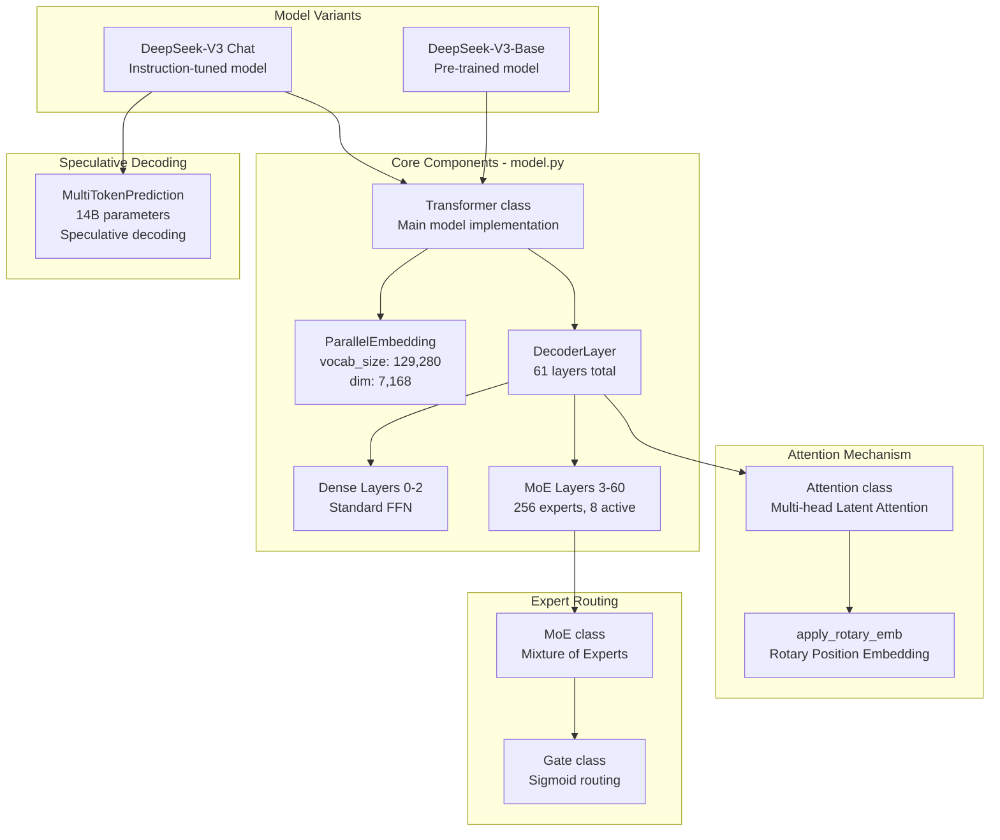
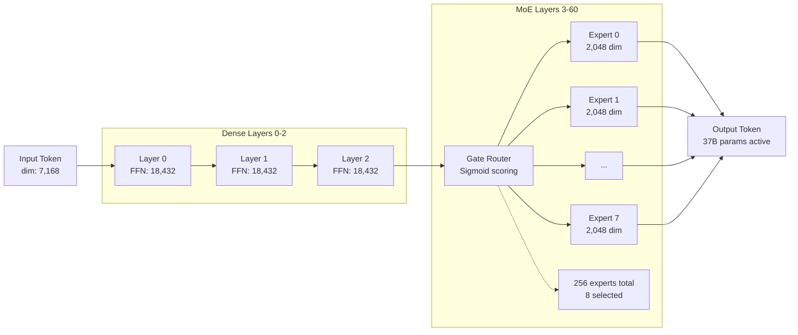
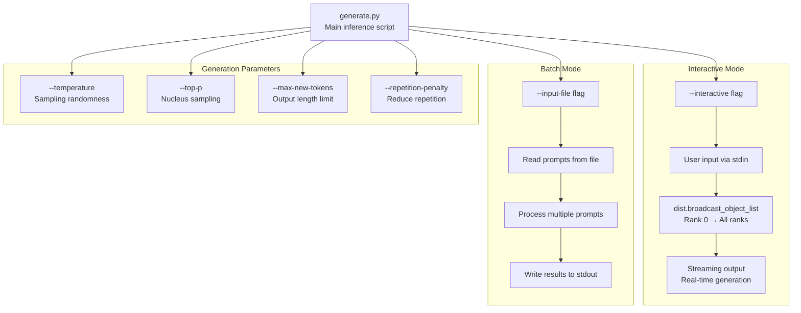
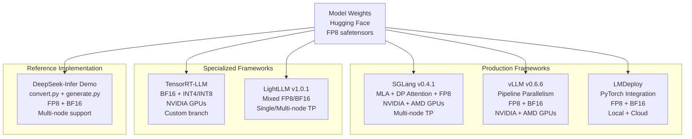

<!-- source: DeepWiki mcp.deepwiki.com · repo deepseek-ai/DeepSeek-V3 · page 1.1 Features and Capabilities · fetched 2026-10-30 -->

# Features and Capabilities

<details>
<summary>Relevant source files</summary>

The following files were used as context for generating this wiki page:

- [README.md](README.md)

</details>


This page details the functional capabilities and specifications of DeepSeek-V3, including model variants, supported tasks, performance characteristics, and deployment options. For architectural details about MLA, MoE, and MTP, see [Model Architecture Overview](#1.2). For comprehensive benchmark results, see [Benchmarks and Evaluations](#1.3). For deployment instructions, see [Local Deployment Options](#2.2).

## Model Variants and Specifications

DeepSeek-V3 is available in two primary variants, both based on a Mixture-of-Experts (MoE) architecture with 671 billion total parameters and 37 billion activated parameters per token.

### Available Models

| Model | Total Parameters | Activated Parameters | Context Length | Additional Modules | Total Storage |
|-------|-----------------|---------------------|----------------|-------------------|---------------|
| DeepSeek-V3-Base | 671B | 37B | 128K tokens | - | 671B |
| DeepSeek-V3 (Chat) | 671B | 37B | 128K tokens | 14B MTP | 685B |

**Sources:** [README.md:91-99]()

### Core Architecture Components

The following diagram maps the high-level capabilities to their concrete implementations in the codebase:



**Sources:** [README.md:47-51](), [README.md:91-99]()

### Parameter Configuration

The model uses `ModelArgs` configuration defined in [inference/model.py]() to specify all architectural parameters:

| Configuration Parameter | Value | Description |
|------------------------|-------|-------------|
| `dim` | 7,168 | Hidden dimension |
| `n_layers` | 61 | Total transformer layers |
| `n_dense_layers` | 3 | Dense FFN layers (0-2) |
| `n_heads` | 128 | Number of attention heads |
| `n_routed_experts` | 256 | Total number of experts in MoE |
| `n_activated_experts` | 8 | Experts activated per token |
| `vocab_size` | 129,280 | Vocabulary size |
| `moe_intermediate_size` | 2,048 | Expert intermediate dimension |
| `rope_theta` | 10,000 | RoPE base frequency |
| `rope_factor` | 40 | RoPE scaling factor |
| `max_seq_len` | 131,072 | Maximum context (128K) |

**Sources:** [inference/model.py]() (ModelArgs dataclass)

## Computational Characteristics

### Activation Pattern

DeepSeek-V3 uses sparse activation to achieve computational efficiency while maintaining model capacity:



**Activation Efficiency:**
- **Total Parameters:** 671B
- **Activated per Token:** 37B (5.5% activation rate)
- **Dense Layers:** All 18,432 intermediate dimensions active
- **MoE Layers:** 8 out of 256 experts per layer (~3.1% expert activation)

**Sources:** [README.md:47](), [README.md:112-116]()

### Precision Support

The model natively supports FP8 quantization with runtime dequantization:

| Precision Mode | Native Support | Use Case | Conversion Required |
|---------------|----------------|----------|---------------------|
| FP8 (UE8M0) | ✓ Native | Production inference, training | No |
| BF16 | Via conversion | Framework compatibility | Yes ([fp8_cast_bf16.py]()) |
| INT4/INT8 | Framework-dependent | Memory-constrained deployment | Framework-specific |

**FP8 Quantization Details:**
- **Block Size:** 128×128 for weight matrices
- **Scale Format:** UE8M0 (unsigned 8-bit exponent, 0 mantissa bits)
- **Storage:** `weight_scale_inv` tensors alongside weights
- **Dequantization:** Performed by `weight_dequant` kernel in [inference/kernel.py]()

**Sources:** [README.md:240-247](), [inference/fp8_cast_bf16.py]()

## Supported Tasks and Performance

### Task Coverage

DeepSeek-V3 demonstrates strong performance across multiple domains:

```mermaid
graph TB
    Model["DeepSeek-V3<br/>671B/37B MoE"]
    
    subgraph "Code Tasks"
        HE["HumanEval<br/>Pass@1: 65.2%"]
        MBPP["MBPP<br/>Pass@1: 75.4%"]
        LCB["LiveCodeBench<br/>Pass@1: 19.4%"]
        Codeforces["Codeforces<br/>Percentile: 51.6"]
    end
    
    subgraph "Math Tasks"
        GSM8K["GSM8K<br/>EM: 89.3%"]
        MATH["MATH<br/>EM: 61.6%"]
        AIME["AIME 2024<br/>Pass@1: 39.2%"]
        CNMO["CNMO 2024<br/>Pass@1: 43.2%"]
    end
    
    subgraph "Language Tasks"
        MMLU["MMLU<br/>Acc: 87.1%"]
        BBH["BBH<br/>EM: 87.5%"]
        DROP["DROP<br/>F1: 89.0%"]
        LongBench["LongBench v2<br/>Acc: 48.7%"]
    end
    
    subgraph "Multilingual"
        CEval["C-Eval<br/>Acc: 90.1%"]
        CMMLU["CMMLU<br/>Acc: 88.8%"]
        MMMLU["MMMLU-non-English<br/>Acc: 79.4%"]
    end
    
    Model --> HE
    Model --> MBPP
    Model --> LCB
    Model --> Codeforces
    Model --> GSM8K
    Model --> MATH
    Model --> AIME
    Model --> CNMO
    Model --> MMLU
    Model --> BBH
    Model --> DROP
    Model --> LongBench
    Model --> CEval
    Model --> CMMLU
    Model --> MMMLU
```



**Sources:** [README.md:106-194]()

### Performance Characteristics

#### Base Model Performance

The Base model excels at foundational capabilities:

| Domain | Top Benchmark | Score | Comparison |
|--------|--------------|-------|------------|
| **Code** | HumanEval | 65.2% Pass@1 | Best in class vs. open-source |
| | LiveCodeBench | 19.4% Pass@1 | +25% vs. LLaMA3.1 405B |
| **Math** | MATH | 61.6% EM | +13% vs. Qwen2.5 72B |
| | GSM8K | 89.3% EM | Strong arithmetic reasoning |
| **English** | MMLU-Pro | 64.4% Acc | +10% vs. Qwen2.5 72B |
| | BBH | 87.5% EM | Superior complex reasoning |
| **Chinese** | C-Eval | 90.1% Acc | Near state-of-the-art |
| **Context** | NIAH (128K) | Near-perfect | Full 128K context utilization |

**Sources:** [README.md:112-148](), [README.md:156-161]()

#### Chat Model Performance

The Chat variant adds conversational and instruction-following capabilities:

| Domain | Top Benchmark | Score | Note |
|--------|--------------|-------|------|
| **Code** | LiveCodeBench (CoT) | 40.5% Pass@1 | Best among open-source |
| | Codeforces | 51.6 percentile | Exceeds GPT-4o (23.6) |
| | Aider-Polyglot | 49.6% Acc | Multi-language editing |
| **Math** | AIME 2024 | 39.2% Pass@1 | Near Claude-3.5 level |
| | MATH-500 | 90.2% EM | +16% vs. Qwen2.5 72B |
| **Reasoning** | MMLU-Redux | 89.1% EM | Competitive with GPT-4o |
| | GPQA-Diamond | 59.1% Pass@1 | Strong scientific reasoning |
| **Long Context** | LongBench v2 | 48.7% Acc | Best among all models |
| **Chinese** | C-SimpleQA | 64.8% Correct | +9% vs. GPT-4o |

**Sources:** [README.md:165-194]()

### Open-Ended Generation

The Chat model demonstrates strong performance in conversational settings:

| Benchmark | Score | Comparison |
|-----------|-------|------------|
| Arena-Hard | 85.5 | Best (tied with Claude-3.5) |
| AlpacaEval 2.0 (LC) | 70.0 | +18 points vs. Claude-3.5 |

**Sources:** [README.md:207-215]()

## Inference Capabilities

### Execution Modes

The model supports two primary inference modes through [inference/generate.py]():



**Interactive Mode Features:**
- Real-time conversational interface
- Multi-turn dialogue support
- Distributed execution across all ranks
- Streaming token generation

**Batch Mode Features:**
- File-based input processing
- Efficient batch processing
- Suitable for evaluation and benchmarking
- Parallel generation across inputs

**Sources:** [inference/generate.py](), [README.md:293-303]()

### Distributed Inference Support

The model supports multi-node and multi-GPU deployment:

| Configuration | Command Example | Hardware Requirement |
|--------------|----------------|---------------------|
| Single-node, 8 GPUs | `torchrun --nproc-per-node 8` | 8× GPUs with ≥80GB VRAM |
| Two-node, 16 GPUs | `torchrun --nnodes 2 --nproc-per-node 8` | 2 nodes × 8 GPUs |
| Custom topology | `--node-rank $RANK --master-addr $ADDR` | Configurable |

**Parallelism Strategies:**
- **Tensor Parallelism:** Weights sharded via [inference/convert.py]()
- **Expert Parallelism:** 256 experts distributed across `world_size` ranks
- **Communication:** NCCL backend for GPU synchronization

**Sources:** [README.md:293-303]()

## Training Features

### Pre-Training Efficiency

DeepSeek-V3 was trained with unprecedented efficiency:

| Metric | Value | Significance |
|--------|-------|-------------|
| Training Data | 14.8 trillion tokens | Diverse, high-quality corpus |
| Precision | FP8 mixed precision | First large-scale FP8 training |
| GPU Hours | 2.664M H800 hours | Pre-training only |
| Training Stability | Zero rollbacks | No irrecoverable loss spikes |
| Post-Training | 0.1M GPU hours | SFT + RL stages |

**Training Innovations:**
- **FP8 Mixed Precision:** Native FP8 training framework validated at 671B scale
- **Communication Optimization:** Near-complete computation-communication overlap for cross-node MoE
- **Load Balancing:** Auxiliary-loss-free strategy minimizes performance degradation
- **Multi-Token Prediction:** MTP training objective improves model performance

**Sources:** [README.md:71-76](), [README.md:49-54]()

### Knowledge Distillation

The Chat variant incorporates advanced reasoning through distillation:

| Source Model | Target Model | Capabilities Transferred |
|-------------|--------------|------------------------|
| DeepSeek-R1 series | DeepSeek-V3 Chat | Long Chain-of-Thought reasoning |
| | | Verification patterns |
| | | Reflection capabilities |

**Distillation Benefits:**
- Improved reasoning performance on math and code tasks
- Controlled output style and length
- Maintains conversational naturalness

**Sources:** [README.md:80-82]()

## Deployment Flexibility

### Framework Support

DeepSeek-V3 integrates with six major inference frameworks, each optimized for different use cases:



**Sources:** [README.md:229-239]()

### Framework Capabilities Matrix

| Framework | FP8 Support | BF16 Support | Multi-Node | MLA Optimized | Special Features |
|-----------|-------------|--------------|------------|---------------|-----------------|
| SGLang | ✓ | ✓ | ✓ | ✓ | DP Attention, FP8 KV Cache, Torch Compile |
| vLLM | ✓ | ✓ | ✓ (PP) | - | Pipeline parallelism, AMD GPU support |
| LMDeploy | ✓ | ✓ | ✓ | - | PyTorch workflow, cloud deployment |
| TensorRT-LLM | Coming | ✓ | ✓ | - | INT4/INT8 quantization |
| LightLLM | ✓ | ✓ | ✓ | - | Mixed precision deployment |
| Demo | ✓ | ✓ | ✓ | - | Reference implementation |

**PP** = Pipeline Parallelism

**Sources:** [README.md:232-336]()

### Hardware Support

| Hardware | Framework Support | Precision | Status |
|----------|------------------|-----------|---------|
| NVIDIA GPUs | All frameworks | FP8, BF16, INT4/INT8 | ✓ Available |
| AMD GPUs | SGLang, vLLM | FP8, BF16 | ✓ Available (Day-One) |
| Huawei Ascend NPU | MindIE | BF16, INT8 | ✓ Available |

**Sources:** [README.md:237-341]()

### Weight Conversion Utilities

The repository provides two conversion utilities:

#### Model Parallel Sharding: `convert.py`

Converts Hugging Face format to sharded format for distributed inference:

```bash
python convert.py \
  --hf-ckpt-path /path/to/DeepSeek-V3 \
  --save-path /path/to/DeepSeek-V3-Demo \
  --n-experts 256 \
  --model-parallel 16
```

**Features:**
- Parameter renaming from HuggingFace to DeepSeek format
- Expert distribution: `n_experts / model_parallel` per shard
- Weight sharding along specified dimensions
- Tokenizer copying
- Output: `model{rank}-mp{world_size}.safetensors` files

**Sources:** [README.md:285-289](), [inference/convert.py]()

#### Precision Conversion: `fp8_cast_bf16.py`

Converts native FP8 weights to BF16 for broader framework compatibility:

```bash
python fp8_cast_bf16.py \
  --input-fp8-hf-path /path/to/fp8_weights \
  --output-bf16-hf-path /path/to/bf16_weights
```

**Features:**
- Iterates through `*.safetensors` files
- Block-wise dequantization using `weight_dequant` kernel
- Updates `model.safetensors.index.json` weight map
- Preserves model structure and metadata

**Sources:** [README.md:242-247](), [inference/fp8_cast_bf16.py]()

## Multi-Token Prediction Module

The Chat variant includes a 14B parameter Multi-Token Prediction (MTP) module:

| Capability | Description | Status |
|-----------|-------------|--------|
| **Speculative Decoding** | Predicts multiple future tokens in parallel | Framework implementation pending |
| **Parameter Sharing** | Shares embeddings with main model | ✓ Implemented |
| **Weight Storage** | Separate from main 671B weights | ✓ Available on Hugging Face |
| **Training Objective** | Multi-token prediction during training | ✓ Used in training |

**MTP Benefits:**
- Potential inference acceleration through speculative decoding
- Improved model performance through auxiliary prediction task
- Parameter-efficient: 14B additional parameters (2% overhead)

**Current Status:** MTP weights are available but speculative decoding support is under development in community frameworks (e.g., [SGLang tracking issue](https://github.com/sgl-project/sglang/issues/2591)).

**Sources:** [README.md:99](), [README.md:66-67](), [README.md:232]()

## Access Methods

### Official Platforms

| Platform | URL | Features |
|----------|-----|----------|
| Web Chat | chat.deepseek.com | Interactive chat interface |
| API Platform | platform.deepseek.com | OpenAI-compatible API |

**Sources:** [README.md:223-225]()

### Local Deployment

For local deployment, users can:
1. Download weights from Hugging Face (DeepSeek-V3-Base or DeepSeek-V3)
2. Choose precision: Keep FP8 native or convert to BF16
3. Select framework based on hardware and requirements
4. Configure distributed execution for multi-GPU/multi-node

Detailed setup instructions for each framework are provided in [Local Deployment Options](#2.2).

**Sources:** [README.md:227-336]()

---

