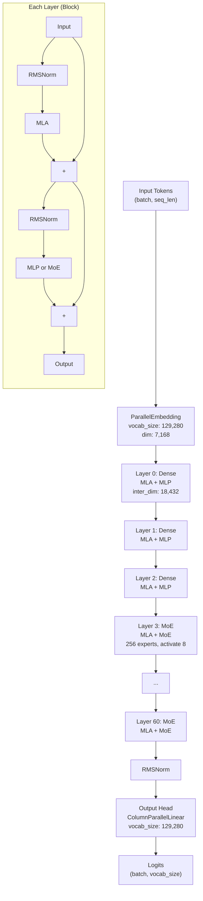
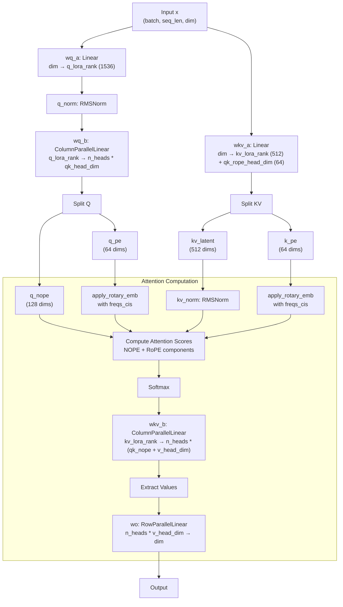
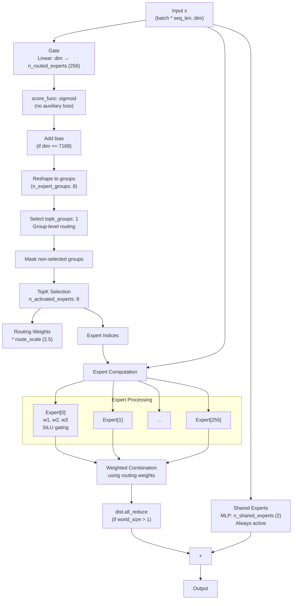
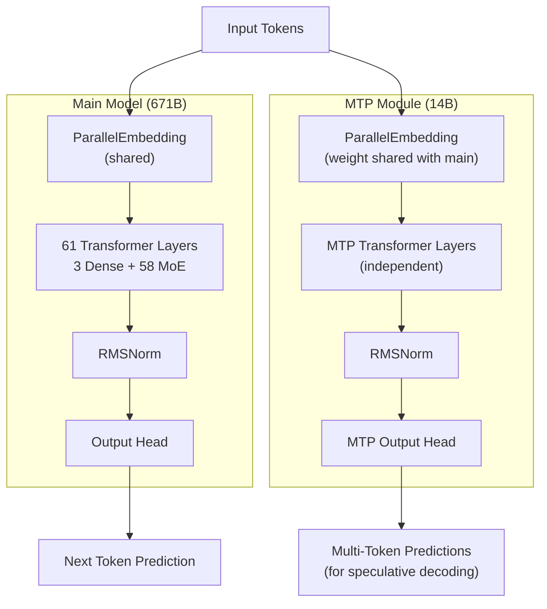
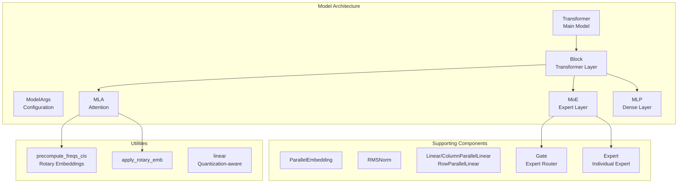
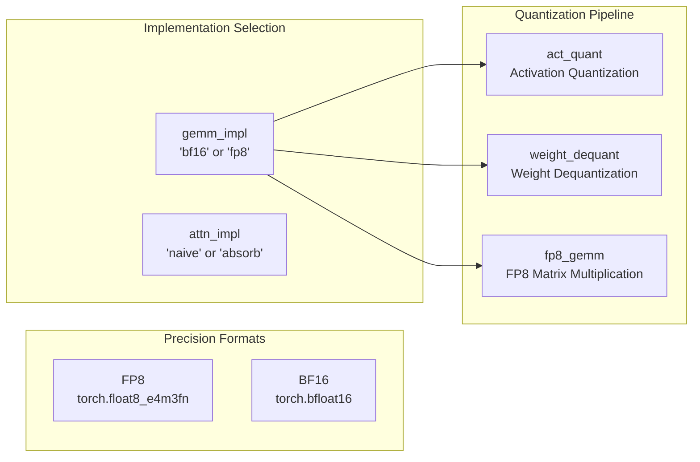
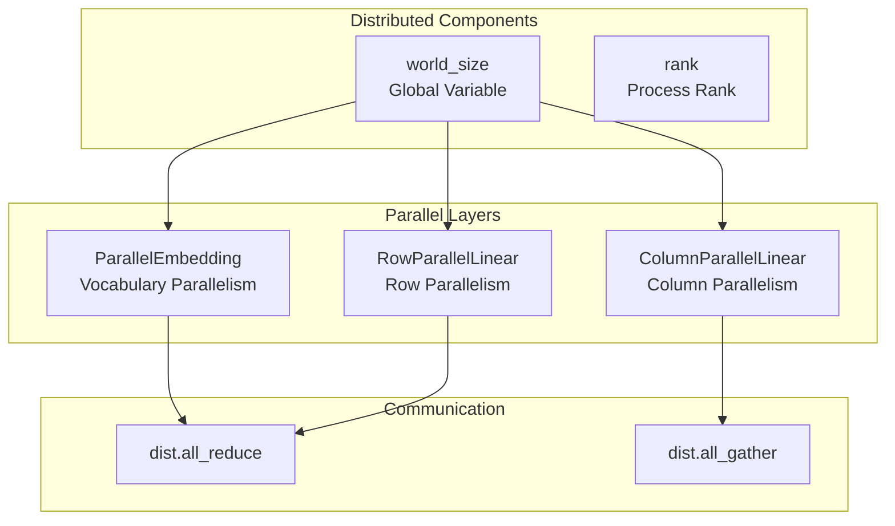

<!-- source: DeepWiki mcp.deepwiki.com · repo deepseek-ai/DeepSeek-V3 · page 1.2 Model Architecture Overview · fetched 2026-10-30 -->

# Model Architecture Overview

Relevant source files

The following files were used as context for generating this wiki page:

- [README.md](README.md)
- [inference/model.py](inference/model.py)

DeepSeek-V3 is a 671B parameter Mixture-of-Experts (MoE) language model that activates only 37B parameters per token, combining efficiency with capability. This page introduces the four key architectural innovations that enable this performance:

1. **Multi-head Latent Attention (MLA)** - Reduces KV cache memory usage through latent compression
2. **DeepSeekMoE** - Auxiliary-loss-free load balancing with 256 experts activating 8 per token
3. **Multi-Token Prediction (MTP)** - 14B parameter module enabling speculative decoding
4. **FP8 Mixed Precision** - Native FP8 training and inference for computational efficiency

This overview introduces these concepts at a high level. For detailed implementations, see [Transformer Implementation (4.1)](page://4.1), [MLA (4.2)](page://4.2), [MoE (4.3)](page://4.3), and [MTP (4.4)](page://4.4). For inference optimizations, see [Optimized Kernels (5.1)](page://5.1).

## Architecture at a Glance

### Key Specifications

| Component | Configuration | Purpose |
|-----------|---------------|---------|
| **Total Parameters** | 671B | Full model capacity |
| **Activated Parameters** | 37B per token | Efficient sparse computation |
| **Context Length** | 128K tokens | Extended context support |
| **Vocabulary Size** | 129,280 | Tokenizer vocabulary |
| **Model Dimension** | 7,168 | Hidden state size |
| **Total Layers** | 61 | Transformer depth |
| **Dense Layers** | 3 (layers 0-2) | Standard FFN |
| **MoE Layers** | 58 (layers 3-60) | Sparse expert routing |

Sources: [README.md:47-51](), [README.md:91-99](), [inference/model.py:20-86]()

### Layer Structure

DeepSeek-V3 uses a hybrid architecture with dense layers at the start followed by MoE layers:

**Diagram: DeepSeek-V3 Layer Structure**

Sources: [inference/model.py:738-771](), [inference/model.py:696-735]()

## Multi-head Latent Attention (MLA)

MLA reduces memory usage for the key-value (KV) cache by projecting keys and values through a low-rank latent space, while maintaining full expressiveness for queries.

### Key Innovations

| Component | Configuration | Purpose |
|-----------|---------------|---------|
| **Query LoRA Rank** | 1,536 (`q_lora_rank`) | Compressed query projection |
| **KV LoRA Rank** | 512 (`kv_lora_rank`) | Compressed KV projection |
| **Attention Heads** | 128 (`n_heads`) | Multi-head parallelism |
| **QK NoRoPE Dim** | 128 (`qk_nope_head_dim`) | Non-positional component |
| **QK RoPE Dim** | 64 (`qk_rope_head_dim`) | Rotary positional component |
| **Value Head Dim** | 128 (`v_head_dim`) | Value projection size |

### Hybrid Positional Encoding

MLA uses a hybrid approach combining:
- **NOPE (No Positional Encoding)**: Standard attention without position information
- **RoPE (Rotary Positional Encoding)**: Rotation-based positional embeddings

**Diagram: MLA Architecture**

### Implementation Variants

The codebase provides two MLA implementations controlled by `attn_impl`:
- **`naive`**: Caches full K/V tensors (`k_cache`, `v_cache`)
- **`absorb`**: Caches compressed latent KV (`kv_cache`, `pe_cache`) - more memory efficient

Sources: [inference/model.py:396-497](), [inference/model.py:17](), [inference/model.py:412-437]()

## DeepSeekMoE

DeepSeekMoE is an auxiliary-loss-free load balancing strategy for Mixture-of-Experts that avoids the performance degradation caused by traditional load balancing auxiliary losses.

### Expert Configuration

| Parameter | Value | Description |
|-----------|-------|-------------|
| **`n_routed_experts`** | 256 | Total number of experts |
| **`n_activated_experts`** | 8 | Experts activated per token |
| **`n_shared_experts`** | 2 | Always-active shared experts |
| **`n_expert_groups`** | 8 | Expert grouping for routing |
| **`n_limited_groups`** | 1 | Limited groups in routing |
| **`score_func`** | `sigmoid` | Routing score function |
| **`route_scale`** | 2.5 | Routing weight scaling |
| **`moe_inter_dim`** | 1,408 | Expert hidden dimension |

### Routing Mechanism

**Diagram: DeepSeekMoE Routing**

### Load Balancing

DeepSeekMoE achieves load balancing without auxiliary losses through:
1. **Sigmoid scoring**: Allows multiple experts to have high scores
2. **Expert grouping**: 256 experts divided into 8 groups
3. **Dynamic routing**: Bias term and group selection guide traffic distribution
4. **Shared experts**: Always-active experts handle common patterns

Sources: [inference/model.py:636-693](), [inference/model.py:535-598](), [inference/model.py:601-633]()

## Multi-Token Prediction (MTP)

The MTP module is a separate 14B parameter component that predicts multiple future tokens in parallel. It shares embedding weights with the main model but has independent transformer layers.

### MTP Structure

| Component | Configuration | Notes |
|-----------|---------------|-------|
| **MTP Parameters** | 14B | Separate from main 671B |
| **Total Model Size** | 685B | 671B main + 14B MTP |
| **Shared Components** | Embedding layer | Weight sharing with main model |
| **Independent Components** | Transformer layers | Separate MTP-specific layers |

### Use Cases

1. **Training Objective**: Multi-token prediction improves model performance by learning to predict multiple tokens ahead
2. **Speculative Decoding**: During inference, MTP predicts candidate tokens that can be verified in parallel, accelerating generation

**Diagram: MTP Integration**

MTP support is currently under active development in the open-source inference frameworks. See [README_WEIGHTS.md](https://github.com/deepseek-ai/DeepSeek-V3/blob/main/README_WEIGHTS.md) for details on the MTP weight structure.

Sources: [README.md:99](), [README.md:66-67](), [README.md:103]()

## Architecture Code Mapping

### Primary Model Classes

The following diagram maps architectural components to their code implementations:

Sources: [inference/model.py:735-795](), [inference/model.py:693-733](), [inference/model.py:393-495](), [inference/model.py:633-691]()

### Quantization and Precision Support

The model supports multiple precision formats through specialized implementations:

Sources: [inference/model.py:10](), [inference/model.py:129-162](), [inference/model.py:16-17]()

## Distributed Computing Support

The architecture includes built-in support for distributed training and inference:

Sources: [inference/model.py:13-14](), [inference/model.py:87-127](), [inference/model.py:205-264]()

This architecture enables DeepSeek-V3 to efficiently scale across multiple GPUs while maintaining high performance through optimized attention mechanisms, sparse expert routing, and quantization-aware computations.

---

