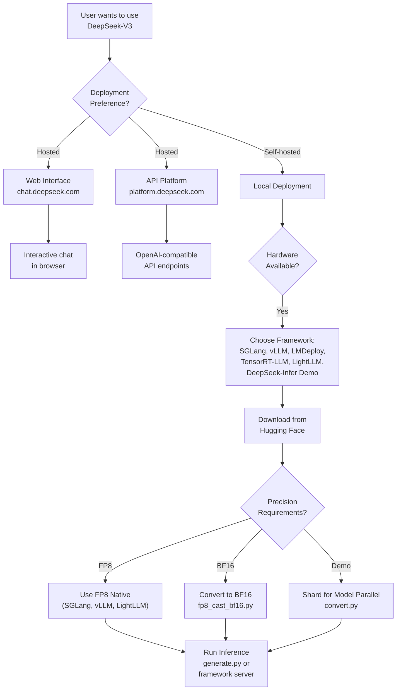
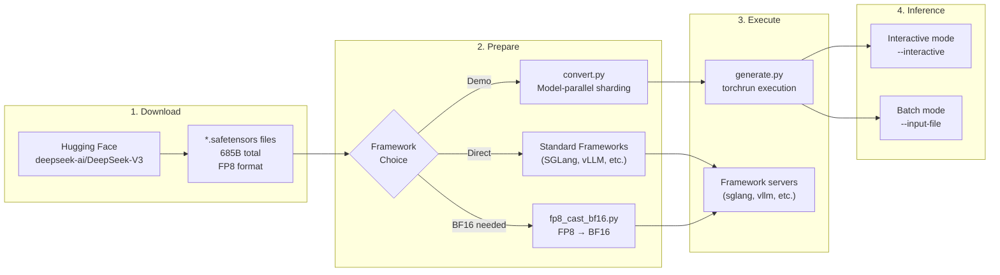
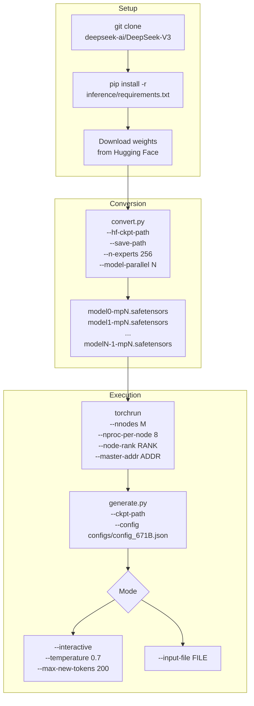
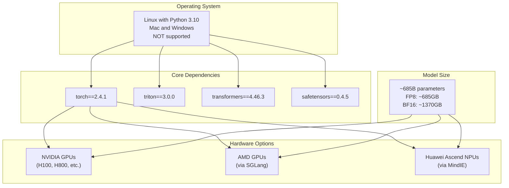

<!-- source: DeepWiki mcp.deepwiki.com · repo deepseek-ai/DeepSeek-V3 · page 2 Getting Started · fetched 2026-10-30 -->

# Getting Started

<details>
<summary>Relevant source files</summary>

The following files were used as context for generating this wiki page:

- [README.md](README.md)

</details>


This document guides you through the initial steps required to use DeepSeek-V3, from choosing a deployment method to running your first inference. It covers model availability, access methods, and the basic workflow for local deployment preparation.

For detailed installation procedures and hardware requirements, see [Installation and Requirements](#2.1). For framework-specific deployment instructions, see [Local Deployment Options](#2.2). For using the hosted services, see [Web Interface and API Access](#2.3).

## Model Variants

DeepSeek-V3 is available in two variants, both distributed via Hugging Face in native FP8 format:

| Model | Total Parameters | Activated Parameters | Context Length | Hugging Face Repository |
|-------|-----------------|---------------------|----------------|------------------------|
| DeepSeek-V3-Base | 671B | 37B | 128K | `deepseek-ai/DeepSeek-V3-Base` |
| DeepSeek-V3 (Chat) | 671B | 37B | 128K | `deepseek-ai/DeepSeek-V3` |

Both models have a total size of 685B weights on disk, consisting of 671B for the main Transformer model and 14B for the Multi-Token Prediction (MTP) module. The Base model is the pre-trained foundation model, while the Chat variant has been post-trained with supervised fine-tuning, reinforcement learning, and knowledge distillation from DeepSeek-R1.

**Sources:** [README.md:87-99]()

## Access Options Overview



**Decision Tree for Getting Started with DeepSeek-V3**

Users can access DeepSeek-V3 through hosted services or deploy it locally. Hosted services provide immediate access without hardware requirements, while local deployment offers control and customization but requires significant computational resources.

**Sources:** [README.md:222-226](), [README.md:227-342]()

## Hosted Services

### Web Chat Interface

The DeepSeek-V3 Chat model is accessible through a web interface at `chat.deepseek.com`. This provides an interactive conversational interface without requiring any setup or hardware.

### API Platform

DeepSeek provides an OpenAI-compatible API at `platform.deepseek.com`. This allows programmatic access to DeepSeek-V3 using familiar API patterns, suitable for integration into applications.

**Sources:** [README.md:222-226]()

## Local Deployment Workflow



**Local Deployment Workflow Showing Core Scripts and Execution Paths**

The local deployment process follows four stages:

1. **Download**: Retrieve model weights from Hugging Face repository
2. **Prepare**: Convert or shard weights based on target framework
3. **Execute**: Launch the inference server or script
4. **Inference**: Run interactive chat or batch processing

**Sources:** [README.md:227-342]()

## Weight Formats and Conversion

DeepSeek-V3 is trained and distributed in native FP8 format for maximum efficiency. Three workflow paths are available depending on deployment requirements:

### FP8 Native Deployment

Frameworks with native FP8 support (SGLang, vLLM, LightLLM) can directly load the downloaded weights without conversion. This provides the best performance and memory efficiency.

### BF16 Conversion

For frameworks requiring higher precision, the `fp8_cast_bf16.py` script converts FP8 weights to BF16 format:

```bash
cd inference
python fp8_cast_bf16.py \
    --input-fp8-hf-path /path/to/fp8_weights \
    --output-bf16-hf-path /path/to/bf16_weights
```

This script processes all `*.safetensors` files in the input directory, applies `weight_dequant` to convert 128×128 FP8 blocks to BF16, and updates the `model.safetensors.index.json` weight map accordingly.

### Model-Parallel Sharding

The DeepSeek-Infer demo requires explicit model-parallel sharding via `convert.py`:

```bash
python convert.py \
    --hf-ckpt-path /path/to/DeepSeek-V3 \
    --save-path /path/to/DeepSeek-V3-Demo \
    --n-experts 256 \
    --model-parallel 16
```

This distributes the 256 experts across 16 shards (16 experts per shard) and shards layer weights along specified dimensions, producing files named `model{i}-mp{mp}.safetensors` where `i` is the rank and `mp` is the world size.

**Sources:** [README.md:240-247](), [README.md:283-289]()

## DeepSeek-Infer Demo Quick Start



**DeepSeek-Infer Demo Execution Flow with Script Names and Key Arguments**

The demo implementation provides a reference for FP8 and BF16 inference with the following workflow:

1. **Clone repository** and install dependencies from `inference/requirements.txt`
2. **Download weights** from Hugging Face to a local directory
3. **Convert weights** using `convert.py` to create model-parallel shards
4. **Execute inference** using `torchrun` with `generate.py` for distributed execution

The demo supports two modes:
- **Interactive mode** (`--interactive`): Conversational chat with temperature sampling
- **Batch mode** (`--input-file`): Process prompts from a file

**Sources:** [README.md:252-303]()

## System Requirements



**System Requirements and Hardware Support**

The demo implementation requires Linux with Python 3.10 and specific package versions. Hardware requirements are substantial due to the model size. Multiple GPU vendors are supported through different frameworks.

**Sources:** [README.md:254-265]()

## Framework Selection

Six inference frameworks provide different optimization strategies and hardware support:

| Framework | Precision | Key Features | Multi-Node | GPU Support |
|-----------|-----------|--------------|------------|-------------|
| **SGLang** | FP8, BF16 | MLA optimizations, DP Attention, FP8 W8A8, FP8 KV cache, Torch Compile | Yes (Tensor Parallel) | NVIDIA, AMD |
| **vLLM** | FP8, BF16 | Pipeline parallelism | Yes (Pipeline Parallel) | NVIDIA, AMD |
| **LMDeploy** | FP8, BF16 | PyTorch integration, cloud deployment | Yes | NVIDIA |
| **TensorRT-LLM** | BF16, INT4/INT8 | Weight-only quantization, FP8 in development | Yes | NVIDIA |
| **LightLLM** | FP8/BF16 mixed | Mixed precision, flexible deployment | Yes (Tensor Parallel) | NVIDIA |
| **DeepSeek-Infer Demo** | FP8, BF16 | Reference implementation | Yes | NVIDIA |

**SGLang** is recommended for most users as it provides comprehensive optimizations including MLA-specific kernels, data-parallel attention, and full FP8 support with state-of-the-art performance on both NVIDIA and AMD hardware.

**vLLM** specializes in pipeline parallelism for large-scale multi-machine deployments.

**LMDeploy** emphasizes seamless PyTorch workflow integration for local and cloud deployment.

**TensorRT-LLM** focuses on advanced quantization with custom NVIDIA optimizations.

**LightLLM** offers flexible mixed-precision deployment.

**DeepSeek-Infer Demo** serves as a reference implementation with explicit scripts for conversion and generation.

**Sources:** [README.md:229-342]()

## Configuration Files

The model is configured via JSON files in the `configs/` directory:

- **`config_671B.json`**: Configuration for the 671B parameter model (37B activated)
- Contains `ModelArgs` parameters including dimensions, layer counts, MoE settings, and quantization options

The configuration is loaded by `generate.py` via the `--config` argument and defines the model architecture instantiated by the `Transformer` class in [inference/model.py]().

**Sources:** [README.md:296-303]()

## Next Steps

After completing the initial setup:

1. **For detailed installation instructions**: See [Installation and Requirements](#2.1) for hardware prerequisites, dependency installation, and environment setup
2. **For framework-specific deployment**: See [Local Deployment Options](#2.2) for step-by-step instructions for each inference framework
3. **For hosted services**: See [Web Interface and API Access](#2.3) for chat interface and API usage
4. **For understanding the architecture**: See [Model Architecture](#4) for technical details on MLA, MoE, and MTP components
5. **For weight format details**: See [Model Weights](#6) for information on weight file structure and quantization formats

**Sources:** [README.md:1-362]()

---

