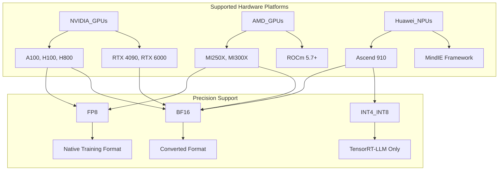
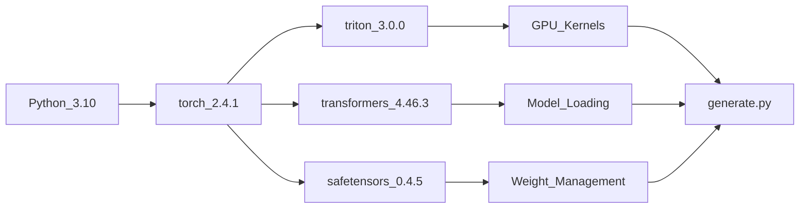
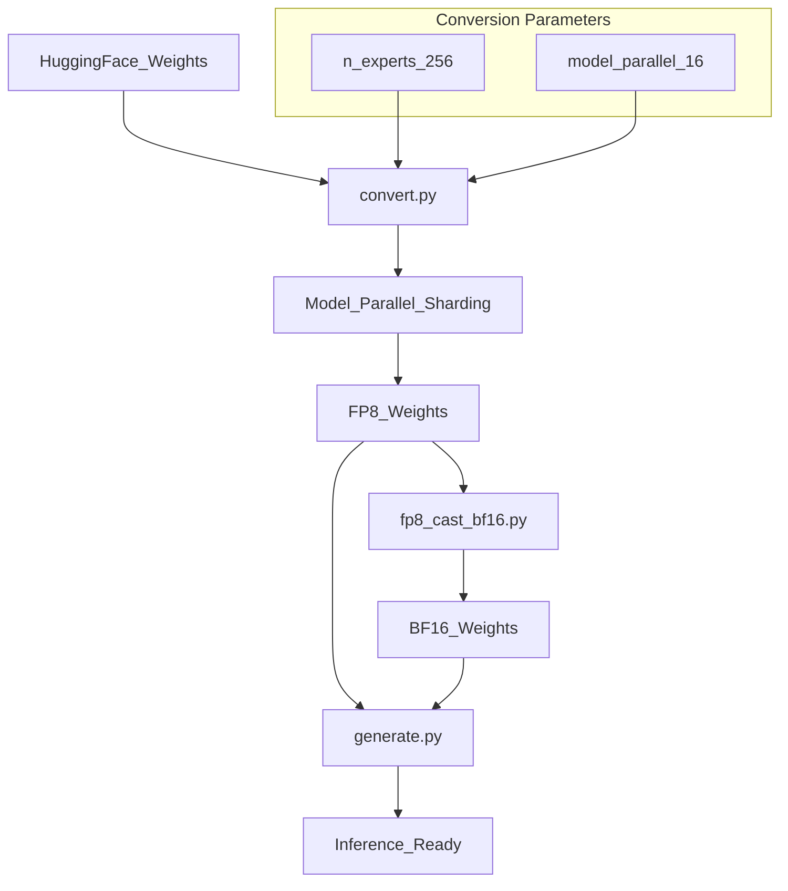
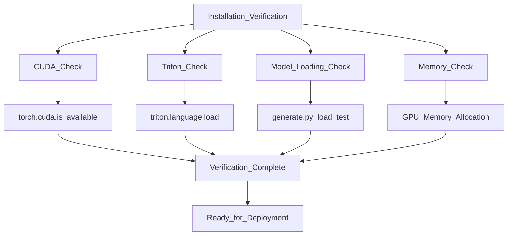

<!-- source: DeepWiki mcp.deepwiki.com · repo deepseek-ai/DeepSeek-V3 · page 2.1 Installation and Requirements · fetched 2026-10-30 -->

# Installation

<details>
<summary>Relevant source files</summary>

The following files were used as context for generating this wiki page:

- [README.md](README.md)
- [inference/requirements.txt](inference/requirements.txt)

</details>


This document covers the installation requirements and setup process for running DeepSeek-V3 locally. It focuses on the core dependencies, system requirements, and initial setup steps needed to get the model operational on your system.

For comprehensive deployment guides using different frameworks, see [Local Deployment Options](#2.2). For accessing the model through web interfaces, see [Web Interface and API Access](#2.3).

## System Requirements

DeepSeek-V3 has specific system requirements that must be met for proper operation:

### Operating System Support
- **Linux**: Required (Python 3.10 only)
- **macOS**: Not supported
- **Windows**: Not supported

### Hardware Requirements

The model requires significant computational resources due to its 671B parameter architecture with 37B parameters activated per token:

| Component | Minimum Requirement | Recommended |
|-----------|-------------------|-------------|
| **GPU Memory** | 80GB+ (single GPU) | 160GB+ (multi-GPU) |
| **System RAM** | 64GB | 128GB+ |
| **Storage** | 1.5TB (model weights) | 2TB+ (includes conversion space) |
| **GPU Compute** | CUDA 11.8+ | CUDA 12.0+ |

### Hardware Platform Support



**Sources:** [README.md:254-258](), [README.md:236-238](), [README.md:340-341]()

## Core Dependencies

### Python Environment

The installation requires a specific Python environment configuration:



**Sources:** [inference/requirements.txt:1-4](), [README.md:260-265]()

### Dependency Installation

The core dependencies are specified in the requirements file:

| Package | Version | Purpose |
|---------|---------|---------|
| `torch` | 2.4.1 | Core tensor operations and CUDA support |
| `triton` | 3.0.0 | GPU kernel compilation for optimized operations |
| `transformers` | 4.46.3 | Model architecture and tokenization |
| `safetensors` | 0.4.5 | Secure tensor serialization and loading |

**Sources:** [inference/requirements.txt:1-4]()

## Installation Process

### Step 1: Repository Setup

Clone the DeepSeek-V3 repository and navigate to the inference directory:

```bash
git clone https://github.com/deepseek-ai/DeepSeek-V3.git
cd DeepSeek-V3/inference
```

### Step 2: Environment Creation

Create a virtual environment using `conda` or `uv`:

```bash
# Using conda
conda create -n deepseek-v3 python=3.10
conda activate deepseek-v3

# Using uv
uv venv --python 3.10
source .venv/bin/activate
```

### Step 3: Dependency Installation

Install the required packages:

```bash
pip install -r requirements.txt
```

**Sources:** [README.md:269-279]()

### Step 4: Model Weight Preparation

Download model weights from Hugging Face and prepare them for inference:



**Sources:** [README.md:281-289](), [README.md:243-247]()

## Weight Format Conversion

### FP8 to BF16 Conversion

Since the model is natively trained in FP8, conversion to BF16 may be required for certain frameworks:

```bash
cd inference
python fp8_cast_bf16.py --input-fp8-hf-path /path/to/fp8_weights --output-bf16-hf-path /path/to/bf16_weights
```

### Model Parallel Conversion

Convert Hugging Face weights to distributed format:

```bash
python convert.py --hf-ckpt-path /path/to/DeepSeek-V3 --save-path /path/to/DeepSeek-V3-Demo --n-experts 256 --model-parallel 16
```

**Sources:** [README.md:285-289](), [README.md:243-247]()

## Installation Verification

### Basic Verification

Test the installation with a simple inference run:

```bash
torchrun --nnodes 2 --nproc-per-node 8 --node-rank $RANK --master-addr $ADDR generate.py --ckpt-path /path/to/DeepSeek-V3-Demo --config configs/config_671B.json --interactive --temperature 0.7 --max-new-tokens 200
```

### Component Verification



**Sources:** [README.md:294-297]()

## Framework-Specific Installation Notes

### SGLang Requirements
- Additional dependencies for MLA optimizations
- FP8 W8A8 and FP8 KV Cache support
- Multi-node tensor parallelism capability

### TensorRT-LLM Requirements  
- NVIDIA TensorRT installation
- Custom branch for DeepSeek-V3 support
- BF16 and INT4/INT8 quantization support

### vLLM Requirements
- Version 0.6.6 or higher
- Pipeline parallelism support
- Multi-machine network configuration

**Sources:** [README.md:305-330]()

## Troubleshooting Common Issues

### Memory Issues
- Verify GPU memory availability matches requirements
- Check for memory leaks in previous runs
- Ensure proper distributed setup across nodes

### CUDA Compatibility
- Verify CUDA version compatibility with PyTorch
- Check driver versions for GPU support
- Ensure Triton can compile kernels properly

### Model Loading Issues
- Verify model weight file integrity
- Check conversion script completion
- Ensure proper file permissions and paths

**Sources:** [README.md:254-258](), [README.md:274-279]()

---

