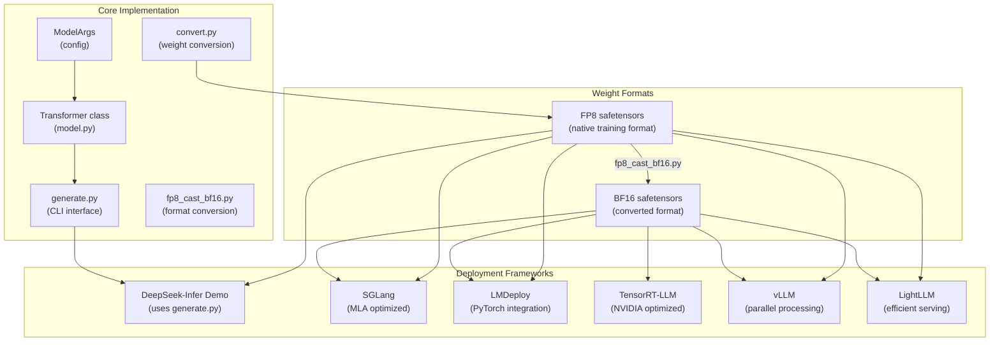
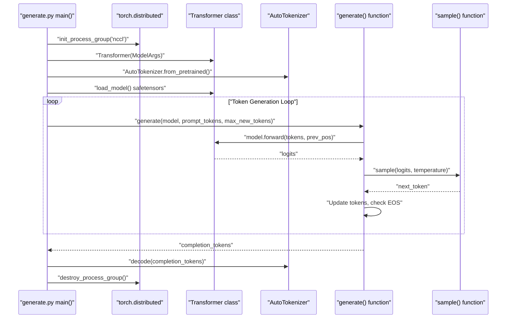
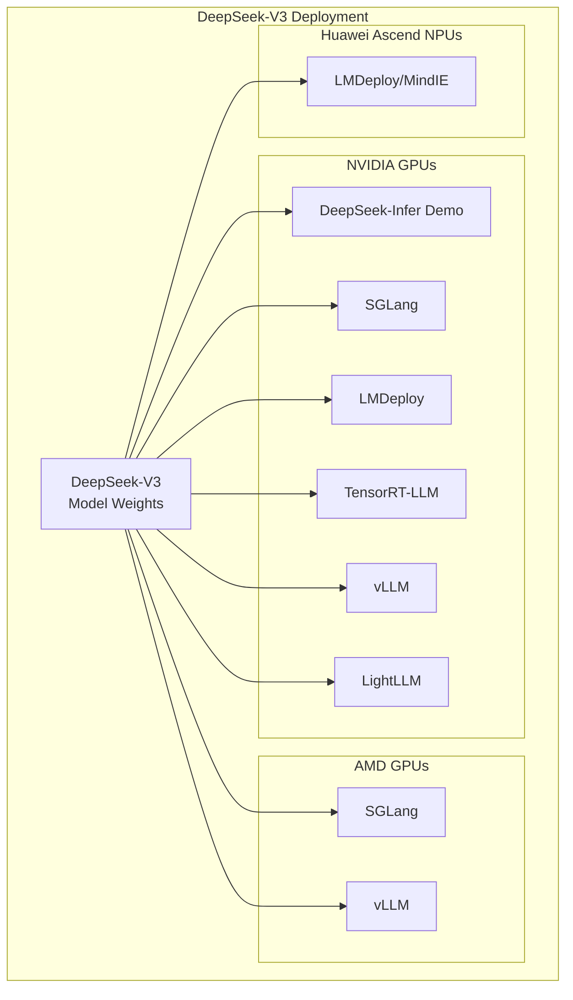
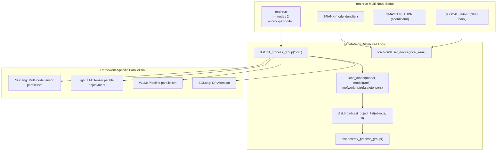

<!-- source: DeepWiki mcp.deepwiki.com · repo deepseek-ai/DeepSeek-V3 · page 2.2 Local Deployment Options · fetched 2026-10-30 -->

# Local Deployment Options

<details>
<summary>Relevant source files</summary>

The following files were used as context for generating this wiki page:

- [README.md](README.md)

</details>


This page provides technical details on deploying DeepSeek-V3 models locally using various frameworks and implementations. It covers the core inference pipeline, weight format conversion utilities, and distributed deployment configurations. For information about Web Interface and API access, see [Web Interface and API Access](#2.3).

## Overview of Deployment Options

DeepSeek-V3, with its 671B total parameters (37B activated), can be deployed locally using multiple frameworks that interface with the core `Transformer` class and inference pipeline. Each framework provides different optimization strategies for the model's MoE architecture.

**Diagram: DeepSeek-V3 Code Architecture for Local Deployment**



Sources: [README.md:227-342](), [inference/generate.py:1-186]()

## Core Inference Pipeline

The repository provides a reference implementation through the `generate.py` script, which demonstrates the core inference pipeline using the `Transformer` class and distributed processing capabilities.

**Diagram: Inference Pipeline Code Flow**



Sources: [inference/generate.py:81-159]()

## Weight Format Considerations

DeepSeek-V3 is natively trained with FP8 precision, making FP8 weights the primary format available. The repository provides conversion utilities to handle different weight formats required by various deployment frameworks.

### Core Weight Conversion Scripts

The repository includes two main conversion utilities:

1. **`convert.py`** - Converts HuggingFace checkpoint format to distributed format for the DeepSeek-Infer demo
2. **`fp8_cast_bf16.py`** - Converts FP8 weights to BF16 format for frameworks requiring BF16 precision

### Converting FP8 to BF16 Weights

To convert FP8 weights to BF16 format:

```bash
cd inference
python fp8_cast_bf16.py --input-fp8-hf-path /path/to/fp8_weights --output-bf16-hf-path /path/to/bf16_weights
```

### Converting HuggingFace Checkpoints for DeepSeek-Infer

The `convert.py` script prepares weights for the reference implementation:

```bash
python convert.py --hf-ckpt-path /path/to/DeepSeek-V3 --save-path /path/to/DeepSeek-V3-Demo --n-experts 256 --model-parallel 16
```

This creates model shards in the format `model{rank}-mp{world_size}.safetensors` for distributed loading.

Sources: [README.md:240-247](), [README.md:285-289]()

## Comparison of Deployment Frameworks

Each deployment framework has its own strengths and use cases. The table below summarizes the key features of each framework:

| Framework | Weight Formats | Hardware Support | Key Features | Multi-Node Support |
|-----------|----------------|------------------|--------------|-------------------|
| DeepSeek-Infer Demo | FP8, BF16 | NVIDIA | Simple, lightweight demo | Yes |
| SGLang | FP8, BF16 | NVIDIA, AMD | MLA optimizations, DP Attention, FP8 (W8A8), FP8 KV Cache, Torch Compile | Yes |
| LMDeploy | FP8, BF16 | NVIDIA, Huawei | Flexible deployment, efficient inference | Yes |
| TensorRT-LLM | BF16, INT4/8 | NVIDIA | NVIDIA optimizations, quantization support | Yes |
| vLLM | FP8, BF16 | NVIDIA, AMD | Tensor parallelism, pipeline parallelism | Yes |
| LightLLM | FP8, BF16 | NVIDIA | Efficient single/multi-node deployment | Yes |

Sources: [README.md:231-238](), [README.md:307-338]()

## Detailed Deployment Options

### DeepSeek-Infer Demo

The DeepSeek-Infer Demo provides a reference implementation using the core `Transformer` class and `generate.py` script for inference with DeepSeek-V3 models.

#### System Requirements
- Linux with Python 3.10 only
- Key dependencies:
  - torch==2.4.1
  - triton==3.0.0
  - transformers==4.46.3
  - safetensors==0.4.5

#### Technical Implementation

The demo uses the following core components:

| Component | File | Purpose |
|-----------|------|---------|
| `Transformer` | `model.py` | Core model implementation |
| `generate()` | `generate.py` | Token generation function |
| `sample()` | `generate.py` | Temperature-based sampling |
| `ModelArgs` | `model.py` | Configuration management |
| `convert.py` | `convert.py` | Weight format conversion |

#### Deployment Process

1. **Installation**:
   ```bash
   git clone https://github.com/deepseek-ai/DeepSeek-V3.git
   cd DeepSeek-V3/inference
   pip install -r requirements.txt
   ```

2. **Weight Conversion**:
   ```bash
   python convert.py --hf-ckpt-path /path/to/DeepSeek-V3 --save-path /path/to/DeepSeek-V3-Demo --n-experts 256 --model-parallel 16
   ```

3. **Running Inference**:
   
   For interactive mode:
   ```bash
   torchrun --nnodes 2 --nproc-per-node 8 --node-rank $RANK --master-addr $ADDR generate.py --ckpt-path /path/to/DeepSeek-V3-Demo --config configs/config_671B.json --interactive --temperature 0.7 --max-new-tokens 200
   ```
   
   For batch inference:
   ```bash
   torchrun --nnodes 2 --nproc-per-node 8 --node-rank $RANK --master-addr $ADDR generate.py --ckpt-path /path/to/DeepSeek-V3-Demo --config configs/config_671B.json --input-file $FILE
   ```

#### Key Implementation Details

The `generate.py` script implements distributed inference through:
- `torch.distributed.init_process_group("nccl")` for multi-node setup
- `load_model()` from safetensors for weight loading 
- `AutoTokenizer.from_pretrained()` for tokenization
- `generate()` function for autoregressive token generation
- `sample()` function for temperature-controlled sampling

Sources: [README.md:252-304](), [inference/generate.py:100-159]()

### SGLang

SGLang currently offers the most optimized performance for DeepSeek-V3 among the open-source frameworks. It supports multiple optimization techniques and is compatible with both NVIDIA and AMD GPUs.

#### Key Features
- MLA (Multi-head Latent Attention) optimizations
- DP Attention (Data Parallelism Attention)
- FP8 (W8A8) support
- FP8 KV Cache
- Torch Compile for improved performance
- Multi-node tensor parallelism for distributed deployment
- Support for both NVIDIA and AMD GPUs

#### Deployment Process
For detailed launch instructions, refer to the SGLang team's documentation at the GitHub repository.

Sources: [README.md:305-316]()

### LMDeploy

LMDeploy provides a flexible and high-performance inference and serving framework for large language models like DeepSeek-V3.

#### Key Features
- Supports both offline pipeline processing and online deployment
- Seamless integration with PyTorch-based workflows
- Support for both FP8 and BF16 inference
- Compatible with NVIDIA GPUs and Huawei Ascend NPUs

Sources: [README.md:317-322]()

### TensorRT-LLM

TensorRT-LLM provides optimized inference specifically for NVIDIA hardware, with various precision options.

#### Key Features
- Support for BF16 and INT4/INT8 weight-only quantization
- FP8 support in development
- Custom branch specifically for DeepSeek-V3 support
- Optimized for NVIDIA GPUs

Sources: [README.md:324-326]()

### vLLM

vLLM offers efficient parallelism options for deploying DeepSeek-V3 on both single and multiple machines.

#### Key Features
- Support for FP8 and BF16 modes
- Compatible with NVIDIA and AMD GPUs
- Pipeline parallelism for multi-machine deployment
- Tensor parallelism for efficient resource utilization

Sources: [README.md:329-331]()

### LightLLM

LightLLM provides efficient deployment options for both single-machine and multi-machine scenarios.

#### Key Features
- Support for tensor parallel deployment (single/multi-machine)
- Mixed-precision deployment options
- Support for FP8/BF16 weights
- PD-disaggregation deployment (in development for DeepSeek-V3)

Sources: [README.md:333-335]()

## Hardware-Specific Deployment

**Diagram: Hardware Support Matrix**



### NVIDIA GPUs

NVIDIA GPUs provide the most comprehensive support for DeepSeek-V3 deployment, with all deployment frameworks compatible with NVIDIA hardware.

#### Recommended Configurations
- For single-node deployment: SGLang, LMDeploy, or vLLM
- For multi-node deployment: SGLang with tensor parallelism or vLLM with pipeline parallelism
- For quantization: TensorRT-LLM with INT4/INT8 support

Sources: [README.md:231-238](), [README.md:305-335]()

### AMD GPUs

AMD GPUs can run DeepSeek-V3 through SGLang and vLLM, with support for both FP8 and BF16 precision.

#### Key Features
- Day-One support through SGLang
- Full compatibility with both FP8 and BF16 precision
- Multi-node tensor parallelism through SGLang

Sources: [README.md:337-339]()

### Huawei Ascend NPUs

Huawei Ascend NPUs can run DeepSeek-V3 through the MindIE framework, which has adapted the BF16 version of the model.

#### Deployment Process
Follow the instructions provided by the Huawei Ascend community for step-by-step guidance on deploying with Ascend NPUs.

Sources: [README.md:341-342]()

## Multi-Node and Distributed Deployment

DeepSeek-V3's distributed deployment leverages PyTorch's distributed training capabilities and framework-specific parallelism strategies. The reference implementation in `generate.py` demonstrates multi-node setup using `torch.distributed`.

**Diagram: Distributed Deployment Implementation**



### Reference Implementation: Multi-Node Setup

The `generate.py` script demonstrates distributed inference setup:

```python
# Environment variables set by torchrun
world_size = int(os.getenv("WORLD_SIZE", "1"))
rank = int(os.getenv("RANK", "0"))
local_rank = int(os.getenv("LOCAL_RANK", "0"))

# Initialize distributed process group
if world_size > 1:
    dist.init_process_group("nccl")

# Load model shard for current rank
load_model(model, os.path.join(ckpt_path, f"model{rank}-mp{world_size}.safetensors"))
```

### Parallelism Strategies by Framework

| Framework | Tensor Parallelism | Pipeline Parallelism | Data Parallelism | Multi-Node Support |
|-----------|-------------------|---------------------|------------------|-------------------|
| SGLang | ✓ | ✗ | ✓ (DP Attention) | ✓ |
| LightLLM | ✓ | ✗ | ✗ | ✓ |
| vLLM | ✓ | ✓ | ✗ | ✓ |
| TensorRT-LLM | ✓ | ✗ | ✗ | ✓ |
| LMDeploy | ✓ | ✗ | ✗ | ✓ |

### Model Sharding Format

The `convert.py` script creates model shards in the format:
- `model{rank}-mp{world_size}.safetensors`
- Example: `model0-mp16.safetensors`, `model1-mp16.safetensors`, etc.

This sharding format is compatible with the `load_model()` function in `generate.py` for distributed loading.

Sources: [README.md:307-335](), [inference/generate.py:100-119]()

## Conclusion

DeepSeek-V3 offers multiple deployment options to accommodate various hardware configurations and performance requirements. The choice of deployment framework depends on the specific hardware available, performance requirements, and deployment scenario.

For optimal performance:
- On NVIDIA hardware: Consider SGLang, vLLM, or LMDeploy
- On AMD hardware: SGLang provides the most optimized support
- For Huawei Ascend NPUs: Use the MindIE framework
- For multi-node deployment: Choose SGLang with tensor parallelism or vLLM with pipeline parallelism

Remember that weight format selection (FP8 vs BF16) may impact performance and compatibility with different frameworks.

Sources: [README.md:227-342]()

---

