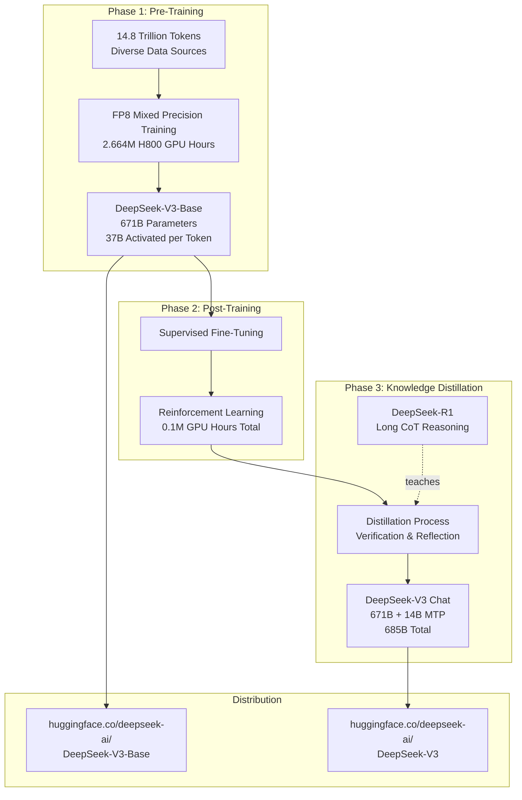
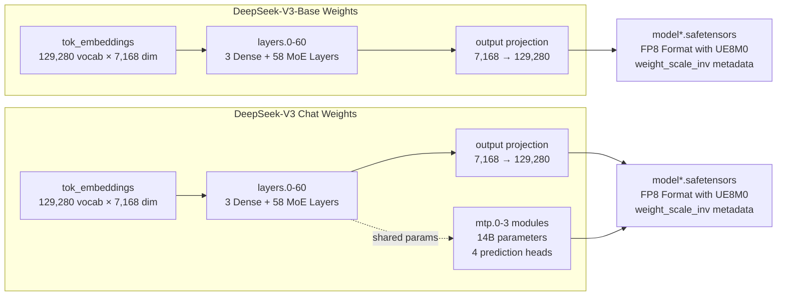
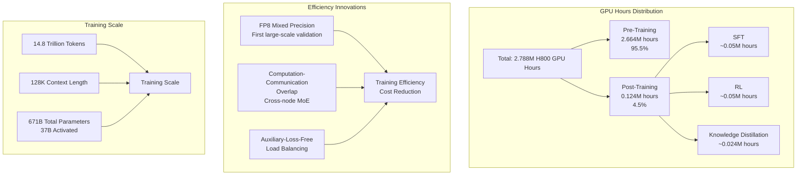
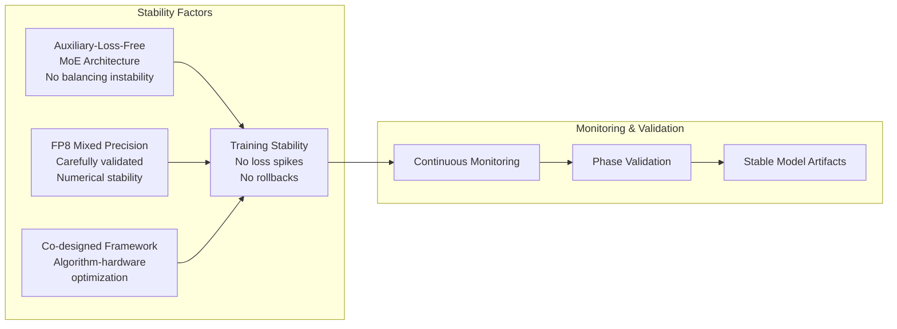

<!-- source: DeepWiki mcp.deepwiki.com · repo deepseek-ai/DeepSeek-V3 · page 3 Training Pipeline · fetched 2026-10-30 -->

# Training Pipeline

<details>
<summary>Relevant source files</summary>

The following files were used as context for generating this wiki page:

- [README.md](README.md)

</details>


## Purpose and Scope

This document provides an overview of the complete training pipeline for DeepSeek-V3, covering the three-phase process that transforms raw training data into production-ready models. The pipeline consists of pre-training on 14.8 trillion tokens, post-training with supervised fine-tuning and reinforcement learning, and knowledge distillation from DeepSeek-R1.

For detailed architecture information about the trained models, see [Model Architecture](#4). For deployment and inference details, see [Inference Pipeline](#5). For specific training phase details, see [Pre-Training](#3.1), [Post-Training](#3.2), and [Knowledge Distillation](#3.3).

**Sources:** [README.md:45-84]()

---

## Pipeline Overview

The DeepSeek-V3 training pipeline follows a sequential three-phase approach that produces two model variants: **DeepSeek-V3-Base** (the foundational pre-trained model) and **DeepSeek-V3** (the instruction-tuned chat model). The entire training process consumed 2.788M H800 GPU hours and exhibited remarkable stability with no irrecoverable loss spikes or rollbacks throughout.



**Training Pipeline Flow**: The complete training process from raw data through pre-training, post-training, and knowledge distillation to final model artifacts.

**Sources:** [README.md:45-84](), [README.md:89-99]()

---

## Training Phases

### Pre-Training Phase

The pre-training phase is the most computationally intensive stage, consuming **2.664M H800 GPU hours** (95.5% of total training time). This phase trains the model from scratch on 14.8 trillion high-quality tokens, establishing the foundational capabilities of the model.

Key innovations in this phase:

- **FP8 Mixed Precision Training**: First validation of FP8 training feasibility on an extremely large-scale model (671B parameters)
- **Auxiliary-Loss-Free Load Balancing**: Pioneer strategy that minimizes performance degradation from load balancing requirements
- **Multi-Token Prediction (MTP)**: Training objective that predicts multiple future tokens simultaneously, beneficial for both model performance and inference acceleration

The output of this phase is **DeepSeek-V3-Base**, a 671B parameter model with 37B parameters activated per token through the Mixture-of-Experts architecture.

**Sources:** [README.md:71-76](), [README.md:47-51]()

### Post-Training Phase

Post-training refines the base model through two sequential stages consuming a total of **0.1M GPU hours** (3.6% of total training time):

1. **Supervised Fine-Tuning (SFT)**: Aligns the model with human instructions using curated instruction-following datasets
2. **Reinforcement Learning (RL)**: Further optimizes model outputs through reward-based training to improve response quality, helpfulness, and safety

This phase transforms the base model's general language understanding into practical instruction-following and conversational capabilities.

**Sources:** [README.md:76](), [README.md:80-82]()

### Knowledge Distillation Phase

The final phase distills reasoning capabilities from the **DeepSeek-R1** series of models, which specialize in long-Chain-of-Thought (CoT) reasoning. This innovative methodology transfers:

- Verification patterns for checking reasoning correctness
- Reflection capabilities for self-correction
- Long-form reasoning without proportional output length increase

The distillation process maintains control over output style and length while significantly improving reasoning performance on math, code, and logical reasoning tasks. The output is **DeepSeek-V3** (chat variant), which includes an additional 14B parameter Multi-Token Prediction module.

**Sources:** [README.md:80-82]()

---

## Model Artifacts

The training pipeline produces two primary model artifacts distributed via Hugging Face:

| Model | Total Parameters | Activated Parameters | Components | Distribution |
|-------|------------------|---------------------|------------|--------------|
| DeepSeek-V3-Base | 671B | 37B | Main model only | `deepseek-ai/DeepSeek-V3-Base` |
| DeepSeek-V3 | 685B | 37B | 671B main + 14B MTP | `deepseek-ai/DeepSeek-V3` |



**Model Artifacts Structure**: Weight organization for both model variants showing the addition of MTP modules in the chat version.

Both models are distributed in native **FP8 format** with UE8M0 scaling metadata stored as `weight_scale_inv` tensors. The weights are stored as `model*.safetensors` files indexed by `model.safetensors.index.json`.

**Sources:** [README.md:89-103](), [README.md:240-247]()

---

## Training Efficiency Metrics

The DeepSeek-V3 training pipeline demonstrates exceptional efficiency through co-design of algorithms, frameworks, and hardware:



**Training Efficiency Overview**: Breakdown of GPU hours and key efficiency innovations.

### Key Efficiency Achievements

- **Near-Complete Overlap**: Communication bottleneck in cross-node MoE training nearly eliminated through co-design
- **FP8 Validation**: First successful FP8 training at 671B parameter scale, reducing memory bandwidth requirements
- **Cost Effectiveness**: At 2.664M GPU hours for pre-training, DeepSeek-V3 achieves state-of-the-art performance at economical cost
- **Post-Training Efficiency**: Only 3.6% of total GPU hours required for post-training phases, enabling rapid iteration

**Sources:** [README.md:71-76](), [README.md:52]()

---

## Training Stability

A hallmark of the DeepSeek-V3 training pipeline is its exceptional stability throughout all phases:

| Metric | Achievement |
|--------|-------------|
| Loss Spikes | Zero irrecoverable spikes |
| Rollbacks | Zero rollbacks performed |
| Training Duration | Complete 14.8T token pre-training |
| Phase Transitions | Smooth transitions between all phases |



**Training Stability Architecture**: Factors contributing to exceptional training stability.

The auxiliary-loss-free load balancing strategy is particularly significant for stability, as traditional auxiliary losses can introduce training instabilities when balancing expert loads in MoE architectures. By eliminating these losses while maintaining effective load balancing, DeepSeek-V3 achieves both performance and stability.

**Sources:** [README.md:52-54](), [README.md:63-67]()

---

## Weight Format and Distribution

All model weights are natively trained and stored in **FP8 format** using the UE8M0 scaling scheme with 128×128 block-wise quantization:

- **Weight Files**: `model*.safetensors` containing FP8 tensors
- **Scale Metadata**: `weight_scale_inv` tensors for dequantization
- **Index File**: `model.safetensors.index.json` mapping parameter names to files

Users requiring BF16 precision can convert weights using the provided conversion utility:

```bash
python inference/fp8_cast_bf16.py \
    --input-fp8-hf-path /path/to/fp8_weights \
    --output-bf16-hf-path /path/to/bf16_weights
```

The conversion script processes each safetensors file, performs FP8-to-BF16 dequantization using the `weight_scale_inv` metadata, and outputs new safetensors files with updated index mappings.

**Sources:** [README.md:240-247](), [README.md:99]()

---

## Configuration

Training produces models configured via `ModelArgs` dataclass with parameters specified in configuration files:

- **671B Configuration**: `configs/config_671B.json` defining the full-scale model architecture
- **Alternative Sizes**: Additional configurations available for 16B and 236B variants

Key training-relevant configuration parameters include:

| Parameter | Value (671B) | Purpose |
|-----------|--------------|---------|
| `dim` | 7,168 | Model hidden dimension |
| `n_layers` | 61 | Total transformer layers (3 dense + 58 MoE) |
| `n_heads` | 128 | Number of attention heads |
| `n_experts` | 256 | Total experts in MoE layers |
| `n_routed_experts` | 8 | Experts activated per token |
| `vocab_size` | 129,280 | Tokenizer vocabulary size |
| `max_seq_len` | 163,840 | Maximum context length (128K tokens) |

**Sources:** [README.md:288](), [README.md:296]()

---

## Training Pipeline Summary

The DeepSeek-V3 training pipeline represents a comprehensive approach to large language model development:

1. **Pre-Training**: 2.664M GPU hours on 14.8T tokens with FP8 mixed precision → DeepSeek-V3-Base (671B params)
2. **Post-Training**: 0.1M GPU hours for SFT and RL → Instruction-following capabilities
3. **Knowledge Distillation**: From DeepSeek-R1 → DeepSeek-V3 with enhanced reasoning (685B total with MTP)

The pipeline achieves state-of-the-art performance while maintaining exceptional training stability and cost-effectiveness through innovations in FP8 training, auxiliary-loss-free load balancing, and multi-token prediction objectives.

**Sources:** [README.md:45-84](), [README.md:89-103]()

---

