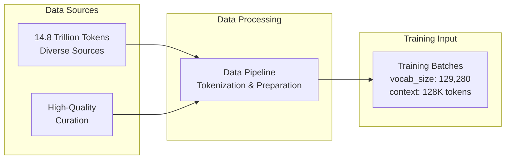
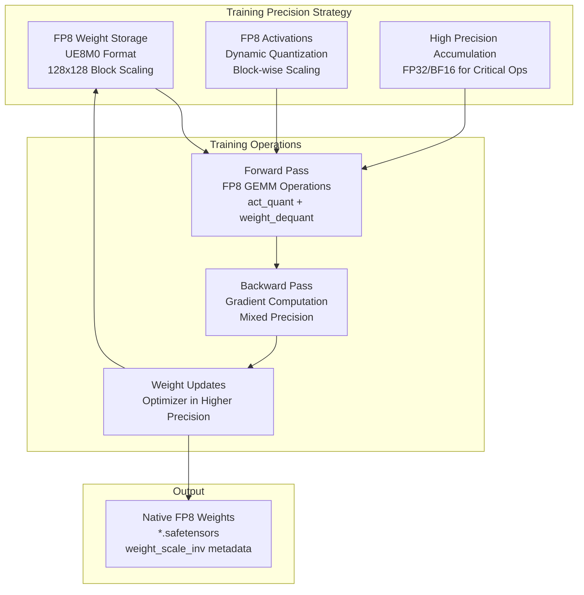
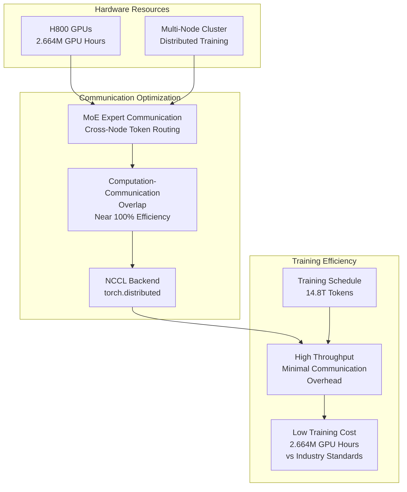
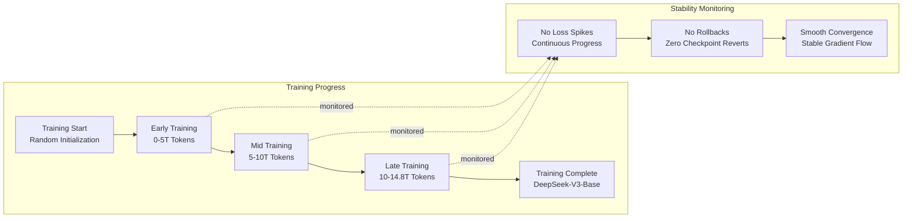
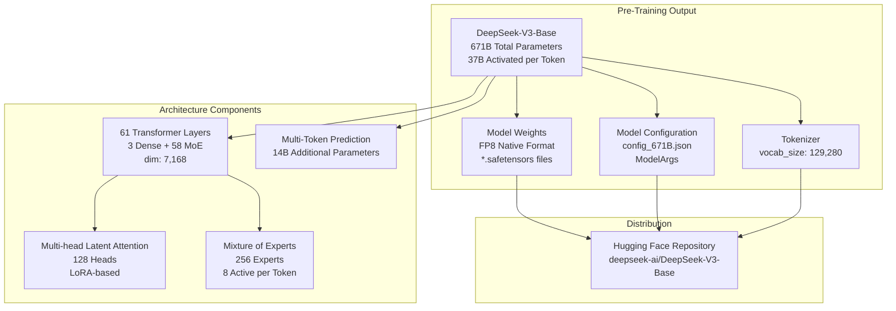

<!-- source: DeepWiki mcp.deepwiki.com · repo deepseek-ai/DeepSeek-V3 · page 3.1 Pre-Training · fetched 2026-10-30 -->

# Pre-Training

Relevant source files

The following files were used as context for generating this wiki page:

- [README.md](README.md)

This document describes the pre-training phase of DeepSeek-V3, which produces the base model (`DeepSeek-V3-Base`) from raw training data. Pre-training is the first and most computationally intensive stage in the model development lifecycle, consuming 2.664M H800 GPU hours to train on 14.8 trillion tokens.

For information about subsequent training stages, see [Post-Training](#3.2) and [Knowledge Distillation](#3.3). For details on the underlying model architecture used during pre-training, see [Model Architecture](#4).

**Sources:** [README.md:45-77]()

---

## Overview

Pre-training transforms the DeepSeek-V3 architecture (671B total parameters, 37B activated per token) into a functional language model by learning from a massive corpus of 14.8 trillion diverse and high-quality tokens. This phase employs several innovations:

- **FP8 Mixed Precision Training**: First validation of FP8 training on an extremely large-scale model
- **Auxiliary-Loss-Free Load Balancing**: Minimizes performance degradation from load balancing constraints
- **Multi-Token Prediction Objective**: Improves model performance and enables speculative decoding
- **Communication-Computation Overlap**: Near-complete overlap in cross-node MoE training

The pre-training phase produces `DeepSeek-V3-Base`, a foundation model that is subsequently refined through post-training stages.

**Sources:** [README.md:45-52](), [README.md:63-77]()

---

## Training Data

**Data Processing Pipeline**

The pre-training dataset consists of **14.8 trillion tokens** sourced from diverse, high-quality data. The data is tokenized using a vocabulary of 129,280 tokens and processed into training batches with a maximum context length of 128K tokens per sequence.

Key characteristics:
- **Scale**: 14.8T tokens total
- **Vocabulary**: 129,280 tokens (defined in model configuration)
- **Context Window**: 128K tokens maximum
- **Diversity**: Multiple data sources to ensure broad coverage

The tokenization process converts raw text into integer token sequences that are fed into the model's `ParallelEmbedding` layer during training.

**Sources:** [README.md:50](), [README.md:93-94]()

---

## FP8 Mixed Precision Training Framework

DeepSeek-V3 pioneers the use of FP8 (8-bit floating point) mixed precision training at an unprecedented scale. This is the first validation of FP8 training on a model of this magnitude.

**FP8 Training Components**

The FP8 training framework consists of several key components:

| Component | Description | Format |
|-----------|-------------|--------|
| **Weight Storage** | Model parameters stored in FP8 | UE8M0 with 128x128 block scaling |
| **Activation Quantization** | Dynamic quantization of activations during forward pass | Block-wise FP8 scaling |
| **Computation** | Matrix multiplications in FP8 | Fused dequant + GEMM operations |
| **Accumulation** | High-precision accumulation for numerical stability | FP32/BF16 |
| **Gradient Computation** | Mixed precision backward pass | FP8 with selective high-precision ops |
| **Optimizer** | Weight updates in higher precision | Converted back to FP8 for storage |

**Native FP8 Format**

The training process produces weights in native FP8 format, which are directly stored in the distributed model checkpoints. Each weight tensor is accompanied by a `weight_scale_inv` tensor that stores the inverse scaling factors for 128x128 blocks, following the UE8M0 (unsigned E8M0) format.

**Sources:** [README.md:73-76](), [README.md:240]()

---

## Training Infrastructure and Efficiency

The pre-training infrastructure achieves exceptional efficiency through careful co-design of algorithms, frameworks, and hardware.

**Computation-Communication Overlap**

A critical innovation in the training infrastructure is the near-complete overlap of computation and communication operations. This addresses the primary bottleneck in cross-node MoE training where tokens must be routed to experts located on different machines.

**Key Optimizations:**

1. **Expert Parallelism**: 256 experts distributed across multiple nodes, with each node computing a subset of experts (`n_experts / world_size` per node)

2. **Asynchronous Communication**: Expert routing and token communication occur concurrently with local expert computations

3. **Pipeline Efficiency**: Overlapping reduces idle time and enables scaling to 671B total parameters without proportional overhead increases

**Resource Consumption:**

- **Total GPU Hours**: 2.664M H800 GPU hours for pre-training
- **Training Data**: 14.8 trillion tokens
- **Cost Efficiency**: Significantly lower than comparable models due to FP8 and communication optimizations

The infrastructure uses PyTorch Distributed with NCCL backend for multi-GPU and multi-node coordination, similar to the distributed inference setup documented in [Distributed Inference Architecture](#5.3).

**Sources:** [README.md:73-76](), [README.md:52]()

---

## Training Stability

A remarkable characteristic of the DeepSeek-V3 pre-training process is its exceptional stability throughout the entire 14.8T token training run.

**Stability Metrics**

The training process achieved the following stability characteristics:

| Metric | Result | Significance |
|--------|--------|--------------|
| **Loss Spikes** | Zero irrecoverable spikes | No divergence or instability requiring intervention |
| **Checkpoint Rollbacks** | Zero rollbacks | No need to revert to earlier checkpoints |
| **Training Interruptions** | Continuous progress | Smooth training from start to completion |
| **Gradient Stability** | Stable throughout | FP8 precision maintained numerical stability |

**Contributing Factors:**

Several architectural and training design choices contributed to this exceptional stability:

1. **Auxiliary-Loss-Free Load Balancing**: The auxiliary-loss-free strategy for MoE load balancing eliminates conflicts between balancing objectives and primary training loss, reducing training instability common in MoE models.

2. **FP8 Mixed Precision**: Despite using lower precision, the FP8 training framework with proper scaling and selective high-precision operations maintained numerical stability.

3. **Architecture Design**: The combination of MLA (Multi-head Latent Attention) and DeepSeekMoE architectures, previously validated in DeepSeek-V2, provided a stable foundation.

4. **Multi-Token Prediction Objective**: The MTP training objective contributed to more robust training dynamics.

This stability is particularly noteworthy given the model's scale (671B parameters) and the use of FP8 precision, which could theoretically introduce numerical instability. The absence of any rollbacks during the 2.664M GPU hour training run represents a significant achievement in large-scale model training.

**Sources:** [README.md:53-54](), [README.md:63-68]()

---

## Output: DeepSeek-V3-Base Model

The pre-training phase produces the `DeepSeek-V3-Base` model, which serves as the foundation for subsequent training stages.

**Model Specifications**

| Property | Value | Description |
|----------|-------|-------------|
| **Total Parameters** | 671B | Total model capacity |
| **Active Parameters** | 37B | Parameters activated per token |
| **Layers** | 61 | 3 dense + 58 MoE layers |
| **Hidden Dimension** | 7,168 | Model hidden size |
| **Attention Heads** | 128 | Multi-head latent attention |
| **MoE Experts** | 256 | Total expert count |
| **Active Experts** | 8 | Experts activated per token |
| **Context Length** | 128K | Maximum sequence length |
| **Vocabulary Size** | 129,280 | Token vocabulary |
| **MTP Parameters** | 14B | Multi-token prediction module |

**Weight Format**

The model weights are stored in native FP8 format with the following structure:
- Main model weights: 671B parameters
- MTP module weights: 14B parameters
- Total distribution size: 685B parameters

Each weight file follows the `model*.safetensors` naming convention and includes `weight_scale_inv` tensors for FP8 dequantization with 128x128 block scaling factors.

**Model Availability**

The `DeepSeek-V3-Base` model is publicly available on Hugging Face at:
- Repository: `deepseek-ai/DeepSeek-V3-Base`
- Format: Native FP8 safetensors with index mapping
- Components: Model weights, configuration file, tokenizer files

This base model serves as input to the post-training pipeline (see [Post-Training](#3.2)), which applies supervised fine-tuning and reinforcement learning to produce the `DeepSeek-V3` chat model.

**Sources:** [README.md:47-52](), [README.md:87-99]()

---

## Pre-Training Cost Analysis

The following table summarizes the computational cost breakdown:

| Phase | GPU Type | GPU Hours | Token Count | Notes |
|-------|----------|-----------|-------------|-------|
| **Pre-Training** | H800 | 2.664M | 14.8T | FP8 mixed precision |
| **Post-Training** | H800 | 0.1M | Various | SFT + RL (see [Post-Training](#3.2)) |
| **Total Training** | H800 | 2.788M (includes rollouts) | 14.8T+ | Complete training pipeline |

The pre-training cost of 2.664M GPU hours represents an economical achievement for a model of this scale, enabled by:
- FP8 mixed precision reducing memory and compute requirements
- Near-complete computation-communication overlap minimizing idle time
- Auxiliary-loss-free MoE training eliminating balancing overhead
- Stable training requiring zero rollbacks or restarts

**Sources:** [README.md:52](), [README.md:76]()

---

