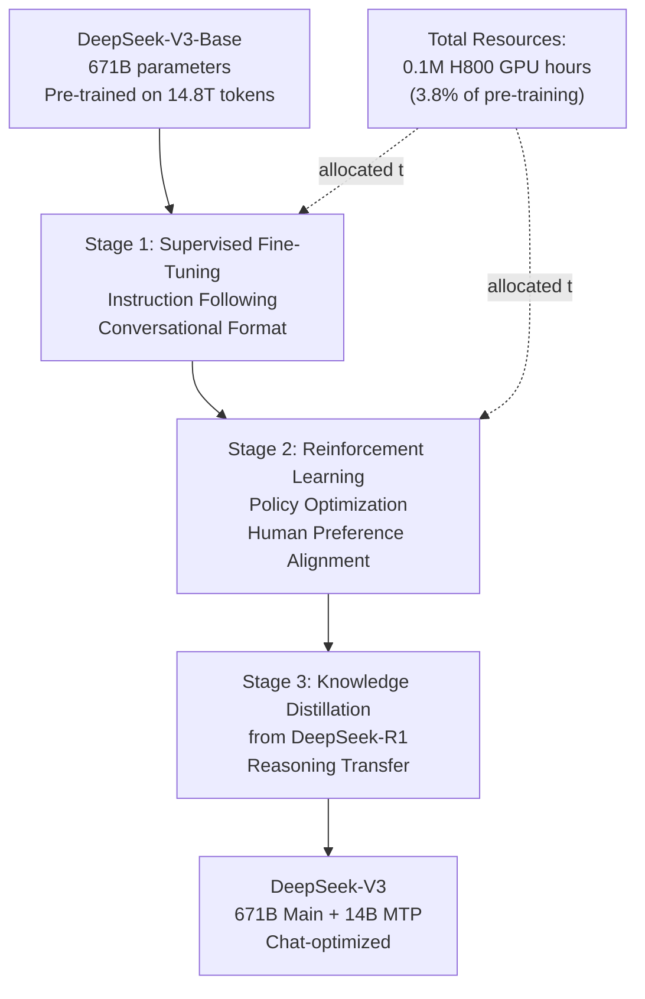
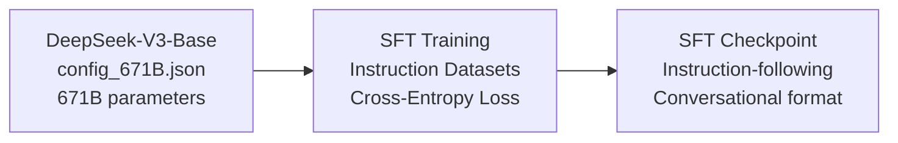
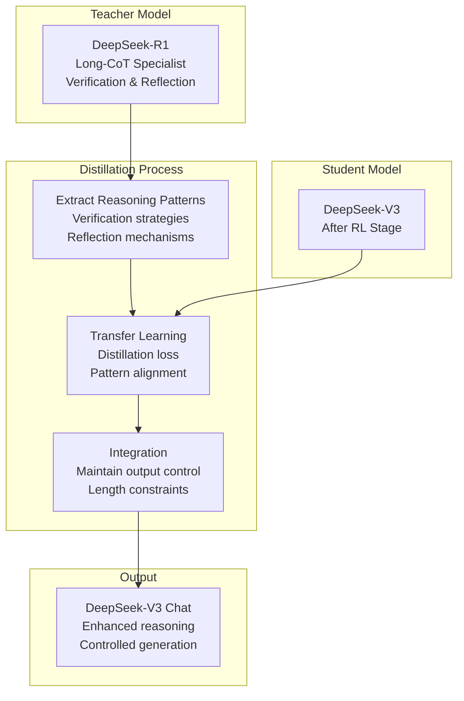
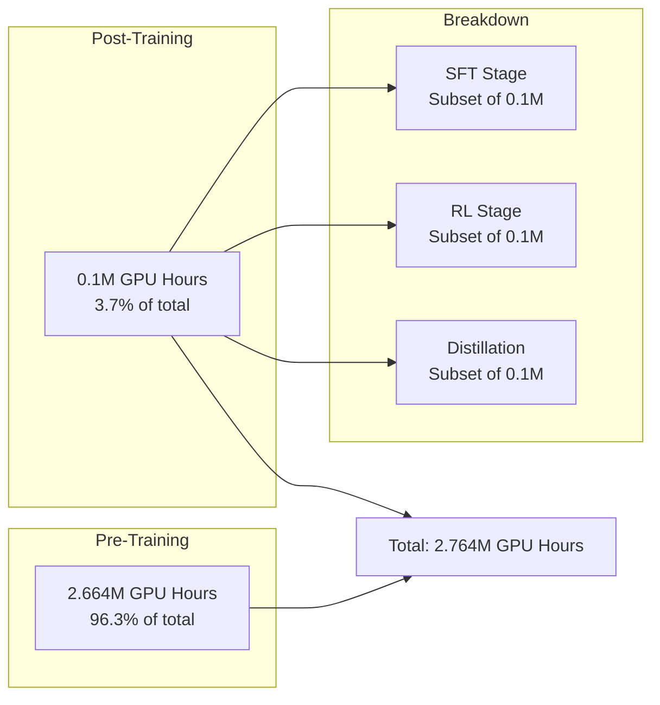
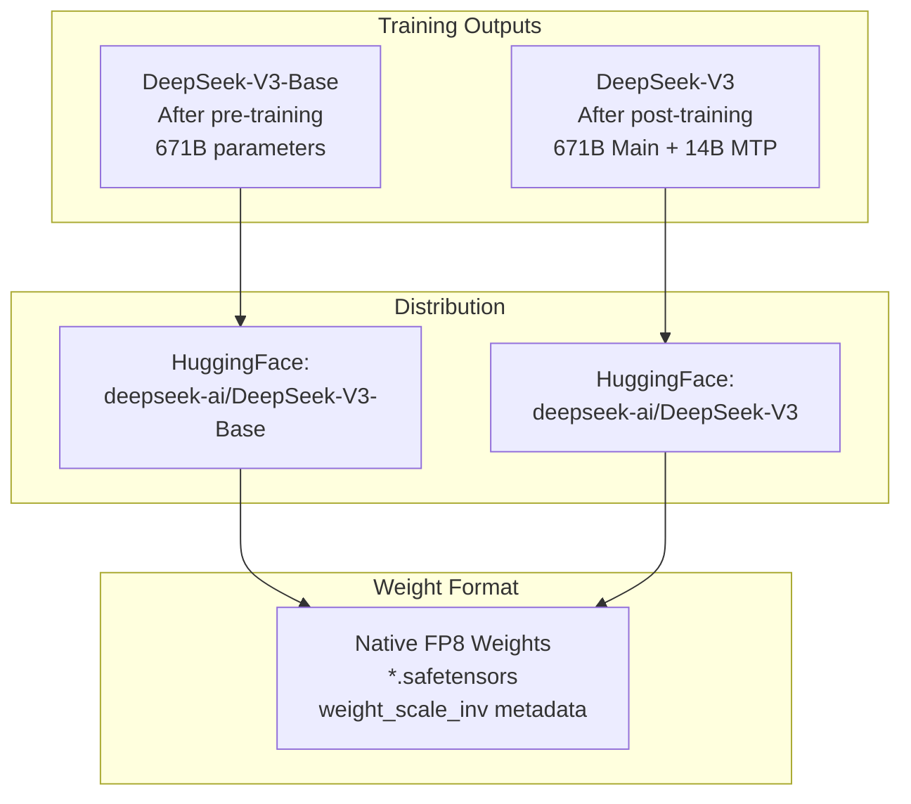
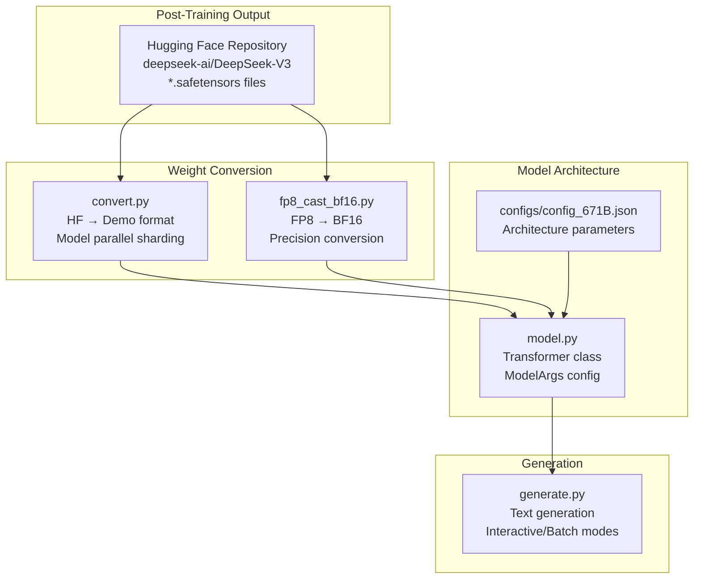

<!-- source: DeepWiki mcp.deepwiki.com · repo deepseek-ai/DeepSeek-V3 · page 3.2 Post-Training · fetched 2026-10-30 -->

# Post-Training

Relevant source files

The following files were used as context for generating this wiki page:

- [README.md](README.md)

## Purpose and Scope

This document describes the post-training phase of DeepSeek-V3, which transforms the pre-trained base model into a chat-capable model through Supervised Fine-Tuning (SFT), Reinforcement Learning (RL), and Knowledge Distillation from DeepSeek-R1. Post-training follows the pre-training phase (see [Pre-Training](#3.1)) and produces the final `DeepSeek-V3` chat model distributed via Hugging Face.

The training implementation code is not included in this repository. This document describes the conceptual pipeline and outputs based on the technical report. For information about using the resulting model artifacts, see [Inference Pipeline](#5) and [Model Weights](#6).

**Sources:** [README.md:45-83]()

## Post-Training Pipeline Overview

Post-training consists of three sequential stages that refine the 671B parameter base model for conversational interactions:

**Diagram: Post-Training Pipeline Stages**

The entire post-training process requires only 0.1M GPU hours, compared to 2.664M hours for pre-training. This represents approximately 3.8% of the total training compute budget.

**Sources:** [README.md:50](), [README.md:76](), [README.md:80-82]()

## Supervised Fine-Tuning (SFT)

### Objective

Supervised Fine-Tuning adapts the pre-trained base model to follow instructions and respond in a conversational format. This stage trains the model on curated instruction-response pairs to establish the foundational capabilities for chat interactions.

### Process Characteristics

The SFT stage:
- Consumes formatted instruction-response datasets
- Optimizes the model to generate coherent, contextually appropriate responses
- Establishes the base conversational behavior patterns
- Maintains the broad knowledge acquired during pre-training

### Model Transformation

**Diagram: SFT Transformation**

The output of this stage serves as the initialization for reinforcement learning.

**Sources:** [README.md:50](), [README.md:76]()

## Reinforcement Learning (RL)

### Objective

Reinforcement Learning further refines the model to align with human preferences and improve response quality. This stage uses policy optimization techniques to maximize reward signals derived from human feedback or automated evaluation metrics.

### Training Approach

The RL stage employs techniques to:
- Optimize the model policy based on preference data
- Balance between exploration (diverse responses) and exploitation (high-reward patterns)
- Prevent excessive deviation from the SFT initialization (KL divergence constraints)
- Improve performance on challenging reasoning and instruction-following tasks

### Resource Allocation

A significant portion of the 0.1M GPU hour budget is allocated to the RL stage, as policy optimization requires iterative sampling and evaluation.

**Sources:** [README.md:50](), [README.md:76]()

## Knowledge Distillation from DeepSeek-R1

### Distillation Methodology

Knowledge distillation transfers reasoning capabilities from DeepSeek-R1, a model specialized in long-Chain-of-Thought (CoT) reasoning, into DeepSeek-V3. This process incorporates advanced reasoning patterns while maintaining control over output style and length.

**Diagram: Knowledge Distillation Architecture**

### Transferred Capabilities

The distillation process specifically transfers:
- **Verification patterns**: Mechanisms for self-checking reasoning steps
- **Reflection capabilities**: Ability to reconsider and refine solutions
- **Long-form reasoning**: Extended multi-step problem-solving approaches
- **Mathematical and coding reasoning**: Domain-specific reasoning strategies

### Output Control

Unlike the teacher model (DeepSeek-R1), which generates long CoT traces, DeepSeek-V3 maintains concise output generation while internally leveraging the distilled reasoning capabilities. This balance provides enhanced performance without excessive verbosity.

**Sources:** [README.md:80-82]()

## Training Efficiency and Resource Requirements

### Compute Budget

**Diagram: Training Resource Allocation**

| Phase | GPU Hours | Percentage | Hardware |
|-------|-----------|------------|----------|
| Pre-Training | 2.664M | 96.3% | H800 GPUs |
| Post-Training Total | 0.1M | 3.7% | H800 GPUs |
| Combined Total | 2.764M | 100% | H800 GPUs |

The post-training efficiency (0.1M hours vs 2.664M for pre-training) demonstrates the effectiveness of the pre-training foundation and the focused nature of the alignment and distillation stages.

**Sources:** [README.md:76]()

## Output Artifacts

### Model Variants

Post-training produces two distributed model variants:

**Diagram: Model Artifacts and Distribution**

| Model | Parameters | Purpose | Hugging Face Repository |
|-------|-----------|---------|------------------------|
| DeepSeek-V3-Base | 671B | Pre-training output, foundation model | deepseek-ai/DeepSeek-V3-Base |
| DeepSeek-V3 | 671B + 14B MTP (685B total) | Post-training output, chat-optimized | deepseek-ai/DeepSeek-V3 |

Both models are distributed in native FP8 format with `weight_scale_inv` metadata for efficient inference.

**Sources:** [README.md:87-99]()

## Integration with Inference Pipeline

### Model Loading and Usage

The post-trained `DeepSeek-V3` model integrates with the inference pipeline through the standard model loading mechanisms:

**Diagram: Post-Training Output to Inference Integration**

### Configuration Compatibility

The post-trained model uses the same `ModelArgs` configuration structure defined in [configs/config_671B.json](). The inference code in `model.py` instantiates the `Transformer` class with these parameters, loading the post-trained weights:

- **Embedding layer**: `ParallelEmbedding` with vocab_size 129,280
- **61 transformer layers**: 3 dense + 58 MoE layers
- **MoE configuration**: 256 experts, 8 activated per token
- **Output projection**: Maps to vocabulary space
- **MTP module**: 14B parameter Multi-Token Prediction head

### Generation Modes

The post-trained chat model supports two primary generation modes via `generate.py`:

1. **Interactive mode**: Conversational interface for chat interactions
2. **Batch mode**: File-based processing for bulk inference

Both modes leverage the instruction-following and reasoning capabilities acquired during post-training.

**Sources:** [inference/convert.py](), [inference/fp8_cast_bf16.py](), [inference/model.py](), [inference/generate.py](), [configs/config_671B.json]()

## Evaluation Impact

### Performance Improvements

Post-training significantly enhances performance across evaluation benchmarks compared to the base model:

| Domain | Benchmark | Base Model Impact | Post-Training Enhancement |
|--------|-----------|------------------|--------------------------|
| Code | LiveCodeBench | Foundation | +110% (Pass@1) |
| Math | AIME 2024 | Foundation | +85% improvement |
| Reasoning | MMLU | Strong base | Instruction-following refinement |
| English | IF-Eval | Limited | Conversational optimization |

The knowledge distillation from DeepSeek-R1 particularly improves:
- Mathematical reasoning (AIME 2024: 39.2% pass@1)
- Code generation (LiveCodeBench: 40.5% pass@1 with CoT)
- Competitive programming (Codeforces: 51.6 percentile)
- Multi-step problem solving (MATH-500: 90.2% EM)

**Sources:** [README.md:163-219]()

## Training Stability

The entire post-training pipeline, like the pre-training phase, exhibits remarkable stability:

- **No rollbacks**: The training process completed without requiring checkpoint rollbacks
- **No irrecoverable loss spikes**: Stable optimization throughout all stages
- **Consistent convergence**: Predictable training dynamics across SFT, RL, and distillation

This stability is particularly noteworthy given the complexity of reinforcement learning and knowledge distillation, which traditionally present optimization challenges at scale.

**Sources:** [README.md:52-54]()

---

