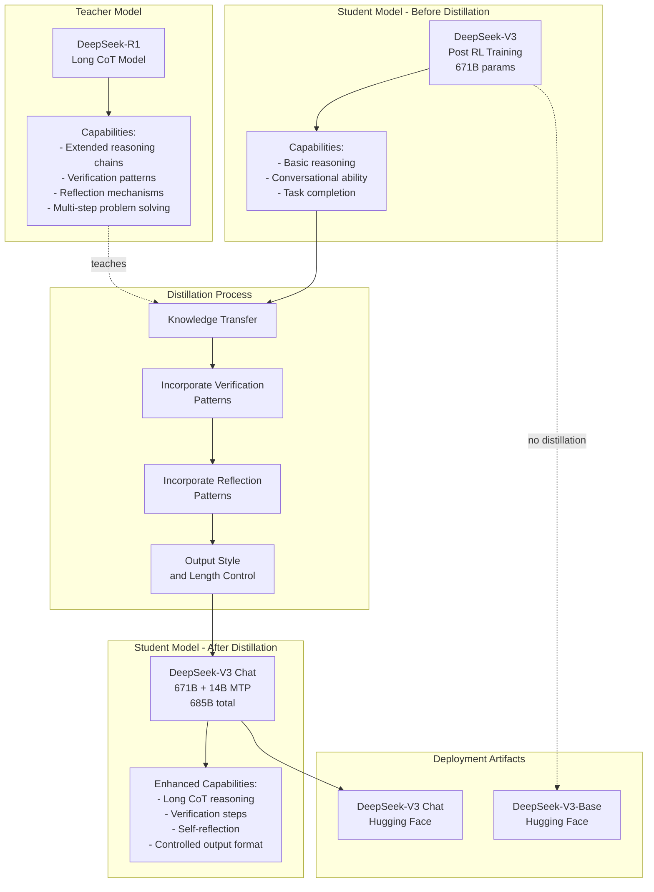
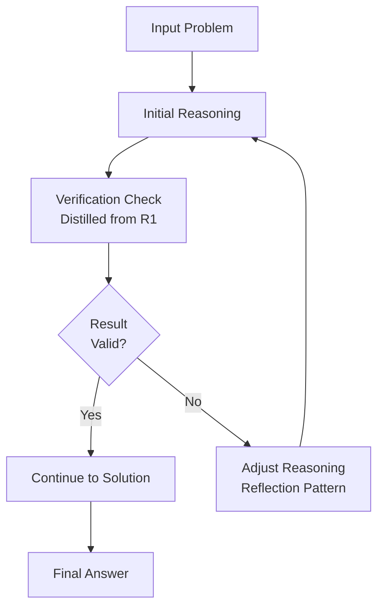
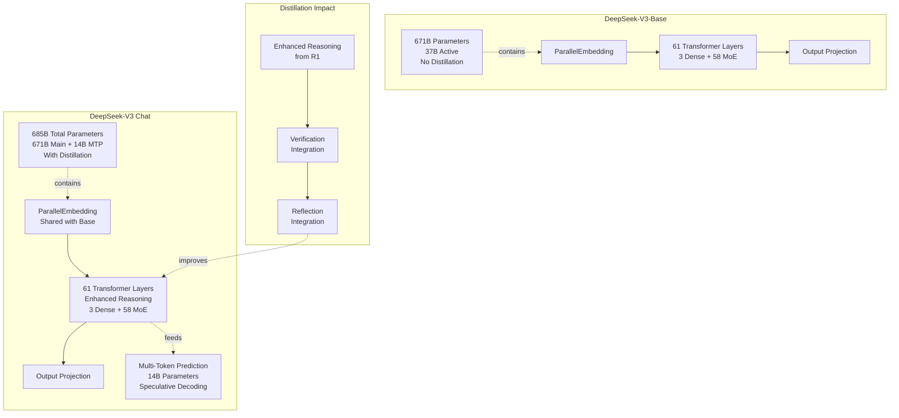
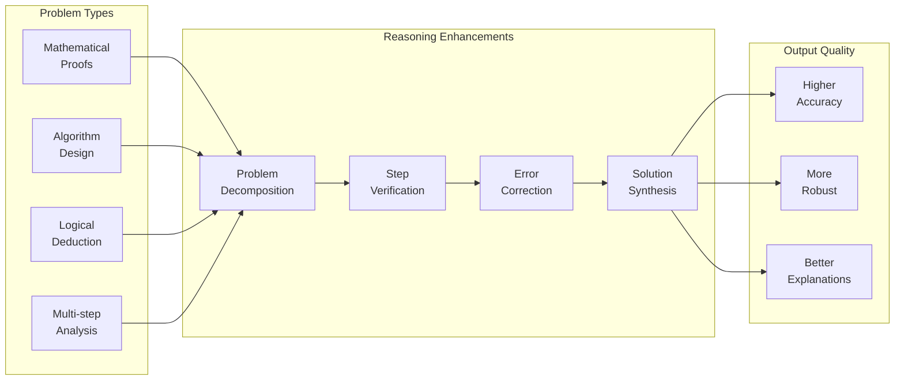
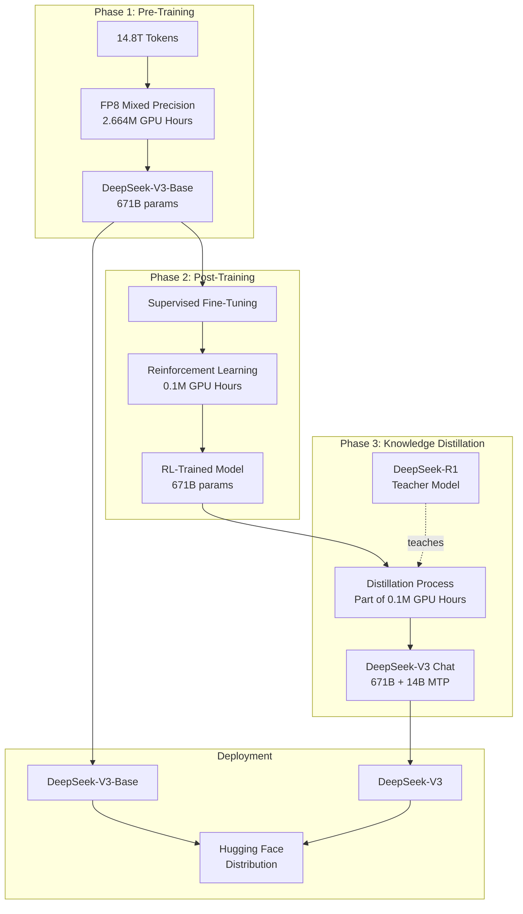

<!-- source: DeepWiki mcp.deepwiki.com · repo deepseek-ai/DeepSeek-V3 · page 3.3 Knowledge Distillation · fetched 2026-10-30 -->

# Knowledge Distillation

<details>
<summary>Relevant source files</summary>

The following files were used as context for generating this wiki page:

- [README.md](README.md)

</details>


This document describes the knowledge distillation process used to transfer reasoning capabilities from the DeepSeek-R1 series models into DeepSeek-V3, producing the final chat-optimized model. This distillation phase represents the culmination of the training pipeline, occurring after supervised fine-tuning and reinforcement learning.

**Purpose and Scope**: This page covers the methodology for distilling long Chain-of-Thought (CoT) reasoning capabilities from DeepSeek-R1 into DeepSeek-V3, including verification and reflection patterns, output style control, and the resulting model characteristics. For information about the preceding training stages, see [Pre-Training](#3.1) and [Post-Training](#3.2). For details on deploying the distilled Chat model, see [Local Deployment Options](#2.2).

**Note**: This repository contains inference code for the final distilled model. The actual distillation training code is part of DeepSeek's internal training pipeline and is not included in this public repository.

## Overview

Knowledge distillation is the final phase of DeepSeek-V3's training pipeline, designed to transfer sophisticated reasoning capabilities from a teacher model (DeepSeek-R1) to a student model (DeepSeek-V3). This process enables DeepSeek-V3 to exhibit enhanced reasoning performance while maintaining controlled output characteristics suitable for production deployment.



**Sources**: [README.md:80-82](), [README.md:91-99]()

## Teacher Model: DeepSeek-R1

DeepSeek-R1 is a specialized model designed for extended reasoning through long Chain-of-Thought (CoT) processes. It serves as the teacher model that provides the reasoning capabilities to be distilled into DeepSeek-V3.

### R1 Characteristics

| Characteristic | Description |
|----------------|-------------|
| **Primary Feature** | Long Chain-of-Thought reasoning |
| **Reasoning Pattern** | Multi-step, explicit reasoning chains |
| **Verification** | Built-in verification mechanisms for intermediate steps |
| **Reflection** | Self-correction and reflection on reasoning paths |
| **Output Style** | Extended, detailed explanations |

The R1 model excels at tasks requiring:
- Complex mathematical reasoning
- Multi-step problem decomposition
- Logical verification of intermediate results
- Self-correction when detecting errors in reasoning

**Sources**: [README.md:80-82]()

## Distillation Methodology

The distillation process transfers R1's reasoning capabilities to DeepSeek-V3 through an innovative pipeline that preserves reasoning quality while adapting output characteristics for production use.

```mermaid
graph LR
    subgraph "Input: R1 Reasoning Examples"
        R1Data["Long CoT Examples<br/>- Problem statements<br/>- Reasoning chains<br/>- Verification steps<br/>- Reflection points"]
    end
    
    subgraph "Distillation Pipeline"
        Extract["Pattern Extraction"]
        Compress["Reasoning Compression"]
        StyleAdapt["Style Adaptation"]
        LengthControl["Length Control"]
        
        Extract --> Compress
        Compress --> StyleAdapt
        StyleAdapt --> LengthControl
    end
    
    subgraph "Training Process"
        V3Student["DeepSeek-V3<br/>Student Model"]
        Loss["Distillation Loss"]
        Update["Parameter Updates"]
        
        Loss --> Update
        Update --> V3Student
    end
    
    subgraph "Output: Enhanced Capabilities"
        Enhanced["Distilled Model<br/>- Compact reasoning<br/>- Verification integrated<br/>- Reflection integrated<br/>- Controlled output"]
    end
    
    R1Data --> Extract
    LengthControl --> Loss
    V3Student --> Enhanced
```



**Sources**: [README.md:80-82]()

### Verification Pattern Integration

Verification patterns from R1 are incorporated into V3's reasoning process:



**Sources**: [README.md:80-82]()

### Output Style and Length Control

A key challenge in distillation is maintaining the quality of reasoning while controlling output characteristics:

| Aspect | R1 Behavior | V3 Chat Behavior (Post-Distillation) |
|--------|-------------|--------------------------------------|
| **Reasoning Detail** | Very verbose, complete chains | Concise, essential steps only |
| **Output Length** | Uncontrolled, can be very long | Controlled, production-appropriate |
| **Verification Steps** | Explicit, detailed | Implicit or abbreviated |
| **Reflection** | Extensive self-dialogue | Compact, focused adjustments |
| **User Experience** | Educational, detailed | Efficient, actionable |

**Sources**: [README.md:80-82]()

## Resulting Model: DeepSeek-V3 Chat

The distillation process produces the DeepSeek-V3 Chat model, which combines the base model with enhanced reasoning capabilities and the Multi-Token Prediction (MTP) module.

### Model Architecture Comparison



**Sources**: [README.md:91-99](), [README.md:103]()

### Weight Distribution

The DeepSeek-V3 Chat model is distributed as a single artifact containing both the main model and MTP module:

| Component | Parameters | Location on Hugging Face |
|-----------|------------|--------------------------|
| **Main Model** | 671B | `model*.safetensors` (main weights) |
| **MTP Module** | 14B | `model*.safetensors` (MTP weights) |
| **Total** | 685B | `deepseek-ai/DeepSeek-V3` |

The Base model (without distillation) is available separately:

| Component | Parameters | Location on Hugging Face |
|-----------|------------|--------------------------|
| **Main Model Only** | 671B | `deepseek-ai/DeepSeek-V3-Base` |

**Sources**: [README.md:91-99](), [README.md:103]()

## Performance Improvements

Knowledge distillation from DeepSeek-R1 significantly improves reasoning performance across multiple benchmarks while maintaining efficiency.

### Benchmark Improvements

Key improvements in the Chat model (with distillation) over the Base model (without distillation):

**Mathematical Reasoning**:
- **AIME 2024**: 39.2% pass rate (state-of-the-art for open models)
- **MATH-500**: 90.2% exact match
- **CNMO 2024**: 43.2% pass rate

**Code Reasoning**:
- **LiveCodeBench (CoT)**: 40.5% pass rate
- **Codeforces**: 51.6th percentile
- **Aider-Polyglot**: 49.6% accuracy

**General Reasoning**:
- **MMLU-Redux**: 89.1% exact match
- **DROP**: 91.6% F1 score
- **GPQA-Diamond**: 59.1% pass rate

**Sources**: [README.md:167-194]()

### Reasoning Quality Examples

The distilled model exhibits improved reasoning in several key areas:



**Sources**: [README.md:167-194]()

## Integration with Training Pipeline

Knowledge distillation is the final stage of the complete training pipeline, building on all previous training phases.

### Complete Training Lifecycle



**Sources**: [README.md:71-83]()

### Resource Allocation

The post-training phase (including distillation) requires significantly fewer resources than pre-training:

| Training Phase | GPU Hours | Models Produced |
|----------------|-----------|-----------------|
| **Pre-Training** | 2.664M H800 | DeepSeek-V3-Base |
| **Post-Training + Distillation** | 0.1M H800 | DeepSeek-V3 Chat |
| **Total** | 2.764M H800 | Both variants |

**Efficiency Note**: The distillation process is part of the 0.1M GPU hours allocated to post-training, representing less than 4% of the total training compute while providing substantial improvements in reasoning capabilities.

**Sources**: [README.md:76](), [README.md:82]()

## Using the Distilled Model

The distilled DeepSeek-V3 Chat model is available through multiple deployment options.

### Model Selection

Choose the appropriate model based on your use case:

| Model | Use Case | Reasoning | Parameters |
|-------|----------|-----------|------------|
| **DeepSeek-V3-Base** | Further fine-tuning, research | Basic | 671B |
| **DeepSeek-V3 Chat** | Production deployment, reasoning tasks | Enhanced (distilled) | 685B (671B + 14B MTP) |

### Accessing the Distilled Model

**Hugging Face**:
```
deepseek-ai/DeepSeek-V3
```

**Official Platforms**:
- Web Interface: `chat.deepseek.com`
- API: `platform.deepseek.com`

**Local Deployment**: See [Local Deployment Options](#2.2) for framework-specific instructions.

**Sources**: [README.md:91-94](), [README.md:223-225]()

## Key Takeaways

1. **Distillation Purpose**: Transfer sophisticated reasoning capabilities from DeepSeek-R1's long CoT model to DeepSeek-V3 for production use
2. **Enhanced Capabilities**: Verification and reflection patterns improve reasoning quality across mathematical, coding, and logical tasks
3. **Output Control**: Distillation includes mechanisms to maintain appropriate output length and style for production deployment
4. **Model Variants**: Two models are distributed - Base (no distillation) and Chat (with distillation + MTP)
5. **Cost Efficiency**: Distillation is part of post-training, requiring only 0.1M GPU hours compared to 2.664M for pre-training
6. **Performance Gains**: Significant improvements on reasoning benchmarks, achieving state-of-the-art results for open models

**Sources**: [README.md:80-82](), [README.md:167-194]()

---

