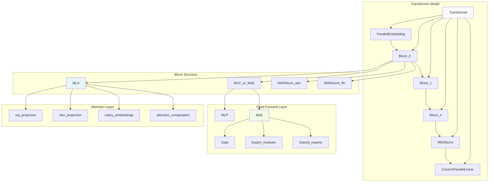
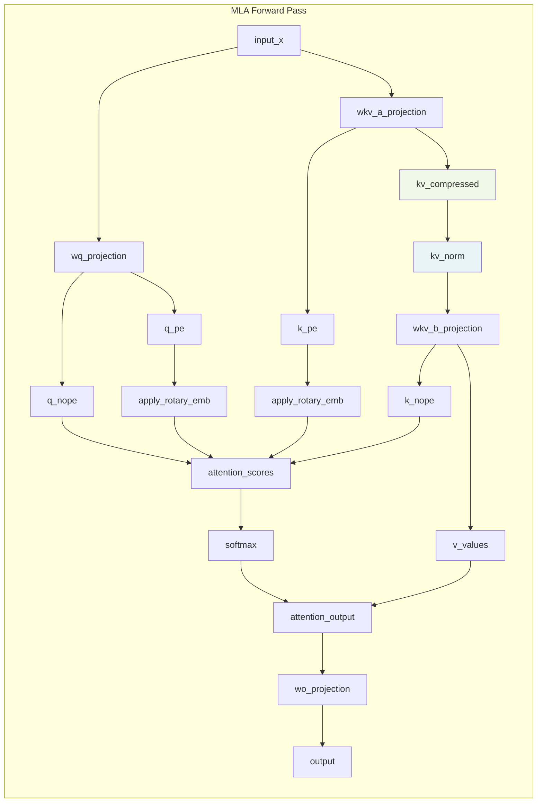
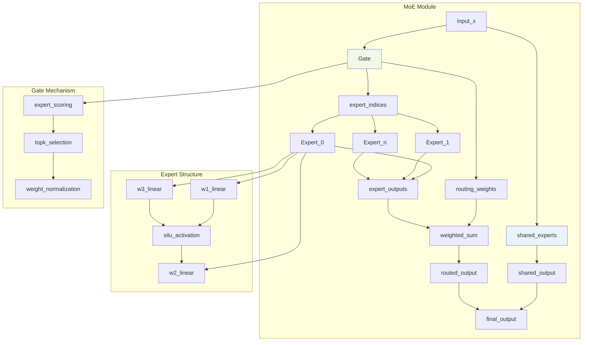
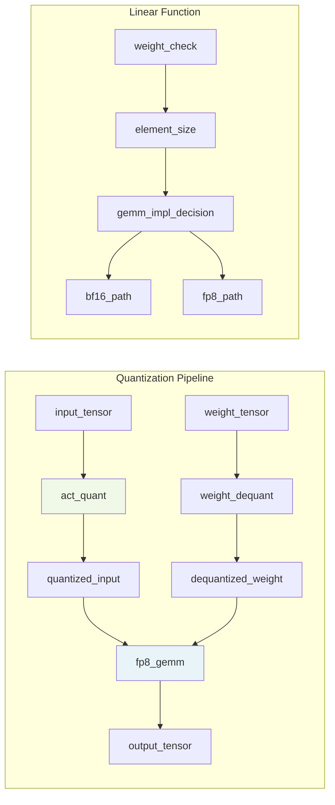
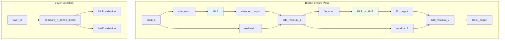

<!-- source: DeepWiki mcp.deepwiki.com · repo deepseek-ai/DeepSeek-V3 · page 4 Model Architecture · fetched 2026-10-30 -->

# Model Architecture

<details>
<summary>Relevant source files</summary>

The following files were used as context for generating this wiki page:

- [inference/model.py](inference/model.py)

</details>


This document provides a comprehensive technical overview of the DeepSeek-V3 model architecture implementation, focusing on the core components, attention mechanisms, and distributed processing capabilities. The architecture is implemented primarily in the `Transformer` class and related modules.

For information about the inference pipeline and text generation, see [Inference Pipeline](#4). For configuration options and model parameters, see [Configuration](#6). For model weight structure and quantization details, see [Model Weights](#5).

## Architecture Overview

The DeepSeek-V3 model implements a transformer architecture with Multi-head Latent Attention (MLA) and Mixture of Experts (MoE) components. The model supports distributed processing across multiple GPUs and includes FP8 quantization for memory efficiency.

### Core Architecture Components



**Sources:** [inference/model.py:735-795]()

The `Transformer` class serves as the main model container, orchestrating embeddings, multiple transformer blocks, normalization, and output projection. Each `Block` contains an MLA attention layer and either an MLP or MoE feed-forward layer depending on the layer position.

### Model Configuration

The architecture is highly configurable through the `ModelArgs` dataclass, which defines key parameters:

| Parameter | Default | Description |
|-----------|---------|-------------|
| `n_layers` | 27 | Number of transformer blocks |
| `n_dense_layers` | 1 | Number of dense (MLP) layers before MoE |
| `dim` | 2048 | Model dimension |
| `n_heads` | 16 | Number of attention heads |
| `n_routed_experts` | 64 | Total number of MoE experts |
| `n_activated_experts` | 6 | Number of experts activated per token |
| `vocab_size` | 102400 | Vocabulary size |

**Sources:** [inference/model.py:19-85]()

## Multi-head Latent Attention (MLA)

The MLA mechanism implements an efficient attention computation using low-rank projections and compressed key-value representations. This approach reduces memory usage while maintaining attention quality.

### MLA Architecture



**Sources:** [inference/model.py:393-495]()

The MLA implementation includes several key components:

- **Low-rank projections**: Uses `q_lora_rank` and `kv_lora_rank` parameters to reduce computational complexity
- **Rotary embeddings**: Applied to position-dependent components (`q_pe` and `k_pe`)
- **Compressed representations**: Key-value pairs are compressed through the `kv_lora_rank` bottleneck
- **Caching strategies**: Supports both naive and absorb caching implementations via `attn_impl` parameter

### MLA Implementation Details

The `MLA` class handles query, key, and value projections with different strategies based on configuration:

```python
# Query projection (conditional on q_lora_rank)
if self.q_lora_rank == 0:
    self.wq = ColumnParallelLinear(self.dim, self.n_heads * self.qk_head_dim)
else:
    self.wq_a = Linear(self.dim, self.q_lora_rank)
    self.wq_b = ColumnParallelLinear(self.q_lora_rank, self.n_heads * self.qk_head_dim)
```

**Sources:** [inference/model.py:421-426](), [inference/model.py:427-430]()

## Mixture of Experts (MoE)

The MoE architecture activates a subset of experts for each token, enabling the model to scale capacity without proportionally increasing computation. The implementation includes routing mechanisms, expert computation, and load balancing.

### MoE Components



**Sources:** [inference/model.py:633-691](), [inference/model.py:532-596](), [inference/model.py:598-631]()

### Expert Routing

The `Gate` class implements the routing mechanism that determines which experts process each token:

- **Scoring**: Computes scores for all experts using learned parameters
- **Selection**: Uses top-k selection to choose `n_activated_experts` experts
- **Normalization**: Applies softmax or sigmoid normalization based on `score_func`
- **Grouping**: Supports expert grouping for load balancing via `n_expert_groups`

**Sources:** [inference/model.py:563-595]()

Each `Expert` module is a standard MLP with SiLU activation, consisting of three linear layers (`w1`, `w2`, `w3`) configured for the MoE intermediate dimension.

## Distributed Processing

The architecture includes comprehensive support for distributed training and inference across multiple GPUs through specialized linear layers and embedding components.

### Parallel Components

```mermaid
graph TB
    subgraph "Parallel Linear Layers"
        A[Linear] --> B[ColumnParallelLinear]
        A --> C[RowParallelLinear]
        
        B --> D[split_output_features]
        C --> E[split_input_features]
        
        D --> F[local_computation]
        E --> G[local_computation]
        G --> H[all_reduce]
    end
    
    subgraph "Parallel Embedding"
        I[ParallelEmbedding] --> J[vocab_partitioning]
        J --> K[local_embedding]
        K --> L[all_reduce]
    end
    
    subgraph "Distributed Coordination"
        M[world_size] --> N[rank_assignment]
        N --> O[partition_calculation]
        O --> P[communication_patterns]
    end
    
    style B fill:#f0f8e8
    style C fill:#e8f4f8
    style I fill:#f9f9f9
```



**Sources:** [inference/model.py:205-232](), [inference/model.py:234-265](), [inference/model.py:87-127]()

### Distributed Implementation Details

The distributed processing relies on three key patterns:

1. **Column Parallelism**: `ColumnParallelLinear` splits output features across ranks
2. **Row Parallelism**: `RowParallelLinear` splits input features and reduces results
3. **Embedding Parallelism**: `ParallelEmbedding` partitions vocabulary across ranks

Global variables `world_size` and `rank` coordinate distributed operations, automatically set when `torch.distributed` is initialized.

## Quantization Support

The model supports FP8 quantization through custom linear operations and kernel implementations. The quantization strategy reduces memory usage while maintaining computational efficiency.

### Quantization Flow



**Sources:** [inference/model.py:129-162](), [inference/model.py:10]()

The `linear` function automatically handles quantization based on weight properties and the global `gemm_impl` setting. When weights are quantized (element size = 1), the function either dequantizes for BF16 computation or uses FP8 GEMM operations.

## Block Structure and Layer Composition

Each transformer block combines attention and feed-forward components with residual connections and layer normalization.

### Block Implementation



**Sources:** [inference/model.py:693-733]()

The `Block` class determines whether to use MLP or MoE based on the layer position: layers with `layer_id < n_dense_layers` use MLP, while subsequent layers use MoE. This allows for a mixed architecture where early layers use dense computation and later layers use sparse expert routing.

---

