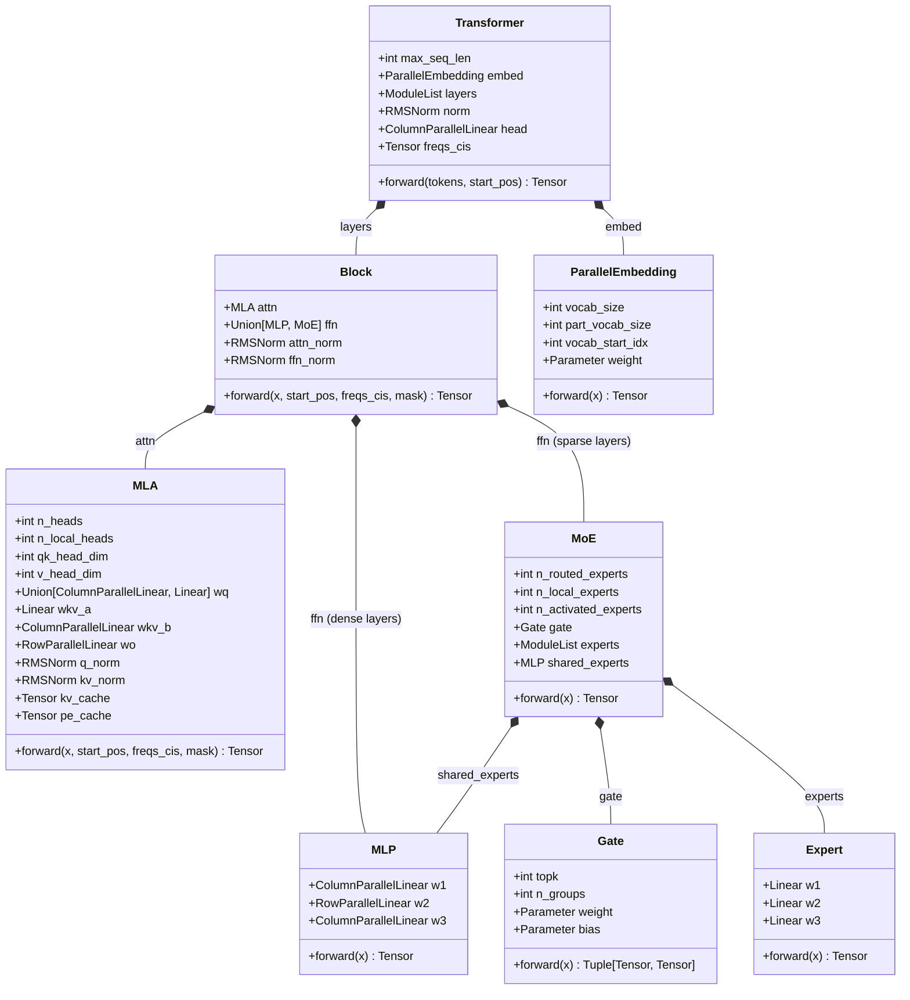
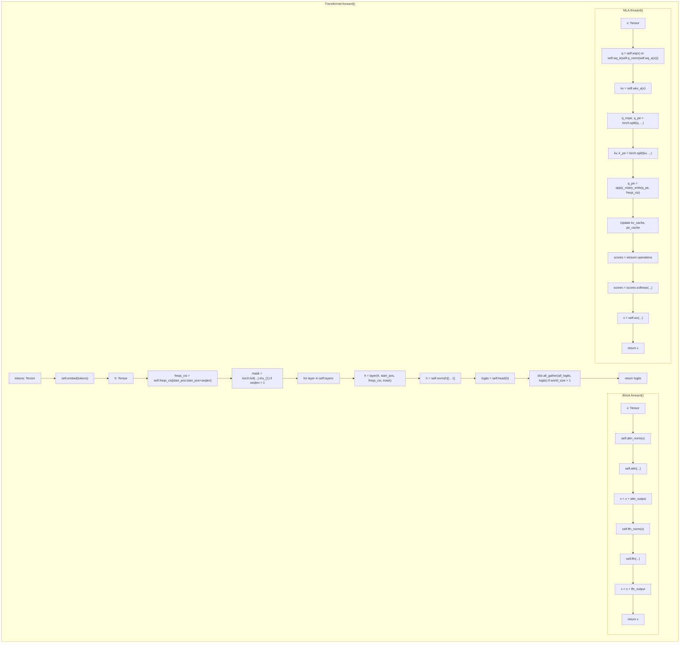
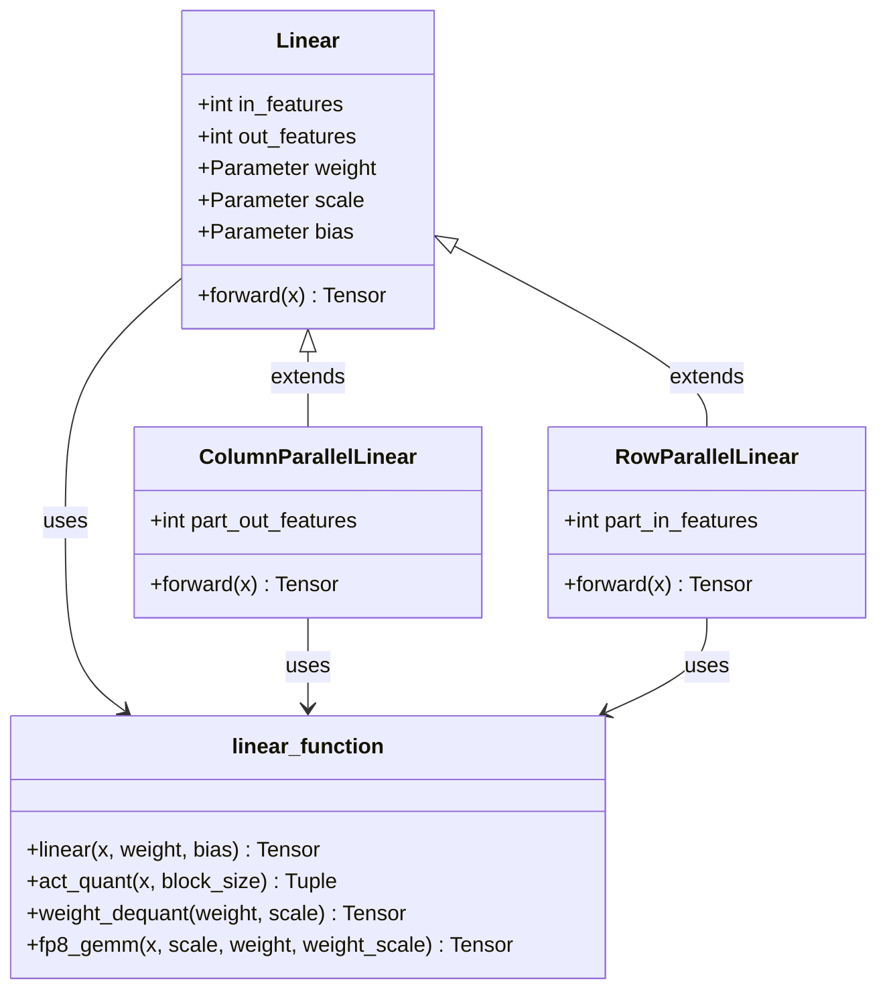

<!-- source: DeepWiki mcp.deepwiki.com · repo deepseek-ai/DeepSeek-V3 · page 4.1 Transformer Implementation · fetched 2026-10-30 -->

# Transformer Implementation

<details>
<summary>Relevant source files</summary>

The following files were used as context for generating this wiki page:

- [inference/model.py](inference/model.py)

</details>


This document details the implementation of the Transformer architecture in DeepSeek-V3. It covers the core components of the transformer model, their interactions, and the specialized features that enable the model's capabilities. For information about specific components like Multi-head Latent Attention (MLA), see [Multi-head Latent Attention (MLA)](#3.2), and for Mixture of Experts (MoE), see [Mixture of Experts (MoE)](#3.3).

## Overview

The DeepSeek-V3 Transformer implementation is defined in `model.py` and features a highly optimized architecture with several key innovations:

1. Distributed computation support with parallel linear layers
2. Multi-head Latent Attention (MLA) for efficient attention computation
3. Mixture of Experts (MoE) for conditional computation
4. FP8/BF16 precision support for memory efficiency
5. Rotary positional embeddings optimized for extended context lengths

The implementation is designed to scale efficiently across different model sizes (16B, 236B, and 671B parameters) while maintaining a consistent architecture.

Sources: [inference/model.py:735-794]()

## Architecture Components

### Model Configuration

The model's hyperparameters are defined in the `ModelArgs` dataclass, including dimensions, layer counts, attention configuration, and MoE settings.

```markdown
| Parameter | Description | Default Value |
|-----------|-------------|---------------|
| max_batch_size | Maximum batch size for inference | 8 |
| max_seq_len | Maximum sequence length | 16384 |
| dtype | Data type for computations | "bf16" |
| vocab_size | Vocabulary size | 102400 |
| dim | Model dimension | 2048 |
| inter_dim | Intermediate dimension for MLP layers | 10944 |
| moe_inter_dim | Intermediate dimension for MoE layers | 1408 |
| n_layers | Number of transformer layers | 27 |
| n_dense_layers | Number of dense (MLP) layers | 1 |
| n_heads | Number of attention heads | 16 |
| n_routed_experts | Number of routed experts in MoE | 64 |
| n_shared_experts | Number of shared experts in MoE | 2 |
| n_activated_experts | Number of activated experts per token | 6 |
| n_expert_groups | Number of expert groups for routing | 1 |
| n_limited_groups | Number of limited groups for routing | 1 |
| score_func | Scoring function for MoE routing | "softmax" |
| route_scale | Scaling factor for routing scores | 1.0 |
| q_lora_rank | LoRA rank for query projections | 0 |
| kv_lora_rank | LoRA rank for key-value projections | 512 |
| qk_nope_head_dim | Query-key dimension without positional embeddings | 128 |
| qk_rope_head_dim | Query-key dimension with rotary embeddings | 64 |
| v_head_dim | Value head dimension | 128 |
| rope_theta | Base for rotary positional encoding | 10000.0 |
| rope_factor | Scaling factor for extended sequence lengths | 40 |
| beta_fast | Fast beta correction factor for YaRN | 32 |
| beta_slow | Slow beta correction factor for YaRN | 1 |
| mscale | Scaling factor for extended attention | 1.0 |
```

Sources: [inference/model.py:19-84]()

### Transformer Class

The `Transformer` class is the main model class that orchestrates all components:

### Transformer Architecture Class Diagram



Sources: [inference/model.py:735-794](), [inference/model.py:693-732](), [inference/model.py:393-494](), [inference/model.py:497-529](), [inference/model.py:633-690](), [inference/model.py:532-595](), [inference/model.py:598-630](), [inference/model.py:87-126]()

## Data Flow

The following diagram illustrates the data flow through the Transformer model:

### Transformer Forward Pass Data Flow



Sources: [inference/model.py:768-794](), [inference/model.py:717-732](), [inference/model.py:443-494]()

## Key Architectural Components

### Embedding Layer

The `ParallelEmbedding` class implements token embedding with support for distributed computation across multiple processes:

- Splits vocabulary across processes for parallel processing
- Synchronizes embeddings across processes with all-reduce operations
- Maps input tokens to their corresponding embeddings

Sources: [inference/model.py:87-126]()

### Transformer Block

Each transformer block (`Block` class) consists of:

1. Attention normalization layer (`attn_norm`)
2. Multi-head Latent Attention (`attn`)
3. Feed-forward normalization layer (`ffn_norm`)
4. Feed-forward network - either MLP (dense) or MoE (sparse)

The transformer block applies residual connections after both attention and feed-forward components.

Sources: [inference/model.py:693-732]()

### Multi-head Latent Attention (MLA)

The MLA implementation features:

- Separate head dimensions for positional and non-positional components
- Efficient caching mechanisms for key-value pairs
- Support for LoRA rank decomposition for query and key-value projections
- Rotary positional embeddings with YaRN scaling for extended context lengths

See [Multi-head Latent Attention (MLA)](#3.2) for more details.

Sources: [inference/model.py:393-494]()

### Feed-Forward Networks

DeepSeek-V3 uses two types of feed-forward networks:

1. **MLP**: Traditional feed-forward network with three linear projections and SiLU activation
   - Used in the first `n_dense_layers` transformer blocks

2. **MoE**: Mixture of Experts with conditional routing
   - Used in later layers for more efficient computation
   - Combines routed experts with shared experts
   - Uses a gating mechanism to select relevant experts for each token

See [Mixture of Experts (MoE)](#3.3) for more details on the MoE implementation.

Sources: [inference/model.py:497-529](), [inference/model.py:633-690]()

## Linear Layer Implementations

DeepSeek-V3 implements custom linear layers with support for distributed computation and quantization:

### Linear Layer Implementation Hierarchy



The linear layer implementations provide distributed computation support with quantization:

1. **`linear()` function**: Custom linear transformation with support for quantized weights
   - Handles both quantized (element_size() == 1) and non-quantized weights
   - Uses `weight_dequant()` for BF16 mode or `act_quant()` + `fp8_gemm()` for FP8 mode
   - Automatically detects quantization format and applies appropriate operations

2. **`Linear`**: Base implementation with quantized weight support
   - Stores quantization scales when using FP8 precision
   - Supports optional bias terms
   - Configurable dtype (BF16 or FP8)

3. **`ColumnParallelLinear`**: Splits output features across processes
   - Divides `out_features` by `world_size` for parallel computation
   - Each process handles `part_out_features = out_features // world_size`

4. **`RowParallelLinear`**: Splits input features across processes
   - Divides `in_features` by `world_size` for parallel computation
   - Performs `dist.all_reduce()` after linear computation to aggregate results
   - Adds bias after all-reduce to avoid double-counting

### Quantization Support Details

The implementation supports both FP8 and BF16 precision modes:

- **FP8 Mode**: Uses `act_quant()` to quantize activations and `fp8_gemm()` for computation
- **BF16 Mode**: Uses `weight_dequant()` to convert quantized weights to BF16 format
- **Scale Management**: Quantized weights include scale parameters stored as `weight.scale`
- **Block Size**: Uses configurable `block_size` (default 128) for quantization granularity

Sources: [inference/model.py:129-264]()

## Rotary Positional Embeddings

### YaRN-Enhanced Rotary Positional Embeddings

DeepSeek-V3 implements rotary positional embeddings (RoPE) with YaRN scaling for extended context length support:

#### `precompute_freqs_cis()` Implementation

The frequency computation includes sophisticated scaling mechanisms:

1. **Base Frequency Computation**: `freqs = 1.0 / (base ** (torch.arange(0, dim, 2) / dim))`
2. **YaRN Scaling**: Applied when `seqlen > args.original_seq_len`
   - Uses `find_correction_range()` to determine scaling boundaries
   - Applies `linear_ramp_factor()` for smooth transitions
   - Formula: `freqs = freqs / factor * (1 - smooth) + freqs * smooth`

#### YaRN Scaling Components

- **`find_correction_dim()`**: Computes correction dimension for rotations
- **`find_correction_range()`**: Determines range for scaling corrections using `beta_fast` and `beta_slow`
- **`linear_ramp_factor()`**: Creates smooth linear interpolation between scaling regions
- **Outer Product**: `freqs = torch.outer(t, freqs)` creates position-frequency matrix
- **Complex Exponentials**: `freqs_cis = torch.polar(torch.ones_like(freqs), freqs)`

#### `apply_rotary_emb()` Implementation

Applies rotary embeddings to query and key tensors:

1. **Complex Conversion**: `x = torch.view_as_complex(x.float().view(*x.shape[:-1], -1, 2))`
2. **Frequency Broadcasting**: `freqs_cis = freqs_cis.view(1, x.size(1), 1, x.size(-1))`
3. **Rotation Application**: `y = torch.view_as_real(x * freqs_cis).flatten(3)`
4. **Type Restoration**: `return y.to(dtype)`

#### Extended Context Support

- **Original Length**: Default 4096 tokens
- **Extension Factor**: `rope_factor = 40` for 40x extension capability
- **Beta Correction**: `beta_fast = 32`, `beta_slow = 1` for frequency adjustments
- **mScale Factor**: Additional scaling for attention computation when context is extended

This implementation enables efficient scaling to sequences far beyond the original 4096 training length.

Sources: [inference/model.py:294-390]()

## Forward Propagation

The main forward method in the `Transformer` class:

1. Embeds input tokens using `ParallelEmbedding`
2. Computes positional frequencies based on sequence position
3. Creates causal attention mask for autoregressive generation
4. Processes the embeddings through all transformer blocks
5. Applies final normalization and output projection
6. Synchronizes output logits across processes

### Forward Propagation Implementation

The `Transformer.forward()` method orchestrates the complete forward pass:

```python
@torch.inference_mode()
def forward(self, tokens: torch.Tensor, start_pos: int = 0):
    seqlen = tokens.size(1)
    h = self.embed(tokens)                                    # ParallelEmbedding
    freqs_cis = self.freqs_cis[start_pos:start_pos+seqlen]   # RoPE frequencies
    mask = None
    if seqlen > 1:
        mask = torch.full((seqlen, seqlen), float("-inf"), 
                         device=tokens.device).triu_(1)       # Causal mask
    
    for layer in self.layers:                                 # Process through blocks
        h = layer(h, start_pos, freqs_cis, mask)
    
    h = self.norm(h)[:, -1]                                  # Final RMSNorm, last token
    logits = self.head(h)                                    # ColumnParallelLinear
    
    # Synchronize distributed output
    if world_size > 1:
        all_logits = [torch.empty_like(logits) for _ in range(world_size)]
        dist.all_gather(all_logits, logits)
        logits = torch.cat(all_logits, dim=-1)
    
    return logits
```

#### Key Implementation Details

1. **Inference Mode**: `@torch.inference_mode()` decorator disables gradient computation
2. **Sequence Position**: `start_pos` parameter enables incremental generation with KV caching
3. **Causal Masking**: Upper triangular mask with `-inf` values for autoregressive generation
4. **Last Token Selection**: `h[:, -1]` extracts the final token representation for next-token prediction
5. **Distributed Synchronization**: `all_gather` + `cat` combines logits across vocabulary shards

Sources: [inference/model.py:768-794]()

## Distributed Computation

### Distributed Computation Architecture

The transformer implementation provides comprehensive distributed execution support:

#### Global Distributed State

```python
world_size = dist.get_world_size() if dist.is_initialized() else 1
rank = dist.get_rank() if dist.is_initialized() else 0
```

#### Distributed Components

1. **`ParallelEmbedding`**: Vocabulary parallelism
   - Splits vocabulary: `part_vocab_size = vocab_size // world_size`
   - Each process handles tokens in range `[vocab_start_idx, vocab_end_idx)`
   - Uses `dist.all_reduce()` to aggregate embeddings across processes
   - Masks out-of-range tokens to zero before aggregation

2. **`ColumnParallelLinear`**: Output feature parallelism
   - Splits output features: `part_out_features = out_features // world_size`
   - Each process computes partial output features
   - No synchronization needed during forward pass

3. **`RowParallelLinear`**: Input feature parallelism
   - Splits input features: `part_in_features = in_features // world_size`
   - Uses `dist.all_reduce()` after linear computation
   - Adds bias after all-reduce to avoid duplication

4. **MoE Expert Parallelism**: Distributes experts across processes
   - Expert range: `[experts_start_idx, experts_end_idx)` per process
   - Uses `dist.all_reduce()` to aggregate expert outputs
   - Shared experts remain replicated across all processes

#### Synchronization Points

- **Embedding Layer**: `dist.all_reduce(y)` aggregates token embeddings
- **Row Parallel Layers**: `dist.all_reduce(y)` aggregates partial linear outputs
- **MoE Layers**: `dist.all_reduce(y)` aggregates expert computations
- **Final Logits**: `dist.all_gather(all_logits, logits)` collects vocabulary shards

#### Distributed Validation

The implementation includes assertions to ensure proper sharding:
- `assert vocab_size % world_size == 0` for vocabulary parallelism
- `assert out_features % world_size == 0` for column parallelism
- `assert in_features % world_size == 0` for row parallelism
- `assert n_routed_experts % world_size == 0` for expert parallelism

This architecture enables efficient scaling to hundreds of billions of parameters across multiple devices.

Sources: [inference/model.py:13-16](), [inference/model.py:87-126](), [inference/model.py:205-264](), [inference/model.py:633-690](), [inference/model.py:754-756]()

## Quantization Support

DeepSeek-V3 provides built-in support for quantized computation:

- FP8 and BF16 precision support
- Custom `linear()` function that handles quantized weights
- Integration with optimized kernels via `act_quant`, `weight_dequant`, and `fp8_gemm`
- Automatic scale computation and handling for quantized weights

This enables efficient inference with reduced memory requirements while maintaining model quality.

Sources: [inference/model.py:129-161](), [inference/model.py:164-191]()

---

