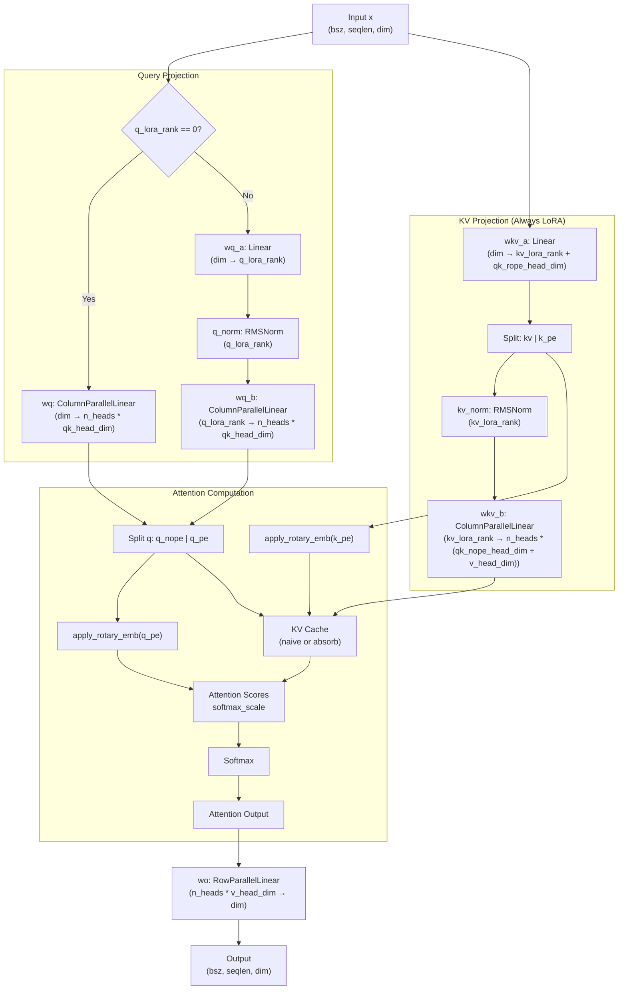
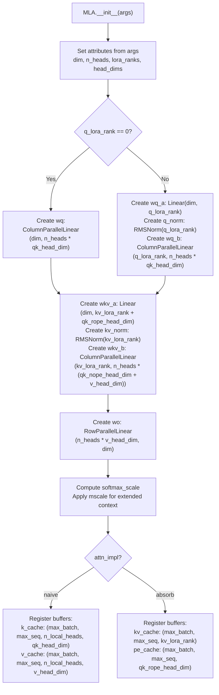
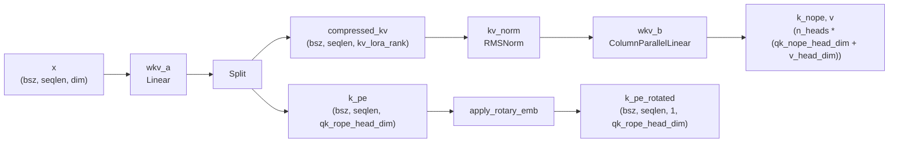
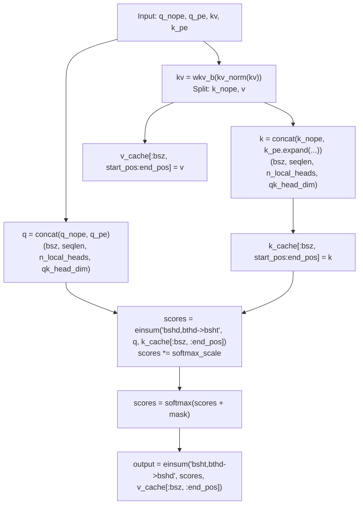
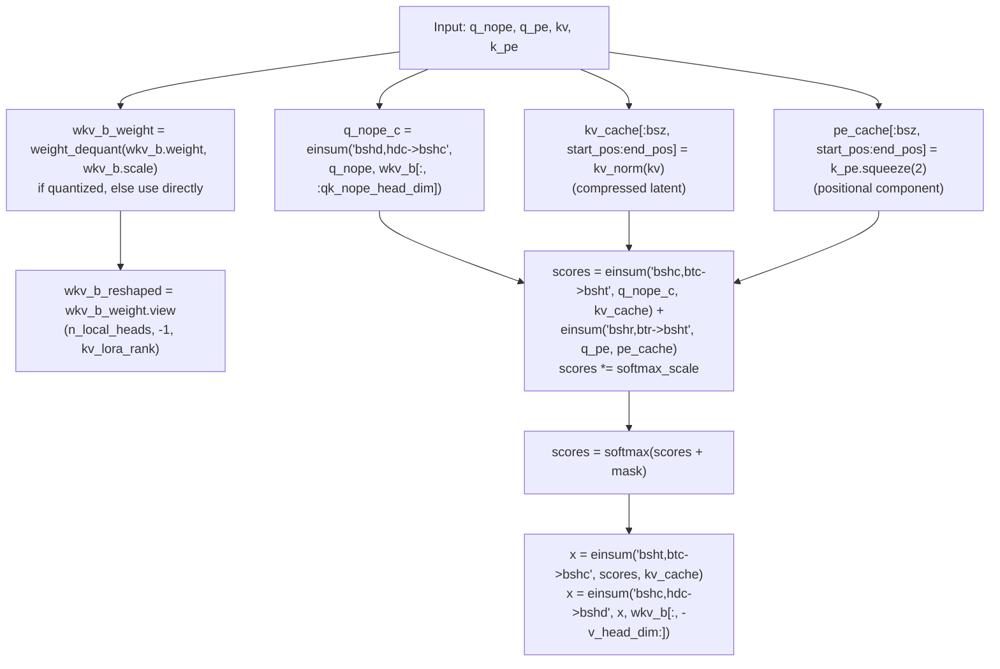
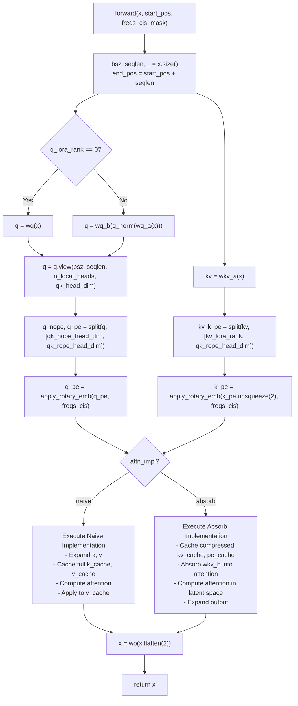

<!-- source: DeepWiki mcp.deepwiki.com · repo deepseek-ai/DeepSeek-V3 · page 4.2 Multi-head Latent Attention (MLA) · fetched 2026-10-30 -->

# Multi-head Latent Attention (MLA)

<details>
<summary>Relevant source files</summary>

The following files were used as context for generating this wiki page:

- [inference/model.py](inference/model.py)

</details>


## Purpose and Scope

This document describes the Multi-head Latent Attention (MLA) mechanism implemented in DeepSeek-V3. MLA is a memory-efficient attention variant that uses low-rank compression for query, key, and value projections to reduce KV cache size during inference. The implementation supports both a standard "naive" mode and an optimized "absorb" mode that further reduces memory usage by caching compressed latent representations.

For information about the overall model architecture, see [Model Architecture](#4). For details about the full transformer implementation, see [Transformer Implementation](#4.1).

**Sources:** [inference/model.py:396-497]()

---

## Architecture Overview

The `MLA` class implements a latent attention mechanism with the following key characteristics:

- **Low-rank compression** via LoRA-style projections for Q/KV to reduce parameter count and cache size
- **Hybrid positional encoding** that splits query/key into non-positional (NOPE) and rotational positional (ROPE) components
- **Dual implementation modes**: "naive" (standard caching) and "absorb" (compressed caching)
- **Distributed support** with column/row parallel linear layers for multi-GPU inference

### MLA Component Diagram



**Sources:** [inference/model.py:396-497]()

---

## Class Definition and Initialization

The `MLA` class is instantiated with a `ModelArgs` configuration object and initializes different projection layers based on whether query compression is enabled.

### Key Attributes

| Attribute | Type | Description |
|-----------|------|-------------|
| `dim` | int | Model dimensionality (e.g., 7168 for 671B model) |
| `n_heads` | int | Total number of attention heads (128 for 671B model) |
| `n_local_heads` | int | Heads per GPU rank (`n_heads // world_size`) |
| `q_lora_rank` | int | Query compression rank (0 = no compression, 1536 for 671B) |
| `kv_lora_rank` | int | KV compression rank (512 for 671B model) |
| `qk_nope_head_dim` | int | Non-positional Q/K dimension per head (128) |
| `qk_rope_head_dim` | int | Rotational positional Q/K dimension per head (64) |
| `qk_head_dim` | int | Total Q/K dimension (`qk_nope_head_dim + qk_rope_head_dim`) |
| `v_head_dim` | int | Value dimension per head (128) |
| `softmax_scale` | float | Attention scaling factor (`qk_head_dim ** -0.5`) |

### Initialization Logic



**Sources:** [inference/model.py:412-444]()

---

## LoRA-Style Compression

MLA reduces memory footprint by compressing query and key-value projections through low-rank factorizations. This is similar to LoRA (Low-Rank Adaptation) but applied to the base attention mechanism.

### Query Projection Paths

The query projection can operate in two modes based on `q_lora_rank`:

**Direct Mode** (`q_lora_rank == 0`):
- Single projection: `wq` maps `dim` → `n_heads * qk_head_dim`
- No compression, standard attention
- Code: [inference/model.py:425]()

**LoRA Mode** (`q_lora_rank > 0`):
- Down-projection: `wq_a` maps `dim` → `q_lora_rank`
- Normalization: `q_norm` normalizes the compressed representation
- Up-projection: `wq_b` maps `q_lora_rank` → `n_heads * qk_head_dim`
- Reduces parameters: `dim * q_lora_rank + q_lora_rank * n_heads * qk_head_dim` vs `dim * n_heads * qk_head_dim`
- Code: [inference/model.py:427-429]()

### KV Projection (Always Compressed)

The KV projection always uses LoRA-style compression regardless of configuration:



**Compression Ratio Example** (671B model):
- Input: 7168 dims
- Compressed KV: 512 dims (7.14% of original)
- Rotational PE: 64 dims
- Total intermediate: 576 dims vs 7168 dims (92% reduction)

**Sources:** [inference/model.py:430-432](), [inference/model.py:468-470]()

---

## Hybrid NOPE/ROPE Positional Encoding

MLA uses a hybrid positional encoding strategy that splits query and key representations into:

1. **NOPE (Non-Positional)**: Content-based attention without position information
2. **ROPE (Rotary Positional Embeddings)**: Position-aware attention using rotary embeddings

### Query Splitting

After computing the query projection, the output is split into two components:

```python
# Code reference: inference/model.py:466
q_nope, q_pe = torch.split(q, [self.qk_nope_head_dim, self.qk_rope_head_dim], dim=-1)
q_pe = apply_rotary_emb(q_pe, freqs_cis)
```

- `q_nope`: Shape `(bsz, seqlen, n_local_heads, qk_nope_head_dim)` - content attention
- `q_pe`: Shape `(bsz, seqlen, n_local_heads, qk_rope_head_dim)` - positional attention

### Key Splitting

The key projection has a similar split, but happens at different stages:

```python
# Code reference: inference/model.py:469-470
kv, k_pe = torch.split(kv, [self.kv_lora_rank, self.qk_rope_head_dim], dim=-1)
k_pe = apply_rotary_emb(k_pe.unsqueeze(2), freqs_cis)
```

### Dimension Configuration

| Component | 671B Model Dims | Purpose |
|-----------|-----------------|---------|
| `qk_nope_head_dim` | 128 | Content-based matching per head |
| `qk_rope_head_dim` | 64 | Position-aware matching per head |
| `qk_head_dim` | 192 (128+64) | Total Q/K dimension per head |
| `v_head_dim` | 128 | Value dimension per head |

**Sources:** [inference/model.py:466-470](), [inference/model.py:419-422]()

---

## Two Implementation Modes

The MLA implementation supports two execution modes controlled by the global variable `attn_impl`:

### Naive Implementation

The "naive" mode follows standard attention with full key and value caching:



**Memory Usage**: 
- K cache: `(max_batch_size, max_seq_len, n_local_heads, qk_head_dim)`
- V cache: `(max_batch_size, max_seq_len, n_local_heads, v_head_dim)`

**Sources:** [inference/model.py:471-479](), [inference/model.py:491-492]()

### Absorb Implementation

The "absorb" mode defers the expansion of KV projections, caching only the compressed latent representation:



**Key Optimizations**:
1. **Deferred Expansion**: The `wkv_b` projection is absorbed into the attention computation rather than applied upfront
2. **Compressed Caching**: Stores `kv_lora_rank` dims instead of `n_heads * (qk_nope_head_dim + v_head_dim)` dims
3. **Two-Stage Attention**: Computes attention scores separately for content (`q_nope_c × kv_cache`) and position (`q_pe × pe_cache`)

**Memory Savings** (671B model example):
- Naive K+V cache per token: `128 heads * (192 + 128) dims = 40,960 dims`
- Absorb cache per token: `512 (KV latent) + 64 (PE) = 576 dims`
- **Reduction: 98.6%** in cache size

**Sources:** [inference/model.py:480-496](), [inference/model.py:443-444]()

---

## Forward Pass Workflow

### Method Signature

```python
def forward(self, x: torch.Tensor, start_pos: int, freqs_cis: torch.Tensor, 
            mask: Optional[torch.Tensor]) -> torch.Tensor
```

**Parameters**:
- `x`: Input tensor of shape `(batch_size, seq_len, dim)`
- `start_pos`: Starting position in sequence for KV cache indexing
- `freqs_cis`: Precomputed rotary embedding frequencies for current positions
- `mask`: Optional attention mask (usually causal mask for autoregressive generation)

**Returns**: Output tensor of shape `(batch_size, seq_len, dim)`

### Execution Flow



**Sources:** [inference/model.py:446-497]()

### Attention Score Computation

Both implementations compute attention scores with the same formula structure but differ in tensor dimensions:

**Naive**:
```python
scores = torch.einsum("bshd,bthd->bsht", q, self.k_cache[:bsz, :end_pos]) * self.softmax_scale
```

**Absorb**:
```python
scores = (torch.einsum("bshc,btc->bsht", q_nope, self.kv_cache[:bsz, :end_pos]) +
          torch.einsum("bshr,btr->bsht", q_pe, self.pe_cache[:bsz, :end_pos])) * self.softmax_scale
```

The absorb mode separates content-based and position-based attention components, computing them independently and summing the results.

**Sources:** [inference/model.py:479](), [inference/model.py:486-487]()

---

## Configuration Parameters

The MLA behavior is controlled by several parameters in the `ModelArgs` dataclass:

### Core MLA Parameters

| Parameter | Type | 671B Value | Description |
|-----------|------|------------|-------------|
| `n_heads` | int | 128 | Total number of attention heads |
| `q_lora_rank` | int | 1536 | Query compression rank (0 = no compression) |
| `kv_lora_rank` | int | 512 | Key-value compression rank |
| `qk_nope_head_dim` | int | 128 | Non-positional Q/K dimension per head |
| `qk_rope_head_dim` | int | 64 | Rotational positional Q/K dimension per head |
| `v_head_dim` | int | 128 | Value dimension per head |

### Extended Context Parameters

For sequences longer than `original_seq_len`, the attention scale is adjusted:

```python
# Code reference: inference/model.py:435-437
if args.max_seq_len > args.original_seq_len:
    mscale = 0.1 * args.mscale * math.log(args.rope_factor) + 1.0
    self.softmax_scale = self.softmax_scale * mscale * mscale
```

| Parameter | Type | Default | Description |
|-----------|------|---------|-------------|
| `original_seq_len` | int | 4096 | Base sequence length for RoPE |
| `rope_factor` | float | 40 | Scaling factor for extended context |
| `mscale` | float | 1.0 | Additional scaling for attention scores |

### Global Configuration

Two global variables control MLA behavior:

```python
# Code reference: inference/model.py:17
attn_impl: Literal["naive", "absorb"] = "absorb"
```

- `attn_impl = "naive"`: Use full KV caching
- `attn_impl = "absorb"`: Use compressed latent caching (default)

**Sources:** [inference/model.py:19-87](), [inference/model.py:412-444]()

---

## Integration with Transformer

The `MLA` module is instantiated as the attention layer in each `Block`:

```python
# Code reference: inference/model.py:715
self.attn = MLA(args)
```

Each block applies MLA with pre-normalization and residual connection:

```python
# Code reference: inference/model.py:733
x = x + self.attn(self.attn_norm(x), start_pos, freqs_cis, mask)
```

The normalized input passes through MLA, and the output is added back to the original input via residual connection.

**Sources:** [inference/model.py:715](), [inference/model.py:733]()

---

## Memory Efficiency Analysis

### Cache Size Comparison

For a single layer with `max_batch_size=8`, `max_seq_len=16384`:

**Naive Mode** (671B model):
```
K cache: 8 * 16384 * 128 * 192 * 2 bytes (bf16) = 6.44 GB
V cache: 8 * 16384 * 128 * 128 * 2 bytes (bf16) = 4.29 GB
Total per layer: 10.73 GB
```

**Absorb Mode** (671B model):
```
KV cache: 8 * 16384 * 512 * 2 bytes (bf16) = 0.134 GB
PE cache: 8 * 16384 * 64 * 2 bytes (bf16) = 0.017 GB
Total per layer: 0.151 GB
```

**Reduction: 98.6%** - Absorb mode uses 71x less memory per layer.

### Parameter Count Reduction

**Without LoRA** (hypothetical):
- Q projection: `7168 * 128 * 192 = 176M params`
- KV projection: `7168 * 128 * (128 + 128) = 235M params`

**With LoRA** (671B model):
- Q projection: `7168 * 1536 + 1536 * 128 * 192 = 48.5M params` (72% reduction)
- KV projection: `7168 * 576 + 512 * 128 * 256 = 20.8M params` (91% reduction)

**Sources:** [inference/model.py:440-444](), [inference/model.py:425-432]()

---

## Performance Considerations

### Absorb Mode Tradeoffs

**Advantages**:
1. Dramatically reduced KV cache memory (98.6% reduction)
2. Enables longer context windows with same memory budget
3. Better scaling for large batch sizes

**Potential Costs**:
1. Additional einsum operations during attention computation
2. Weight dequantization overhead if using FP8 quantization: [inference/model.py:481]()
3. Two separate attention score computations (content + position)

### Implementation Selection

The global `attn_impl` variable should be set based on deployment constraints:

- **Use "absorb"** when:
  - Memory is constrained
  - Long context windows are required
  - Large batch sizes are needed
  
- **Use "naive"** when:
  - Maximum throughput is critical
  - Memory is abundant
  - Debugging or validating behavior

**Sources:** [inference/model.py:17](), [inference/model.py:439-444]()

---

## Related Components

- **RoPE Embeddings**: The `precompute_freqs_cis()` and `apply_rotary_emb()` functions handle rotary positional encoding. See [inference/model.py:297-394]()
- **Parallel Linear Layers**: `ColumnParallelLinear` and `RowParallelLinear` enable distributed execution. See [inference/model.py:208-267]()
- **RMSNorm**: Used for normalizing LoRA intermediate representations. See [inference/model.py:270-294]()
- **FP8 Quantization**: Weight dequantization in absorb mode. See [Optimized Kernels](#5.1) and [inference/model.py:156]()

**Sources:** [inference/model.py:208-394]()

---

