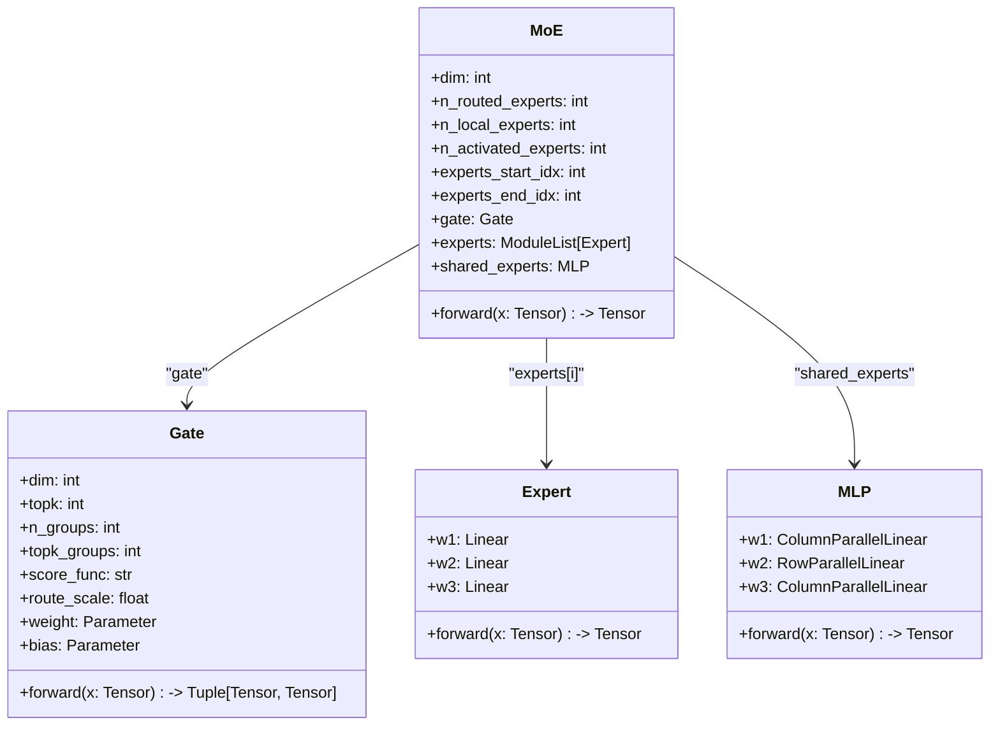
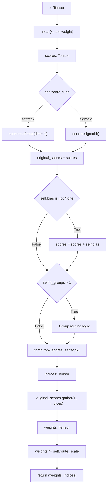
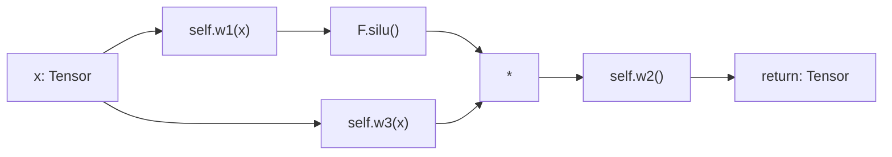
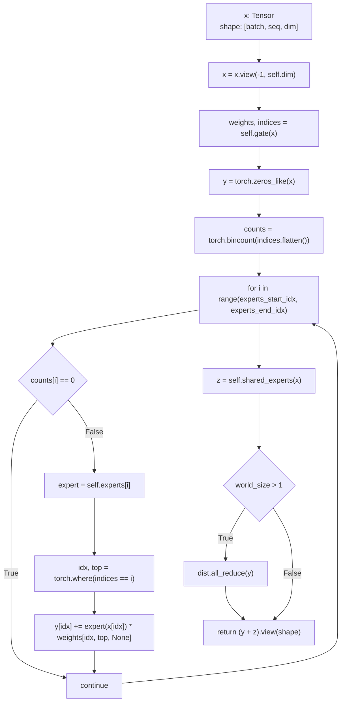
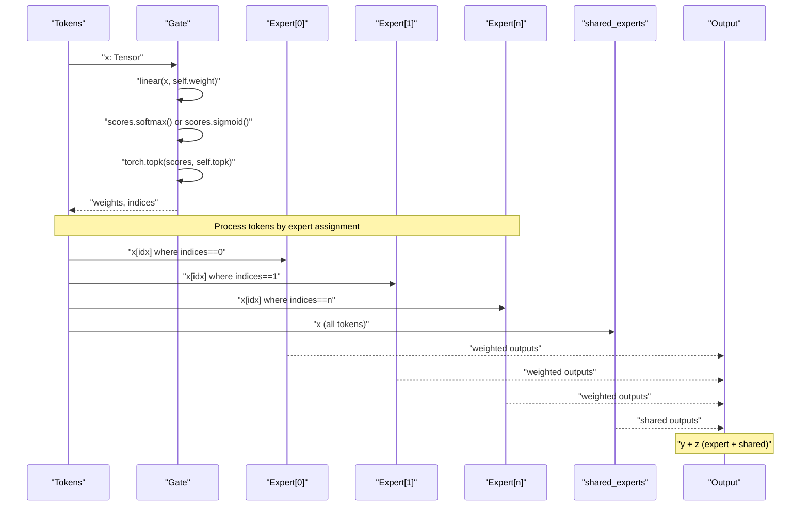
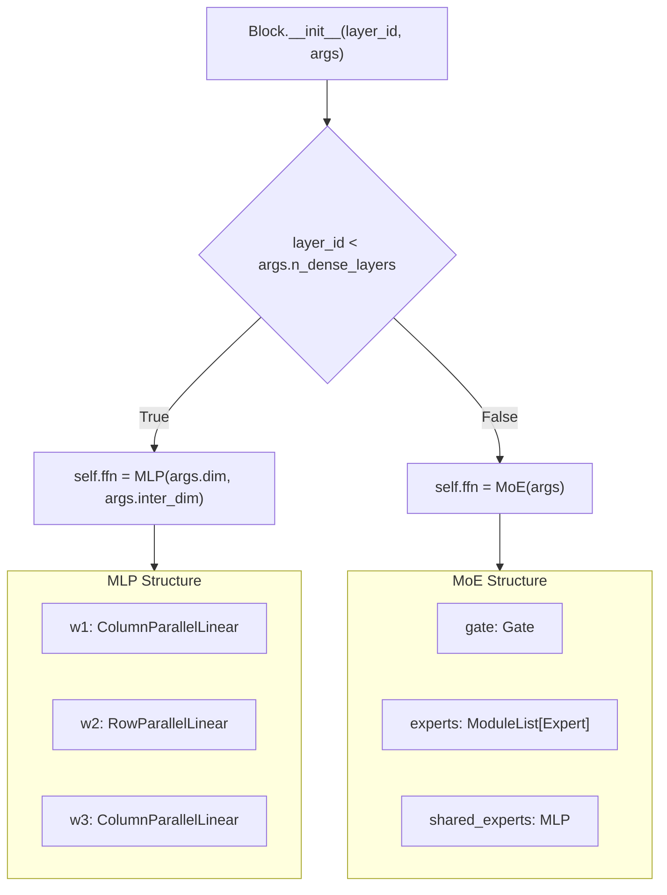
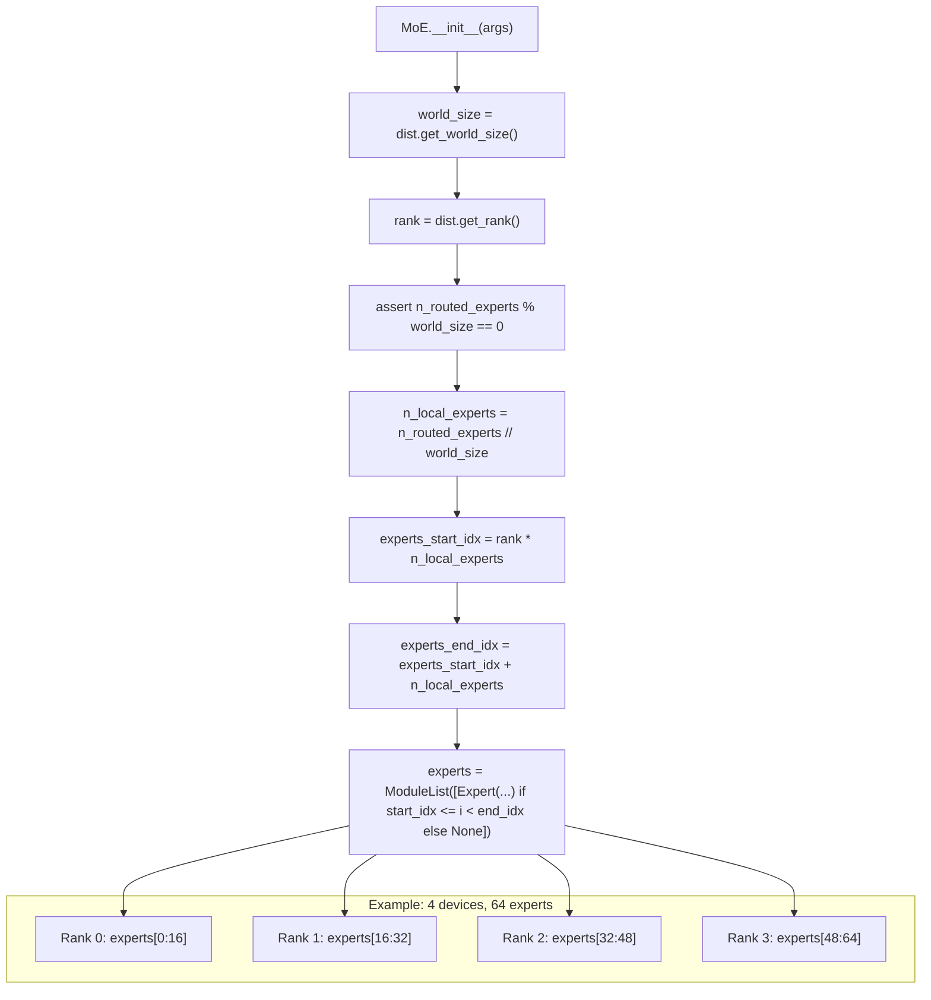

<!-- source: DeepWiki mcp.deepwiki.com · repo deepseek-ai/DeepSeek-V3 · page 4.3 Mixture of Experts (MoE) · fetched 2026-10-30 -->

# Mixture of Experts (MoE)

<details>
<summary>Relevant source files</summary>

The following files were used as context for generating this wiki page:

- [inference/model.py](inference/model.py)

</details>


This document details the Mixture of Experts (MoE) implementation in DeepSeek-V3. The MoE architecture enables sparse activation where only 37B of 671B total parameters are activated per token during inference. For information about other architectural components, see [Multi-head Latent Attention (MLA)](#3.2).

## Overview

The MoE implementation in DeepSeek-V3 replaces standard `MLP` layers with sparse `MoE` layers in transformer blocks. The core implementation consists of three main classes: `Gate`, `Expert`, and `MoE`, which work together to route tokens to specialized expert networks.

MoE Class Architecture


Sources: [inference/model.py:633-690](), [inference/model.py:532-595](), [inference/model.py:598-631](), [inference/model.py:497-529]()

## Core Components

The MoE architecture consists of three main components implemented as Python classes:

1. **`Gate`** - Routes input tokens to relevant experts
2. **`Expert`** - Specialized feed-forward networks 
3. **`MLP`** - Shared experts applied to all inputs

### Gate Class Implementation

The `Gate` class implements token routing logic. It contains a learnable `weight` parameter of shape `[n_routed_experts, dim]` and produces routing weights and expert indices.

Gate.forward() Implementation Flow


Sources: [inference/model.py:563-595]()

### Expert Class Implementation

Each `Expert` is a feed-forward network with three `Linear` layers. Unlike `MLP` which uses `ColumnParallelLinear` and `RowParallelLinear`, `Expert` uses non-parallel `Linear` layers.

Expert.forward() Method


| Component | Expert Class | MLP Class |
|-----------|-------------|-----------|
| `w1` | `Linear(dim, inter_dim)` | `ColumnParallelLinear(dim, inter_dim)` |
| `w2` | `Linear(inter_dim, dim)` | `RowParallelLinear(inter_dim, dim)` |
| `w3` | `Linear(dim, inter_dim)` | `ColumnParallelLinear(dim, inter_dim)` |
| Forward | `self.w2(F.silu(self.w1(x)) * self.w3(x))` | `self.w2(F.silu(self.w1(x)) * self.w3(x))` |

Sources: [inference/model.py:598-631](), [inference/model.py:497-529]()

## ModelArgs Configuration

The MoE architecture is configured through `ModelArgs` dataclass parameters:

### MoE Configuration Parameters

| Parameter | Type | Default | Description |
|-----------|------|---------|-------------|
| `n_routed_experts` | `int` | `64` | Total number of routed experts |
| `n_shared_experts` | `int` | `2` | Number of shared experts |
| `n_activated_experts` | `int` | `6` | Number of experts activated per token |
| `n_expert_groups` | `int` | `1` | Number of expert groups |
| `n_limited_groups` | `int` | `1` | Number of limited groups for routing |
| `score_func` | `Literal["softmax", "sigmoid"]` | `"softmax"` | Scoring function for routing |
| `route_scale` | `float` | `1.0` | Scaling factor for routing weights |
| `moe_inter_dim` | `int` | `1408` | Intermediate dimension for expert FFNs |

### Architecture Scaling

The DeepSeek-V3 full model uses these scaled parameters:
- **Total Parameters**: 671B
- **Activated Parameters**: 37B per token
- **Routed Experts**: 256 (scaled from default 64)
- **Expert Selection**: Top-6 activation per token

Sources: [inference/model.py:19-84]()

## MoE.forward() Implementation

The `MoE.forward()` method implements the core sparse activation logic:

### Forward Pass Algorithm

MoE.forward() Step-by-Step Execution


### Distributed Expert Allocation

The MoE implementation supports distributed execution by partitioning experts across devices:

```python
# Expert partitioning logic from MoE.__init__()
self.n_local_experts = args.n_routed_experts // world_size
self.experts_start_idx = rank * self.n_local_experts
self.experts_end_idx = self.experts_start_idx + self.n_local_experts

# Only create experts for local range
self.experts = nn.ModuleList([
    Expert(args.dim, args.moe_inter_dim) if self.experts_start_idx <= i < self.experts_end_idx else None
    for i in range(self.n_routed_experts)
])
```

Sources: [inference/model.py:666-690](), [inference/model.py:654-664]()

### Token Routing and Processing

The routing mechanism efficiently processes tokens by expert assignment:

Token Processing Flow


Sources: [inference/model.py:676-690]()

## Integration with Block Architecture

The MoE layers integrate with transformer `Block` architecture through conditional instantiation in the `Block.__init__()` method:

### Block.ffn Layer Selection

Block FFN Layer Selection Logic


### Block.forward() Method

The `Block.forward()` method applies the same interface regardless of MLP or MoE:

```python
def forward(self, x: torch.Tensor, start_pos: int, freqs_cis: torch.Tensor, mask: Optional[torch.Tensor]) -> torch.Tensor:
    x = x + self.attn(self.attn_norm(x), start_pos, freqs_cis, mask)
    x = x + self.ffn(self.ffn_norm(x))  # self.ffn is either MLP or MoE
    return x
```

Sources: [inference/model.py:703-732](), [inference/model.py:713]()

## Distributed MoE Implementation

The MoE implementation supports distributed execution through expert partitioning and `torch.distributed` communication:

### Expert Partitioning Logic

Distributed Expert Allocation


### Communication Pattern

The distributed forward pass uses `dist.all_reduce()` to combine expert outputs:

```python
# From MoE.forward() method
for i in range(self.experts_start_idx, self.experts_end_idx):
    if counts[i] == 0:
        continue
    expert = self.experts[i]
    idx, top = torch.where(indices == i)
    y[idx] += expert(x[idx]) * weights[idx, top, None]

z = self.shared_experts(x)
if world_size > 1:
    dist.all_reduce(y)  # Combine expert outputs across devices
return (y + z).view(shape)
```

Sources: [inference/model.py:654-664](), [inference/model.py:687-689]()

## Benefits and Performance

The MoE architecture in DeepSeek-V3 provides several key benefits:

1. **Parameter Efficiency**: 671B total parameters with only 37B activated per token
2. **Training Efficiency**: Requires only 2.788M H800 GPU hours despite large model size
3. **Inference Efficiency**: Better performance with lower computational cost
4. **Scaling Capability**: Enables building larger models without proportional increases in computation

The MoE architecture, combined with Multi-head Latent Attention (MLA) and an auxiliary-loss-free strategy for load balancing, helps DeepSeek-V3 achieve performance comparable to leading closed-source models while remaining efficient for both training and inference.

Sources: [README.md:47-52](), [README.md:65-67]()

## Implementation Code Walkthrough

### Gate Implementation

The `Gate` class decides which experts to activate for each input token:

- Computes routing scores using a linear projection
- Applies either softmax or sigmoid function to the scores
- Optionally applies group routing to limit token distribution
- Selects the top-k experts for each token
- Returns routing weights and expert indices

Key implementation points:
- The gate uses a learnable weight matrix of shape `[n_routed_experts, dim]`
- For softmax scoring, the weights are normalized across experts
- For sigmoid scoring, the weights are normalized after expert selection
- The `route_scale` parameter scales the final routing weights

Sources: [inference/model.py:532-595]()

### Expert Implementation

Each expert is a feed-forward network with three linear transformations:

- `w1`: Projects from `dim` to `inter_dim`
- `w2`: Projects from `inter_dim` back to `dim`
- `w3`: Additional projection from `dim` to `inter_dim`
- SiLU activation is applied to the output of `w1`
- The activated output is multiplied elementwise with the output of `w3`
- The result is projected back using `w2`

Sources: [inference/model.py:598-631]()

### MoE Forward Pass

The forward pass in the `MoE` class:

1. Reshapes the input to a 2D tensor
2. Obtains routing weights and expert indices from the gate
3. Creates an output tensor initialized with zeros
4. Counts tokens routed to each expert
5. For each local expert with assigned tokens:
   - Extracts the tokens routed to this expert
   - Applies the expert to these tokens
   - Weights the expert outputs and adds them to the result
6. Applies the shared experts to all tokens
7. If distributed, performs all-reduce to combine results
8. Returns the combined output reshaped to the original input shape

Sources: [inference/model.py:666-690]()

---

