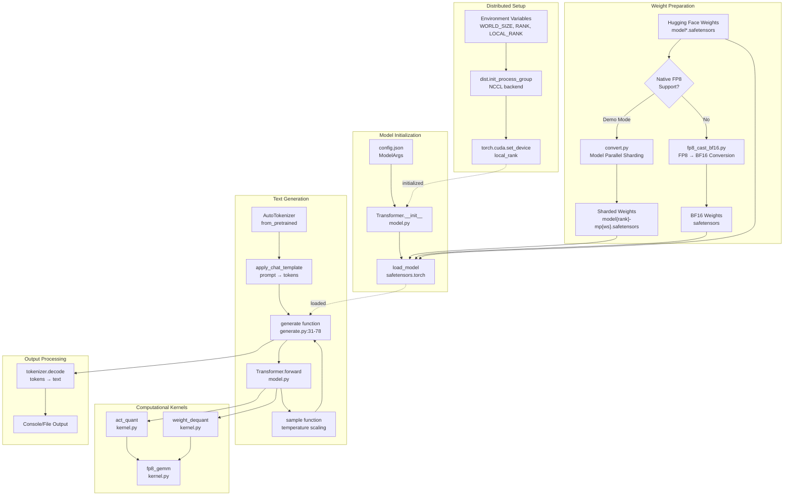
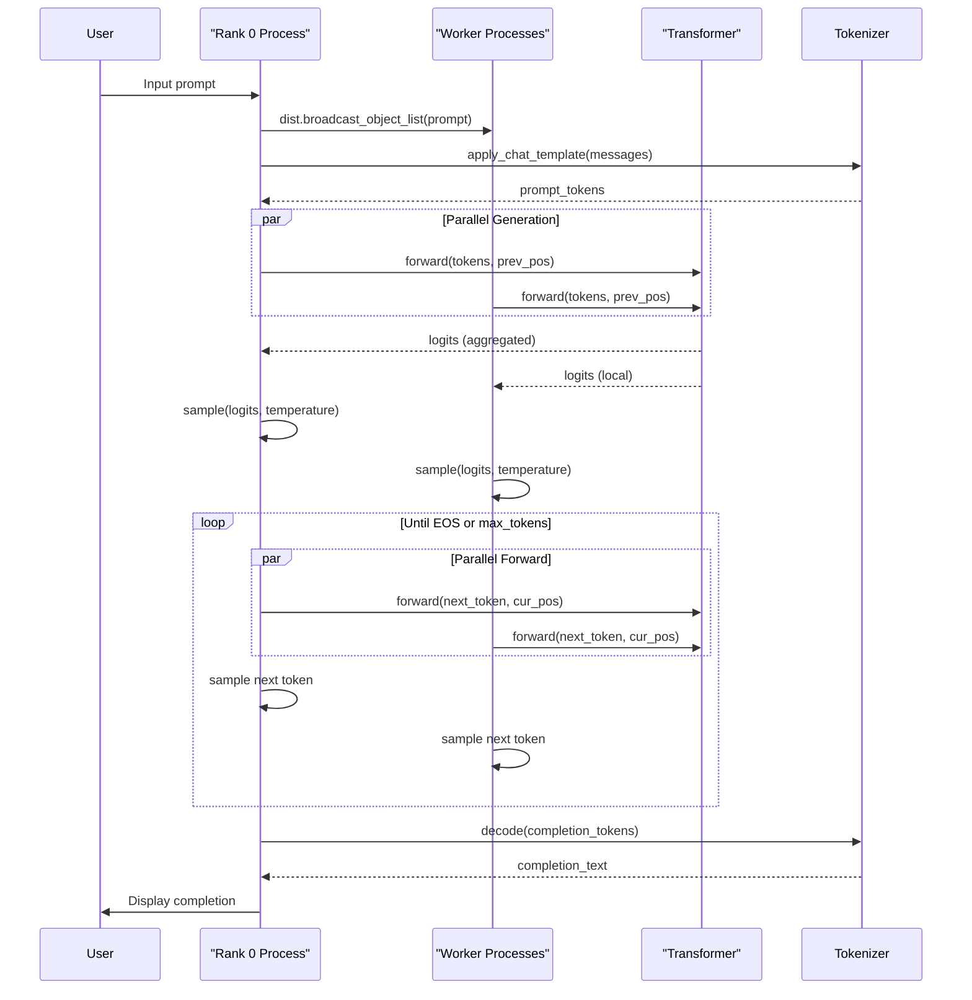
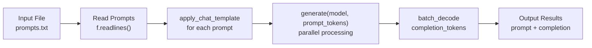
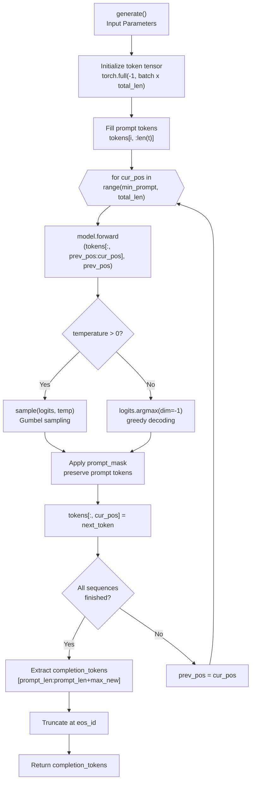
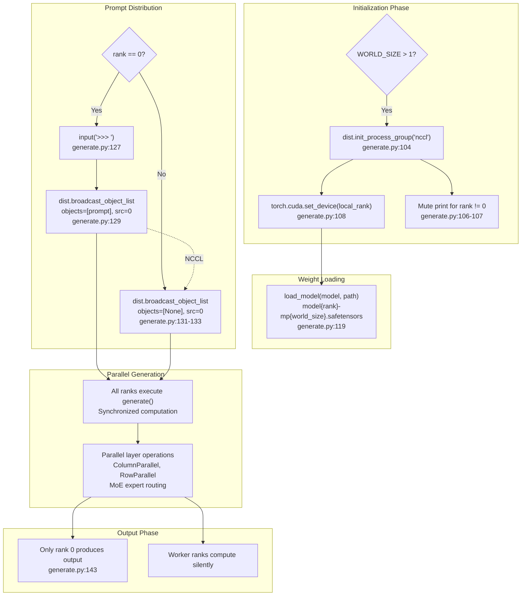
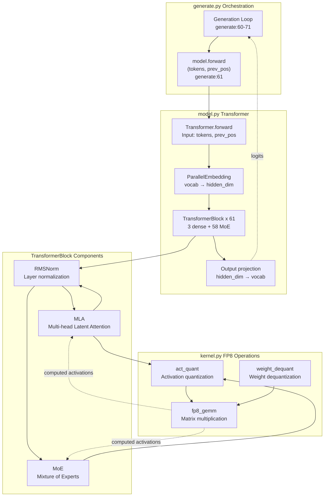
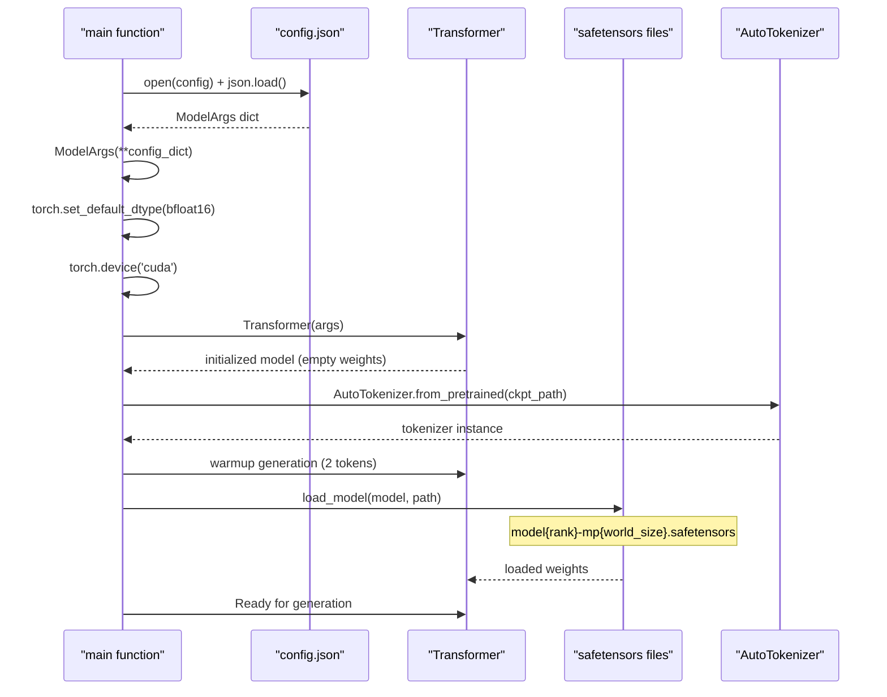

<!-- source: DeepWiki mcp.deepwiki.com · repo deepseek-ai/DeepSeek-V3 · page 5 Inference Pipeline · fetched 2026-10-30 -->

# Inference Pipeline

<details>
<summary>Relevant source files</summary>

The following files were used as context for generating this wiki page:

- [inference/generate.py](inference/generate.py)

</details>


## Purpose and Scope

This document describes the complete inference pipeline for DeepSeek-V3, covering the end-to-end process from loading model weights to generating text. The inference pipeline integrates several specialized components: optimized computational kernels for FP8 operations (see [5.1](#5.1)), checkpoint conversion utilities for weight management (see [5.2](#5.2)), text generation logic (see [5.3](#5.3)), and precision conversion tools (see [5.4](#5.4)). This page provides an overview of how these components work together to enable efficient inference with the 671B parameter model.

For information about the underlying model architecture, see [4](#4). For deployment options and framework integrations, see [2.2](#2.2).

## System Architecture

The inference pipeline follows a multi-stage process that transforms raw model weights into generated text through a series of specialized components. The pipeline supports both single-GPU and distributed multi-GPU execution, with different weight formats and conversion paths depending on deployment requirements.

### Pipeline Overview



**Sources:** [inference/generate.py:1-186]()

This diagram illustrates the complete inference pipeline from weight preparation through text generation. The pipeline begins with weight loading, which may require format conversion depending on the target framework. Model initialization leverages the `Transformer` class from `model.py`, while distributed execution coordinates through PyTorch's NCCL backend. The text generation loop orchestrates tokenization, model forward passes, and sampling to produce output text, with low-level FP8 kernels providing optimized computation.

## Execution Modes

The inference pipeline supports two distinct execution modes, each optimized for different use cases:

### Interactive Mode



**Sources:** [inference/generate.py:121-144]()

Interactive mode enables conversational text generation with multi-turn dialogue support. The mode maintains a message history across turns and uses the HuggingFace chat template format. In distributed settings, rank 0 handles user I/O and broadcasts prompts to worker ranks via `dist.broadcast_object_list` [inference/generate.py:129](), ensuring synchronized generation across all processes. The message history persists until explicitly cleared with the `/clear` command [inference/generate.py:136-138]().

### Batch Mode



**Sources:** [inference/generate.py:145-155]()

Batch mode processes multiple prompts from a file in parallel, maximizing GPU utilization for throughput-oriented workloads. The implementation reads all prompts from `--input-file`, applies chat templates to each, and invokes the `generate` function with the full batch [inference/generate.py:149-150](). The batch size is constrained by `args.max_batch_size` to prevent out-of-memory errors [inference/generate.py:148](). Results are decoded in batch using `tokenizer.batch_decode` [inference/generate.py:151]() and printed with prompt-completion pairs.

## Core Components

The inference pipeline integrates several key components, each responsible for a specific aspect of the generation process:

| Component | File | Primary Classes/Functions | Purpose |
|-----------|------|---------------------------|---------|
| Text Generation | `inference/generate.py` | `generate`, `sample`, `main` | Orchestrates token generation loop with temperature sampling |
| Model Architecture | `inference/model.py` | `Transformer`, `TransformerBlock`, `MLA`, `MoE` | Implements forward pass through transformer layers |
| Optimized Kernels | `inference/kernel.py` | `act_quant`, `weight_dequant`, `fp8_gemm` | Provides FP8 quantization and GEMM operations |
| Weight Conversion | `inference/convert.py` | `convert_state_dict`, `main` | Transforms HuggingFace weights to sharded format |
| Precision Conversion | `inference/fp8_cast_bf16.py` | `convert_fp8_to_bf16` | Converts FP8 weights to BF16 |

### Generation Function



**Sources:** [inference/generate.py:31-78]()

The `generate` function implements the core autoregressive generation loop. It initializes a token tensor pre-filled with -1 as a sentinel value [inference/generate.py:54](), then populates prompt tokens [inference/generate.py:55-56](). The generation loop operates from the minimum prompt length to the total sequence length [inference/generate.py:60](), calling `model.forward` with the token slice from `prev_pos` to `cur_pos` [inference/generate.py:61](). 

For each position, the function samples the next token using either temperature-scaled sampling via the `sample` function [inference/generate.py:63]() or greedy argmax decoding [inference/generate.py:65](). A prompt mask ensures that tokens already present in the prompt are preserved [inference/generate.py:66](), preventing the model from overwriting user input. The loop terminates when all sequences have generated an EOS token or reached maximum length [inference/generate.py:70-71]().

### Sampling Strategy

The `sample` function implements Gumbel-max sampling for stochastic token generation:

```python
def sample(logits, temperature: float = 1.0):
    logits = logits / max(temperature, 1e-5)  # Temperature scaling
    probs = torch.softmax(logits, dim=-1)     # Convert to probabilities
    return probs.div_(torch.empty_like(probs).exponential_(1)).argmax(dim=-1)  # Gumbel-max trick
```

**Sources:** [inference/generate.py:14-27]()

The sampling mechanism applies temperature scaling to logits [inference/generate.py:25](), converts them to probabilities via softmax [inference/generate.py:26](), and uses the Gumbel-max trick for efficient sampling [inference/generate.py:27](). The Gumbel-max approach divides probabilities by exponentially-distributed random variables and selects the argmax, which is mathematically equivalent to categorical sampling but more computationally efficient. A minimum temperature of 1e-5 prevents division by zero.

## Distributed Inference Coordination

Multi-GPU inference requires careful coordination between processes to ensure correct generation while maximizing parallelism:



**Sources:** [inference/generate.py:100-158]()

The distributed inference system uses PyTorch's NCCL backend for inter-GPU communication. Environment variables `WORLD_SIZE`, `RANK`, and `LOCAL_RANK` control the distributed setup [inference/generate.py:100-102](). When `WORLD_SIZE > 1`, the system initializes the process group [inference/generate.py:104]() and configures each process to use its assigned GPU [inference/generate.py:108](). 

Non-zero ranks have their `print` function silenced [inference/generate.py:106-107]() to prevent duplicate output. Each rank loads its corresponding weight shard following the naming pattern `model{rank}-mp{world_size}.safetensors` [inference/generate.py:119](), ensuring that the 671B parameters are distributed across GPUs. During execution, rank 0 handles user interaction and broadcasts prompts to workers [inference/generate.py:127-129](), while worker ranks receive broadcasts [inference/generate.py:131-133]() and participate silently in generation.

## Integration with Model Components

The inference pipeline interfaces with core model components to execute the forward pass:



**Sources:** [inference/generate.py:61](), [inference/model.py]()

The `generate` function invokes `model.forward` at each generation step [inference/generate.py:61](), passing the token slice and previous position. The `Transformer` class orchestrates the forward pass through its 61-layer architecture, beginning with parallel embedding lookup and proceeding through attention and feedforward layers. Each `TransformerBlock` contains RMSNorm, MLA (Multi-head Latent Attention), and either dense FFN or MoE (Mixture of Experts) components.

Low-level FP8 kernels from `kernel.py` provide optimized computation within MLA and MoE modules, handling activation quantization, weight dequantization, and GEMM operations. This multi-layer architecture enables the pipeline to efficiently process 671B parameters with 37B active per token.

## Command-Line Interface

The inference pipeline exposes a flexible CLI for various deployment scenarios:

| Argument | Type | Default | Description |
|----------|------|---------|-------------|
| `--ckpt-path` | str | required | Path to model checkpoint directory containing weights and tokenizer |
| `--config` | str | required | Path to JSON configuration file with `ModelArgs` |
| `--input-file` | str | `""` | Path to text file with prompts for batch processing |
| `--interactive` | flag | `False` | Enable interactive conversational mode |
| `--max-new-tokens` | int | `200` | Maximum number of tokens to generate per prompt |
| `--temperature` | float | `0.2` | Temperature for sampling (0.0 = greedy, higher = more random) |

**Sources:** [inference/generate.py:176-185]()

### Usage Examples

**Single-GPU Interactive Mode:**
```bash
python inference/generate.py \
    --ckpt-path /path/to/DeepSeek-V3-sharded \
    --config inference/configs/config_671B.json \
    --interactive \
    --max-new-tokens 500 \
    --temperature 0.7
```

**Multi-GPU Batch Mode:**
```bash
torchrun --nproc_per_node=8 inference/generate.py \
    --ckpt-path /path/to/DeepSeek-V3-sharded \
    --config inference/configs/config_671B.json \
    --input-file prompts.txt \
    --max-new-tokens 200 \
    --temperature 0.2
```

**Multi-Node Distributed Execution:**
```bash
torchrun \
    --nnodes=2 \
    --nproc_per_node=8 \
    --master_addr=<master_ip> \
    --master_port=29500 \
    inference/generate.py \
    --ckpt-path /path/to/DeepSeek-V3-sharded \
    --config inference/configs/config_671B.json \
    --interactive
```

The CLI requires either `--input-file` or `--interactive` mode to be specified [inference/generate.py:184](). The `main` function validates this requirement and raises an assertion error if neither is provided.

## Model Loading and Initialization

The initialization sequence prepares the model for inference through several coordinated steps:



**Sources:** [inference/generate.py:112-119]()

The initialization process begins by loading the model configuration from JSON [inference/generate.py:112-113](), constructing a `ModelArgs` instance that defines the model architecture. The default dtype is set to `bfloat16` [inference/generate.py:109]() for memory efficiency, and the model is instantiated on CUDA devices [inference/generate.py:115-116]().

A tokenizer is loaded from the checkpoint path [inference/generate.py:117](), which must contain HuggingFace tokenizer files. The system performs a warmup generation of 2 tokens [inference/generate.py:118]() to trigger JIT compilation and cache initialization before loading actual weights. Finally, `load_model` from `safetensors.torch` loads the appropriate weight shard [inference/generate.py:119](), following the distributed naming convention for multi-GPU setups.

## Memory Management

The inference pipeline implements several strategies to minimize memory usage while maintaining performance:

| Strategy | Implementation | Location | Purpose |
|----------|----------------|----------|---------|
| BFloat16 Default | `torch.set_default_dtype(torch.bfloat16)` | [generate.py:109]() | Reduces memory footprint by 50% vs FP32 |
| Inference Mode | `@torch.inference_mode()` decorator | [generate.py:30]() | Disables gradient computation and tracking |
| Thread Pool Size | `torch.set_num_threads(8)` | [generate.py:110]() | Limits CPU thread overhead |
| In-place Token Update | `tokens[:, cur_pos] = next_token` | [generate.py:67]() | Avoids tensor reallocation |
| Prompt Mask Reuse | `prompt_mask = tokens != -1` | [generate.py:59]() | Single mask tensor for batch |

The `@torch.inference_mode()` decorator [inference/generate.py:30]() on the `generate` function disables autograd entirely, providing stronger guarantees than `torch.no_grad()` by preventing accidental gradient computation. This reduces memory overhead and improves performance for inference workloads where gradients are never needed.

## Interactive Mode Commands

Interactive mode supports special commands for session management:

| Command | Effect | Implementation |
|---------|--------|----------------|
| `/exit` | Terminate generation session | [generate.py:134-135]() |
| `/clear` | Clear message history, start fresh conversation | [generate.py:136-138]() |
| Any other input | Add to conversation and generate response | [generate.py:139-144]() |

The message history persists across turns [inference/generate.py:122](), enabling multi-turn conversations where the model maintains context. Each user input is appended with role "user" [inference/generate.py:139](), and the assistant's response is appended with role "assistant" [inference/generate.py:144](), following the standard chat template format.

## Performance Considerations

The inference pipeline balances several performance factors:

**Generation Speed:**
- Token-by-token generation requires one forward pass per token
- Prompt processing can be batched (all prompt tokens in parallel)
- Maximum sequence length constrained by `model.max_seq_len` [inference/generate.py:52]()

**Distributed Efficiency:**
- NCCL collectives synchronize across GPUs for each forward pass
- Expert routing in MoE layers balances load across ranks
- Communication overhead proportional to hidden dimension and batch size

**Sampling Overhead:**
- Greedy decoding (temperature=0) uses simple argmax [inference/generate.py:65]()
- Temperature sampling adds softmax + Gumbel-max operations [inference/generate.py:26-27]()
- Overhead minimal compared to forward pass time

**Batch Processing:**
- Batch mode processes multiple prompts in parallel [inference/generate.py:149-150]()
- Batch size limited by `args.max_batch_size` [inference/generate.py:148]()
- All prompts in batch generate simultaneously, improving throughput

The pipeline prioritizes correctness and stability over maximum throughput, making it suitable as a reference implementation for understanding DeepSeek-V3 inference patterns.

---

