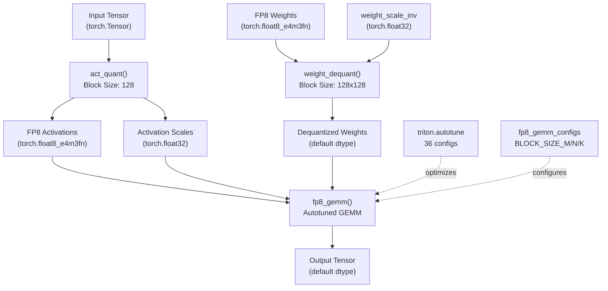
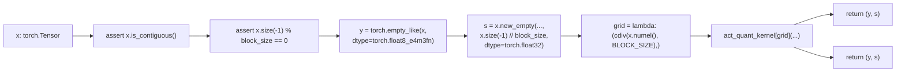
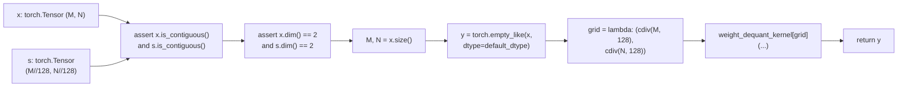
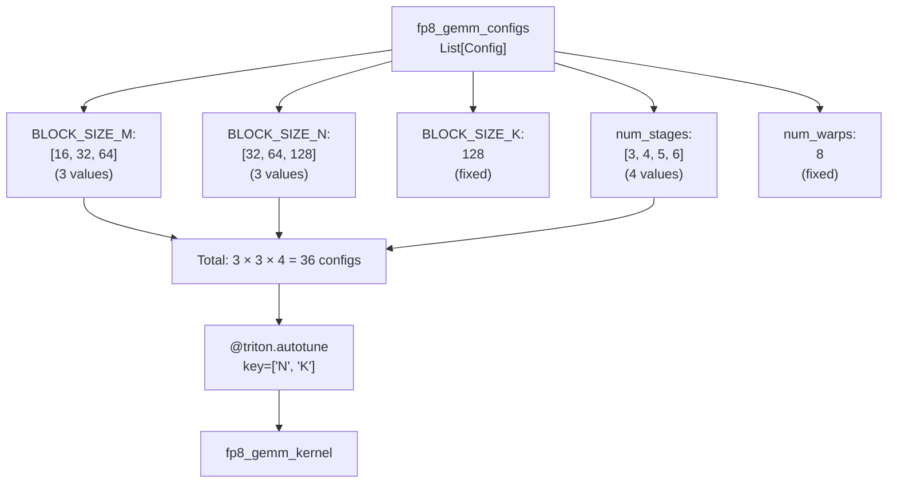
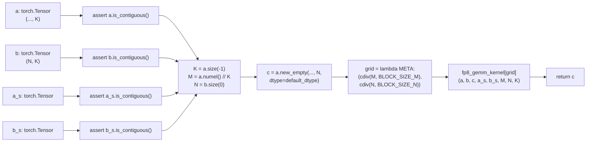
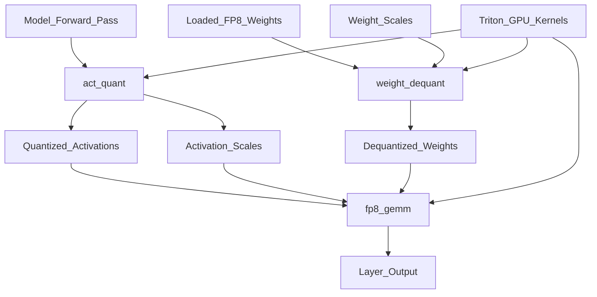

<!-- source: DeepWiki mcp.deepwiki.com · repo deepseek-ai/DeepSeek-V3 · page 5.1 Optimized Kernels · fetched 2026-10-30 -->

# Optimized Kernels

Relevant source files

The following files were used as context for generating this wiki page:

- [inference/kernel.py](inference/kernel.py)

The optimized kernels module provides GPU-accelerated Triton-based implementations for critical inference operations in DeepSeek-V3. This module focuses on efficient FP8 quantization, weight dequantization, and matrix multiplication operations that are essential for high-performance inference with quantized models.

The kernels handle the computational bottlenecks in the inference pipeline, particularly around FP8 quantization workflows. For broader quantization format details, see [Quantization](#6.2). For integration with the text generation pipeline, see [Text Generation](#5.3).

## Kernel Architecture Overview

The kernel system consists of three main components that work together to optimize inference operations:

**Kernel Data Flow in Inference Pipeline**

Sources: [inference/kernel.py:1-192]()

## Activation Quantization

The activation quantization system converts input tensors to FP8 format using block-wise quantization for memory efficiency and computational speed.

### act_quant_kernel Function

The `act_quant_kernel` implements block-wise quantization where each block (default size: 128 elements) is quantized independently with its own scaling factor:

| Parameter | Type | Description |
|-----------|------|-------------|
| `x_ptr` | `triton.Pointer` | Input tensor pointer |
| `y_ptr` | `triton.Pointer` | Output quantized tensor pointer (FP8) |
| `s_ptr` | `triton.Pointer` | Scaling factors output pointer (FP32) |
| `BLOCK_SIZE` | `tl.constexpr` | Processing block size (default: 128) |
| `scale_fmt` | `tl.constexpr` | Scale format: `"ue8m0"` or None |

The kernel calculates scaling factors using the formula `s = max(abs(x)) / 448.0`, with a minimum clamp of `1e-4` to prevent division by zero [inference/kernel.py:26-28](). 

**UE8M0 Scale Format**: When `scale_fmt="ue8m0"`, the scale is quantized to power-of-2 values by computing `exp = ceil(log2(s))` and then `s = 2^exp` [inference/kernel.py:29-31](). This reduces scale storage precision but maintains efficient computation through bit-shift operations.

### act_quant Wrapper Function

The `act_quant` function provides a Python interface to the Triton kernel:

**Activation Quantization Process**

The function signature is `act_quant(x: torch.Tensor, block_size: int = 128, scale_fmt: Optional[str] = None)` and returns a tuple containing:
- Quantized tensor with dtype `torch.float8_e4m3fn`
- Scaling factors with dtype `torch.float32` and shape `(*x.size()[:-1], x.size(-1) // block_size)`

[inference/kernel.py:38-57]()

Sources: [inference/kernel.py:9-52]()

## Weight Dequantization

Weight dequantization converts stored FP8 weights back to full precision using pre-computed scaling factors.

### weight_dequant_kernel Function

The `weight_dequant_kernel` processes weight matrices in a 2D tiled manner (128x128 blocks) for efficient memory access:

| Parameter | Type | Description |
|-----------|------|-------------|
| `x_ptr` | `tl.pointer` | Quantized weights pointer (FP8) |
| `s_ptr` | `tl.pointer` | Scaling factors pointer (FP32, shape: M//128, N//128) |
| `y_ptr` | `tl.pointer` | Output dequantized weights pointer |
| `M` | `int` | Number of matrix rows |
| `N` | `int` | Number of matrix columns |
| `BLOCK_SIZE` | `tl.constexpr` | Tile size for processing (default: 128) |

The kernel uses 2D program IDs (`pid_m`, `pid_n`) to process 128x128 blocks, computing offsets `offs = offs_m[:, None] * N + offs_n[None, :]` and loading the corresponding scale from `s_ptr + pid_m * n + pid_n` where `n = cdiv(N, BLOCK_SIZE)` [inference/kernel.py:76-85]().

### weight_dequant Wrapper Function

The `weight_dequant` function validates input tensors and launches the kernel with a 2D grid configuration:

**Weight Dequantization Process**

The function signature is `weight_dequant(x: torch.Tensor, s: torch.Tensor, block_size: int = 128)` and returns the dequantized weight tensor in `torch.get_default_dtype()` [inference/kernel.py:89-110]().

Sources: [inference/kernel.py:55-105]()

## FP8 Matrix Multiplication

The FP8 GEMM kernel performs matrix multiplication directly on FP8 tensors with scaling factors, avoiding intermediate dequantization steps.

### Kernel Configuration

The kernel uses auto-tuning with multiple configurations to optimize performance:

**FP8 GEMM Configuration System**

The configuration space includes 36 different combinations (3 × 3 × 4) tested by Triton's auto-tuning system based on matrix dimensions N and K [inference/kernel.py:113-116]().

### fp8_gemm_kernel Function

The kernel implements tiled matrix multiplication with the following key features:

| Feature | Implementation | Code Reference |
|---------|----------------|----------------|
| Tiling Strategy | 3D blocking (M, N, K dimensions) | [inference/kernel.py:145-150]() |
| Scaling Integration | Per-block scaling: `a_s[:, None] * b_s[None, :]` | [inference/kernel.py:162]() |
| Memory Access | Coalesced loads with masking: `mask=offs_k < K - i * BLOCK_SIZE_K` | [inference/kernel.py:158-159]() |
| Accumulation | FP32 accumulation: `tl.zeros(..., dtype=tl.float32)` | [inference/kernel.py:156]() |
| Output Conversion | Convert to output dtype: `accumulator.to(c_ptr.dtype.element_ty)` | [inference/kernel.py:167]() |

The kernel processes blocks iteratively over the K dimension, loading FP8 data from `a_ptr` and `b_ptr`, loading corresponding scales from `a_s_ptr` and `b_s_ptr`, computing dot products, applying scaling factors, and accumulating results in FP32 precision [inference/kernel.py:157-166]().

### fp8_gemm Wrapper Function

The `fp8_gemm` function validates inputs and configures the kernel launch parameters:

**FP8 GEMM Function Flow**

The function signature is `fp8_gemm(a: torch.Tensor, a_s: torch.Tensor, b: torch.Tensor, b_s: torch.Tensor)`. It reshapes input `a` from shape `(..., K)` into 2D `(M, K)` where `M = a.numel() // K`, performs the GEMM, and returns result with shape `(*a.size()[:-1], N)` [inference/kernel.py:175-196]().

Sources: [inference/kernel.py:108-192]()

## Kernel Integration

The optimized kernels integrate seamlessly with the broader inference pipeline:

**Kernel Integration in Inference Pipeline**

The kernels provide the computational foundation for efficient FP8 inference, handling quantization, dequantization, and matrix operations with optimized GPU implementations.

Sources: [inference/kernel.py:1-192]()

---

