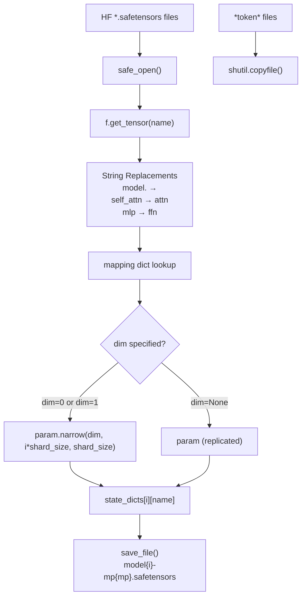
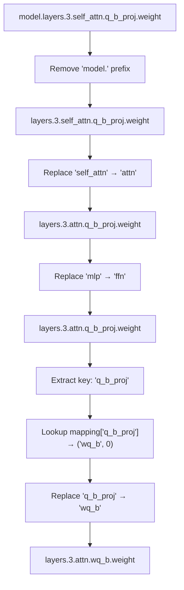
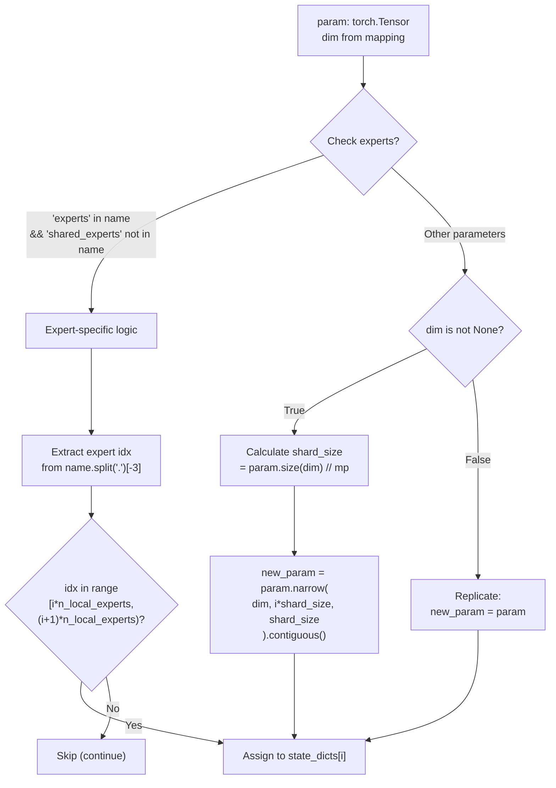
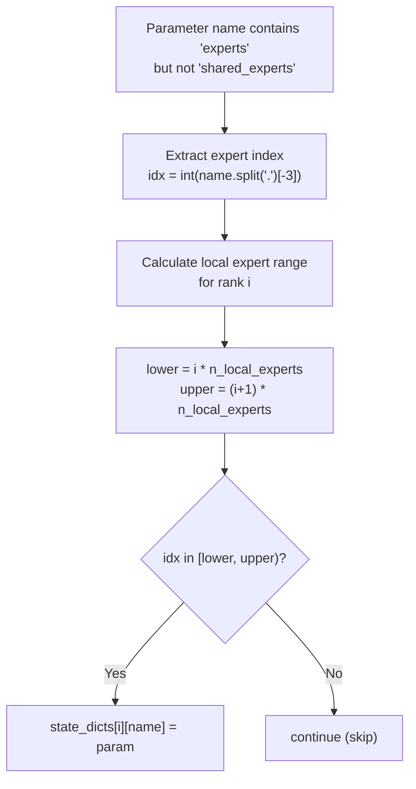
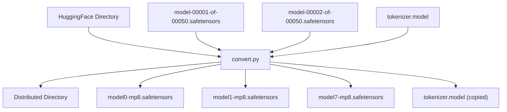

<!-- source: DeepWiki mcp.deepwiki.com · repo deepseek-ai/DeepSeek-V3 · page 5.2 Model Checkpoint Conversion · fetched 2026-10-30 -->

# Model Checkpoint Conversion

<details>
<summary>Relevant source files</summary>

The following files were used as context for generating this wiki page:

- [inference/convert.py](inference/convert.py)

</details>


This document covers the process of converting HuggingFace model checkpoints to a distributed format suitable for DeepSeek-V3 inference. The conversion handles parameter name mapping, tensor sharding for model parallelism, and expert distribution for the Mixture of Experts (MoE) architecture.

For information about the resulting weight file structure, see [Weight File Structure](#6.1). For precision format conversion between FP8 and BF16, see [FP8 to BF16 Conversion](#5.4).

## Purpose and Scope

The `convert.py` script transforms HuggingFace safetensors checkpoints into model-parallel sharded format for distributed inference. The conversion performs three key operations:

1. **Parameter Renaming**: Maps HuggingFace parameter names to DeepSeek's internal naming convention using the `mapping` dictionary
2. **Tensor Sharding**: Distributes weight tensors across model-parallel ranks based on specified dimensions
3. **Expert Distribution**: Partitions MoE experts across ranks, assigning `n_local_experts = n_experts // mp` experts per rank

The output consists of `model{i}-mp{mp}.safetensors` files, one per rank, plus copied tokenizer files.

Sources: [inference/convert.py:33-45](), [inference/convert.py:88-96]()

## Conversion Pipeline Overview

Conversion Pipeline Data Flow



The `main()` function processes all safetensors files, applying the `mapping` dictionary to rename parameters and sharding tensors according to the specified dimension. Each rank's parameters are accumulated in `state_dicts[i]` before being written to disk.

Sources: [inference/convert.py:33-86]()

## Parameter Name Mapping

The `mapping` dictionary at [inference/convert.py:11-30]() defines transformations from HuggingFace to DeepSeek parameter names. The mapping specifies both the new name and the sharding dimension (0, 1, or None for replication).

### Mapping Dictionary Structure

| HuggingFace Key | DeepSeek Name | Shard Dim | Parameter Type |
|----------------|---------------|-----------|----------------|
| `embed_tokens` | `embed` | 0 | Embedding |
| `input_layernorm` | `attn_norm` | None | Normalization |
| `post_attention_layernorm` | `ffn_norm` | None | Normalization |
| `q_proj` | `wq` | 0 | Attention Query (non-LoRA) |
| `q_a_proj` | `wq_a` | None | Query LoRA Low-rank |
| `q_a_layernorm` | `q_norm` | None | Query LoRA Norm |
| `q_b_proj` | `wq_b` | 0 | Query LoRA Up-projection |
| `kv_a_proj_with_mqa` | `wkv_a` | None | KV LoRA Low-rank |
| `kv_a_layernorm` | `kv_norm` | None | KV LoRA Norm |
| `kv_b_proj` | `wkv_b` | 0 | KV LoRA Up-projection |
| `o_proj` | `wo` | 1 | Attention Output |
| `gate` | `gate` | None | MoE Router |
| `gate_proj` | `w1` | 0 | FFN Gate |
| `down_proj` | `w2` | 1 | FFN Down |
| `up_proj` | `w3` | 0 | FFN Up |
| `norm` | `norm` | None | Final Norm |
| `lm_head` | `head` | 0 | Output Projection |
| `scale` | `scale` | None | Quantization Scale |

Parameter Name Transformation Process



The conversion also applies these string replacements: `weight_scale_inv` → `scale`, `e_score_correction_bias` → `bias`.

Sources: [inference/convert.py:11-30](), [inference/convert.py:56-65]()

## Distributed Sharding Process

The conversion distributes parameters across `mp` ranks using `torch.Tensor.narrow()` to extract contiguous slices. The sharding dimension from the `mapping` dict determines how each parameter is partitioned.

### Sharding Logic Implementation

Tensor Sharding Decision Tree



### Sharding Strategy by Parameter Type

**Dimension 0 Sharding** (Column Parallel): Input features are distributed
- `embed`: Vocabulary partitioned across ranks
- `wq`, `wq_b`, `wkv_b`: Attention query/KV projections split by output channels
- `w1`, `w3`: FFN gate/up projections split by intermediate dimension
- `head`: Output vocabulary partitioned

**Dimension 1 Sharding** (Row Parallel): Output features are distributed
- `wo`: Attention output projection split by input channels
- `w2`: FFN down projection split by input channels

**Replicated** (No Sharding): Each rank receives full copy
- `attn_norm`, `ffn_norm`, `q_norm`, `kv_norm`, `norm`: All normalization layers
- `wq_a`, `wkv_a`: LoRA low-rank projections
- `gate`: MoE routing weights
- `scale`: FP8 quantization scales

Sources: [inference/convert.py:66-76]()

## Expert Distribution

MoE experts are partitioned across ranks by extracting the expert index from parameter names and filtering based on rank-specific ranges. The conversion skips `shared_experts` which are replicated across all ranks.

### Expert Partitioning Algorithm

Expert Distribution Logic



### Expert Assignment Example

For DeepSeek-V3-671B with 256 experts and `mp=8`:

| Rank | n_local_experts | Expert Range | Example Parameters |
|------|----------------|--------------|-------------------|
| 0 | 32 | [0, 32) | `layers.3.ffn.experts.0.*` ... `layers.3.ffn.experts.31.*` |
| 1 | 32 | [32, 64) | `layers.3.ffn.experts.32.*` ... `layers.3.ffn.experts.63.*` |
| 2 | 32 | [64, 96) | `layers.3.ffn.experts.64.*` ... `layers.3.ffn.experts.95.*` |
| ... | ... | ... | ... |
| 7 | 32 | [224, 256) | `layers.3.ffn.experts.224.*` ... `layers.3.ffn.experts.255.*` |

The condition at [inference/convert.py:70-71]() ensures each expert's parameters (e.g., `w1`, `w2`, `w3`) are assigned to exactly one rank.

Sources: [inference/convert.py:47](), [inference/convert.py:68-71]()

## Usage and Output Format

The conversion script accepts HuggingFace checkpoint directories and produces distributed safetensors files along with copied tokenizer files.

### Command Line Interface

```bash
python convert.py \
    --hf-ckpt-path /path/to/huggingface/checkpoint \
    --save-path /path/to/distributed/checkpoint \
    --n-experts 256 \
    --model-parallel 8
```

### Output Structure

The conversion produces:
- `model0-mp8.safetensors` through `model7-mp8.safetensors` (distributed parameter files)
- Copied tokenizer files (`tokenizer.model`, `tokenizer.json`, etc.)



The distributed files are structured to enable efficient loading during inference with the specified model parallelism configuration.

Sources: [inference/convert.py:78-85](), [inference/convert.py:88-96]()

---

