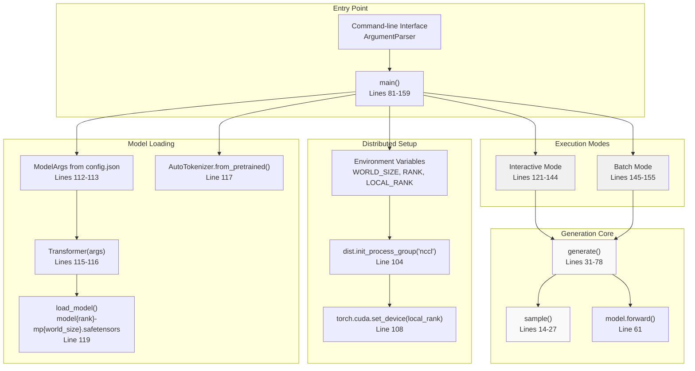
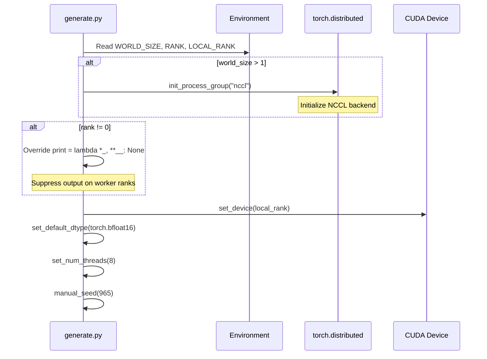
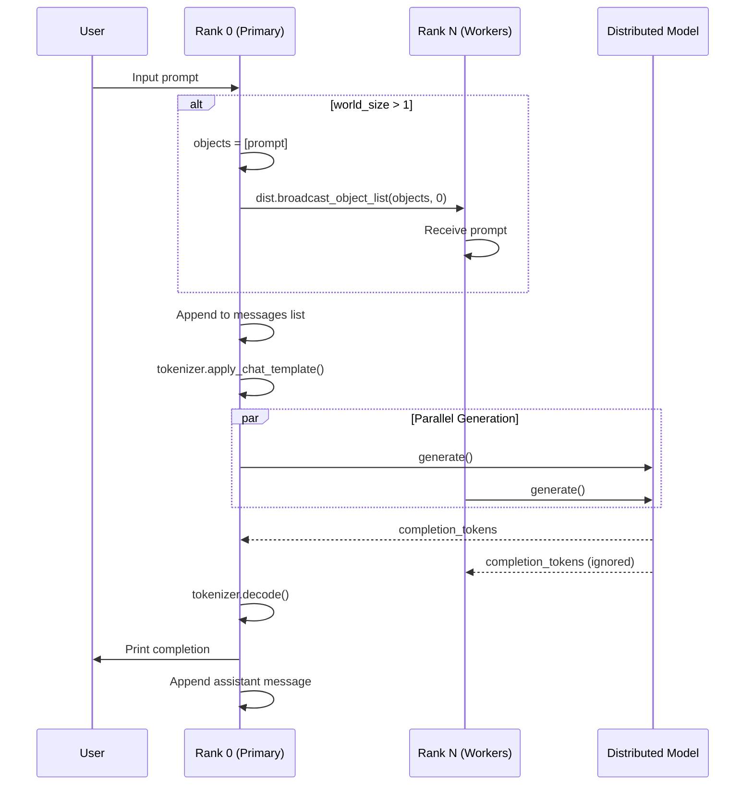
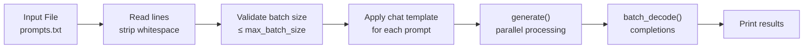
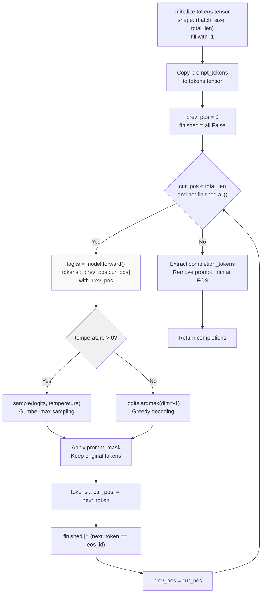

<!-- source: DeepWiki mcp.deepwiki.com · repo deepseek-ai/DeepSeek-V3 · page 5.3 Text Generation · fetched 2026-10-30 -->

# Text Generation

<details>
<summary>Relevant source files</summary>

The following files were used as context for generating this wiki page:

- [inference/generate.py](inference/generate.py)

</details>


This document explains the text generation system implemented in `generate.py`, which provides both interactive conversational and batch processing capabilities for DeepSeek-V3. The generation system supports distributed multi-GPU/multi-node inference with temperature-based sampling and efficient KV cache management.

For information about the underlying model architecture, see [Model Architecture](#4). For details on model checkpoint preparation, see [Model Checkpoint Conversion](#5.2). For precision conversion of weights, see [FP8 to BF16 Conversion](#5.4).

**Sources:** [inference/generate.py:1-186]()

## Overview

The `generate.py` script serves as the reference implementation for text generation with DeepSeek-V3. It provides two execution modes:

| Mode | Description | Use Case |
|------|-------------|----------|
| Interactive | Conversational interface with message history | Chat applications, debugging, model exploration |
| Batch | File-based batch processing | Benchmarking, evaluation, production inference |

Both modes support distributed inference across multiple GPUs/nodes using PyTorch Distributed with NCCL backend.

**Sources:** [inference/generate.py:81-159]()

## System Architecture



**Sources:** [inference/generate.py:14-159]()

## Distributed Inference Setup

The generation system supports distributed execution across multiple GPUs and nodes using PyTorch Distributed with the NCCL backend.

### Environment Configuration

The system reads three environment variables to determine the distributed configuration:

| Variable | Description | Default |
|----------|-------------|---------|
| `WORLD_SIZE` | Total number of processes across all nodes | 1 |
| `RANK` | Global rank of current process (0 to WORLD_SIZE-1) | 0 |
| `LOCAL_RANK` | Local rank within the current node | 0 |

**Sources:** [inference/generate.py:100-102]()

### Initialization Process



**Sources:** [inference/generate.py:103-111]()

### Model Sharding and Loading

Each rank loads a different shard of the model weights:

```
model{rank}-mp{world_size}.safetensors
```

For example, with `world_size=4`:
- Rank 0 loads `model0-mp4.safetensors`
- Rank 1 loads `model1-mp4.safetensors`
- Rank 2 loads `model2-mp4.safetensors`
- Rank 3 loads `model3-mp4.safetensors`

The sharding is created by the `convert.py` script (see [Model Checkpoint Conversion](#5.2)), which distributes:
- Experts across ranks (256 experts / world_size per rank)
- Weight matrix dimensions using column/row parallelism

**Sources:** [inference/generate.py:119]()

## Interactive Mode

Interactive mode provides a conversational interface with persistent message history, similar to a chat application.

### Communication Pattern



**Sources:** [inference/generate.py:121-144]()

### Special Commands

| Command | Action | Line Reference |
|---------|--------|----------------|
| `/exit` | Terminate the interactive session | 134-135 |
| `/clear` | Clear message history and start fresh | 136-138 |

### Message History Management

The interactive mode maintains a `messages` list that accumulates the conversation:

```python
messages = [
    {"role": "user", "content": "first prompt"},
    {"role": "assistant", "content": "first response"},
    {"role": "user", "content": "second prompt"},
    {"role": "assistant", "content": "second response"},
    ...
]
```

This history is passed to `tokenizer.apply_chat_template()` on each turn to maintain conversational context.

**Sources:** [inference/generate.py:122, 139-144]()

## Batch Mode

Batch mode processes multiple prompts from a file in a single forward pass, enabling efficient parallel processing.

### Input Format

The input file should contain one prompt per line:

```
How do I sort a list in Python?
Explain quantum computing
Write a haiku about programming
```

**Sources:** [inference/generate.py:146-147]()

### Processing Flow



**Sources:** [inference/generate.py:145-155]()

### Batch Size Validation

The number of prompts must not exceed `args.max_batch_size` configured in the model:

```python
assert len(prompts) <= args.max_batch_size, 
    f"Number of prompts exceeds maximum batch size ({args.max_batch_size})"
```

**Sources:** [inference/generate.py:148]()

## Generation Algorithm

The core `generate()` function implements autoregressive token generation with KV cache optimization.

### Function Signature

```python
@torch.inference_mode()
def generate(
    model: Transformer,
    prompt_tokens: List[List[int]],
    max_new_tokens: int,
    eos_id: int,
    temperature: float = 1.0
) -> List[List[int]]
```

**Sources:** [inference/generate.py:30-37]()

### Algorithm Flow



**Sources:** [inference/generate.py:31-78]()

### Key Implementation Details

#### Token Tensor Initialization

The algorithm pre-allocates a full token tensor and fills it with `-1` as a sentinel value:

```python
tokens = torch.full((len(prompt_tokens), total_len), -1, dtype=torch.long, device="cuda")
```

This allows distinguishing between prompt tokens (non-negative) and positions to generate (marked `-1`).

**Sources:** [inference/generate.py:54-56]()

#### Incremental Forward Pass

The model is called incrementally with only new tokens:

```python
logits = model.forward(tokens[:, prev_pos:cur_pos], prev_pos)
```

The `prev_pos` argument enables the model to use cached key-value pairs from previous iterations, avoiding redundant computation.

**Sources:** [inference/generate.py:61]()

#### Prompt Masking

During generation, prompt tokens are preserved using a mask:

```python
prompt_mask = tokens != -1
next_token = torch.where(prompt_mask[:, cur_pos], tokens[:, cur_pos], next_token)
```

This ensures that the prompt region is not overwritten by generated tokens.

**Sources:** [inference/generate.py:59, 66]()

#### Early Stopping

Generation terminates when all sequences have produced an EOS token:

```python
finished |= torch.logical_and(~prompt_mask[:, cur_pos], next_token == eos_id)
if finished.all():
    break
```

The `~prompt_mask[:, cur_pos]` condition ensures EOS tokens within the prompt don't trigger early stopping.

**Sources:** [inference/generate.py:68-71]()

## Sampling Strategies

The system supports two sampling strategies controlled by the `temperature` parameter.

### Temperature Sampling

When `temperature > 0`, the `sample()` function uses Gumbel-max sampling:

```python
def sample(logits, temperature: float = 1.0):
    logits = logits / max(temperature, 1e-5)
    probs = torch.softmax(logits, dim=-1)
    return probs.div_(torch.empty_like(probs).exponential_(1)).argmax(dim=-1)
```

**Algorithm:**
1. Scale logits by temperature: `logits / temperature`
2. Convert to probabilities: `softmax(logits)`
3. Apply Gumbel noise: `probs / Gumbel(0,1)`
4. Take argmax of noisy probabilities

This is mathematically equivalent to `Categorical(softmax(logits/temperature)).sample()` but more efficient.

**Sources:** [inference/generate.py:14-27]()

### Greedy Decoding

When `temperature = 0`, greedy decoding is used:

```python
next_token = logits.argmax(dim=-1)
```

This deterministically selects the highest-probability token at each step.

**Sources:** [inference/generate.py:64-65]()

### Temperature Effects

| Temperature | Behavior | Use Case |
|-------------|----------|----------|
| 0.0 | Greedy decoding (deterministic) | Reproducible outputs, evaluation |
| 0.1 - 0.5 | Low randomness | Focused, coherent responses |
| 0.7 - 1.0 | Moderate randomness | Balanced creativity and coherence |
| 1.0+ | High randomness | Creative writing, brainstorming |

## Command-line Interface

### Required Arguments

| Argument | Type | Description |
|----------|------|-------------|
| `--ckpt-path` | str | Path to model checkpoint directory containing sharded weights and tokenizer |
| `--config` | str | Path to model configuration JSON file (e.g., `config_671B.json`) |

### Optional Arguments

| Argument | Type | Default | Description |
|----------|------|---------|-------------|
| `--input-file` | str | "" | Path to file containing prompts (one per line) for batch mode |
| `--interactive` | flag | False | Enable interactive conversational mode |
| `--max-new-tokens` | int | 200 | Maximum number of tokens to generate per prompt |
| `--temperature` | float | 0.2 | Sampling temperature (0.0 = greedy, higher = more random) |

**Validation:** Either `--input-file` or `--interactive` must be specified.

**Sources:** [inference/generate.py:161-185]()

### Usage Examples

#### Single-GPU Interactive Mode

```bash
python generate.py \
    --ckpt-path /path/to/DeepSeek-V3-sharded \
    --config configs/config_671B.json \
    --interactive \
    --max-new-tokens 500 \
    --temperature 0.7
```

#### Multi-GPU Interactive Mode (4 GPUs)

```bash
torchrun --nproc_per_node=4 generate.py \
    --ckpt-path /path/to/DeepSeek-V3-sharded \
    --config configs/config_671B.json \
    --interactive \
    --max-new-tokens 500 \
    --temperature 0.7
```

#### Multi-Node Batch Mode (2 nodes, 8 GPUs each)

```bash
torchrun \
    --nnodes=2 \
    --nproc_per_node=8 \
    --node_rank=0 \
    --master_addr=node0.example.com \
    --master_port=29500 \
    generate.py \
    --ckpt-path /path/to/DeepSeek-V3-sharded \
    --config configs/config_671B.json \
    --input-file prompts.txt \
    --max-new-tokens 1000 \
    --temperature 0.0
```

#### Batch Processing with Greedy Decoding

```bash
python generate.py \
    --ckpt-path /path/to/DeepSeek-V3-sharded \
    --config configs/config_671B.json \
    --input-file eval_prompts.txt \
    --max-new-tokens 100 \
    --temperature 0.0
```

**Sources:** [inference/generate.py:161-186]()

## Execution Environment Setup

### Python Environment

The script sets up the following execution environment:

```python
torch.set_default_dtype(torch.bfloat16)  # Use BF16 for computation
torch.set_num_threads(8)                  # Limit CPU threads
torch.manual_seed(965)                    # Reproducibility
```

**Sources:** [inference/generate.py:109-111]()

### Device Placement

All tensors are placed on CUDA devices:

```python
with torch.device("cuda"):
    model = Transformer(args)
```

The specific GPU is set based on `LOCAL_RANK` in distributed mode.

**Sources:** [inference/generate.py:108, 115-116]()

## Integration with Model Components

### Tokenizer Integration

The system uses the Hugging Face `AutoTokenizer` with chat template support:

```python
tokenizer = AutoTokenizer.from_pretrained(ckpt_path)
prompt_tokens = tokenizer.apply_chat_template(messages, add_generation_prompt=True)
completion = tokenizer.decode(completion_tokens[0], skip_special_tokens=True)
```

The `apply_chat_template()` method formats messages according to the model's chat format and adds the generation prompt (e.g., `"<|assistant|>"`).

**Sources:** [inference/generate.py:117, 140, 142, 149, 151]()

### Model Forward Pass

The generation loop calls the model's forward method with incremental inputs:

```python
logits = model.forward(tokens[:, prev_pos:cur_pos], prev_pos)
```

The model maintains internal KV cache state indexed by `prev_pos`, enabling efficient autoregressive generation without recomputing attention for previous tokens.

**Sources:** [inference/generate.py:61]()

## Performance Considerations

### Sequence Length Validation

The system validates that prompt length doesn't exceed the model's maximum sequence length:

```python
assert max(prompt_lens) <= model.max_seq_len, 
    f"Prompt length exceeds model maximum sequence length (max_seq_len={model.max_seq_len})"
```

**Sources:** [inference/generate.py:52]()

### Total Length Computation

The total generation length is capped by the model's maximum sequence length:

```python
total_len = min(model.max_seq_len, max_new_tokens + max(prompt_lens))
```

This ensures memory allocation doesn't exceed model capacity.

**Sources:** [inference/generate.py:53]()

### Warmup Forward Pass

The script performs a warmup forward pass before loading weights:

```python
tokenizer.decode(generate(model, [tokenizer.encode("DeepSeek")], 2, -1, 1.)[0])
```

This initializes CUDA kernels and can be used to verify the model loads correctly before proceeding with actual inference.

**Sources:** [inference/generate.py:118]()

---

