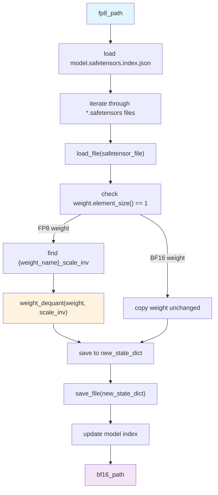
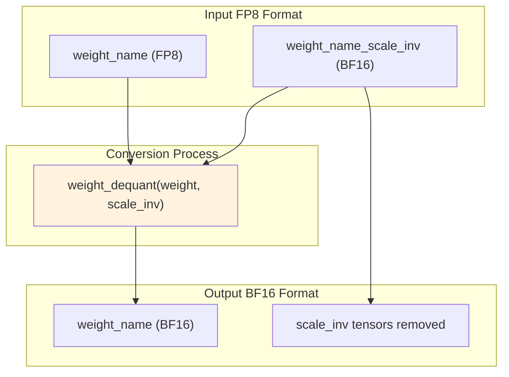
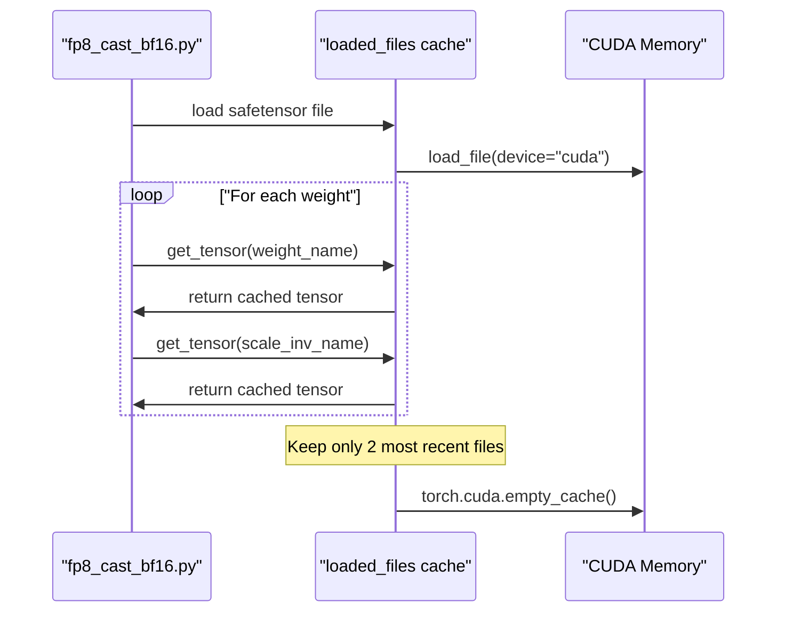

<!-- source: DeepWiki mcp.deepwiki.com · repo deepseek-ai/DeepSeek-V3 · page 5.4 FP8 to BF16 Conversion · fetched 2026-10-30 -->

# FP8 to BF16 Conversion

<details>
<summary>Relevant source files</summary>

The following files were used as context for generating this wiki page:

- [inference/fp8_cast_bf16.py](inference/fp8_cast_bf16.py)

</details>


## Purpose and Scope

This page covers the FP8 to BF16 weight conversion utility in the DeepSeek-V3 inference pipeline. The conversion process transforms quantized FP8 model weights back to BF16 format using dequantization, enabling compatibility with frameworks or deployment scenarios that require higher precision weights.

For general information about FP8 quantization formats, see [Quantization](#5.2). For details about the underlying dequantization kernels, see [Optimized Kernels](#4.1). For other model conversion processes, see [Model Checkpoint Conversion](#4.2).

## Conversion Process Overview

The FP8 to BF16 conversion utility processes model weights stored in safetensor format, performing dequantization on FP8 weights while preserving BF16 weights unchanged. The process involves reading FP8 weights paired with their corresponding scale inverse tensors, applying dequantization, and saving the results in BF16 format.

### Conversion Pipeline



Sources: [inference/fp8_cast_bf16.py:12-104]()

## File Structure and Data Flow

The conversion process operates on safetensor files containing both FP8 weights and their associated scale inverse tensors. The system maintains a model index file that maps tensor names to their containing files.

### Weight and Scale Tensor Relationship



Sources: [inference/fp8_cast_bf16.py:74-85]()

## Implementation Details

### Main Conversion Function

The `main` function in [inference/fp8_cast_bf16.py:12-104]() orchestrates the entire conversion process:

| Component | Function | Description |
|-----------|----------|-------------|
| Input Processing | `load_file` | Loads safetensor files to CUDA memory |
| Weight Detection | `element_size() == 1` | Identifies FP8 weights by 1-byte element size |
| Dequantization | `weight_dequant` | Converts FP8 to BF16 using scale inverse |
| Output Generation | `save_file` | Saves converted weights to new directory |

### Memory Management Strategy

The conversion process implements a caching mechanism to optimize memory usage:



Sources: [inference/fp8_cast_bf16.py:39-94]()

### Scale Inverse Tensor Handling

The conversion process relies on scale inverse tensors for accurate dequantization:

- **Detection**: Scale inverse tensors are identified by `_scale_inv` suffix
- **Pairing**: Each FP8 weight requires its corresponding scale inverse tensor
- **Location**: Scale inverse tensors may be stored in different safetensor files
- **Removal**: Scale inverse tensors are excluded from the output BF16 model

### Model Index Update

The conversion updates the model index file to reflect the removal of scale inverse tensors:

```python
for weight_name in fp8_weight_names:
    scale_inv_name = f"{weight_name}_scale_inv"
    if scale_inv_name in weight_map:
        weight_map.pop(scale_inv_name)
```

Sources: [inference/fp8_cast_bf16.py:96-103]()

## Usage and Command Line Interface

The conversion utility provides a command-line interface for batch processing:

```bash
python fp8_cast_bf16.py --input-fp8-hf-path /path/to/fp8/model --output-bf16-hf-path /path/to/bf16/model
```

### Arguments

| Argument | Type | Description |
|----------|------|-------------|
| `--input-fp8-hf-path` | Required | Path to directory containing FP8 weights |
| `--output-bf16-hf-path` | Required | Path to output directory for BF16 weights |

Sources: [inference/fp8_cast_bf16.py:106-111]()

## Error Handling and Validation

The conversion process includes error handling for missing scale inverse tensors:

- **Missing Scale Inverse**: Warns when `scale_inv` tensor is missing and skips conversion
- **Memory Management**: Automatically manages CUDA memory with cache eviction
- **File Validation**: Processes safetensor files in sorted order for consistency

The system sets `torch.bfloat16` as the default dtype to ensure proper handling of BF16 weights throughout the conversion process.

Sources: [inference/fp8_cast_bf16.py:75-84]()

---

