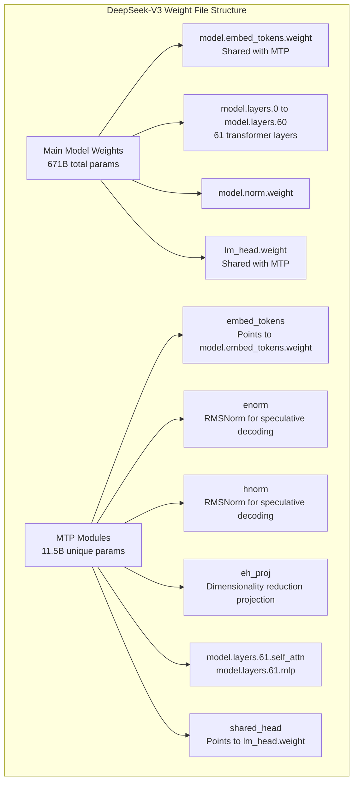
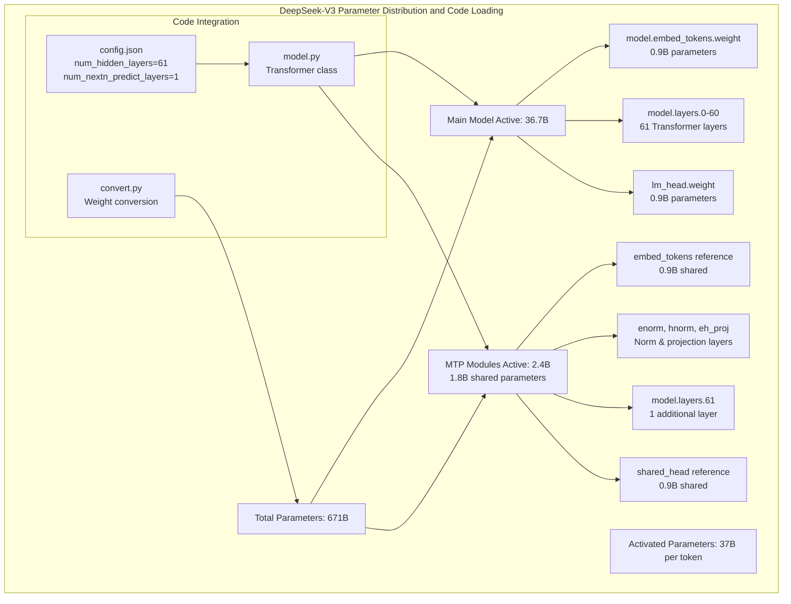
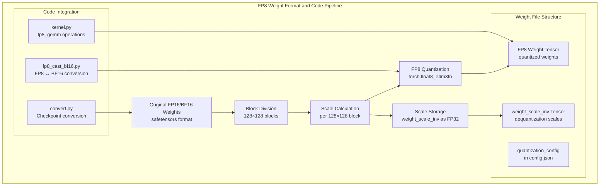
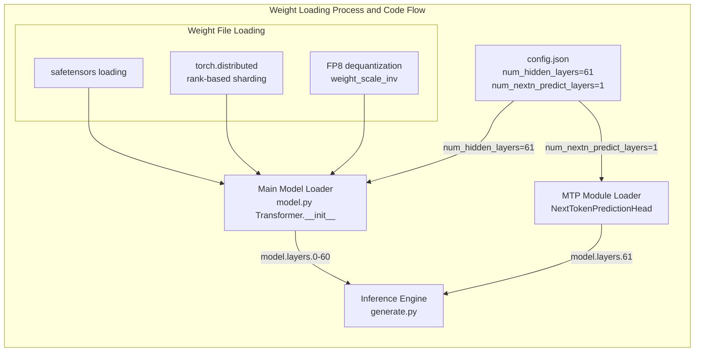

<!-- source: DeepWiki mcp.deepwiki.com · repo deepseek-ai/DeepSeek-V3 · page 6 Model Weights · fetched 2026-10-30 -->

# Model Weights

<details>
<summary>Relevant source files</summary>

The following files were used as context for generating this wiki page:

- [README_WEIGHTS.md](README_WEIGHTS.md)

</details>


This document provides detailed information about the structure, organization, and technical specifications of the DeepSeek-V3 model weights. It covers the weight file composition, parameter distribution, FP8 quantization format, and loading mechanisms. For information about weight conversion for inference, see [Weight Conversion](#4.2).

## Weight Structure Overview

The DeepSeek-V3 weight file architecture consists of two primary components: the Main Model Weights and Multi-Token Prediction (MTP) Modules. Together, these components form the complete weight structure needed for model operation.



Sources: [README_WEIGHTS.md:11-49]()

### Main Model Weights

The Main Model Weights constitute the core of the DeepSeek-V3 architecture, containing the fundamental components required for the model's operation.

**Parameters:**
- **Total parameters**: 671B
- **Activation parameters**: 36.7B (including 0.9B for Embedding and 0.9B for the output Head)

**Structure:**
- **Embedding Layer**: `model.embed_tokens.weight`
- **Transformer Hidden Layers**: 61 layers from `model.layers.0` to `model.layers.60`
- **Output Layer**: `model.norm.weight` and `lm_head.weight`

### Multi-Token Prediction (MTP) Modules

The MTP Modules are specialized components that enhance the model's capabilities for multi-token prediction, enabling more efficient sequence generation.

**Parameters:**
- **Unique parameters**: 11.5B (excluding shared embedding and output head)
- **Activation parameters**: 2.4B (including shared components)

**Structure:**
- **Embedding**: Shares parameters with the Main Model's embedding layer
- **Normalization layers**: `enorm` & `hnorm` (RMSNorm parameters for speculative decoding)
- **Projection layer**: `eh_proj` (Dimensionality reduction on norm results)
- **Additional Transformer Layer**: `model.layers.61.self_attn` & `model.layers.61.mlp`
- **Output Head**: Shares parameters with the Main Model's output head (`lm_head.weight`)

Sources: [README_WEIGHTS.md:15-49]()

## Parameter Distribution and Architecture

The DeepSeek-V3 model implements a Mixture of Experts (MoE) architecture that allows it to have a large total parameter count while maintaining efficiency during inference by activating only a subset of parameters.



The special architecture allows DeepSeek-V3 to have:
- **Total parameters**: 671B parameters across all experts
- **Active parameters during inference**: Only 37B parameters (5.5% of total)
- **Shared components**: 1.8B parameters shared between Main Model and MTP Modules

Sources: [README_WEIGHTS.md:15-40]()

## FP8 Weight Format

DeepSeek-V3 natively supports FP8 weight format with 128×128 block scaling, providing significant storage efficiency while maintaining model performance.



### FP8 Configuration

The quantization configuration is specified in the `quantization_config` field of the model's `config.json`:

```json
"quantization_config": {
  "activation_scheme": "dynamic",
  "fmt": "e4m3",
  "quant_method": "fp8",
  "weight_block_size": [128, 128]
}
```

Key configuration details:
- **Format type**: `fp8` and `e4m3` (corresponding to `torch.float8_e4m3fn`)
- **Weight block size**: 128×128 matrix blocks
- **Activation quantization**: Dynamic activation quantization scheme

Sources: [README_WEIGHTS.md:60-82]()

### Dequantization Process

The dequantization process converts the FP8 weights back to higher precision during inference:

| Component | Description |
|-----------|-------------|
| `weight_scale_inv` | Float32 tensor storing dequantization scales |
| Block handling | Zero-padding for non-aligned blocks before scale calculation |
| Dequantization formula | `(128×128 weight block) * weight_scale_inv` |
| Runtime optimization | Online quantization at per-token-per-128-channel granularity |

The dequantization process enables high-precision computation while benefiting from the storage efficiency of FP8 weights.

Sources: [README_WEIGHTS.md:83-93]()

## Loading Mechanism

The model loading process follows specific rules to load both the Main Model Weights and the MTP Modules:



Loading rules:
- **Main Model Weights**: Controlled by the `num_hidden_layers` parameter in `config.json`
- **MTP Modules**: Controlled by the `num_nextn_predict_layers` parameter in `config.json`
- **Layer ID assignment**: MTP Module layer IDs are appended immediately after the Main Model hidden layers
  - Example: With `num_hidden_layers = 61` and `num_nextn_predict_layers = 1`, the MTP Module's layer ID is `61`

Sources: [README_WEIGHTS.md:52-57]()

## Additional Weight File Configuration Fields

The DeepSeek-V3 weight files include several important configuration fields in the `config.json` file:

| Field | Description |
|-------|-------------|
| `model_type` | Set to `deepseek_v3` for this release |
| `num_nextn_predict_layers` | Number of MTP Modules (1 in the open-sourced V3 weights) |
| `quantization_config` | FP8 quantization configuration parameters |

These configuration fields are essential for properly loading and utilizing the model weights within the DeepSeek-V3 architecture.

Sources: [README_WEIGHTS.md:3-7]()

---

