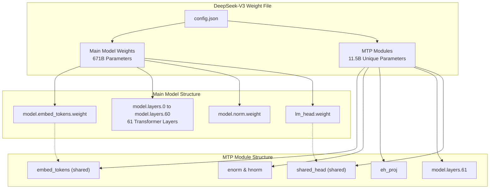
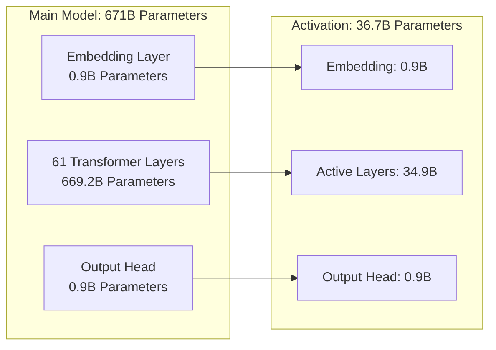
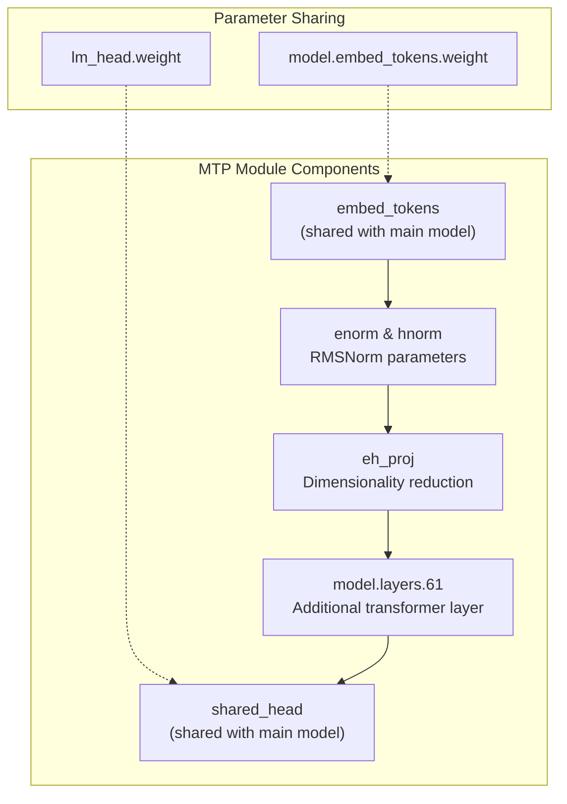
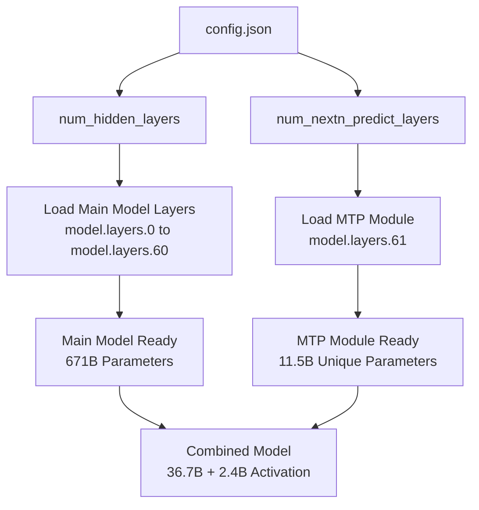
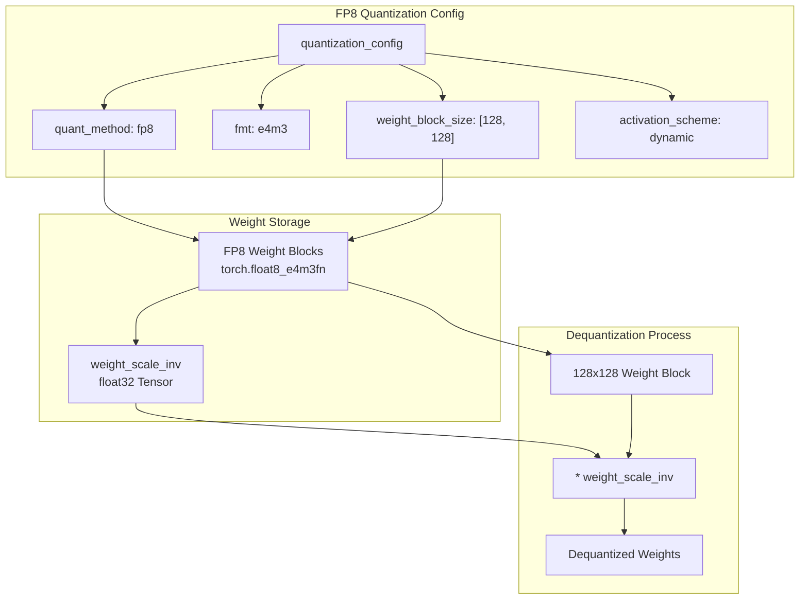

<!-- source: DeepWiki mcp.deepwiki.com · repo deepseek-ai/DeepSeek-V3 · page 6.1 Weight File Structure · fetched 2026-10-30 -->

# Weight File Structure

<details>
<summary>Relevant source files</summary>

The following files were used as context for generating this wiki page:

- [README_WEIGHTS.md](README_WEIGHTS.md)

</details>


This document provides a comprehensive overview of the DeepSeek-V3 weight file organization, including the main model weights, Multi-Token Prediction (MTP) modules, and FP8 quantization format. It covers the structural details, parameter distribution, and loading mechanisms for both the main model and MTP components.

For information about the quantization process and FP8 format details, see [Quantization](#5.2). For general configuration parameters, see [Configuration Options](#6.1).

## Overview

The DeepSeek-V3 weight file consists of two primary components organized in a hierarchical structure. The system supports both standard and quantized weight formats, with specific configuration parameters controlling the loading behavior.

### Weight File Components



**Weight File Component Architecture**

Sources: [README_WEIGHTS.md:13-49]()

## Configuration Parameters

The weight file structure is controlled by specific configuration parameters in `config.json` that determine loading behavior and quantization settings.

| Parameter | Description | Value in V3 |
|-----------|-------------|-------------|
| `model_type` | Specifies the model architecture type | `deepseek_v3` |
| `num_hidden_layers` | Number of transformer layers in main model | `61` |
| `num_nextn_predict_layers` | Number of MTP modules | `1` |
| `quantization_config` | FP8 quantization configuration | See FP8 section |

Sources: [README_WEIGHTS.md:3-8]()

## Main Model Weights

The main model weights contain the core transformer architecture with 671B total parameters and 36.7B activation parameters.

### Parameter Distribution



**Main Model Parameter Distribution**

### Weight Components

#### Embedding Layer
- **Component**: `model.embed_tokens.weight`
- **Parameters**: 0.9B
- **Purpose**: Input token embeddings

#### Transformer Hidden Layers
- **Components**: `model.layers.0` through `model.layers.60`
- **Count**: 61 layers (indexed 0-60)
- **Parameters**: 669.2B total
- **Structure**: Each layer contains `self_attn` and `mlp` components

#### Output Layer
- **Components**: 
  - `model.norm.weight` - Final layer normalization
  - `lm_head.weight` - Output projection (0.9B parameters)

Sources: [README_WEIGHTS.md:15-32]()

## Multi-Token Prediction (MTP) Modules

The MTP modules provide additional prediction capabilities with 11.5B unique parameters and 2.4B activation parameters.

### MTP Module Architecture



**MTP Module Component Structure**

### Component Details

#### Shared Components
- **embed_tokens**: Shares parameters with main model embedding layer
- **shared_head**: Shares parameters with main model output head (`lm_head.weight`)

#### Unique Components
- **enorm & hnorm**: RMSNorm parameters for speculative decoding
- **eh_proj**: Dimensionality reduction projection parameters
- **model.layers.61**: Additional transformer layer with identical structure to main model layers

Sources: [README_WEIGHTS.md:33-49]()

## Loading Mechanism

The weight loading process follows specific rules based on configuration parameters to properly initialize both main model and MTP components.

### Loading Rules



**Weight Loading Process**

### Loading Process

1. **Main Model Loading**: Controlled by `num_hidden_layers` parameter (61 layers)
2. **MTP Module Loading**: Controlled by `num_nextn_predict_layers` parameter (1 module)
3. **Layer ID Assignment**: MTP layers are appended immediately after main model layers
4. **Parameter Sharing**: Embedding and output head parameters are shared between components

Sources: [README_WEIGHTS.md:52-57]()

## FP8 Weight Format

DeepSeek-V3 natively supports FP8 weight format with 128x128 block scaling for memory efficiency.

### FP8 Configuration Structure



**FP8 Weight Format and Dequantization**

### FP8 Specifications

#### Configuration Parameters
```json
{
  "quantization_config": {
    "activation_scheme": "dynamic",
    "fmt": "e4m3",
    "quant_method": "fp8",
    "weight_block_size": [128, 128]
  }
}
```

#### Dequantization Process
- **Weight Scale Storage**: `weight_scale_inv` field stores `float32` dequantization scales
- **Block Processing**: Weights are processed in 128x128 blocks with zero-padding when necessary
- **Dequantization Formula**: `(128x128 weight block) * weight_scale_inv`
- **Runtime Quantization**: Enables online quantization at `per-token-per-128-channel` granularity

Sources: [README_WEIGHTS.md:60-95]()

---

