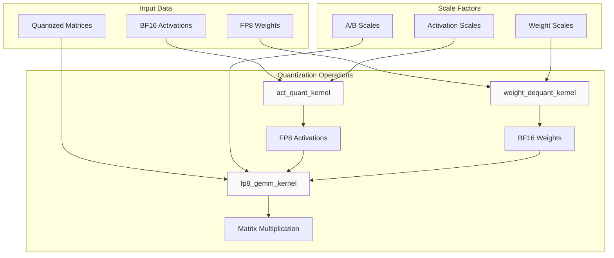
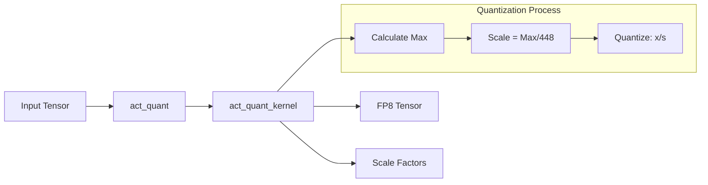
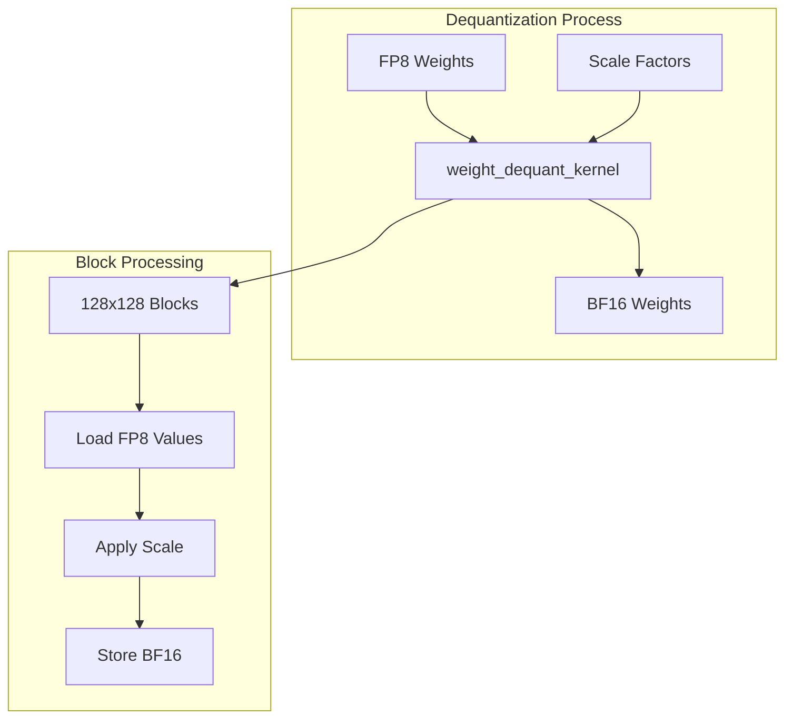
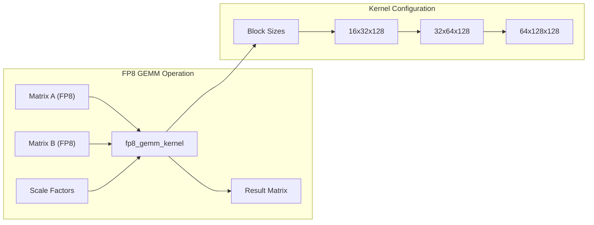
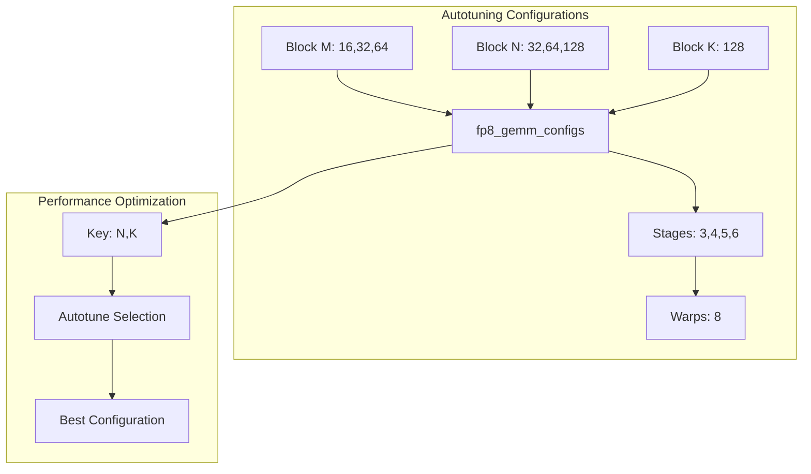
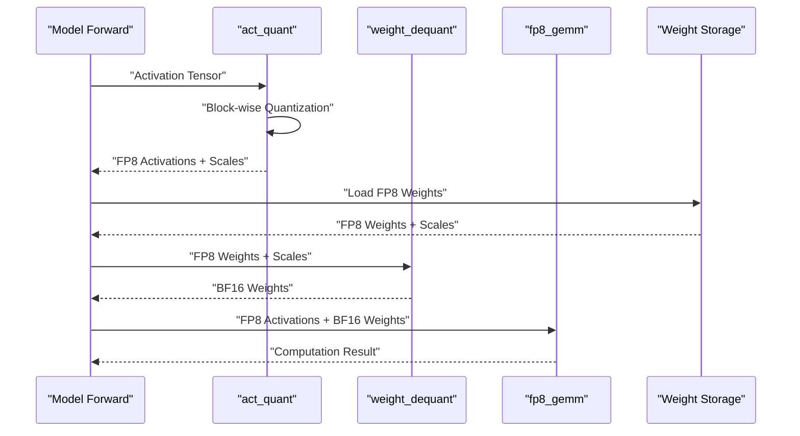

<!-- source: DeepWiki mcp.deepwiki.com · repo deepseek-ai/DeepSeek-V3 · page 6.2 Quantization · fetched 2026-10-30 -->

# Quantization

<details>
<summary>Relevant source files</summary>

The following files were used as context for generating this wiki page:

- [README_WEIGHTS.md](README_WEIGHTS.md)
- [inference/kernel.py](inference/kernel.py)

</details>


This document covers the quantization system in DeepSeek-V3, which enables efficient inference through FP8 precision with block-wise scaling. The quantization system includes optimized Triton kernels for activation quantization, weight dequantization, and FP8 matrix multiplication operations.

For information about the broader inference pipeline, see [4](#4). For details on model weight file structure, see [5.1](#5.1).

## FP8 Quantization Format

DeepSeek-V3 uses FP8 quantization with the `e4m3` format (`torch.float8_e4m3fn`) and block-wise scaling to reduce memory usage while maintaining model performance. The quantization configuration is stored in the model's `config.json` file.

### Quantization Configuration

The FP8 quantization is configured through the `quantization_config` field:

```json
{
  "activation_scheme": "dynamic",
  "fmt": "e4m3", 
  "quant_method": "fp8",
  "weight_block_size": [128, 128]
}
```

| Parameter | Value | Description |
|-----------|--------|-------------|
| `activation_scheme` | `"dynamic"` | Uses dynamic activation quantization |
| `fmt` | `"e4m3"` | FP8 format corresponding to `torch.float8_e4m3fn` |
| `quant_method` | `"fp8"` | Quantization method identifier |
| `weight_block_size` | `[128, 128]` | Block size for weight quantization |

### Weight Storage Format

FP8 weights are stored with accompanying `weight_scale_inv` tensors that contain the dequantization scales for each weight block. The dequantization formula is:

```
dequantized_weight = (128x128 weight block) * weight_scale_inv
```

**Sources:** [README_WEIGHTS.md:60-94]()

## Quantization Kernels

The quantization system implements three core Triton kernels for efficient GPU operations:



### Activation Quantization

The `act_quant_kernel` function quantizes input activations using block-wise scaling:



The kernel processes blocks of size 128 by default and calculates scaling factors as `max(abs(x)) / 448.0`, where 448 represents the maximum representable value in FP8 e4m3 format.

### Weight Dequantization

The `weight_dequant_kernel` converts FP8 weights back to higher precision using stored scaling factors:



### FP8 Matrix Multiplication

The `fp8_gemm_kernel` performs optimized matrix multiplication directly on FP8 tensors:



**Sources:** [inference/kernel.py:1-192]()

## Quantization API

The quantization system provides three main functions accessible from the inference pipeline:

| Function | Input | Output | Purpose |
|----------|-------|---------|---------|
| `act_quant(x, block_size=128)` | BF16 tensor | FP8 tensor + scales | Quantize activations |
| `weight_dequant(x, s, block_size=128)` | FP8 weights + scales | BF16 weights | Dequantize weights |
| `fp8_gemm(a, a_s, b, b_s)` | FP8 matrices + scales | Result matrix | FP8 matrix multiplication |

### Function Signatures

```python
def act_quant(x: torch.Tensor, block_size: int = 128) -> Tuple[torch.Tensor, torch.Tensor]
def weight_dequant(x: torch.Tensor, s: torch.Tensor, block_size: int = 128) -> torch.Tensor  
def fp8_gemm(a: torch.Tensor, a_s: torch.Tensor, b: torch.Tensor, b_s: torch.Tensor) -> torch.Tensor
```

The functions enforce strict requirements:
- All tensors must be contiguous
- Block sizes must evenly divide tensor dimensions
- Weight tensors must be 2-dimensional for `weight_dequant`

**Sources:** [inference/kernel.py:33-52](), [inference/kernel.py:84-105](), [inference/kernel.py:170-191]()

## Kernel Configuration and Optimization

The FP8 GEMM kernel uses Triton's autotuning system with multiple configurations to optimize performance:



The autotuning system generates 36 different configurations by combining:
- Block sizes for M dimension: 16, 32, 64
- Block sizes for N dimension: 32, 64, 128  
- Fixed block size for K dimension: 128
- Number of pipeline stages: 3, 4, 5, 6
- Fixed number of warps: 8

**Sources:** [inference/kernel.py:108-111]()

## Integration with Model Inference

The quantization system integrates with the broader inference pipeline through the model architecture:



The quantization enables runtime operations with `per-token-per-128-channel` granularity, allowing efficient inference while maintaining model quality.

**Sources:** [README_WEIGHTS.md:92-93](), [inference/kernel.py:1-192]()

---

