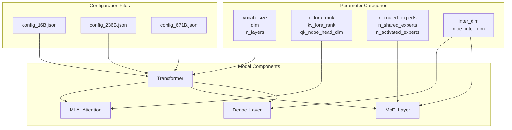
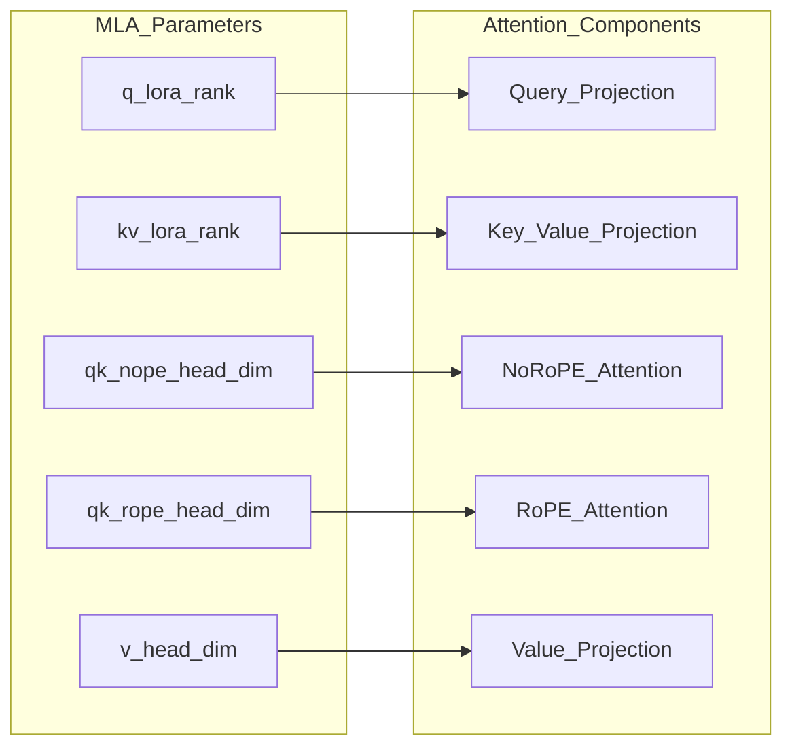
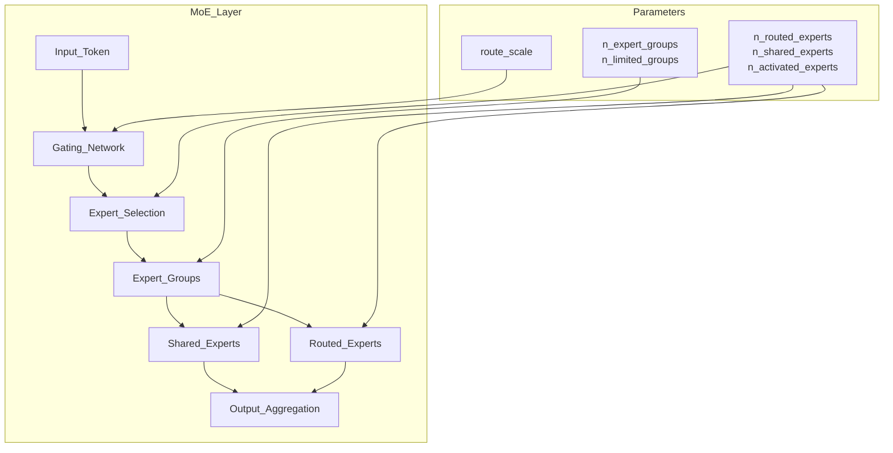
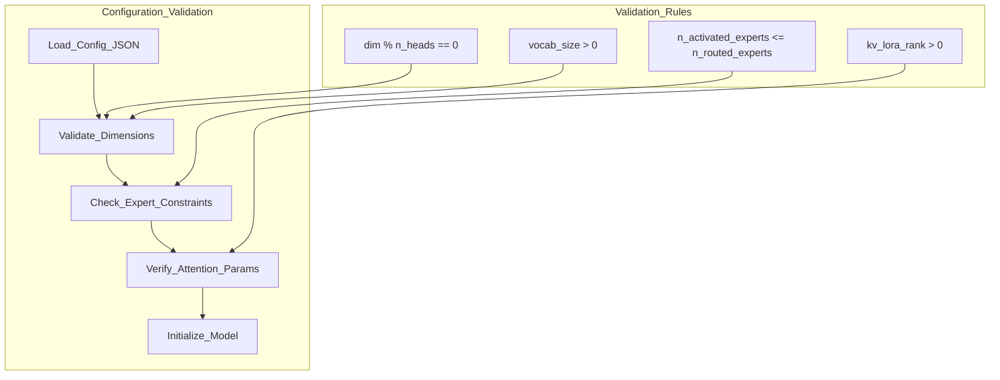

<!-- source: DeepWiki mcp.deepwiki.com · repo deepseek-ai/DeepSeek-V3 · page 7.1 Configuration Options · fetched 2026-10-30 -->

# Configuration Options

Relevant source files

The following files were used as context for generating this wiki page:

- [inference/configs/config_671B.json](inference/configs/config_671B.json)
- [inference/configs/config_v3.1.json](inference/configs/config_v3.1.json)

This document describes the configuration parameters available for DeepSeek-V3 models, including their purpose, valid values, and relationships. The configuration options control model architecture, attention mechanisms, mixture of experts (MoE) settings, and optimization parameters.

For information about comparing different model sizes and their configurations, see [Model Sizes](#6.2). For details about the model architecture implementation that uses these configurations, see [Model Architecture](#3).

## Configuration File Structure

DeepSeek-V3 uses JSON configuration files to define model parameters. Three pre-configured model sizes are available:

- **16B Model**: `inference/configs/config_16B.json`
- **236B Model**: `inference/configs/config_236B.json`
- **671B Model**: `inference/configs/config_671B.json`

### Configuration Loading Architecture

*Sources: [inference/configs/config_16B.json:1-19](), [inference/configs/config_236B.json:1-20](), [inference/configs/config_671B.json:1-22]()*

## Core Model Parameters

### Basic Architecture Parameters

| Parameter | Description | Type | Example Values |
|-----------|-------------|------|----------------|
| `vocab_size` | Vocabulary size for tokenization | Integer | 102400 (16B/236B), 129280 (671B) |
| `dim` | Model hidden dimension | Integer | 2048 (16B), 5120 (236B), 7168 (671B) |
| `n_layers` | Total number of transformer layers | Integer | 27 (16B), 60 (236B), 61 (671B) |
| `n_dense_layers` | Number of dense (non-MoE) layers | Integer | 1 (16B/236B), 3 (671B) |
| `n_heads` | Number of attention heads | Integer | 16 (16B), 128 (236B/671B) |

### Feed-Forward Network Parameters

| Parameter | Description | Type | Example Values |
|-----------|-------------|------|----------------|
| `inter_dim` | Dense layer intermediate dimension | Integer | 10944 (16B), 12288 (236B), 18432 (671B) |
| `moe_inter_dim` | MoE expert intermediate dimension | Integer | 1408 (16B), 1536 (236B), 2048 (671B) |

*Sources: [inference/configs/config_16B.json:2-7](), [inference/configs/config_236B.json:2-7](), [inference/configs/config_671B.json:2-7]()*

## Multi-Head Latent Attention (MLA) Parameters

The MLA attention mechanism uses several specialized parameters to configure its low-rank approximation and rope positioning:

### Attention Configuration

| Parameter | Description | Type | Range |
|-----------|-------------|------|-------|
| `q_lora_rank` | Query LoRA rank dimension | Integer | 0 (16B), 1536 (236B/671B) |
| `kv_lora_rank` | Key-Value LoRA rank dimension | Integer | 512 (all models) |
| `qk_nope_head_dim` | Query-Key head dimension (non-RoPE) | Integer | 128 (all models) |
| `qk_rope_head_dim` | Query-Key head dimension (RoPE) | Integer | 64 (all models) |
| `v_head_dim` | Value head dimension | Integer | 128 (all models) |

*Sources: [inference/configs/config_16B.json:13-17](), [inference/configs/config_236B.json:15-19](), [inference/configs/config_671B.json:16-20]()*

## Mixture of Experts (MoE) Parameters

### Expert Configuration

| Parameter | Description | Type | Example Values |
|-----------|-------------|------|----------------|
| `n_routed_experts` | Total number of routed experts | Integer | 64 (16B), 160 (236B), 256 (671B) |
| `n_shared_experts` | Number of shared experts | Integer | 2 (16B/236B), 1 (671B) |
| `n_activated_experts` | Number of experts activated per token | Integer | 6 (16B/236B), 8 (671B) |
| `route_scale` | Scaling factor for expert routing | Float | 1.0 (16B), 16.0 (236B), 2.5 (671B) |

### Advanced MoE Parameters (236B and 671B only)

| Parameter | Description | Type | Example Values |
|-----------|-------------|------|----------------|
| `n_expert_groups` | Number of expert groups | Integer | 8 (236B/671B) |
| `n_limited_groups` | Number of limited groups | Integer | 3 (236B), 4 (671B) |

### MoE Architecture Flow

*Sources: [inference/configs/config_16B.json:9-12](), [inference/configs/config_236B.json:9-14](), [inference/configs/config_671B.json:9-14]()*

## Model-Specific Parameters

### 16B Model Only

| Parameter | Description | Type | Value |
|-----------|-------------|------|-------|
| `mscale` | Model scaling factor | Float | 0.707 |

### 671B Model Only

| Parameter | Description | Type | Value |
|-----------|-------------|------|-------|
| `score_func` | Scoring function for expert selection | String | "sigmoid" |
| `dtype` | Data type for model weights | String | "fp8" |

*Sources: [inference/configs/config_16B.json:18](), [inference/configs/config_671B.json:15](), [inference/configs/config_671B.json:21]()*

## Parameter Relationships and Constraints

### Dimension Relationships

The model dimensions follow specific relationships to ensure proper tensor operations:

- `dim` must be divisible by `n_heads`
- `qk_nope_head_dim + qk_rope_head_dim` determines query-key computation split
- `inter_dim` typically follows a 4:1 ratio with `dim` for dense layers
- `moe_inter_dim` is usually smaller than `inter_dim` for memory efficiency

### Expert Configuration Constraints

- `n_activated_experts` ≤ `n_routed_experts`
- `n_expert_groups` divides expert routing when specified
- `n_limited_groups` ≤ `n_expert_groups`

### Configuration Validation Flow

*Sources: [inference/configs/config_16B.json:1-19](), [inference/configs/config_236B.json:1-20](), [inference/configs/config_671B.json:1-22]()*

## Configuration Usage in Code

The configuration parameters are loaded and used throughout the model implementation:

- Model initialization uses `dim`, `n_layers`, `n_heads`
- Attention layers use `q_lora_rank`, `kv_lora_rank`, and head dimension parameters
- MoE layers use expert count and routing parameters
- Weight loading considers `dtype` for precision handling

The configuration system provides a flexible way to define different model architectures while maintaining consistent parameter interfaces across the codebase.

*Sources: [inference/configs/config_16B.json:1-19](), [inference/configs/config_236B.json:1-20](), [inference/configs/config_671B.json:1-22]()*

---

