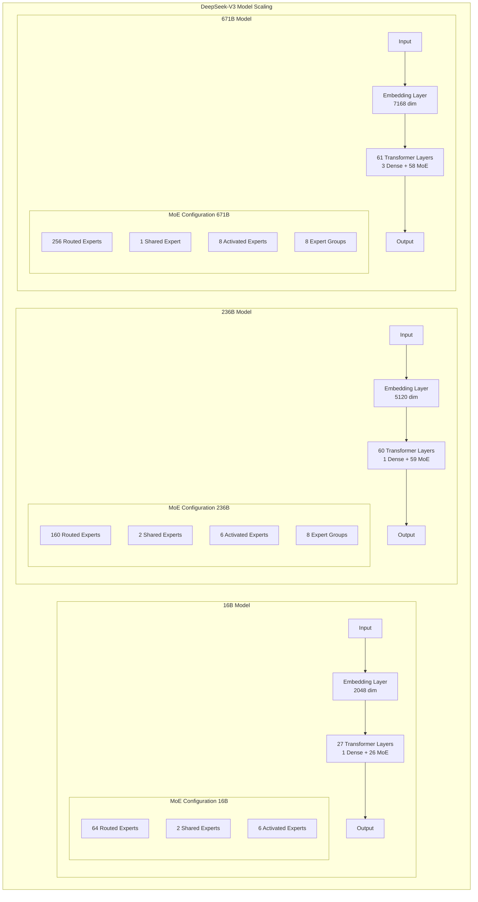
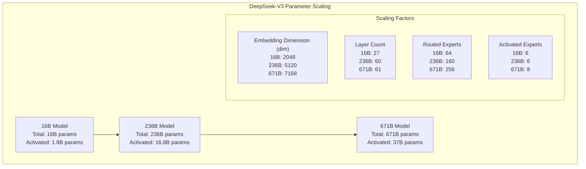

<!-- source: DeepWiki mcp.deepwiki.com · repo deepseek-ai/DeepSeek-V3 · page 7.2 Model Sizes · fetched 2026-10-30 -->

# Model Sizes

Relevant source files

The following files were used as context for generating this wiki page:

- [README.md](README.md)
- [inference/configs/config_16B.json](inference/configs/config_16B.json)
- [inference/configs/config_236B.json](inference/configs/config_236B.json)
- [inference/configs/config_671B.json](inference/configs/config_671B.json)

This documentation page describes the different model sizes available in the DeepSeek-V3 family. It provides a detailed comparison of the 16B, 236B, and 671B parameter models, focusing on their architectural differences, configuration parameters, and performance characteristics. For information about general configuration options, see [Configuration Options](#6.1).

## Overview of DeepSeek-V3 Model Variants

DeepSeek-V3 is available in three primary sizes, each offering different capabilities and resource requirements:

- **16B Variant**: The smallest model with 16 billion total parameters, with only 1.8B parameters activated during inference
- **236B Variant**: A medium-sized model with 236 billion total parameters, with 16.8B parameters activated during inference
- **671B Variant**: The largest model with 671 billion total parameters, with 37B parameters activated during inference

The models utilize a Mixture of Experts (MoE) architecture, meaning that while the total parameter count is high, only a fraction of parameters is activated during inference, making them computationally efficient.

Sources: [inference/configs/config_16B.json](), [inference/configs/config_236B.json](), [inference/configs/config_671B.json]()

## Configuration Comparison

The following table provides a side-by-side comparison of key configuration parameters across the three model sizes:

| Parameter | 16B Model | 236B Model | 671B Model |
|-----------|-----------|------------|------------|
| vocab_size | 102,400 | 102,400 | 129,280 |
| dim (embedding dimension) | 2,048 | 5,120 | 7,168 |
| inter_dim | 10,944 | 12,288 | 18,432 |
| moe_inter_dim | 1,408 | 1,536 | 2,048 |
| n_layers | 27 | 60 | 61 |
| n_dense_layers | 1 | 1 | 3 |
| n_heads | 16 | 128 | 128 |
| n_routed_experts | 64 | 160 | 256 |
| n_shared_experts | 2 | 2 | 1 |
| n_activated_experts | 6 | 6 | 8 |
| n_expert_groups | not specified | 8 | 8 |
| n_limited_groups | not specified | 3 | 4 |
| route_scale | 1.0 | 16.0 | 2.5 |
| q_lora_rank | 0 | 1,536 | 1,536 |
| kv_lora_rank | 512 | 512 | 512 |
| Default precision | not specified | not specified | fp8 |

Sources: [inference/configs/config_16B.json](), [inference/configs/config_236B.json](), [inference/configs/config_671B.json]()

## Model Architecture Scaling

The following diagram illustrates how the architecture scales across different model sizes:

Sources: [inference/configs/config_16B.json](), [inference/configs/config_236B.json](), [inference/configs/config_671B.json]()

## Parameter Scaling and Efficiency

The following diagram shows how the total parameters and activated parameters scale across model sizes:

Sources: [inference/configs/config_16B.json](), [inference/configs/config_236B.json](), [inference/configs/config_671B.json]()

## Mixture of Experts (MoE) Structure

The MoE architecture is a key component of DeepSeek-V3 models, enabling them to have large parameter counts while maintaining reasonable computational requirements during inference. The different model sizes have varying MoE configurations:

### Expert Configuration Comparison

| MoE Parameter | 16B Model | 236B Model | 671B Model |
|---------------|-----------|------------|------------|
| Total routed experts | 64 | 160 | 256 |
| Shared experts | 2 | 2 | 1 |
| Activated experts per token | 6 | 6 | 8 |
| Expert groups | Not specified | 8 | 8 |
| Limited groups | Not specified | 3 | 4 |
| Expert activation mechanism | Router (scale: 1.0) | Router (scale: 16.0) | Router (scale: 2.5, sigmoid) |
| MoE intermediate dimension | 1,408 | 1,536 | 2,048 |

Sources: [inference/configs/config_16B.json](), [inference/configs/config_236B.json](), [inference/configs/config_671B.json]()

### MoE Architecture Across Model Sizes

```mermaid
flowchart LR
    subgraph "MoE Architecture"
        subgraph "16B Model MoE Layer"
            input16[Input] --> router16[Router]
            router16 -- "Select 6 experts" --> experts16["64 Routed Experts Pool\n+ 2 Shared Experts"]
            experts16 --> combine16[Combine Outputs]
            combine16 --> output16[Output]
        end
        
        subgraph "236B Model MoE Layer"
            input236[Input] --> router236[Router]
            router236 -- "Select 6 experts" --> experts236["160 Routed Experts Pool\n+ 2 Shared Experts\n8 Expert Groups"]
            experts236 --> combine236[Combine Outputs]
            combine236 --> output236[Output]
        end
        
        subgraph "671B Model MoE Layer"
            input671[Input] --> router671[Router with Sigmoid]
            router671 -- "Select 8 experts" --> experts671["256 Routed Experts Pool\n+ 1 Shared Expert\n8 Expert Groups"]
            experts671 --> combine671[Combine Outputs]
            combine671 --> output671[Output]
        end
    end
```

Sources: [inference/configs/config_16B.json](), [inference/configs/config_236B.json](), [inference/configs/config_671B.json]()

## Multi-head Latent Attention Configuration

All DeepSeek-V3 models use Multi-head Latent Attention (MLA), but with different configurations based on model size:

| Attention Parameter | 16B Model | 236B Model | 671B Model |
|---------------------|-----------|------------|------------|
| Number of attention heads | 16 | 128 | 128 |
| Query LoRA rank | 0 | 1,536 | 1,536 |
| Key-Value LoRA rank | 512 | 512 | 512 |
| Q/K NoRoPE head dimension | 128 | 128 | 128 |
| Q/K RoPE head dimension | 64 | 64 | 64 |
| Value head dimension | 128 | 128 | 128 |

Sources: [inference/configs/config_16B.json](), [inference/configs/config_236B.json](), [inference/configs/config_671B.json]()

## Memory Requirements and Hardware Considerations

The different model sizes have significantly different memory and computational requirements:

| Model Size | Approximate GPU Memory | Minimum GPU Recommendation | Notes |
|------------|------------------------|-----------------------------|-------|
| 16B | 14-16 GB | Single consumer GPU (e.g., RTX 3090) | Works well on consumer hardware |
| 236B | 80-100 GB | Multi-GPU setup or high-end datacenter GPUs | Requires substantial GPU memory |
| 671B | 200+ GB | Multiple high-end GPUs or specialized hardware | Requires a cluster or specialized setup |

Note that these requirements can be reduced through quantization techniques. The 671B model specifically defaults to FP8 precision to reduce memory requirements.

Sources: [inference/configs/config_671B.json]()

## Use Case Recommendations

Different model sizes are suitable for different use cases:

| Model Size | Recommended Use Cases |
|------------|------------------------|
| 16B | - Personal development and experimentation - Applications with limited hardware resources - Scenarios where lower latency is preferred over maximum quality |
| 236B | - Production applications requiring high-quality outputs - Research and development with access to datacenter hardware - Complex reasoning tasks requiring more capability than the 16B model |
| 671B | - Advanced research applications - Enterprise-scale deployments with specialized hardware - Complex tasks requiring maximum model capability - Applications where output quality is paramount |

## Vocab Size Differences

An important distinction between the models is their vocabulary size:
- 16B and 236B models: 102,400 tokens
- 671B model: 129,280 tokens

The larger vocabulary of the 671B model may provide better tokenization efficiency for certain languages and specialized content.

Sources: [inference/configs/config_16B.json](), [inference/configs/config_236B.json](), [inference/configs/config_671B.json]()

---

