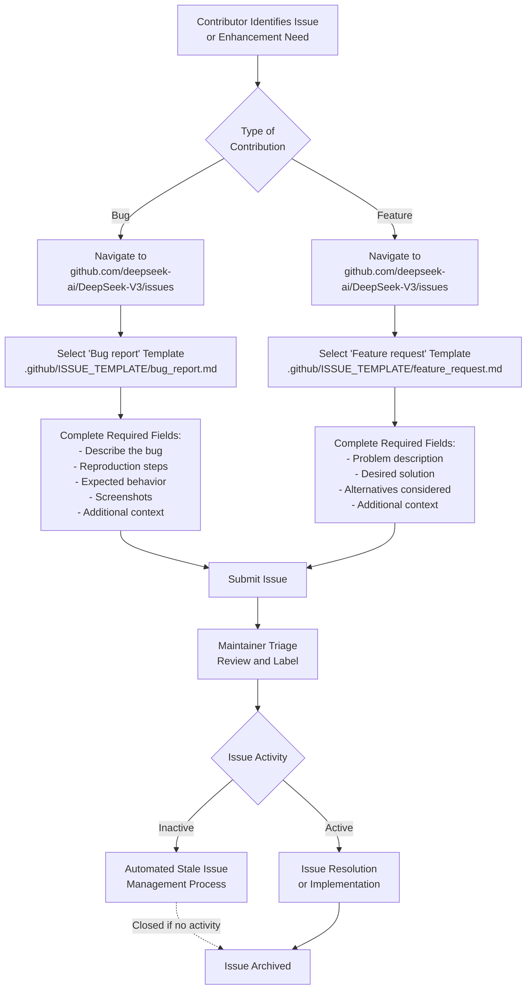
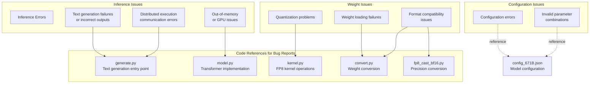
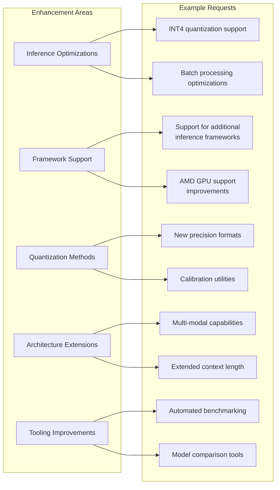
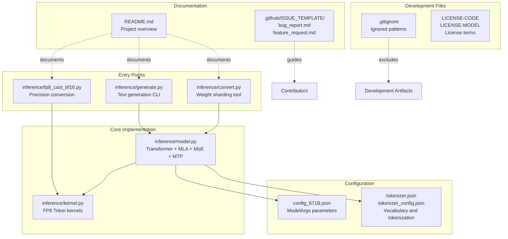
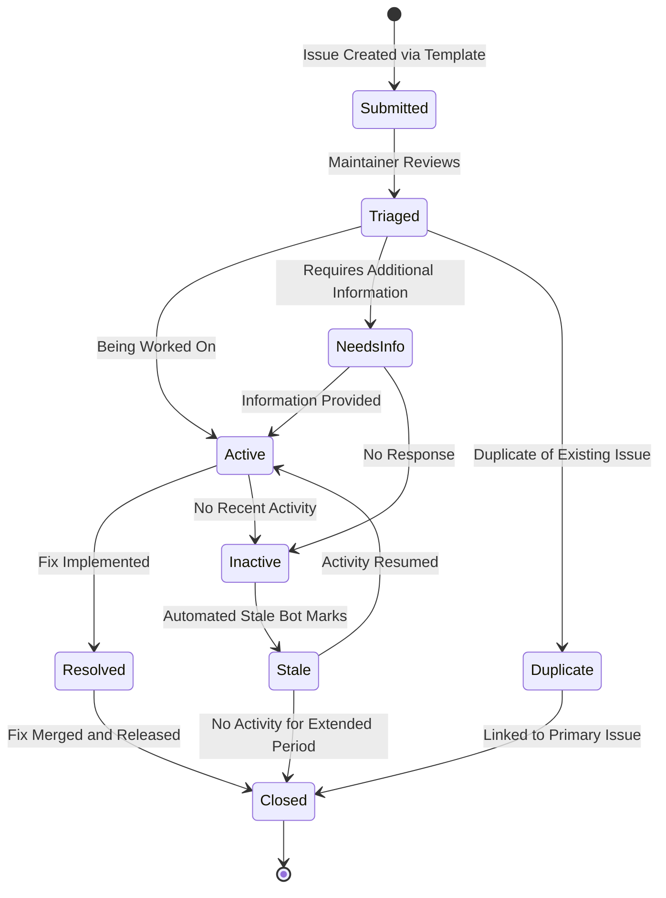

<!-- source: DeepWiki mcp.deepwiki.com · repo deepseek-ai/DeepSeek-V3 · page 8 Contributing · fetched 2026-10-30 -->

# Contributing

Relevant source files

The following files were used as context for generating this wiki page:

- [.github/ISSUE_TEMPLATE/bug_report.md](.github/ISSUE_TEMPLATE/bug_report.md)
- [.github/ISSUE_TEMPLATE/feature_request.md](.github/ISSUE_TEMPLATE/feature_request.md)

This document provides guidance for contributing to the DeepSeek-V3 repository. It covers the processes for reporting bugs, requesting features, and understanding the development workflow for this research codebase. 

For information about model deployment and usage, see [Getting Started](#2). For technical implementation details, see [Model Architecture](#4) and [Inference Pipeline](#5).

## Overview

The DeepSeek-V3 repository is a research release that provides inference implementations and documentation for the DeepSeek-V3 large language model. Contributions primarily take the form of issue reports, feature requests, and community discussions. The repository uses GitHub Issues with structured templates to maintain organized tracking of bugs and enhancement requests.

## Contribution Workflow

The following diagram illustrates the standard contribution workflow for the DeepSeek-V3 repository:

**Sources:** [.github/ISSUE_TEMPLATE/bug_report.md](), [.github/ISSUE_TEMPLATE/feature_request.md]()

## Bug Reports

Bug reports are submitted through GitHub Issues using the structured bug report template. The template ensures all necessary information is provided for efficient issue triage and resolution.

### Bug Report Template Structure

The bug report template at [.github/ISSUE_TEMPLATE/bug_report.md:1-24]() defines the following required sections:

| Section | Purpose | Required Information |
|---------|---------|---------------------|
| **Describe the bug** | Provide clear description of the issue | Concise explanation of what the bug is |
| **To Reproduce** | Enable reproduction of the issue | Step-by-step instructions to reproduce the behavior |
| **Expected behavior** | Define correct behavior | Clear description of what should happen instead |
| **Screenshots** | Visual documentation | Screenshots or error logs if applicable |
| **Additional context** | Supporting information | Any other relevant context about the problem |

### Bug Report Metadata

The template includes metadata fields:
- **title**: Defaults to `[BUG]` prefix [.github/ISSUE_TEMPLATE/bug_report.md:4]()
- **labels**: Can be assigned during submission [.github/ISSUE_TEMPLATE/bug_report.md:5]()
- **assignees**: Can be pre-assigned to maintainers [.github/ISSUE_TEMPLATE/bug_report.md:6]()

### Common Bug Report Scenarios

The following diagram maps common issues to relevant code components for effective bug reporting:

When reporting bugs related to inference, contributors should reference:
- **generate.py** for text generation issues
- **model.py** for model architecture or forward pass errors  
- **kernel.py** for FP8 quantization or kernel failures
- **convert.py** for weight sharding or model parallel issues
- **fp8_cast_bf16.py** for precision conversion problems

**Sources:** [.github/ISSUE_TEMPLATE/bug_report.md:1-24]()

### Effective Bug Report Guidelines

To file an effective bug report:

1. **Search existing issues** before creating a new report to avoid duplicates
2. **Provide complete reproduction steps** including commands executed
3. **Include environment details**: GPU model, CUDA version, PyTorch version, number of GPUs
4. **Attach error messages** with full stack traces
5. **Specify model variant**: DeepSeek-V3-Base or DeepSeek-V3 Chat
6. **Document inference framework** if using SGLang, vLLM, LMDeploy, TensorRT-LLM, LightLLM, or the reference implementation
7. **Include precision format**: FP8 native or converted BF16

**Sources:** [.github/ISSUE_TEMPLATE/bug_report.md]()

## Feature Requests

Feature requests follow a structured template that encourages contributors to clearly articulate problems and propose solutions.

### Feature Request Template Structure

The feature request template at [.github/ISSUE_TEMPLATE/feature_request.md:1-21]() defines the following sections:

| Section | Purpose | Expected Content |
|---------|---------|------------------|
| **Is your feature request related to a problem?** | Context for the request | Clear description of the problem, e.g., "I'm always frustrated when [...]" |
| **Describe the solution you'd like** | Proposed implementation | Clear and concise description of desired functionality |
| **Describe alternatives you've considered** | Alternative approaches | Discussion of other solutions or features considered |
| **Additional context** | Supporting materials | Context, screenshots, or references to support the request |

### Feature Request Categories

Common feature request categories for the DeepSeek-V3 repository:

**Sources:** [.github/ISSUE_TEMPLATE/feature_request.md:1-21]()

### Writing Effective Feature Requests

To submit an effective feature request:

1. **Describe the problem clearly** - explain the limitation or gap in current functionality
2. **Propose concrete solutions** - provide specific suggestions rather than vague requests
3. **Consider implementation complexity** - acknowledge technical constraints
4. **Reference similar features** - cite examples from other frameworks or models
5. **Explain use case** - describe how the feature would benefit users
6. **Discuss alternatives** - show you've considered multiple approaches

Example structure:
- **Problem**: "When running inference with convert.py on models with more than 256 experts, the sharding logic fails"
- **Solution**: "Modify the expert distribution calculation in convert.py to support arbitrary expert counts"
- **Alternatives**: "Use a different model parallel strategy or pre-shard experts manually"

**Sources:** [.github/ISSUE_TEMPLATE/feature_request.md]()

## Development Workflow

The DeepSeek-V3 repository follows standard GitHub development practices with automated issue management and code organization patterns.

### Repository Structure for Contributors

The following diagram shows the repository organization from a contributor's perspective:

**Sources:** [.github/ISSUE_TEMPLATE/bug_report.md](), [.github/ISSUE_TEMPLATE/feature_request.md]()

### Issue Lifecycle and Management

The repository employs automated stale issue management to maintain repository hygiene:

The stale issue workflow automatically:
- Identifies issues with no activity for a configured period
- Adds a `stale` label to inactive issues
- Closes issues that remain inactive after being marked stale
- Allows issues to be reactivated by adding comments

This process ensures the issue tracker remains focused on actionable items.

**Sources:** [.github/ISSUE_TEMPLATE/bug_report.md](), [.github/ISSUE_TEMPLATE/feature_request.md]()

### Code Organization Conventions

Contributors interacting with the codebase should understand these organizational patterns:

#### Inference Code Structure

The `inference/` directory contains all inference-related code:

- **model.py**: Defines `Transformer`, `Attention`, `MoE`, `MTP` classes
- **kernel.py**: Implements `act_quant()`, `weight_dequant()`, `fp8_gemm()` functions
- **generate.py**: Provides `generate()` function and CLI entry point
- **convert.py**: Contains weight conversion logic for model parallelism
- **fp8_cast_bf16.py**: Handles precision conversion utilities

#### Configuration Files

- **config_*.json**: Store `ModelArgs` parameters for different model sizes
- **tokenizer files**: Define vocabulary and tokenization behavior

#### Issue Templates

Located at [.github/ISSUE_TEMPLATE/]():
- **bug_report.md**: Template for bug reports [.github/ISSUE_TEMPLATE/bug_report.md:1-24]()
- **feature_request.md**: Template for feature requests [.github/ISSUE_TEMPLATE/feature_request.md:1-21]()

**Sources:** [.github/ISSUE_TEMPLATE/bug_report.md](), [.github/ISSUE_TEMPLATE/feature_request.md]()

### Repository Hygiene Practices

The repository maintains clean development practices:

1. **Automated artifact exclusion** via `.gitignore` patterns
2. **Template-driven issue creation** to ensure consistency
3. **Stale issue management** to keep the issue tracker current
4. **Structured labeling** for categorizing issues
5. **Clear separation** between code licenses (MIT) and model licenses (DeepSeek License Agreement)

### Contributing Best Practices

When contributing to DeepSeek-V3:

1. **Use issue templates** - Always use the provided templates for bug reports and feature requests
2. **Search before posting** - Check for existing issues to avoid duplicates
3. **Be specific** - Provide detailed reproduction steps and environment information
4. **Stay focused** - Keep issues focused on a single bug or feature
5. **Be responsive** - Respond to maintainer questions to prevent issues from going stale
6. **Test thoroughly** - Verify bugs can be reproduced before reporting
7. **Propose solutions** - When requesting features, suggest implementation approaches

**Sources:** [.github/ISSUE_TEMPLATE/bug_report.md](), [.github/ISSUE_TEMPLATE/feature_request.md]()

## Summary

The DeepSeek-V3 repository uses a structured contribution process centered around GitHub Issues:

- **Bug reports** follow the template at [.github/ISSUE_TEMPLATE/bug_report.md]()
- **Feature requests** follow the template at [.github/ISSUE_TEMPLATE/feature_request.md]()
- **Issue lifecycle** includes automated stale management
- **Code organization** separates inference implementation, configuration, and tooling

Contributors should familiarize themselves with the inference pipeline (documented in [Inference Pipeline](#5)) and model architecture (documented in [Model Architecture](#4)) to provide informed bug reports and feature requests.

---

