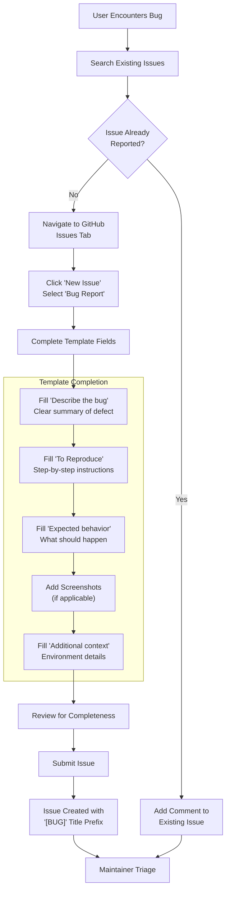
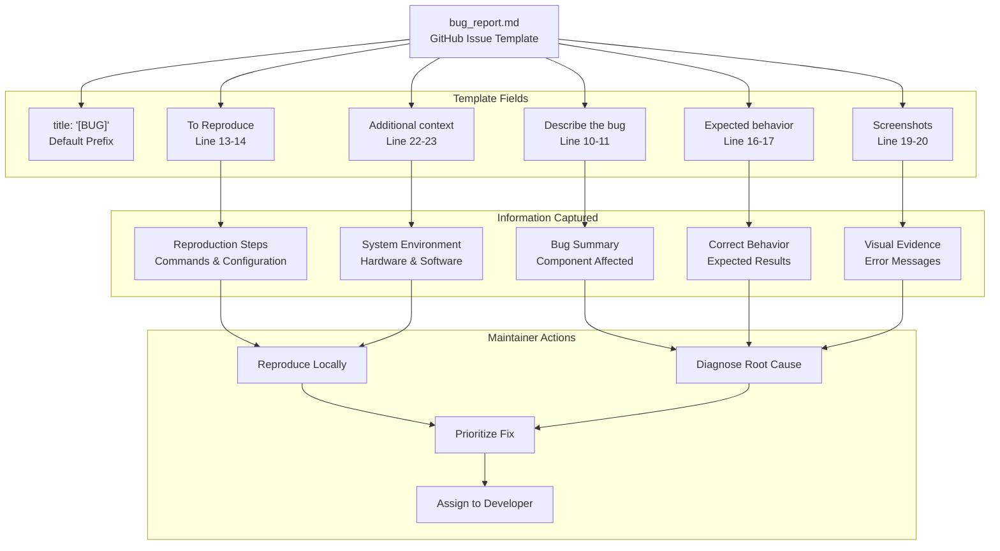
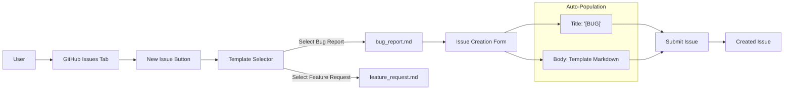

<!-- source: DeepWiki mcp.deepwiki.com · repo deepseek-ai/DeepSeek-V3 · page 8.1 Bug Reports · fetched 2026-10-30 -->

# Bug Reports

<details>
<summary>Relevant source files</summary>

The following files were used as context for generating this wiki page:

- [.github/ISSUE_TEMPLATE/bug_report.md](.github/ISSUE_TEMPLATE/bug_report.md)
- [.github/ISSUE_TEMPLATE/feature_request.md](.github/ISSUE_TEMPLATE/feature_request.md)

</details>


This document explains how to file bug reports for the DeepSeek-V3 project using the GitHub issue template system. It covers the required information, template structure, and submission workflow for reporting defects, errors, or unexpected behavior in the inference framework, model architecture, or deployment tools.

For feature requests and enhancements, see [Feature Requests](#8.2). For overall development workflow including issue lifecycle management, see [Development Workflow](#8.3).

---

## Bug Report Template Structure

The DeepSeek-V3 repository uses a structured GitHub issue template to collect bug reports. The template is defined in [.github/ISSUE_TEMPLATE/bug_report.md:1-24]() and is automatically presented when users create a new issue with the "Bug report" option.

### Template Metadata

The template includes YAML front matter that configures the GitHub issue creation interface:

| Field | Value | Purpose |
|-------|-------|---------|
| `name` | "Bug report" | Display name in issue template selector |
| `about` | "Create a report to help us improve" | Description shown to users |
| `title` | "[BUG]" | Default issue title prefix |
| `labels` | (empty) | No automatic labels applied |
| `assignees` | (empty) | No automatic assignees |

Sources: [.github/ISSUE_TEMPLATE/bug_report.md:1-8]()

---

## Required Information Fields

The template defines four mandatory sections that reporters must complete:

### Describe the Bug

**Purpose**: Provide a clear, concise summary of the defect.

**Location**: [.github/ISSUE_TEMPLATE/bug_report.md:10-11]()

**Guidelines**:
- State what is malfunctioning or producing incorrect output
- Specify which component is affected (e.g., `model.py`, `kernel.py`, `generate.py`, `convert.py`)
- Include error messages or unexpected output verbatim
- Reference specific model configuration if applicable (671B, 236B, 16B)

**Example**: "FP8 quantization in `kernel.py` produces NaN values during inference when using 256 experts with 8 active tokens on NVIDIA A100"

### To Reproduce

**Purpose**: Enable maintainers to recreate the issue deterministically.

**Location**: [.github/ISSUE_TEMPLATE/bug_report.md:13-14]()

**Guidelines**:
- Provide step-by-step instructions starting from a clean state
- Include command-line invocations with all flags and arguments
- Specify model weights used (DeepSeek-V3-Base vs DeepSeek-V3 Chat)
- Document environment setup (CUDA version, PyTorch version, distributed configuration)
- Include minimal reproducible code snippets if applicable

**Example**:
```
1. Download DeepSeek-V3 weights from Hugging Face
2. Run conversion: python convert.py --hf-ckpt-path ./DeepSeek-V3 --save-path ./model --n-experts-per-rank 32 --model-parallel 8
3. Execute generation: torchrun --nproc_per_node 8 generate.py --interactive --ckpt-path ./model
4. Enter prompt: "Explain quantum computing"
5. Observe: Process crashes with CUDA out of memory error
```

### Expected Behavior

**Purpose**: Clarify what the correct output or behavior should be.

**Location**: [.github/ISSUE_TEMPLATE/bug_report.md:16-17]()

**Guidelines**:
- Describe the anticipated result based on documentation or logical inference
- Reference relevant configuration parameters from `ModelArgs` if applicable
- Cite benchmark results or published performance metrics if the bug affects them
- Distinguish between functional failures and performance regressions

**Example**: "Generation should complete successfully and produce coherent text output within the 671B model's 37B active parameter capacity"

### Screenshots

**Purpose**: Provide visual evidence of the issue.

**Location**: [.github/ISSUE_TEMPLATE/bug_report.md:19-20]()

**Guidelines**:
- Include terminal output showing error stack traces
- Capture monitoring dashboards showing GPU memory usage or utilization
- Show incorrect model outputs or corrupted generated text
- Provide comparison screenshots if behavior differs across configurations

### Additional Context

**Purpose**: Supply supplementary information not covered by other sections.

**Location**: [.github/ISSUE_TEMPLATE/bug_report.md:22-23]()

**Guidelines**:
- Hardware specifications (GPU model, VRAM, CPU, system memory)
- Software environment (OS, CUDA version, cuDNN version, PyTorch version)
- Framework being used (SGLang, vLLM, LMDeploy, TensorRT-LLM, LightLLM, DeepSeek-Infer Demo)
- Model precision format (FP8 native, BF16 converted)
- Multi-node configuration if using distributed inference
- Related issues or pull requests

Sources: [.github/ISSUE_TEMPLATE/bug_report.md:10-24]()

---

## Bug Report Submission Workflow

The following diagram illustrates the process from encountering a bug to filing an issue:



Sources: [.github/ISSUE_TEMPLATE/bug_report.md:1-24]()

---

## Template Field Mapping

The following diagram maps template sections to their data collection purposes and downstream usage:



Sources: [.github/ISSUE_TEMPLATE/bug_report.md:1-24]()

---

## Component-Specific Bug Reporting

Different components require specific contextual information:

### Inference Framework Bugs

**Affected Files**: `generate.py`, `model.py`, `kernel.py`

**Required Context**:
- Execution mode (interactive vs batch, see [Text Generation](#5.3))
- Model parallel configuration (world size, rank)
- Prompt length and generation parameters
- GPU memory usage before crash
- NCCL communication errors if distributed

**Common Issues**:
- Out-of-memory errors during generation
- Distributed synchronization failures
- FP8 kernel computation errors
- Token generation quality degradation

### Weight Conversion Bugs

**Affected Files**: `convert.py`, `fp8_cast_bf16.py`

**Required Context**:
- Source checkpoint format (Hugging Face safetensors structure)
- Conversion command with all arguments
- Target model parallel degree
- Expert distribution configuration
- File sizes before and after conversion

**Common Issues**:
- Parameter name mismatches during conversion
- Incorrect expert sharding across ranks
- FP8 to BF16 dequantization errors
- Safetensors index file corruption

### Model Architecture Bugs

**Affected Files**: Components in `model.py` (Transformer, Attention, MoE, MTP)

**Required Context**:
- Model configuration from `ModelArgs` (see [Configuration Options](#7.1))
- Layer-specific failures (dense vs MoE layers)
- Attention mechanism variant (naive vs absorb)
- MTP module activation status
- Expert routing scores and token distribution

**Common Issues**:
- MLA cache dimension mismatches
- MoE routing producing NaN values
- MTP prediction head errors
- RoPE frequency calculation issues

### Quantization Bugs

**Affected Files**: `kernel.py` (act_quant, weight_dequant, fp8_gemm)

**Required Context**:
- Quantization format (FP8 vs BF16, see [Quantization](#6.2))
- Block scaling dimensions (128x128)
- Scale factor values (`weight_scale_inv`)
- Numerical precision issues (NaN, Inf, underflow)
- Comparison with BF16 baseline if available

**Common Issues**:
- Incorrect scale factor application
- Block boundary errors in dequantization
- Autotuning failures in `fp8_gemm`
- Activation quantization producing extreme values

Sources: [.github/ISSUE_TEMPLATE/bug_report.md:1-24]()

---

## Bug Report Quality Checklist

Before submitting a bug report, verify the following:

| Checklist Item | Verification |
|----------------|-------------|
| **Reproducibility** | Can the bug be reproduced consistently with the provided steps? |
| **Minimal Example** | Have you reduced the test case to the smallest possible reproduction? |
| **Environment Details** | Are GPU model, CUDA version, PyTorch version, and OS specified? |
| **Error Messages** | Are complete stack traces included without truncation? |
| **Configuration** | Are all relevant `ModelArgs` parameters documented? |
| **Version Information** | Is the Git commit hash or release version specified? |
| **Existing Issues** | Have you searched for duplicate reports? |
| **Title Format** | Does the title start with "[BUG]" and summarize the issue? |

---

## Integration with GitHub Issue System

The bug report template integrates with GitHub's issue management infrastructure:



Sources: [.github/ISSUE_TEMPLATE/bug_report.md:1-8]()

---

## Common Bug Categories

Based on the repository structure, bugs typically fall into these categories:

### Runtime Errors
- Process crashes during inference
- CUDA out-of-memory exceptions
- Distributed communication timeouts
- Python exceptions in model forward pass

### Correctness Issues
- Generated text quality degradation
- Numerical instability in computations
- Incorrect expert routing behavior
- MLA attention producing wrong outputs

### Performance Regressions
- Slower generation speed than expected
- Inefficient GPU utilization
- Memory leaks during extended inference
- Suboptimal kernel performance

### Integration Failures
- Compatibility issues with inference frameworks (SGLang, vLLM, etc.)
- Weight loading errors
- Configuration parsing failures
- Multi-node setup problems

---

## Post-Submission Expectations

After submitting a bug report:

1. **Automatic Processing**: GitHub applies the "[BUG]" title prefix and presents the issue in the repository's issue list
2. **Maintainer Triage**: Repository maintainers review new issues for validity and completeness
3. **Stale Issue Management**: Issues may be marked stale if inactive (see [Development Workflow](#8.3))
4. **Potential Actions**:
   - Request for additional information
   - Assignment to a developer
   - Labeling with component-specific tags
   - Closure if duplicate or invalid
   - Fix implementation and pull request

**Response Time**: Response times vary based on issue severity and maintainer availability. Critical bugs affecting inference stability receive higher priority than minor documentation issues.

Sources: [.github/ISSUE_TEMPLATE/bug_report.md:1-24]()

---

