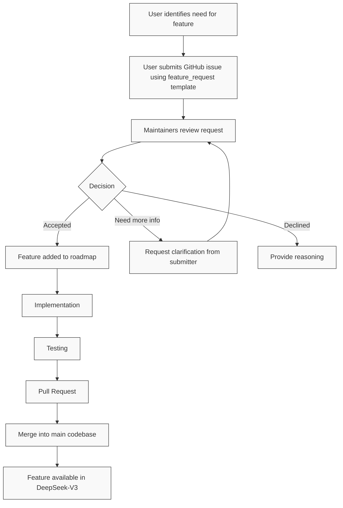
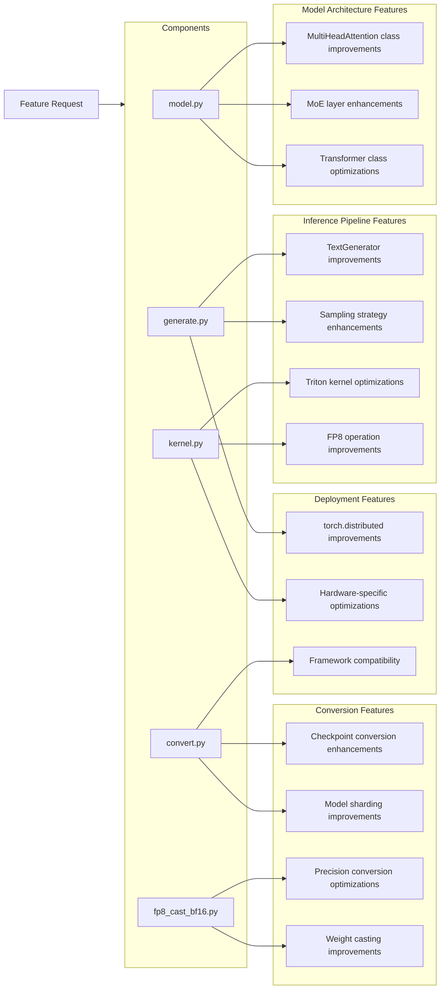
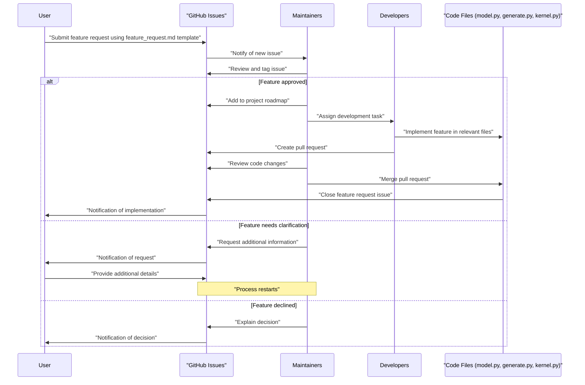

<!-- source: DeepWiki mcp.deepwiki.com · repo deepseek-ai/DeepSeek-V3 · page 8.2 Feature Requests · fetched 2026-10-30 -->

# Feature Requests

Relevant source files

The following files were used as context for generating this wiki page:

- [.github/ISSUE_TEMPLATE/bug_report.md](.github/ISSUE_TEMPLATE/bug_report.md)
- [.github/ISSUE_TEMPLATE/feature_request.md](.github/ISSUE_TEMPLATE/feature_request.md)

This document outlines the process for submitting feature requests to the DeepSeek-V3 project. Feature requests allow users and contributors to suggest improvements, enhancements, or new capabilities for the DeepSeek-V3 model, its inference pipeline, or deployment options. For information about reporting bugs, see [Bug Reports](#7.1).

## What Is a Feature Request?

A feature request is a formal suggestion for enhancing DeepSeek-V3's functionality, performance, or usability. Feature requests may address any component of the system, including but not limited to:

- Model architecture enhancements
- New inference optimizations
- Additional deployment platforms
- Improved API functionality
- Documentation improvements
- New tools or utilities

## Submitting a Feature Request

DeepSeek-V3 uses GitHub Issues for feature request tracking. To submit a feature request, follow these steps:

1. Navigate to the [DeepSeek-V3 repository](https://github.com/deepseek-ai/DeepSeek-V3)
2. Click on "Issues" tab
3. Click on "New Issue"
4. Select the "Feature request" template
5. Complete the template with your suggestion details
6. Submit the issue

The feature request template is structured to gather specific information about your suggestion.

Sources: [.github/ISSUE_TEMPLATE/feature_request.md:1-21]()

## Feature Request Guidelines

When submitting a feature request, please provide thorough information using the template structure. An effective feature request includes:

### Problem Description

Clearly articulate the problem that your feature would solve. This helps maintainers understand the motivation behind your request. The template asks: "Is your feature request related to a problem? Please describe."

Example:
- "The current `kernel.py` Triton implementations don't support AMD GPUs with optimal performance, which limits accessibility."
- "Converting between weight formats in `fp8_cast_bf16.py` requires multiple steps, making the process cumbersome."

### Proposed Solution

Describe your proposed feature or enhancement in detail. Be specific about what you want to happen and how it would function within the existing codebase. The template asks: "Describe the solution you'd like."

Example:
- "Add ROCm-optimized Triton kernels in `kernel.py` to improve inference speed for AMD GPUs."
- "Create a unified weight conversion utility in `convert.py` that supports multiple formats in a single operation."

### Alternatives Considered

Mention any alternative approaches you've thought about. This demonstrates that you've thoroughly considered the problem space and helps maintainers evaluate different options. The template asks: "Describe alternatives you've considered."

### Additional Context

Provide any other relevant information, such as:
- Technical specifications
- Performance expectations
- Use cases that would benefit from this feature
- References to similar implementations in other projects
- Specific code files or functions that would be affected

Sources: [.github/ISSUE_TEMPLATE/feature_request.md:10-20]()

## Feature Request Lifecycle

The following diagram illustrates the typical lifecycle of a feature request:

Sources: [.github/ISSUE_TEMPLATE/feature_request.md:1-21]()

## Feature Request Integration with DeepSeek-V3 Components

This diagram illustrates how feature requests map to actual code files in the DeepSeek-V3 codebase:

Sources: [.github/ISSUE_TEMPLATE/feature_request.md:1-21]()

## Examples of Feature Request Categories

| Category | Example Feature Requests | Related Code Files |
|----------|---------------------------|-------------------|
| **Model Enhancement** | Specialized domain adaptation for medical use cases | `model.py`, `Transformer` class |
| **Inference Optimization** | Improved batching for heterogeneous input sequences | `generate.py`, `TextGenerator` class |
| **Memory Efficiency** | Reduced VRAM usage during inference | `kernel.py`, FP8 quantization functions |
| **New Hardware Support** | Support for Intel GPUs | `kernel.py`, Triton kernel implementations |
| **Integration** | Native integration with downstream frameworks | `convert.py`, checkpoint conversion utilities |
| **Performance Monitoring** | Built-in profiling and benchmarking tools | `generate.py`, inference pipeline |
| **Usability** | Simplified model configuration and parameter tuning | Configuration loading, model initialization |
| **Weight Conversion** | Enhanced FP8 to BF16 conversion utilities | `fp8_cast_bf16.py`, weight casting functions |

Sources: [.github/ISSUE_TEMPLATE/feature_request.md:1-21]()

## Review Criteria for Feature Requests

The DeepSeek-V3 team evaluates feature requests based on several criteria:

1. **Alignment with project goals**: How well the feature aligns with the core objectives of DeepSeek-V3
2. **Technical feasibility**: Whether the feature can be implemented within the current architecture
3. **Development effort**: Estimated time and resources required for implementation
4. **Community benefit**: Number of users who would benefit from the feature
5. **Maintenance impact**: Long-term maintenance considerations

## Best Practices for Feature Request Submission

To maximize the chances of your feature request being accepted:

1. **Research first**: Check if the feature has been previously requested or is already planned
2. **Be specific**: Clearly define what you want and why it's valuable
3. **Technical context**: Provide relevant technical details about implementation if you have them
4. **Use cases**: Include concrete examples of how the feature would be used
5. **Start small**: Consider breaking large feature requests into smaller, more manageable components

## Feature Request to Code Implementation Process

Sources: [.github/ISSUE_TEMPLATE/feature_request.md:1-21]()

## Conclusion

Feature requests are an important mechanism for the ongoing improvement and development of DeepSeek-V3. By following the guidelines and process outlined in this document, you can effectively contribute to the evolution of the project. Your thoughtful suggestions help make DeepSeek-V3 more versatile, performant, and useful for the entire community.

---

