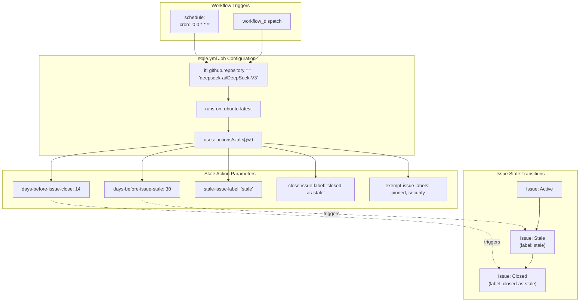
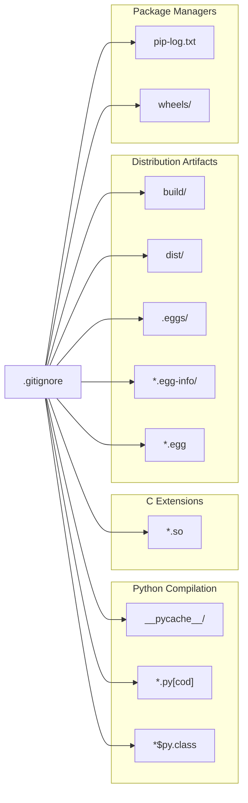
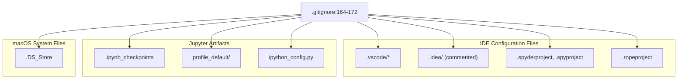

<!-- source: DeepWiki mcp.deepwiki.com · repo deepseek-ai/DeepSeek-V3 · page 8.3 Development Workflow · fetched 2026-10-30 -->

# Development Workflow

Relevant source files

The following files were used as context for generating this wiki page:

- [.github/workflows/stale.yml](.github/workflows/stale.yml)
- [.gitignore](.gitignore)

This document covers the development workflow practices in the DeepSeek-V3 repository, including automated issue management, repository hygiene through `.gitignore` patterns, and development environment conventions. For information about submitting bug reports, see [Bug Reports](#8.1). For guidance on feature requests, see [Feature Requests](#8.2).

The repository follows standard Python development practices with automated GitHub Actions workflows for issue management and comprehensive ignore patterns to maintain a clean working directory.

## Automated Issue Management

The repository implements automated issue management through GitHub Actions to maintain repository health and manage community contributions. The workflow file `.github/workflows/stale.yml` defines the automation behavior.

### Stale Issue Workflow

The workflow uses `actions/stale@v9` to manage inactive issues with a two-stage process:

1. **Stale Marking**: Issues are marked stale after 30 days of inactivity
2. **Issue Closure**: Stale issues are automatically closed after 14 additional days

**Stale Issue Workflow: Code Entity Mapping**

Sources: [.github/workflows/stale.yml:1-31]()

### Workflow Configuration

The workflow configuration in `.github/workflows/stale.yml` defines the following parameters:

| Parameter | Value | Description | Line Reference |
|-----------|-------|-------------|----------------|
| `days-before-issue-stale` | 30 | Days of inactivity before stale marking | [.github/workflows/stale.yml:15]() |
| `days-before-issue-close` | 14 | Days after stale before auto-close | [.github/workflows/stale.yml:16]() |
| `stale-issue-label` | "stale" | Label applied to stale issues | [.github/workflows/stale.yml:17]() |
| `close-issue-label` | "closed-as-stale" | Label applied when closing | [.github/workflows/stale.yml:18]() |
| `exempt-issue-labels` | "pinned", "security" | Labels that prevent stale marking | [.github/workflows/stale.yml:19-21]() |
| `days-before-pr-stale` | -1 | Pull request stale detection disabled | [.github/workflows/stale.yml:28]() |
| `days-before-pr-close` | -1 | Pull request auto-close disabled | [.github/workflows/stale.yml:29]() |

The workflow runs on a daily schedule (`cron: "0 0 * * *"`) and can be manually triggered via `workflow_dispatch`. The repository check (`github.repository == 'deepseek-ai/DeepSeek-V3'`) ensures the workflow only executes on the official repository, not on forks.

Sources: [.github/workflows/stale.yml:2-30]()

### Stale Message Template

When an issue is marked stale, the workflow posts the following message defined in `stale-issue-message`:

> "This issue has been automatically marked as stale because it has not had recent activity. It will be closed if no further activity occurs. If you believe this issue is still relevant, please leave a comment to keep it open. Thank you for your contributions!"

No message is posted when closing stale issues (`close-issue-message: false`), only the `closed-as-stale` label is applied.

Sources: [.github/workflows/stale.yml:22-27]()

## Repository Hygiene Practices

The repository maintains a clean working directory through comprehensive `.gitignore` patterns. The configuration follows Python development best practices and excludes build artifacts, dependencies, IDE files, and temporary files.

### Ignored File Categories

The `.gitignore` file defines seven major categories of excluded files:

**Python Build and Runtime Artifacts**

Sources: [.gitignore:1-27]()

| Pattern Category | Examples | Lines |
|-----------------|----------|-------|
| Python bytecode | `__pycache__/`, `*.py[cod]`, `*$py.class` | [.gitignore:2-4]() |
| C extensions | `*.so` | [.gitignore:7]() |
| Build artifacts | `build/`, `dist/`, `*.egg-info/` | [.gitignore:10-27]() |
| Test coverage | `.coverage`, `.pytest_cache/`, `htmlcov/` | [.gitignore:39-52]() |
| Documentation | `docs/_build/`, `/site` | [.gitignore:72-147]() |

### Virtual Environment Patterns

The repository supports multiple Python environment management tools:

| Tool | Ignored Patterns | Lines |
|------|-----------------|-------|
| `venv` | `.venv`, `venv/`, `ENV/`, `env.bak/` | [.gitignore:130-137]() |
| `pipenv` | `Pipfile.lock` (commented) | [.gitignore:90-95]() |
| `poetry` | `poetry.lock` (commented) | [.gitignore:103-108]() |
| `pdm` | `.pdm.toml`, `.pdm-python`, `.pdm-build/` | [.gitignore:110-118]() |
| `uv` | `uv.lock` (commented) | [.gitignore:97-101]() |

Sources: [.gitignore:90-137]()

### IDE and Editor Configurations

**IDE File Exclusions: Code Entity Mapping**

Sources: [.gitignore:79-172]()

The repository explicitly ignores:
- **VS Code**: `.vscode/*` directory ([.gitignore:170]())
- **PyCharm**: `.idea/` directory (commented out, available if needed) ([.gitignore:164-168]())
- **Jupyter**: `.ipynb_checkpoints` ([.gitignore:79]())
- **macOS**: `.DS_Store` files ([.gitignore:172]())

### Development Environment Patterns

The `.gitignore` configuration reveals standard Python development patterns:

1. **Package Management**: Supports modern tools (`pdm`, `uv`, `poetry`) with lock files commented out, suggesting flexibility in dependency management approaches

2. **Testing Infrastructure**: Excludes coverage reports (`.coverage*`, `htmlcov/`), test caches (`.pytest_cache/`), and framework-specific artifacts (`.tox/`, `.nox/`)

3. **Type Checking**: Ignores type checker outputs (`.mypy_cache/`, `.pytype/`, `.pyre/`)

4. **Environment Variables**: Excludes `.env` files to prevent credential leakage

Sources: [.gitignore:39-161]()

## Development Process Integration

The stale issue workflow represents a broader development philosophy focused on maintaining an active and responsive community repository. This automation serves several development workflow purposes:

1. **Issue Triage**: Automatically identifies issues that may no longer be relevant
2. **Community Engagement**: Provides opportunities for contributors to reactivate important issues
3. **Repository Health**: Maintains a clean issue tracker focused on active development needs
4. **Resource Management**: Reduces manual maintenance overhead for maintainers

The workflow's exemption system for `pinned` and `security` labels ensures that critical issues remain protected from automatic closure, maintaining focus on important development priorities.

Sources: [.github/workflows/stale.yml:19-21]()

---

