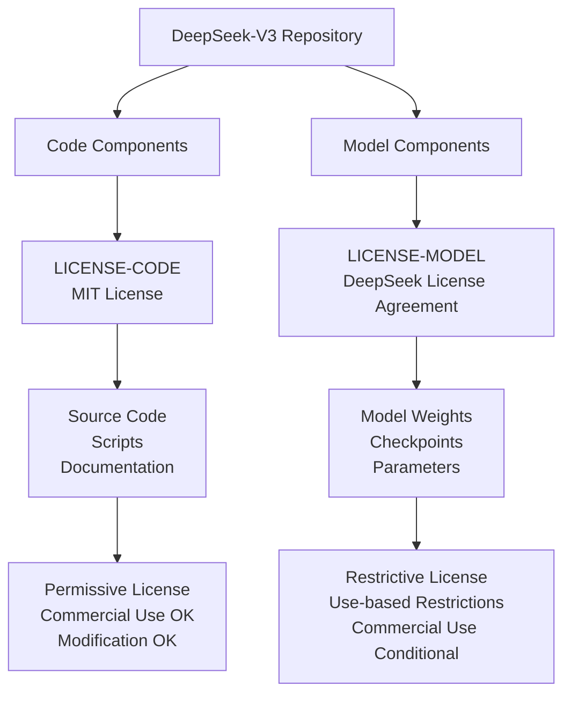
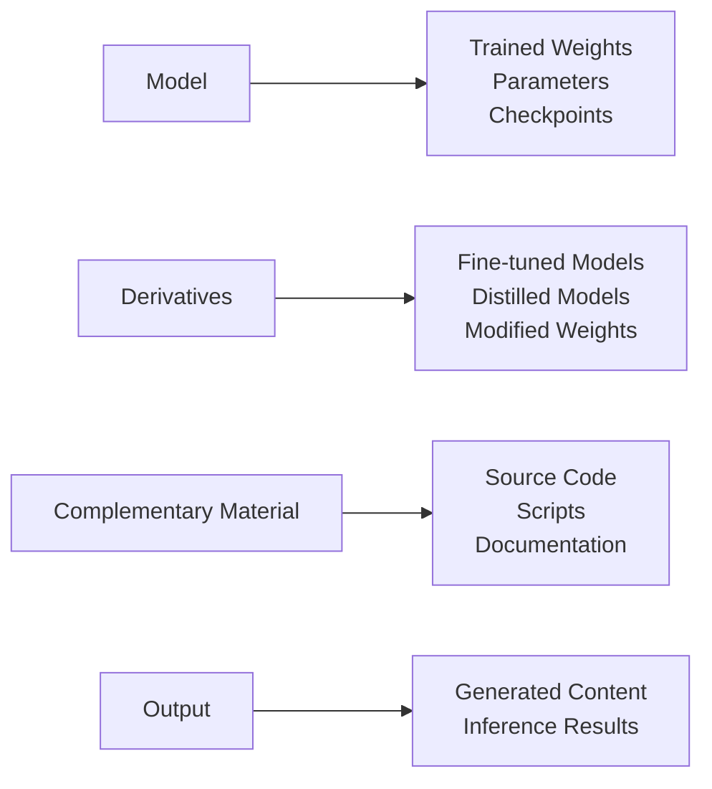
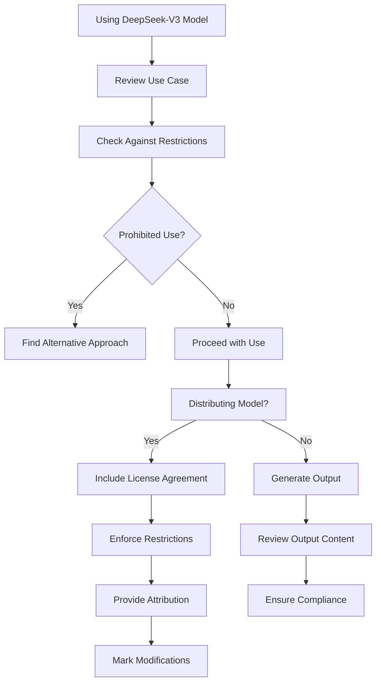

<!-- source: DeepWiki mcp.deepwiki.com · repo deepseek-ai/DeepSeek-V3 · page 9 License Information · fetched 2026-10-30 -->

# License Information

Relevant source files

The following files were used as context for generating this wiki page:

- [LICENSE-CODE](LICENSE-CODE)
- [LICENSE-MODEL](LICENSE-MODEL)

This document provides comprehensive information about the licensing terms for the DeepSeek-V3 repository. The repository uses a dual licensing structure with separate licenses for code and model components.

## Dual Licensing Structure

The DeepSeek-V3 repository implements a dual licensing approach to accommodate the different nature of software code and machine learning model weights:

**Sources:** [LICENSE-CODE:1-21](), [LICENSE-MODEL:1-91]()

## Code License (MIT)

The software components of the DeepSeek-V3 repository are licensed under the MIT License, as specified in `LICENSE-CODE`. This is a permissive open-source license that grants broad usage rights.

### Permissions Granted

| Permission | Status | Description |
|------------|--------|-------------|
| **Commercial Use** | ✅ Allowed | Software can be used for commercial purposes |
| **Modification** | ✅ Allowed | Code can be modified and distributed |
| **Distribution** | ✅ Allowed | Code can be distributed freely |
| **Private Use** | ✅ Allowed | Code can be used privately |
| **Sublicensing** | ✅ Allowed | Code can be sublicensed |

### Requirements

The MIT License requires:
- **Copyright Notice**: Include the original copyright notice in all copies
- **License Notice**: Include the license text in all copies or substantial portions

### Covered Components

The MIT License applies to all software components including:
- Python source code files (`*.py`)
- Configuration files
- Documentation and examples
- Build scripts and utilities
- GitHub workflow files

**Sources:** [LICENSE-CODE:5-10](), [LICENSE-CODE:12-13]()

## Model License (DeepSeek License Agreement)

The model weights and related assets are governed by the DeepSeek License Agreement v1.0, a custom license designed for responsible AI deployment.

### Key Definitions

**Sources:** [LICENSE-MODEL:25-27](), [LICENSE-MODEL:24](), [LICENSE-MODEL:27]()

### Intellectual Property Rights

The model license grants both copyright and patent rights:

- **Copyright License**: Perpetual, worldwide, non-exclusive, royalty-free license to reproduce, display, perform, sublicense, and distribute the model
- **Patent License**: License to make, use, sell, import, and transfer the model, with patent litigation termination clause

### Use-Based Restrictions

The model license includes specific prohibited uses outlined in Attachment A:

| Restriction Category | Description |
|---------------------|-------------|
| **Legal Compliance** | Cannot violate applicable laws or infringe third-party rights |
| **Military Use** | No military applications permitted |
| **Minor Protection** | Cannot exploit or harm minors |
| **Misinformation** | Cannot generate false information to harm others |
| **Privacy Violations** | Cannot generate unauthorized personal information |
| **Harassment** | Cannot defame, disparage, or harass others |
| **Automated Decisions** | Cannot make automated decisions affecting legal rights |
| **Discrimination** | Cannot discriminate based on protected characteristics |

**Sources:** [LICENSE-MODEL:81-91]()

### Distribution Requirements

When distributing the model or derivatives, you must:

1. **Include License**: Provide copy of DeepSeek License Agreement to recipients
2. **Enforce Restrictions**: Include use-based restrictions in any licensing agreements
3. **Attribution**: Retain all copyright, patent, and attribution notices
4. **Modification Notice**: Mark any modified files with prominent notices

**Sources:** [LICENSE-MODEL:44-49]()

## License Comparison

| Aspect | Code License (MIT) | Model License (DeepSeek) |
|--------|-------------------|-------------------------|
| **Type** | Permissive Open Source | Custom Restrictive |
| **Commercial Use** | ✅ Unrestricted | ⚠️ With restrictions |
| **Modification** | ✅ Allowed | ✅ Allowed with conditions |
| **Distribution** | ✅ Minimal requirements | ❌ Extensive requirements |
| **Use Restrictions** | ❌ None | ✅ Comprehensive list |
| **Patent Grant** | ❌ No | ✅ Yes |
| **Liability** | ❌ Disclaimed | ❌ Disclaimed |

## Compliance Guidelines

### For Code Components

To comply with the MIT License:
1. Include the copyright notice from `LICENSE-CODE` in all distributions
2. Include the full license text in all substantial portions
3. No additional restrictions on usage

### For Model Components

To comply with the DeepSeek License Agreement:

**Sources:** [LICENSE-MODEL:51](), [LICENSE-MODEL:44-49]()

### Repository Structure Impact

The dual licensing affects different parts of the repository:

| Component | License | File Examples |
|-----------|---------|---------------|
| **Inference Code** | MIT | `inference/generate.py`, `inference/model.py` |
| **Conversion Tools** | MIT | `inference/convert.py`, `inference/fp8_cast_bf16.py` |
| **Model Weights** | DeepSeek | `*.safetensors`, checkpoint files |
| **Documentation** | MIT | `README.md`, wiki pages |
| **Kernels** | MIT | `inference/kernel.py` |

### Legal Considerations

- **No Legal Advice**: This documentation does not constitute legal advice
- **Governing Law**: Model license governed by PRC law with exclusive jurisdiction in Hangzhou
- **Updates**: DeepSeek reserves right to restrict model usage remotely
- **Personal Information**: Users responsible for compliance with data protection laws

**Sources:** [LICENSE-MODEL:71](), [LICENSE-MODEL:57](), [LICENSE-MODEL:61]()

## Summary

The DeepSeek-V3 repository's dual licensing structure reflects the different considerations for software and AI model deployment. The MIT License provides maximum flexibility for the codebase, while the DeepSeek License Agreement ensures responsible use of the model weights through comprehensive use-based restrictions. Users must comply with both licenses when working with the complete system.

**Sources:** [LICENSE-CODE:1-21](), [LICENSE-MODEL:1-91]()