# Page: Overview

# Overview

<details>
<summary>Relevant source files</summary>

The following files were used as context for generating this wiki page:

- [README.md](README.md)

</details>


DeepSeek-V3 is a Mixture-of-Experts (MoE) language model with 671B total parameters and 37B activated per token, designed to achieve performance comparable to leading closed-source models while maintaining efficient training and inference. This repository provides the inference implementation, weight conversion utilities, and integration guides for deploying DeepSeek-V3 across various hardware platforms.

## What is DeepSeek-V3?

DeepSeek-V3 represents a significant advancement in open-source large language models, combining architectural innovations with cost-effective training methodologies. The model was pre-trained on 14.8 trillion tokens using FP8 mixed precision (requiring 2.664M H800 GPU hours), followed by supervised fine-tuning, reinforcement learning, and knowledge distillation from DeepSeek-R1 (0.1M GPU hours). Two model variants are available:

- **DeepSeek-V3-Base**: Pre-trained foundation model (671B parameters)
- **DeepSeek-V3**: Chat-optimized model with Multi-Token Prediction module (671B + 14B MTP)

The model supports a 128K token context window and demonstrates state-of-the-art performance across code generation, mathematical reasoning, and multilingual tasks. Notably, the training process exhibited remarkable stability with no irrecoverable loss spikes or rollbacks throughout the entire training pipeline.

Sources: [README.md:45-54](), [README.md:91-99]()

## Key Architectural Innovations

DeepSeek-V3 builds upon four core innovations that differentiate it from previous large language models:

**1. Multi-head Latent Attention (MLA)**
- Reduces key-value cache memory requirements through latent projection
- Implements low-rank compression with separate LoRA ranks for queries (1536) and key-values (512)
- Uses hybrid RoPE (Rotary Position Embedding) and NOPE (No Position Embedding) for position encoding
- Implementation located in attention layers within [inference/model.py]()

**2. DeepSeekMoE Architecture**
- 256 experts per MoE layer with 8 experts activated per token
- Auxiliary-loss-free load balancing strategy using sigmoid-based routing with expert grouping
- Hybrid layer structure: 3 dense layers (layers 0-2) followed by 58 MoE layers (layers 3-60)
- Router uses `route_scale` parameter (2.5) with 8 expert groups for balanced computation
- Implementation in `DecoderLayer` and expert routing logic in [inference/model.py]()

**3. Multi-Token Prediction (MTP)**
- 14B parameter module that predicts multiple future tokens simultaneously
- Enables speculative decoding for inference acceleration
- Trained as an auxiliary objective alongside next-token prediction
- MTP weights stored separately and share embeddings with main model
- Module structure documented in `README_WEIGHTS.md`

**4. FP8 Mixed Precision Training and Inference**
- Native FP8 (UE8M0 format) training framework validated at extreme scale
- Block-wise quantization with 128×128 block scaling factors (`weight_scale_inv`)
- Optimized Triton kernels for quantization (`act_quant`), dequantization (`weight_dequant`), and matrix multiplication (`fp8_gemm`)
- Kernel implementations in [inference/kernel.py]()

These innovations collectively enable DeepSeek-V3 to achieve 671B total parameters with only 37B activation per token, significantly reducing computational costs while maintaining strong performance.

Sources: [README.md:63-67](), [README.md:48-49](), [README.md:73-76]()

## Repository Structure and Components

**DeepSeek-V3 Codebase Organization**

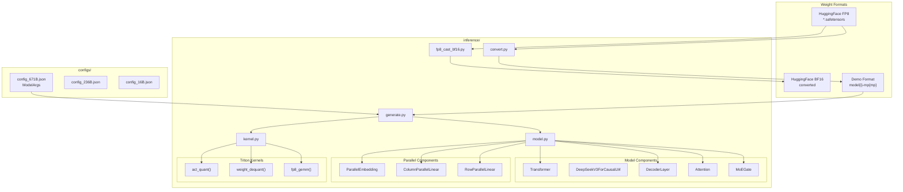

The repository is organized into three primary layers:

**Core Model Implementation** ([inference/model.py]())
- `Transformer`: Main model class with 61 layers (3 dense + 58 MoE)
- `DeepSeekV3ForCausalLM`: CausalLM wrapper for generation tasks
- `DecoderLayer`: Transformer decoder block containing attention and FFN/MoE
- `Attention`: MLA implementation with LoRA compression and hybrid position encoding
- `MoEGate`: Sigmoid-based expert routing with auxiliary-loss-free balancing

**Distributed Parallel Components** ([inference/model.py]())
- `ParallelEmbedding`: Vocabulary-partitioned embedding layer with all-reduce aggregation
- `ColumnParallelLinear`: Output-feature partitioned linear layer (used for `wq`, `w1`, `w3`)
- `RowParallelLinear`: Input-feature partitioned linear layer with all-reduce (used for `wo`, `w2`)

**FP8 Optimization Kernels** ([inference/kernel.py]())
- `act_quant(input, scale)`: Block-wise activation quantization to FP8
- `weight_dequant(weight, scale_inv)`: Weight dequantization with 128×128 block scaling
- `fp8_gemm(a, b, scale_a, scale_b)`: Fused FP8 matrix multiplication with autotuning

**Weight Conversion and Generation Utilities**
- `convert.py`: Transforms HuggingFace weights to model-parallel sharded format for distributed inference
- `fp8_cast_bf16.py`: Converts native FP8 weights to BF16 for frameworks requiring higher precision
- `generate.py`: Entry point for text generation with `torchrun` distributed execution

**Configuration Files** ([inference/configs/]())
- `config_671B.json`: ModelArgs for the full 671B model (128 attention heads, 256 experts)
- `config_236B.json`: Configuration for the 236B variant
- `config_16B.json`: Configuration for the 16B variant

Sources: [README.md:240-248](), [README.md:285-297]()

## Training to Deployment Lifecycle

**DeepSeek-V3 Development Pipeline**

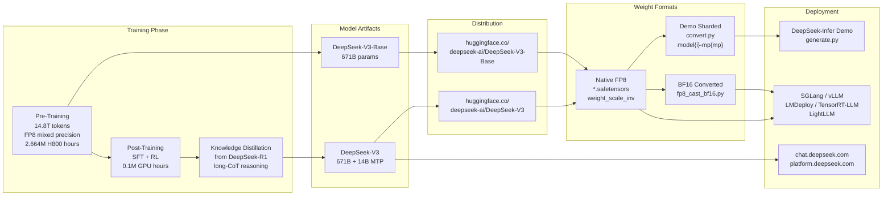

DeepSeek-V3 progresses through a multi-stage training pipeline before deployment:

**Training Stages:**
1. **Pre-Training** (2.664M H800 GPU hours): Model trained on 14.8 trillion diverse tokens using FP8 mixed precision framework with auxiliary-loss-free MoE load balancing
2. **Post-Training** (0.1M GPU hours): Supervised fine-tuning and reinforcement learning to align model behavior
3. **Knowledge Distillation**: Transfer of long Chain-of-Thought reasoning capabilities from DeepSeek-R1 series models, incorporating verification and reflection patterns

**Model Variants:**
- **DeepSeek-V3-Base**: Foundation model from pre-training (671B parameters)
- **DeepSeek-V3**: Chat-optimized model with MTP module (671B + 14B = 685B total)

**Weight Distribution:**
Models are distributed via HuggingFace in native FP8 format as `*.safetensors` files with `weight_scale_inv` metadata. Users can convert to BF16 using [inference/fp8_cast_bf16.py]() or shard for distributed inference using [inference/convert.py]().

**Deployment Options:**
- **Reference Implementation**: DeepSeek-Infer Demo with [inference/generate.py]() for multi-node execution via `torchrun`
- **Community Frameworks**: SGLang, vLLM, LMDeploy, TensorRT-LLM, LightLLM with varying FP8/BF16/quantization support
- **Official Platforms**: chat.deepseek.com (web interface) and platform.deepseek.com (OpenAI-compatible API)

Sources: [README.md:71-82](), [README.md:91-103](), [README.md:223-226]()

## Model Configuration and Parameters

The model architecture is configured through `ModelArgs` dataclass in [inference/model.py]() and instantiated via JSON configuration files. The 671B model uses the following key parameters:

| **Parameter Category** | **Configuration** | **Value** |
|------------------------|-------------------|-----------|
| **Model Scale** | `dim` | 7,168 |
| | `n_layers` | 61 (3 dense + 58 MoE) |
| | `n_heads` | 128 |
| | Total parameters | 671B |
| | Activated per token | 37B |
| **Vocabulary** | `vocab_size` | 129,280 tokens |
| **Context** | `max_seq_len` | 128K tokens |
| **MoE Settings** | `n_routed_experts` | 256 |
| | `n_expert_per_token` | 8 |
| | `first_k_dense_replace` | 3 |
| | `n_group` | 8 |
| | `route_scale` | 2.5 |
| **MLA Settings** | `q_lora_rank` | 1,536 |
| | `kv_lora_rank` | 512 |
| | `qk_nope_head_dim` | 128 |
| | `qk_rope_head_dim` | 64 |
| | `v_head_dim` | 128 |
| **Quantization** | `weight_bits` | 8 (FP8) |
| | Quantization format | UE8M0 |
| | Block size | 128×128 |

**Layer Structure:**
- Layers 0-2: Dense FFN with `intermediate_size` = 18,432
- Layers 3-60: MoE with 256 experts, 8 active per token
- Each MoE expert has same dimensions as dense FFN

The configuration is loaded from [inference/configs/config_671B.json]() and passed to the `Transformer` class constructor. Other model sizes (16B, 236B) use different configurations with adjusted layer counts and expert numbers.

Sources: [README.md:91-99](), [README.md:112-149]()

## Distributed Inference Architecture

**Multi-GPU Execution with PyTorch Distributed**

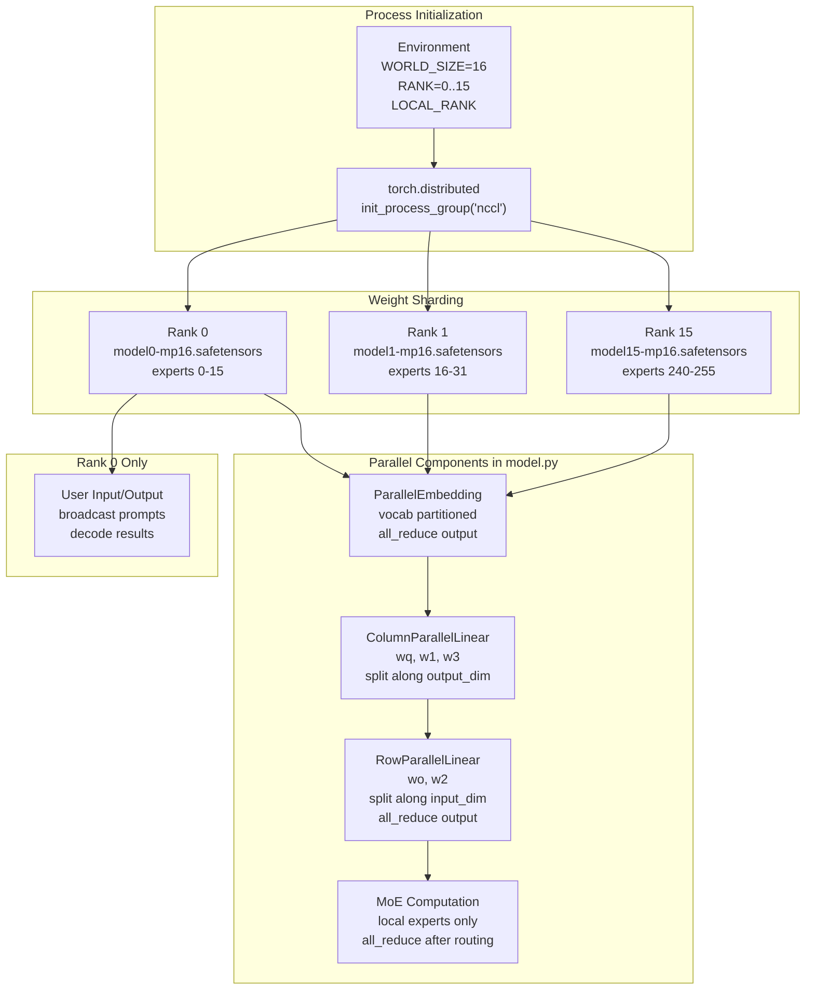

DeepSeek-V3 uses PyTorch Distributed (NCCL backend) for multi-GPU and multi-node inference. The [inference/convert.py]() script shards weights across ranks with `--model-parallel N`, creating `model{i}-mp{N}.safetensors` files where each rank loads its shard.

**Parallel Layer Types:**

**`ParallelEmbedding`** ([inference/model.py]())
- Vocabulary partitioned: each rank holds `vocab_size / world_size` embeddings
- Forward pass performs local embedding lookup, then `all_reduce` to combine results
- Used for token embeddings at model input

**`ColumnParallelLinear`** ([inference/model.py]())
- Output features split across ranks: `output_dim / world_size` per rank
- No collective communication during forward pass
- Used for query (`wq`), gate (`w1`), up (`w3`) projections in attention and FFN

**`RowParallelLinear`** ([inference/model.py]())
- Input features split across ranks: `input_dim / world_size` per rank
- Forward pass applies local linear transformation, then `all_reduce` to sum partial results
- Used for output (`wo`) and down (`w2`) projections

**MoE Expert Distribution:**
- 256 total experts divided evenly: `n_experts / world_size` per rank
- Each rank stores and computes only its local expert subset
- Router computes scores for all 256 experts but only forwards to local experts
- `all_reduce` aggregates expert outputs across ranks

**Execution Flow:**
1. Rank 0 reads input and broadcasts prompts via `dist.broadcast_object_list()`
2. All ranks execute forward pass using local weights and parallel layers
3. Collective operations (`all_reduce`) synchronize intermediate results
4. Rank 0 decodes output tokens and prints results

Example command for 2-node, 16-GPU inference:
```bash
torchrun --nnodes 2 --nproc-per-node 8 --node-rank $RANK --master-addr $ADDR \
  generate.py --ckpt-path /path/to/DeepSeek-V3-Demo --config configs/config_671B.json \
  --interactive --temperature 0.7
```

Sources: [README.md:285-303]()

## Deployment Framework Ecosystem

DeepSeek-V3 supports deployment through multiple inference frameworks, each offering different optimizations and hardware support:

| **Framework** | **Precision** | **Hardware** | **Key Optimizations** | **Status** |
|---------------|---------------|--------------|----------------------|------------|
| **DeepSeek-Infer Demo** | FP8, BF16 | NVIDIA GPUs | Reference implementation with [inference/generate.py]() | ✅ Available |
| **SGLang** | FP8 W8A8, BF16 | NVIDIA, AMD GPUs | MLA optimizations, DP Attention, Torch Compile, multi-node TP | ✅ Full support |
| **LMDeploy** | FP8, BF16 | NVIDIA GPUs, Huawei Ascend NPU | PyTorch integration, flexible local/cloud deployment | ✅ Available |
| **TensorRT-LLM** | BF16, INT4/INT8 | NVIDIA GPUs | Weight-only quantization, custom NVIDIA branch | ✅ Available (FP8 coming soon) |
| **vLLM** | FP8, BF16 | NVIDIA, AMD GPUs | Pipeline parallelism for multi-machine deployment | ✅ Available |
| **LightLLM** | FP8/BF16 mixed | NVIDIA GPUs | Single/multi-node tensor parallelism | ✅ Available |

**Reference Implementation Usage:**

The DeepSeek-Infer Demo provides a lightweight reference for deploying the model:

1. **Weight Conversion** ([inference/convert.py]()):
```bash
python convert.py --hf-ckpt-path /path/to/DeepSeek-V3 \
  --save-path /path/to/DeepSeek-V3-Demo \
  --n-experts 256 --model-parallel 16
```
This shards HuggingFace weights into `model{i}-mp16.safetensors` files for 16-way model parallelism.

2. **Interactive Generation** ([inference/generate.py]()):
```bash
torchrun --nnodes 2 --nproc-per-node 8 --node-rank $RANK --master-addr $ADDR \
  generate.py --ckpt-path /path/to/DeepSeek-V3-Demo \
  --config configs/config_671B.json --interactive --temperature 0.7
```

3. **Batch Inference** ([inference/generate.py]()):
```bash
torchrun --nnodes 2 --nproc-per-node 8 --node-rank $RANK --master-addr $ADDR \
  generate.py --ckpt-path /path/to/DeepSeek-V3-Demo \
  --config configs/config_671B.json --input-file prompts.txt
```

**FP8 to BF16 Conversion:**

For frameworks requiring BF16 precision, use [inference/fp8_cast_bf16.py]():
```bash
python fp8_cast_bf16.py --input-fp8-hf-path /path/to/fp8_weights \
  --output-bf16-hf-path /path/to/bf16_weights
```
This dequantizes FP8 weights using `weight_dequant()` from [inference/kernel.py]() and saves as BF16 safetensors.

**Official Platforms:**
- Web Interface: [chat.deepseek.com](https://chat.deepseek.com)
- API Service: [platform.deepseek.com](https://platform.deepseek.com) (OpenAI-compatible)

Sources: [README.md:227-341](), [README.md:240-248]()

## Performance and Capabilities

DeepSeek-V3 demonstrates strong performance across a wide range of benchmarks, particularly excelling in areas like mathematics, code generation, and reasoning tasks. It offers a 128K token context window, allowing it to process and reason over very long inputs.

The model's performance is comparable to leading closed-source models while being fully open-source. For detailed benchmark results and comparisons, see [Benchmarks and Evaluations](#1.3).

Sources: [README.md:107-161]()

---

# Page: Features and Capabilities

# Features and Capabilities

<details>
<summary>Relevant source files</summary>

The following files were used as context for generating this wiki page:

- [README.md](README.md)

</details>


This page details the functional capabilities and specifications of DeepSeek-V3, including model variants, supported tasks, performance characteristics, and deployment options. For architectural details about MLA, MoE, and MTP, see [Model Architecture Overview](#1.2). For comprehensive benchmark results, see [Benchmarks and Evaluations](#1.3). For deployment instructions, see [Local Deployment Options](#2.2).

## Model Variants and Specifications

DeepSeek-V3 is available in two primary variants, both based on a Mixture-of-Experts (MoE) architecture with 671 billion total parameters and 37 billion activated parameters per token.

### Available Models

| Model | Total Parameters | Activated Parameters | Context Length | Additional Modules | Total Storage |
|-------|-----------------|---------------------|----------------|-------------------|---------------|
| DeepSeek-V3-Base | 671B | 37B | 128K tokens | - | 671B |
| DeepSeek-V3 (Chat) | 671B | 37B | 128K tokens | 14B MTP | 685B |

**Sources:** [README.md:91-99]()

### Core Architecture Components

The following diagram maps the high-level capabilities to their concrete implementations in the codebase:

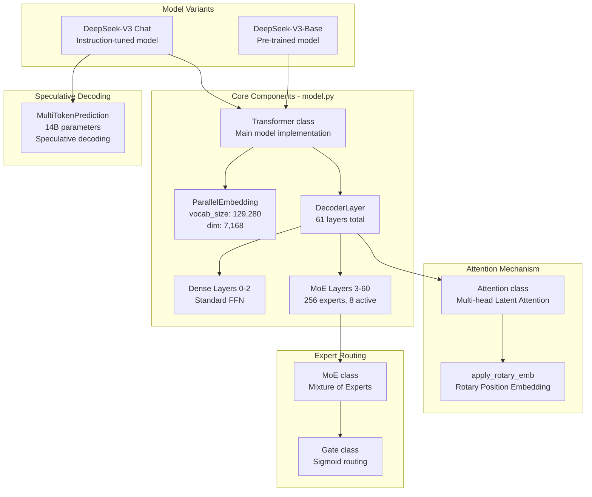

**Sources:** [README.md:47-51](), [README.md:91-99]()

### Parameter Configuration

The model uses `ModelArgs` configuration defined in [inference/model.py]() to specify all architectural parameters:

| Configuration Parameter | Value | Description |
|------------------------|-------|-------------|
| `dim` | 7,168 | Hidden dimension |
| `n_layers` | 61 | Total transformer layers |
| `n_dense_layers` | 3 | Dense FFN layers (0-2) |
| `n_heads` | 128 | Number of attention heads |
| `n_routed_experts` | 256 | Total number of experts in MoE |
| `n_activated_experts` | 8 | Experts activated per token |
| `vocab_size` | 129,280 | Vocabulary size |
| `moe_intermediate_size` | 2,048 | Expert intermediate dimension |
| `rope_theta` | 10,000 | RoPE base frequency |
| `rope_factor` | 40 | RoPE scaling factor |
| `max_seq_len` | 131,072 | Maximum context (128K) |

**Sources:** [inference/model.py]() (ModelArgs dataclass)

## Computational Characteristics

### Activation Pattern

DeepSeek-V3 uses sparse activation to achieve computational efficiency while maintaining model capacity:

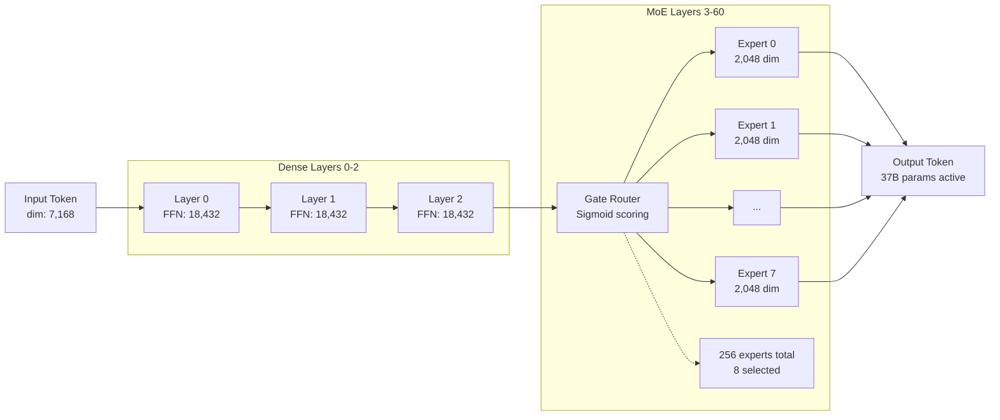

**Activation Efficiency:**
- **Total Parameters:** 671B
- **Activated per Token:** 37B (5.5% activation rate)
- **Dense Layers:** All 18,432 intermediate dimensions active
- **MoE Layers:** 8 out of 256 experts per layer (~3.1% expert activation)

**Sources:** [README.md:47](), [README.md:112-116]()

### Precision Support

The model natively supports FP8 quantization with runtime dequantization:

| Precision Mode | Native Support | Use Case | Conversion Required |
|---------------|----------------|----------|---------------------|
| FP8 (UE8M0) | ✓ Native | Production inference, training | No |
| BF16 | Via conversion | Framework compatibility | Yes ([fp8_cast_bf16.py]()) |
| INT4/INT8 | Framework-dependent | Memory-constrained deployment | Framework-specific |

**FP8 Quantization Details:**
- **Block Size:** 128×128 for weight matrices
- **Scale Format:** UE8M0 (unsigned 8-bit exponent, 0 mantissa bits)
- **Storage:** `weight_scale_inv` tensors alongside weights
- **Dequantization:** Performed by `weight_dequant` kernel in [inference/kernel.py]()

**Sources:** [README.md:240-247](), [inference/fp8_cast_bf16.py]()

## Supported Tasks and Performance

### Task Coverage

DeepSeek-V3 demonstrates strong performance across multiple domains:

```mermaid
graph TB
    Model["DeepSeek-V3<br/>671B/37B MoE"]
    
    subgraph "Code Tasks"
        HE["HumanEval<br/>Pass@1: 65.2%"]
        MBPP["MBPP<br/>Pass@1: 75.4%"]
        LCB["LiveCodeBench<br/>Pass@1: 19.4%"]
        Codeforces["Codeforces<br/>Percentile: 51.6"]
    end
    
    subgraph "Math Tasks"
        GSM8K["GSM8K<br/>EM: 89.3%"]
        MATH["MATH<br/>EM: 61.6%"]
        AIME["AIME 2024<br/>Pass@1: 39.2%"]
        CNMO["CNMO 2024<br/>Pass@1: 43.2%"]
    end
    
    subgraph "Language Tasks"
        MMLU["MMLU<br/>Acc: 87.1%"]
        BBH["BBH<br/>EM: 87.5%"]
        DROP["DROP<br/>F1: 89.0%"]
        LongBench["LongBench v2<br/>Acc: 48.7%"]
    end
    
    subgraph "Multilingual"
        CEval["C-Eval<br/>Acc: 90.1%"]
        CMMLU["CMMLU<br/>Acc: 88.8%"]
        MMMLU["MMMLU-non-English<br/>Acc: 79.4%"]
    end
    
    Model --> HE
    Model --> MBPP
    Model --> LCB
    Model --> Codeforces
    Model --> GSM8K
    Model --> MATH
    Model --> AIME
    Model --> CNMO
    Model --> MMLU
    Model --> BBH
    Model --> DROP
    Model --> LongBench
    Model --> CEval
    Model --> CMMLU
    Model --> MMMLU
```

**Sources:** [README.md:106-194]()

### Performance Characteristics

#### Base Model Performance

The Base model excels at foundational capabilities:

| Domain | Top Benchmark | Score | Comparison |
|--------|--------------|-------|------------|
| **Code** | HumanEval | 65.2% Pass@1 | Best in class vs. open-source |
| | LiveCodeBench | 19.4% Pass@1 | +25% vs. LLaMA3.1 405B |
| **Math** | MATH | 61.6% EM | +13% vs. Qwen2.5 72B |
| | GSM8K | 89.3% EM | Strong arithmetic reasoning |
| **English** | MMLU-Pro | 64.4% Acc | +10% vs. Qwen2.5 72B |
| | BBH | 87.5% EM | Superior complex reasoning |
| **Chinese** | C-Eval | 90.1% Acc | Near state-of-the-art |
| **Context** | NIAH (128K) | Near-perfect | Full 128K context utilization |

**Sources:** [README.md:112-148](), [README.md:156-161]()

#### Chat Model Performance

The Chat variant adds conversational and instruction-following capabilities:

| Domain | Top Benchmark | Score | Note |
|--------|--------------|-------|------|
| **Code** | LiveCodeBench (CoT) | 40.5% Pass@1 | Best among open-source |
| | Codeforces | 51.6 percentile | Exceeds GPT-4o (23.6) |
| | Aider-Polyglot | 49.6% Acc | Multi-language editing |
| **Math** | AIME 2024 | 39.2% Pass@1 | Near Claude-3.5 level |
| | MATH-500 | 90.2% EM | +16% vs. Qwen2.5 72B |
| **Reasoning** | MMLU-Redux | 89.1% EM | Competitive with GPT-4o |
| | GPQA-Diamond | 59.1% Pass@1 | Strong scientific reasoning |
| **Long Context** | LongBench v2 | 48.7% Acc | Best among all models |
| **Chinese** | C-SimpleQA | 64.8% Correct | +9% vs. GPT-4o |

**Sources:** [README.md:165-194]()

### Open-Ended Generation

The Chat model demonstrates strong performance in conversational settings:

| Benchmark | Score | Comparison |
|-----------|-------|------------|
| Arena-Hard | 85.5 | Best (tied with Claude-3.5) |
| AlpacaEval 2.0 (LC) | 70.0 | +18 points vs. Claude-3.5 |

**Sources:** [README.md:207-215]()

## Inference Capabilities

### Execution Modes

The model supports two primary inference modes through [inference/generate.py]():

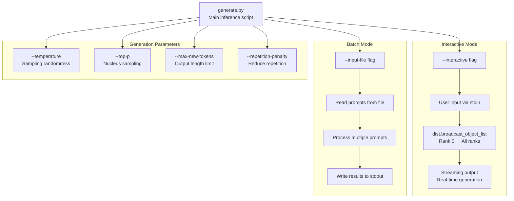

**Interactive Mode Features:**
- Real-time conversational interface
- Multi-turn dialogue support
- Distributed execution across all ranks
- Streaming token generation

**Batch Mode Features:**
- File-based input processing
- Efficient batch processing
- Suitable for evaluation and benchmarking
- Parallel generation across inputs

**Sources:** [inference/generate.py](), [README.md:293-303]()

### Distributed Inference Support

The model supports multi-node and multi-GPU deployment:

| Configuration | Command Example | Hardware Requirement |
|--------------|----------------|---------------------|
| Single-node, 8 GPUs | `torchrun --nproc-per-node 8` | 8× GPUs with ≥80GB VRAM |
| Two-node, 16 GPUs | `torchrun --nnodes 2 --nproc-per-node 8` | 2 nodes × 8 GPUs |
| Custom topology | `--node-rank $RANK --master-addr $ADDR` | Configurable |

**Parallelism Strategies:**
- **Tensor Parallelism:** Weights sharded via [inference/convert.py]()
- **Expert Parallelism:** 256 experts distributed across `world_size` ranks
- **Communication:** NCCL backend for GPU synchronization

**Sources:** [README.md:293-303]()

## Training Features

### Pre-Training Efficiency

DeepSeek-V3 was trained with unprecedented efficiency:

| Metric | Value | Significance |
|--------|-------|-------------|
| Training Data | 14.8 trillion tokens | Diverse, high-quality corpus |
| Precision | FP8 mixed precision | First large-scale FP8 training |
| GPU Hours | 2.664M H800 hours | Pre-training only |
| Training Stability | Zero rollbacks | No irrecoverable loss spikes |
| Post-Training | 0.1M GPU hours | SFT + RL stages |

**Training Innovations:**
- **FP8 Mixed Precision:** Native FP8 training framework validated at 671B scale
- **Communication Optimization:** Near-complete computation-communication overlap for cross-node MoE
- **Load Balancing:** Auxiliary-loss-free strategy minimizes performance degradation
- **Multi-Token Prediction:** MTP training objective improves model performance

**Sources:** [README.md:71-76](), [README.md:49-54]()

### Knowledge Distillation

The Chat variant incorporates advanced reasoning through distillation:

| Source Model | Target Model | Capabilities Transferred |
|-------------|--------------|------------------------|
| DeepSeek-R1 series | DeepSeek-V3 Chat | Long Chain-of-Thought reasoning |
| | | Verification patterns |
| | | Reflection capabilities |

**Distillation Benefits:**
- Improved reasoning performance on math and code tasks
- Controlled output style and length
- Maintains conversational naturalness

**Sources:** [README.md:80-82]()

## Deployment Flexibility

### Framework Support

DeepSeek-V3 integrates with six major inference frameworks, each optimized for different use cases:

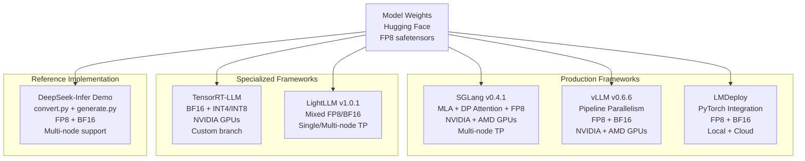

**Sources:** [README.md:229-239]()

### Framework Capabilities Matrix

| Framework | FP8 Support | BF16 Support | Multi-Node | MLA Optimized | Special Features |
|-----------|-------------|--------------|------------|---------------|-----------------|
| SGLang | ✓ | ✓ | ✓ | ✓ | DP Attention, FP8 KV Cache, Torch Compile |
| vLLM | ✓ | ✓ | ✓ (PP) | - | Pipeline parallelism, AMD GPU support |
| LMDeploy | ✓ | ✓ | ✓ | - | PyTorch workflow, cloud deployment |
| TensorRT-LLM | Coming | ✓ | ✓ | - | INT4/INT8 quantization |
| LightLLM | ✓ | ✓ | ✓ | - | Mixed precision deployment |
| Demo | ✓ | ✓ | ✓ | - | Reference implementation |

**PP** = Pipeline Parallelism

**Sources:** [README.md:232-336]()

### Hardware Support

| Hardware | Framework Support | Precision | Status |
|----------|------------------|-----------|---------|
| NVIDIA GPUs | All frameworks | FP8, BF16, INT4/INT8 | ✓ Available |
| AMD GPUs | SGLang, vLLM | FP8, BF16 | ✓ Available (Day-One) |
| Huawei Ascend NPU | MindIE | BF16, INT8 | ✓ Available |

**Sources:** [README.md:237-341]()

### Weight Conversion Utilities

The repository provides two conversion utilities:

#### Model Parallel Sharding: `convert.py`

Converts Hugging Face format to sharded format for distributed inference:

```bash
python convert.py \
  --hf-ckpt-path /path/to/DeepSeek-V3 \
  --save-path /path/to/DeepSeek-V3-Demo \
  --n-experts 256 \
  --model-parallel 16
```

**Features:**
- Parameter renaming from HuggingFace to DeepSeek format
- Expert distribution: `n_experts / model_parallel` per shard
- Weight sharding along specified dimensions
- Tokenizer copying
- Output: `model{rank}-mp{world_size}.safetensors` files

**Sources:** [README.md:285-289](), [inference/convert.py]()

#### Precision Conversion: `fp8_cast_bf16.py`

Converts native FP8 weights to BF16 for broader framework compatibility:

```bash
python fp8_cast_bf16.py \
  --input-fp8-hf-path /path/to/fp8_weights \
  --output-bf16-hf-path /path/to/bf16_weights
```

**Features:**
- Iterates through `*.safetensors` files
- Block-wise dequantization using `weight_dequant` kernel
- Updates `model.safetensors.index.json` weight map
- Preserves model structure and metadata

**Sources:** [README.md:242-247](), [inference/fp8_cast_bf16.py]()

## Multi-Token Prediction Module

The Chat variant includes a 14B parameter Multi-Token Prediction (MTP) module:

| Capability | Description | Status |
|-----------|-------------|--------|
| **Speculative Decoding** | Predicts multiple future tokens in parallel | Framework implementation pending |
| **Parameter Sharing** | Shares embeddings with main model | ✓ Implemented |
| **Weight Storage** | Separate from main 671B weights | ✓ Available on Hugging Face |
| **Training Objective** | Multi-token prediction during training | ✓ Used in training |

**MTP Benefits:**
- Potential inference acceleration through speculative decoding
- Improved model performance through auxiliary prediction task
- Parameter-efficient: 14B additional parameters (2% overhead)

**Current Status:** MTP weights are available but speculative decoding support is under development in community frameworks (e.g., [SGLang tracking issue](https://github.com/sgl-project/sglang/issues/2591)).

**Sources:** [README.md:99](), [README.md:66-67](), [README.md:232]()

## Access Methods

### Official Platforms

| Platform | URL | Features |
|----------|-----|----------|
| Web Chat | chat.deepseek.com | Interactive chat interface |
| API Platform | platform.deepseek.com | OpenAI-compatible API |

**Sources:** [README.md:223-225]()

### Local Deployment

For local deployment, users can:
1. Download weights from Hugging Face (DeepSeek-V3-Base or DeepSeek-V3)
2. Choose precision: Keep FP8 native or convert to BF16
3. Select framework based on hardware and requirements
4. Configure distributed execution for multi-GPU/multi-node

Detailed setup instructions for each framework are provided in [Local Deployment Options](#2.2).

**Sources:** [README.md:227-336]()

---

# Page: Model Architecture Overview

# Model Architecture Overview

<details>
<summary>Relevant source files</summary>

The following files were used as context for generating this wiki page:

- [README.md](README.md)
- [inference/model.py](inference/model.py)

</details>


DeepSeek-V3 is a 671B parameter Mixture-of-Experts (MoE) language model that activates only 37B parameters per token, combining efficiency with capability. This page introduces the four key architectural innovations that enable this performance:

1. **Multi-head Latent Attention (MLA)** - Reduces KV cache memory usage through latent compression
2. **DeepSeekMoE** - Auxiliary-loss-free load balancing with 256 experts activating 8 per token
3. **Multi-Token Prediction (MTP)** - 14B parameter module enabling speculative decoding
4. **FP8 Mixed Precision** - Native FP8 training and inference for computational efficiency

This overview introduces these concepts at a high level. For detailed implementations, see [Transformer Implementation (4.1)](page://4.1), [MLA (4.2)](page://4.2), [MoE (4.3)](page://4.3), and [MTP (4.4)](page://4.4). For inference optimizations, see [Optimized Kernels (5.1)](page://5.1).

## Architecture at a Glance

### Key Specifications

| Component | Configuration | Purpose |
|-----------|---------------|---------|
| **Total Parameters** | 671B | Full model capacity |
| **Activated Parameters** | 37B per token | Efficient sparse computation |
| **Context Length** | 128K tokens | Extended context support |
| **Vocabulary Size** | 129,280 | Tokenizer vocabulary |
| **Model Dimension** | 7,168 | Hidden state size |
| **Total Layers** | 61 | Transformer depth |
| **Dense Layers** | 3 (layers 0-2) | Standard FFN |
| **MoE Layers** | 58 (layers 3-60) | Sparse expert routing |

Sources: [README.md:47-51](), [README.md:91-99](), [inference/model.py:20-86]()

### Layer Structure

DeepSeek-V3 uses a hybrid architecture with dense layers at the start followed by MoE layers:

**Diagram: DeepSeek-V3 Layer Structure**
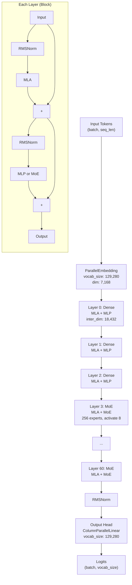

Sources: [inference/model.py:738-771](), [inference/model.py:696-735]()

## Multi-head Latent Attention (MLA)

MLA reduces memory usage for the key-value (KV) cache by projecting keys and values through a low-rank latent space, while maintaining full expressiveness for queries.

### Key Innovations

| Component | Configuration | Purpose |
|-----------|---------------|---------|
| **Query LoRA Rank** | 1,536 (`q_lora_rank`) | Compressed query projection |
| **KV LoRA Rank** | 512 (`kv_lora_rank`) | Compressed KV projection |
| **Attention Heads** | 128 (`n_heads`) | Multi-head parallelism |
| **QK NoRoPE Dim** | 128 (`qk_nope_head_dim`) | Non-positional component |
| **QK RoPE Dim** | 64 (`qk_rope_head_dim`) | Rotary positional component |
| **Value Head Dim** | 128 (`v_head_dim`) | Value projection size |

### Hybrid Positional Encoding

MLA uses a hybrid approach combining:
- **NOPE (No Positional Encoding)**: Standard attention without position information
- **RoPE (Rotary Positional Encoding)**: Rotation-based positional embeddings

**Diagram: MLA Architecture**
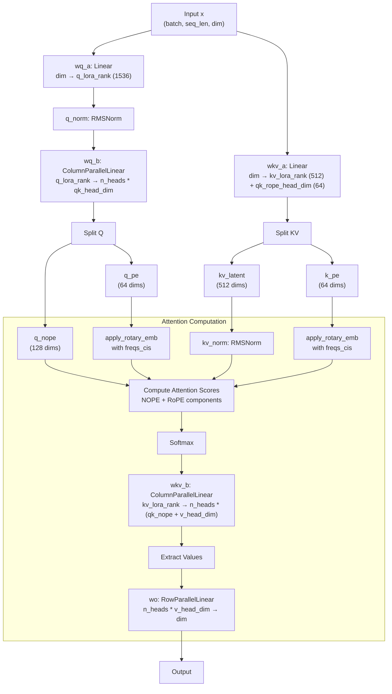

### Implementation Variants

The codebase provides two MLA implementations controlled by `attn_impl`:
- **`naive`**: Caches full K/V tensors (`k_cache`, `v_cache`)
- **`absorb`**: Caches compressed latent KV (`kv_cache`, `pe_cache`) - more memory efficient

Sources: [inference/model.py:396-497](), [inference/model.py:17](), [inference/model.py:412-437]()


## DeepSeekMoE

DeepSeekMoE is an auxiliary-loss-free load balancing strategy for Mixture-of-Experts that avoids the performance degradation caused by traditional load balancing auxiliary losses.

### Expert Configuration

| Parameter | Value | Description |
|-----------|-------|-------------|
| **`n_routed_experts`** | 256 | Total number of experts |
| **`n_activated_experts`** | 8 | Experts activated per token |
| **`n_shared_experts`** | 2 | Always-active shared experts |
| **`n_expert_groups`** | 8 | Expert grouping for routing |
| **`n_limited_groups`** | 1 | Limited groups in routing |
| **`score_func`** | `sigmoid` | Routing score function |
| **`route_scale`** | 2.5 | Routing weight scaling |
| **`moe_inter_dim`** | 1,408 | Expert hidden dimension |

### Routing Mechanism

**Diagram: DeepSeekMoE Routing**
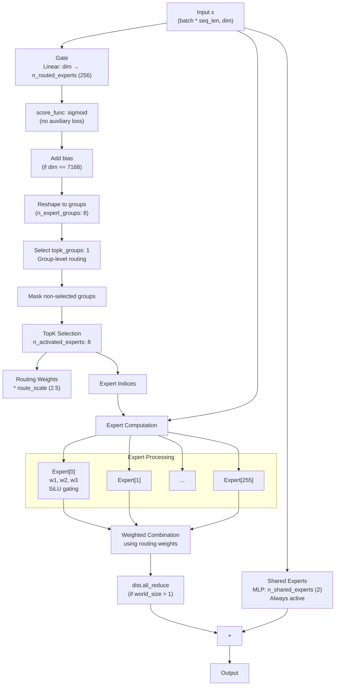

### Load Balancing

DeepSeekMoE achieves load balancing without auxiliary losses through:
1. **Sigmoid scoring**: Allows multiple experts to have high scores
2. **Expert grouping**: 256 experts divided into 8 groups
3. **Dynamic routing**: Bias term and group selection guide traffic distribution
4. **Shared experts**: Always-active experts handle common patterns

Sources: [inference/model.py:636-693](), [inference/model.py:535-598](), [inference/model.py:601-633]()

## Multi-Token Prediction (MTP)

The MTP module is a separate 14B parameter component that predicts multiple future tokens in parallel. It shares embedding weights with the main model but has independent transformer layers.

### MTP Structure

| Component | Configuration | Notes |
|-----------|---------------|-------|
| **MTP Parameters** | 14B | Separate from main 671B |
| **Total Model Size** | 685B | 671B main + 14B MTP |
| **Shared Components** | Embedding layer | Weight sharing with main model |
| **Independent Components** | Transformer layers | Separate MTP-specific layers |

### Use Cases

1. **Training Objective**: Multi-token prediction improves model performance by learning to predict multiple tokens ahead
2. **Speculative Decoding**: During inference, MTP predicts candidate tokens that can be verified in parallel, accelerating generation

**Diagram: MTP Integration**
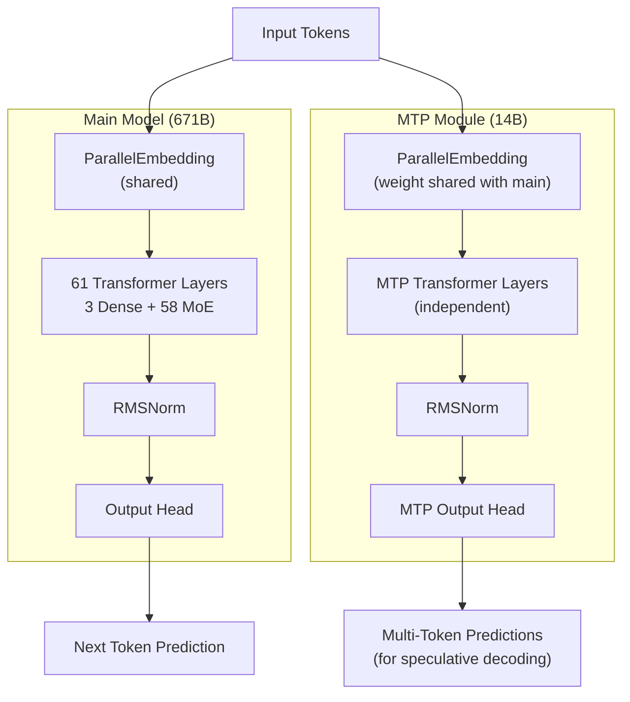

MTP support is currently under active development in the open-source inference frameworks. See [README_WEIGHTS.md](https://github.com/deepseek-ai/DeepSeek-V3/blob/main/README_WEIGHTS.md) for details on the MTP weight structure.

Sources: [README.md:99](), [README.md:66-67](), [README.md:103]()

## Architecture Code Mapping

### Primary Model Classes

The following diagram maps architectural components to their code implementations:

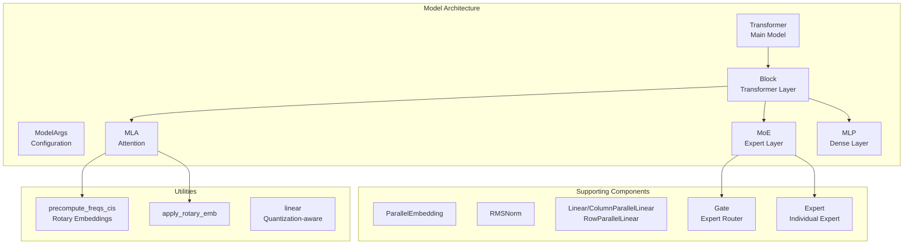

Sources: [inference/model.py:735-795](), [inference/model.py:693-733](), [inference/model.py:393-495](), [inference/model.py:633-691]()

### Quantization and Precision Support

The model supports multiple precision formats through specialized implementations:

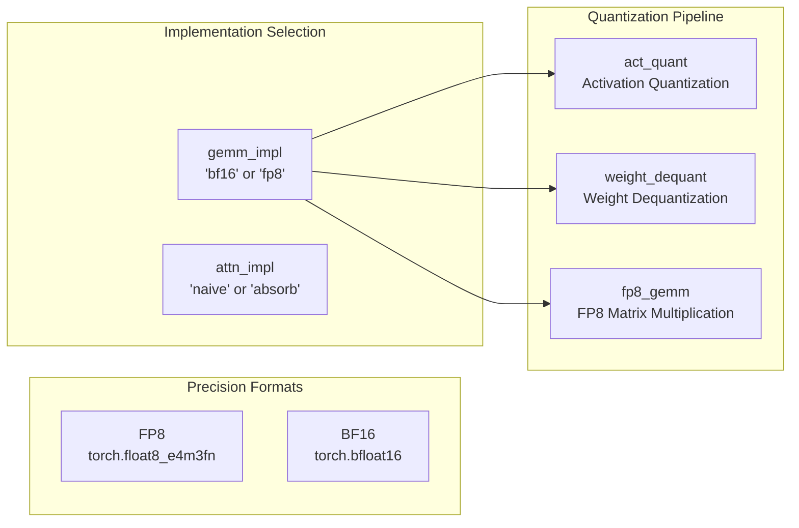

Sources: [inference/model.py:10](), [inference/model.py:129-162](), [inference/model.py:16-17]()

## Distributed Computing Support

The architecture includes built-in support for distributed training and inference:

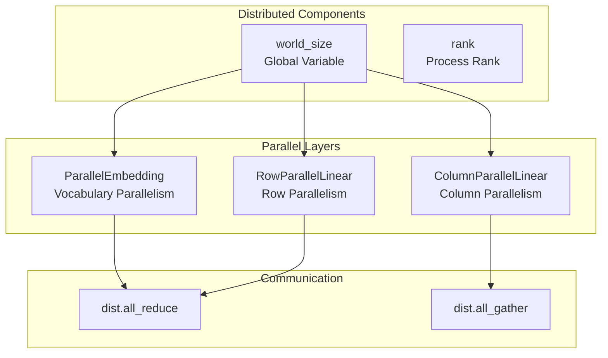

Sources: [inference/model.py:13-14](), [inference/model.py:87-127](), [inference/model.py:205-264]()

This architecture enables DeepSeek-V3 to efficiently scale across multiple GPUs while maintaining high performance through optimized attention mechanisms, sparse expert routing, and quantization-aware computations.

---

# Page: Benchmarks and Evaluations

# Benchmarks and Evaluations

<details>
<summary>Relevant source files</summary>

The following files were used as context for generating this wiki page:

- [README.md](README.md)
- [figures/benchmark.png](figures/benchmark.png)
- [figures/niah.png](figures/niah.png)

</details>


This page presents the performance benchmarks and evaluation results for DeepSeek-V3 models. It covers evaluation methodology, benchmark categories, and performance comparisons with other state-of-the-art models across diverse tasks including code generation, mathematics, natural language understanding, and multilingual capabilities.

For details on the model architecture that enables these results, see [Model Architecture Overview](#1.2). For information on the training process that produces these models, see sections on [Pre-Training](#3.1), [Post-Training](#3.2), and [Knowledge Distillation](#3.3).

## Evaluation Overview

DeepSeek-V3 is evaluated across two model variants:
- **DeepSeek-V3-Base** (671B parameters, 37B activated): Pre-trained model evaluated on standard academic benchmarks
- **DeepSeek-V3** (671B + 14B MTP parameters): Chat-optimized model with post-training and knowledge distillation

The evaluation spans multiple dimensions including language understanding, reasoning, code generation, mathematical problem solving, and long-context processing. All results are reproducible using standard evaluation frameworks with specified prompting strategies.

**Sources:** [README.md:105-220]()

## Training Phase to Benchmark Performance Mapping

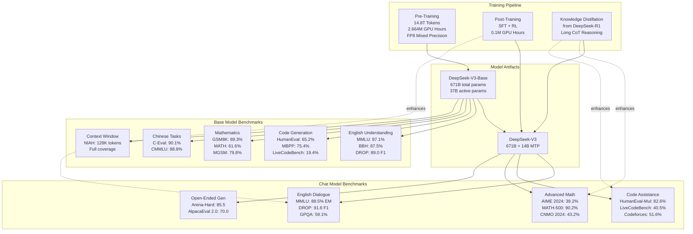

This diagram illustrates how the three-phase training pipeline produces two model variants with distinct benchmark profiles. The base model excels at standard language understanding tasks, while the chat model demonstrates superior performance on complex reasoning tasks through knowledge distillation from DeepSeek-R1.

**Sources:** [README.md:45-84](), [README.md:105-220]()

## Benchmark Category Architecture

```mermaid
graph TB
    subgraph "Evaluation Dimensions"
        English["English Language<br/>Understanding & Reasoning"]
        Code["Code Generation<br/>& Programming"]
        Math["Mathematical<br/>Reasoning"]
        Chinese["Chinese Language<br/>Tasks"]
        Multi["Multilingual<br/>Capabilities"]
        Context["Long Context<br/>Processing"]
        Open["Open-Ended<br/>Generation"]
    end
    
    subgraph "English Benchmarks"
        MMLU["MMLU / MMLU-Redux<br/>MMLU-Pro<br/>5-shot Accuracy"]
        BBH["BBH (Big-Bench Hard)<br/>3-shot EM"]
        DROP_B["DROP<br/>3-shot F1"]
        ARC["ARC-Easy / Challenge<br/>25-shot Accuracy"]
        Common["HellaSwag / PIQA<br/>WinoGrande<br/>0-10 shot"]
        QA["TriviaQA / NaturalQ<br/>5-shot EM"]
        AGI["AGIEval<br/>0-shot Accuracy"]
        IFEval["IF-Eval<br/>Prompt Strict"]
        GPQA["GPQA-Diamond<br/>Pass@1"]
        SimpleQA["SimpleQA<br/>Correct"]
    end
    
    subgraph "Code Benchmarks"
        HE["HumanEval<br/>0-shot Pass@1"]
        MBPP_B["MBPP<br/>3-shot Pass@1"]
        LCB["LiveCodeBench<br/>3-shot Pass@1"]
        CRUX["CRUXEval-I/O<br/>2-shot Accuracy"]
        HEMul["HumanEval-Mul<br/>Pass@1"]
        CF["Codeforces<br/>Percentile"]
        SWE["SWE Verified<br/>Resolved"]
        Aider["Aider-Edit/Polyglot<br/>Accuracy"]
    end
    
    subgraph "Math Benchmarks"
        GSM["GSM8K<br/>8-shot EM"]
        MATH_B["MATH<br/>4-shot EM"]
        MGSM["MGSM<br/>8-shot EM"]
        CMath["CMath<br/>3-shot EM"]
        AIME["AIME 2024<br/>Pass@1"]
        MATH500["MATH-500<br/>EM"]
        CNMO["CNMO 2024<br/>Pass@1"]
    end
    
    subgraph "Chinese Benchmarks"
        CLUE["CLUEWSC<br/>5-shot EM"]
        CEval["C-Eval<br/>5-shot Accuracy"]
        CMMLU_B["CMMLU<br/>5-shot Accuracy"]
        CMRC["CMRC<br/>1-shot EM"]
        C3["C3<br/>0-shot Accuracy"]
        CCPM["CCPM<br/>0-shot Accuracy"]
        CSimple["C-SimpleQA<br/>Correct"]
    end
    
    English --> MMLU
    English --> BBH
    English --> DROP_B
    English --> ARC
    English --> Common
    English --> QA
    English --> AGI
    English --> IFEval
    English --> GPQA
    English --> SimpleQA
    
    Code --> HE
    Code --> MBPP_B
    Code --> LCB
    Code --> CRUX
    Code --> HEMul
    Code --> CF
    Code --> SWE
    Code --> Aider
    
    Math --> GSM
    Math --> MATH_B
    Math --> MGSM
    Math --> CMath
    Math --> AIME
    Math --> MATH500
    Math --> CNMO
    
    Chinese --> CLUE
    Chinese --> CEval
    Chinese --> CMMLU_B
    Chinese --> CMRC
    Chinese --> C3
    Chinese --> CCPM
    Chinese --> CSimple
    
    Multi --> MMMLU["MMMLU-non-English<br/>5-shot Accuracy"]
    
    Context --> NIAH["Needle In A Haystack<br/>128K context"]
    Context --> LongBench["LongBench v2<br/>Accuracy"]
    Context --> FRAMES["FRAMES<br/>Accuracy"]
    
    Open --> Arena["Arena-Hard<br/>Win Rate"]
    Open --> Alpaca["AlpacaEval 2.0<br/>LC Win Rate"]
```

This diagram maps the comprehensive evaluation framework used to assess DeepSeek-V3 across seven key dimensions. Each benchmark uses specific prompting strategies (indicated by shot counts) and metrics (EM, Accuracy, F1, Pass@1) to measure different aspects of model capability.

**Sources:** [README.md:108-149](), [README.md:164-219]()

## Base Model Performance

### Standard Benchmarks

The following table presents DeepSeek-V3-Base performance on academic benchmarks, compared against leading open-source models. All evaluations use the specified shot counts and metrics.

| Category | Benchmark (Metric) | Shots | DeepSeek-V2 | Qwen2.5 72B | LLaMA3.1 405B | **DeepSeek-V3** |
|----------|-------------------|-------|-------------|-------------|---------------|-----------------|
| **Architecture** | - | - | MoE (236B/21B) | Dense (72B) | Dense (405B) | MoE (671B/37B) |
| **English** | Pile-test (BPB) | - | 0.606 | 0.638 | **0.542** | 0.548 |
| | BBH (EM) | 3 | 78.8 | 79.8 | 82.9 | **87.5** |
| | MMLU (Acc.) | 5 | 78.4 | 85.0 | 84.4 | **87.1** |
| | MMLU-Redux (Acc.) | 5 | 75.6 | 83.2 | 81.3 | **86.2** |
| | MMLU-Pro (Acc.) | 5 | 51.4 | 58.3 | 52.8 | **64.4** |
| | DROP (F1) | 3 | 80.4 | 80.6 | 86.0 | **89.0** |
| | ARC-Easy (Acc.) | 25 | 97.6 | 98.4 | 98.4 | **98.9** |
| | ARC-Challenge (Acc.) | 25 | 92.2 | 94.5 | **95.3** | **95.3** |
| | AGIEval (Acc.) | 0 | 57.5 | 75.8 | 60.6 | **79.6** |
| **Code** | HumanEval (Pass@1) | 0 | 43.3 | 53.0 | 54.9 | **65.2** |
| | MBPP (Pass@1) | 3 | 65.0 | 72.6 | 68.4 | **75.4** |
| | LiveCodeBench-Base (Pass@1) | 3 | 11.6 | 12.9 | 15.5 | **19.4** |
| | CRUXEval-I (Acc.) | 2 | 52.5 | 59.1 | 58.5 | **67.3** |
| | CRUXEval-O (Acc.) | 2 | 49.8 | 59.9 | 59.9 | **69.8** |
| **Math** | GSM8K (EM) | 8 | 81.6 | 88.3 | 83.5 | **89.3** |
| | MATH (EM) | 4 | 43.4 | 54.4 | 49.0 | **61.6** |
| | MGSM (EM) | 8 | 63.6 | 76.2 | 69.9 | **79.8** |
| | CMath (EM) | 3 | 78.7 | 84.5 | 77.3 | **90.7** |
| **Chinese** | CLUEWSC (EM) | 5 | 82.0 | 82.5 | **83.0** | 82.7 |
| | C-Eval (Acc.) | 5 | 81.4 | 89.2 | 72.5 | **90.1** |
| | CMMLU (Acc.) | 5 | 84.0 | **89.5** | 73.7 | 88.8 |
| **Multilingual** | MMMLU-non-English (Acc.) | 5 | 64.0 | 74.8 | 73.8 | **79.4** |

**Key Findings:**
- DeepSeek-V3 achieves best-in-class performance on 22 out of 26 benchmarks despite having only 37B activated parameters
- Exceptional performance on code tasks: 50.5% improvement over DeepSeek-V2 on LiveCodeBench
- Strong mathematical reasoning: 42% improvement over DeepSeek-V2 on MATH benchmark
- Competitive with 405B dense model while using only 9% activated parameters

**Sources:** [README.md:108-149]()

### Context Window Evaluation

DeepSeek-V3-Base supports a 128K token context window. Performance is validated using the "Needle In A Haystack" (NIAH) test, which measures the model's ability to retrieve specific information embedded at various positions within long contexts.

**Evaluation Methodology:**
- Documents of varying lengths up to 128K tokens are created
- A specific piece of information (the "needle") is inserted at different depth positions
- The model is queried to retrieve this information
- Success rate is measured across all positions and lengths

**Results:**
- DeepSeek-V3 demonstrates **full coverage** across the entire 128K context window
- Maintains high retrieval accuracy at all depths and positions
- No degradation observed at maximum context length

The NIAH visualization shows consistent performance across:
- Document lengths: 1K to 128K tokens
- Needle depths: 0% to 100% of document length
- Multiple test iterations with varying content types

**Sources:** [README.md:156-161]()

## Chat Model Performance

### Standard Benchmarks (Large Models)

The following table compares DeepSeek-V3 chat model against other frontier models (parameters > 67B) across diverse tasks. All models are evaluated with 8K output length limit.

| Category | Benchmark (Metric) | DeepSeek V2.5 | Qwen2.5 72B-Inst. | Llama3.1 405B-Inst. | Claude-3.5-Sonnet | GPT-4o 0513 | **DeepSeek V3** |
|----------|-------------------|---------------|-------------------|---------------------|-------------------|-------------|-----------------|
| **Architecture** | - | MoE (236B/21B) | Dense (72B) | Dense (405B) | - | - | MoE (671B/37B) |
| **English** | MMLU (EM) | 80.6 | 85.3 | **88.6** | **88.3** | 87.2 | **88.5** |
| | MMLU-Redux (EM) | 80.3 | 85.6 | 86.2 | **88.9** | 88.0 | **89.1** |
| | MMLU-Pro (EM) | 66.2 | 71.6 | 73.3 | **78.0** | 72.6 | 75.9 |
| | DROP (3-shot F1) | 87.8 | 76.7 | 88.7 | 88.3 | 83.7 | **91.6** |
| | IF-Eval (Prompt Strict) | 80.6 | 84.1 | 86.0 | **86.5** | 84.3 | 86.1 |
| | GPQA-Diamond (Pass@1) | 41.3 | 49.0 | 51.1 | **65.0** | 49.9 | 59.1 |
| | SimpleQA (Correct) | 10.2 | 9.1 | 17.1 | 28.4 | **38.2** | 24.9 |
| | FRAMES (Acc.) | 65.4 | 69.8 | 70.0 | 72.5 | **80.5** | 73.3 |
| | LongBench v2 (Acc.) | 35.4 | 39.4 | 36.1 | 41.0 | 48.1 | **48.7** |
| **Code** | HumanEval-Mul (Pass@1) | 77.4 | 77.3 | 77.2 | 81.7 | 80.5 | **82.6** |
| | LiveCodeBench (Pass@1-COT) | 29.2 | 31.1 | 28.4 | 36.3 | 33.4 | **40.5** |
| | LiveCodeBench (Pass@1) | 28.4 | 28.7 | 30.1 | 32.8 | 34.2 | **37.6** |
| | Codeforces (Percentile) | 35.6 | 24.8 | 25.3 | 20.3 | 23.6 | **51.6** |
| | SWE Verified (Resolved) | 22.6 | 23.8 | 24.5 | **50.8** | 38.8 | 42.0 |
| | Aider-Edit (Acc.) | 71.6 | 65.4 | 63.9 | **84.2** | 72.9 | 79.7 |
| | Aider-Polyglot (Acc.) | 18.2 | 7.6 | 5.8 | 45.3 | 16.0 | **49.6** |
| **Math** | AIME 2024 (Pass@1) | 16.7 | 23.3 | 23.3 | 16.0 | 9.3 | **39.2** |
| | MATH-500 (EM) | 74.7 | 80.0 | 73.8 | 78.3 | 74.6 | **90.2** |
| | CNMO 2024 (Pass@1) | 10.8 | 15.9 | 6.8 | 13.1 | 10.8 | **43.2** |
| **Chinese** | CLUEWSC (EM) | 90.4 | **91.4** | 84.7 | 85.4 | 87.9 | 90.9 |
| | C-Eval (EM) | 79.5 | 86.1 | 61.5 | 76.7 | 76.0 | **86.5** |
| | C-SimpleQA (Correct) | 54.1 | 48.4 | 50.4 | 51.3 | 59.3 | **64.8** |

**Key Findings:**
- Best-performing open-source model across all categories
- Competitive with frontier closed-source models (GPT-4o, Claude-3.5-Sonnet)
- Exceptional math performance: **39.2% on AIME 2024** (2.5× improvement over GPT-4o)
- Strong code reasoning: **51.6 percentile on Codeforces** (competitive programming)
- Best long-context performance: **48.7% on LongBench v2**

**Evaluation Methodology:**
- All models limited to 8K output tokens for fair comparison
- Benchmarks with <1000 samples tested multiple times with varying temperatures
- Robust final results derived from multiple runs

**Sources:** [README.md:164-199]()

### Open-Ended Generation Evaluation

The following table presents performance on conversational and creative generation tasks that measure model helpfulness and user preference.

| Model | Architecture | Activated Params | Arena-Hard | AlpacaEval 2.0 (LC) |
|-------|-------------|------------------|------------|---------------------|
| DeepSeek-V2.5-0905 | MoE | 21B | 76.2 | 50.5 |
| Qwen2.5-72B-Instruct | Dense | 72B | 81.2 | 49.1 |
| LLaMA-3.1 405B | Dense | 405B | 69.3 | 40.5 |
| GPT-4o-0513 | - | - | 80.4 | 51.1 |
| Claude-Sonnet-3.5-1022 | - | - | 85.2 | 52.0 |
| **DeepSeek-V3** | MoE | 37B | **85.5** | **70.0** |

**Benchmark Descriptions:**

**Arena-Hard:**
- Measures win rate against GPT-4 on challenging user queries
- Focuses on instruction following, reasoning, and helpful responses
- DeepSeek-V3 achieves **85.5** score, competitive with Claude-3.5-Sonnet

**AlpacaEval 2.0 (Length-Controlled Win Rate):**
- Human preference evaluation against baseline model
- Length-controlled (LC) metric prevents favoring verbosity
- DeepSeek-V3 achieves **70.0%** win rate, significantly outperforming all baselines
- 37% relative improvement over Claude-3.5-Sonnet (52.0%)

**Key Findings:**
- DeepSeek-V3 demonstrates superior performance on open-ended tasks despite smaller activated parameters
- Strong user preference scores indicate effective knowledge distillation from DeepSeek-R1
- Balanced performance across factual accuracy and creative generation

**Sources:** [README.md:201-219]()

## Comparative Analysis

### Performance vs. Model Size

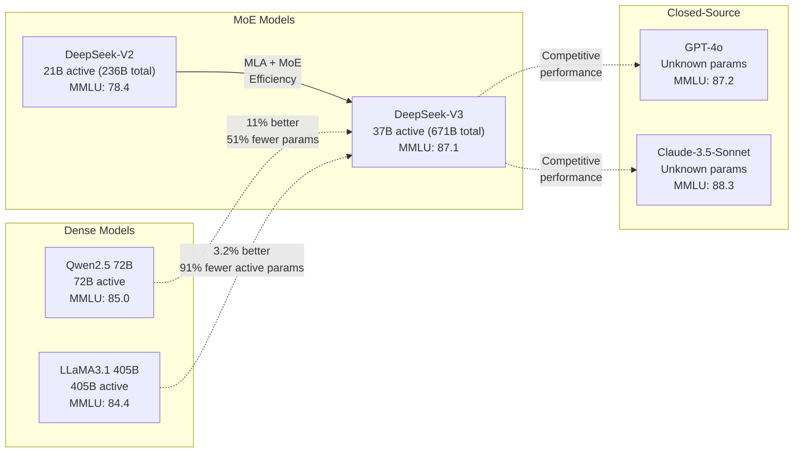

DeepSeek-V3's Mixture-of-Experts architecture achieves competitive performance with frontier models while maintaining computational efficiency through sparse activation. Only 37B out of 671B parameters are activated per token, enabling:

- **Parameter Efficiency:** 91% fewer activated parameters than LLaMA3.1 405B with superior performance
- **Inference Efficiency:** Comparable latency to 40B dense models despite 671B total parameters
- **Training Efficiency:** 2.664M H800 GPU hours for full pre-training on 14.8T tokens

**Sources:** [README.md:108-149](), [README.md:47-52]()

### Task-Specific Performance Highlights

The following table summarizes DeepSeek-V3's standout achievements across specific evaluation categories:

| Task Category | Best Performance | Baseline Comparison | Improvement |
|---------------|------------------|---------------------|-------------|
| **Mathematical Reasoning** | AIME 2024: 39.2% | GPT-4o: 9.3% | +322% |
| | MATH-500: 90.2% | Qwen2.5: 80.0% | +12.8% |
| | CNMO 2024: 43.2% | Qwen2.5: 15.9% | +172% |
| **Code Generation** | Codeforces: 51.6%ile | Claude-3.5: 20.3%ile | +154% |
| | LiveCodeBench (CoT): 40.5% | Claude-3.5: 36.3% | +11.6% |
| | Aider-Polyglot: 49.6% | Claude-3.5: 45.3% | +9.5% |
| **Long Context** | LongBench v2: 48.7% | GPT-4o: 48.1% | Best |
| | NIAH: 128K coverage | - | Full coverage |
| **Open Generation** | AlpacaEval 2.0: 70.0% | Claude-3.5: 52.0% | +34.6% |
| | Arena-Hard: 85.5 | Claude-3.5: 85.2 | Competitive |
| **Chinese Language** | C-Eval: 86.5% | Qwen2.5: 86.1% | Best OS |
| | C-SimpleQA: 64.8% | GPT-4o: 59.3% | +9.3% |

**Sources:** [README.md:164-219]()

## Evaluation Methodology

### Prompting Strategy

DeepSeek-V3 evaluations follow standardized protocols for each benchmark:

**Few-Shot Learning:**
- **0-shot:** Direct task completion without examples (AGIEval, PIQA, C3, CCPM)
- **1-shot:** Single example provided (CMRC)
- **2-shot:** Two examples (CRUXEval-I/O)
- **3-shot:** Three examples (BBH, DROP, MBPP, CMath, LiveCodeBench)
- **4-shot:** Four examples (MATH)
- **5-shot:** Five examples (MMLU variants, WinoGrande, TriviaQA, NaturalQuestions, Chinese benchmarks)
- **8-shot:** Eight examples (GSM8K, MGSM)
- **10-shot:** Ten examples (HellaSwag)
- **25-shot:** Twenty-five examples (ARC-Easy/Challenge)

**Chain-of-Thought (CoT):**
- LiveCodeBench evaluated both with and without CoT prompting
- CoT significantly improves performance on reasoning-heavy tasks
- DeepSeek-V3 shows 40.5% Pass@1 with CoT vs. 37.6% without

**Sources:** [README.md:108-149](), [README.md:164-194]()

### Metrics and Scoring

Different evaluation tasks use task-appropriate metrics:

| Metric | Description | Used In |
|--------|-------------|---------|
| **EM (Exact Match)** | Percentage of exactly correct answers | MMLU, GSM8K, MATH, MGSM, CMath, CLUEWSC, CMRC |
| **Accuracy (Acc.)** | Percentage of correct predictions | ARC, C-Eval, CMMLU, C3, CCPM, CRUXEval, FRAMES, LongBench v2 |
| **F1 Score** | Harmonic mean of precision and recall | DROP |
| **Pass@1** | Percentage passing test cases on first attempt | HumanEval, MBPP, LiveCodeBench, GPQA, AIME, CNMO |
| **BPB (Bits Per Byte)** | Language modeling efficiency (lower is better) | Pile-test |
| **Percentile** | Ranking among competitive programmers | Codeforces |
| **Resolved** | Issues successfully resolved | SWE Verified |
| **Correct** | Factual correctness rate | SimpleQA, C-SimpleQA |
| **Win Rate** | Human preference vs. baseline | Arena-Hard, AlpacaEval 2.0 |

**Length-Controlled Metrics:**
- AlpacaEval 2.0 uses length-controlled (LC) win rate to prevent bias toward verbose responses
- All chat model evaluations limit output to 8K tokens for fair comparison

**Sources:** [README.md:108-219]()

### Robustness and Reliability

To ensure reliable evaluation results, DeepSeek-V3 implements the following practices:

**Multiple Runs for Small Benchmarks:**
- Benchmarks with fewer than 1,000 samples are evaluated multiple times
- Varying temperature settings across runs (typically 0.0, 0.3, 0.7, 1.0)
- Final results derived from aggregated performance across all runs
- Reduces variance and provides more robust performance estimates

**Standard Evaluation Frameworks:**
- All benchmarks use publicly available datasets
- Evaluation code follows established protocols from benchmark creators
- Results are reproducible using standard evaluation libraries

**Fair Comparison Guidelines:**
- Output length limits applied consistently across all models
- Same prompting format used for all models on each benchmark
- No benchmark-specific prompt engineering or few-shot example selection

**Statistical Significance:**
- Performance gaps of 0.3 or less are considered statistically equivalent
- Best results are highlighted only when meaningfully better than alternatives

**Sources:** [README.md:152-154](), [README.md:196-199]()

## Benchmark Access and Reproduction

The evaluation results presented in this document are derived from standardized academic benchmarks. While the DeepSeek-V3 repository does not include evaluation code, all benchmarks are publicly available:

**Publicly Available Benchmarks:**
- Most benchmarks are accessible through Hugging Face Datasets
- Evaluation frameworks like `lm-evaluation-harness` provide standardized implementations
- Official benchmark websites provide detailed documentation and test sets

**Model Artifacts for Evaluation:**
- DeepSeek-V3-Base: [HuggingFace deepseek-ai/DeepSeek-V3-Base](https://huggingface.co/deepseek-ai/DeepSeek-V3-Base)
- DeepSeek-V3: [HuggingFace deepseek-ai/DeepSeek-V3](https://huggingface.co/deepseek-ai/DeepSeek-V3)
- Both models available in FP8 format natively
- BF16 conversion available via `fp8_cast_bf16.py` utility (see [FP8 to BF16 Conversion](#5.4))

**Technical Paper:**
- Comprehensive evaluation details available in the DeepSeek-V3 technical report
- ArXiv preprint: [2412.19437](https://arxiv.org/abs/2412.19437)
- Includes full methodology, additional benchmarks, and ablation studies

**Sources:** [README.md:29](), [README.md:87-103](), [README.md:152-154]()

---

# Page: Getting Started

# Getting Started

<details>
<summary>Relevant source files</summary>

The following files were used as context for generating this wiki page:

- [README.md](README.md)

</details>


This document guides you through the initial steps required to use DeepSeek-V3, from choosing a deployment method to running your first inference. It covers model availability, access methods, and the basic workflow for local deployment preparation.

For detailed installation procedures and hardware requirements, see [Installation and Requirements](#2.1). For framework-specific deployment instructions, see [Local Deployment Options](#2.2). For using the hosted services, see [Web Interface and API Access](#2.3).

## Model Variants

DeepSeek-V3 is available in two variants, both distributed via Hugging Face in native FP8 format:

| Model | Total Parameters | Activated Parameters | Context Length | Hugging Face Repository |
|-------|-----------------|---------------------|----------------|------------------------|
| DeepSeek-V3-Base | 671B | 37B | 128K | `deepseek-ai/DeepSeek-V3-Base` |
| DeepSeek-V3 (Chat) | 671B | 37B | 128K | `deepseek-ai/DeepSeek-V3` |

Both models have a total size of 685B weights on disk, consisting of 671B for the main Transformer model and 14B for the Multi-Token Prediction (MTP) module. The Base model is the pre-trained foundation model, while the Chat variant has been post-trained with supervised fine-tuning, reinforcement learning, and knowledge distillation from DeepSeek-R1.

**Sources:** [README.md:87-99]()

## Access Options Overview

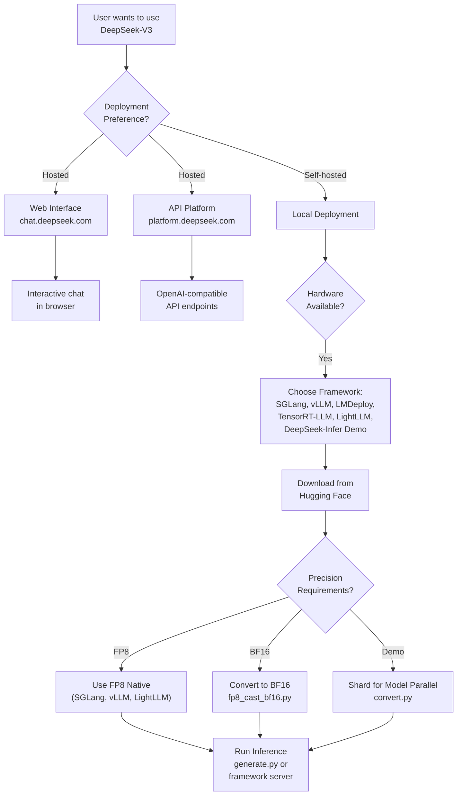

**Decision Tree for Getting Started with DeepSeek-V3**

Users can access DeepSeek-V3 through hosted services or deploy it locally. Hosted services provide immediate access without hardware requirements, while local deployment offers control and customization but requires significant computational resources.

**Sources:** [README.md:222-226](), [README.md:227-342]()

## Hosted Services

### Web Chat Interface

The DeepSeek-V3 Chat model is accessible through a web interface at `chat.deepseek.com`. This provides an interactive conversational interface without requiring any setup or hardware.

### API Platform

DeepSeek provides an OpenAI-compatible API at `platform.deepseek.com`. This allows programmatic access to DeepSeek-V3 using familiar API patterns, suitable for integration into applications.

**Sources:** [README.md:222-226]()

## Local Deployment Workflow

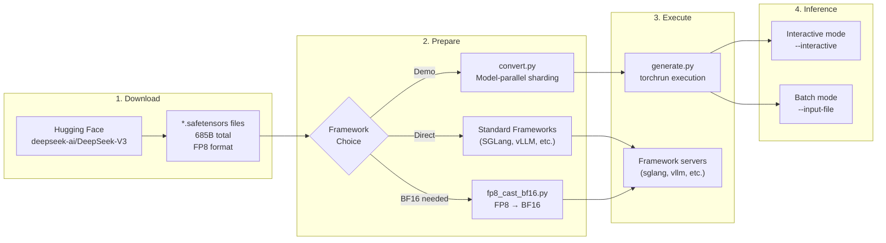

**Local Deployment Workflow Showing Core Scripts and Execution Paths**

The local deployment process follows four stages:

1. **Download**: Retrieve model weights from Hugging Face repository
2. **Prepare**: Convert or shard weights based on target framework
3. **Execute**: Launch the inference server or script
4. **Inference**: Run interactive chat or batch processing

**Sources:** [README.md:227-342]()

## Weight Formats and Conversion

DeepSeek-V3 is trained and distributed in native FP8 format for maximum efficiency. Three workflow paths are available depending on deployment requirements:

### FP8 Native Deployment

Frameworks with native FP8 support (SGLang, vLLM, LightLLM) can directly load the downloaded weights without conversion. This provides the best performance and memory efficiency.

### BF16 Conversion

For frameworks requiring higher precision, the `fp8_cast_bf16.py` script converts FP8 weights to BF16 format:

```bash
cd inference
python fp8_cast_bf16.py \
    --input-fp8-hf-path /path/to/fp8_weights \
    --output-bf16-hf-path /path/to/bf16_weights
```

This script processes all `*.safetensors` files in the input directory, applies `weight_dequant` to convert 128×128 FP8 blocks to BF16, and updates the `model.safetensors.index.json` weight map accordingly.

### Model-Parallel Sharding

The DeepSeek-Infer demo requires explicit model-parallel sharding via `convert.py`:

```bash
python convert.py \
    --hf-ckpt-path /path/to/DeepSeek-V3 \
    --save-path /path/to/DeepSeek-V3-Demo \
    --n-experts 256 \
    --model-parallel 16
```

This distributes the 256 experts across 16 shards (16 experts per shard) and shards layer weights along specified dimensions, producing files named `model{i}-mp{mp}.safetensors` where `i` is the rank and `mp` is the world size.

**Sources:** [README.md:240-247](), [README.md:283-289]()

## DeepSeek-Infer Demo Quick Start

```mermaid
graph TB
    subgraph "Setup"
        Clone["git clone<br/>deepseek-ai/DeepSeek-V3"]
        InstallDeps["pip install -r<br/>inference/requirements.txt"]
        Download["Download weights<br/>from Hugging Face"]
        
        Clone --> InstallDeps
        InstallDeps --> Download
    end
    
    subgraph "Conversion"
        ConvertScript["convert.py<br/>--hf-ckpt-path<br/>--save-path<br/>--n-experts 256<br/>--model-parallel N"]
        
        Download --> ConvertScript
        
        OutputShards["model0-mpN.safetensors<br/>model1-mpN.safetensors<br/>...<br/>modelN-1-mpN.safetensors"]
        
        ConvertScript --> OutputShards
    end
    
    subgraph "Execution"
        Torchrun["torchrun<br/>--nnodes M<br/>--nproc-per-node 8<br/>--node-rank RANK<br/>--master-addr ADDR"]
        
        GenerateScript["generate.py<br/>--ckpt-path<br/>--config configs/config_671B.json"]
        
        Mode{"Mode"}
        
        InteractiveFlag["--interactive<br/>--temperature 0.7<br/>--max-new-tokens 200"]
        
        BatchFlag["--input-file FILE"]
        
        OutputShards --> Torchrun
        Torchrun --> GenerateScript
        GenerateScript --> Mode
        Mode --> InteractiveFlag
        Mode --> BatchFlag
    end
```

**DeepSeek-Infer Demo Execution Flow with Script Names and Key Arguments**

The demo implementation provides a reference for FP8 and BF16 inference with the following workflow:

1. **Clone repository** and install dependencies from `inference/requirements.txt`
2. **Download weights** from Hugging Face to a local directory
3. **Convert weights** using `convert.py` to create model-parallel shards
4. **Execute inference** using `torchrun` with `generate.py` for distributed execution

The demo supports two modes:
- **Interactive mode** (`--interactive`): Conversational chat with temperature sampling
- **Batch mode** (`--input-file`): Process prompts from a file

**Sources:** [README.md:252-303]()

## System Requirements

```mermaid
graph TB
    subgraph "Operating System"
        OS["Linux with Python 3.10<br/>Mac and Windows<br/>NOT supported"]
    end
    
    subgraph "Core Dependencies"
        Torch["torch==2.4.1"]
        Triton["triton==3.0.0"]
        Transformers["transformers==4.46.3"]
        Safetensors["safetensors==0.4.5"]
    end
    
    subgraph "Hardware Options"
        NVIDIA["NVIDIA GPUs<br/>(H100, H800, etc.)"]
        AMD["AMD GPUs<br/>(via SGLang)"]
        Ascend["Huawei Ascend NPUs<br/>(via MindIE)"]
    end
    
    subgraph "Model Size"
        Memory["~685B parameters<br/>FP8: ~685GB<br/>BF16: ~1370GB"]
    end
    
    OS --> Torch
    OS --> Triton
    OS --> Transformers
    OS --> Safetensors
    
    Torch --> NVIDIA
    Torch --> AMD
    Torch --> Ascend
    
    Memory --> NVIDIA
    Memory --> AMD
    Memory --> Ascend
```

**System Requirements and Hardware Support**

The demo implementation requires Linux with Python 3.10 and specific package versions. Hardware requirements are substantial due to the model size. Multiple GPU vendors are supported through different frameworks.

**Sources:** [README.md:254-265]()

## Framework Selection

Six inference frameworks provide different optimization strategies and hardware support:

| Framework | Precision | Key Features | Multi-Node | GPU Support |
|-----------|-----------|--------------|------------|-------------|
| **SGLang** | FP8, BF16 | MLA optimizations, DP Attention, FP8 W8A8, FP8 KV cache, Torch Compile | Yes (Tensor Parallel) | NVIDIA, AMD |
| **vLLM** | FP8, BF16 | Pipeline parallelism | Yes (Pipeline Parallel) | NVIDIA, AMD |
| **LMDeploy** | FP8, BF16 | PyTorch integration, cloud deployment | Yes | NVIDIA |
| **TensorRT-LLM** | BF16, INT4/INT8 | Weight-only quantization, FP8 in development | Yes | NVIDIA |
| **LightLLM** | FP8/BF16 mixed | Mixed precision, flexible deployment | Yes (Tensor Parallel) | NVIDIA |
| **DeepSeek-Infer Demo** | FP8, BF16 | Reference implementation | Yes | NVIDIA |

**SGLang** is recommended for most users as it provides comprehensive optimizations including MLA-specific kernels, data-parallel attention, and full FP8 support with state-of-the-art performance on both NVIDIA and AMD hardware.

**vLLM** specializes in pipeline parallelism for large-scale multi-machine deployments.

**LMDeploy** emphasizes seamless PyTorch workflow integration for local and cloud deployment.

**TensorRT-LLM** focuses on advanced quantization with custom NVIDIA optimizations.

**LightLLM** offers flexible mixed-precision deployment.

**DeepSeek-Infer Demo** serves as a reference implementation with explicit scripts for conversion and generation.

**Sources:** [README.md:229-342]()

## Configuration Files

The model is configured via JSON files in the `configs/` directory:

- **`config_671B.json`**: Configuration for the 671B parameter model (37B activated)
- Contains `ModelArgs` parameters including dimensions, layer counts, MoE settings, and quantization options

The configuration is loaded by `generate.py` via the `--config` argument and defines the model architecture instantiated by the `Transformer` class in [inference/model.py]().

**Sources:** [README.md:296-303]()

## Next Steps

After completing the initial setup:

1. **For detailed installation instructions**: See [Installation and Requirements](#2.1) for hardware prerequisites, dependency installation, and environment setup
2. **For framework-specific deployment**: See [Local Deployment Options](#2.2) for step-by-step instructions for each inference framework
3. **For hosted services**: See [Web Interface and API Access](#2.3) for chat interface and API usage
4. **For understanding the architecture**: See [Model Architecture](#4) for technical details on MLA, MoE, and MTP components
5. **For weight format details**: See [Model Weights](#6) for information on weight file structure and quantization formats

**Sources:** [README.md:1-362]()

---

# Page: Installation and Requirements

# Installation

<details>
<summary>Relevant source files</summary>

The following files were used as context for generating this wiki page:

- [README.md](README.md)
- [inference/requirements.txt](inference/requirements.txt)

</details>


This document covers the installation requirements and setup process for running DeepSeek-V3 locally. It focuses on the core dependencies, system requirements, and initial setup steps needed to get the model operational on your system.

For comprehensive deployment guides using different frameworks, see [Local Deployment Options](#2.2). For accessing the model through web interfaces, see [Web Interface and API Access](#2.3).

## System Requirements

DeepSeek-V3 has specific system requirements that must be met for proper operation:

### Operating System Support
- **Linux**: Required (Python 3.10 only)
- **macOS**: Not supported
- **Windows**: Not supported

### Hardware Requirements

The model requires significant computational resources due to its 671B parameter architecture with 37B parameters activated per token:

| Component | Minimum Requirement | Recommended |
|-----------|-------------------|-------------|
| **GPU Memory** | 80GB+ (single GPU) | 160GB+ (multi-GPU) |
| **System RAM** | 64GB | 128GB+ |
| **Storage** | 1.5TB (model weights) | 2TB+ (includes conversion space) |
| **GPU Compute** | CUDA 11.8+ | CUDA 12.0+ |

### Hardware Platform Support

```mermaid
graph TB
    subgraph "Supported Hardware Platforms"
        A[NVIDIA_GPUs] --> A1["A100, H100, H800"]
        A[NVIDIA_GPUs] --> A2["RTX 4090, RTX 6000"]
        
        B[AMD_GPUs] --> B1["MI250X, MI300X"]
        B[AMD_GPUs] --> B2["ROCm 5.7+"]
        
        C[Huawei_NPUs] --> C1["Ascend 910"]
        C[Huawei_NPUs] --> C2["MindIE Framework"]
    end
    
    subgraph "Precision Support"
        D[FP8] --> D1["Native Training Format"]
        E[BF16] --> E1["Converted Format"]
        F[INT4_INT8] --> F1["TensorRT-LLM Only"]
    end
    
    A1 --> D
    A1 --> E
    A2 --> E
    B1 --> D
    B1 --> E
    C1 --> E
    C1 --> F
```

**Sources:** [README.md:254-258](), [README.md:236-238](), [README.md:340-341]()

## Core Dependencies

### Python Environment

The installation requires a specific Python environment configuration:

```mermaid
graph LR
    A[Python_3.10] --> B[torch_2.4.1]
    B --> C[triton_3.0.0]
    B --> D[transformers_4.46.3]
    B --> E[safetensors_0.4.5]
    
    C --> F[GPU_Kernels]
    D --> G[Model_Loading]
    E --> H[Weight_Management]
    
    F --> I[generate.py]
    G --> I
    H --> I
```

**Sources:** [inference/requirements.txt:1-4](), [README.md:260-265]()

### Dependency Installation

The core dependencies are specified in the requirements file:

| Package | Version | Purpose |
|---------|---------|---------|
| `torch` | 2.4.1 | Core tensor operations and CUDA support |
| `triton` | 3.0.0 | GPU kernel compilation for optimized operations |
| `transformers` | 4.46.3 | Model architecture and tokenization |
| `safetensors` | 0.4.5 | Secure tensor serialization and loading |

**Sources:** [inference/requirements.txt:1-4]()

## Installation Process

### Step 1: Repository Setup

Clone the DeepSeek-V3 repository and navigate to the inference directory:

```bash
git clone https://github.com/deepseek-ai/DeepSeek-V3.git
cd DeepSeek-V3/inference
```

### Step 2: Environment Creation

Create a virtual environment using `conda` or `uv`:

```bash
# Using conda
conda create -n deepseek-v3 python=3.10
conda activate deepseek-v3

# Using uv
uv venv --python 3.10
source .venv/bin/activate
```

### Step 3: Dependency Installation

Install the required packages:

```bash
pip install -r requirements.txt
```

**Sources:** [README.md:269-279]()

### Step 4: Model Weight Preparation

Download model weights from Hugging Face and prepare them for inference:

```mermaid
flowchart TD
    A[HuggingFace_Weights] --> B[convert.py]
    B --> C[Model_Parallel_Sharding]
    C --> D[FP8_Weights]
    
    E[fp8_cast_bf16.py] --> F[BF16_Weights]
    D --> E
    
    G[generate.py] --> H[Inference_Ready]
    D --> G
    F --> G
    
    subgraph "Conversion Parameters"
        I[n_experts_256]
        J[model_parallel_16]
    end
    
    I --> B
    J --> B
```

**Sources:** [README.md:281-289](), [README.md:243-247]()

## Weight Format Conversion

### FP8 to BF16 Conversion

Since the model is natively trained in FP8, conversion to BF16 may be required for certain frameworks:

```bash
cd inference
python fp8_cast_bf16.py --input-fp8-hf-path /path/to/fp8_weights --output-bf16-hf-path /path/to/bf16_weights
```

### Model Parallel Conversion

Convert Hugging Face weights to distributed format:

```bash
python convert.py --hf-ckpt-path /path/to/DeepSeek-V3 --save-path /path/to/DeepSeek-V3-Demo --n-experts 256 --model-parallel 16
```

**Sources:** [README.md:285-289](), [README.md:243-247]()

## Installation Verification

### Basic Verification

Test the installation with a simple inference run:

```bash
torchrun --nnodes 2 --nproc-per-node 8 --node-rank $RANK --master-addr $ADDR generate.py --ckpt-path /path/to/DeepSeek-V3-Demo --config configs/config_671B.json --interactive --temperature 0.7 --max-new-tokens 200
```

### Component Verification

```mermaid
graph TB
    A[Installation_Verification] --> B[CUDA_Check]
    A --> C[Triton_Check]
    A --> D[Model_Loading_Check]
    A --> E[Memory_Check]
    
    B --> B1[torch.cuda.is_available]
    C --> C1[triton.language.load]
    D --> D1[generate.py_load_test]
    E --> E1[GPU_Memory_Allocation]
    
    F[Verification_Complete] --> G[Ready_for_Deployment]
    
    B1 --> F
    C1 --> F
    D1 --> F
    E1 --> F
```

**Sources:** [README.md:294-297]()

## Framework-Specific Installation Notes

### SGLang Requirements
- Additional dependencies for MLA optimizations
- FP8 W8A8 and FP8 KV Cache support
- Multi-node tensor parallelism capability

### TensorRT-LLM Requirements  
- NVIDIA TensorRT installation
- Custom branch for DeepSeek-V3 support
- BF16 and INT4/INT8 quantization support

### vLLM Requirements
- Version 0.6.6 or higher
- Pipeline parallelism support
- Multi-machine network configuration

**Sources:** [README.md:305-330]()

## Troubleshooting Common Issues

### Memory Issues
- Verify GPU memory availability matches requirements
- Check for memory leaks in previous runs
- Ensure proper distributed setup across nodes

### CUDA Compatibility
- Verify CUDA version compatibility with PyTorch
- Check driver versions for GPU support
- Ensure Triton can compile kernels properly

### Model Loading Issues
- Verify model weight file integrity
- Check conversion script completion
- Ensure proper file permissions and paths

**Sources:** [README.md:254-258](), [README.md:274-279]()

---

# Page: Local Deployment Options

# Local Deployment Options

<details>
<summary>Relevant source files</summary>

The following files were used as context for generating this wiki page:

- [README.md](README.md)

</details>


This page provides technical details on deploying DeepSeek-V3 models locally using various frameworks and implementations. It covers the core inference pipeline, weight format conversion utilities, and distributed deployment configurations. For information about Web Interface and API access, see [Web Interface and API Access](#2.3).

## Overview of Deployment Options

DeepSeek-V3, with its 671B total parameters (37B activated), can be deployed locally using multiple frameworks that interface with the core `Transformer` class and inference pipeline. Each framework provides different optimization strategies for the model's MoE architecture.

**Diagram: DeepSeek-V3 Code Architecture for Local Deployment**

```mermaid
flowchart TD
    subgraph "Core Implementation"
        Transformer["Transformer class\n(model.py)"]
        ModelArgs["ModelArgs\n(config)"]
        generate_py["generate.py\n(CLI interface)"]
        convert_py["convert.py\n(weight conversion)"]
        fp8_cast_bf16_py["fp8_cast_bf16.py\n(format conversion)"]
    end
    
    subgraph "Weight Formats"
        FP8["FP8 safetensors\n(native training format)"]
        BF16["BF16 safetensors\n(converted format)"]
    end
    
    subgraph "Deployment Frameworks"
        DSInfer["DeepSeek-Infer Demo\n(uses generate.py)"]
        SGLang["SGLang\n(MLA optimized)"]
        LMDeploy["LMDeploy\n(PyTorch integration)"]
        TRTLLM["TensorRT-LLM\n(NVIDIA optimized)"]
        vLLM["vLLM\n(parallel processing)"]
        LightLLM["LightLLM\n(efficient serving)"]
    end
    
    ModelArgs --> Transformer
    Transformer --> generate_py
    convert_py --> FP8
    FP8 -->|fp8_cast_bf16.py| BF16
    
    FP8 --> DSInfer
    FP8 --> SGLang
    FP8 --> LMDeploy
    FP8 --> vLLM
    FP8 --> LightLLM
    
    BF16 --> SGLang
    BF16 --> LMDeploy
    BF16 --> TRTLLM
    BF16 --> vLLM
    BF16 --> LightLLM
    
    generate_py --> DSInfer
```

Sources: [README.md:227-342](), [inference/generate.py:1-186]()

## Core Inference Pipeline

The repository provides a reference implementation through the `generate.py` script, which demonstrates the core inference pipeline using the `Transformer` class and distributed processing capabilities.

**Diagram: Inference Pipeline Code Flow**

```mermaid
sequenceDiagram
    participant CLI as "generate.py main()"
    participant Dist as "torch.distributed"
    participant Model as "Transformer class"
    participant Tokenizer as "AutoTokenizer"
    participant Generate as "generate() function"
    participant Sample as "sample() function"
    
    CLI->>Dist: "init_process_group('nccl')"
    CLI->>Model: "Transformer(ModelArgs)"
    CLI->>Tokenizer: "AutoTokenizer.from_pretrained()"
    CLI->>Model: "load_model() safetensors"
    
    loop "Token Generation Loop"
        CLI->>Generate: "generate(model, prompt_tokens, max_new_tokens)"
        Generate->>Model: "model.forward(tokens, prev_pos)"
        Model-->>Generate: "logits"
        Generate->>Sample: "sample(logits, temperature)"
        Sample-->>Generate: "next_token"
        Generate->>Generate: "Update tokens, check EOS"
    end
    
    Generate-->>CLI: "completion_tokens"
    CLI->>Tokenizer: "decode(completion_tokens)"
    CLI->>Dist: "destroy_process_group()"
```

Sources: [inference/generate.py:81-159]()

## Weight Format Considerations

DeepSeek-V3 is natively trained with FP8 precision, making FP8 weights the primary format available. The repository provides conversion utilities to handle different weight formats required by various deployment frameworks.

### Core Weight Conversion Scripts

The repository includes two main conversion utilities:

1. **`convert.py`** - Converts HuggingFace checkpoint format to distributed format for the DeepSeek-Infer demo
2. **`fp8_cast_bf16.py`** - Converts FP8 weights to BF16 format for frameworks requiring BF16 precision

### Converting FP8 to BF16 Weights

To convert FP8 weights to BF16 format:

```bash
cd inference
python fp8_cast_bf16.py --input-fp8-hf-path /path/to/fp8_weights --output-bf16-hf-path /path/to/bf16_weights
```

### Converting HuggingFace Checkpoints for DeepSeek-Infer

The `convert.py` script prepares weights for the reference implementation:

```bash
python convert.py --hf-ckpt-path /path/to/DeepSeek-V3 --save-path /path/to/DeepSeek-V3-Demo --n-experts 256 --model-parallel 16
```

This creates model shards in the format `model{rank}-mp{world_size}.safetensors` for distributed loading.

Sources: [README.md:240-247](), [README.md:285-289]()

## Comparison of Deployment Frameworks

Each deployment framework has its own strengths and use cases. The table below summarizes the key features of each framework:

| Framework | Weight Formats | Hardware Support | Key Features | Multi-Node Support |
|-----------|----------------|------------------|--------------|-------------------|
| DeepSeek-Infer Demo | FP8, BF16 | NVIDIA | Simple, lightweight demo | Yes |
| SGLang | FP8, BF16 | NVIDIA, AMD | MLA optimizations, DP Attention, FP8 (W8A8), FP8 KV Cache, Torch Compile | Yes |
| LMDeploy | FP8, BF16 | NVIDIA, Huawei | Flexible deployment, efficient inference | Yes |
| TensorRT-LLM | BF16, INT4/8 | NVIDIA | NVIDIA optimizations, quantization support | Yes |
| vLLM | FP8, BF16 | NVIDIA, AMD | Tensor parallelism, pipeline parallelism | Yes |
| LightLLM | FP8, BF16 | NVIDIA | Efficient single/multi-node deployment | Yes |

Sources: [README.md:231-238](), [README.md:307-338]()

## Detailed Deployment Options

### DeepSeek-Infer Demo

The DeepSeek-Infer Demo provides a reference implementation using the core `Transformer` class and `generate.py` script for inference with DeepSeek-V3 models.

#### System Requirements
- Linux with Python 3.10 only
- Key dependencies:
  - torch==2.4.1
  - triton==3.0.0
  - transformers==4.46.3
  - safetensors==0.4.5

#### Technical Implementation

The demo uses the following core components:

| Component | File | Purpose |
|-----------|------|---------|
| `Transformer` | `model.py` | Core model implementation |
| `generate()` | `generate.py` | Token generation function |
| `sample()` | `generate.py` | Temperature-based sampling |
| `ModelArgs` | `model.py` | Configuration management |
| `convert.py` | `convert.py` | Weight format conversion |

#### Deployment Process

1. **Installation**:
   ```bash
   git clone https://github.com/deepseek-ai/DeepSeek-V3.git
   cd DeepSeek-V3/inference
   pip install -r requirements.txt
   ```

2. **Weight Conversion**:
   ```bash
   python convert.py --hf-ckpt-path /path/to/DeepSeek-V3 --save-path /path/to/DeepSeek-V3-Demo --n-experts 256 --model-parallel 16
   ```

3. **Running Inference**:
   
   For interactive mode:
   ```bash
   torchrun --nnodes 2 --nproc-per-node 8 --node-rank $RANK --master-addr $ADDR generate.py --ckpt-path /path/to/DeepSeek-V3-Demo --config configs/config_671B.json --interactive --temperature 0.7 --max-new-tokens 200
   ```
   
   For batch inference:
   ```bash
   torchrun --nnodes 2 --nproc-per-node 8 --node-rank $RANK --master-addr $ADDR generate.py --ckpt-path /path/to/DeepSeek-V3-Demo --config configs/config_671B.json --input-file $FILE
   ```

#### Key Implementation Details

The `generate.py` script implements distributed inference through:
- `torch.distributed.init_process_group("nccl")` for multi-node setup
- `load_model()` from safetensors for weight loading 
- `AutoTokenizer.from_pretrained()` for tokenization
- `generate()` function for autoregressive token generation
- `sample()` function for temperature-controlled sampling

Sources: [README.md:252-304](), [inference/generate.py:100-159]()

### SGLang

SGLang currently offers the most optimized performance for DeepSeek-V3 among the open-source frameworks. It supports multiple optimization techniques and is compatible with both NVIDIA and AMD GPUs.

#### Key Features
- MLA (Multi-head Latent Attention) optimizations
- DP Attention (Data Parallelism Attention)
- FP8 (W8A8) support
- FP8 KV Cache
- Torch Compile for improved performance
- Multi-node tensor parallelism for distributed deployment
- Support for both NVIDIA and AMD GPUs

#### Deployment Process
For detailed launch instructions, refer to the SGLang team's documentation at the GitHub repository.

Sources: [README.md:305-316]()

### LMDeploy

LMDeploy provides a flexible and high-performance inference and serving framework for large language models like DeepSeek-V3.

#### Key Features
- Supports both offline pipeline processing and online deployment
- Seamless integration with PyTorch-based workflows
- Support for both FP8 and BF16 inference
- Compatible with NVIDIA GPUs and Huawei Ascend NPUs

Sources: [README.md:317-322]()

### TensorRT-LLM

TensorRT-LLM provides optimized inference specifically for NVIDIA hardware, with various precision options.

#### Key Features
- Support for BF16 and INT4/INT8 weight-only quantization
- FP8 support in development
- Custom branch specifically for DeepSeek-V3 support
- Optimized for NVIDIA GPUs

Sources: [README.md:324-326]()

### vLLM

vLLM offers efficient parallelism options for deploying DeepSeek-V3 on both single and multiple machines.

#### Key Features
- Support for FP8 and BF16 modes
- Compatible with NVIDIA and AMD GPUs
- Pipeline parallelism for multi-machine deployment
- Tensor parallelism for efficient resource utilization

Sources: [README.md:329-331]()

### LightLLM

LightLLM provides efficient deployment options for both single-machine and multi-machine scenarios.

#### Key Features
- Support for tensor parallel deployment (single/multi-machine)
- Mixed-precision deployment options
- Support for FP8/BF16 weights
- PD-disaggregation deployment (in development for DeepSeek-V3)

Sources: [README.md:333-335]()

## Hardware-Specific Deployment

**Diagram: Hardware Support Matrix**

```mermaid
graph TB
    subgraph "DeepSeek-V3 Deployment"
        Model["DeepSeek-V3\nModel Weights"]
        
        subgraph "NVIDIA GPUs"
            NVIDIA_DSInfer["DeepSeek-Infer Demo"]
            NVIDIA_SGLang["SGLang"]
            NVIDIA_LMDeploy["LMDeploy"]
            NVIDIA_TRTLLM["TensorRT-LLM"]
            NVIDIA_vLLM["vLLM"]
            NVIDIA_LightLLM["LightLLM"]
        end
        
        subgraph "AMD GPUs"
            AMD_SGLang["SGLang"]
            AMD_vLLM["vLLM"]
        end
        
        subgraph "Huawei Ascend NPUs"
            Huawei_LMDeploy["LMDeploy/MindIE"]
        end
        
        Model --> NVIDIA_DSInfer
        Model --> NVIDIA_SGLang
        Model --> NVIDIA_LMDeploy
        Model --> NVIDIA_TRTLLM
        Model --> NVIDIA_vLLM
        Model --> NVIDIA_LightLLM
        
        Model --> AMD_SGLang
        Model --> AMD_vLLM
        
        Model --> Huawei_LMDeploy
    end
```

### NVIDIA GPUs

NVIDIA GPUs provide the most comprehensive support for DeepSeek-V3 deployment, with all deployment frameworks compatible with NVIDIA hardware.

#### Recommended Configurations
- For single-node deployment: SGLang, LMDeploy, or vLLM
- For multi-node deployment: SGLang with tensor parallelism or vLLM with pipeline parallelism
- For quantization: TensorRT-LLM with INT4/INT8 support

Sources: [README.md:231-238](), [README.md:305-335]()

### AMD GPUs

AMD GPUs can run DeepSeek-V3 through SGLang and vLLM, with support for both FP8 and BF16 precision.

#### Key Features
- Day-One support through SGLang
- Full compatibility with both FP8 and BF16 precision
- Multi-node tensor parallelism through SGLang

Sources: [README.md:337-339]()

### Huawei Ascend NPUs

Huawei Ascend NPUs can run DeepSeek-V3 through the MindIE framework, which has adapted the BF16 version of the model.

#### Deployment Process
Follow the instructions provided by the Huawei Ascend community for step-by-step guidance on deploying with Ascend NPUs.

Sources: [README.md:341-342]()

## Multi-Node and Distributed Deployment

DeepSeek-V3's distributed deployment leverages PyTorch's distributed training capabilities and framework-specific parallelism strategies. The reference implementation in `generate.py` demonstrates multi-node setup using `torch.distributed`.

**Diagram: Distributed Deployment Implementation**

```mermaid
flowchart TD
    subgraph "torchrun Multi-Node Setup"
        torchrun["torchrun\n--nnodes 2\n--nproc-per-node 8"]
        RANK["$RANK (node identifier)"]
        ADDR["$MASTER_ADDR (coordinator)"]
        LOCAL_RANK["$LOCAL_RANK (GPU index)"]
    end
    
    subgraph "generate.py Distributed Logic"
        init_process_group["dist.init_process_group('nccl')"]
        set_device["torch.cuda.set_device(local_rank)"]
        load_model["load_model(model, model{rank}-mp{world_size}.safetensors)"]
        broadcast_object_list["dist.broadcast_object_list(objects, 0)"]
        destroy_process_group["dist.destroy_process_group()"]
    end
    
    subgraph "Framework-Specific Parallelism"
        SGLang_TP["SGLang: Multi-node tensor parallelism"]
        LightLLM_TP["LightLLM: Tensor parallel deployment"]
        vLLM_PP["vLLM: Pipeline parallelism"]
        SGLang_DP["SGLang: DP Attention"]
    end
    
    torchrun --> init_process_group
    RANK --> set_device
    LOCAL_RANK --> set_device
    init_process_group --> load_model
    load_model --> broadcast_object_list
    broadcast_object_list --> destroy_process_group
    
    init_process_group --> SGLang_TP
    init_process_group --> LightLLM_TP
    init_process_group --> vLLM_PP
    init_process_group --> SGLang_DP
```

### Reference Implementation: Multi-Node Setup

The `generate.py` script demonstrates distributed inference setup:

```python
# Environment variables set by torchrun
world_size = int(os.getenv("WORLD_SIZE", "1"))
rank = int(os.getenv("RANK", "0"))
local_rank = int(os.getenv("LOCAL_RANK", "0"))

# Initialize distributed process group
if world_size > 1:
    dist.init_process_group("nccl")

# Load model shard for current rank
load_model(model, os.path.join(ckpt_path, f"model{rank}-mp{world_size}.safetensors"))
```

### Parallelism Strategies by Framework

| Framework | Tensor Parallelism | Pipeline Parallelism | Data Parallelism | Multi-Node Support |
|-----------|-------------------|---------------------|------------------|-------------------|
| SGLang | ✓ | ✗ | ✓ (DP Attention) | ✓ |
| LightLLM | ✓ | ✗ | ✗ | ✓ |
| vLLM | ✓ | ✓ | ✗ | ✓ |
| TensorRT-LLM | ✓ | ✗ | ✗ | ✓ |
| LMDeploy | ✓ | ✗ | ✗ | ✓ |

### Model Sharding Format

The `convert.py` script creates model shards in the format:
- `model{rank}-mp{world_size}.safetensors`
- Example: `model0-mp16.safetensors`, `model1-mp16.safetensors`, etc.

This sharding format is compatible with the `load_model()` function in `generate.py` for distributed loading.

Sources: [README.md:307-335](), [inference/generate.py:100-119]()

## Conclusion

DeepSeek-V3 offers multiple deployment options to accommodate various hardware configurations and performance requirements. The choice of deployment framework depends on the specific hardware available, performance requirements, and deployment scenario.

For optimal performance:
- On NVIDIA hardware: Consider SGLang, vLLM, or LMDeploy
- On AMD hardware: SGLang provides the most optimized support
- For Huawei Ascend NPUs: Use the MindIE framework
- For multi-node deployment: Choose SGLang with tensor parallelism or vLLM with pipeline parallelism

Remember that weight format selection (FP8 vs BF16) may impact performance and compatibility with different frameworks.

Sources: [README.md:227-342]()

---

# Page: Web Interface and API Access

# Web Interface and API Access

<details>
<summary>Relevant source files</summary>

The following files were used as context for generating this wiki page:

- [README.md](README.md)

</details>


This document provides a comprehensive guide to accessing and utilizing DeepSeek-V3 models through official web interfaces and APIs. It covers both the official hosted services provided by DeepSeek and the various options for self-hosting the API. For information about local deployments without API functionality, see [Local Deployment Options](#2.2).

## 1. Official Hosted Services

DeepSeek provides two official platforms for interacting with the DeepSeek-V3 models:

### 1.1 Chat Website

The official DeepSeek Chat website allows direct interaction with the DeepSeek-V3 model through a user-friendly web interface.

- **URL**: [chat.deepseek.com](https://chat.deepseek.com)
- **Features**:
  - Interactive chat interface
  - User account management
  - Chat history storage
  - Conversation management
  - Access to various DeepSeek models, including DeepSeek-V3

### 1.2 DeepSeek Platform API

For developers requiring programmatic access, DeepSeek offers an OpenAI-compatible API through its platform.

- **URL**: [platform.deepseek.com](https://platform.deepseek.com/)
- **Features**:
  - OpenAI-compatible API endpoints
  - API key management
  - Usage tracking and quotas
  - Developer documentation

**API Compatibility**: The API is designed to be compatible with OpenAI's API format, allowing developers to easily migrate existing applications built for OpenAI's models to DeepSeek-V3.

Sources: [README.md:223-225]()

## 2. Self-Hosted API Options

DeepSeek-V3 can be self-hosted using various frameworks, each offering different optimization techniques and hardware support options.

### 2.1 Available Frameworks

The following table summarizes the key features of each self-hosting framework:

| Framework | FP8 Support | BF16 Support | MTP Support | NVIDIA Support | AMD Support | Huawei Ascend NPU | Multi-node Support |
|-----------|-------------|--------------|-------------|----------------|-------------|-------------------|-------------------|
| DeepSeek-Infer Demo | ✓ | ✓ | ✗ | ✓ | ✗ | ✗ | ✓ |
| SGLang | ✓ | ✓ | Coming soon | ✓ | ✓ | ✗ | ✓ |
| LMDeploy | ✓ | ✓ | ✗ | ✓ | ✗ | ✗ | ✓ |
| TensorRT-LLM | ✗ | ✓ | ✗ | ✓ | ✗ | ✗ | ✓ |
| vLLM | ✓ | ✓ | ✗ | ✓ | ✓ | ✗ | ✓ |
| LightLLM | ✓ | ✓ | ✗ | ✓ | ✗ | ✗ | ✓ |

Sources: [README.md:229-239]()

### 2.2 Framework Selection Guide

```mermaid
flowchart TD
    start[Choose Self-Hosted API]
    amd{AMD GPU?}
    nvidia{NVIDIA GPU?}
    huawei{Huawei NPU?}
    mtp{MTP Support?}
    fp8{FP8 Required?}
    
    start --> amd
    
    amd -->|Yes| amd_options[SGLang or vLLM]
    amd -->|No| nvidia
    
    nvidia -->|Yes| fp8
    nvidia -->|No| huawei
    
    huawei -->|Yes| huawei_option[Huawei MindIE]
    huawei -->|No| other_hw[Unsupported Hardware]
    
    fp8 -->|Yes| mtp
    fp8 -->|No| bf16_options[Any framework with BF16]
    
    mtp -->|Yes| sglang_soon[SGLang (Coming Soon)]
    mtp -->|No| nvidia_options[DeepSeek-Infer, SGLang, LMDeploy, vLLM, or LightLLM]
```

Sources: [README.md:229-342]()

## 3. API Implementation Details

Below is a technical overview of how the API implementations connect to the underlying DeepSeek-V3 model architecture.

```mermaid
graph TD
    subgraph "Client Access Methods"
        WEB["Web Interface\nchat.deepseek.com"]
        REST["REST API\nplatform.deepseek.com"]
        SELF["Self-Hosted API\n(Various Frameworks)"]
    end
    
    subgraph "API Service Layer"
        OAICOMPAT["OpenAI-Compatible\nAPI Endpoints"]
        GENERATE["generate.py\nText Generation"]
        CONVERT["convert.py\nWeight Conversion"]
    end
    
    subgraph "Model Layer"
        MODEL["DeepSeek-V3 Model\n(671B total / 37B activated)"]
        MLA["Multi-head Latent\nAttention (MLA)"]
        MoE["DeepSeekMoE\nArchitecture"]
        MTP["Multi-Token Prediction\n(MTP)"]
    end
    
    WEB --> OAICOMPAT
    REST --> OAICOMPAT
    SELF --> GENERATE
    
    OAICOMPAT --> GENERATE
    GENERATE --> MODEL
    CONVERT --> MODEL
    
    MODEL --> MLA
    MODEL --> MoE
    MODEL --> MTP
```

Sources: [README.md:45-54](), [README.md:229-305]()

## 4. Setting Up Self-Hosted API

The general process for setting up a self-hosted API involves:

1. Download model weights from Hugging Face
2. Convert the weights to the required format
3. Run the appropriate inference server

### 4.1 Weight Conversion

Since DeepSeek-V3 uses FP8 precision natively, conversion to BF16 might be required for some frameworks:

```shell
cd inference
python fp8_cast_bf16.py --input-fp8-hf-path /path/to/fp8_weights --output-bf16-hf-path /path/to/bf16_weights
```

Sources: [README.md:240-248]()

### 4.2 Example Server Setup with DeepSeek-Infer Demo

This is a basic example showing how to set up a DeepSeek-V3 server using the DeepSeek-Infer demo:

1. **Convert weights**:
```shell
python convert.py --hf-ckpt-path /path/to/DeepSeek-V3 --save-path /path/to/DeepSeek-V3-Demo --n-experts 256 --model-parallel 16
```

2. **Run the server**:
```shell
torchrun --nnodes 2 --nproc-per-node 8 --node-rank $RANK --master-addr $ADDR generate.py --ckpt-path /path/to/DeepSeek-V3-Demo --config configs/config_671B.json --interactive --temperature 0.7 --max-new-tokens 200
```

Sources: [README.md:284-297]()

## 5. Framework-Specific API Details

### 5.1 SGLang

SGLang provides comprehensive support for DeepSeek-V3 and is recommended for most deployments, especially when AMD GPU support is needed.

```mermaid
graph TD
    subgraph "SGLang API Architecture"
        CLIENT["API Client"]
        REST["REST Endpoints"]
        SGLANG["SGLang Server"]
        MLA_OPT["MLA Optimizations"]
        DP_ATTN["DP Attention"]
        FP8["FP8 Support"]
        KVFP8["FP8 KV Cache"]
        TC["Torch Compile"]
        TP["Tensor Parallelism"]
        
        CLIENT --> REST
        REST --> SGLANG
        SGLANG --> MLA_OPT
        SGLANG --> DP_ATTN
        SGLANG --> FP8
        SGLANG --> KVFP8
        SGLANG --> TC
        SGLANG --> TP
    end
    
    subgraph "Hardware Support"
        NVIDIA["NVIDIA GPUs"]
        AMD["AMD GPUs"]
        
        TP --> NVIDIA
        TP --> AMD
    end
```

Additional features:
- Multi-node tensor parallelism for distributed deployment
- Multi-Token Prediction (MTP) support in development

For detailed setup instructions, refer to the SGLang documentation: https://github.com/sgl-project/sglang/tree/main/benchmark/deepseek_v3

Sources: [README.md:307-316]()

### 5.2 Other Recommended Frameworks

- **LMDeploy**: Offers flexible deployment options with both offline pipeline processing and online serving capabilities.
- **TensorRT-LLM**: Provides BF16 and INT4/INT8 weight-only quantization options, with FP8 support in development.
- **vLLM**: Supports both tensor parallelism and pipeline parallelism for distributed deployments.
- **LightLLM**: Offers single-machine and multi-machine tensor parallel deployment with mixed-precision options.

Sources: [README.md:318-335]()

## 6. Hardware Considerations

### 6.1 NVIDIA GPUs

All the frameworks mentioned above support NVIDIA GPUs, which are the primary target hardware for DeepSeek-V3.

### 6.2 AMD GPUs

For AMD GPU deployment, the recommended options are:
- SGLang: Full support for both FP8 and BF16 precision
- vLLM: Support for DeepSeek-V3 inference

Sources: [README.md:338-339]()

### 6.3 Huawei Ascend NPUs

The MindIE framework from Huawei Ascend community supports the BF16 version of DeepSeek-V3.

Sources: [README.md:341-342]()

## 7. API Usage Examples

When using the OpenAI-compatible API (either through the official platform or a self-hosted solution), the interface follows a similar pattern to other LLM APIs:

### 7.1 Basic Completion Request

```python
import requests
import json

API_URL = "https://platform.deepseek.com/v1/chat/completions"  # Or your self-hosted endpoint
API_KEY = "your_api_key"

headers = {
    "Content-Type": "application/json",
    "Authorization": f"Bearer {API_KEY}"
}

data = {
    "model": "deepseek-v3",
    "messages": [
        {"role": "system", "content": "You are a helpful assistant."},
        {"role": "user", "content": "Explain how multi-head latent attention works."}
    ],
    "temperature": 0.7,
    "max_tokens": 500
}

response = requests.post(API_URL, headers=headers, data=json.dumps(data))
print(response.json())
```

Sources: [README.md:225-226]()

## 8. Troubleshooting

If you encounter issues with the web interface or API access, consider the following common solutions:

1. **API Rate Limits**: Check if you've exceeded your rate limits on the official platform
2. **Hardware Requirements**: Ensure your hardware meets the minimum requirements for self-hosted deployments
3. **Weight Conversion**: Verify that weight conversion was successful if using BF16 precision
4. **Framework Compatibility**: Confirm that your chosen framework supports your specific hardware configuration

For additional support, you can contact DeepSeek at [service@deepseek.com](mailto:service@deepseek.com).

Sources: [README.md:359-361]()

---

# Page: Training Pipeline

# Training Pipeline

<details>
<summary>Relevant source files</summary>

The following files were used as context for generating this wiki page:

- [README.md](README.md)

</details>


## Purpose and Scope

This document provides an overview of the complete training pipeline for DeepSeek-V3, covering the three-phase process that transforms raw training data into production-ready models. The pipeline consists of pre-training on 14.8 trillion tokens, post-training with supervised fine-tuning and reinforcement learning, and knowledge distillation from DeepSeek-R1.

For detailed architecture information about the trained models, see [Model Architecture](#4). For deployment and inference details, see [Inference Pipeline](#5). For specific training phase details, see [Pre-Training](#3.1), [Post-Training](#3.2), and [Knowledge Distillation](#3.3).

**Sources:** [README.md:45-84]()

---

## Pipeline Overview

The DeepSeek-V3 training pipeline follows a sequential three-phase approach that produces two model variants: **DeepSeek-V3-Base** (the foundational pre-trained model) and **DeepSeek-V3** (the instruction-tuned chat model). The entire training process consumed 2.788M H800 GPU hours and exhibited remarkable stability with no irrecoverable loss spikes or rollbacks throughout.

```mermaid
graph TB
    subgraph "Phase 1: Pre-Training"
        TrainingData["14.8 Trillion Tokens<br/>Diverse Data Sources"]
        PreTrainProcess["FP8 Mixed Precision Training<br/>2.664M H800 GPU Hours"]
        BaseModel["DeepSeek-V3-Base<br/>671B Parameters<br/>37B Activated per Token"]
        
        TrainingData --> PreTrainProcess
        PreTrainProcess --> BaseModel
    end
    
    subgraph "Phase 2: Post-Training"
        SFT["Supervised Fine-Tuning"]
        RL["Reinforcement Learning<br/>0.1M GPU Hours Total"]
        
        BaseModel --> SFT
        SFT --> RL
    end
    
    subgraph "Phase 3: Knowledge Distillation"
        R1Model["DeepSeek-R1<br/>Long CoT Reasoning"]
        KDProcess["Distillation Process<br/>Verification & Reflection"]
        ChatModel["DeepSeek-V3 Chat<br/>671B + 14B MTP<br/>685B Total"]
        
        RL --> KDProcess
        R1Model -.teaches.-> KDProcess
        KDProcess --> ChatModel
    end
    
    subgraph "Distribution"
        HFBase["huggingface.co/deepseek-ai/<br/>DeepSeek-V3-Base"]
        HFChat["huggingface.co/deepseek-ai/<br/>DeepSeek-V3"]
        
        BaseModel --> HFBase
        ChatModel --> HFChat
    end
```

**Training Pipeline Flow**: The complete training process from raw data through pre-training, post-training, and knowledge distillation to final model artifacts.

**Sources:** [README.md:45-84](), [README.md:89-99]()

---

## Training Phases

### Pre-Training Phase

The pre-training phase is the most computationally intensive stage, consuming **2.664M H800 GPU hours** (95.5% of total training time). This phase trains the model from scratch on 14.8 trillion high-quality tokens, establishing the foundational capabilities of the model.

Key innovations in this phase:

- **FP8 Mixed Precision Training**: First validation of FP8 training feasibility on an extremely large-scale model (671B parameters)
- **Auxiliary-Loss-Free Load Balancing**: Pioneer strategy that minimizes performance degradation from load balancing requirements
- **Multi-Token Prediction (MTP)**: Training objective that predicts multiple future tokens simultaneously, beneficial for both model performance and inference acceleration

The output of this phase is **DeepSeek-V3-Base**, a 671B parameter model with 37B parameters activated per token through the Mixture-of-Experts architecture.

**Sources:** [README.md:71-76](), [README.md:47-51]()

### Post-Training Phase

Post-training refines the base model through two sequential stages consuming a total of **0.1M GPU hours** (3.6% of total training time):

1. **Supervised Fine-Tuning (SFT)**: Aligns the model with human instructions using curated instruction-following datasets
2. **Reinforcement Learning (RL)**: Further optimizes model outputs through reward-based training to improve response quality, helpfulness, and safety

This phase transforms the base model's general language understanding into practical instruction-following and conversational capabilities.

**Sources:** [README.md:76](), [README.md:80-82]()

### Knowledge Distillation Phase

The final phase distills reasoning capabilities from the **DeepSeek-R1** series of models, which specialize in long-Chain-of-Thought (CoT) reasoning. This innovative methodology transfers:

- Verification patterns for checking reasoning correctness
- Reflection capabilities for self-correction
- Long-form reasoning without proportional output length increase

The distillation process maintains control over output style and length while significantly improving reasoning performance on math, code, and logical reasoning tasks. The output is **DeepSeek-V3** (chat variant), which includes an additional 14B parameter Multi-Token Prediction module.

**Sources:** [README.md:80-82]()

---

## Model Artifacts

The training pipeline produces two primary model artifacts distributed via Hugging Face:

| Model | Total Parameters | Activated Parameters | Components | Distribution |
|-------|------------------|---------------------|------------|--------------|
| DeepSeek-V3-Base | 671B | 37B | Main model only | `deepseek-ai/DeepSeek-V3-Base` |
| DeepSeek-V3 | 685B | 37B | 671B main + 14B MTP | `deepseek-ai/DeepSeek-V3` |

```mermaid
graph LR
    subgraph "DeepSeek-V3-Base Weights"
        BaseEmbed["tok_embeddings<br/>129,280 vocab × 7,168 dim"]
        BaseLayers["layers.0-60<br/>3 Dense + 58 MoE Layers"]
        BaseOutput["output projection<br/>7,168 → 129,280"]
        
        BaseEmbed --> BaseLayers
        BaseLayers --> BaseOutput
    end
    
    subgraph "DeepSeek-V3 Chat Weights"
        ChatEmbed["tok_embeddings<br/>129,280 vocab × 7,168 dim"]
        ChatLayers["layers.0-60<br/>3 Dense + 58 MoE Layers"]
        ChatOutput["output projection<br/>7,168 → 129,280"]
        MTP["mtp.0-3 modules<br/>14B parameters<br/>4 prediction heads"]
        
        ChatEmbed --> ChatLayers
        ChatLayers --> ChatOutput
        ChatLayers -.shared params.-> MTP
    end
    
    BaseOutput --> SafeTensorsBase["model*.safetensors<br/>FP8 Format with UE8M0<br/>weight_scale_inv metadata"]
    ChatOutput --> SafeTensorsChat["model*.safetensors<br/>FP8 Format with UE8M0<br/>weight_scale_inv metadata"]
    MTP --> SafeTensorsChat
```

**Model Artifacts Structure**: Weight organization for both model variants showing the addition of MTP modules in the chat version.

Both models are distributed in native **FP8 format** with UE8M0 scaling metadata stored as `weight_scale_inv` tensors. The weights are stored as `model*.safetensors` files indexed by `model.safetensors.index.json`.

**Sources:** [README.md:89-103](), [README.md:240-247]()

---

## Training Efficiency Metrics

The DeepSeek-V3 training pipeline demonstrates exceptional efficiency through co-design of algorithms, frameworks, and hardware:

```mermaid
graph TB
    subgraph "GPU Hours Distribution"
        Total["Total: 2.788M H800 GPU Hours"]
        PreTrain["Pre-Training<br/>2.664M hours<br/>95.5%"]
        PostTrain["Post-Training<br/>0.124M hours<br/>4.5%"]
        
        Total --> PreTrain
        Total --> PostTrain
        
        PostTrain --> SFT_Hours["SFT<br/>~0.05M hours"]
        PostTrain --> RL_Hours["RL<br/>~0.05M hours"]
        PostTrain --> KD_Hours["Knowledge Distillation<br/>~0.024M hours"]
    end
    
    subgraph "Efficiency Innovations"
        FP8["FP8 Mixed Precision<br/>First large-scale validation"]
        Overlap["Computation-Communication<br/>Overlap<br/>Cross-node MoE"]
        Balance["Auxiliary-Loss-Free<br/>Load Balancing"]
        
        FP8 --> Performance["Training Efficiency<br/>Cost Reduction"]
        Overlap --> Performance
        Balance --> Performance
    end
    
    subgraph "Training Scale"
        Tokens["14.8 Trillion Tokens"]
        Context["128K Context Length"]
        Params["671B Total Parameters<br/>37B Activated"]
        
        Tokens --> Scale["Training Scale"]
        Context --> Scale
        Params --> Scale
    end
```

**Training Efficiency Overview**: Breakdown of GPU hours and key efficiency innovations.

### Key Efficiency Achievements

- **Near-Complete Overlap**: Communication bottleneck in cross-node MoE training nearly eliminated through co-design
- **FP8 Validation**: First successful FP8 training at 671B parameter scale, reducing memory bandwidth requirements
- **Cost Effectiveness**: At 2.664M GPU hours for pre-training, DeepSeek-V3 achieves state-of-the-art performance at economical cost
- **Post-Training Efficiency**: Only 3.6% of total GPU hours required for post-training phases, enabling rapid iteration

**Sources:** [README.md:71-76](), [README.md:52]()

---

## Training Stability

A hallmark of the DeepSeek-V3 training pipeline is its exceptional stability throughout all phases:

| Metric | Achievement |
|--------|-------------|
| Loss Spikes | Zero irrecoverable spikes |
| Rollbacks | Zero rollbacks performed |
| Training Duration | Complete 14.8T token pre-training |
| Phase Transitions | Smooth transitions between all phases |

```mermaid
graph LR
    subgraph "Stability Factors"
        Architecture["Auxiliary-Loss-Free<br/>MoE Architecture<br/>No balancing instability"]
        Precision["FP8 Mixed Precision<br/>Carefully validated<br/>Numerical stability"]
        Framework["Co-designed Framework<br/>Algorithm-hardware<br/>optimization"]
        
        Architecture --> Stable["Training Stability<br/>No loss spikes<br/>No rollbacks"]
        Precision --> Stable
        Framework --> Stable
    end
    
    subgraph "Monitoring & Validation"
        Stable --> Continuous["Continuous Monitoring"]
        Continuous --> Validation["Phase Validation"]
        Validation --> Artifacts["Stable Model Artifacts"]
    end
```

**Training Stability Architecture**: Factors contributing to exceptional training stability.

The auxiliary-loss-free load balancing strategy is particularly significant for stability, as traditional auxiliary losses can introduce training instabilities when balancing expert loads in MoE architectures. By eliminating these losses while maintaining effective load balancing, DeepSeek-V3 achieves both performance and stability.

**Sources:** [README.md:52-54](), [README.md:63-67]()

---

## Weight Format and Distribution

All model weights are natively trained and stored in **FP8 format** using the UE8M0 scaling scheme with 128×128 block-wise quantization:

- **Weight Files**: `model*.safetensors` containing FP8 tensors
- **Scale Metadata**: `weight_scale_inv` tensors for dequantization
- **Index File**: `model.safetensors.index.json` mapping parameter names to files

Users requiring BF16 precision can convert weights using the provided conversion utility:

```bash
python inference/fp8_cast_bf16.py \
    --input-fp8-hf-path /path/to/fp8_weights \
    --output-bf16-hf-path /path/to/bf16_weights
```

The conversion script processes each safetensors file, performs FP8-to-BF16 dequantization using the `weight_scale_inv` metadata, and outputs new safetensors files with updated index mappings.

**Sources:** [README.md:240-247](), [README.md:99]()

---

## Configuration

Training produces models configured via `ModelArgs` dataclass with parameters specified in configuration files:

- **671B Configuration**: `configs/config_671B.json` defining the full-scale model architecture
- **Alternative Sizes**: Additional configurations available for 16B and 236B variants

Key training-relevant configuration parameters include:

| Parameter | Value (671B) | Purpose |
|-----------|--------------|---------|
| `dim` | 7,168 | Model hidden dimension |
| `n_layers` | 61 | Total transformer layers (3 dense + 58 MoE) |
| `n_heads` | 128 | Number of attention heads |
| `n_experts` | 256 | Total experts in MoE layers |
| `n_routed_experts` | 8 | Experts activated per token |
| `vocab_size` | 129,280 | Tokenizer vocabulary size |
| `max_seq_len` | 163,840 | Maximum context length (128K tokens) |

**Sources:** [README.md:288](), [README.md:296]()

---

## Training Pipeline Summary

The DeepSeek-V3 training pipeline represents a comprehensive approach to large language model development:

1. **Pre-Training**: 2.664M GPU hours on 14.8T tokens with FP8 mixed precision → DeepSeek-V3-Base (671B params)
2. **Post-Training**: 0.1M GPU hours for SFT and RL → Instruction-following capabilities
3. **Knowledge Distillation**: From DeepSeek-R1 → DeepSeek-V3 with enhanced reasoning (685B total with MTP)

The pipeline achieves state-of-the-art performance while maintaining exceptional training stability and cost-effectiveness through innovations in FP8 training, auxiliary-loss-free load balancing, and multi-token prediction objectives.

**Sources:** [README.md:45-84](), [README.md:89-103]()

---

# Page: Pre-Training

# Pre-Training

<details>
<summary>Relevant source files</summary>

The following files were used as context for generating this wiki page:

- [README.md](README.md)

</details>


This document describes the pre-training phase of DeepSeek-V3, which produces the base model (`DeepSeek-V3-Base`) from raw training data. Pre-training is the first and most computationally intensive stage in the model development lifecycle, consuming 2.664M H800 GPU hours to train on 14.8 trillion tokens.

For information about subsequent training stages, see [Post-Training](#3.2) and [Knowledge Distillation](#3.3). For details on the underlying model architecture used during pre-training, see [Model Architecture](#4).

**Sources:** [README.md:45-77]()

---

## Overview

Pre-training transforms the DeepSeek-V3 architecture (671B total parameters, 37B activated per token) into a functional language model by learning from a massive corpus of 14.8 trillion diverse and high-quality tokens. This phase employs several innovations:

- **FP8 Mixed Precision Training**: First validation of FP8 training on an extremely large-scale model
- **Auxiliary-Loss-Free Load Balancing**: Minimizes performance degradation from load balancing constraints
- **Multi-Token Prediction Objective**: Improves model performance and enables speculative decoding
- **Communication-Computation Overlap**: Near-complete overlap in cross-node MoE training

The pre-training phase produces `DeepSeek-V3-Base`, a foundation model that is subsequently refined through post-training stages.

**Sources:** [README.md:45-52](), [README.md:63-77]()

---

## Training Data

```mermaid
graph LR
    subgraph "Data Sources"
        Diverse["14.8 Trillion Tokens<br/>Diverse Sources"]
        Quality["High-Quality<br/>Curation"]
    end
    
    subgraph "Data Processing"
        Pipeline["Data Pipeline<br/>Tokenization & Preparation"]
    end
    
    subgraph "Training Input"
        Batches["Training Batches<br/>vocab_size: 129,280<br/>context: 128K tokens"]
    end
    
    Diverse --> Pipeline
    Quality --> Pipeline
    Pipeline --> Batches
```

**Data Processing Pipeline**

The pre-training dataset consists of **14.8 trillion tokens** sourced from diverse, high-quality data. The data is tokenized using a vocabulary of 129,280 tokens and processed into training batches with a maximum context length of 128K tokens per sequence.

Key characteristics:
- **Scale**: 14.8T tokens total
- **Vocabulary**: 129,280 tokens (defined in model configuration)
- **Context Window**: 128K tokens maximum
- **Diversity**: Multiple data sources to ensure broad coverage

The tokenization process converts raw text into integer token sequences that are fed into the model's `ParallelEmbedding` layer during training.

**Sources:** [README.md:50](), [README.md:93-94]()

---

## FP8 Mixed Precision Training Framework

DeepSeek-V3 pioneers the use of FP8 (8-bit floating point) mixed precision training at an unprecedented scale. This is the first validation of FP8 training on a model of this magnitude.

```mermaid
graph TB
    subgraph "Training Precision Strategy"
        FP8Weights["FP8 Weight Storage<br/>UE8M0 Format<br/>128x128 Block Scaling"]
        FP8Acts["FP8 Activations<br/>Dynamic Quantization<br/>Block-wise Scaling"]
        HighPrecision["High Precision Accumulation<br/>FP32/BF16 for Critical Ops"]
    end
    
    subgraph "Training Operations"
        Forward["Forward Pass<br/>FP8 GEMM Operations<br/>act_quant + weight_dequant"]
        Backward["Backward Pass<br/>Gradient Computation<br/>Mixed Precision"]
        Update["Weight Updates<br/>Optimizer in Higher Precision"]
    end
    
    subgraph "Output"
        NativeWeights["Native FP8 Weights<br/>*.safetensors<br/>weight_scale_inv metadata"]
    end
    
    FP8Weights --> Forward
    FP8Acts --> Forward
    HighPrecision --> Forward
    
    Forward --> Backward
    Backward --> Update
    Update --> FP8Weights
    
    Update --> NativeWeights
```

**FP8 Training Components**

The FP8 training framework consists of several key components:

| Component | Description | Format |
|-----------|-------------|--------|
| **Weight Storage** | Model parameters stored in FP8 | UE8M0 with 128x128 block scaling |
| **Activation Quantization** | Dynamic quantization of activations during forward pass | Block-wise FP8 scaling |
| **Computation** | Matrix multiplications in FP8 | Fused dequant + GEMM operations |
| **Accumulation** | High-precision accumulation for numerical stability | FP32/BF16 |
| **Gradient Computation** | Mixed precision backward pass | FP8 with selective high-precision ops |
| **Optimizer** | Weight updates in higher precision | Converted back to FP8 for storage |

**Native FP8 Format**

The training process produces weights in native FP8 format, which are directly stored in the distributed model checkpoints. Each weight tensor is accompanied by a `weight_scale_inv` tensor that stores the inverse scaling factors for 128x128 blocks, following the UE8M0 (unsigned E8M0) format.

**Sources:** [README.md:73-76](), [README.md:240]()

---

## Training Infrastructure and Efficiency

The pre-training infrastructure achieves exceptional efficiency through careful co-design of algorithms, frameworks, and hardware.

```mermaid
graph TB
    subgraph "Hardware Resources"
        GPUs["H800 GPUs<br/>2.664M GPU Hours"]
        Nodes["Multi-Node Cluster<br/>Distributed Training"]
    end
    
    subgraph "Communication Optimization"
        MoEComm["MoE Expert Communication<br/>Cross-Node Token Routing"]
        Overlap["Computation-Communication<br/>Overlap<br/>Near 100% Efficiency"]
        NCCL["NCCL Backend<br/>torch.distributed"]
    end
    
    subgraph "Training Efficiency"
        Schedule["Training Schedule<br/>14.8T Tokens"]
        Throughput["High Throughput<br/>Minimal Communication<br/>Overhead"]
        Cost["Low Training Cost<br/>2.664M GPU Hours<br/>vs Industry Standards"]
    end
    
    GPUs --> MoEComm
    Nodes --> MoEComm
    
    MoEComm --> Overlap
    Overlap --> NCCL
    
    NCCL --> Throughput
    Schedule --> Throughput
    Throughput --> Cost
```

**Computation-Communication Overlap**

A critical innovation in the training infrastructure is the near-complete overlap of computation and communication operations. This addresses the primary bottleneck in cross-node MoE training where tokens must be routed to experts located on different machines.

**Key Optimizations:**

1. **Expert Parallelism**: 256 experts distributed across multiple nodes, with each node computing a subset of experts (`n_experts / world_size` per node)

2. **Asynchronous Communication**: Expert routing and token communication occur concurrently with local expert computations

3. **Pipeline Efficiency**: Overlapping reduces idle time and enables scaling to 671B total parameters without proportional overhead increases

**Resource Consumption:**

- **Total GPU Hours**: 2.664M H800 GPU hours for pre-training
- **Training Data**: 14.8 trillion tokens
- **Cost Efficiency**: Significantly lower than comparable models due to FP8 and communication optimizations

The infrastructure uses PyTorch Distributed with NCCL backend for multi-GPU and multi-node coordination, similar to the distributed inference setup documented in [Distributed Inference Architecture](#5.3).

**Sources:** [README.md:73-76](), [README.md:52]()

---

## Training Stability

A remarkable characteristic of the DeepSeek-V3 pre-training process is its exceptional stability throughout the entire 14.8T token training run.

```mermaid
graph LR
    subgraph "Training Progress"
        Start["Training Start<br/>Random Initialization"]
        Early["Early Training<br/>0-5T Tokens"]
        Mid["Mid Training<br/>5-10T Tokens"]
        Late["Late Training<br/>10-14.8T Tokens"]
        Complete["Training Complete<br/>DeepSeek-V3-Base"]
    end
    
    subgraph "Stability Monitoring"
        NoSpikes["No Loss Spikes<br/>Continuous Progress"]
        NoRollback["No Rollbacks<br/>Zero Checkpoint Reverts"]
        Smooth["Smooth Convergence<br/>Stable Gradient Flow"]
    end
    
    Start --> Early
    Early --> Mid
    Mid --> Late
    Late --> Complete
    
    Early -.monitored.-> NoSpikes
    Mid -.monitored.-> NoSpikes
    Late -.monitored.-> NoSpikes
    
    NoSpikes --> NoRollback
    NoRollback --> Smooth
```

**Stability Metrics**

The training process achieved the following stability characteristics:

| Metric | Result | Significance |
|--------|--------|--------------|
| **Loss Spikes** | Zero irrecoverable spikes | No divergence or instability requiring intervention |
| **Checkpoint Rollbacks** | Zero rollbacks | No need to revert to earlier checkpoints |
| **Training Interruptions** | Continuous progress | Smooth training from start to completion |
| **Gradient Stability** | Stable throughout | FP8 precision maintained numerical stability |

**Contributing Factors:**

Several architectural and training design choices contributed to this exceptional stability:

1. **Auxiliary-Loss-Free Load Balancing**: The auxiliary-loss-free strategy for MoE load balancing eliminates conflicts between balancing objectives and primary training loss, reducing training instability common in MoE models.

2. **FP8 Mixed Precision**: Despite using lower precision, the FP8 training framework with proper scaling and selective high-precision operations maintained numerical stability.

3. **Architecture Design**: The combination of MLA (Multi-head Latent Attention) and DeepSeekMoE architectures, previously validated in DeepSeek-V2, provided a stable foundation.

4. **Multi-Token Prediction Objective**: The MTP training objective contributed to more robust training dynamics.

This stability is particularly noteworthy given the model's scale (671B parameters) and the use of FP8 precision, which could theoretically introduce numerical instability. The absence of any rollbacks during the 2.664M GPU hour training run represents a significant achievement in large-scale model training.

**Sources:** [README.md:53-54](), [README.md:63-68]()

---

## Output: DeepSeek-V3-Base Model

The pre-training phase produces the `DeepSeek-V3-Base` model, which serves as the foundation for subsequent training stages.

```mermaid
graph TB
    subgraph "Pre-Training Output"
        BaseModel["DeepSeek-V3-Base<br/>671B Total Parameters<br/>37B Activated per Token"]
        
        Weights["Model Weights<br/>FP8 Native Format<br/>*.safetensors files"]
        
        Config["Model Configuration<br/>config_671B.json<br/>ModelArgs"]
        
        Tokenizer["Tokenizer<br/>vocab_size: 129,280"]
    end
    
    subgraph "Architecture Components"
        Layers["61 Transformer Layers<br/>3 Dense + 58 MoE<br/>dim: 7,168"]
        
        MLA["Multi-head Latent Attention<br/>128 Heads<br/>LoRA-based"]
        
        MoE["Mixture of Experts<br/>256 Experts<br/>8 Active per Token"]
        
        MTP["Multi-Token Prediction<br/>14B Additional Parameters"]
    end
    
    subgraph "Distribution"
        HF["Hugging Face Repository<br/>deepseek-ai/DeepSeek-V3-Base"]
    end
    
    BaseModel --> Weights
    BaseModel --> Config
    BaseModel --> Tokenizer
    
    BaseModel --> Layers
    Layers --> MLA
    Layers --> MoE
    BaseModel --> MTP
    
    Weights --> HF
    Config --> HF
    Tokenizer --> HF
```

**Model Specifications**

| Property | Value | Description |
|----------|-------|-------------|
| **Total Parameters** | 671B | Total model capacity |
| **Active Parameters** | 37B | Parameters activated per token |
| **Layers** | 61 | 3 dense + 58 MoE layers |
| **Hidden Dimension** | 7,168 | Model hidden size |
| **Attention Heads** | 128 | Multi-head latent attention |
| **MoE Experts** | 256 | Total expert count |
| **Active Experts** | 8 | Experts activated per token |
| **Context Length** | 128K | Maximum sequence length |
| **Vocabulary Size** | 129,280 | Token vocabulary |
| **MTP Parameters** | 14B | Multi-token prediction module |

**Weight Format**

The model weights are stored in native FP8 format with the following structure:
- Main model weights: 671B parameters
- MTP module weights: 14B parameters
- Total distribution size: 685B parameters

Each weight file follows the `model*.safetensors` naming convention and includes `weight_scale_inv` tensors for FP8 dequantization with 128x128 block scaling factors.

**Model Availability**

The `DeepSeek-V3-Base` model is publicly available on Hugging Face at:
- Repository: `deepseek-ai/DeepSeek-V3-Base`
- Format: Native FP8 safetensors with index mapping
- Components: Model weights, configuration file, tokenizer files

This base model serves as input to the post-training pipeline (see [Post-Training](#3.2)), which applies supervised fine-tuning and reinforcement learning to produce the `DeepSeek-V3` chat model.

**Sources:** [README.md:47-52](), [README.md:87-99]()

---

## Pre-Training Cost Analysis

The following table summarizes the computational cost breakdown:

| Phase | GPU Type | GPU Hours | Token Count | Notes |
|-------|----------|-----------|-------------|-------|
| **Pre-Training** | H800 | 2.664M | 14.8T | FP8 mixed precision |
| **Post-Training** | H800 | 0.1M | Various | SFT + RL (see [Post-Training](#3.2)) |
| **Total Training** | H800 | 2.788M (includes rollouts) | 14.8T+ | Complete training pipeline |

The pre-training cost of 2.664M GPU hours represents an economical achievement for a model of this scale, enabled by:
- FP8 mixed precision reducing memory and compute requirements
- Near-complete computation-communication overlap minimizing idle time
- Auxiliary-loss-free MoE training eliminating balancing overhead
- Stable training requiring zero rollbacks or restarts

**Sources:** [README.md:52](), [README.md:76]()

---

# Page: Post-Training

# Post-Training

<details>
<summary>Relevant source files</summary>

The following files were used as context for generating this wiki page:

- [README.md](README.md)

</details>


## Purpose and Scope

This document describes the post-training phase of DeepSeek-V3, which transforms the pre-trained base model into a chat-capable model through Supervised Fine-Tuning (SFT), Reinforcement Learning (RL), and Knowledge Distillation from DeepSeek-R1. Post-training follows the pre-training phase (see [Pre-Training](#3.1)) and produces the final `DeepSeek-V3` chat model distributed via Hugging Face.

The training implementation code is not included in this repository. This document describes the conceptual pipeline and outputs based on the technical report. For information about using the resulting model artifacts, see [Inference Pipeline](#5) and [Model Weights](#6).

**Sources:** [README.md:45-83]()

## Post-Training Pipeline Overview

Post-training consists of three sequential stages that refine the 671B parameter base model for conversational interactions:

```mermaid
graph TB
    BaseModel["DeepSeek-V3-Base<br/>671B parameters<br/>Pre-trained on 14.8T tokens"]
    
    SFT["Stage 1: Supervised Fine-Tuning<br/>Instruction Following<br/>Conversational Format"]
    
    RL["Stage 2: Reinforcement Learning<br/>Policy Optimization<br/>Human Preference Alignment"]
    
    KD["Stage 3: Knowledge Distillation<br/>from DeepSeek-R1<br/>Reasoning Transfer"]
    
    ChatModel["DeepSeek-V3<br/>671B Main + 14B MTP<br/>Chat-optimized"]
    
    BaseModel --> SFT
    SFT --> RL
    RL --> KD
    KD --> ChatModel
    
    Resources["Total Resources:<br/>0.1M H800 GPU hours<br/>(3.8% of pre-training)"]
    
    Resources -.allocated to.-> SFT
    Resources -.allocated to.-> RL
```

**Diagram: Post-Training Pipeline Stages**

The entire post-training process requires only 0.1M GPU hours, compared to 2.664M hours for pre-training. This represents approximately 3.8% of the total training compute budget.

**Sources:** [README.md:50](), [README.md:76](), [README.md:80-82]()

## Supervised Fine-Tuning (SFT)

### Objective

Supervised Fine-Tuning adapts the pre-trained base model to follow instructions and respond in a conversational format. This stage trains the model on curated instruction-response pairs to establish the foundational capabilities for chat interactions.

### Process Characteristics

The SFT stage:
- Consumes formatted instruction-response datasets
- Optimizes the model to generate coherent, contextually appropriate responses
- Establishes the base conversational behavior patterns
- Maintains the broad knowledge acquired during pre-training

### Model Transformation

```mermaid
graph LR
    Input["DeepSeek-V3-Base<br/>config_671B.json<br/>671B parameters"]
    
    SFTProcess["SFT Training<br/>Instruction Datasets<br/>Cross-Entropy Loss"]
    
    Output["SFT Checkpoint<br/>Instruction-following<br/>Conversational format"]
    
    Input --> SFTProcess
    SFTProcess --> Output
```

**Diagram: SFT Transformation**

The output of this stage serves as the initialization for reinforcement learning.

**Sources:** [README.md:50](), [README.md:76]()

## Reinforcement Learning (RL)

### Objective

Reinforcement Learning further refines the model to align with human preferences and improve response quality. This stage uses policy optimization techniques to maximize reward signals derived from human feedback or automated evaluation metrics.

### Training Approach

The RL stage employs techniques to:
- Optimize the model policy based on preference data
- Balance between exploration (diverse responses) and exploitation (high-reward patterns)
- Prevent excessive deviation from the SFT initialization (KL divergence constraints)
- Improve performance on challenging reasoning and instruction-following tasks

### Resource Allocation

A significant portion of the 0.1M GPU hour budget is allocated to the RL stage, as policy optimization requires iterative sampling and evaluation.

**Sources:** [README.md:50](), [README.md:76]()

## Knowledge Distillation from DeepSeek-R1

### Distillation Methodology

Knowledge distillation transfers reasoning capabilities from DeepSeek-R1, a model specialized in long-Chain-of-Thought (CoT) reasoning, into DeepSeek-V3. This process incorporates advanced reasoning patterns while maintaining control over output style and length.

```mermaid
graph TB
    subgraph "Teacher Model"
        R1["DeepSeek-R1<br/>Long-CoT Specialist<br/>Verification & Reflection"]
    end
    
    subgraph "Student Model"
        V3RL["DeepSeek-V3<br/>After RL Stage"]
    end
    
    subgraph "Distillation Process"
        Extract["Extract Reasoning Patterns<br/>Verification strategies<br/>Reflection mechanisms"]
        
        Transfer["Transfer Learning<br/>Distillation loss<br/>Pattern alignment"]
        
        Integrate["Integration<br/>Maintain output control<br/>Length constraints"]
    end
    
    subgraph "Output"
        V3Chat["DeepSeek-V3 Chat<br/>Enhanced reasoning<br/>Controlled generation"]
    end
    
    R1 --> Extract
    Extract --> Transfer
    V3RL --> Transfer
    Transfer --> Integrate
    Integrate --> V3Chat
```

**Diagram: Knowledge Distillation Architecture**

### Transferred Capabilities

The distillation process specifically transfers:
- **Verification patterns**: Mechanisms for self-checking reasoning steps
- **Reflection capabilities**: Ability to reconsider and refine solutions
- **Long-form reasoning**: Extended multi-step problem-solving approaches
- **Mathematical and coding reasoning**: Domain-specific reasoning strategies

### Output Control

Unlike the teacher model (DeepSeek-R1), which generates long CoT traces, DeepSeek-V3 maintains concise output generation while internally leveraging the distilled reasoning capabilities. This balance provides enhanced performance without excessive verbosity.

**Sources:** [README.md:80-82]()

## Training Efficiency and Resource Requirements

### Compute Budget

```mermaid
graph LR
    subgraph "Pre-Training"
        PT["2.664M GPU Hours<br/>96.3% of total"]
    end
    
    subgraph "Post-Training"
        Post["0.1M GPU Hours<br/>3.7% of total"]
    end
    
    subgraph "Breakdown"
        SFT_R["SFT Stage<br/>Subset of 0.1M"]
        RL_R["RL Stage<br/>Subset of 0.1M"]
        KD_R["Distillation<br/>Subset of 0.1M"]
    end
    
    PT --> Total["Total: 2.764M GPU Hours"]
    Post --> Total
    
    Post --> SFT_R
    Post --> RL_R
    Post --> KD_R
```

**Diagram: Training Resource Allocation**

| Phase | GPU Hours | Percentage | Hardware |
|-------|-----------|------------|----------|
| Pre-Training | 2.664M | 96.3% | H800 GPUs |
| Post-Training Total | 0.1M | 3.7% | H800 GPUs |
| Combined Total | 2.764M | 100% | H800 GPUs |

The post-training efficiency (0.1M hours vs 2.664M for pre-training) demonstrates the effectiveness of the pre-training foundation and the focused nature of the alignment and distillation stages.

**Sources:** [README.md:76]()

## Output Artifacts

### Model Variants

Post-training produces two distributed model variants:

```mermaid
graph TB
    subgraph "Training Outputs"
        Base["DeepSeek-V3-Base<br/>After pre-training<br/>671B parameters"]
        
        Chat["DeepSeek-V3<br/>After post-training<br/>671B Main + 14B MTP"]
    end
    
    subgraph "Distribution"
        HF_Base["HuggingFace:<br/>deepseek-ai/DeepSeek-V3-Base"]
        
        HF_Chat["HuggingFace:<br/>deepseek-ai/DeepSeek-V3"]
    end
    
    subgraph "Weight Format"
        FP8["Native FP8 Weights<br/>*.safetensors<br/>weight_scale_inv metadata"]
    end
    
    Base --> HF_Base
    Chat --> HF_Chat
    
    HF_Base --> FP8
    HF_Chat --> FP8
```

**Diagram: Model Artifacts and Distribution**

| Model | Parameters | Purpose | Hugging Face Repository |
|-------|-----------|---------|------------------------|
| DeepSeek-V3-Base | 671B | Pre-training output, foundation model | deepseek-ai/DeepSeek-V3-Base |
| DeepSeek-V3 | 671B + 14B MTP (685B total) | Post-training output, chat-optimized | deepseek-ai/DeepSeek-V3 |

Both models are distributed in native FP8 format with `weight_scale_inv` metadata for efficient inference.

**Sources:** [README.md:87-99]()

## Integration with Inference Pipeline

### Model Loading and Usage

The post-trained `DeepSeek-V3` model integrates with the inference pipeline through the standard model loading mechanisms:

```mermaid
graph TB
    subgraph "Post-Training Output"
        HF["Hugging Face Repository<br/>deepseek-ai/DeepSeek-V3<br/>*.safetensors files"]
    end
    
    subgraph "Weight Conversion"
        ConvertScript["convert.py<br/>HF → Demo format<br/>Model parallel sharding"]
        
        FP8Cast["fp8_cast_bf16.py<br/>FP8 → BF16<br/>Precision conversion"]
    end
    
    subgraph "Model Architecture"
        ModelPy["model.py<br/>Transformer class<br/>ModelArgs config"]
        
        Config["configs/config_671B.json<br/>Architecture parameters"]
    end
    
    subgraph "Generation"
        Generate["generate.py<br/>Text generation<br/>Interactive/Batch modes"]
    end
    
    HF --> ConvertScript
    HF --> FP8Cast
    
    ConvertScript --> ModelPy
    FP8Cast --> ModelPy
    
    Config --> ModelPy
    ModelPy --> Generate
```

**Diagram: Post-Training Output to Inference Integration**

### Configuration Compatibility

The post-trained model uses the same `ModelArgs` configuration structure defined in [configs/config_671B.json](). The inference code in `model.py` instantiates the `Transformer` class with these parameters, loading the post-trained weights:

- **Embedding layer**: `ParallelEmbedding` with vocab_size 129,280
- **61 transformer layers**: 3 dense + 58 MoE layers
- **MoE configuration**: 256 experts, 8 activated per token
- **Output projection**: Maps to vocabulary space
- **MTP module**: 14B parameter Multi-Token Prediction head

### Generation Modes

The post-trained chat model supports two primary generation modes via `generate.py`:

1. **Interactive mode**: Conversational interface for chat interactions
2. **Batch mode**: File-based processing for bulk inference

Both modes leverage the instruction-following and reasoning capabilities acquired during post-training.

**Sources:** [inference/convert.py](), [inference/fp8_cast_bf16.py](), [inference/model.py](), [inference/generate.py](), [configs/config_671B.json]()

## Evaluation Impact

### Performance Improvements

Post-training significantly enhances performance across evaluation benchmarks compared to the base model:

| Domain | Benchmark | Base Model Impact | Post-Training Enhancement |
|--------|-----------|------------------|--------------------------|
| Code | LiveCodeBench | Foundation | +110% (Pass@1) |
| Math | AIME 2024 | Foundation | +85% improvement |
| Reasoning | MMLU | Strong base | Instruction-following refinement |
| English | IF-Eval | Limited | Conversational optimization |

The knowledge distillation from DeepSeek-R1 particularly improves:
- Mathematical reasoning (AIME 2024: 39.2% pass@1)
- Code generation (LiveCodeBench: 40.5% pass@1 with CoT)
- Competitive programming (Codeforces: 51.6 percentile)
- Multi-step problem solving (MATH-500: 90.2% EM)

**Sources:** [README.md:163-219]()

## Training Stability

The entire post-training pipeline, like the pre-training phase, exhibits remarkable stability:

- **No rollbacks**: The training process completed without requiring checkpoint rollbacks
- **No irrecoverable loss spikes**: Stable optimization throughout all stages
- **Consistent convergence**: Predictable training dynamics across SFT, RL, and distillation

This stability is particularly noteworthy given the complexity of reinforcement learning and knowledge distillation, which traditionally present optimization challenges at scale.

**Sources:** [README.md:52-54]()

---

# Page: Knowledge Distillation

# Knowledge Distillation

<details>
<summary>Relevant source files</summary>

The following files were used as context for generating this wiki page:

- [README.md](README.md)

</details>


This document describes the knowledge distillation process used to transfer reasoning capabilities from the DeepSeek-R1 series models into DeepSeek-V3, producing the final chat-optimized model. This distillation phase represents the culmination of the training pipeline, occurring after supervised fine-tuning and reinforcement learning.

**Purpose and Scope**: This page covers the methodology for distilling long Chain-of-Thought (CoT) reasoning capabilities from DeepSeek-R1 into DeepSeek-V3, including verification and reflection patterns, output style control, and the resulting model characteristics. For information about the preceding training stages, see [Pre-Training](#3.1) and [Post-Training](#3.2). For details on deploying the distilled Chat model, see [Local Deployment Options](#2.2).

**Note**: This repository contains inference code for the final distilled model. The actual distillation training code is part of DeepSeek's internal training pipeline and is not included in this public repository.

## Overview

Knowledge distillation is the final phase of DeepSeek-V3's training pipeline, designed to transfer sophisticated reasoning capabilities from a teacher model (DeepSeek-R1) to a student model (DeepSeek-V3). This process enables DeepSeek-V3 to exhibit enhanced reasoning performance while maintaining controlled output characteristics suitable for production deployment.

```mermaid
graph TB
    subgraph "Teacher Model"
        R1["DeepSeek-R1<br/>Long CoT Model"]
        R1Caps["Capabilities:<br/>- Extended reasoning chains<br/>- Verification patterns<br/>- Reflection mechanisms<br/>- Multi-step problem solving"]
        R1 --> R1Caps
    end
    
    subgraph "Student Model - Before Distillation"
        V3RL["DeepSeek-V3<br/>Post RL Training<br/>671B params"]
        V3RLCaps["Capabilities:<br/>- Basic reasoning<br/>- Conversational ability<br/>- Task completion"]
        V3RL --> V3RLCaps
    end
    
    subgraph "Distillation Process"
        Transfer["Knowledge Transfer"]
        Verify["Incorporate Verification<br/>Patterns"]
        Reflect["Incorporate Reflection<br/>Patterns"]
        StyleControl["Output Style<br/>and Length Control"]
        
        Transfer --> Verify
        Verify --> Reflect
        Reflect --> StyleControl
    end
    
    subgraph "Student Model - After Distillation"
        V3Chat["DeepSeek-V3 Chat<br/>671B + 14B MTP<br/>685B total"]
        V3ChatCaps["Enhanced Capabilities:<br/>- Long CoT reasoning<br/>- Verification steps<br/>- Self-reflection<br/>- Controlled output format"]
        V3Chat --> V3ChatCaps
    end
    
    R1Caps -.teaches.-> Transfer
    V3RLCaps --> Transfer
    StyleControl --> V3Chat
    
    subgraph "Deployment Artifacts"
        BaseModel["DeepSeek-V3-Base<br/>Hugging Face"]
        ChatModel["DeepSeek-V3 Chat<br/>Hugging Face"]
    end
    
    V3RL -.no distillation.-> BaseModel
    V3Chat --> ChatModel
```

**Sources**: [README.md:80-82](), [README.md:91-99]()

## Teacher Model: DeepSeek-R1

DeepSeek-R1 is a specialized model designed for extended reasoning through long Chain-of-Thought (CoT) processes. It serves as the teacher model that provides the reasoning capabilities to be distilled into DeepSeek-V3.

### R1 Characteristics

| Characteristic | Description |
|----------------|-------------|
| **Primary Feature** | Long Chain-of-Thought reasoning |
| **Reasoning Pattern** | Multi-step, explicit reasoning chains |
| **Verification** | Built-in verification mechanisms for intermediate steps |
| **Reflection** | Self-correction and reflection on reasoning paths |
| **Output Style** | Extended, detailed explanations |

The R1 model excels at tasks requiring:
- Complex mathematical reasoning
- Multi-step problem decomposition
- Logical verification of intermediate results
- Self-correction when detecting errors in reasoning

**Sources**: [README.md:80-82]()

## Distillation Methodology

The distillation process transfers R1's reasoning capabilities to DeepSeek-V3 through an innovative pipeline that preserves reasoning quality while adapting output characteristics for production use.

```mermaid
graph LR
    subgraph "Input: R1 Reasoning Examples"
        R1Data["Long CoT Examples<br/>- Problem statements<br/>- Reasoning chains<br/>- Verification steps<br/>- Reflection points"]
    end
    
    subgraph "Distillation Pipeline"
        Extract["Pattern Extraction"]
        Compress["Reasoning Compression"]
        StyleAdapt["Style Adaptation"]
        LengthControl["Length Control"]
        
        Extract --> Compress
        Compress --> StyleAdapt
        StyleAdapt --> LengthControl
    end
    
    subgraph "Training Process"
        V3Student["DeepSeek-V3<br/>Student Model"]
        Loss["Distillation Loss"]
        Update["Parameter Updates"]
        
        Loss --> Update
        Update --> V3Student
    end
    
    subgraph "Output: Enhanced Capabilities"
        Enhanced["Distilled Model<br/>- Compact reasoning<br/>- Verification integrated<br/>- Reflection integrated<br/>- Controlled output"]
    end
    
    R1Data --> Extract
    LengthControl --> Loss
    V3Student --> Enhanced
```

**Sources**: [README.md:80-82]()

### Verification Pattern Integration

Verification patterns from R1 are incorporated into V3's reasoning process:

```mermaid
graph TB
    Problem["Input Problem"]
    InitReason["Initial Reasoning"]
    Verify["Verification Check<br/>Distilled from R1"]
    Decision{"Result<br/>Valid?"}
    Continue["Continue to Solution"]
    Adjust["Adjust Reasoning<br/>Reflection Pattern"]
    Output["Final Answer"]
    
    Problem --> InitReason
    InitReason --> Verify
    Verify --> Decision
    Decision -->|Yes| Continue
    Decision -->|No| Adjust
    Adjust --> InitReason
    Continue --> Output
```

**Sources**: [README.md:80-82]()

### Output Style and Length Control

A key challenge in distillation is maintaining the quality of reasoning while controlling output characteristics:

| Aspect | R1 Behavior | V3 Chat Behavior (Post-Distillation) |
|--------|-------------|--------------------------------------|
| **Reasoning Detail** | Very verbose, complete chains | Concise, essential steps only |
| **Output Length** | Uncontrolled, can be very long | Controlled, production-appropriate |
| **Verification Steps** | Explicit, detailed | Implicit or abbreviated |
| **Reflection** | Extensive self-dialogue | Compact, focused adjustments |
| **User Experience** | Educational, detailed | Efficient, actionable |

**Sources**: [README.md:80-82]()

## Resulting Model: DeepSeek-V3 Chat

The distillation process produces the DeepSeek-V3 Chat model, which combines the base model with enhanced reasoning capabilities and the Multi-Token Prediction (MTP) module.

### Model Architecture Comparison

```mermaid
graph TB
    subgraph "DeepSeek-V3-Base"
        Base["671B Parameters<br/>37B Active<br/>No Distillation"]
        BaseEmbed["ParallelEmbedding"]
        BaseLayers["61 Transformer Layers<br/>3 Dense + 58 MoE"]
        BaseOutput["Output Projection"]
        
        BaseEmbed --> BaseLayers
        BaseLayers --> BaseOutput
        Base -.contains.-> BaseEmbed
    end
    
    subgraph "DeepSeek-V3 Chat"
        Chat["685B Total Parameters<br/>671B Main + 14B MTP<br/>With Distillation"]
        ChatEmbed["ParallelEmbedding<br/>Shared with Base"]
        ChatLayers["61 Transformer Layers<br/>Enhanced Reasoning<br/>3 Dense + 58 MoE"]
        ChatOutput["Output Projection"]
        MTP["Multi-Token Prediction<br/>14B Parameters<br/>Speculative Decoding"]
        
        ChatEmbed --> ChatLayers
        ChatLayers --> ChatOutput
        ChatLayers -.feeds.-> MTP
        Chat -.contains.-> ChatEmbed
    end
    
    subgraph "Distillation Impact"
        ReasoningEnhance["Enhanced Reasoning<br/>from R1"]
        VerificationInt["Verification<br/>Integration"]
        ReflectionInt["Reflection<br/>Integration"]
        
        ReasoningEnhance --> VerificationInt
        VerificationInt --> ReflectionInt
        ReflectionInt -.improves.-> ChatLayers
    end
```

**Sources**: [README.md:91-99](), [README.md:103]()

### Weight Distribution

The DeepSeek-V3 Chat model is distributed as a single artifact containing both the main model and MTP module:

| Component | Parameters | Location on Hugging Face |
|-----------|------------|--------------------------|
| **Main Model** | 671B | `model*.safetensors` (main weights) |
| **MTP Module** | 14B | `model*.safetensors` (MTP weights) |
| **Total** | 685B | `deepseek-ai/DeepSeek-V3` |

The Base model (without distillation) is available separately:

| Component | Parameters | Location on Hugging Face |
|-----------|------------|--------------------------|
| **Main Model Only** | 671B | `deepseek-ai/DeepSeek-V3-Base` |

**Sources**: [README.md:91-99](), [README.md:103]()

## Performance Improvements

Knowledge distillation from DeepSeek-R1 significantly improves reasoning performance across multiple benchmarks while maintaining efficiency.

### Benchmark Improvements

Key improvements in the Chat model (with distillation) over the Base model (without distillation):

**Mathematical Reasoning**:
- **AIME 2024**: 39.2% pass rate (state-of-the-art for open models)
- **MATH-500**: 90.2% exact match
- **CNMO 2024**: 43.2% pass rate

**Code Reasoning**:
- **LiveCodeBench (CoT)**: 40.5% pass rate
- **Codeforces**: 51.6th percentile
- **Aider-Polyglot**: 49.6% accuracy

**General Reasoning**:
- **MMLU-Redux**: 89.1% exact match
- **DROP**: 91.6% F1 score
- **GPQA-Diamond**: 59.1% pass rate

**Sources**: [README.md:167-194]()

### Reasoning Quality Examples

The distilled model exhibits improved reasoning in several key areas:

```mermaid
graph LR
    subgraph "Problem Types"
        Math["Mathematical<br/>Proofs"]
        Code["Algorithm<br/>Design"]
        Logic["Logical<br/>Deduction"]
        Analysis["Multi-step<br/>Analysis"]
    end
    
    subgraph "Reasoning Enhancements"
        Decompose["Problem<br/>Decomposition"]
        Verify["Step<br/>Verification"]
        Reflect["Error<br/>Correction"]
        Synthesize["Solution<br/>Synthesis"]
    end
    
    subgraph "Output Quality"
        Accurate["Higher<br/>Accuracy"]
        Robust["More<br/>Robust"]
        Explainable["Better<br/>Explanations"]
    end
    
    Math --> Decompose
    Code --> Decompose
    Logic --> Decompose
    Analysis --> Decompose
    
    Decompose --> Verify
    Verify --> Reflect
    Reflect --> Synthesize
    
    Synthesize --> Accurate
    Synthesize --> Robust
    Synthesize --> Explainable
```

**Sources**: [README.md:167-194]()

## Integration with Training Pipeline

Knowledge distillation is the final stage of the complete training pipeline, building on all previous training phases.

### Complete Training Lifecycle

```mermaid
graph TB
    subgraph "Phase 1: Pre-Training"
        Data["14.8T Tokens"]
        PreTrain["FP8 Mixed Precision<br/>2.664M GPU Hours"]
        BaseModel["DeepSeek-V3-Base<br/>671B params"]
        
        Data --> PreTrain
        PreTrain --> BaseModel
    end
    
    subgraph "Phase 2: Post-Training"
        SFT["Supervised Fine-Tuning"]
        RL["Reinforcement Learning<br/>0.1M GPU Hours"]
        RLModel["RL-Trained Model<br/>671B params"]
        
        BaseModel --> SFT
        SFT --> RL
        RL --> RLModel
    end
    
    subgraph "Phase 3: Knowledge Distillation"
        Teacher["DeepSeek-R1<br/>Teacher Model"]
        DistillProc["Distillation Process<br/>Part of 0.1M GPU Hours"]
        ChatModel["DeepSeek-V3 Chat<br/>671B + 14B MTP"]
        
        RLModel --> DistillProc
        Teacher -.teaches.-> DistillProc
        DistillProc --> ChatModel
    end
    
    subgraph "Deployment"
        HF["Hugging Face<br/>Distribution"]
        BaseHF["DeepSeek-V3-Base"]
        ChatHF["DeepSeek-V3"]
        
        BaseModel --> BaseHF
        ChatModel --> ChatHF
        BaseHF --> HF
        ChatHF --> HF
    end
```

**Sources**: [README.md:71-83]()

### Resource Allocation

The post-training phase (including distillation) requires significantly fewer resources than pre-training:

| Training Phase | GPU Hours | Models Produced |
|----------------|-----------|-----------------|
| **Pre-Training** | 2.664M H800 | DeepSeek-V3-Base |
| **Post-Training + Distillation** | 0.1M H800 | DeepSeek-V3 Chat |
| **Total** | 2.764M H800 | Both variants |

**Efficiency Note**: The distillation process is part of the 0.1M GPU hours allocated to post-training, representing less than 4% of the total training compute while providing substantial improvements in reasoning capabilities.

**Sources**: [README.md:76](), [README.md:82]()

## Using the Distilled Model

The distilled DeepSeek-V3 Chat model is available through multiple deployment options.

### Model Selection

Choose the appropriate model based on your use case:

| Model | Use Case | Reasoning | Parameters |
|-------|----------|-----------|------------|
| **DeepSeek-V3-Base** | Further fine-tuning, research | Basic | 671B |
| **DeepSeek-V3 Chat** | Production deployment, reasoning tasks | Enhanced (distilled) | 685B (671B + 14B MTP) |

### Accessing the Distilled Model

**Hugging Face**:
```
deepseek-ai/DeepSeek-V3
```

**Official Platforms**:
- Web Interface: `chat.deepseek.com`
- API: `platform.deepseek.com`

**Local Deployment**: See [Local Deployment Options](#2.2) for framework-specific instructions.

**Sources**: [README.md:91-94](), [README.md:223-225]()

## Key Takeaways

1. **Distillation Purpose**: Transfer sophisticated reasoning capabilities from DeepSeek-R1's long CoT model to DeepSeek-V3 for production use
2. **Enhanced Capabilities**: Verification and reflection patterns improve reasoning quality across mathematical, coding, and logical tasks
3. **Output Control**: Distillation includes mechanisms to maintain appropriate output length and style for production deployment
4. **Model Variants**: Two models are distributed - Base (no distillation) and Chat (with distillation + MTP)
5. **Cost Efficiency**: Distillation is part of post-training, requiring only 0.1M GPU hours compared to 2.664M for pre-training
6. **Performance Gains**: Significant improvements on reasoning benchmarks, achieving state-of-the-art results for open models

**Sources**: [README.md:80-82](), [README.md:167-194]()

---

# Page: Model Architecture

# Model Architecture

<details>
<summary>Relevant source files</summary>

The following files were used as context for generating this wiki page:

- [inference/model.py](inference/model.py)

</details>


This document provides a comprehensive technical overview of the DeepSeek-V3 model architecture implementation, focusing on the core components, attention mechanisms, and distributed processing capabilities. The architecture is implemented primarily in the `Transformer` class and related modules.

For information about the inference pipeline and text generation, see [Inference Pipeline](#4). For configuration options and model parameters, see [Configuration](#6). For model weight structure and quantization details, see [Model Weights](#5).

## Architecture Overview

The DeepSeek-V3 model implements a transformer architecture with Multi-head Latent Attention (MLA) and Mixture of Experts (MoE) components. The model supports distributed processing across multiple GPUs and includes FP8 quantization for memory efficiency.

### Core Architecture Components

```mermaid
graph TB
    subgraph "Transformer Model"
        A[Transformer] --> B[ParallelEmbedding]
        A --> C[Block_0]
        A --> D[Block_1]
        A --> E[Block_n]
        A --> F[RMSNorm]
        A --> G[ColumnParallelLinear]
    end
    
    subgraph "Block Structure"
        C --> H[MLA]
        C --> I[MLP_or_MoE]
        C --> J[RMSNorm_attn]
        C --> K[RMSNorm_ffn]
    end
    
    subgraph "Attention Layer"
        H --> L[wq_projection]
        H --> M[wkv_projection]
        H --> N[rotary_embeddings]
        H --> O[attention_computation]
    end
    
    subgraph "Feed-Forward Layer"
        I --> P[MLP]
        I --> Q[MoE]
        Q --> R[Gate]
        Q --> S[Expert_modules]
        Q --> T[shared_experts]
    end
    
    B --> C
    C --> D
    D --> E
    E --> F
    F --> G
    
    style A fill:#f9f9f9
    style H fill:#e8f4f8
    style Q fill:#f0f8e8
```

**Sources:** [inference/model.py:735-795]()

The `Transformer` class serves as the main model container, orchestrating embeddings, multiple transformer blocks, normalization, and output projection. Each `Block` contains an MLA attention layer and either an MLP or MoE feed-forward layer depending on the layer position.

### Model Configuration

The architecture is highly configurable through the `ModelArgs` dataclass, which defines key parameters:

| Parameter | Default | Description |
|-----------|---------|-------------|
| `n_layers` | 27 | Number of transformer blocks |
| `n_dense_layers` | 1 | Number of dense (MLP) layers before MoE |
| `dim` | 2048 | Model dimension |
| `n_heads` | 16 | Number of attention heads |
| `n_routed_experts` | 64 | Total number of MoE experts |
| `n_activated_experts` | 6 | Number of experts activated per token |
| `vocab_size` | 102400 | Vocabulary size |

**Sources:** [inference/model.py:19-85]()

## Multi-head Latent Attention (MLA)

The MLA mechanism implements an efficient attention computation using low-rank projections and compressed key-value representations. This approach reduces memory usage while maintaining attention quality.

### MLA Architecture

```mermaid
graph LR
    subgraph "MLA Forward Pass"
        A[input_x] --> B[wq_projection]
        A --> C[wkv_a_projection]
        
        B --> D[q_nope]
        B --> E[q_pe]
        
        C --> F[kv_compressed]
        C --> G[k_pe]
        
        E --> H[apply_rotary_emb]
        G --> I[apply_rotary_emb]
        
        F --> J[kv_norm]
        J --> K[wkv_b_projection]
        
        K --> L[k_nope]
        K --> M[v_values]
        
        D --> N[attention_scores]
        H --> N
        I --> N
        L --> N
        
        N --> O[softmax]
        O --> P[attention_output]
        M --> P
        
        P --> Q[wo_projection]
        Q --> R[output]
    end
    
    style F fill:#f0f8e8
    style J fill:#e8f4f8
```

**Sources:** [inference/model.py:393-495]()

The MLA implementation includes several key components:

- **Low-rank projections**: Uses `q_lora_rank` and `kv_lora_rank` parameters to reduce computational complexity
- **Rotary embeddings**: Applied to position-dependent components (`q_pe` and `k_pe`)
- **Compressed representations**: Key-value pairs are compressed through the `kv_lora_rank` bottleneck
- **Caching strategies**: Supports both naive and absorb caching implementations via `attn_impl` parameter

### MLA Implementation Details

The `MLA` class handles query, key, and value projections with different strategies based on configuration:

```python
# Query projection (conditional on q_lora_rank)
if self.q_lora_rank == 0:
    self.wq = ColumnParallelLinear(self.dim, self.n_heads * self.qk_head_dim)
else:
    self.wq_a = Linear(self.dim, self.q_lora_rank)
    self.wq_b = ColumnParallelLinear(self.q_lora_rank, self.n_heads * self.qk_head_dim)
```

**Sources:** [inference/model.py:421-426](), [inference/model.py:427-430]()

## Mixture of Experts (MoE)

The MoE architecture activates a subset of experts for each token, enabling the model to scale capacity without proportionally increasing computation. The implementation includes routing mechanisms, expert computation, and load balancing.

### MoE Components

```mermaid
graph TB
    subgraph "MoE Module"
        A[input_x] --> B[Gate]
        A --> C[shared_experts]
        
        B --> D[routing_weights]
        B --> E[expert_indices]
        
        E --> F[Expert_0]
        E --> G[Expert_1]
        E --> H[Expert_n]
        
        F --> I[expert_outputs]
        G --> I
        H --> I
        
        D --> J[weighted_sum]
        I --> J
        
        C --> K[shared_output]
        J --> L[routed_output]
        
        K --> M[final_output]
        L --> M
    end
    
    subgraph "Expert Structure"
        F --> N[w1_linear]
        F --> O[w3_linear]
        F --> P[w2_linear]
        
        N --> Q[silu_activation]
        O --> Q
        Q --> P
    end
    
    subgraph "Gate Mechanism"
        B --> R[expert_scoring]
        R --> S[topk_selection]
        S --> T[weight_normalization]
    end
    
    style B fill:#f0f8e8
    style C fill:#e8f4f8
```

**Sources:** [inference/model.py:633-691](), [inference/model.py:532-596](), [inference/model.py:598-631]()

### Expert Routing

The `Gate` class implements the routing mechanism that determines which experts process each token:

- **Scoring**: Computes scores for all experts using learned parameters
- **Selection**: Uses top-k selection to choose `n_activated_experts` experts
- **Normalization**: Applies softmax or sigmoid normalization based on `score_func`
- **Grouping**: Supports expert grouping for load balancing via `n_expert_groups`

**Sources:** [inference/model.py:563-595]()

Each `Expert` module is a standard MLP with SiLU activation, consisting of three linear layers (`w1`, `w2`, `w3`) configured for the MoE intermediate dimension.

## Distributed Processing

The architecture includes comprehensive support for distributed training and inference across multiple GPUs through specialized linear layers and embedding components.

### Parallel Components

```mermaid
graph TB
    subgraph "Parallel Linear Layers"
        A[Linear] --> B[ColumnParallelLinear]
        A --> C[RowParallelLinear]
        
        B --> D[split_output_features]
        C --> E[split_input_features]
        
        D --> F[local_computation]
        E --> G[local_computation]
        G --> H[all_reduce]
    end
    
    subgraph "Parallel Embedding"
        I[ParallelEmbedding] --> J[vocab_partitioning]
        J --> K[local_embedding]
        K --> L[all_reduce]
    end
    
    subgraph "Distributed Coordination"
        M[world_size] --> N[rank_assignment]
        N --> O[partition_calculation]
        O --> P[communication_patterns]
    end
    
    style B fill:#f0f8e8
    style C fill:#e8f4f8
    style I fill:#f9f9f9
```

**Sources:** [inference/model.py:205-232](), [inference/model.py:234-265](), [inference/model.py:87-127]()

### Distributed Implementation Details

The distributed processing relies on three key patterns:

1. **Column Parallelism**: `ColumnParallelLinear` splits output features across ranks
2. **Row Parallelism**: `RowParallelLinear` splits input features and reduces results
3. **Embedding Parallelism**: `ParallelEmbedding` partitions vocabulary across ranks

Global variables `world_size` and `rank` coordinate distributed operations, automatically set when `torch.distributed` is initialized.

## Quantization Support

The model supports FP8 quantization through custom linear operations and kernel implementations. The quantization strategy reduces memory usage while maintaining computational efficiency.

### Quantization Flow

```mermaid
graph LR
    subgraph "Quantization Pipeline"
        A[input_tensor] --> B[act_quant]
        C[weight_tensor] --> D[weight_dequant]
        
        B --> E[quantized_input]
        D --> F[dequantized_weight]
        
        E --> G[fp8_gemm]
        F --> G
        
        G --> H[output_tensor]
    end
    
    subgraph "Linear Function"
        I[weight_check] --> J[element_size]
        J --> K[gemm_impl_decision]
        K --> L[bf16_path]
        K --> M[fp8_path]
    end
    
    style B fill:#f0f8e8
    style G fill:#e8f4f8
```

**Sources:** [inference/model.py:129-162](), [inference/model.py:10]()

The `linear` function automatically handles quantization based on weight properties and the global `gemm_impl` setting. When weights are quantized (element size = 1), the function either dequantizes for BF16 computation or uses FP8 GEMM operations.

## Block Structure and Layer Composition

Each transformer block combines attention and feed-forward components with residual connections and layer normalization.

### Block Implementation

```mermaid
graph TD
    subgraph "Block Forward Pass"
        A[input_x] --> B[attn_norm]
        A --> C[residual_1]
        
        B --> D[MLA]
        D --> E[attention_output]
        
        E --> F[add_residual_1]
        C --> F
        
        F --> G[ffn_norm]
        F --> H[residual_2]
        
        G --> I[MLP_or_MoE]
        I --> J[ffn_output]
        
        J --> K[add_residual_2]
        H --> K
        
        K --> L[block_output]
    end
    
    subgraph "Layer Selection"
        M[layer_id] --> N[compare_n_dense_layers]
        N --> O[MLP_selection]
        N --> P[MoE_selection]
    end
    
    style D fill:#e8f4f8
    style I fill:#f0f8e8
```

**Sources:** [inference/model.py:693-733]()

The `Block` class determines whether to use MLP or MoE based on the layer position: layers with `layer_id < n_dense_layers` use MLP, while subsequent layers use MoE. This allows for a mixed architecture where early layers use dense computation and later layers use sparse expert routing.

---

# Page: Transformer Implementation

# Transformer Implementation

<details>
<summary>Relevant source files</summary>

The following files were used as context for generating this wiki page:

- [inference/model.py](inference/model.py)

</details>


This document details the implementation of the Transformer architecture in DeepSeek-V3. It covers the core components of the transformer model, their interactions, and the specialized features that enable the model's capabilities. For information about specific components like Multi-head Latent Attention (MLA), see [Multi-head Latent Attention (MLA)](#3.2), and for Mixture of Experts (MoE), see [Mixture of Experts (MoE)](#3.3).

## Overview

The DeepSeek-V3 Transformer implementation is defined in `model.py` and features a highly optimized architecture with several key innovations:

1. Distributed computation support with parallel linear layers
2. Multi-head Latent Attention (MLA) for efficient attention computation
3. Mixture of Experts (MoE) for conditional computation
4. FP8/BF16 precision support for memory efficiency
5. Rotary positional embeddings optimized for extended context lengths

The implementation is designed to scale efficiently across different model sizes (16B, 236B, and 671B parameters) while maintaining a consistent architecture.

Sources: [inference/model.py:735-794]()

## Architecture Components

### Model Configuration

The model's hyperparameters are defined in the `ModelArgs` dataclass, including dimensions, layer counts, attention configuration, and MoE settings.

```markdown
| Parameter | Description | Default Value |
|-----------|-------------|---------------|
| max_batch_size | Maximum batch size for inference | 8 |
| max_seq_len | Maximum sequence length | 16384 |
| dtype | Data type for computations | "bf16" |
| vocab_size | Vocabulary size | 102400 |
| dim | Model dimension | 2048 |
| inter_dim | Intermediate dimension for MLP layers | 10944 |
| moe_inter_dim | Intermediate dimension for MoE layers | 1408 |
| n_layers | Number of transformer layers | 27 |
| n_dense_layers | Number of dense (MLP) layers | 1 |
| n_heads | Number of attention heads | 16 |
| n_routed_experts | Number of routed experts in MoE | 64 |
| n_shared_experts | Number of shared experts in MoE | 2 |
| n_activated_experts | Number of activated experts per token | 6 |
| n_expert_groups | Number of expert groups for routing | 1 |
| n_limited_groups | Number of limited groups for routing | 1 |
| score_func | Scoring function for MoE routing | "softmax" |
| route_scale | Scaling factor for routing scores | 1.0 |
| q_lora_rank | LoRA rank for query projections | 0 |
| kv_lora_rank | LoRA rank for key-value projections | 512 |
| qk_nope_head_dim | Query-key dimension without positional embeddings | 128 |
| qk_rope_head_dim | Query-key dimension with rotary embeddings | 64 |
| v_head_dim | Value head dimension | 128 |
| rope_theta | Base for rotary positional encoding | 10000.0 |
| rope_factor | Scaling factor for extended sequence lengths | 40 |
| beta_fast | Fast beta correction factor for YaRN | 32 |
| beta_slow | Slow beta correction factor for YaRN | 1 |
| mscale | Scaling factor for extended attention | 1.0 |
```

Sources: [inference/model.py:19-84]()

### Transformer Class

The `Transformer` class is the main model class that orchestrates all components:

### Transformer Architecture Class Diagram

```mermaid
classDiagram
    class Transformer {
        +int max_seq_len
        +ParallelEmbedding embed
        +ModuleList layers
        +RMSNorm norm
        +ColumnParallelLinear head
        +Tensor freqs_cis
        +forward(tokens, start_pos) Tensor
    }
    class Block {
        +MLA attn
        +Union[MLP, MoE] ffn
        +RMSNorm attn_norm
        +RMSNorm ffn_norm
        +forward(x, start_pos, freqs_cis, mask) Tensor
    }
    class MLA {
        +int n_heads
        +int n_local_heads
        +int qk_head_dim
        +int v_head_dim
        +Union[ColumnParallelLinear, Linear] wq
        +Linear wkv_a
        +ColumnParallelLinear wkv_b
        +RowParallelLinear wo
        +RMSNorm q_norm
        +RMSNorm kv_norm
        +Tensor kv_cache
        +Tensor pe_cache
        +forward(x, start_pos, freqs_cis, mask) Tensor
    }
    class MLP {
        +ColumnParallelLinear w1
        +RowParallelLinear w2
        +ColumnParallelLinear w3
        +forward(x) Tensor
    }
    class MoE {
        +int n_routed_experts
        +int n_local_experts
        +int n_activated_experts
        +Gate gate
        +ModuleList experts
        +MLP shared_experts
        +forward(x) Tensor
    }
    class Gate {
        +int topk
        +int n_groups
        +Parameter weight
        +Parameter bias
        +forward(x) Tuple[Tensor, Tensor]
    }
    class Expert {
        +Linear w1
        +Linear w2
        +Linear w3
        +forward(x) Tensor
    }
    class ParallelEmbedding {
        +int vocab_size
        +int part_vocab_size
        +int vocab_start_idx
        +Parameter weight
        +forward(x) Tensor
    }
    
    Transformer *-- Block : layers
    Transformer *-- ParallelEmbedding : embed
    Block *-- MLA : attn
    Block *-- MLP : ffn (dense layers)
    Block *-- MoE : ffn (sparse layers)
    MoE *-- Gate : gate
    MoE *-- Expert : experts
    MoE *-- MLP : shared_experts
```

Sources: [inference/model.py:735-794](), [inference/model.py:693-732](), [inference/model.py:393-494](), [inference/model.py:497-529](), [inference/model.py:633-690](), [inference/model.py:532-595](), [inference/model.py:598-630](), [inference/model.py:87-126]()

## Data Flow

The following diagram illustrates the data flow through the Transformer model:

### Transformer Forward Pass Data Flow

```mermaid
flowchart TD
    subgraph transformer_forward["Transformer.forward()"]
        tokens["tokens: Tensor"] --> embed["self.embed(tokens)"]
        embed --> h1["h: Tensor"]
        h1 --> freqs_cis_slice["freqs_cis = self.freqs_cis[start_pos:start_pos+seqlen]"]
        freqs_cis_slice --> mask_creation["mask = torch.full(...).triu_(1) if seqlen > 1"]
        mask_creation --> layer_loop["for layer in self.layers:"]
        layer_loop --> h2["h = layer(h, start_pos, freqs_cis, mask)"]
        h2 --> norm["h = self.norm(h)[:, -1]"]
        norm --> head["logits = self.head(h)"]
        head --> all_gather["dist.all_gather(all_logits, logits) if world_size > 1"]
        all_gather --> return_logits["return logits"]
        
        subgraph block_forward["Block.forward()"]
            block_input["x: Tensor"] --> attn_norm["self.attn_norm(x)"]
            attn_norm --> attn["self.attn(...)"]
            attn --> attn_resid["x = x + attn_output"]
            attn_resid --> ffn_norm["self.ffn_norm(x)"]
            ffn_norm --> ffn["self.ffn(...)"]
            ffn --> ffn_resid["x = x + ffn_output"]
            ffn_resid --> block_output["return x"]
        end
        
        subgraph mla_forward["MLA.forward()"]
            mla_input["x: Tensor"] --> q_proj["q = self.wq(x) or self.wq_b(self.q_norm(self.wq_a(x)))"]
            q_proj --> kv_proj["kv = self.wkv_a(x)"]
            kv_proj --> q_split["q_nope, q_pe = torch.split(q, ...)"]
            q_split --> kv_split["kv, k_pe = torch.split(kv, ...)"]
            kv_split --> apply_rope["q_pe = apply_rotary_emb(q_pe, freqs_cis)"]
            apply_rope --> cache_update["Update kv_cache, pe_cache"]
            cache_update --> scores["scores = einsum operations"]
            scores --> softmax["scores = scores.softmax(...)"]
            softmax --> output_proj["x = self.wo(...)"]
            output_proj --> mla_output["return x"]
        end
    end
```

Sources: [inference/model.py:768-794](), [inference/model.py:717-732](), [inference/model.py:443-494]()

## Key Architectural Components

### Embedding Layer

The `ParallelEmbedding` class implements token embedding with support for distributed computation across multiple processes:

- Splits vocabulary across processes for parallel processing
- Synchronizes embeddings across processes with all-reduce operations
- Maps input tokens to their corresponding embeddings

Sources: [inference/model.py:87-126]()

### Transformer Block

Each transformer block (`Block` class) consists of:

1. Attention normalization layer (`attn_norm`)
2. Multi-head Latent Attention (`attn`)
3. Feed-forward normalization layer (`ffn_norm`)
4. Feed-forward network - either MLP (dense) or MoE (sparse)

The transformer block applies residual connections after both attention and feed-forward components.

Sources: [inference/model.py:693-732]()

### Multi-head Latent Attention (MLA)

The MLA implementation features:

- Separate head dimensions for positional and non-positional components
- Efficient caching mechanisms for key-value pairs
- Support for LoRA rank decomposition for query and key-value projections
- Rotary positional embeddings with YaRN scaling for extended context lengths

See [Multi-head Latent Attention (MLA)](#3.2) for more details.

Sources: [inference/model.py:393-494]()

### Feed-Forward Networks

DeepSeek-V3 uses two types of feed-forward networks:

1. **MLP**: Traditional feed-forward network with three linear projections and SiLU activation
   - Used in the first `n_dense_layers` transformer blocks

2. **MoE**: Mixture of Experts with conditional routing
   - Used in later layers for more efficient computation
   - Combines routed experts with shared experts
   - Uses a gating mechanism to select relevant experts for each token

See [Mixture of Experts (MoE)](#3.3) for more details on the MoE implementation.

Sources: [inference/model.py:497-529](), [inference/model.py:633-690]()

## Linear Layer Implementations

DeepSeek-V3 implements custom linear layers with support for distributed computation and quantization:

### Linear Layer Implementation Hierarchy

```mermaid
classDiagram
    class linear_function {
        +linear(x, weight, bias) Tensor
        +act_quant(x, block_size) Tuple
        +weight_dequant(weight, scale) Tensor
        +fp8_gemm(x, scale, weight, weight_scale) Tensor
    }
    class Linear {
        +int in_features
        +int out_features
        +Parameter weight
        +Parameter scale
        +Parameter bias
        +forward(x) Tensor
    }
    class ColumnParallelLinear {
        +int part_out_features
        +forward(x) Tensor
    }
    class RowParallelLinear {
        +int part_in_features
        +forward(x) Tensor
    }
    
    Linear <|-- ColumnParallelLinear : extends
    Linear <|-- RowParallelLinear : extends
    Linear --> linear_function : uses
    ColumnParallelLinear --> linear_function : uses
    RowParallelLinear --> linear_function : uses
```

The linear layer implementations provide distributed computation support with quantization:

1. **`linear()` function**: Custom linear transformation with support for quantized weights
   - Handles both quantized (element_size() == 1) and non-quantized weights
   - Uses `weight_dequant()` for BF16 mode or `act_quant()` + `fp8_gemm()` for FP8 mode
   - Automatically detects quantization format and applies appropriate operations

2. **`Linear`**: Base implementation with quantized weight support
   - Stores quantization scales when using FP8 precision
   - Supports optional bias terms
   - Configurable dtype (BF16 or FP8)

3. **`ColumnParallelLinear`**: Splits output features across processes
   - Divides `out_features` by `world_size` for parallel computation
   - Each process handles `part_out_features = out_features // world_size`

4. **`RowParallelLinear`**: Splits input features across processes
   - Divides `in_features` by `world_size` for parallel computation
   - Performs `dist.all_reduce()` after linear computation to aggregate results
   - Adds bias after all-reduce to avoid double-counting

### Quantization Support Details

The implementation supports both FP8 and BF16 precision modes:

- **FP8 Mode**: Uses `act_quant()` to quantize activations and `fp8_gemm()` for computation
- **BF16 Mode**: Uses `weight_dequant()` to convert quantized weights to BF16 format
- **Scale Management**: Quantized weights include scale parameters stored as `weight.scale`
- **Block Size**: Uses configurable `block_size` (default 128) for quantization granularity

Sources: [inference/model.py:129-264]()

## Rotary Positional Embeddings

### YaRN-Enhanced Rotary Positional Embeddings

DeepSeek-V3 implements rotary positional embeddings (RoPE) with YaRN scaling for extended context length support:

#### `precompute_freqs_cis()` Implementation

The frequency computation includes sophisticated scaling mechanisms:

1. **Base Frequency Computation**: `freqs = 1.0 / (base ** (torch.arange(0, dim, 2) / dim))`
2. **YaRN Scaling**: Applied when `seqlen > args.original_seq_len`
   - Uses `find_correction_range()` to determine scaling boundaries
   - Applies `linear_ramp_factor()` for smooth transitions
   - Formula: `freqs = freqs / factor * (1 - smooth) + freqs * smooth`

#### YaRN Scaling Components

- **`find_correction_dim()`**: Computes correction dimension for rotations
- **`find_correction_range()`**: Determines range for scaling corrections using `beta_fast` and `beta_slow`
- **`linear_ramp_factor()`**: Creates smooth linear interpolation between scaling regions
- **Outer Product**: `freqs = torch.outer(t, freqs)` creates position-frequency matrix
- **Complex Exponentials**: `freqs_cis = torch.polar(torch.ones_like(freqs), freqs)`

#### `apply_rotary_emb()` Implementation

Applies rotary embeddings to query and key tensors:

1. **Complex Conversion**: `x = torch.view_as_complex(x.float().view(*x.shape[:-1], -1, 2))`
2. **Frequency Broadcasting**: `freqs_cis = freqs_cis.view(1, x.size(1), 1, x.size(-1))`
3. **Rotation Application**: `y = torch.view_as_real(x * freqs_cis).flatten(3)`
4. **Type Restoration**: `return y.to(dtype)`

#### Extended Context Support

- **Original Length**: Default 4096 tokens
- **Extension Factor**: `rope_factor = 40` for 40x extension capability
- **Beta Correction**: `beta_fast = 32`, `beta_slow = 1` for frequency adjustments
- **mScale Factor**: Additional scaling for attention computation when context is extended

This implementation enables efficient scaling to sequences far beyond the original 4096 training length.

Sources: [inference/model.py:294-390]()

## Forward Propagation

The main forward method in the `Transformer` class:

1. Embeds input tokens using `ParallelEmbedding`
2. Computes positional frequencies based on sequence position
3. Creates causal attention mask for autoregressive generation
4. Processes the embeddings through all transformer blocks
5. Applies final normalization and output projection
6. Synchronizes output logits across processes

### Forward Propagation Implementation

The `Transformer.forward()` method orchestrates the complete forward pass:

```python
@torch.inference_mode()
def forward(self, tokens: torch.Tensor, start_pos: int = 0):
    seqlen = tokens.size(1)
    h = self.embed(tokens)                                    # ParallelEmbedding
    freqs_cis = self.freqs_cis[start_pos:start_pos+seqlen]   # RoPE frequencies
    mask = None
    if seqlen > 1:
        mask = torch.full((seqlen, seqlen), float("-inf"), 
                         device=tokens.device).triu_(1)       # Causal mask
    
    for layer in self.layers:                                 # Process through blocks
        h = layer(h, start_pos, freqs_cis, mask)
    
    h = self.norm(h)[:, -1]                                  # Final RMSNorm, last token
    logits = self.head(h)                                    # ColumnParallelLinear
    
    # Synchronize distributed output
    if world_size > 1:
        all_logits = [torch.empty_like(logits) for _ in range(world_size)]
        dist.all_gather(all_logits, logits)
        logits = torch.cat(all_logits, dim=-1)
    
    return logits
```

#### Key Implementation Details

1. **Inference Mode**: `@torch.inference_mode()` decorator disables gradient computation
2. **Sequence Position**: `start_pos` parameter enables incremental generation with KV caching
3. **Causal Masking**: Upper triangular mask with `-inf` values for autoregressive generation
4. **Last Token Selection**: `h[:, -1]` extracts the final token representation for next-token prediction
5. **Distributed Synchronization**: `all_gather` + `cat` combines logits across vocabulary shards

Sources: [inference/model.py:768-794]()

## Distributed Computation

### Distributed Computation Architecture

The transformer implementation provides comprehensive distributed execution support:

#### Global Distributed State

```python
world_size = dist.get_world_size() if dist.is_initialized() else 1
rank = dist.get_rank() if dist.is_initialized() else 0
```

#### Distributed Components

1. **`ParallelEmbedding`**: Vocabulary parallelism
   - Splits vocabulary: `part_vocab_size = vocab_size // world_size`
   - Each process handles tokens in range `[vocab_start_idx, vocab_end_idx)`
   - Uses `dist.all_reduce()` to aggregate embeddings across processes
   - Masks out-of-range tokens to zero before aggregation

2. **`ColumnParallelLinear`**: Output feature parallelism
   - Splits output features: `part_out_features = out_features // world_size`
   - Each process computes partial output features
   - No synchronization needed during forward pass

3. **`RowParallelLinear`**: Input feature parallelism
   - Splits input features: `part_in_features = in_features // world_size`
   - Uses `dist.all_reduce()` after linear computation
   - Adds bias after all-reduce to avoid duplication

4. **MoE Expert Parallelism**: Distributes experts across processes
   - Expert range: `[experts_start_idx, experts_end_idx)` per process
   - Uses `dist.all_reduce()` to aggregate expert outputs
   - Shared experts remain replicated across all processes

#### Synchronization Points

- **Embedding Layer**: `dist.all_reduce(y)` aggregates token embeddings
- **Row Parallel Layers**: `dist.all_reduce(y)` aggregates partial linear outputs
- **MoE Layers**: `dist.all_reduce(y)` aggregates expert computations
- **Final Logits**: `dist.all_gather(all_logits, logits)` collects vocabulary shards

#### Distributed Validation

The implementation includes assertions to ensure proper sharding:
- `assert vocab_size % world_size == 0` for vocabulary parallelism
- `assert out_features % world_size == 0` for column parallelism
- `assert in_features % world_size == 0` for row parallelism
- `assert n_routed_experts % world_size == 0` for expert parallelism

This architecture enables efficient scaling to hundreds of billions of parameters across multiple devices.

Sources: [inference/model.py:13-16](), [inference/model.py:87-126](), [inference/model.py:205-264](), [inference/model.py:633-690](), [inference/model.py:754-756]()

## Quantization Support

DeepSeek-V3 provides built-in support for quantized computation:

- FP8 and BF16 precision support
- Custom `linear()` function that handles quantized weights
- Integration with optimized kernels via `act_quant`, `weight_dequant`, and `fp8_gemm`
- Automatic scale computation and handling for quantized weights

This enables efficient inference with reduced memory requirements while maintaining model quality.

Sources: [inference/model.py:129-161](), [inference/model.py:164-191]()

---

# Page: Multi-head Latent Attention (MLA)

# Multi-head Latent Attention (MLA)

<details>
<summary>Relevant source files</summary>

The following files were used as context for generating this wiki page:

- [inference/model.py](inference/model.py)

</details>


## Purpose and Scope

This document describes the Multi-head Latent Attention (MLA) mechanism implemented in DeepSeek-V3. MLA is a memory-efficient attention variant that uses low-rank compression for query, key, and value projections to reduce KV cache size during inference. The implementation supports both a standard "naive" mode and an optimized "absorb" mode that further reduces memory usage by caching compressed latent representations.

For information about the overall model architecture, see [Model Architecture](#4). For details about the full transformer implementation, see [Transformer Implementation](#4.1).

**Sources:** [inference/model.py:396-497]()

---

## Architecture Overview

The `MLA` class implements a latent attention mechanism with the following key characteristics:

- **Low-rank compression** via LoRA-style projections for Q/KV to reduce parameter count and cache size
- **Hybrid positional encoding** that splits query/key into non-positional (NOPE) and rotational positional (ROPE) components
- **Dual implementation modes**: "naive" (standard caching) and "absorb" (compressed caching)
- **Distributed support** with column/row parallel linear layers for multi-GPU inference

### MLA Component Diagram

```mermaid
graph TB
    Input["Input x<br/>(bsz, seqlen, dim)"]
    
    subgraph "Query Projection"
        Q_Check{q_lora_rank == 0?}
        Q_Direct["wq: ColumnParallelLinear<br/>(dim → n_heads * qk_head_dim)"]
        Q_LoRA_A["wq_a: Linear<br/>(dim → q_lora_rank)"]
        Q_Norm["q_norm: RMSNorm<br/>(q_lora_rank)"]
        Q_LoRA_B["wq_b: ColumnParallelLinear<br/>(q_lora_rank → n_heads * qk_head_dim)"]
    end
    
    subgraph "KV Projection (Always LoRA)"
        KV_A["wkv_a: Linear<br/>(dim → kv_lora_rank + qk_rope_head_dim)"]
        KV_Split["Split: kv | k_pe"]
        KV_Norm["kv_norm: RMSNorm<br/>(kv_lora_rank)"]
        KV_B["wkv_b: ColumnParallelLinear<br/>(kv_lora_rank → n_heads * (qk_nope_head_dim + v_head_dim))"]
    end
    
    subgraph "Attention Computation"
        Q_Split["Split q: q_nope | q_pe"]
        RoPE_Q["apply_rotary_emb(q_pe)"]
        RoPE_K["apply_rotary_emb(k_pe)"]
        Cache["KV Cache<br/>(naive or absorb)"]
        Scores["Attention Scores<br/>softmax_scale"]
        Softmax["Softmax"]
        AttOut["Attention Output"]
    end
    
    Output_Proj["wo: RowParallelLinear<br/>(n_heads * v_head_dim → dim)"]
    Output["Output<br/>(bsz, seqlen, dim)"]
    
    Input --> Q_Check
    Q_Check -->|Yes| Q_Direct
    Q_Check -->|No| Q_LoRA_A
    Q_LoRA_A --> Q_Norm --> Q_LoRA_B
    Q_Direct --> Q_Split
    Q_LoRA_B --> Q_Split
    
    Input --> KV_A
    KV_A --> KV_Split
    KV_Split --> KV_Norm
    KV_Split --> RoPE_K
    
    Q_Split --> RoPE_Q
    Q_Split --> Cache
    KV_Norm --> KV_B
    KV_B --> Cache
    RoPE_K --> Cache
    
    Cache --> Scores
    RoPE_Q --> Scores
    Scores --> Softmax --> AttOut
    
    AttOut --> Output_Proj --> Output
```

**Sources:** [inference/model.py:396-497]()

---

## Class Definition and Initialization

The `MLA` class is instantiated with a `ModelArgs` configuration object and initializes different projection layers based on whether query compression is enabled.

### Key Attributes

| Attribute | Type | Description |
|-----------|------|-------------|
| `dim` | int | Model dimensionality (e.g., 7168 for 671B model) |
| `n_heads` | int | Total number of attention heads (128 for 671B model) |
| `n_local_heads` | int | Heads per GPU rank (`n_heads // world_size`) |
| `q_lora_rank` | int | Query compression rank (0 = no compression, 1536 for 671B) |
| `kv_lora_rank` | int | KV compression rank (512 for 671B model) |
| `qk_nope_head_dim` | int | Non-positional Q/K dimension per head (128) |
| `qk_rope_head_dim` | int | Rotational positional Q/K dimension per head (64) |
| `qk_head_dim` | int | Total Q/K dimension (`qk_nope_head_dim + qk_rope_head_dim`) |
| `v_head_dim` | int | Value dimension per head (128) |
| `softmax_scale` | float | Attention scaling factor (`qk_head_dim ** -0.5`) |

### Initialization Logic

```mermaid
graph TD
    Init["MLA.__init__(args)"]
    
    SetAttrs["Set attributes from args<br/>dim, n_heads, lora_ranks, head_dims"]
    
    CheckQ{q_lora_rank == 0?}
    
    DirectQ["Create wq:<br/>ColumnParallelLinear<br/>(dim, n_heads * qk_head_dim)"]
    
    LoRAQ["Create wq_a: Linear(dim, q_lora_rank)<br/>Create q_norm: RMSNorm(q_lora_rank)<br/>Create wq_b: ColumnParallelLinear<br/>(q_lora_rank, n_heads * qk_head_dim)"]
    
    KVProj["Create wkv_a: Linear<br/>(dim, kv_lora_rank + qk_rope_head_dim)<br/>Create kv_norm: RMSNorm(kv_lora_rank)<br/>Create wkv_b: ColumnParallelLinear<br/>(kv_lora_rank, n_heads * (qk_nope_head_dim + v_head_dim))"]
    
    OutProj["Create wo: RowParallelLinear<br/>(n_heads * v_head_dim, dim)"]
    
    Scale["Compute softmax_scale<br/>Apply mscale for extended context"]
    
    CheckImpl{attn_impl?}
    
    NaiveCache["Register buffers:<br/>k_cache: (max_batch, max_seq, n_local_heads, qk_head_dim)<br/>v_cache: (max_batch, max_seq, n_local_heads, v_head_dim)"]
    
    AbsorbCache["Register buffers:<br/>kv_cache: (max_batch, max_seq, kv_lora_rank)<br/>pe_cache: (max_batch, max_seq, qk_rope_head_dim)"]
    
    Init --> SetAttrs --> CheckQ
    CheckQ -->|Yes| DirectQ --> KVProj
    CheckQ -->|No| LoRAQ --> KVProj
    KVProj --> OutProj --> Scale --> CheckImpl
    CheckImpl -->|naive| NaiveCache
    CheckImpl -->|absorb| AbsorbCache
```

**Sources:** [inference/model.py:412-444]()

---

## LoRA-Style Compression

MLA reduces memory footprint by compressing query and key-value projections through low-rank factorizations. This is similar to LoRA (Low-Rank Adaptation) but applied to the base attention mechanism.

### Query Projection Paths

The query projection can operate in two modes based on `q_lora_rank`:

**Direct Mode** (`q_lora_rank == 0`):
- Single projection: `wq` maps `dim` → `n_heads * qk_head_dim`
- No compression, standard attention
- Code: [inference/model.py:425]()

**LoRA Mode** (`q_lora_rank > 0`):
- Down-projection: `wq_a` maps `dim` → `q_lora_rank`
- Normalization: `q_norm` normalizes the compressed representation
- Up-projection: `wq_b` maps `q_lora_rank` → `n_heads * qk_head_dim`
- Reduces parameters: `dim * q_lora_rank + q_lora_rank * n_heads * qk_head_dim` vs `dim * n_heads * qk_head_dim`
- Code: [inference/model.py:427-429]()

### KV Projection (Always Compressed)

The KV projection always uses LoRA-style compression regardless of configuration:

```mermaid
graph LR
    X["x<br/>(bsz, seqlen, dim)"]
    
    WKV_A["wkv_a<br/>Linear"]
    
    Split["Split"]
    
    KV["compressed_kv<br/>(bsz, seqlen, kv_lora_rank)"]
    KPE["k_pe<br/>(bsz, seqlen, qk_rope_head_dim)"]
    
    Norm["kv_norm<br/>RMSNorm"]
    
    WKV_B["wkv_b<br/>ColumnParallelLinear"]
    
    RoPE["apply_rotary_emb"]
    
    KV_Expanded["k_nope, v<br/>(n_heads * (qk_nope_head_dim + v_head_dim))"]
    
    KPE_Rot["k_pe_rotated<br/>(bsz, seqlen, 1, qk_rope_head_dim)"]
    
    X --> WKV_A
    WKV_A --> Split
    Split --> KV
    Split --> KPE
    KV --> Norm --> WKV_B --> KV_Expanded
    KPE --> RoPE --> KPE_Rot
```

**Compression Ratio Example** (671B model):
- Input: 7168 dims
- Compressed KV: 512 dims (7.14% of original)
- Rotational PE: 64 dims
- Total intermediate: 576 dims vs 7168 dims (92% reduction)

**Sources:** [inference/model.py:430-432](), [inference/model.py:468-470]()

---

## Hybrid NOPE/ROPE Positional Encoding

MLA uses a hybrid positional encoding strategy that splits query and key representations into:

1. **NOPE (Non-Positional)**: Content-based attention without position information
2. **ROPE (Rotary Positional Embeddings)**: Position-aware attention using rotary embeddings

### Query Splitting

After computing the query projection, the output is split into two components:

```python
# Code reference: inference/model.py:466
q_nope, q_pe = torch.split(q, [self.qk_nope_head_dim, self.qk_rope_head_dim], dim=-1)
q_pe = apply_rotary_emb(q_pe, freqs_cis)
```

- `q_nope`: Shape `(bsz, seqlen, n_local_heads, qk_nope_head_dim)` - content attention
- `q_pe`: Shape `(bsz, seqlen, n_local_heads, qk_rope_head_dim)` - positional attention

### Key Splitting

The key projection has a similar split, but happens at different stages:

```python
# Code reference: inference/model.py:469-470
kv, k_pe = torch.split(kv, [self.kv_lora_rank, self.qk_rope_head_dim], dim=-1)
k_pe = apply_rotary_emb(k_pe.unsqueeze(2), freqs_cis)
```

### Dimension Configuration

| Component | 671B Model Dims | Purpose |
|-----------|-----------------|---------|
| `qk_nope_head_dim` | 128 | Content-based matching per head |
| `qk_rope_head_dim` | 64 | Position-aware matching per head |
| `qk_head_dim` | 192 (128+64) | Total Q/K dimension per head |
| `v_head_dim` | 128 | Value dimension per head |

**Sources:** [inference/model.py:466-470](), [inference/model.py:419-422]()

---

## Two Implementation Modes

The MLA implementation supports two execution modes controlled by the global variable `attn_impl`:

### Naive Implementation

The "naive" mode follows standard attention with full key and value caching:

```mermaid
graph TB
    Input["Input: q_nope, q_pe, kv, k_pe"]
    
    Concat_Q["q = concat(q_nope, q_pe)<br/>(bsz, seqlen, n_local_heads, qk_head_dim)"]
    
    Expand_KV["kv = wkv_b(kv_norm(kv))<br/>Split: k_nope, v"]
    
    Concat_K["k = concat(k_nope, k_pe.expand(...))<br/>(bsz, seqlen, n_local_heads, qk_head_dim)"]
    
    Cache_K["k_cache[:bsz, start_pos:end_pos] = k"]
    Cache_V["v_cache[:bsz, start_pos:end_pos] = v"]
    
    Attn["scores = einsum('bshd,bthd->bsht', q, k_cache[:bsz, :end_pos])<br/>scores *= softmax_scale"]
    
    Softmax["scores = softmax(scores + mask)"]
    
    Output["output = einsum('bsht,bthd->bshd', scores, v_cache[:bsz, :end_pos])"]
    
    Input --> Concat_Q
    Input --> Expand_KV
    Expand_KV --> Concat_K
    Concat_K --> Cache_K
    Expand_KV --> Cache_V
    Concat_Q --> Attn
    Cache_K --> Attn
    Attn --> Softmax --> Output
```

**Memory Usage**: 
- K cache: `(max_batch_size, max_seq_len, n_local_heads, qk_head_dim)`
- V cache: `(max_batch_size, max_seq_len, n_local_heads, v_head_dim)`

**Sources:** [inference/model.py:471-479](), [inference/model.py:491-492]()

### Absorb Implementation

The "absorb" mode defers the expansion of KV projections, caching only the compressed latent representation:

```mermaid
graph TB
    Input["Input: q_nope, q_pe, kv, k_pe"]
    
    Dequant["wkv_b_weight = weight_dequant(wkv_b.weight, wkv_b.scale)<br/>if quantized, else use directly"]
    
    Reshape["wkv_b_reshaped = wkv_b_weight.view<br/>(n_local_heads, -1, kv_lora_rank)"]
    
    Q_Project["q_nope_c = einsum('bshd,hdc->bshc',<br/>q_nope, wkv_b[:, :qk_nope_head_dim])"]
    
    Cache_KV["kv_cache[:bsz, start_pos:end_pos] = kv_norm(kv)<br/>(compressed latent)"]
    Cache_PE["pe_cache[:bsz, start_pos:end_pos] = k_pe.squeeze(2)<br/>(positional component)"]
    
    Scores_Compute["scores = einsum('bshc,btc->bsht', q_nope_c, kv_cache) +<br/>einsum('bshr,btr->bsht', q_pe, pe_cache)<br/>scores *= softmax_scale"]
    
    Softmax["scores = softmax(scores + mask)"]
    
    V_Project["x = einsum('bsht,btc->bshc', scores, kv_cache)<br/>x = einsum('bshc,hdc->bshd', x, wkv_b[:, -v_head_dim:])"]
    
    Input --> Dequant
    Dequant --> Reshape
    Input --> Q_Project
    Input --> Cache_KV
    Input --> Cache_PE
    
    Q_Project --> Scores_Compute
    Cache_KV --> Scores_Compute
    Cache_PE --> Scores_Compute
    
    Scores_Compute --> Softmax --> V_Project
```

**Key Optimizations**:
1. **Deferred Expansion**: The `wkv_b` projection is absorbed into the attention computation rather than applied upfront
2. **Compressed Caching**: Stores `kv_lora_rank` dims instead of `n_heads * (qk_nope_head_dim + v_head_dim)` dims
3. **Two-Stage Attention**: Computes attention scores separately for content (`q_nope_c × kv_cache`) and position (`q_pe × pe_cache`)

**Memory Savings** (671B model example):
- Naive K+V cache per token: `128 heads * (192 + 128) dims = 40,960 dims`
- Absorb cache per token: `512 (KV latent) + 64 (PE) = 576 dims`
- **Reduction: 98.6%** in cache size

**Sources:** [inference/model.py:480-496](), [inference/model.py:443-444]()

---

## Forward Pass Workflow

### Method Signature

```python
def forward(self, x: torch.Tensor, start_pos: int, freqs_cis: torch.Tensor, 
            mask: Optional[torch.Tensor]) -> torch.Tensor
```

**Parameters**:
- `x`: Input tensor of shape `(batch_size, seq_len, dim)`
- `start_pos`: Starting position in sequence for KV cache indexing
- `freqs_cis`: Precomputed rotary embedding frequencies for current positions
- `mask`: Optional attention mask (usually causal mask for autoregressive generation)

**Returns**: Output tensor of shape `(batch_size, seq_len, dim)`

### Execution Flow

```mermaid
graph TD
    Start["forward(x, start_pos, freqs_cis, mask)"]
    
    GetShape["bsz, seqlen, _ = x.size()<br/>end_pos = start_pos + seqlen"]
    
    CheckQLora{q_lora_rank == 0?}
    
    Q_Direct["q = wq(x)"]
    Q_LoRA["q = wq_b(q_norm(wq_a(x)))"]
    
    Q_Reshape["q = q.view(bsz, seqlen, n_local_heads, qk_head_dim)"]
    
    Q_Split["q_nope, q_pe = split(q, [qk_nope_head_dim, qk_rope_head_dim])"]
    
    Q_RoPE["q_pe = apply_rotary_emb(q_pe, freqs_cis)"]
    
    KV_Proj["kv = wkv_a(x)"]
    
    KV_Split["kv, k_pe = split(kv, [kv_lora_rank, qk_rope_head_dim])"]
    
    K_RoPE["k_pe = apply_rotary_emb(k_pe.unsqueeze(2), freqs_cis)"]
    
    CheckImpl{attn_impl?}
    
    Naive["Execute Naive Implementation<br/>- Expand k, v<br/>- Cache full k_cache, v_cache<br/>- Compute attention<br/>- Apply to v_cache"]
    
    Absorb["Execute Absorb Implementation<br/>- Cache compressed kv_cache, pe_cache<br/>- Absorb wkv_b into attention<br/>- Compute attention in latent space<br/>- Expand output"]
    
    Output_Proj["x = wo(x.flatten(2))"]
    
    Return["return x"]
    
    Start --> GetShape --> CheckQLora
    CheckQLora -->|Yes| Q_Direct --> Q_Reshape
    CheckQLora -->|No| Q_LoRA --> Q_Reshape
    Q_Reshape --> Q_Split --> Q_RoPE
    GetShape --> KV_Proj --> KV_Split --> K_RoPE
    Q_RoPE --> CheckImpl
    K_RoPE --> CheckImpl
    CheckImpl -->|naive| Naive --> Output_Proj
    CheckImpl -->|absorb| Absorb --> Output_Proj
    Output_Proj --> Return
```

**Sources:** [inference/model.py:446-497]()

### Attention Score Computation

Both implementations compute attention scores with the same formula structure but differ in tensor dimensions:

**Naive**:
```python
scores = torch.einsum("bshd,bthd->bsht", q, self.k_cache[:bsz, :end_pos]) * self.softmax_scale
```

**Absorb**:
```python
scores = (torch.einsum("bshc,btc->bsht", q_nope, self.kv_cache[:bsz, :end_pos]) +
          torch.einsum("bshr,btr->bsht", q_pe, self.pe_cache[:bsz, :end_pos])) * self.softmax_scale
```

The absorb mode separates content-based and position-based attention components, computing them independently and summing the results.

**Sources:** [inference/model.py:479](), [inference/model.py:486-487]()

---

## Configuration Parameters

The MLA behavior is controlled by several parameters in the `ModelArgs` dataclass:

### Core MLA Parameters

| Parameter | Type | 671B Value | Description |
|-----------|------|------------|-------------|
| `n_heads` | int | 128 | Total number of attention heads |
| `q_lora_rank` | int | 1536 | Query compression rank (0 = no compression) |
| `kv_lora_rank` | int | 512 | Key-value compression rank |
| `qk_nope_head_dim` | int | 128 | Non-positional Q/K dimension per head |
| `qk_rope_head_dim` | int | 64 | Rotational positional Q/K dimension per head |
| `v_head_dim` | int | 128 | Value dimension per head |

### Extended Context Parameters

For sequences longer than `original_seq_len`, the attention scale is adjusted:

```python
# Code reference: inference/model.py:435-437
if args.max_seq_len > args.original_seq_len:
    mscale = 0.1 * args.mscale * math.log(args.rope_factor) + 1.0
    self.softmax_scale = self.softmax_scale * mscale * mscale
```

| Parameter | Type | Default | Description |
|-----------|------|---------|-------------|
| `original_seq_len` | int | 4096 | Base sequence length for RoPE |
| `rope_factor` | float | 40 | Scaling factor for extended context |
| `mscale` | float | 1.0 | Additional scaling for attention scores |

### Global Configuration

Two global variables control MLA behavior:

```python
# Code reference: inference/model.py:17
attn_impl: Literal["naive", "absorb"] = "absorb"
```

- `attn_impl = "naive"`: Use full KV caching
- `attn_impl = "absorb"`: Use compressed latent caching (default)

**Sources:** [inference/model.py:19-87](), [inference/model.py:412-444]()

---

## Integration with Transformer

The `MLA` module is instantiated as the attention layer in each `Block`:

```python
# Code reference: inference/model.py:715
self.attn = MLA(args)
```

Each block applies MLA with pre-normalization and residual connection:

```python
# Code reference: inference/model.py:733
x = x + self.attn(self.attn_norm(x), start_pos, freqs_cis, mask)
```

The normalized input passes through MLA, and the output is added back to the original input via residual connection.

**Sources:** [inference/model.py:715](), [inference/model.py:733]()

---

## Memory Efficiency Analysis

### Cache Size Comparison

For a single layer with `max_batch_size=8`, `max_seq_len=16384`:

**Naive Mode** (671B model):
```
K cache: 8 * 16384 * 128 * 192 * 2 bytes (bf16) = 6.44 GB
V cache: 8 * 16384 * 128 * 128 * 2 bytes (bf16) = 4.29 GB
Total per layer: 10.73 GB
```

**Absorb Mode** (671B model):
```
KV cache: 8 * 16384 * 512 * 2 bytes (bf16) = 0.134 GB
PE cache: 8 * 16384 * 64 * 2 bytes (bf16) = 0.017 GB
Total per layer: 0.151 GB
```

**Reduction: 98.6%** - Absorb mode uses 71x less memory per layer.

### Parameter Count Reduction

**Without LoRA** (hypothetical):
- Q projection: `7168 * 128 * 192 = 176M params`
- KV projection: `7168 * 128 * (128 + 128) = 235M params`

**With LoRA** (671B model):
- Q projection: `7168 * 1536 + 1536 * 128 * 192 = 48.5M params` (72% reduction)
- KV projection: `7168 * 576 + 512 * 128 * 256 = 20.8M params` (91% reduction)

**Sources:** [inference/model.py:440-444](), [inference/model.py:425-432]()

---

## Performance Considerations

### Absorb Mode Tradeoffs

**Advantages**:
1. Dramatically reduced KV cache memory (98.6% reduction)
2. Enables longer context windows with same memory budget
3. Better scaling for large batch sizes

**Potential Costs**:
1. Additional einsum operations during attention computation
2. Weight dequantization overhead if using FP8 quantization: [inference/model.py:481]()
3. Two separate attention score computations (content + position)

### Implementation Selection

The global `attn_impl` variable should be set based on deployment constraints:

- **Use "absorb"** when:
  - Memory is constrained
  - Long context windows are required
  - Large batch sizes are needed
  
- **Use "naive"** when:
  - Maximum throughput is critical
  - Memory is abundant
  - Debugging or validating behavior

**Sources:** [inference/model.py:17](), [inference/model.py:439-444]()

---

## Related Components

- **RoPE Embeddings**: The `precompute_freqs_cis()` and `apply_rotary_emb()` functions handle rotary positional encoding. See [inference/model.py:297-394]()
- **Parallel Linear Layers**: `ColumnParallelLinear` and `RowParallelLinear` enable distributed execution. See [inference/model.py:208-267]()
- **RMSNorm**: Used for normalizing LoRA intermediate representations. See [inference/model.py:270-294]()
- **FP8 Quantization**: Weight dequantization in absorb mode. See [Optimized Kernels](#5.1) and [inference/model.py:156]()

**Sources:** [inference/model.py:208-394]()

---

# Page: Mixture of Experts (MoE)

# Mixture of Experts (MoE)

<details>
<summary>Relevant source files</summary>

The following files were used as context for generating this wiki page:

- [inference/model.py](inference/model.py)

</details>


This document details the Mixture of Experts (MoE) implementation in DeepSeek-V3. The MoE architecture enables sparse activation where only 37B of 671B total parameters are activated per token during inference. For information about other architectural components, see [Multi-head Latent Attention (MLA)](#3.2).

## Overview

The MoE implementation in DeepSeek-V3 replaces standard `MLP` layers with sparse `MoE` layers in transformer blocks. The core implementation consists of three main classes: `Gate`, `Expert`, and `MoE`, which work together to route tokens to specialized expert networks.

MoE Class Architecture
```mermaid
classDiagram
    class MoE {
        +dim: int
        +n_routed_experts: int
        +n_local_experts: int
        +n_activated_experts: int
        +experts_start_idx: int
        +experts_end_idx: int
        +gate: Gate
        +experts: ModuleList[Expert]
        +shared_experts: MLP
        +forward(x: Tensor) -> Tensor
    }
    
    class Gate {
        +dim: int
        +topk: int
        +n_groups: int
        +topk_groups: int
        +score_func: str
        +route_scale: float
        +weight: Parameter
        +bias: Parameter
        +forward(x: Tensor) -> Tuple[Tensor, Tensor]
    }
    
    class Expert {
        +w1: Linear
        +w2: Linear
        +w3: Linear
        +forward(x: Tensor) -> Tensor
    }
    
    class MLP {
        +w1: ColumnParallelLinear
        +w2: RowParallelLinear
        +w3: ColumnParallelLinear
        +forward(x: Tensor) -> Tensor
    }
    
    MoE --> Gate : "gate"
    MoE --> Expert : "experts[i]"
    MoE --> MLP : "shared_experts"
```

Sources: [inference/model.py:633-690](), [inference/model.py:532-595](), [inference/model.py:598-631](), [inference/model.py:497-529]()

## Core Components

The MoE architecture consists of three main components implemented as Python classes:

1. **`Gate`** - Routes input tokens to relevant experts
2. **`Expert`** - Specialized feed-forward networks 
3. **`MLP`** - Shared experts applied to all inputs

### Gate Class Implementation

The `Gate` class implements token routing logic. It contains a learnable `weight` parameter of shape `[n_routed_experts, dim]` and produces routing weights and expert indices.

Gate.forward() Implementation Flow
```mermaid
flowchart TD
    input["x: Tensor"] --> linear_call["linear(x, self.weight)"]
    linear_call --> scores["scores: Tensor"]
    scores --> score_func{"self.score_func"}
    score_func -->|"softmax"| softmax["scores.softmax(dim=-1)"]
    score_func -->|"sigmoid"| sigmoid["scores.sigmoid()"]
    softmax --> original_scores["original_scores = scores"]
    sigmoid --> original_scores
    original_scores --> bias_check{"self.bias is not None"}
    bias_check -->|"True"| add_bias["scores = scores + self.bias"]
    bias_check -->|"False"| group_check{"self.n_groups > 1"}
    add_bias --> group_check
    group_check -->|"True"| group_routing["Group routing logic"]
    group_check -->|"False"| topk["torch.topk(scores, self.topk)"]
    group_routing --> topk
    topk --> indices["indices: Tensor"]
    indices --> gather["original_scores.gather(1, indices)"]
    gather --> weights["weights: Tensor"]
    weights --> route_scale["weights *= self.route_scale"]
    route_scale --> return_vals["return (weights, indices)"]
```

Sources: [inference/model.py:563-595]()

### Expert Class Implementation

Each `Expert` is a feed-forward network with three `Linear` layers. Unlike `MLP` which uses `ColumnParallelLinear` and `RowParallelLinear`, `Expert` uses non-parallel `Linear` layers.

Expert.forward() Method
```mermaid
flowchart LR
    x["x: Tensor"] --> w1["self.w1(x)"]
    x --> w3["self.w3(x)"]
    w1 --> silu["F.silu()"]
    silu --> multiply["*"]
    w3 --> multiply
    multiply --> w2["self.w2()"]
    w2 --> output["return: Tensor"]
```

| Component | Expert Class | MLP Class |
|-----------|-------------|-----------|
| `w1` | `Linear(dim, inter_dim)` | `ColumnParallelLinear(dim, inter_dim)` |
| `w2` | `Linear(inter_dim, dim)` | `RowParallelLinear(inter_dim, dim)` |
| `w3` | `Linear(dim, inter_dim)` | `ColumnParallelLinear(dim, inter_dim)` |
| Forward | `self.w2(F.silu(self.w1(x)) * self.w3(x))` | `self.w2(F.silu(self.w1(x)) * self.w3(x))` |

Sources: [inference/model.py:598-631](), [inference/model.py:497-529]()

## ModelArgs Configuration

The MoE architecture is configured through `ModelArgs` dataclass parameters:

### MoE Configuration Parameters

| Parameter | Type | Default | Description |
|-----------|------|---------|-------------|
| `n_routed_experts` | `int` | `64` | Total number of routed experts |
| `n_shared_experts` | `int` | `2` | Number of shared experts |
| `n_activated_experts` | `int` | `6` | Number of experts activated per token |
| `n_expert_groups` | `int` | `1` | Number of expert groups |
| `n_limited_groups` | `int` | `1` | Number of limited groups for routing |
| `score_func` | `Literal["softmax", "sigmoid"]` | `"softmax"` | Scoring function for routing |
| `route_scale` | `float` | `1.0` | Scaling factor for routing weights |
| `moe_inter_dim` | `int` | `1408` | Intermediate dimension for expert FFNs |

### Architecture Scaling

The DeepSeek-V3 full model uses these scaled parameters:
- **Total Parameters**: 671B
- **Activated Parameters**: 37B per token
- **Routed Experts**: 256 (scaled from default 64)
- **Expert Selection**: Top-6 activation per token

Sources: [inference/model.py:19-84]()

## MoE.forward() Implementation

The `MoE.forward()` method implements the core sparse activation logic:

### Forward Pass Algorithm

MoE.forward() Step-by-Step Execution
```mermaid
flowchart TD
    input["x: Tensor<br>shape: [batch, seq, dim]"] --> reshape["x = x.view(-1, self.dim)"]
    reshape --> gate_call["weights, indices = self.gate(x)"]
    gate_call --> init_output["y = torch.zeros_like(x)"]
    init_output --> bincount["counts = torch.bincount(indices.flatten())"]
    bincount --> expert_loop["for i in range(experts_start_idx, experts_end_idx)"]
    expert_loop --> check_count{"counts[i] == 0"}
    check_count -->|"True"| continue_loop["continue"]
    check_count -->|"False"| get_expert["expert = self.experts[i]"]
    get_expert --> get_tokens["idx, top = torch.where(indices == i)"]
    get_tokens --> apply_expert["y[idx] += expert(x[idx]) * weights[idx, top, None]"]
    apply_expert --> continue_loop
    continue_loop --> expert_loop
    expert_loop --> shared_experts["z = self.shared_experts(x)"]
    shared_experts --> distributed_check{"world_size > 1"}
    distributed_check -->|"True"| all_reduce["dist.all_reduce(y)"]
    distributed_check -->|"False"| combine_output["return (y + z).view(shape)"]
    all_reduce --> combine_output
```

### Distributed Expert Allocation

The MoE implementation supports distributed execution by partitioning experts across devices:

```python
# Expert partitioning logic from MoE.__init__()
self.n_local_experts = args.n_routed_experts // world_size
self.experts_start_idx = rank * self.n_local_experts
self.experts_end_idx = self.experts_start_idx + self.n_local_experts

# Only create experts for local range
self.experts = nn.ModuleList([
    Expert(args.dim, args.moe_inter_dim) if self.experts_start_idx <= i < self.experts_end_idx else None
    for i in range(self.n_routed_experts)
])
```

Sources: [inference/model.py:666-690](), [inference/model.py:654-664]()

### Token Routing and Processing

The routing mechanism efficiently processes tokens by expert assignment:

Token Processing Flow
```mermaid
sequenceDiagram
    participant T as "Tokens"
    participant G as "Gate"
    participant E1 as "Expert[0]"
    participant E2 as "Expert[1]"
    participant En as "Expert[n]"
    participant S as "shared_experts"
    participant O as "Output"
    
    T->>G: "x: Tensor"
    G->>G: "linear(x, self.weight)"
    G->>G: "scores.softmax() or scores.sigmoid()"
    G->>G: "torch.topk(scores, self.topk)"
    G-->>T: "weights, indices"
    
    Note over T,En: Process tokens by expert assignment
    T->>E1: "x[idx] where indices==0"
    T->>E2: "x[idx] where indices==1" 
    T->>En: "x[idx] where indices==n"
    T->>S: "x (all tokens)"
    
    E1-->>O: "weighted outputs"
    E2-->>O: "weighted outputs"
    En-->>O: "weighted outputs"
    S-->>O: "shared outputs"
    
    Note over O: "y + z (expert + shared)"
```

Sources: [inference/model.py:676-690]()

## Integration with Block Architecture

The MoE layers integrate with transformer `Block` architecture through conditional instantiation in the `Block.__init__()` method:

### Block.ffn Layer Selection

Block FFN Layer Selection Logic
```mermaid
flowchart TD
    block_init["Block.__init__(layer_id, args)"] --> ffn_check{"layer_id < args.n_dense_layers"}
    ffn_check -->|"True"| mlp_layer["self.ffn = MLP(args.dim, args.inter_dim)"]
    ffn_check -->|"False"| moe_layer["self.ffn = MoE(args)"]
    
    subgraph MLP_Structure ["MLP Structure"]
        mlp_w1["w1: ColumnParallelLinear"]
        mlp_w2["w2: RowParallelLinear"] 
        mlp_w3["w3: ColumnParallelLinear"]
    end
    
    subgraph MoE_Structure ["MoE Structure"]
        moe_gate["gate: Gate"]
        moe_experts["experts: ModuleList[Expert]"]
        moe_shared["shared_experts: MLP"]
    end
    
    mlp_layer --> MLP_Structure
    moe_layer --> MoE_Structure
```

### Block.forward() Method

The `Block.forward()` method applies the same interface regardless of MLP or MoE:

```python
def forward(self, x: torch.Tensor, start_pos: int, freqs_cis: torch.Tensor, mask: Optional[torch.Tensor]) -> torch.Tensor:
    x = x + self.attn(self.attn_norm(x), start_pos, freqs_cis, mask)
    x = x + self.ffn(self.ffn_norm(x))  # self.ffn is either MLP or MoE
    return x
```

Sources: [inference/model.py:703-732](), [inference/model.py:713]()

## Distributed MoE Implementation

The MoE implementation supports distributed execution through expert partitioning and `torch.distributed` communication:

### Expert Partitioning Logic

Distributed Expert Allocation
```mermaid
flowchart TD
    init_moe["MoE.__init__(args)"] --> world_size_check["world_size = dist.get_world_size()"]
    world_size_check --> rank_check["rank = dist.get_rank()"]
    rank_check --> assert_divisible["assert n_routed_experts % world_size == 0"]
    assert_divisible --> calc_local["n_local_experts = n_routed_experts // world_size"]
    calc_local --> calc_start["experts_start_idx = rank * n_local_experts"]
    calc_start --> calc_end["experts_end_idx = experts_start_idx + n_local_experts"]
    calc_end --> create_experts["experts = ModuleList([Expert(...) if start_idx <= i < end_idx else None])"]
    
    subgraph "Example: 4 devices, 64 experts"
        rank0["Rank 0: experts[0:16]"]
        rank1["Rank 1: experts[16:32]"]
        rank2["Rank 2: experts[32:48]"]
        rank3["Rank 3: experts[48:64]"]
    end
    
    create_experts --> rank0
    create_experts --> rank1
    create_experts --> rank2
    create_experts --> rank3
```

### Communication Pattern

The distributed forward pass uses `dist.all_reduce()` to combine expert outputs:

```python
# From MoE.forward() method
for i in range(self.experts_start_idx, self.experts_end_idx):
    if counts[i] == 0:
        continue
    expert = self.experts[i]
    idx, top = torch.where(indices == i)
    y[idx] += expert(x[idx]) * weights[idx, top, None]

z = self.shared_experts(x)
if world_size > 1:
    dist.all_reduce(y)  # Combine expert outputs across devices
return (y + z).view(shape)
```

Sources: [inference/model.py:654-664](), [inference/model.py:687-689]()

## Benefits and Performance

The MoE architecture in DeepSeek-V3 provides several key benefits:

1. **Parameter Efficiency**: 671B total parameters with only 37B activated per token
2. **Training Efficiency**: Requires only 2.788M H800 GPU hours despite large model size
3. **Inference Efficiency**: Better performance with lower computational cost
4. **Scaling Capability**: Enables building larger models without proportional increases in computation

The MoE architecture, combined with Multi-head Latent Attention (MLA) and an auxiliary-loss-free strategy for load balancing, helps DeepSeek-V3 achieve performance comparable to leading closed-source models while remaining efficient for both training and inference.

Sources: [README.md:47-52](), [README.md:65-67]()

## Implementation Code Walkthrough

### Gate Implementation

The `Gate` class decides which experts to activate for each input token:

- Computes routing scores using a linear projection
- Applies either softmax or sigmoid function to the scores
- Optionally applies group routing to limit token distribution
- Selects the top-k experts for each token
- Returns routing weights and expert indices

Key implementation points:
- The gate uses a learnable weight matrix of shape `[n_routed_experts, dim]`
- For softmax scoring, the weights are normalized across experts
- For sigmoid scoring, the weights are normalized after expert selection
- The `route_scale` parameter scales the final routing weights

Sources: [inference/model.py:532-595]()

### Expert Implementation

Each expert is a feed-forward network with three linear transformations:

- `w1`: Projects from `dim` to `inter_dim`
- `w2`: Projects from `inter_dim` back to `dim`
- `w3`: Additional projection from `dim` to `inter_dim`
- SiLU activation is applied to the output of `w1`
- The activated output is multiplied elementwise with the output of `w3`
- The result is projected back using `w2`

Sources: [inference/model.py:598-631]()

### MoE Forward Pass

The forward pass in the `MoE` class:

1. Reshapes the input to a 2D tensor
2. Obtains routing weights and expert indices from the gate
3. Creates an output tensor initialized with zeros
4. Counts tokens routed to each expert
5. For each local expert with assigned tokens:
   - Extracts the tokens routed to this expert
   - Applies the expert to these tokens
   - Weights the expert outputs and adds them to the result
6. Applies the shared experts to all tokens
7. If distributed, performs all-reduce to combine results
8. Returns the combined output reshaped to the original input shape

Sources: [inference/model.py:666-690]()

---

# Page: Multi-Token Prediction (MTP)

# Multi-Token Prediction (MTP)

<details>
<summary>Relevant source files</summary>

The following files were used as context for generating this wiki page:

- [README_WEIGHTS.md](README_WEIGHTS.md)
- [inference/model.py](inference/model.py)

</details>


## Overview

Multi-Token Prediction (MTP) is an auxiliary training module in DeepSeek-V3 that enables the model to predict multiple future tokens simultaneously from the same hidden state. The MTP module adds 14B parameters to the base 671B parameter model (11.5B unique + 2.5B shared parameters) and includes an additional transformer layer for multi-step prediction.

The MTP module serves two purposes:
1. **Training**: Improves model performance by learning to predict multiple future tokens
2. **Inference**: Enables speculative decoding for generation acceleration

```mermaid
graph TB
    subgraph "Main Model 671B"
        A["model.embed_tokens"] --> B["model.layers.0 to model.layers.60<br/>(61 layers)"]
        B --> C["model.norm"]
        C --> D["lm_head"]
    end
    
    subgraph "MTP Module 14B"
        E["model.embed_tokens<br/>(shared)"] --> F["enorm"]
        F --> G["eh_proj"]
        G --> H["model.layers.61<br/>(additional layer)"]
        H --> I["hnorm"]
        I --> J["shared_head<br/>(shared)"]
    end
    
    B --> K["Hidden States"]
    K --> D
    K --> F
    
    D --> L["Next Token Prediction"]
    J --> M["Multi-Token Predictions"]
```

**MTP Module Architecture with Parameter Sharing**

Sources: [README_WEIGHTS.md:33-48]()

## Module Structure

The MTP module consists of five main components that process hidden states from the main model to generate multi-token predictions.

### Component Breakdown

| Component | Parameter Count | Description | Sharing Status |
|-----------|----------------|-------------|----------------|
| `model.embed_tokens` | 0.9B | Token embeddings | **Shared** with main model |
| `enorm` | Small | RMSNorm for speculative decoding input | Unique |
| `eh_proj` | Variable | Dimensionality reduction projection | Unique |
| `model.layers.61` | ~10.6B | Additional transformer layer (MLA + MoE) | Unique |
| `hnorm` | Small | RMSNorm for speculative decoding output | Unique |
| `shared_head` | 0.9B | Output projection to vocabulary | **Shared** with main model |

```mermaid
graph LR
    A["Hidden State<br/>from Main Model"] --> B["enorm<br/>(RMSNorm)"]
    B --> C["eh_proj<br/>(Dimension<br/>Reduction)"]
    C --> D["model.layers.61<br/>(Full Transformer<br/>Block)"]
    D --> E["hnorm<br/>(RMSNorm)"]
    E --> F["shared_head<br/>(ColumnParallelLinear)"]
    F --> G["Multi-Token<br/>Logits"]
```

**MTP Module Forward Pass Pipeline**

The additional transformer layer (`model.layers.61`) has the same structure as main model layers, consisting of:
- Multi-head Latent Attention (MLA) with LoRA projections
- Mixture-of-Experts (MoE) with 256 experts, 8 activated per token
- RMSNorm for attention and FFN

Sources: [README_WEIGHTS.md:42-48](), [inference/model.py:696-735]()

## Parameter Sharing

The MTP module shares critical parameters with the main model to reduce redundancy and maintain consistency.

### Shared Components

```mermaid
graph TB
    subgraph "Main Model"
        A["model.embed_tokens<br/>(0.9B params)"]
        B["lm_head<br/>(0.9B params)"]
    end
    
    subgraph "MTP Module"
        C["embed_tokens<br/>(reference)"]
        D["shared_head<br/>(reference)"]
    end
    
    A -.->|"parameter<br/>sharing"| C
    B -.->|"parameter<br/>sharing"| D
    
    E["Total Unique MTP Params:<br/>11.5B"] --> F["enorm + eh_proj<br/>+ layers.61 + hnorm"]
    
    G["Total MTP with Shared:<br/>14B"] --> H["11.5B unique<br/>+ 1.8B shared"]
```

**Parameter Sharing Architecture**

The 14B total parameter count breaks down as:
- **11.5B unique parameters**: `enorm`, `eh_proj`, `model.layers.61`, `hnorm`
- **1.8B shared parameters**: `embed_tokens` (0.9B) + `shared_head` (0.9B)
- **2.4B activation parameters**: Including shared components

Sources: [README_WEIGHTS.md:37-39]()

## Weight Organization

MTP weights are organized as an extension of the main model, with layer numbering continuing after the main model's 61 layers.

### Layer Numbering Convention

```mermaid
graph TB
    subgraph "Main Model Layers"
        A["model.layers.0<br/>(Dense Layer)"]
        B["model.layers.1<br/>(Dense Layer)"]
        C["model.layers.2<br/>(Dense Layer)"]
        D["model.layers.3 to 60<br/>(MoE Layers)"]
    end
    
    subgraph "MTP Module Layer"
        E["model.layers.61<br/>(MTP Layer)"]
    end
    
    A --> B
    B --> C
    C --> D
    D --> F["num_hidden_layers = 61"]
    F --> E
    E --> G["num_nextn_predict_layers = 1"]
```

**Layer Index Assignment for MTP**

The loading logic uses two configuration parameters:
- `num_hidden_layers`: Number of main model layers (61)
- `num_nextn_predict_layers`: Number of MTP modules (1)

MTP layer indices start at `num_hidden_layers` and continue for `num_nextn_predict_layers` layers. For DeepSeek-V3, the MTP layer is at index 61.

Sources: [README_WEIGHTS.md:52-56]()

### Weight File Structure

```mermaid
graph TB
    subgraph "config.json"
        A["model_type: deepseek_v3"]
        B["num_hidden_layers: 61"]
        C["num_nextn_predict_layers: 1"]
    end
    
    subgraph "Main Model Weights"
        D["model.embed_tokens.weight"]
        E["model.layers.0.* to model.layers.60.*"]
        F["model.norm.weight"]
        G["lm_head.weight"]
    end
    
    subgraph "MTP Module Weights"
        H["nextn_predict_layers.0.enorm.weight"]
        I["nextn_predict_layers.0.eh_proj.*"]
        J["model.layers.61.self_attn.*"]
        K["model.layers.61.mlp.*"]
        L["nextn_predict_layers.0.hnorm.weight"]
    end
    
    M["model*.safetensors<br/>(Weight Files)"] --> D
    M --> E
    M --> F
    M --> G
    M --> H
    M --> I
    M --> J
    M --> K
    M --> L
```

**Weight File Organization in Checkpoints**

Sources: [README_WEIGHTS.md:1-56]()

## Integration with Main Model

The MTP module integrates with the main transformer architecture by processing hidden states from the final layer of the main model.

### Forward Pass Integration

```mermaid
sequenceDiagram
    participant Input as "Input Tokens"
    participant Embed as "model.embed"
    participant Layers as "model.layers[0:60]"
    participant Norm as "model.norm"
    participant Head as "lm_head"
    participant MTP as "MTP Module"
    
    Input->>Embed: Token IDs
    Embed->>Layers: Embeddings
    Layers->>Norm: Hidden States
    Norm->>Head: Normalized States
    Head->>Input: Next Token Logits
    
    Note over Norm,MTP: For MTP prediction
    Norm->>MTP: Hidden States
    MTP->>MTP: enorm → eh_proj → layers.61 → hnorm
    MTP->>Input: Multi-Token Logits
```

**MTP Integration in Forward Pass**

The `Transformer` class [inference/model.py:738-798]() implements the main model forward pass. The MTP module would process the output of `self.norm(h)` before the final `[:, -1]` indexing that selects only the last token for the main prediction head.

Sources: [inference/model.py:772-798](), [README_WEIGHTS.md:42-48]()

## Speculative Decoding

The MTP module enables speculative decoding by predicting future tokens, which can be verified by the main model to accelerate generation.

### Speculative Decoding Process

```mermaid
graph TB
    A["Token t<br/>Generated"] --> B["Main Model<br/>Compute Hidden<br/>State h_t"]
    B --> C["MTP Module<br/>Predict Tokens<br/>t+1, t+2, ..."]
    C --> D["Draft Tokens<br/>Generated"]
    
    D --> E["Main Model<br/>Verification Pass"]
    E --> F{"All Tokens<br/>Accepted?"}
    
    F -->|"Yes"| G["Accept All<br/>Draft Tokens"]
    F -->|"No"| H["Accept Valid<br/>Reject Invalid"]
    
    G --> I["Continue from<br/>Last Accepted"]
    H --> I
    
    I --> A
```

**Speculative Decoding Workflow with MTP**

The `enorm` and `hnorm` components are specifically designed for speculative decoding:
- `enorm`: Normalizes hidden states from the main model before projection
- `eh_proj`: Projects hidden states to reduced dimensionality
- `model.layers.61`: Additional transformer layer for refined prediction
- `hnorm`: Normalizes outputs before vocabulary projection

Sources: [README_WEIGHTS.md:44-48]()

### Computational Benefits

| Metric | Without MTP | With MTP |
|--------|-------------|----------|
| Tokens per Forward Pass | 1 | 1 + k (draft) |
| Verification Overhead | None | 1 forward pass |
| Speedup (if accepted) | 1x | up to (k+1)x |
| Additional Memory | 0B | 14B parameters |

The actual speedup depends on the acceptance rate of draft tokens, which varies by task complexity and model confidence.

Sources: [README_WEIGHTS.md:37-39]()

## Implementation Status

MTP support is currently under active development within the community frameworks. The implementation status varies across different inference engines:

| Framework | MTP Support Status |
|-----------|-------------------|
| DeepSeek-Infer Demo | Not implemented |
| SGLang | [Coming soon](https://github.com/sgl-project/sglang/issues/2591) |
| vLLM | In development |
| TensorRT-LLM | Under consideration |
| LMDeploy | Under evaluation |

### Community Development

```mermaid
graph TB
    A[DeepSeek-V3_Release] --> B[MTP_Weights_Available]
    B --> C[Community_Integration]
    
    subgraph "Framework Support"
        D[SGLang_Implementation]
        E[vLLM_Integration]
        F[TensorRT-LLM_Support]
        G[LMDeploy_Adaptation]
    end
    
    C --> D
    C --> E
    C --> F
    C --> G
    
    D --> H[Production_Ready_MTP]
    E --> H
    F --> H
    G --> H
    
    style B fill:#e1f5fe
    style C fill:#f3e5f5
    style H fill:#fff3e0
```

**MTP Community Implementation Timeline**

Sources: [README.md:232](), [README.md:313]()

## Weight Structure

The MTP module maintains separate weight parameters from the main model, stored as distinct components in the model checkpoint. This separation allows for modular loading and optional MTP functionality.

### Model File Organization

```mermaid
graph TB
    subgraph "HuggingFace Repository"
        A[Model_Checkpoint]
    end
    
    subgraph "Main Model Components"
        B[transformer_layers]
        C[embedding_weights]
        D[output_projection]
    end
    
    subgraph "MTP Module Components"
        E[mtp_prediction_heads]
        F[mtp_position_embeddings]
        G[mtp_layer_weights]
    end
    
    A --> B
    A --> C
    A --> D
    A --> E
    A --> F
    A --> G
    
    B --> H[671B_Parameters]
    C --> H
    D --> H
    
    E --> I[14B_Parameters]
    F --> I
    G --> I
    
    style H fill:#e1f5fe
    style I fill:#f3e5f5
```

**MTP Weight File Structure**

The MTP module weights are stored separately from the main model weights, enabling flexible deployment scenarios where MTP functionality can be optionally loaded based on inference requirements.

Sources: [README.md:99](), [README.md:103]()

---

# Page: Inference Pipeline

# Inference Pipeline

<details>
<summary>Relevant source files</summary>

The following files were used as context for generating this wiki page:

- [inference/generate.py](inference/generate.py)

</details>


## Purpose and Scope

This document describes the complete inference pipeline for DeepSeek-V3, covering the end-to-end process from loading model weights to generating text. The inference pipeline integrates several specialized components: optimized computational kernels for FP8 operations (see [5.1](#5.1)), checkpoint conversion utilities for weight management (see [5.2](#5.2)), text generation logic (see [5.3](#5.3)), and precision conversion tools (see [5.4](#5.4)). This page provides an overview of how these components work together to enable efficient inference with the 671B parameter model.

For information about the underlying model architecture, see [4](#4). For deployment options and framework integrations, see [2.2](#2.2).

## System Architecture

The inference pipeline follows a multi-stage process that transforms raw model weights into generated text through a series of specialized components. The pipeline supports both single-GPU and distributed multi-GPU execution, with different weight formats and conversion paths depending on deployment requirements.

### Pipeline Overview

```mermaid
graph TB
    subgraph "Weight Preparation"
        HF["Hugging Face Weights<br/>model*.safetensors"]
        FP8Check{"Native FP8<br/>Support?"}
        ConvertBF16["fp8_cast_bf16.py<br/>FP8 → BF16 Conversion"]
        ConvertMP["convert.py<br/>Model Parallel Sharding"]
        
        HF --> FP8Check
        FP8Check -->|"No"| ConvertBF16
        FP8Check -->|"Demo Mode"| ConvertMP
        ConvertBF16 --> Weights_BF16["BF16 Weights<br/>safetensors"]
        ConvertMP --> Weights_Sharded["Sharded Weights<br/>model{rank}-mp{ws}.safetensors"]
    end
    
    subgraph "Model Initialization"
        Config["config.json<br/>ModelArgs"]
        ModelInit["Transformer.__init__<br/>model.py"]
        LoadWeights["load_model<br/>safetensors.torch"]
        
        Config --> ModelInit
        ModelInit --> LoadWeights
        Weights_Sharded --> LoadWeights
        Weights_BF16 --> LoadWeights
        HF --> LoadWeights
    end
    
    subgraph "Distributed Setup"
        EnvVars["Environment Variables<br/>WORLD_SIZE, RANK, LOCAL_RANK"]
        InitDist["dist.init_process_group<br/>NCCL backend"]
        SetDevice["torch.cuda.set_device<br/>local_rank"]
        
        EnvVars --> InitDist
        InitDist --> SetDevice
    end
    
    subgraph "Text Generation"
        Tokenizer["AutoTokenizer<br/>from_pretrained"]
        PromptEncode["apply_chat_template<br/>prompt → tokens"]
        GenerateFunc["generate function<br/>generate.py:31-78"]
        ModelForward["Transformer.forward<br/>model.py"]
        SampleFunc["sample function<br/>temperature scaling"]
        
        Tokenizer --> PromptEncode
        PromptEncode --> GenerateFunc
        GenerateFunc --> ModelForward
        ModelForward --> SampleFunc
        SampleFunc --> GenerateFunc
    end
    
    subgraph "Computational Kernels"
        ActQuant["act_quant<br/>kernel.py"]
        WeightDequant["weight_dequant<br/>kernel.py"]
        FP8GEMM["fp8_gemm<br/>kernel.py"]
        
        ModelForward --> ActQuant
        ModelForward --> WeightDequant
        ActQuant --> FP8GEMM
        WeightDequant --> FP8GEMM
    end
    
    subgraph "Output Processing"
        Decode["tokenizer.decode<br/>tokens → text"]
        Output["Console/File Output"]
        
        GenerateFunc --> Decode
        Decode --> Output
    end
    
    SetDevice -.initialized.-> ModelInit
    LoadWeights -.loaded.-> GenerateFunc
```

**Sources:** [inference/generate.py:1-186]()

This diagram illustrates the complete inference pipeline from weight preparation through text generation. The pipeline begins with weight loading, which may require format conversion depending on the target framework. Model initialization leverages the `Transformer` class from `model.py`, while distributed execution coordinates through PyTorch's NCCL backend. The text generation loop orchestrates tokenization, model forward passes, and sampling to produce output text, with low-level FP8 kernels providing optimized computation.

## Execution Modes

The inference pipeline supports two distinct execution modes, each optimized for different use cases:

### Interactive Mode

```mermaid
sequenceDiagram
    participant User
    participant Rank0 as "Rank 0 Process"
    participant RankN as "Worker Processes"
    participant Model as "Transformer"
    participant Tokenizer
    
    User->>Rank0: Input prompt
    Rank0->>RankN: dist.broadcast_object_list(prompt)
    Rank0->>Tokenizer: apply_chat_template(messages)
    Tokenizer-->>Rank0: prompt_tokens
    
    par Parallel Generation
        Rank0->>Model: forward(tokens, prev_pos)
        RankN->>Model: forward(tokens, prev_pos)
    end
    
    Model-->>Rank0: logits (aggregated)
    Model-->>RankN: logits (local)
    
    Rank0->>Rank0: sample(logits, temperature)
    RankN->>RankN: sample(logits, temperature)
    
    loop Until EOS or max_tokens
        par Parallel Forward
            Rank0->>Model: forward(next_token, cur_pos)
            RankN->>Model: forward(next_token, cur_pos)
        end
        Rank0->>Rank0: sample next token
        RankN->>RankN: sample next token
    end
    
    Rank0->>Tokenizer: decode(completion_tokens)
    Tokenizer-->>Rank0: completion_text
    Rank0->>User: Display completion
```

**Sources:** [inference/generate.py:121-144]()

Interactive mode enables conversational text generation with multi-turn dialogue support. The mode maintains a message history across turns and uses the HuggingFace chat template format. In distributed settings, rank 0 handles user I/O and broadcasts prompts to worker ranks via `dist.broadcast_object_list` [inference/generate.py:129](), ensuring synchronized generation across all processes. The message history persists until explicitly cleared with the `/clear` command [inference/generate.py:136-138]().

### Batch Mode

```mermaid
graph LR
    InputFile["Input File<br/>prompts.txt"]
    ReadLines["Read Prompts<br/>f.readlines()"]
    ApplyTemplate["apply_chat_template<br/>for each prompt"]
    BatchGenerate["generate(model, prompt_tokens)<br/>parallel processing"]
    BatchDecode["batch_decode<br/>completion_tokens"]
    Output["Output Results<br/>prompt + completion"]
    
    InputFile --> ReadLines
    ReadLines --> ApplyTemplate
    ApplyTemplate --> BatchGenerate
    BatchGenerate --> BatchDecode
    BatchDecode --> Output
```

**Sources:** [inference/generate.py:145-155]()

Batch mode processes multiple prompts from a file in parallel, maximizing GPU utilization for throughput-oriented workloads. The implementation reads all prompts from `--input-file`, applies chat templates to each, and invokes the `generate` function with the full batch [inference/generate.py:149-150](). The batch size is constrained by `args.max_batch_size` to prevent out-of-memory errors [inference/generate.py:148](). Results are decoded in batch using `tokenizer.batch_decode` [inference/generate.py:151]() and printed with prompt-completion pairs.

## Core Components

The inference pipeline integrates several key components, each responsible for a specific aspect of the generation process:

| Component | File | Primary Classes/Functions | Purpose |
|-----------|------|---------------------------|---------|
| Text Generation | `inference/generate.py` | `generate`, `sample`, `main` | Orchestrates token generation loop with temperature sampling |
| Model Architecture | `inference/model.py` | `Transformer`, `TransformerBlock`, `MLA`, `MoE` | Implements forward pass through transformer layers |
| Optimized Kernels | `inference/kernel.py` | `act_quant`, `weight_dequant`, `fp8_gemm` | Provides FP8 quantization and GEMM operations |
| Weight Conversion | `inference/convert.py` | `convert_state_dict`, `main` | Transforms HuggingFace weights to sharded format |
| Precision Conversion | `inference/fp8_cast_bf16.py` | `convert_fp8_to_bf16` | Converts FP8 weights to BF16 |

### Generation Function

```mermaid
graph TB
    GenerateInput["generate()<br/>Input Parameters"]
    InitTokens["Initialize token tensor<br/>torch.full(-1, batch x total_len)"]
    FillPrompt["Fill prompt tokens<br/>tokens[i, :len(t)]"]
    
    LoopStart{{"for cur_pos in<br/>range(min_prompt, total_len)"}}
    ModelFwd["model.forward<br/>(tokens[:, prev_pos:cur_pos], prev_pos)"]
    TempCheck{"temperature > 0?"}
    SampleToken["sample(logits, temp)<br/>Gumbel sampling"]
    ArgmaxToken["logits.argmax(dim=-1)<br/>greedy decoding"]
    
    PromptMask["Apply prompt_mask<br/>preserve prompt tokens"]
    UpdateTokens["tokens[:, cur_pos] = next_token"]
    CheckEOS{"All sequences<br/>finished?"}
    IncrPos["prev_pos = cur_pos"]
    
    ExtractCompletion["Extract completion_tokens<br/>[prompt_len:prompt_len+max_new]"]
    TruncateEOS["Truncate at eos_id"]
    ReturnOutput["Return completion_tokens"]
    
    GenerateInput --> InitTokens
    InitTokens --> FillPrompt
    FillPrompt --> LoopStart
    
    LoopStart --> ModelFwd
    ModelFwd --> TempCheck
    TempCheck -->|"Yes"| SampleToken
    TempCheck -->|"No"| ArgmaxToken
    SampleToken --> PromptMask
    ArgmaxToken --> PromptMask
    PromptMask --> UpdateTokens
    UpdateTokens --> CheckEOS
    CheckEOS -->|"Yes"| ExtractCompletion
    CheckEOS -->|"No"| IncrPos
    IncrPos --> LoopStart
    
    ExtractCompletion --> TruncateEOS
    TruncateEOS --> ReturnOutput
```

**Sources:** [inference/generate.py:31-78]()

The `generate` function implements the core autoregressive generation loop. It initializes a token tensor pre-filled with -1 as a sentinel value [inference/generate.py:54](), then populates prompt tokens [inference/generate.py:55-56](). The generation loop operates from the minimum prompt length to the total sequence length [inference/generate.py:60](), calling `model.forward` with the token slice from `prev_pos` to `cur_pos` [inference/generate.py:61](). 

For each position, the function samples the next token using either temperature-scaled sampling via the `sample` function [inference/generate.py:63]() or greedy argmax decoding [inference/generate.py:65](). A prompt mask ensures that tokens already present in the prompt are preserved [inference/generate.py:66](), preventing the model from overwriting user input. The loop terminates when all sequences have generated an EOS token or reached maximum length [inference/generate.py:70-71]().

### Sampling Strategy

The `sample` function implements Gumbel-max sampling for stochastic token generation:

```python
def sample(logits, temperature: float = 1.0):
    logits = logits / max(temperature, 1e-5)  # Temperature scaling
    probs = torch.softmax(logits, dim=-1)     # Convert to probabilities
    return probs.div_(torch.empty_like(probs).exponential_(1)).argmax(dim=-1)  # Gumbel-max trick
```

**Sources:** [inference/generate.py:14-27]()

The sampling mechanism applies temperature scaling to logits [inference/generate.py:25](), converts them to probabilities via softmax [inference/generate.py:26](), and uses the Gumbel-max trick for efficient sampling [inference/generate.py:27](). The Gumbel-max approach divides probabilities by exponentially-distributed random variables and selects the argmax, which is mathematically equivalent to categorical sampling but more computationally efficient. A minimum temperature of 1e-5 prevents division by zero.

## Distributed Inference Coordination

Multi-GPU inference requires careful coordination between processes to ensure correct generation while maximizing parallelism:

```mermaid
graph TB
    subgraph "Initialization Phase"
        CheckWS{"WORLD_SIZE > 1?"}
        InitPG["dist.init_process_group('nccl')<br/>generate.py:104"]
        SetDevice["torch.cuda.set_device(local_rank)<br/>generate.py:108"]
        MutePrint["Mute print for rank != 0<br/>generate.py:106-107"]
        
        CheckWS -->|"Yes"| InitPG
        InitPG --> SetDevice
        InitPG --> MutePrint
    end
    
    subgraph "Weight Loading"
        LoadSharded["load_model(model, path)<br/>model{rank}-mp{world_size}.safetensors<br/>generate.py:119"]
        
        SetDevice --> LoadSharded
    end
    
    subgraph "Prompt Distribution"
        IsRank0{"rank == 0?"}
        ReadInput["input('>>> ')<br/>generate.py:127"]
        BroadcastPrompt["dist.broadcast_object_list<br/>objects=[prompt], src=0<br/>generate.py:129"]
        ReceivePrompt["dist.broadcast_object_list<br/>objects=[None], src=0<br/>generate.py:131-133"]
        
        IsRank0 -->|"Yes"| ReadInput
        IsRank0 -->|"No"| ReceivePrompt
        ReadInput --> BroadcastPrompt
        BroadcastPrompt -.NCCL.-> ReceivePrompt
    end
    
    subgraph "Parallel Generation"
        AllRanksGenerate["All ranks execute generate()<br/>Synchronized computation"]
        ParallelLayers["Parallel layer operations<br/>ColumnParallel, RowParallel<br/>MoE expert routing"]
        
        BroadcastPrompt --> AllRanksGenerate
        ReceivePrompt --> AllRanksGenerate
        AllRanksGenerate --> ParallelLayers
    end
    
    subgraph "Output Phase"
        OnlyRank0["Only rank 0 produces output<br/>generate.py:143"]
        WorkersSilent["Worker ranks compute silently"]
        
        ParallelLayers --> OnlyRank0
        ParallelLayers --> WorkersSilent
    end
```

**Sources:** [inference/generate.py:100-158]()

The distributed inference system uses PyTorch's NCCL backend for inter-GPU communication. Environment variables `WORLD_SIZE`, `RANK`, and `LOCAL_RANK` control the distributed setup [inference/generate.py:100-102](). When `WORLD_SIZE > 1`, the system initializes the process group [inference/generate.py:104]() and configures each process to use its assigned GPU [inference/generate.py:108](). 

Non-zero ranks have their `print` function silenced [inference/generate.py:106-107]() to prevent duplicate output. Each rank loads its corresponding weight shard following the naming pattern `model{rank}-mp{world_size}.safetensors` [inference/generate.py:119](), ensuring that the 671B parameters are distributed across GPUs. During execution, rank 0 handles user interaction and broadcasts prompts to workers [inference/generate.py:127-129](), while worker ranks receive broadcasts [inference/generate.py:131-133]() and participate silently in generation.

## Integration with Model Components

The inference pipeline interfaces with core model components to execute the forward pass:

```mermaid
graph TB
    subgraph "generate.py Orchestration"
        GenLoop["Generation Loop<br/>generate:60-71"]
        ForwardCall["model.forward<br/>(tokens, prev_pos)<br/>generate:61"]
    end
    
    subgraph "model.py Transformer"
        TransformerFwd["Transformer.forward<br/>Input: tokens, prev_pos"]
        Embed["ParallelEmbedding<br/>vocab → hidden_dim"]
        Blocks["TransformerBlock x 61<br/>3 dense + 58 MoE"]
        Output["Output projection<br/>hidden_dim → vocab"]
        
        TransformerFwd --> Embed
        Embed --> Blocks
        Blocks --> Output
    end
    
    subgraph "TransformerBlock Components"
        MLAComp["MLA<br/>Multi-head Latent Attention"]
        MoEComp["MoE<br/>Mixture of Experts"]
        RMSNorm["RMSNorm<br/>Layer normalization"]
        
        Blocks --> RMSNorm
        RMSNorm --> MLAComp
        MLAComp --> RMSNorm
        RMSNorm --> MoEComp
    end
    
    subgraph "kernel.py FP8 Operations"
        ActQ["act_quant<br/>Activation quantization"]
        WtDQ["weight_dequant<br/>Weight dequantization"]
        GEMM["fp8_gemm<br/>Matrix multiplication"]
        
        MLAComp --> ActQ
        MoEComp --> ActQ
        ActQ --> GEMM
        WtDQ --> GEMM
    end
    
    GenLoop --> ForwardCall
    ForwardCall --> TransformerFwd
    Output -.logits.-> GenLoop
    GEMM -.computed activations.-> MLAComp
    GEMM -.computed activations.-> MoEComp
```

**Sources:** [inference/generate.py:61](), [inference/model.py]()

The `generate` function invokes `model.forward` at each generation step [inference/generate.py:61](), passing the token slice and previous position. The `Transformer` class orchestrates the forward pass through its 61-layer architecture, beginning with parallel embedding lookup and proceeding through attention and feedforward layers. Each `TransformerBlock` contains RMSNorm, MLA (Multi-head Latent Attention), and either dense FFN or MoE (Mixture of Experts) components.

Low-level FP8 kernels from `kernel.py` provide optimized computation within MLA and MoE modules, handling activation quantization, weight dequantization, and GEMM operations. This multi-layer architecture enables the pipeline to efficiently process 671B parameters with 37B active per token.

## Command-Line Interface

The inference pipeline exposes a flexible CLI for various deployment scenarios:

| Argument | Type | Default | Description |
|----------|------|---------|-------------|
| `--ckpt-path` | str | required | Path to model checkpoint directory containing weights and tokenizer |
| `--config` | str | required | Path to JSON configuration file with `ModelArgs` |
| `--input-file` | str | `""` | Path to text file with prompts for batch processing |
| `--interactive` | flag | `False` | Enable interactive conversational mode |
| `--max-new-tokens` | int | `200` | Maximum number of tokens to generate per prompt |
| `--temperature` | float | `0.2` | Temperature for sampling (0.0 = greedy, higher = more random) |

**Sources:** [inference/generate.py:176-185]()

### Usage Examples

**Single-GPU Interactive Mode:**
```bash
python inference/generate.py \
    --ckpt-path /path/to/DeepSeek-V3-sharded \
    --config inference/configs/config_671B.json \
    --interactive \
    --max-new-tokens 500 \
    --temperature 0.7
```

**Multi-GPU Batch Mode:**
```bash
torchrun --nproc_per_node=8 inference/generate.py \
    --ckpt-path /path/to/DeepSeek-V3-sharded \
    --config inference/configs/config_671B.json \
    --input-file prompts.txt \
    --max-new-tokens 200 \
    --temperature 0.2
```

**Multi-Node Distributed Execution:**
```bash
torchrun \
    --nnodes=2 \
    --nproc_per_node=8 \
    --master_addr=<master_ip> \
    --master_port=29500 \
    inference/generate.py \
    --ckpt-path /path/to/DeepSeek-V3-sharded \
    --config inference/configs/config_671B.json \
    --interactive
```

The CLI requires either `--input-file` or `--interactive` mode to be specified [inference/generate.py:184](). The `main` function validates this requirement and raises an assertion error if neither is provided.

## Model Loading and Initialization

The initialization sequence prepares the model for inference through several coordinated steps:

```mermaid
sequenceDiagram
    participant Main as "main function"
    participant Config as "config.json"
    participant Model as "Transformer"
    participant Weights as "safetensors files"
    participant Tokenizer as "AutoTokenizer"
    
    Main->>Config: open(config) + json.load()
    Config-->>Main: ModelArgs dict
    Main->>Main: ModelArgs(**config_dict)
    
    Main->>Main: torch.set_default_dtype(bfloat16)
    Main->>Main: torch.device('cuda')
    Main->>Model: Transformer(args)
    Model-->>Main: initialized model (empty weights)
    
    Main->>Tokenizer: AutoTokenizer.from_pretrained(ckpt_path)
    Tokenizer-->>Main: tokenizer instance
    
    Main->>Model: warmup generation (2 tokens)
    
    Main->>Weights: load_model(model, path)
    Note over Weights: model{rank}-mp{world_size}.safetensors
    Weights-->>Model: loaded weights
    
    Main->>Model: Ready for generation
```

**Sources:** [inference/generate.py:112-119]()

The initialization process begins by loading the model configuration from JSON [inference/generate.py:112-113](), constructing a `ModelArgs` instance that defines the model architecture. The default dtype is set to `bfloat16` [inference/generate.py:109]() for memory efficiency, and the model is instantiated on CUDA devices [inference/generate.py:115-116]().

A tokenizer is loaded from the checkpoint path [inference/generate.py:117](), which must contain HuggingFace tokenizer files. The system performs a warmup generation of 2 tokens [inference/generate.py:118]() to trigger JIT compilation and cache initialization before loading actual weights. Finally, `load_model` from `safetensors.torch` loads the appropriate weight shard [inference/generate.py:119](), following the distributed naming convention for multi-GPU setups.

## Memory Management

The inference pipeline implements several strategies to minimize memory usage while maintaining performance:

| Strategy | Implementation | Location | Purpose |
|----------|----------------|----------|---------|
| BFloat16 Default | `torch.set_default_dtype(torch.bfloat16)` | [generate.py:109]() | Reduces memory footprint by 50% vs FP32 |
| Inference Mode | `@torch.inference_mode()` decorator | [generate.py:30]() | Disables gradient computation and tracking |
| Thread Pool Size | `torch.set_num_threads(8)` | [generate.py:110]() | Limits CPU thread overhead |
| In-place Token Update | `tokens[:, cur_pos] = next_token` | [generate.py:67]() | Avoids tensor reallocation |
| Prompt Mask Reuse | `prompt_mask = tokens != -1` | [generate.py:59]() | Single mask tensor for batch |

The `@torch.inference_mode()` decorator [inference/generate.py:30]() on the `generate` function disables autograd entirely, providing stronger guarantees than `torch.no_grad()` by preventing accidental gradient computation. This reduces memory overhead and improves performance for inference workloads where gradients are never needed.

## Interactive Mode Commands

Interactive mode supports special commands for session management:

| Command | Effect | Implementation |
|---------|--------|----------------|
| `/exit` | Terminate generation session | [generate.py:134-135]() |
| `/clear` | Clear message history, start fresh conversation | [generate.py:136-138]() |
| Any other input | Add to conversation and generate response | [generate.py:139-144]() |

The message history persists across turns [inference/generate.py:122](), enabling multi-turn conversations where the model maintains context. Each user input is appended with role "user" [inference/generate.py:139](), and the assistant's response is appended with role "assistant" [inference/generate.py:144](), following the standard chat template format.

## Performance Considerations

The inference pipeline balances several performance factors:

**Generation Speed:**
- Token-by-token generation requires one forward pass per token
- Prompt processing can be batched (all prompt tokens in parallel)
- Maximum sequence length constrained by `model.max_seq_len` [inference/generate.py:52]()

**Distributed Efficiency:**
- NCCL collectives synchronize across GPUs for each forward pass
- Expert routing in MoE layers balances load across ranks
- Communication overhead proportional to hidden dimension and batch size

**Sampling Overhead:**
- Greedy decoding (temperature=0) uses simple argmax [inference/generate.py:65]()
- Temperature sampling adds softmax + Gumbel-max operations [inference/generate.py:26-27]()
- Overhead minimal compared to forward pass time

**Batch Processing:**
- Batch mode processes multiple prompts in parallel [inference/generate.py:149-150]()
- Batch size limited by `args.max_batch_size` [inference/generate.py:148]()
- All prompts in batch generate simultaneously, improving throughput

The pipeline prioritizes correctness and stability over maximum throughput, making it suitable as a reference implementation for understanding DeepSeek-V3 inference patterns.

---

# Page: Optimized Kernels

# Optimized Kernels

<details>
<summary>Relevant source files</summary>

The following files were used as context for generating this wiki page:

- [inference/kernel.py](inference/kernel.py)

</details>


The optimized kernels module provides GPU-accelerated Triton-based implementations for critical inference operations in DeepSeek-V3. This module focuses on efficient FP8 quantization, weight dequantization, and matrix multiplication operations that are essential for high-performance inference with quantized models.

The kernels handle the computational bottlenecks in the inference pipeline, particularly around FP8 quantization workflows. For broader quantization format details, see [Quantization](#6.2). For integration with the text generation pipeline, see [Text Generation](#5.3).

## Kernel Architecture Overview

The kernel system consists of three main components that work together to optimize inference operations:

```mermaid
graph TD
    InputTensor["Input Tensor<br/>(torch.Tensor)"] --> ActQuant["act_quant()<br/>Block Size: 128"]
    ActQuant --> FP8Act["FP8 Activations<br/>(torch.float8_e4m3fn)"]
    ActQuant --> ActScale["Activation Scales<br/>(torch.float32)"]
    
    FP8Weights["FP8 Weights<br/>(torch.float8_e4m3fn)"] --> WeightDequant["weight_dequant()<br/>Block Size: 128x128"]
    WeightScale["weight_scale_inv<br/>(torch.float32)"] --> WeightDequant
    WeightDequant --> DequantWeights["Dequantized Weights<br/>(default dtype)"]
    
    FP8Act --> FP8GEMM["fp8_gemm()<br/>Autotuned GEMM"]
    ActScale --> FP8GEMM
    DequantWeights --> FP8GEMM
    FP8GEMM --> Output["Output Tensor<br/>(default dtype)"]
    
    TritonAutoTune["triton.autotune<br/>36 configs"] -.optimizes.-> FP8GEMM
    FP8GEMMConfigs["fp8_gemm_configs<br/>BLOCK_SIZE_M/N/K"] -.configures.-> FP8GEMM
```

**Kernel Data Flow in Inference Pipeline**

Sources: [inference/kernel.py:1-192]()

## Activation Quantization

The activation quantization system converts input tensors to FP8 format using block-wise quantization for memory efficiency and computational speed.

### act_quant_kernel Function

The `act_quant_kernel` implements block-wise quantization where each block (default size: 128 elements) is quantized independently with its own scaling factor:

| Parameter | Type | Description |
|-----------|------|-------------|
| `x_ptr` | `triton.Pointer` | Input tensor pointer |
| `y_ptr` | `triton.Pointer` | Output quantized tensor pointer (FP8) |
| `s_ptr` | `triton.Pointer` | Scaling factors output pointer (FP32) |
| `BLOCK_SIZE` | `tl.constexpr` | Processing block size (default: 128) |
| `scale_fmt` | `tl.constexpr` | Scale format: `"ue8m0"` or None |

The kernel calculates scaling factors using the formula `s = max(abs(x)) / 448.0`, with a minimum clamp of `1e-4` to prevent division by zero [inference/kernel.py:26-28](). 

**UE8M0 Scale Format**: When `scale_fmt="ue8m0"`, the scale is quantized to power-of-2 values by computing `exp = ceil(log2(s))` and then `s = 2^exp` [inference/kernel.py:29-31](). This reduces scale storage precision but maintains efficient computation through bit-shift operations.

### act_quant Wrapper Function

The `act_quant` function provides a Python interface to the Triton kernel:

```mermaid
graph LR
    InputX["x: torch.Tensor"] --> ContCheck["assert x.is_contiguous()"]
    ContCheck --> BlockCheck["assert x.size(-1) % block_size == 0"]
    BlockCheck --> AllocY["y = torch.empty_like(x,<br/>dtype=torch.float8_e4m3fn)"]
    AllocY --> AllocS["s = x.new_empty(...,<br/>x.size(-1) // block_size,<br/>dtype=torch.float32)"]
    AllocS --> Grid["grid = lambda: (cdiv(x.numel(), BLOCK_SIZE),)"]
    Grid --> Kernel["act_quant_kernel[grid](...)"]
    Kernel --> ReturnY["return (y, s)"]
    Kernel --> ReturnS["return (y, s)"]
```

**Activation Quantization Process**

The function signature is `act_quant(x: torch.Tensor, block_size: int = 128, scale_fmt: Optional[str] = None)` and returns a tuple containing:
- Quantized tensor with dtype `torch.float8_e4m3fn`
- Scaling factors with dtype `torch.float32` and shape `(*x.size()[:-1], x.size(-1) // block_size)`

[inference/kernel.py:38-57]()

Sources: [inference/kernel.py:9-52]()

## Weight Dequantization

Weight dequantization converts stored FP8 weights back to full precision using pre-computed scaling factors.

### weight_dequant_kernel Function

The `weight_dequant_kernel` processes weight matrices in a 2D tiled manner (128x128 blocks) for efficient memory access:

| Parameter | Type | Description |
|-----------|------|-------------|
| `x_ptr` | `tl.pointer` | Quantized weights pointer (FP8) |
| `s_ptr` | `tl.pointer` | Scaling factors pointer (FP32, shape: M//128, N//128) |
| `y_ptr` | `tl.pointer` | Output dequantized weights pointer |
| `M` | `int` | Number of matrix rows |
| `N` | `int` | Number of matrix columns |
| `BLOCK_SIZE` | `tl.constexpr` | Tile size for processing (default: 128) |

The kernel uses 2D program IDs (`pid_m`, `pid_n`) to process 128x128 blocks, computing offsets `offs = offs_m[:, None] * N + offs_n[None, :]` and loading the corresponding scale from `s_ptr + pid_m * n + pid_n` where `n = cdiv(N, BLOCK_SIZE)` [inference/kernel.py:76-85]().

### weight_dequant Wrapper Function

The `weight_dequant` function validates input tensors and launches the kernel with a 2D grid configuration:

```mermaid
graph LR
    InputX["x: torch.Tensor (M, N)"] --> CheckCont["assert x.is_contiguous()<br/>and s.is_contiguous()"]
    InputS["s: torch.Tensor<br/>(M//128, N//128)"] --> CheckCont
    CheckCont --> CheckDim["assert x.dim() == 2<br/>and s.dim() == 2"]
    CheckDim --> GetShape["M, N = x.size()"]
    GetShape --> AllocY["y = torch.empty_like(x,<br/>dtype=default_dtype)"]
    AllocY --> Grid["grid = lambda: (cdiv(M, 128),<br/>cdiv(N, 128))"]
    Grid --> Kernel["weight_dequant_kernel[grid](...)"]
    Kernel --> Return["return y"]
```

**Weight Dequantization Process**

The function signature is `weight_dequant(x: torch.Tensor, s: torch.Tensor, block_size: int = 128)` and returns the dequantized weight tensor in `torch.get_default_dtype()` [inference/kernel.py:89-110]().

Sources: [inference/kernel.py:55-105]()

## FP8 Matrix Multiplication

The FP8 GEMM kernel performs matrix multiplication directly on FP8 tensors with scaling factors, avoiding intermediate dequantization steps.

### Kernel Configuration

The kernel uses auto-tuning with multiple configurations to optimize performance:

```mermaid
graph TD
    FP8Configs["fp8_gemm_configs<br/>List[Config]"] --> BlockM["BLOCK_SIZE_M:<br/>[16, 32, 64]<br/>(3 values)"]
    FP8Configs --> BlockN["BLOCK_SIZE_N:<br/>[32, 64, 128]<br/>(3 values)"]
    FP8Configs --> BlockK["BLOCK_SIZE_K:<br/>128<br/>(fixed)"]
    FP8Configs --> NumStages["num_stages:<br/>[3, 4, 5, 6]<br/>(4 values)"]
    FP8Configs --> NumWarps["num_warps:<br/>8<br/>(fixed)"]
    
    BlockM --> Total["Total: 3 × 3 × 4 = 36 configs"]
    BlockN --> Total
    NumStages --> Total
    
    Total --> AutoTune["@triton.autotune<br/>key=['N', 'K']"]
    AutoTune --> Kernel["fp8_gemm_kernel"]
```

**FP8 GEMM Configuration System**

The configuration space includes 36 different combinations (3 × 3 × 4) tested by Triton's auto-tuning system based on matrix dimensions N and K [inference/kernel.py:113-116]().

### fp8_gemm_kernel Function

The kernel implements tiled matrix multiplication with the following key features:

| Feature | Implementation | Code Reference |
|---------|----------------|----------------|
| Tiling Strategy | 3D blocking (M, N, K dimensions) | [inference/kernel.py:145-150]() |
| Scaling Integration | Per-block scaling: `a_s[:, None] * b_s[None, :]` | [inference/kernel.py:162]() |
| Memory Access | Coalesced loads with masking: `mask=offs_k < K - i * BLOCK_SIZE_K` | [inference/kernel.py:158-159]() |
| Accumulation | FP32 accumulation: `tl.zeros(..., dtype=tl.float32)` | [inference/kernel.py:156]() |
| Output Conversion | Convert to output dtype: `accumulator.to(c_ptr.dtype.element_ty)` | [inference/kernel.py:167]() |

The kernel processes blocks iteratively over the K dimension, loading FP8 data from `a_ptr` and `b_ptr`, loading corresponding scales from `a_s_ptr` and `b_s_ptr`, computing dot products, applying scaling factors, and accumulating results in FP32 precision [inference/kernel.py:157-166]().

### fp8_gemm Wrapper Function

The `fp8_gemm` function validates inputs and configures the kernel launch parameters:

```mermaid
graph LR
    MatA["a: torch.Tensor<br/>(..., K)"] --> CheckA["assert a.is_contiguous()"]
    MatB["b: torch.Tensor<br/>(N, K)"] --> CheckB["assert b.is_contiguous()"]
    ScaleA["a_s: torch.Tensor"] --> CheckAS["assert a_s.is_contiguous()"]
    ScaleB["b_s: torch.Tensor"] --> CheckBS["assert b_s.is_contiguous()"]
    
    CheckA --> CalcDim["K = a.size(-1)<br/>M = a.numel() // K<br/>N = b.size(0)"]
    CheckB --> CalcDim
    CheckAS --> CalcDim
    CheckBS --> CalcDim
    
    CalcDim --> AllocC["c = a.new_empty(..., N,<br/>dtype=default_dtype)"]
    AllocC --> Grid["grid = lambda META:<br/>(cdiv(M, BLOCK_SIZE_M),<br/>cdiv(N, BLOCK_SIZE_N))"]
    Grid --> Launch["fp8_gemm_kernel[grid]<br/>(a, b, c, a_s, b_s, M, N, K)"]
    Launch --> Return["return c"]
```

**FP8 GEMM Function Flow**

The function signature is `fp8_gemm(a: torch.Tensor, a_s: torch.Tensor, b: torch.Tensor, b_s: torch.Tensor)`. It reshapes input `a` from shape `(..., K)` into 2D `(M, K)` where `M = a.numel() // K`, performs the GEMM, and returns result with shape `(*a.size()[:-1], N)` [inference/kernel.py:175-196]().

Sources: [inference/kernel.py:108-192]()

## Kernel Integration

The optimized kernels integrate seamlessly with the broader inference pipeline:

```mermaid
graph TD
    A[Model_Forward_Pass] --> B[act_quant]
    B --> C[Quantized_Activations]
    B --> D[Activation_Scales]
    
    E[Loaded_FP8_Weights] --> F[weight_dequant]
    G[Weight_Scales] --> F
    F --> H[Dequantized_Weights]
    
    C --> I[fp8_gemm]
    D --> I
    H --> I
    I --> J[Layer_Output]
    
    K[Triton_GPU_Kernels] --> B
    K --> F
    K --> I
```

**Kernel Integration in Inference Pipeline**

The kernels provide the computational foundation for efficient FP8 inference, handling quantization, dequantization, and matrix operations with optimized GPU implementations.

Sources: [inference/kernel.py:1-192]()

---

# Page: Model Checkpoint Conversion

# Model Checkpoint Conversion

<details>
<summary>Relevant source files</summary>

The following files were used as context for generating this wiki page:

- [inference/convert.py](inference/convert.py)

</details>


This document covers the process of converting HuggingFace model checkpoints to a distributed format suitable for DeepSeek-V3 inference. The conversion handles parameter name mapping, tensor sharding for model parallelism, and expert distribution for the Mixture of Experts (MoE) architecture.

For information about the resulting weight file structure, see [Weight File Structure](#6.1). For precision format conversion between FP8 and BF16, see [FP8 to BF16 Conversion](#5.4).

## Purpose and Scope

The `convert.py` script transforms HuggingFace safetensors checkpoints into model-parallel sharded format for distributed inference. The conversion performs three key operations:

1. **Parameter Renaming**: Maps HuggingFace parameter names to DeepSeek's internal naming convention using the `mapping` dictionary
2. **Tensor Sharding**: Distributes weight tensors across model-parallel ranks based on specified dimensions
3. **Expert Distribution**: Partitions MoE experts across ranks, assigning `n_local_experts = n_experts // mp` experts per rank

The output consists of `model{i}-mp{mp}.safetensors` files, one per rank, plus copied tokenizer files.

Sources: [inference/convert.py:33-45](), [inference/convert.py:88-96]()

## Conversion Pipeline Overview

Conversion Pipeline Data Flow

```mermaid
flowchart TD
    A["HF *.safetensors files"] --> B["safe_open()"]
    B --> C["f.get_tensor(name)"]
    C --> D["String Replacements<br/>model. → <empty><br/>self_attn → attn<br/>mlp → ffn"]
    D --> E["mapping dict lookup"]
    E --> F{"dim specified?"}
    F -->|"dim=0 or dim=1"| G["param.narrow(dim, i*shard_size, shard_size)"]
    F -->|"dim=None"| H["param (replicated)"]
    G --> I["state_dicts[i][name]"]
    H --> I
    I --> J["save_file()<br/>model{i}-mp{mp}.safetensors"]
    K["*token* files"] --> L["shutil.copyfile()"]
```

The `main()` function processes all safetensors files, applying the `mapping` dictionary to rename parameters and sharding tensors according to the specified dimension. Each rank's parameters are accumulated in `state_dicts[i]` before being written to disk.

Sources: [inference/convert.py:33-86]()

## Parameter Name Mapping

The `mapping` dictionary at [inference/convert.py:11-30]() defines transformations from HuggingFace to DeepSeek parameter names. The mapping specifies both the new name and the sharding dimension (0, 1, or None for replication).

### Mapping Dictionary Structure

| HuggingFace Key | DeepSeek Name | Shard Dim | Parameter Type |
|----------------|---------------|-----------|----------------|
| `embed_tokens` | `embed` | 0 | Embedding |
| `input_layernorm` | `attn_norm` | None | Normalization |
| `post_attention_layernorm` | `ffn_norm` | None | Normalization |
| `q_proj` | `wq` | 0 | Attention Query (non-LoRA) |
| `q_a_proj` | `wq_a` | None | Query LoRA Low-rank |
| `q_a_layernorm` | `q_norm` | None | Query LoRA Norm |
| `q_b_proj` | `wq_b` | 0 | Query LoRA Up-projection |
| `kv_a_proj_with_mqa` | `wkv_a` | None | KV LoRA Low-rank |
| `kv_a_layernorm` | `kv_norm` | None | KV LoRA Norm |
| `kv_b_proj` | `wkv_b` | 0 | KV LoRA Up-projection |
| `o_proj` | `wo` | 1 | Attention Output |
| `gate` | `gate` | None | MoE Router |
| `gate_proj` | `w1` | 0 | FFN Gate |
| `down_proj` | `w2` | 1 | FFN Down |
| `up_proj` | `w3` | 0 | FFN Up |
| `norm` | `norm` | None | Final Norm |
| `lm_head` | `head` | 0 | Output Projection |
| `scale` | `scale` | None | Quantization Scale |

Parameter Name Transformation Process

```mermaid
flowchart TD
    A["model.layers.3.self_attn.q_b_proj.weight"] --> B["Remove 'model.' prefix"]
    B --> C["layers.3.self_attn.q_b_proj.weight"]
    C --> D["Replace 'self_attn' → 'attn'"]
    D --> E["layers.3.attn.q_b_proj.weight"]
    E --> F["Replace 'mlp' → 'ffn'"]
    F --> G["layers.3.attn.q_b_proj.weight"]
    G --> H["Extract key: 'q_b_proj'"]
    H --> I["Lookup mapping['q_b_proj']<br/>→ ('wq_b', 0)"]
    I --> J["Replace 'q_b_proj' → 'wq_b'"]
    J --> K["layers.3.attn.wq_b.weight"]
```

The conversion also applies these string replacements: `weight_scale_inv` → `scale`, `e_score_correction_bias` → `bias`.

Sources: [inference/convert.py:11-30](), [inference/convert.py:56-65]()

## Distributed Sharding Process

The conversion distributes parameters across `mp` ranks using `torch.Tensor.narrow()` to extract contiguous slices. The sharding dimension from the `mapping` dict determines how each parameter is partitioned.

### Sharding Logic Implementation

Tensor Sharding Decision Tree

```mermaid
flowchart TD
    A["param: torch.Tensor<br/>dim from mapping"] --> B{"Check experts?"}
    B -->|"'experts' in name<br/>&& 'shared_experts' not in name"| C["Expert-specific logic"]
    B -->|"Other parameters"| D{"dim is not None?"}
    
    C --> E["Extract expert idx<br/>from name.split('.')[-3]"]
    E --> F{"idx in range<br/>[i*n_local_experts,<br/>(i+1)*n_local_experts)?"}
    F -->|"Yes"| G["Assign to state_dicts[i]"]
    F -->|"No"| H["Skip (continue)"]
    
    D -->|"True"| I["Calculate shard_size<br/>= param.size(dim) // mp"]
    D -->|"False"| J["Replicate:<br/>new_param = param"]
    
    I --> K["new_param = param.narrow(<br/>dim, i*shard_size, shard_size<br/>).contiguous()"]
    K --> G
    J --> G
```

### Sharding Strategy by Parameter Type

**Dimension 0 Sharding** (Column Parallel): Input features are distributed
- `embed`: Vocabulary partitioned across ranks
- `wq`, `wq_b`, `wkv_b`: Attention query/KV projections split by output channels
- `w1`, `w3`: FFN gate/up projections split by intermediate dimension
- `head`: Output vocabulary partitioned

**Dimension 1 Sharding** (Row Parallel): Output features are distributed
- `wo`: Attention output projection split by input channels
- `w2`: FFN down projection split by input channels

**Replicated** (No Sharding): Each rank receives full copy
- `attn_norm`, `ffn_norm`, `q_norm`, `kv_norm`, `norm`: All normalization layers
- `wq_a`, `wkv_a`: LoRA low-rank projections
- `gate`: MoE routing weights
- `scale`: FP8 quantization scales

Sources: [inference/convert.py:66-76]()

## Expert Distribution

MoE experts are partitioned across ranks by extracting the expert index from parameter names and filtering based on rank-specific ranges. The conversion skips `shared_experts` which are replicated across all ranks.

### Expert Partitioning Algorithm

Expert Distribution Logic

```mermaid
flowchart TD
    A["Parameter name contains 'experts'<br/>but not 'shared_experts'"] --> B["Extract expert index<br/>idx = int(name.split('.')[-3])"]
    B --> C["Calculate local expert range<br/>for rank i"]
    C --> D["lower = i * n_local_experts<br/>upper = (i+1) * n_local_experts"]
    D --> E{"idx in [lower, upper)?"}
    E -->|"Yes"| F["state_dicts[i][name] = param"]
    E -->|"No"| G["continue (skip)"]
```

### Expert Assignment Example

For DeepSeek-V3-671B with 256 experts and `mp=8`:

| Rank | n_local_experts | Expert Range | Example Parameters |
|------|----------------|--------------|-------------------|
| 0 | 32 | [0, 32) | `layers.3.ffn.experts.0.*` ... `layers.3.ffn.experts.31.*` |
| 1 | 32 | [32, 64) | `layers.3.ffn.experts.32.*` ... `layers.3.ffn.experts.63.*` |
| 2 | 32 | [64, 96) | `layers.3.ffn.experts.64.*` ... `layers.3.ffn.experts.95.*` |
| ... | ... | ... | ... |
| 7 | 32 | [224, 256) | `layers.3.ffn.experts.224.*` ... `layers.3.ffn.experts.255.*` |

The condition at [inference/convert.py:70-71]() ensures each expert's parameters (e.g., `w1`, `w2`, `w3`) are assigned to exactly one rank.

Sources: [inference/convert.py:47](), [inference/convert.py:68-71]()

## Usage and Output Format

The conversion script accepts HuggingFace checkpoint directories and produces distributed safetensors files along with copied tokenizer files.

### Command Line Interface

```bash
python convert.py \
    --hf-ckpt-path /path/to/huggingface/checkpoint \
    --save-path /path/to/distributed/checkpoint \
    --n-experts 256 \
    --model-parallel 8
```

### Output Structure

The conversion produces:
- `model0-mp8.safetensors` through `model7-mp8.safetensors` (distributed parameter files)
- Copied tokenizer files (`tokenizer.model`, `tokenizer.json`, etc.)

```mermaid
graph TD
    A["HuggingFace Directory"] --> B["convert.py"]
    B --> C["Distributed Directory"]
    
    D["model-00001-of-00050.safetensors"] --> B
    E["model-00002-of-00050.safetensors"] --> B
    F["tokenizer.model"] --> B
    
    B --> G["model0-mp8.safetensors"]
    B --> H["model1-mp8.safetensors"]
    B --> I["model7-mp8.safetensors"]
    B --> J["tokenizer.model (copied)"]
```

The distributed files are structured to enable efficient loading during inference with the specified model parallelism configuration.

Sources: [inference/convert.py:78-85](), [inference/convert.py:88-96]()

---

# Page: Text Generation

# Text Generation

<details>
<summary>Relevant source files</summary>

The following files were used as context for generating this wiki page:

- [inference/generate.py](inference/generate.py)

</details>


This document explains the text generation system implemented in `generate.py`, which provides both interactive conversational and batch processing capabilities for DeepSeek-V3. The generation system supports distributed multi-GPU/multi-node inference with temperature-based sampling and efficient KV cache management.

For information about the underlying model architecture, see [Model Architecture](#4). For details on model checkpoint preparation, see [Model Checkpoint Conversion](#5.2). For precision conversion of weights, see [FP8 to BF16 Conversion](#5.4).

**Sources:** [inference/generate.py:1-186]()

## Overview

The `generate.py` script serves as the reference implementation for text generation with DeepSeek-V3. It provides two execution modes:

| Mode | Description | Use Case |
|------|-------------|----------|
| Interactive | Conversational interface with message history | Chat applications, debugging, model exploration |
| Batch | File-based batch processing | Benchmarking, evaluation, production inference |

Both modes support distributed inference across multiple GPUs/nodes using PyTorch Distributed with NCCL backend.

**Sources:** [inference/generate.py:81-159]()

## System Architecture

```mermaid
graph TB
    subgraph "Entry Point"
        CLI["Command-line Interface<br/>ArgumentParser"]
        Main["main()<br/>Lines 81-159"]
    end
    
    subgraph "Distributed Setup"
        EnvVars["Environment Variables<br/>WORLD_SIZE, RANK, LOCAL_RANK"]
        InitPG["dist.init_process_group('nccl')<br/>Line 104"]
        SetDevice["torch.cuda.set_device(local_rank)<br/>Line 108"]
    end
    
    subgraph "Model Loading"
        LoadConfig["ModelArgs from config.json<br/>Lines 112-113"]
        InitModel["Transformer(args)<br/>Lines 115-116"]
        LoadWeights["load_model()<br/>model{rank}-mp{world_size}.safetensors<br/>Line 119"]
        LoadTokenizer["AutoTokenizer.from_pretrained()<br/>Line 117"]
    end
    
    subgraph "Execution Modes"
        Interactive["Interactive Mode<br/>Lines 121-144"]
        Batch["Batch Mode<br/>Lines 145-155"]
    end
    
    subgraph "Generation Core"
        Generate["generate()<br/>Lines 31-78"]
        Sample["sample()<br/>Lines 14-27"]
        Forward["model.forward()<br/>Line 61"]
    end
    
    CLI --> Main
    Main --> EnvVars
    EnvVars --> InitPG
    InitPG --> SetDevice
    
    Main --> LoadConfig
    LoadConfig --> InitModel
    InitModel --> LoadWeights
    Main --> LoadTokenizer
    
    Main --> Interactive
    Main --> Batch
    
    Interactive --> Generate
    Batch --> Generate
    
    Generate --> Forward
    Generate --> Sample
    
    style Generate fill:#f9f9f9
    style Sample fill:#f9f9f9
    style Interactive fill:#f0f0f0
    style Batch fill:#f0f0f0
```

**Sources:** [inference/generate.py:14-159]()

## Distributed Inference Setup

The generation system supports distributed execution across multiple GPUs and nodes using PyTorch Distributed with the NCCL backend.

### Environment Configuration

The system reads three environment variables to determine the distributed configuration:

| Variable | Description | Default |
|----------|-------------|---------|
| `WORLD_SIZE` | Total number of processes across all nodes | 1 |
| `RANK` | Global rank of current process (0 to WORLD_SIZE-1) | 0 |
| `LOCAL_RANK` | Local rank within the current node | 0 |

**Sources:** [inference/generate.py:100-102]()

### Initialization Process

```mermaid
sequenceDiagram
    participant Script as generate.py
    participant Env as Environment
    participant Dist as torch.distributed
    participant CUDA as CUDA Device
    
    Script->>Env: Read WORLD_SIZE, RANK, LOCAL_RANK
    
    alt world_size > 1
        Script->>Dist: init_process_group("nccl")
        Note over Dist: Initialize NCCL backend
    end
    
    alt rank != 0
        Script->>Script: Override print = lambda *_, **__: None
        Note over Script: Suppress output on worker ranks
    end
    
    Script->>CUDA: set_device(local_rank)
    Script->>Script: set_default_dtype(torch.bfloat16)
    Script->>Script: set_num_threads(8)
    Script->>Script: manual_seed(965)
```

**Sources:** [inference/generate.py:103-111]()

### Model Sharding and Loading

Each rank loads a different shard of the model weights:

```
model{rank}-mp{world_size}.safetensors
```

For example, with `world_size=4`:
- Rank 0 loads `model0-mp4.safetensors`
- Rank 1 loads `model1-mp4.safetensors`
- Rank 2 loads `model2-mp4.safetensors`
- Rank 3 loads `model3-mp4.safetensors`

The sharding is created by the `convert.py` script (see [Model Checkpoint Conversion](#5.2)), which distributes:
- Experts across ranks (256 experts / world_size per rank)
- Weight matrix dimensions using column/row parallelism

**Sources:** [inference/generate.py:119]()

## Interactive Mode

Interactive mode provides a conversational interface with persistent message history, similar to a chat application.

### Communication Pattern

```mermaid
sequenceDiagram
    participant User
    participant Rank0 as Rank 0 (Primary)
    participant RankN as Rank N (Workers)
    participant Model as Distributed Model
    
    User->>Rank0: Input prompt
    
    alt world_size > 1
        Rank0->>Rank0: objects = [prompt]
        Rank0->>RankN: dist.broadcast_object_list(objects, 0)
        RankN->>RankN: Receive prompt
    end
    
    Rank0->>Rank0: Append to messages list
    Rank0->>Rank0: tokenizer.apply_chat_template()
    
    par Parallel Generation
        Rank0->>Model: generate()
        RankN->>Model: generate()
    end
    
    Model-->>Rank0: completion_tokens
    Model-->>RankN: completion_tokens (ignored)
    
    Rank0->>Rank0: tokenizer.decode()
    Rank0->>User: Print completion
    Rank0->>Rank0: Append assistant message
```

**Sources:** [inference/generate.py:121-144]()

### Special Commands

| Command | Action | Line Reference |
|---------|--------|----------------|
| `/exit` | Terminate the interactive session | 134-135 |
| `/clear` | Clear message history and start fresh | 136-138 |

### Message History Management

The interactive mode maintains a `messages` list that accumulates the conversation:

```python
messages = [
    {"role": "user", "content": "first prompt"},
    {"role": "assistant", "content": "first response"},
    {"role": "user", "content": "second prompt"},
    {"role": "assistant", "content": "second response"},
    ...
]
```

This history is passed to `tokenizer.apply_chat_template()` on each turn to maintain conversational context.

**Sources:** [inference/generate.py:122, 139-144]()

## Batch Mode

Batch mode processes multiple prompts from a file in a single forward pass, enabling efficient parallel processing.

### Input Format

The input file should contain one prompt per line:

```
How do I sort a list in Python?
Explain quantum computing
Write a haiku about programming
```

**Sources:** [inference/generate.py:146-147]()

### Processing Flow

```mermaid
graph LR
    InputFile["Input File<br/>prompts.txt"]
    ReadLines["Read lines<br/>strip whitespace"]
    ValidateBatch["Validate batch size<br/>≤ max_batch_size"]
    ApplyTemplate["Apply chat template<br/>for each prompt"]
    Generate["generate()<br/>parallel processing"]
    Decode["batch_decode()<br/>completions"]
    Output["Print results"]
    
    InputFile --> ReadLines
    ReadLines --> ValidateBatch
    ValidateBatch --> ApplyTemplate
    ApplyTemplate --> Generate
    Generate --> Decode
    Decode --> Output
```

**Sources:** [inference/generate.py:145-155]()

### Batch Size Validation

The number of prompts must not exceed `args.max_batch_size` configured in the model:

```python
assert len(prompts) <= args.max_batch_size, 
    f"Number of prompts exceeds maximum batch size ({args.max_batch_size})"
```

**Sources:** [inference/generate.py:148]()

## Generation Algorithm

The core `generate()` function implements autoregressive token generation with KV cache optimization.

### Function Signature

```python
@torch.inference_mode()
def generate(
    model: Transformer,
    prompt_tokens: List[List[int]],
    max_new_tokens: int,
    eos_id: int,
    temperature: float = 1.0
) -> List[List[int]]
```

**Sources:** [inference/generate.py:30-37]()

### Algorithm Flow

```mermaid
graph TB
    Start["Initialize tokens tensor<br/>shape: (batch_size, total_len)<br/>fill with -1"]
    CopyPrompts["Copy prompt_tokens<br/>to tokens tensor"]
    SetPrevPos["prev_pos = 0<br/>finished = all False"]
    
    LoopStart{"cur_pos < total_len<br/>and not finished.all()"}
    
    Forward["logits = model.forward()<br/>tokens[:, prev_pos:cur_pos]<br/>with prev_pos"]
    
    Sample{"temperature > 0?"}
    TempSample["sample(logits, temperature)<br/>Gumbel-max sampling"]
    ArgMax["logits.argmax(dim=-1)<br/>Greedy decoding"]
    
    MaskPrompt["Apply prompt_mask<br/>Keep original tokens"]
    UpdateTokens["tokens[:, cur_pos] = next_token"]
    CheckEOS["finished |= (next_token == eos_id)"]
    IncPos["prev_pos = cur_pos"]
    
    Extract["Extract completion_tokens<br/>Remove prompt, trim at EOS"]
    Return["Return completions"]
    
    Start --> CopyPrompts
    CopyPrompts --> SetPrevPos
    SetPrevPos --> LoopStart
    
    LoopStart -->|Yes| Forward
    LoopStart -->|No| Extract
    
    Forward --> Sample
    Sample -->|Yes| TempSample
    Sample -->|No| ArgMax
    
    TempSample --> MaskPrompt
    ArgMax --> MaskPrompt
    
    MaskPrompt --> UpdateTokens
    UpdateTokens --> CheckEOS
    CheckEOS --> IncPos
    IncPos --> LoopStart
    
    Extract --> Return
    
    style Forward fill:#f9f9f9
    style Sample fill:#f0f0f0
```

**Sources:** [inference/generate.py:31-78]()

### Key Implementation Details

#### Token Tensor Initialization

The algorithm pre-allocates a full token tensor and fills it with `-1` as a sentinel value:

```python
tokens = torch.full((len(prompt_tokens), total_len), -1, dtype=torch.long, device="cuda")
```

This allows distinguishing between prompt tokens (non-negative) and positions to generate (marked `-1`).

**Sources:** [inference/generate.py:54-56]()

#### Incremental Forward Pass

The model is called incrementally with only new tokens:

```python
logits = model.forward(tokens[:, prev_pos:cur_pos], prev_pos)
```

The `prev_pos` argument enables the model to use cached key-value pairs from previous iterations, avoiding redundant computation.

**Sources:** [inference/generate.py:61]()

#### Prompt Masking

During generation, prompt tokens are preserved using a mask:

```python
prompt_mask = tokens != -1
next_token = torch.where(prompt_mask[:, cur_pos], tokens[:, cur_pos], next_token)
```

This ensures that the prompt region is not overwritten by generated tokens.

**Sources:** [inference/generate.py:59, 66]()

#### Early Stopping

Generation terminates when all sequences have produced an EOS token:

```python
finished |= torch.logical_and(~prompt_mask[:, cur_pos], next_token == eos_id)
if finished.all():
    break
```

The `~prompt_mask[:, cur_pos]` condition ensures EOS tokens within the prompt don't trigger early stopping.

**Sources:** [inference/generate.py:68-71]()

## Sampling Strategies

The system supports two sampling strategies controlled by the `temperature` parameter.

### Temperature Sampling

When `temperature > 0`, the `sample()` function uses Gumbel-max sampling:

```python
def sample(logits, temperature: float = 1.0):
    logits = logits / max(temperature, 1e-5)
    probs = torch.softmax(logits, dim=-1)
    return probs.div_(torch.empty_like(probs).exponential_(1)).argmax(dim=-1)
```

**Algorithm:**
1. Scale logits by temperature: `logits / temperature`
2. Convert to probabilities: `softmax(logits)`
3. Apply Gumbel noise: `probs / Gumbel(0,1)`
4. Take argmax of noisy probabilities

This is mathematically equivalent to `Categorical(softmax(logits/temperature)).sample()` but more efficient.

**Sources:** [inference/generate.py:14-27]()

### Greedy Decoding

When `temperature = 0`, greedy decoding is used:

```python
next_token = logits.argmax(dim=-1)
```

This deterministically selects the highest-probability token at each step.

**Sources:** [inference/generate.py:64-65]()

### Temperature Effects

| Temperature | Behavior | Use Case |
|-------------|----------|----------|
| 0.0 | Greedy decoding (deterministic) | Reproducible outputs, evaluation |
| 0.1 - 0.5 | Low randomness | Focused, coherent responses |
| 0.7 - 1.0 | Moderate randomness | Balanced creativity and coherence |
| 1.0+ | High randomness | Creative writing, brainstorming |

## Command-line Interface

### Required Arguments

| Argument | Type | Description |
|----------|------|-------------|
| `--ckpt-path` | str | Path to model checkpoint directory containing sharded weights and tokenizer |
| `--config` | str | Path to model configuration JSON file (e.g., `config_671B.json`) |

### Optional Arguments

| Argument | Type | Default | Description |
|----------|------|---------|-------------|
| `--input-file` | str | "" | Path to file containing prompts (one per line) for batch mode |
| `--interactive` | flag | False | Enable interactive conversational mode |
| `--max-new-tokens` | int | 200 | Maximum number of tokens to generate per prompt |
| `--temperature` | float | 0.2 | Sampling temperature (0.0 = greedy, higher = more random) |

**Validation:** Either `--input-file` or `--interactive` must be specified.

**Sources:** [inference/generate.py:161-185]()

### Usage Examples

#### Single-GPU Interactive Mode

```bash
python generate.py \
    --ckpt-path /path/to/DeepSeek-V3-sharded \
    --config configs/config_671B.json \
    --interactive \
    --max-new-tokens 500 \
    --temperature 0.7
```

#### Multi-GPU Interactive Mode (4 GPUs)

```bash
torchrun --nproc_per_node=4 generate.py \
    --ckpt-path /path/to/DeepSeek-V3-sharded \
    --config configs/config_671B.json \
    --interactive \
    --max-new-tokens 500 \
    --temperature 0.7
```

#### Multi-Node Batch Mode (2 nodes, 8 GPUs each)

```bash
torchrun \
    --nnodes=2 \
    --nproc_per_node=8 \
    --node_rank=0 \
    --master_addr=node0.example.com \
    --master_port=29500 \
    generate.py \
    --ckpt-path /path/to/DeepSeek-V3-sharded \
    --config configs/config_671B.json \
    --input-file prompts.txt \
    --max-new-tokens 1000 \
    --temperature 0.0
```

#### Batch Processing with Greedy Decoding

```bash
python generate.py \
    --ckpt-path /path/to/DeepSeek-V3-sharded \
    --config configs/config_671B.json \
    --input-file eval_prompts.txt \
    --max-new-tokens 100 \
    --temperature 0.0
```

**Sources:** [inference/generate.py:161-186]()

## Execution Environment Setup

### Python Environment

The script sets up the following execution environment:

```python
torch.set_default_dtype(torch.bfloat16)  # Use BF16 for computation
torch.set_num_threads(8)                  # Limit CPU threads
torch.manual_seed(965)                    # Reproducibility
```

**Sources:** [inference/generate.py:109-111]()

### Device Placement

All tensors are placed on CUDA devices:

```python
with torch.device("cuda"):
    model = Transformer(args)
```

The specific GPU is set based on `LOCAL_RANK` in distributed mode.

**Sources:** [inference/generate.py:108, 115-116]()

## Integration with Model Components

### Tokenizer Integration

The system uses the Hugging Face `AutoTokenizer` with chat template support:

```python
tokenizer = AutoTokenizer.from_pretrained(ckpt_path)
prompt_tokens = tokenizer.apply_chat_template(messages, add_generation_prompt=True)
completion = tokenizer.decode(completion_tokens[0], skip_special_tokens=True)
```

The `apply_chat_template()` method formats messages according to the model's chat format and adds the generation prompt (e.g., `"<|assistant|>"`).

**Sources:** [inference/generate.py:117, 140, 142, 149, 151]()

### Model Forward Pass

The generation loop calls the model's forward method with incremental inputs:

```python
logits = model.forward(tokens[:, prev_pos:cur_pos], prev_pos)
```

The model maintains internal KV cache state indexed by `prev_pos`, enabling efficient autoregressive generation without recomputing attention for previous tokens.

**Sources:** [inference/generate.py:61]()

## Performance Considerations

### Sequence Length Validation

The system validates that prompt length doesn't exceed the model's maximum sequence length:

```python
assert max(prompt_lens) <= model.max_seq_len, 
    f"Prompt length exceeds model maximum sequence length (max_seq_len={model.max_seq_len})"
```

**Sources:** [inference/generate.py:52]()

### Total Length Computation

The total generation length is capped by the model's maximum sequence length:

```python
total_len = min(model.max_seq_len, max_new_tokens + max(prompt_lens))
```

This ensures memory allocation doesn't exceed model capacity.

**Sources:** [inference/generate.py:53]()

### Warmup Forward Pass

The script performs a warmup forward pass before loading weights:

```python
tokenizer.decode(generate(model, [tokenizer.encode("DeepSeek")], 2, -1, 1.)[0])
```

This initializes CUDA kernels and can be used to verify the model loads correctly before proceeding with actual inference.

**Sources:** [inference/generate.py:118]()

---

# Page: FP8 to BF16 Conversion

# FP8 to BF16 Conversion

<details>
<summary>Relevant source files</summary>

The following files were used as context for generating this wiki page:

- [inference/fp8_cast_bf16.py](inference/fp8_cast_bf16.py)

</details>


## Purpose and Scope

This page covers the FP8 to BF16 weight conversion utility in the DeepSeek-V3 inference pipeline. The conversion process transforms quantized FP8 model weights back to BF16 format using dequantization, enabling compatibility with frameworks or deployment scenarios that require higher precision weights.

For general information about FP8 quantization formats, see [Quantization](#5.2). For details about the underlying dequantization kernels, see [Optimized Kernels](#4.1). For other model conversion processes, see [Model Checkpoint Conversion](#4.2).

## Conversion Process Overview

The FP8 to BF16 conversion utility processes model weights stored in safetensor format, performing dequantization on FP8 weights while preserving BF16 weights unchanged. The process involves reading FP8 weights paired with their corresponding scale inverse tensors, applying dequantization, and saving the results in BF16 format.

### Conversion Pipeline

```mermaid
flowchart TD
    A[fp8_path] --> B["load model.safetensors.index.json"]
    B --> C["iterate through *.safetensors files"]
    C --> D["load_file(safetensor_file)"]
    D --> E["check weight.element_size() == 1"]
    E -->|FP8 weight| F["find {weight_name}_scale_inv"]
    E -->|BF16 weight| G["copy weight unchanged"]
    F --> H["weight_dequant(weight, scale_inv)"]
    H --> I["save to new_state_dict"]
    G --> I
    I --> J["save_file(new_state_dict)"]
    J --> K["update model index"]
    K --> L[bf16_path]
    
    style A fill:#e1f5fe
    style L fill:#f3e5f5
    style H fill:#fff3e0
```

Sources: [inference/fp8_cast_bf16.py:12-104]()

## File Structure and Data Flow

The conversion process operates on safetensor files containing both FP8 weights and their associated scale inverse tensors. The system maintains a model index file that maps tensor names to their containing files.

### Weight and Scale Tensor Relationship

```mermaid
graph TD
    subgraph "Input FP8 Format"
        A["weight_name (FP8)"]
        B["weight_name_scale_inv (BF16)"]
    end
    
    subgraph "Conversion Process"
        C["weight_dequant(weight, scale_inv)"]
    end
    
    subgraph "Output BF16 Format"
        D["weight_name (BF16)"]
        E["scale_inv tensors removed"]
    end
    
    A --> C
    B --> C
    C --> D
    B --> E
    
    style C fill:#fff3e0
```

Sources: [inference/fp8_cast_bf16.py:74-85]()

## Implementation Details

### Main Conversion Function

The `main` function in [inference/fp8_cast_bf16.py:12-104]() orchestrates the entire conversion process:

| Component | Function | Description |
|-----------|----------|-------------|
| Input Processing | `load_file` | Loads safetensor files to CUDA memory |
| Weight Detection | `element_size() == 1` | Identifies FP8 weights by 1-byte element size |
| Dequantization | `weight_dequant` | Converts FP8 to BF16 using scale inverse |
| Output Generation | `save_file` | Saves converted weights to new directory |

### Memory Management Strategy

The conversion process implements a caching mechanism to optimize memory usage:

```mermaid
sequenceDiagram
    participant Script as "fp8_cast_bf16.py"
    participant Cache as "loaded_files cache"
    participant GPU as "CUDA Memory"
    
    Script->>Cache: load safetensor file
    Cache->>GPU: load_file(device="cuda")
    
    loop "For each weight"
        Script->>Cache: get_tensor(weight_name)
        Cache->>Script: return cached tensor
        Script->>Cache: get_tensor(scale_inv_name)
        Cache->>Script: return cached tensor
    end
    
    Note over Cache: Keep only 2 most recent files
    Cache->>GPU: torch.cuda.empty_cache()
```

Sources: [inference/fp8_cast_bf16.py:39-94]()

### Scale Inverse Tensor Handling

The conversion process relies on scale inverse tensors for accurate dequantization:

- **Detection**: Scale inverse tensors are identified by `_scale_inv` suffix
- **Pairing**: Each FP8 weight requires its corresponding scale inverse tensor
- **Location**: Scale inverse tensors may be stored in different safetensor files
- **Removal**: Scale inverse tensors are excluded from the output BF16 model

### Model Index Update

The conversion updates the model index file to reflect the removal of scale inverse tensors:

```python
for weight_name in fp8_weight_names:
    scale_inv_name = f"{weight_name}_scale_inv"
    if scale_inv_name in weight_map:
        weight_map.pop(scale_inv_name)
```

Sources: [inference/fp8_cast_bf16.py:96-103]()

## Usage and Command Line Interface

The conversion utility provides a command-line interface for batch processing:

```bash
python fp8_cast_bf16.py --input-fp8-hf-path /path/to/fp8/model --output-bf16-hf-path /path/to/bf16/model
```

### Arguments

| Argument | Type | Description |
|----------|------|-------------|
| `--input-fp8-hf-path` | Required | Path to directory containing FP8 weights |
| `--output-bf16-hf-path` | Required | Path to output directory for BF16 weights |

Sources: [inference/fp8_cast_bf16.py:106-111]()

## Error Handling and Validation

The conversion process includes error handling for missing scale inverse tensors:

- **Missing Scale Inverse**: Warns when `scale_inv` tensor is missing and skips conversion
- **Memory Management**: Automatically manages CUDA memory with cache eviction
- **File Validation**: Processes safetensor files in sorted order for consistency

The system sets `torch.bfloat16` as the default dtype to ensure proper handling of BF16 weights throughout the conversion process.

Sources: [inference/fp8_cast_bf16.py:75-84]()

---

# Page: Model Weights

# Model Weights

<details>
<summary>Relevant source files</summary>

The following files were used as context for generating this wiki page:

- [README_WEIGHTS.md](README_WEIGHTS.md)

</details>


This document provides detailed information about the structure, organization, and technical specifications of the DeepSeek-V3 model weights. It covers the weight file composition, parameter distribution, FP8 quantization format, and loading mechanisms. For information about weight conversion for inference, see [Weight Conversion](#4.2).

## Weight Structure Overview

The DeepSeek-V3 weight file architecture consists of two primary components: the Main Model Weights and Multi-Token Prediction (MTP) Modules. Together, these components form the complete weight structure needed for model operation.

```mermaid
flowchart TD
    subgraph "DeepSeek-V3 Weight File Structure"
        MainModel["Main Model Weights<br>671B total params"]
        MTPModules["MTP Modules<br>11.5B unique params"]
        
        MainModel --> EmbedTokens["model.embed_tokens.weight<br>Shared with MTP"]
        MainModel --> HiddenLayers["model.layers.0 to model.layers.60<br>61 transformer layers"]
        MainModel --> OutputNorm["model.norm.weight"]
        MainModel --> LMHead["lm_head.weight<br>Shared with MTP"]
        
        MTPModules --> MTPEmbedTokens["embed_tokens<br>Points to model.embed_tokens.weight"]
        MTPModules --> ENorm["enorm<br>RMSNorm for speculative decoding"]
        MTPModules --> HNorm["hnorm<br>RMSNorm for speculative decoding"]
        MTPModules --> EHProj["eh_proj<br>Dimensionality reduction projection"]
        MTPModules --> Layer61["model.layers.61.self_attn<br>model.layers.61.mlp"]
        MTPModules --> SharedHead["shared_head<br>Points to lm_head.weight"]
    end
```

Sources: [README_WEIGHTS.md:11-49]()

### Main Model Weights

The Main Model Weights constitute the core of the DeepSeek-V3 architecture, containing the fundamental components required for the model's operation.

**Parameters:**
- **Total parameters**: 671B
- **Activation parameters**: 36.7B (including 0.9B for Embedding and 0.9B for the output Head)

**Structure:**
- **Embedding Layer**: `model.embed_tokens.weight`
- **Transformer Hidden Layers**: 61 layers from `model.layers.0` to `model.layers.60`
- **Output Layer**: `model.norm.weight` and `lm_head.weight`

### Multi-Token Prediction (MTP) Modules

The MTP Modules are specialized components that enhance the model's capabilities for multi-token prediction, enabling more efficient sequence generation.

**Parameters:**
- **Unique parameters**: 11.5B (excluding shared embedding and output head)
- **Activation parameters**: 2.4B (including shared components)

**Structure:**
- **Embedding**: Shares parameters with the Main Model's embedding layer
- **Normalization layers**: `enorm` & `hnorm` (RMSNorm parameters for speculative decoding)
- **Projection layer**: `eh_proj` (Dimensionality reduction on norm results)
- **Additional Transformer Layer**: `model.layers.61.self_attn` & `model.layers.61.mlp`
- **Output Head**: Shares parameters with the Main Model's output head (`lm_head.weight`)

Sources: [README_WEIGHTS.md:15-49]()

## Parameter Distribution and Architecture

The DeepSeek-V3 model implements a Mixture of Experts (MoE) architecture that allows it to have a large total parameter count while maintaining efficiency during inference by activating only a subset of parameters.

```mermaid
graph TD
    subgraph "DeepSeek-V3 Parameter Distribution and Code Loading"
        TotalParams["Total Parameters: 671B"]
        ActiveParams["Activated Parameters: 37B per token"]
        
        TotalParams --> MainActive["Main Model Active: 36.7B"]
        TotalParams --> MTPActive["MTP Modules Active: 2.4B<br>1.8B shared parameters"]
        
        MainActive --> EmbedMain["model.embed_tokens.weight<br>0.9B parameters"]
        MainActive --> TransformerMain["model.layers.0-60<br>61 Transformer layers"]
        MainActive --> HeadMain["lm_head.weight<br>0.9B parameters"]
        
        MTPActive --> EmbedMTP["embed_tokens reference<br>0.9B shared"]
        MTPActive --> NormProj["enorm, hnorm, eh_proj<br>Norm & projection layers"]
        MTPActive --> TransformerMTP["model.layers.61<br>1 additional layer"]
        MTPActive --> HeadMTP["shared_head reference<br>0.9B shared"]
        
        subgraph "Code Integration"
            ConfigLoader["config.json<br>num_hidden_layers=61<br>num_nextn_predict_layers=1"]
            ModelLoader["model.py<br>Transformer class"]
            WeightLoader["convert.py<br>Weight conversion"]
        end
        
        ConfigLoader --> ModelLoader
        ModelLoader --> MainActive
        ModelLoader --> MTPActive
        WeightLoader --> TotalParams
    end
```

The special architecture allows DeepSeek-V3 to have:
- **Total parameters**: 671B parameters across all experts
- **Active parameters during inference**: Only 37B parameters (5.5% of total)
- **Shared components**: 1.8B parameters shared between Main Model and MTP Modules

Sources: [README_WEIGHTS.md:15-40]()

## FP8 Weight Format

DeepSeek-V3 natively supports FP8 weight format with 128×128 block scaling, providing significant storage efficiency while maintaining model performance.

```mermaid
flowchart TD
    subgraph "FP8 Weight Format and Code Pipeline"
        OriginalWeights["Original FP16/BF16 Weights<br>safetensors format"]
        Blocking["Block Division<br>128×128 blocks"]
        ScaleCalc["Scale Calculation<br>per 128×128 block"]
        Quantization["FP8 Quantization<br>torch.float8_e4m3fn"]
        ScaleStorage["Scale Storage<br>weight_scale_inv as FP32"]
        
        OriginalWeights --> Blocking
        Blocking --> ScaleCalc
        ScaleCalc --> Quantization
        ScaleCalc --> ScaleStorage
        
        subgraph "Weight File Structure"
            FP8Weights["FP8 Weight Tensor<br>quantized weights"]
            ScaleValues["weight_scale_inv Tensor<br>dequantization scales"]
            ConfigFields["quantization_config<br>in config.json"]
        end
        
        subgraph "Code Integration"
            ConvertScript["convert.py<br>Checkpoint conversion"]
            FP8CastScript["fp8_cast_bf16.py<br>FP8 ↔ BF16 conversion"]
            KernelOps["kernel.py<br>fp8_gemm operations"]
        end
        
        Quantization --> FP8Weights
        ScaleStorage --> ScaleValues
        ConvertScript --> OriginalWeights
        FP8CastScript --> Quantization
        KernelOps --> FP8Weights
    end
```

### FP8 Configuration

The quantization configuration is specified in the `quantization_config` field of the model's `config.json`:

```json
"quantization_config": {
  "activation_scheme": "dynamic",
  "fmt": "e4m3",
  "quant_method": "fp8",
  "weight_block_size": [128, 128]
}
```

Key configuration details:
- **Format type**: `fp8` and `e4m3` (corresponding to `torch.float8_e4m3fn`)
- **Weight block size**: 128×128 matrix blocks
- **Activation quantization**: Dynamic activation quantization scheme

Sources: [README_WEIGHTS.md:60-82]()

### Dequantization Process

The dequantization process converts the FP8 weights back to higher precision during inference:

| Component | Description |
|-----------|-------------|
| `weight_scale_inv` | Float32 tensor storing dequantization scales |
| Block handling | Zero-padding for non-aligned blocks before scale calculation |
| Dequantization formula | `(128×128 weight block) * weight_scale_inv` |
| Runtime optimization | Online quantization at per-token-per-128-channel granularity |

The dequantization process enables high-precision computation while benefiting from the storage efficiency of FP8 weights.

Sources: [README_WEIGHTS.md:83-93]()

## Loading Mechanism

The model loading process follows specific rules to load both the Main Model Weights and the MTP Modules:

```mermaid
flowchart LR
    subgraph "Weight Loading Process and Code Flow"
        ConfigJSON["config.json<br>num_hidden_layers=61<br>num_nextn_predict_layers=1"]
        MainLoader["Main Model Loader<br>model.py Transformer.__init__"]
        MTPLoader["MTP Module Loader<br>NextTokenPredictionHead"]
        InferenceEngine["Inference Engine<br>generate.py"]
        
        ConfigJSON -->|"num_hidden_layers=61"| MainLoader
        ConfigJSON -->|"num_nextn_predict_layers=1"| MTPLoader
        
        MainLoader -->|"model.layers.0-60"| InferenceEngine
        MTPLoader -->|"model.layers.61"| InferenceEngine
        
        subgraph "Weight File Loading"
            SafetensorsLoader["safetensors loading"]
            DistributedLoader["torch.distributed<br>rank-based sharding"]
            QuantLoader["FP8 dequantization<br>weight_scale_inv"]
        end
        
        SafetensorsLoader --> MainLoader
        DistributedLoader --> MainLoader
        QuantLoader --> MainLoader
    end
```

Loading rules:
- **Main Model Weights**: Controlled by the `num_hidden_layers` parameter in `config.json`
- **MTP Modules**: Controlled by the `num_nextn_predict_layers` parameter in `config.json`
- **Layer ID assignment**: MTP Module layer IDs are appended immediately after the Main Model hidden layers
  - Example: With `num_hidden_layers = 61` and `num_nextn_predict_layers = 1`, the MTP Module's layer ID is `61`

Sources: [README_WEIGHTS.md:52-57]()

## Additional Weight File Configuration Fields

The DeepSeek-V3 weight files include several important configuration fields in the `config.json` file:

| Field | Description |
|-------|-------------|
| `model_type` | Set to `deepseek_v3` for this release |
| `num_nextn_predict_layers` | Number of MTP Modules (1 in the open-sourced V3 weights) |
| `quantization_config` | FP8 quantization configuration parameters |

These configuration fields are essential for properly loading and utilizing the model weights within the DeepSeek-V3 architecture.

Sources: [README_WEIGHTS.md:3-7]()

---

# Page: Weight File Structure

# Weight File Structure

<details>
<summary>Relevant source files</summary>

The following files were used as context for generating this wiki page:

- [README_WEIGHTS.md](README_WEIGHTS.md)

</details>


This document provides a comprehensive overview of the DeepSeek-V3 weight file organization, including the main model weights, Multi-Token Prediction (MTP) modules, and FP8 quantization format. It covers the structural details, parameter distribution, and loading mechanisms for both the main model and MTP components.

For information about the quantization process and FP8 format details, see [Quantization](#5.2). For general configuration parameters, see [Configuration Options](#6.1).

## Overview

The DeepSeek-V3 weight file consists of two primary components organized in a hierarchical structure. The system supports both standard and quantized weight formats, with specific configuration parameters controlling the loading behavior.

### Weight File Components

```mermaid
graph TB
    subgraph "DeepSeek-V3 Weight File"
        A[config.json]
        B["Main Model Weights<br/>671B Parameters"]
        C["MTP Modules<br/>11.5B Unique Parameters"]
    end
    
    subgraph "Main Model Structure"
        B1["model.embed_tokens.weight"]
        B2["model.layers.0 to model.layers.60<br/>61 Transformer Layers"]
        B3["model.norm.weight"]
        B4["lm_head.weight"]
    end
    
    subgraph "MTP Module Structure"
        C1["embed_tokens (shared)"]
        C2["enorm & hnorm"]
        C3["eh_proj"]
        C4["model.layers.61"]
        C5["shared_head (shared)"]
    end
    
    A --> B
    A --> C
    B --> B1
    B --> B2
    B --> B3
    B --> B4
    C --> C1
    C --> C2
    C --> C3
    C --> C4
    C --> C5
    
    B1 -.-> C1
    B4 -.-> C5
```

**Weight File Component Architecture**

Sources: [README_WEIGHTS.md:13-49]()

## Configuration Parameters

The weight file structure is controlled by specific configuration parameters in `config.json` that determine loading behavior and quantization settings.

| Parameter | Description | Value in V3 |
|-----------|-------------|-------------|
| `model_type` | Specifies the model architecture type | `deepseek_v3` |
| `num_hidden_layers` | Number of transformer layers in main model | `61` |
| `num_nextn_predict_layers` | Number of MTP modules | `1` |
| `quantization_config` | FP8 quantization configuration | See FP8 section |

Sources: [README_WEIGHTS.md:3-8]()

## Main Model Weights

The main model weights contain the core transformer architecture with 671B total parameters and 36.7B activation parameters.

### Parameter Distribution

```mermaid
graph LR
    subgraph "Main Model: 671B Parameters"
        A["Embedding Layer<br/>0.9B Parameters"]
        B["61 Transformer Layers<br/>669.2B Parameters"]
        C["Output Head<br/>0.9B Parameters"]
    end
    
    subgraph "Activation: 36.7B Parameters"
        D["Embedding: 0.9B"]
        E["Active Layers: 34.9B"]
        F["Output Head: 0.9B"]
    end
    
    A --> D
    B --> E
    C --> F
```

**Main Model Parameter Distribution**

### Weight Components

#### Embedding Layer
- **Component**: `model.embed_tokens.weight`
- **Parameters**: 0.9B
- **Purpose**: Input token embeddings

#### Transformer Hidden Layers
- **Components**: `model.layers.0` through `model.layers.60`
- **Count**: 61 layers (indexed 0-60)
- **Parameters**: 669.2B total
- **Structure**: Each layer contains `self_attn` and `mlp` components

#### Output Layer
- **Components**: 
  - `model.norm.weight` - Final layer normalization
  - `lm_head.weight` - Output projection (0.9B parameters)

Sources: [README_WEIGHTS.md:15-32]()

## Multi-Token Prediction (MTP) Modules

The MTP modules provide additional prediction capabilities with 11.5B unique parameters and 2.4B activation parameters.

### MTP Module Architecture

```mermaid
graph TB
    subgraph "MTP Module Components"
        A["embed_tokens<br/>(shared with main model)"]
        B["enorm & hnorm<br/>RMSNorm parameters"]
        C["eh_proj<br/>Dimensionality reduction"]
        D["model.layers.61<br/>Additional transformer layer"]
        E["shared_head<br/>(shared with main model)"]
    end
    
    subgraph "Parameter Sharing"
        F["model.embed_tokens.weight"]
        G["lm_head.weight"]
    end
    
    F -.-> A
    G -.-> E
    
    A --> B
    B --> C
    C --> D
    D --> E
```

**MTP Module Component Structure**

### Component Details

#### Shared Components
- **embed_tokens**: Shares parameters with main model embedding layer
- **shared_head**: Shares parameters with main model output head (`lm_head.weight`)

#### Unique Components
- **enorm & hnorm**: RMSNorm parameters for speculative decoding
- **eh_proj**: Dimensionality reduction projection parameters
- **model.layers.61**: Additional transformer layer with identical structure to main model layers

Sources: [README_WEIGHTS.md:33-49]()

## Loading Mechanism

The weight loading process follows specific rules based on configuration parameters to properly initialize both main model and MTP components.

### Loading Rules

```mermaid
flowchart TD
    A["config.json"] --> B["num_hidden_layers"]
    A --> C["num_nextn_predict_layers"]
    
    B --> D["Load Main Model Layers<br/>model.layers.0 to model.layers.60"]
    C --> E["Load MTP Module<br/>model.layers.61"]
    
    D --> F["Main Model Ready<br/>671B Parameters"]
    E --> G["MTP Module Ready<br/>11.5B Unique Parameters"]
    
    F --> H["Combined Model<br/>36.7B + 2.4B Activation"]
    G --> H
```

**Weight Loading Process**

### Loading Process

1. **Main Model Loading**: Controlled by `num_hidden_layers` parameter (61 layers)
2. **MTP Module Loading**: Controlled by `num_nextn_predict_layers` parameter (1 module)
3. **Layer ID Assignment**: MTP layers are appended immediately after main model layers
4. **Parameter Sharing**: Embedding and output head parameters are shared between components

Sources: [README_WEIGHTS.md:52-57]()

## FP8 Weight Format

DeepSeek-V3 natively supports FP8 weight format with 128x128 block scaling for memory efficiency.

### FP8 Configuration Structure

```mermaid
graph TB
    subgraph "FP8 Quantization Config"
        A["quantization_config"]
        B["quant_method: fp8"]
        C["fmt: e4m3"]
        D["weight_block_size: [128, 128]"]
        E["activation_scheme: dynamic"]
    end
    
    subgraph "Weight Storage"
        F["FP8 Weight Blocks<br/>torch.float8_e4m3fn"]
        G["weight_scale_inv<br/>float32 Tensor"]
    end
    
    subgraph "Dequantization Process"
        H["128x128 Weight Block"]
        I["* weight_scale_inv"]
        J["Dequantized Weights"]
    end
    
    A --> B
    A --> C
    A --> D
    A --> E
    
    B --> F
    D --> F
    F --> G
    
    F --> H
    G --> I
    H --> I
    I --> J
```

**FP8 Weight Format and Dequantization**

### FP8 Specifications

#### Configuration Parameters
```json
{
  "quantization_config": {
    "activation_scheme": "dynamic",
    "fmt": "e4m3",
    "quant_method": "fp8",
    "weight_block_size": [128, 128]
  }
}
```

#### Dequantization Process
- **Weight Scale Storage**: `weight_scale_inv` field stores `float32` dequantization scales
- **Block Processing**: Weights are processed in 128x128 blocks with zero-padding when necessary
- **Dequantization Formula**: `(128x128 weight block) * weight_scale_inv`
- **Runtime Quantization**: Enables online quantization at `per-token-per-128-channel` granularity

Sources: [README_WEIGHTS.md:60-95]()

---

# Page: Quantization

# Quantization

<details>
<summary>Relevant source files</summary>

The following files were used as context for generating this wiki page:

- [README_WEIGHTS.md](README_WEIGHTS.md)
- [inference/kernel.py](inference/kernel.py)

</details>


This document covers the quantization system in DeepSeek-V3, which enables efficient inference through FP8 precision with block-wise scaling. The quantization system includes optimized Triton kernels for activation quantization, weight dequantization, and FP8 matrix multiplication operations.

For information about the broader inference pipeline, see [4](#4). For details on model weight file structure, see [5.1](#5.1).

## FP8 Quantization Format

DeepSeek-V3 uses FP8 quantization with the `e4m3` format (`torch.float8_e4m3fn`) and block-wise scaling to reduce memory usage while maintaining model performance. The quantization configuration is stored in the model's `config.json` file.

### Quantization Configuration

The FP8 quantization is configured through the `quantization_config` field:

```json
{
  "activation_scheme": "dynamic",
  "fmt": "e4m3", 
  "quant_method": "fp8",
  "weight_block_size": [128, 128]
}
```

| Parameter | Value | Description |
|-----------|--------|-------------|
| `activation_scheme` | `"dynamic"` | Uses dynamic activation quantization |
| `fmt` | `"e4m3"` | FP8 format corresponding to `torch.float8_e4m3fn` |
| `quant_method` | `"fp8"` | Quantization method identifier |
| `weight_block_size` | `[128, 128]` | Block size for weight quantization |

### Weight Storage Format

FP8 weights are stored with accompanying `weight_scale_inv` tensors that contain the dequantization scales for each weight block. The dequantization formula is:

```
dequantized_weight = (128x128 weight block) * weight_scale_inv
```

**Sources:** [README_WEIGHTS.md:60-94]()

## Quantization Kernels

The quantization system implements three core Triton kernels for efficient GPU operations:

```mermaid
graph TB
    subgraph "Quantization Operations"
        A[act_quant_kernel] --> B["FP8 Activations"]
        C[weight_dequant_kernel] --> D["BF16 Weights"]
        E[fp8_gemm_kernel] --> F["Matrix Multiplication"]
    end
    
    subgraph "Input Data"
        G["BF16 Activations"] --> A
        H["FP8 Weights"] --> C
        I["Quantized Matrices"] --> E
    end
    
    subgraph "Scale Factors"
        J["Activation Scales"] --> A
        K["Weight Scales"] --> C
        L["A/B Scales"] --> E
    end
    
    B --> E
    D --> E
    
    style A fill:#f9f9f9
    style C fill:#f9f9f9
    style E fill:#f9f9f9
```

### Activation Quantization

The `act_quant_kernel` function quantizes input activations using block-wise scaling:

```mermaid
flowchart LR
    A["Input Tensor"] --> B["act_quant"]
    B --> C["act_quant_kernel"]
    C --> D["FP8 Tensor"]
    C --> E["Scale Factors"]
    
    subgraph "Quantization Process"
        F["Calculate Max"] --> G["Scale = Max/448"]
        G --> H["Quantize: x/s"]
    end
    
    C --> F
```

The kernel processes blocks of size 128 by default and calculates scaling factors as `max(abs(x)) / 448.0`, where 448 represents the maximum representable value in FP8 e4m3 format.

### Weight Dequantization

The `weight_dequant_kernel` converts FP8 weights back to higher precision using stored scaling factors:

```mermaid
graph TB
    subgraph "Dequantization Process"
        A["FP8 Weights"] --> C["weight_dequant_kernel"]
        B["Scale Factors"] --> C
        C --> D["BF16 Weights"]
    end
    
    subgraph "Block Processing"
        E["128x128 Blocks"] --> F["Load FP8 Values"]
        F --> G["Apply Scale"]
        G --> H["Store BF16"]
    end
    
    C --> E
```

### FP8 Matrix Multiplication

The `fp8_gemm_kernel` performs optimized matrix multiplication directly on FP8 tensors:

```mermaid
graph LR
    subgraph "FP8 GEMM Operation"
        A["Matrix A (FP8)"] --> D["fp8_gemm_kernel"]
        B["Matrix B (FP8)"] --> D
        C["Scale Factors"] --> D
        D --> E["Result Matrix"]
    end
    
    subgraph "Kernel Configuration"
        F["Block Sizes"] --> G["16x32x128"]
        G --> H["32x64x128"]
        H --> I["64x128x128"]
    end
    
    D --> F
```

**Sources:** [inference/kernel.py:1-192]()

## Quantization API

The quantization system provides three main functions accessible from the inference pipeline:

| Function | Input | Output | Purpose |
|----------|-------|---------|---------|
| `act_quant(x, block_size=128)` | BF16 tensor | FP8 tensor + scales | Quantize activations |
| `weight_dequant(x, s, block_size=128)` | FP8 weights + scales | BF16 weights | Dequantize weights |
| `fp8_gemm(a, a_s, b, b_s)` | FP8 matrices + scales | Result matrix | FP8 matrix multiplication |

### Function Signatures

```python
def act_quant(x: torch.Tensor, block_size: int = 128) -> Tuple[torch.Tensor, torch.Tensor]
def weight_dequant(x: torch.Tensor, s: torch.Tensor, block_size: int = 128) -> torch.Tensor  
def fp8_gemm(a: torch.Tensor, a_s: torch.Tensor, b: torch.Tensor, b_s: torch.Tensor) -> torch.Tensor
```

The functions enforce strict requirements:
- All tensors must be contiguous
- Block sizes must evenly divide tensor dimensions
- Weight tensors must be 2-dimensional for `weight_dequant`

**Sources:** [inference/kernel.py:33-52](), [inference/kernel.py:84-105](), [inference/kernel.py:170-191]()

## Kernel Configuration and Optimization

The FP8 GEMM kernel uses Triton's autotuning system with multiple configurations to optimize performance:

```mermaid
graph TB
    subgraph "Autotuning Configurations"
        A["Block M: 16,32,64"] --> D["fp8_gemm_configs"]
        B["Block N: 32,64,128"] --> D
        C["Block K: 128"] --> D
        D --> E["Stages: 3,4,5,6"]
        E --> F["Warps: 8"]
    end
    
    subgraph "Performance Optimization"
        G["Key: N,K"] --> H["Autotune Selection"]
        H --> I["Best Configuration"]
    end
    
    D --> G
```

The autotuning system generates 36 different configurations by combining:
- Block sizes for M dimension: 16, 32, 64
- Block sizes for N dimension: 32, 64, 128  
- Fixed block size for K dimension: 128
- Number of pipeline stages: 3, 4, 5, 6
- Fixed number of warps: 8

**Sources:** [inference/kernel.py:108-111]()

## Integration with Model Inference

The quantization system integrates with the broader inference pipeline through the model architecture:

```mermaid
sequenceDiagram
    participant M as "Model Forward"
    participant Q as "act_quant"
    participant D as "weight_dequant"  
    participant G as "fp8_gemm"
    participant W as "Weight Storage"
    
    M->>Q: "Activation Tensor"
    Q->>Q: "Block-wise Quantization"
    Q-->>M: "FP8 Activations + Scales"
    
    M->>W: "Load FP8 Weights"
    W-->>M: "FP8 Weights + Scales"
    
    M->>D: "FP8 Weights + Scales"
    D-->>M: "BF16 Weights"
    
    M->>G: "FP8 Activations + BF16 Weights"
    G-->>M: "Computation Result"
```

The quantization enables runtime operations with `per-token-per-128-channel` granularity, allowing efficient inference while maintaining model quality.

**Sources:** [README_WEIGHTS.md:92-93](), [inference/kernel.py:1-192]()

---

# Page: Configuration

# Configuration

<details>
<summary>Relevant source files</summary>

The following files were used as context for generating this wiki page:

- [inference/configs/config_671B.json](inference/configs/config_671B.json)

</details>


This page documents the configuration system for DeepSeek-V3, including the structure of configuration files, how they are loaded and used throughout the codebase, and how configuration parameters map to model architecture components. For detailed documentation of individual configuration parameters, see [Configuration Options](#7.1). For information about different model size configurations available, see [Model Sizes](#7.2).

## Overview

The DeepSeek-V3 configuration system uses JSON files to define all architectural hyperparameters for model instantiation. Configuration files specify dimensions, layer counts, MoE topology, attention parameters, LoRA ranks, and quantization settings. The configuration drives the construction of all model components from embedding layers through transformer blocks to output projections.

**Sources:** [inference/configs/config_671B.json:1-22]()

## Configuration File Structure

Configuration files are stored in the `inference/configs/` directory and follow a flat JSON schema. The primary configuration file for the 671B parameter model is `config_671B.json`:

```json
{
    "vocab_size": 129280,
    "dim": 7168,
    "inter_dim": 18432,
    "moe_inter_dim": 2048,
    "n_layers": 61,
    "n_dense_layers": 3,
    "n_heads": 128,
    "n_routed_experts": 256,
    "n_shared_experts": 1,
    "n_activated_experts": 8,
    "n_expert_groups": 8,
    "n_limited_groups": 4,
    "route_scale": 2.5,
    "score_func": "sigmoid",
    "q_lora_rank": 1536,
    "kv_lora_rank": 512,
    "qk_nope_head_dim": 128,
    "qk_rope_head_dim": 64,
    "v_head_dim": 128,
    "dtype": "fp8"
}
```

The configuration file contains no nested structures - all parameters are defined at the top level for straightforward parsing and validation.

**Sources:** [inference/configs/config_671B.json:1-22]()

## Configuration Loading Process

### ModelArgs Dataclass

Configuration parameters are loaded into a `ModelArgs` dataclass defined in `model.py`. This dataclass provides type safety and default values for all configuration parameters. The loading process follows this workflow:

```mermaid
flowchart LR
    ConfigFile["config_671B.json<br/>(JSON file)"]
    LoadJSON["json.load()<br/>(Parse JSON)"]
    ModelArgs["ModelArgs<br/>(dataclass)"]
    Transformer["Transformer<br/>(model instance)"]
    
    ConfigFile --> LoadJSON
    LoadJSON --> ModelArgs
    ModelArgs --> Transformer
```

**Diagram 1: Configuration Loading Pipeline**

The configuration dictionary is unpacked directly into the `ModelArgs` constructor, which validates parameter types and applies any necessary transformations before model instantiation.

**Sources:** [inference/configs/config_671B.json:1-22]()

## Configuration Parameter Categories

Configuration parameters are organized into several logical categories that control different aspects of the model architecture:

| Category | Parameters | Purpose |
|----------|-----------|---------|
| **Model Dimensions** | `vocab_size`, `dim`, `inter_dim`, `moe_inter_dim` | Define vocabulary size and hidden dimensions for embeddings and feed-forward layers |
| **Layer Structure** | `n_layers`, `n_dense_layers` | Specify total transformer layers (61) and initial dense layers (3) |
| **Attention** | `n_heads`, `q_lora_rank`, `kv_lora_rank`, `qk_nope_head_dim`, `qk_rope_head_dim`, `v_head_dim` | Control Multi-head Latent Attention configuration with LoRA and RoPE/NOPE dimensions |
| **MoE Topology** | `n_routed_experts`, `n_shared_experts`, `n_activated_experts`, `n_expert_groups`, `n_limited_groups` | Define expert routing with 256 total experts, 8 activated per token, and expert grouping |
| **Routing** | `route_scale`, `score_func` | Configure routing mechanism using sigmoid scoring with scale factor 2.5 |
| **Quantization** | `dtype` | Specify weight precision (fp8 or bf16) |

**Sources:** [inference/configs/config_671B.json:1-22]()

## Configuration-Architecture Mapping

The following diagram illustrates how configuration parameters map to specific architectural components in the model implementation:

```mermaid
graph TB
    subgraph Config["config_671B.json"]
        vocab_size["vocab_size: 129280"]
        dim["dim: 7168"]
        inter_dim["inter_dim: 18432"]
        moe_inter_dim["moe_inter_dim: 2048"]
        n_layers["n_layers: 61"]
        n_dense_layers["n_dense_layers: 3"]
        n_heads["n_heads: 128"]
        n_routed_experts["n_routed_experts: 256"]
        n_activated_experts["n_activated_experts: 8"]
        q_lora_rank["q_lora_rank: 1536"]
        kv_lora_rank["kv_lora_rank: 512"]
        qk_nope_head_dim["qk_nope_head_dim: 128"]
        qk_rope_head_dim["qk_rope_head_dim: 64"]
        v_head_dim["v_head_dim: 128"]
        dtype["dtype: fp8"]
    end
    
    subgraph ModelPy["model.py Components"]
        ParallelEmbedding["ParallelEmbedding<br/>(tok_embeddings)"]
        TransformerBlock["TransformerBlock<br/>(layers 0-60)"]
        Attention["Attention<br/>(MLA implementation)"]
        MoE["MoE<br/>(DeepSeekMoE)"]
        Gate["Gate<br/>(routing)"]
        ColumnLinear["ColumnParallelLinear<br/>(output projection)"]
    end
    
    vocab_size --> ParallelEmbedding
    vocab_size --> ColumnLinear
    dim --> ParallelEmbedding
    dim --> TransformerBlock
    
    n_layers -.controls.-> TransformerBlock
    n_dense_layers -.first 3 layers.-> TransformerBlock
    
    dim --> Attention
    n_heads --> Attention
    q_lora_rank --> Attention
    kv_lora_rank --> Attention
    qk_nope_head_dim --> Attention
    qk_rope_head_dim --> Attention
    v_head_dim --> Attention
    
    dim --> MoE
    moe_inter_dim --> MoE
    n_routed_experts --> MoE
    n_activated_experts --> Gate
    
    inter_dim -.dense layers.-> TransformerBlock
    
    dtype -.quantization.-> ParallelEmbedding
    dtype -.quantization.-> MoE
    dtype -.quantization.-> Attention
```

**Diagram 2: Configuration Parameter to Code Entity Mapping**

This diagram shows the direct relationships between configuration parameters and the classes/components they instantiate. Note that:

- `vocab_size` and `dim` control the `ParallelEmbedding` size
- `n_layers` (61) defines the total number of `TransformerBlock` instances
- `n_dense_layers` (3) specifies that layers 0-2 use standard FFN with `inter_dim`
- Layers 3-60 use `MoE` components with `moe_inter_dim` and expert parameters
- Attention parameters control the `Attention` module's LoRA and RoPE/NOPE configuration
- `dtype` affects quantization across all linear layers

**Sources:** [inference/configs/config_671B.json:1-22]()

## Configuration Usage in Code

Configuration is typically loaded at model initialization time. The standard pattern involves:

1. Loading the JSON configuration file
2. Constructing a `ModelArgs` instance from the configuration dictionary
3. Passing `ModelArgs` to the `Transformer` constructor
4. The `Transformer` uses configuration parameters to instantiate all sub-components

### Dense vs MoE Layer Selection

A critical aspect of the configuration is the distinction between dense and MoE layers:

```mermaid
flowchart TD
    Config["ModelArgs<br/>n_layers=61<br/>n_dense_layers=3"]
    LayerLoop["for layer_id in range(n_layers)"]
    
    Condition{"layer_id < n_dense_layers?"}
    
    DenseLayer["TransformerBlock<br/>with FeedForward<br/>(uses inter_dim)"]
    
    MoELayer["TransformerBlock<br/>with MoE<br/>(uses moe_inter_dim)"]
    
    Config --> LayerLoop
    LayerLoop --> Condition
    Condition -->|"Yes (0-2)"| DenseLayer
    Condition -->|"No (3-60)"| MoELayer
```

**Diagram 3: Layer Type Selection Logic**

The first `n_dense_layers` (3) use standard feed-forward networks with `inter_dim` (18,432) as the intermediate dimension. The remaining 58 layers use MoE with `moe_inter_dim` (2,048) per expert.

**Sources:** [inference/configs/config_671B.json:4-7]()

## Configuration Validation

The `ModelArgs` dataclass enforces type safety and provides validation for configuration parameters:

- **Dimension consistency**: `dim` must be divisible by `n_heads` for proper attention head splitting
- **MoE constraints**: `n_routed_experts` must be divisible by `n_expert_groups`
- **LoRA dimensions**: `q_lora_rank` and `kv_lora_rank` define the compressed latent space
- **Head dimensions**: `qk_nope_head_dim + qk_rope_head_dim` defines the per-head dimension for queries/keys
- **Layer structure**: `n_dense_layers` must be less than `n_layers`

Invalid configurations will raise errors during model initialization, preventing runtime failures.

**Sources:** [inference/configs/config_671B.json:1-22]()

## Configuration and Model Parallelism

Configuration parameters interact with model parallelism settings (world size, rank) to determine shard sizes:

| Parameter | Sharding Strategy |
|-----------|------------------|
| `vocab_size` | Partitioned across ranks in `ParallelEmbedding` |
| `n_routed_experts` | Each rank loads `n_routed_experts // world_size` experts |
| `dim` | Split for `ColumnParallelLinear` (output features) |
| `dim` | Split for `RowParallelLinear` (input features) |

The configuration file itself does not specify parallelism settings - these are provided through environment variables (`WORLD_SIZE`, `RANK`, `LOCAL_RANK`) at runtime. The model code combines configuration parameters with parallelism settings to compute local dimensions.

**Sources:** [inference/configs/config_671B.json:2-9]()

## Configuration Extension Points

While the 671B configuration is the primary production configuration, the system supports arbitrary configurations through the same JSON schema. New model sizes can be defined by creating additional configuration files (e.g., `config_16B.json`, `config_236B.json`) with appropriate parameter values. See [Model Sizes](#7.2) for documentation of available configurations.

The configuration system is designed for extensibility:
- New parameters can be added to `ModelArgs` with default values
- Existing parameters can be overridden for experimentation
- Configuration files can be programmatically generated for architecture search

**Sources:** [inference/configs/config_671B.json:1-22]()

---

# Page: Configuration Options

# Configuration Options

<details>
<summary>Relevant source files</summary>

The following files were used as context for generating this wiki page:

- [inference/configs/config_671B.json](inference/configs/config_671B.json)
- [inference/configs/config_v3.1.json](inference/configs/config_v3.1.json)

</details>


This document describes the configuration parameters available for DeepSeek-V3 models, including their purpose, valid values, and relationships. The configuration options control model architecture, attention mechanisms, mixture of experts (MoE) settings, and optimization parameters.

For information about comparing different model sizes and their configurations, see [Model Sizes](#6.2). For details about the model architecture implementation that uses these configurations, see [Model Architecture](#3).

## Configuration File Structure

DeepSeek-V3 uses JSON configuration files to define model parameters. Three pre-configured model sizes are available:

- **16B Model**: `inference/configs/config_16B.json`
- **236B Model**: `inference/configs/config_236B.json`
- **671B Model**: `inference/configs/config_671B.json`

### Configuration Loading Architecture

```mermaid
graph TB
    subgraph "Configuration Files"
        A["config_16B.json"]
        B["config_236B.json"] 
        C["config_671B.json"]
    end
    
    subgraph "Model Components"
        D["Transformer"]
        E["MLA_Attention"]
        F["MoE_Layer"]
        G["Dense_Layer"]
    end
    
    subgraph "Parameter Categories"
        H["vocab_size<br/>dim<br/>n_layers"]
        I["q_lora_rank<br/>kv_lora_rank<br/>qk_nope_head_dim"]
        J["n_routed_experts<br/>n_shared_experts<br/>n_activated_experts"]
        K["inter_dim<br/>moe_inter_dim"]
    end
    
    A --> D
    B --> D
    C --> D
    
    D --> E
    D --> F
    D --> G
    
    H --> D
    I --> E
    J --> F
    K --> G
    K --> F
```

*Sources: [inference/configs/config_16B.json:1-19](), [inference/configs/config_236B.json:1-20](), [inference/configs/config_671B.json:1-22]()*

## Core Model Parameters

### Basic Architecture Parameters

| Parameter | Description | Type | Example Values |
|-----------|-------------|------|----------------|
| `vocab_size` | Vocabulary size for tokenization | Integer | 102400 (16B/236B), 129280 (671B) |
| `dim` | Model hidden dimension | Integer | 2048 (16B), 5120 (236B), 7168 (671B) |
| `n_layers` | Total number of transformer layers | Integer | 27 (16B), 60 (236B), 61 (671B) |
| `n_dense_layers` | Number of dense (non-MoE) layers | Integer | 1 (16B/236B), 3 (671B) |
| `n_heads` | Number of attention heads | Integer | 16 (16B), 128 (236B/671B) |

### Feed-Forward Network Parameters

| Parameter | Description | Type | Example Values |
|-----------|-------------|------|----------------|
| `inter_dim` | Dense layer intermediate dimension | Integer | 10944 (16B), 12288 (236B), 18432 (671B) |
| `moe_inter_dim` | MoE expert intermediate dimension | Integer | 1408 (16B), 1536 (236B), 2048 (671B) |

*Sources: [inference/configs/config_16B.json:2-7](), [inference/configs/config_236B.json:2-7](), [inference/configs/config_671B.json:2-7]()*

## Multi-Head Latent Attention (MLA) Parameters

The MLA attention mechanism uses several specialized parameters to configure its low-rank approximation and rope positioning:

### Attention Configuration

```mermaid
graph LR
    subgraph "MLA_Parameters"
        A["q_lora_rank"]
        B["kv_lora_rank"]
        C["qk_nope_head_dim"]
        D["qk_rope_head_dim"]
        E["v_head_dim"]
    end
    
    subgraph "Attention_Components"
        F["Query_Projection"]
        G["Key_Value_Projection"]
        H["NoRoPE_Attention"]
        I["RoPE_Attention"]
        J["Value_Projection"]
    end
    
    A --> F
    B --> G
    C --> H
    D --> I
    E --> J
```

| Parameter | Description | Type | Range |
|-----------|-------------|------|-------|
| `q_lora_rank` | Query LoRA rank dimension | Integer | 0 (16B), 1536 (236B/671B) |
| `kv_lora_rank` | Key-Value LoRA rank dimension | Integer | 512 (all models) |
| `qk_nope_head_dim` | Query-Key head dimension (non-RoPE) | Integer | 128 (all models) |
| `qk_rope_head_dim` | Query-Key head dimension (RoPE) | Integer | 64 (all models) |
| `v_head_dim` | Value head dimension | Integer | 128 (all models) |

*Sources: [inference/configs/config_16B.json:13-17](), [inference/configs/config_236B.json:15-19](), [inference/configs/config_671B.json:16-20]()*

## Mixture of Experts (MoE) Parameters

### Expert Configuration

| Parameter | Description | Type | Example Values |
|-----------|-------------|------|----------------|
| `n_routed_experts` | Total number of routed experts | Integer | 64 (16B), 160 (236B), 256 (671B) |
| `n_shared_experts` | Number of shared experts | Integer | 2 (16B/236B), 1 (671B) |
| `n_activated_experts` | Number of experts activated per token | Integer | 6 (16B/236B), 8 (671B) |
| `route_scale` | Scaling factor for expert routing | Float | 1.0 (16B), 16.0 (236B), 2.5 (671B) |

### Advanced MoE Parameters (236B and 671B only)

| Parameter | Description | Type | Example Values |
|-----------|-------------|------|----------------|
| `n_expert_groups` | Number of expert groups | Integer | 8 (236B/671B) |
| `n_limited_groups` | Number of limited groups | Integer | 3 (236B), 4 (671B) |

### MoE Architecture Flow

```mermaid
graph TB
    subgraph "MoE_Layer"
        A["Input_Token"]
        B["Gating_Network"]
        C["Expert_Selection"]
        D["Expert_Groups"]
        E["Shared_Experts"]
        F["Routed_Experts"]
        G["Output_Aggregation"]
    end
    
    A --> B
    B --> C
    C --> D
    D --> E
    D --> F
    E --> G
    F --> G
    
    subgraph "Parameters"
        H["n_routed_experts<br/>n_shared_experts<br/>n_activated_experts"]
        I["n_expert_groups<br/>n_limited_groups"]
        J["route_scale"]
    end
    
    H --> F
    H --> E
    H --> C
    I --> D
    J --> B
```

*Sources: [inference/configs/config_16B.json:9-12](), [inference/configs/config_236B.json:9-14](), [inference/configs/config_671B.json:9-14]()*

## Model-Specific Parameters

### 16B Model Only

| Parameter | Description | Type | Value |
|-----------|-------------|------|-------|
| `mscale` | Model scaling factor | Float | 0.707 |

### 671B Model Only

| Parameter | Description | Type | Value |
|-----------|-------------|------|-------|
| `score_func` | Scoring function for expert selection | String | "sigmoid" |
| `dtype` | Data type for model weights | String | "fp8" |

*Sources: [inference/configs/config_16B.json:18](), [inference/configs/config_671B.json:15](), [inference/configs/config_671B.json:21]()*

## Parameter Relationships and Constraints

### Dimension Relationships

The model dimensions follow specific relationships to ensure proper tensor operations:

- `dim` must be divisible by `n_heads`
- `qk_nope_head_dim + qk_rope_head_dim` determines query-key computation split
- `inter_dim` typically follows a 4:1 ratio with `dim` for dense layers
- `moe_inter_dim` is usually smaller than `inter_dim` for memory efficiency

### Expert Configuration Constraints

- `n_activated_experts` ≤ `n_routed_experts`
- `n_expert_groups` divides expert routing when specified
- `n_limited_groups` ≤ `n_expert_groups`

### Configuration Validation Flow

```mermaid
graph TD
    subgraph "Configuration_Validation"
        A["Load_Config_JSON"]
        B["Validate_Dimensions"]
        C["Check_Expert_Constraints"]
        D["Verify_Attention_Params"]
        E["Initialize_Model"]
    end
    
    A --> B
    B --> C
    C --> D
    D --> E
    
    subgraph "Validation_Rules"
        F["dim % n_heads == 0"]
        G["n_activated_experts <= n_routed_experts"]
        H["kv_lora_rank > 0"]
        I["vocab_size > 0"]
    end
    
    F --> B
    G --> C
    H --> D
    I --> B
```

*Sources: [inference/configs/config_16B.json:1-19](), [inference/configs/config_236B.json:1-20](), [inference/configs/config_671B.json:1-22]()*

## Configuration Usage in Code

The configuration parameters are loaded and used throughout the model implementation:

- Model initialization uses `dim`, `n_layers`, `n_heads`
- Attention layers use `q_lora_rank`, `kv_lora_rank`, and head dimension parameters
- MoE layers use expert count and routing parameters
- Weight loading considers `dtype` for precision handling

The configuration system provides a flexible way to define different model architectures while maintaining consistent parameter interfaces across the codebase.

*Sources: [inference/configs/config_16B.json:1-19](), [inference/configs/config_236B.json:1-20](), [inference/configs/config_671B.json:1-22]()*

---

# Page: Model Sizes

# Model Sizes

<details>
<summary>Relevant source files</summary>

The following files were used as context for generating this wiki page:

- [README.md](README.md)
- [inference/configs/config_16B.json](inference/configs/config_16B.json)
- [inference/configs/config_236B.json](inference/configs/config_236B.json)
- [inference/configs/config_671B.json](inference/configs/config_671B.json)

</details>


This documentation page describes the different model sizes available in the DeepSeek-V3 family. It provides a detailed comparison of the 16B, 236B, and 671B parameter models, focusing on their architectural differences, configuration parameters, and performance characteristics. For information about general configuration options, see [Configuration Options](#6.1).

## Overview of DeepSeek-V3 Model Variants

DeepSeek-V3 is available in three primary sizes, each offering different capabilities and resource requirements:

- **16B Variant**: The smallest model with 16 billion total parameters, with only 1.8B parameters activated during inference
- **236B Variant**: A medium-sized model with 236 billion total parameters, with 16.8B parameters activated during inference
- **671B Variant**: The largest model with 671 billion total parameters, with 37B parameters activated during inference

The models utilize a Mixture of Experts (MoE) architecture, meaning that while the total parameter count is high, only a fraction of parameters is activated during inference, making them computationally efficient.

Sources: [inference/configs/config_16B.json](), [inference/configs/config_236B.json](), [inference/configs/config_671B.json]()

## Configuration Comparison

The following table provides a side-by-side comparison of key configuration parameters across the three model sizes:

| Parameter | 16B Model | 236B Model | 671B Model |
|-----------|-----------|------------|------------|
| vocab_size | 102,400 | 102,400 | 129,280 |
| dim (embedding dimension) | 2,048 | 5,120 | 7,168 |
| inter_dim | 10,944 | 12,288 | 18,432 |
| moe_inter_dim | 1,408 | 1,536 | 2,048 |
| n_layers | 27 | 60 | 61 |
| n_dense_layers | 1 | 1 | 3 |
| n_heads | 16 | 128 | 128 |
| n_routed_experts | 64 | 160 | 256 |
| n_shared_experts | 2 | 2 | 1 |
| n_activated_experts | 6 | 6 | 8 |
| n_expert_groups | not specified | 8 | 8 |
| n_limited_groups | not specified | 3 | 4 |
| route_scale | 1.0 | 16.0 | 2.5 |
| q_lora_rank | 0 | 1,536 | 1,536 |
| kv_lora_rank | 512 | 512 | 512 |
| Default precision | not specified | not specified | fp8 |

Sources: [inference/configs/config_16B.json](), [inference/configs/config_236B.json](), [inference/configs/config_671B.json]()

## Model Architecture Scaling

The following diagram illustrates how the architecture scales across different model sizes:

```mermaid
flowchart TD
    subgraph "DeepSeek-V3 Model Scaling"
        subgraph "16B Model"
            A1[Input] --> B1[Embedding Layer\n2048 dim]
            B1 --> C1[27 Transformer Layers\n1 Dense + 26 MoE]
            C1 --> D1[Output]
            
            subgraph "MoE Configuration 16B"
                E1[64 Routed Experts]
                F1[2 Shared Experts]
                G1[6 Activated Experts]
            end
        end
        
        subgraph "236B Model"
            A2[Input] --> B2[Embedding Layer\n5120 dim]
            B2 --> C2[60 Transformer Layers\n1 Dense + 59 MoE]
            C2 --> D2[Output]
            
            subgraph "MoE Configuration 236B"
                E2[160 Routed Experts]
                F2[2 Shared Experts]
                G2[6 Activated Experts]
                H2[8 Expert Groups]
            end
        end
        
        subgraph "671B Model"
            A3[Input] --> B3[Embedding Layer\n7168 dim]
            B3 --> C3[61 Transformer Layers\n3 Dense + 58 MoE]
            C3 --> D3[Output]
            
            subgraph "MoE Configuration 671B"
                E3[256 Routed Experts]
                F3[1 Shared Expert]
                G3[8 Activated Experts]
                H3[8 Expert Groups]
            end
        end
    end
```

Sources: [inference/configs/config_16B.json](), [inference/configs/config_236B.json](), [inference/configs/config_671B.json]()

## Parameter Scaling and Efficiency

The following diagram shows how the total parameters and activated parameters scale across model sizes:

```mermaid
graph TD
    subgraph "DeepSeek-V3 Parameter Scaling"
        16B[16B Model\nTotal: 16B params\nActivated: 1.8B params]
        236B[236B Model\nTotal: 236B params\nActivated: 16.8B params]
        671B[671B Model\nTotal: 671B params\nActivated: 37B params]
        
        16B --> 236B --> 671B
        
        subgraph "Scaling Factors"
            dim["Embedding Dimension (dim)\n16B: 2048\n236B: 5120\n671B: 7168"]
            layers["Layer Count\n16B: 27\n236B: 60\n671B: 61"]
            experts["Routed Experts\n16B: 64\n236B: 160\n671B: 256"]
            activated["Activated Experts\n16B: 6\n236B: 6\n671B: 8"]
        end
    end
```

Sources: [inference/configs/config_16B.json](), [inference/configs/config_236B.json](), [inference/configs/config_671B.json]()

## Mixture of Experts (MoE) Structure

The MoE architecture is a key component of DeepSeek-V3 models, enabling them to have large parameter counts while maintaining reasonable computational requirements during inference. The different model sizes have varying MoE configurations:

### Expert Configuration Comparison

| MoE Parameter | 16B Model | 236B Model | 671B Model |
|---------------|-----------|------------|------------|
| Total routed experts | 64 | 160 | 256 |
| Shared experts | 2 | 2 | 1 |
| Activated experts per token | 6 | 6 | 8 |
| Expert groups | Not specified | 8 | 8 |
| Limited groups | Not specified | 3 | 4 |
| Expert activation mechanism | Router (scale: 1.0) | Router (scale: 16.0) | Router (scale: 2.5, sigmoid) |
| MoE intermediate dimension | 1,408 | 1,536 | 2,048 |

Sources: [inference/configs/config_16B.json](), [inference/configs/config_236B.json](), [inference/configs/config_671B.json]()

### MoE Architecture Across Model Sizes

```mermaid
flowchart LR
    subgraph "MoE Architecture"
        subgraph "16B Model MoE Layer"
            input16[Input] --> router16[Router]
            router16 -- "Select 6 experts" --> experts16["64 Routed Experts Pool\n+ 2 Shared Experts"]
            experts16 --> combine16[Combine Outputs]
            combine16 --> output16[Output]
        end
        
        subgraph "236B Model MoE Layer"
            input236[Input] --> router236[Router]
            router236 -- "Select 6 experts" --> experts236["160 Routed Experts Pool\n+ 2 Shared Experts\n8 Expert Groups"]
            experts236 --> combine236[Combine Outputs]
            combine236 --> output236[Output]
        end
        
        subgraph "671B Model MoE Layer"
            input671[Input] --> router671[Router with Sigmoid]
            router671 -- "Select 8 experts" --> experts671["256 Routed Experts Pool\n+ 1 Shared Expert\n8 Expert Groups"]
            experts671 --> combine671[Combine Outputs]
            combine671 --> output671[Output]
        end
    end
```

Sources: [inference/configs/config_16B.json](), [inference/configs/config_236B.json](), [inference/configs/config_671B.json]()

## Multi-head Latent Attention Configuration

All DeepSeek-V3 models use Multi-head Latent Attention (MLA), but with different configurations based on model size:

| Attention Parameter | 16B Model | 236B Model | 671B Model |
|---------------------|-----------|------------|------------|
| Number of attention heads | 16 | 128 | 128 |
| Query LoRA rank | 0 | 1,536 | 1,536 |
| Key-Value LoRA rank | 512 | 512 | 512 |
| Q/K NoRoPE head dimension | 128 | 128 | 128 |
| Q/K RoPE head dimension | 64 | 64 | 64 |
| Value head dimension | 128 | 128 | 128 |

Sources: [inference/configs/config_16B.json](), [inference/configs/config_236B.json](), [inference/configs/config_671B.json]()

## Memory Requirements and Hardware Considerations

The different model sizes have significantly different memory and computational requirements:

| Model Size | Approximate GPU Memory | Minimum GPU Recommendation | Notes |
|------------|------------------------|-----------------------------|-------|
| 16B | 14-16 GB | Single consumer GPU (e.g., RTX 3090) | Works well on consumer hardware |
| 236B | 80-100 GB | Multi-GPU setup or high-end datacenter GPUs | Requires substantial GPU memory |
| 671B | 200+ GB | Multiple high-end GPUs or specialized hardware | Requires a cluster or specialized setup |

Note that these requirements can be reduced through quantization techniques. The 671B model specifically defaults to FP8 precision to reduce memory requirements.

Sources: [inference/configs/config_671B.json]()

## Use Case Recommendations

Different model sizes are suitable for different use cases:

| Model Size | Recommended Use Cases |
|------------|------------------------|
| 16B | - Personal development and experimentation<br>- Applications with limited hardware resources<br>- Scenarios where lower latency is preferred over maximum quality |
| 236B | - Production applications requiring high-quality outputs<br>- Research and development with access to datacenter hardware<br>- Complex reasoning tasks requiring more capability than the 16B model |
| 671B | - Advanced research applications<br>- Enterprise-scale deployments with specialized hardware<br>- Complex tasks requiring maximum model capability<br>- Applications where output quality is paramount |

## Vocab Size Differences

An important distinction between the models is their vocabulary size:
- 16B and 236B models: 102,400 tokens
- 671B model: 129,280 tokens

The larger vocabulary of the 671B model may provide better tokenization efficiency for certain languages and specialized content.

Sources: [inference/configs/config_16B.json](), [inference/configs/config_236B.json](), [inference/configs/config_671B.json]()

---

# Page: Contributing

# Contributing

<details>
<summary>Relevant source files</summary>

The following files were used as context for generating this wiki page:

- [.github/ISSUE_TEMPLATE/bug_report.md](.github/ISSUE_TEMPLATE/bug_report.md)
- [.github/ISSUE_TEMPLATE/feature_request.md](.github/ISSUE_TEMPLATE/feature_request.md)

</details>


This document provides guidance for contributing to the DeepSeek-V3 repository. It covers the processes for reporting bugs, requesting features, and understanding the development workflow for this research codebase. 

For information about model deployment and usage, see [Getting Started](#2). For technical implementation details, see [Model Architecture](#4) and [Inference Pipeline](#5).

## Overview

The DeepSeek-V3 repository is a research release that provides inference implementations and documentation for the DeepSeek-V3 large language model. Contributions primarily take the form of issue reports, feature requests, and community discussions. The repository uses GitHub Issues with structured templates to maintain organized tracking of bugs and enhancement requests.

## Contribution Workflow

The following diagram illustrates the standard contribution workflow for the DeepSeek-V3 repository:

```mermaid
flowchart TD
    Start["Contributor Identifies Issue<br/>or Enhancement Need"]
    
    CheckType{"Type of<br/>Contribution"}
    
    BugPath["Navigate to<br/>github.com/deepseek-ai/DeepSeek-V3/issues"]
    FeaturePath["Navigate to<br/>github.com/deepseek-ai/DeepSeek-V3/issues"]
    
    SelectBug["Select 'Bug report' Template<br/>.github/ISSUE_TEMPLATE/bug_report.md"]
    SelectFeature["Select 'Feature request' Template<br/>.github/ISSUE_TEMPLATE/feature_request.md"]
    
    FillBug["Complete Required Fields:<br/>- Describe the bug<br/>- Reproduction steps<br/>- Expected behavior<br/>- Screenshots<br/>- Additional context"]
    
    FillFeature["Complete Required Fields:<br/>- Problem description<br/>- Desired solution<br/>- Alternatives considered<br/>- Additional context"]
    
    Submit["Submit Issue"]
    
    Triage["Maintainer Triage<br/>Review and Label"]
    
    Stale{"Issue Activity"}
    
    StaleBot["Automated Stale Issue<br/>Management Process"]
    
    Resolution["Issue Resolution<br/>or Implementation"]
    
    Start --> CheckType
    CheckType -->|"Bug"| BugPath
    CheckType -->|"Feature"| FeaturePath
    
    BugPath --> SelectBug
    FeaturePath --> SelectFeature
    
    SelectBug --> FillBug
    SelectFeature --> FillFeature
    
    FillBug --> Submit
    FillFeature --> Submit
    
    Submit --> Triage
    Triage --> Stale
    
    Stale -->|"Inactive"| StaleBot
    Stale -->|"Active"| Resolution
    
    StaleBot -.->|"Closed if no activity"| End["Issue Archived"]
    Resolution --> End
```

**Sources:** [.github/ISSUE_TEMPLATE/bug_report.md](), [.github/ISSUE_TEMPLATE/feature_request.md]()

## Bug Reports

Bug reports are submitted through GitHub Issues using the structured bug report template. The template ensures all necessary information is provided for efficient issue triage and resolution.

### Bug Report Template Structure

The bug report template at [.github/ISSUE_TEMPLATE/bug_report.md:1-24]() defines the following required sections:

| Section | Purpose | Required Information |
|---------|---------|---------------------|
| **Describe the bug** | Provide clear description of the issue | Concise explanation of what the bug is |
| **To Reproduce** | Enable reproduction of the issue | Step-by-step instructions to reproduce the behavior |
| **Expected behavior** | Define correct behavior | Clear description of what should happen instead |
| **Screenshots** | Visual documentation | Screenshots or error logs if applicable |
| **Additional context** | Supporting information | Any other relevant context about the problem |

### Bug Report Metadata

The template includes metadata fields:
- **title**: Defaults to `[BUG]` prefix [.github/ISSUE_TEMPLATE/bug_report.md:4]()
- **labels**: Can be assigned during submission [.github/ISSUE_TEMPLATE/bug_report.md:5]()
- **assignees**: Can be pre-assigned to maintainers [.github/ISSUE_TEMPLATE/bug_report.md:6]()

### Common Bug Report Scenarios

The following diagram maps common issues to relevant code components for effective bug reporting:

```mermaid
graph TB
    subgraph "Inference Issues"
        InferenceError["Inference Errors"]
        GenError["Text generation failures<br/>or incorrect outputs"]
        DistError["Distributed execution<br/>communication errors"]
        MemError["Out-of-memory<br/>or GPU issues"]
    end
    
    subgraph "Code References for Bug Reports"
        GenPy["generate.py<br/>Text generation entry point"]
        ModelPy["model.py<br/>Transformer implementation"]
        KernelPy["kernel.py<br/>FP8 kernel operations"]
        ConvertPy["convert.py<br/>Weight conversion"]
        FP8CastPy["fp8_cast_bf16.py<br/>Precision conversion"]
    end
    
    subgraph "Weight Issues"
        LoadError["Weight loading failures"]
        FormatError["Format compatibility<br/>issues"]
        QuantError["Quantization problems"]
    end
    
    subgraph "Configuration Issues"
        ConfigError["Configuration errors"]
        ParamError["Invalid parameter<br/>combinations"]
    end
    
    GenError --> GenPy
    DistError --> GenPy
    MemError --> ModelPy
    
    LoadError --> ConvertPy
    FormatError --> ConvertPy
    FormatError --> FP8CastPy
    QuantError --> KernelPy
    
    ConfigError -.reference.-> ConfigFile["config_671B.json<br/>Model configuration"]
    ParamError -.reference.-> ConfigFile
```

When reporting bugs related to inference, contributors should reference:
- **generate.py** for text generation issues
- **model.py** for model architecture or forward pass errors  
- **kernel.py** for FP8 quantization or kernel failures
- **convert.py** for weight sharding or model parallel issues
- **fp8_cast_bf16.py** for precision conversion problems

**Sources:** [.github/ISSUE_TEMPLATE/bug_report.md:1-24]()

### Effective Bug Report Guidelines

To file an effective bug report:

1. **Search existing issues** before creating a new report to avoid duplicates
2. **Provide complete reproduction steps** including commands executed
3. **Include environment details**: GPU model, CUDA version, PyTorch version, number of GPUs
4. **Attach error messages** with full stack traces
5. **Specify model variant**: DeepSeek-V3-Base or DeepSeek-V3 Chat
6. **Document inference framework** if using SGLang, vLLM, LMDeploy, TensorRT-LLM, LightLLM, or the reference implementation
7. **Include precision format**: FP8 native or converted BF16

**Sources:** [.github/ISSUE_TEMPLATE/bug_report.md]()

## Feature Requests

Feature requests follow a structured template that encourages contributors to clearly articulate problems and propose solutions.

### Feature Request Template Structure

The feature request template at [.github/ISSUE_TEMPLATE/feature_request.md:1-21]() defines the following sections:

| Section | Purpose | Expected Content |
|---------|---------|------------------|
| **Is your feature request related to a problem?** | Context for the request | Clear description of the problem, e.g., "I'm always frustrated when [...]" |
| **Describe the solution you'd like** | Proposed implementation | Clear and concise description of desired functionality |
| **Describe alternatives you've considered** | Alternative approaches | Discussion of other solutions or features considered |
| **Additional context** | Supporting materials | Context, screenshots, or references to support the request |

### Feature Request Categories

Common feature request categories for the DeepSeek-V3 repository:

```mermaid
graph LR
    subgraph "Enhancement Areas"
        Inference["Inference Optimizations"]
        Framework["Framework Support"]
        Quant["Quantization Methods"]
        Arch["Architecture Extensions"]
        Tools["Tooling Improvements"]
    end
    
    subgraph "Example Requests"
        InferEx1["INT4 quantization support"]
        InferEx2["Batch processing optimizations"]
        
        FrameEx1["Support for additional<br/>inference frameworks"]
        FrameEx2["AMD GPU support<br/>improvements"]
        
        QuantEx1["New precision formats"]
        QuantEx2["Calibration utilities"]
        
        ArchEx1["Multi-modal capabilities"]
        ArchEx2["Extended context length"]
        
        ToolEx1["Automated benchmarking"]
        ToolEx2["Model comparison tools"]
    end
    
    Inference --> InferEx1
    Inference --> InferEx2
    
    Framework --> FrameEx1
    Framework --> FrameEx2
    
    Quant --> QuantEx1
    Quant --> QuantEx2
    
    Arch --> ArchEx1
    Arch --> ArchEx2
    
    Tools --> ToolEx1
    Tools --> ToolEx2
```

**Sources:** [.github/ISSUE_TEMPLATE/feature_request.md:1-21]()

### Writing Effective Feature Requests

To submit an effective feature request:

1. **Describe the problem clearly** - explain the limitation or gap in current functionality
2. **Propose concrete solutions** - provide specific suggestions rather than vague requests
3. **Consider implementation complexity** - acknowledge technical constraints
4. **Reference similar features** - cite examples from other frameworks or models
5. **Explain use case** - describe how the feature would benefit users
6. **Discuss alternatives** - show you've considered multiple approaches

Example structure:
- **Problem**: "When running inference with convert.py on models with more than 256 experts, the sharding logic fails"
- **Solution**: "Modify the expert distribution calculation in convert.py to support arbitrary expert counts"
- **Alternatives**: "Use a different model parallel strategy or pre-shard experts manually"

**Sources:** [.github/ISSUE_TEMPLATE/feature_request.md]()

## Development Workflow

The DeepSeek-V3 repository follows standard GitHub development practices with automated issue management and code organization patterns.

### Repository Structure for Contributors

The following diagram shows the repository organization from a contributor's perspective:

```mermaid
graph TB
    subgraph "Entry Points"
        GeneratePy["inference/generate.py<br/>Text generation CLI"]
        ConvertPy["inference/convert.py<br/>Weight sharding tool"]
        FP8CastPy["inference/fp8_cast_bf16.py<br/>Precision conversion"]
    end
    
    subgraph "Core Implementation"
        ModelPy["inference/model.py<br/>Transformer + MLA + MoE + MTP"]
        KernelPy["inference/kernel.py<br/>FP8 Triton kernels"]
    end
    
    subgraph "Configuration"
        Config["config_671B.json<br/>ModelArgs parameters"]
        Tokenizer["tokenizer.json<br/>tokenizer_config.json<br/>Vocabulary and tokenization"]
    end
    
    subgraph "Documentation"
        README["README.md<br/>Project overview"]
        IssueTemplates[".github/ISSUE_TEMPLATE/<br/>bug_report.md<br/>feature_request.md"]
    end
    
    subgraph "Development Files"
        GitIgnore[".gitignore<br/>Ignored patterns"]
        License["LICENSE-CODE<br/>LICENSE-MODEL<br/>License terms"]
    end
    
    GeneratePy --> ModelPy
    ConvertPy --> ModelPy
    FP8CastPy --> KernelPy
    
    ModelPy --> KernelPy
    ModelPy --> Config
    ModelPy --> Tokenizer
    
    IssueTemplates -.guides.-> Contributors["Contributors"]
    README -.documents.-> GeneratePy
    README -.documents.-> ConvertPy
    README -.documents.-> FP8CastPy
    
    GitIgnore -.excludes.-> DevArtifacts["Development Artifacts"]
```

**Sources:** [.github/ISSUE_TEMPLATE/bug_report.md](), [.github/ISSUE_TEMPLATE/feature_request.md]()

### Issue Lifecycle and Management

The repository employs automated stale issue management to maintain repository hygiene:

```mermaid
stateDiagram-v2
    [*] --> Submitted: Issue Created via Template
    
    Submitted --> Triaged: Maintainer Reviews
    
    Triaged --> Active: Being Worked On
    Triaged --> NeedsInfo: Requires Additional Information
    Triaged --> Duplicate: Duplicate of Existing Issue
    
    Active --> Resolved: Fix Implemented
    Active --> Inactive: No Recent Activity
    
    NeedsInfo --> Active: Information Provided
    NeedsInfo --> Inactive: No Response
    
    Inactive --> Stale: Automated Stale Bot Marks
    
    Stale --> Active: Activity Resumed
    Stale --> Closed: No Activity for Extended Period
    
    Duplicate --> Closed: Linked to Primary Issue
    Resolved --> Closed: Fix Merged and Released
    
    Closed --> [*]
```

The stale issue workflow automatically:
- Identifies issues with no activity for a configured period
- Adds a `stale` label to inactive issues
- Closes issues that remain inactive after being marked stale
- Allows issues to be reactivated by adding comments

This process ensures the issue tracker remains focused on actionable items.

**Sources:** [.github/ISSUE_TEMPLATE/bug_report.md](), [.github/ISSUE_TEMPLATE/feature_request.md]()

### Code Organization Conventions

Contributors interacting with the codebase should understand these organizational patterns:

#### Inference Code Structure

The `inference/` directory contains all inference-related code:

- **model.py**: Defines `Transformer`, `Attention`, `MoE`, `MTP` classes
- **kernel.py**: Implements `act_quant()`, `weight_dequant()`, `fp8_gemm()` functions
- **generate.py**: Provides `generate()` function and CLI entry point
- **convert.py**: Contains weight conversion logic for model parallelism
- **fp8_cast_bf16.py**: Handles precision conversion utilities

#### Configuration Files

- **config_*.json**: Store `ModelArgs` parameters for different model sizes
- **tokenizer files**: Define vocabulary and tokenization behavior

#### Issue Templates

Located at [.github/ISSUE_TEMPLATE/]():
- **bug_report.md**: Template for bug reports [.github/ISSUE_TEMPLATE/bug_report.md:1-24]()
- **feature_request.md**: Template for feature requests [.github/ISSUE_TEMPLATE/feature_request.md:1-21]()

**Sources:** [.github/ISSUE_TEMPLATE/bug_report.md](), [.github/ISSUE_TEMPLATE/feature_request.md]()

### Repository Hygiene Practices

The repository maintains clean development practices:

1. **Automated artifact exclusion** via `.gitignore` patterns
2. **Template-driven issue creation** to ensure consistency
3. **Stale issue management** to keep the issue tracker current
4. **Structured labeling** for categorizing issues
5. **Clear separation** between code licenses (MIT) and model licenses (DeepSeek License Agreement)

### Contributing Best Practices

When contributing to DeepSeek-V3:

1. **Use issue templates** - Always use the provided templates for bug reports and feature requests
2. **Search before posting** - Check for existing issues to avoid duplicates
3. **Be specific** - Provide detailed reproduction steps and environment information
4. **Stay focused** - Keep issues focused on a single bug or feature
5. **Be responsive** - Respond to maintainer questions to prevent issues from going stale
6. **Test thoroughly** - Verify bugs can be reproduced before reporting
7. **Propose solutions** - When requesting features, suggest implementation approaches

**Sources:** [.github/ISSUE_TEMPLATE/bug_report.md](), [.github/ISSUE_TEMPLATE/feature_request.md]()

## Summary

The DeepSeek-V3 repository uses a structured contribution process centered around GitHub Issues:

- **Bug reports** follow the template at [.github/ISSUE_TEMPLATE/bug_report.md]()
- **Feature requests** follow the template at [.github/ISSUE_TEMPLATE/feature_request.md]()
- **Issue lifecycle** includes automated stale management
- **Code organization** separates inference implementation, configuration, and tooling

Contributors should familiarize themselves with the inference pipeline (documented in [Inference Pipeline](#5)) and model architecture (documented in [Model Architecture](#4)) to provide informed bug reports and feature requests.

---

# Page: Bug Reports

# Bug Reports

<details>
<summary>Relevant source files</summary>

The following files were used as context for generating this wiki page:

- [.github/ISSUE_TEMPLATE/bug_report.md](.github/ISSUE_TEMPLATE/bug_report.md)
- [.github/ISSUE_TEMPLATE/feature_request.md](.github/ISSUE_TEMPLATE/feature_request.md)

</details>


This document explains how to file bug reports for the DeepSeek-V3 project using the GitHub issue template system. It covers the required information, template structure, and submission workflow for reporting defects, errors, or unexpected behavior in the inference framework, model architecture, or deployment tools.

For feature requests and enhancements, see [Feature Requests](#8.2). For overall development workflow including issue lifecycle management, see [Development Workflow](#8.3).

---

## Bug Report Template Structure

The DeepSeek-V3 repository uses a structured GitHub issue template to collect bug reports. The template is defined in [.github/ISSUE_TEMPLATE/bug_report.md:1-24]() and is automatically presented when users create a new issue with the "Bug report" option.

### Template Metadata

The template includes YAML front matter that configures the GitHub issue creation interface:

| Field | Value | Purpose |
|-------|-------|---------|
| `name` | "Bug report" | Display name in issue template selector |
| `about` | "Create a report to help us improve" | Description shown to users |
| `title` | "[BUG]" | Default issue title prefix |
| `labels` | (empty) | No automatic labels applied |
| `assignees` | (empty) | No automatic assignees |

Sources: [.github/ISSUE_TEMPLATE/bug_report.md:1-8]()

---

## Required Information Fields

The template defines four mandatory sections that reporters must complete:

### Describe the Bug

**Purpose**: Provide a clear, concise summary of the defect.

**Location**: [.github/ISSUE_TEMPLATE/bug_report.md:10-11]()

**Guidelines**:
- State what is malfunctioning or producing incorrect output
- Specify which component is affected (e.g., `model.py`, `kernel.py`, `generate.py`, `convert.py`)
- Include error messages or unexpected output verbatim
- Reference specific model configuration if applicable (671B, 236B, 16B)

**Example**: "FP8 quantization in `kernel.py` produces NaN values during inference when using 256 experts with 8 active tokens on NVIDIA A100"

### To Reproduce

**Purpose**: Enable maintainers to recreate the issue deterministically.

**Location**: [.github/ISSUE_TEMPLATE/bug_report.md:13-14]()

**Guidelines**:
- Provide step-by-step instructions starting from a clean state
- Include command-line invocations with all flags and arguments
- Specify model weights used (DeepSeek-V3-Base vs DeepSeek-V3 Chat)
- Document environment setup (CUDA version, PyTorch version, distributed configuration)
- Include minimal reproducible code snippets if applicable

**Example**:
```
1. Download DeepSeek-V3 weights from Hugging Face
2. Run conversion: python convert.py --hf-ckpt-path ./DeepSeek-V3 --save-path ./model --n-experts-per-rank 32 --model-parallel 8
3. Execute generation: torchrun --nproc_per_node 8 generate.py --interactive --ckpt-path ./model
4. Enter prompt: "Explain quantum computing"
5. Observe: Process crashes with CUDA out of memory error
```

### Expected Behavior

**Purpose**: Clarify what the correct output or behavior should be.

**Location**: [.github/ISSUE_TEMPLATE/bug_report.md:16-17]()

**Guidelines**:
- Describe the anticipated result based on documentation or logical inference
- Reference relevant configuration parameters from `ModelArgs` if applicable
- Cite benchmark results or published performance metrics if the bug affects them
- Distinguish between functional failures and performance regressions

**Example**: "Generation should complete successfully and produce coherent text output within the 671B model's 37B active parameter capacity"

### Screenshots

**Purpose**: Provide visual evidence of the issue.

**Location**: [.github/ISSUE_TEMPLATE/bug_report.md:19-20]()

**Guidelines**:
- Include terminal output showing error stack traces
- Capture monitoring dashboards showing GPU memory usage or utilization
- Show incorrect model outputs or corrupted generated text
- Provide comparison screenshots if behavior differs across configurations

### Additional Context

**Purpose**: Supply supplementary information not covered by other sections.

**Location**: [.github/ISSUE_TEMPLATE/bug_report.md:22-23]()

**Guidelines**:
- Hardware specifications (GPU model, VRAM, CPU, system memory)
- Software environment (OS, CUDA version, cuDNN version, PyTorch version)
- Framework being used (SGLang, vLLM, LMDeploy, TensorRT-LLM, LightLLM, DeepSeek-Infer Demo)
- Model precision format (FP8 native, BF16 converted)
- Multi-node configuration if using distributed inference
- Related issues or pull requests

Sources: [.github/ISSUE_TEMPLATE/bug_report.md:10-24]()

---

## Bug Report Submission Workflow

The following diagram illustrates the process from encountering a bug to filing an issue:

```mermaid
flowchart TD
    Encounter["User Encounters Bug"]
    Search["Search Existing Issues"]
    Found{"Issue Already<br/>Reported?"}
    Comment["Add Comment to<br/>Existing Issue"]
    Navigate["Navigate to GitHub<br/>Issues Tab"]
    SelectTemplate["Click 'New Issue'<br/>Select 'Bug Report'"]
    FillTemplate["Complete Template Fields"]
    
    subgraph "Template Completion"
        DescribeBug["Fill 'Describe the bug'<br/>Clear summary of defect"]
        Reproduce["Fill 'To Reproduce'<br/>Step-by-step instructions"]
        Expected["Fill 'Expected behavior'<br/>What should happen"]
        Screenshots["Add Screenshots<br/>(if applicable)"]
        Context["Fill 'Additional context'<br/>Environment details"]
    end
    
    Review["Review for Completeness"]
    Submit["Submit Issue"]
    AutoLabel["Issue Created with<br/>'[BUG]' Title Prefix"]
    Triage["Maintainer Triage"]
    
    Encounter --> Search
    Search --> Found
    Found -->|Yes| Comment
    Found -->|No| Navigate
    Navigate --> SelectTemplate
    SelectTemplate --> FillTemplate
    
    FillTemplate --> DescribeBug
    DescribeBug --> Reproduce
    Reproduce --> Expected
    Expected --> Screenshots
    Screenshots --> Context
    
    Context --> Review
    Review --> Submit
    Submit --> AutoLabel
    AutoLabel --> Triage
    
    Comment --> Triage
```

Sources: [.github/ISSUE_TEMPLATE/bug_report.md:1-24]()

---

## Template Field Mapping

The following diagram maps template sections to their data collection purposes and downstream usage:

```mermaid
graph TB
    Template["bug_report.md<br/>GitHub Issue Template"]
    
    subgraph "Template Fields"
        Title["title: '[BUG]'<br/>Default Prefix"]
        Describe["Describe the bug<br/>Line 10-11"]
        Reproduce["To Reproduce<br/>Line 13-14"]
        Expected["Expected behavior<br/>Line 16-17"]
        Screenshots["Screenshots<br/>Line 19-20"]
        Context["Additional context<br/>Line 22-23"]
    end
    
    subgraph "Information Captured"
        Summary["Bug Summary<br/>Component Affected"]
        Steps["Reproduction Steps<br/>Commands & Configuration"]
        ExpectedOutput["Correct Behavior<br/>Expected Results"]
        Visual["Visual Evidence<br/>Error Messages"]
        Environment["System Environment<br/>Hardware & Software"]
    end
    
    subgraph "Maintainer Actions"
        Reproduce2["Reproduce Locally"]
        Diagnose["Diagnose Root Cause"]
        Prioritize["Prioritize Fix"]
        Assign["Assign to Developer"]
    end
    
    Template --> Title
    Template --> Describe
    Template --> Reproduce
    Template --> Expected
    Template --> Screenshots
    Template --> Context
    
    Describe --> Summary
    Reproduce --> Steps
    Expected --> ExpectedOutput
    Screenshots --> Visual
    Context --> Environment
    
    Summary --> Diagnose
    Steps --> Reproduce2
    ExpectedOutput --> Diagnose
    Visual --> Diagnose
    Environment --> Reproduce2
    
    Reproduce2 --> Prioritize
    Diagnose --> Prioritize
    Prioritize --> Assign
```

Sources: [.github/ISSUE_TEMPLATE/bug_report.md:1-24]()

---

## Component-Specific Bug Reporting

Different components require specific contextual information:

### Inference Framework Bugs

**Affected Files**: `generate.py`, `model.py`, `kernel.py`

**Required Context**:
- Execution mode (interactive vs batch, see [Text Generation](#5.3))
- Model parallel configuration (world size, rank)
- Prompt length and generation parameters
- GPU memory usage before crash
- NCCL communication errors if distributed

**Common Issues**:
- Out-of-memory errors during generation
- Distributed synchronization failures
- FP8 kernel computation errors
- Token generation quality degradation

### Weight Conversion Bugs

**Affected Files**: `convert.py`, `fp8_cast_bf16.py`

**Required Context**:
- Source checkpoint format (Hugging Face safetensors structure)
- Conversion command with all arguments
- Target model parallel degree
- Expert distribution configuration
- File sizes before and after conversion

**Common Issues**:
- Parameter name mismatches during conversion
- Incorrect expert sharding across ranks
- FP8 to BF16 dequantization errors
- Safetensors index file corruption

### Model Architecture Bugs

**Affected Files**: Components in `model.py` (Transformer, Attention, MoE, MTP)

**Required Context**:
- Model configuration from `ModelArgs` (see [Configuration Options](#7.1))
- Layer-specific failures (dense vs MoE layers)
- Attention mechanism variant (naive vs absorb)
- MTP module activation status
- Expert routing scores and token distribution

**Common Issues**:
- MLA cache dimension mismatches
- MoE routing producing NaN values
- MTP prediction head errors
- RoPE frequency calculation issues

### Quantization Bugs

**Affected Files**: `kernel.py` (act_quant, weight_dequant, fp8_gemm)

**Required Context**:
- Quantization format (FP8 vs BF16, see [Quantization](#6.2))
- Block scaling dimensions (128x128)
- Scale factor values (`weight_scale_inv`)
- Numerical precision issues (NaN, Inf, underflow)
- Comparison with BF16 baseline if available

**Common Issues**:
- Incorrect scale factor application
- Block boundary errors in dequantization
- Autotuning failures in `fp8_gemm`
- Activation quantization producing extreme values

Sources: [.github/ISSUE_TEMPLATE/bug_report.md:1-24]()

---

## Bug Report Quality Checklist

Before submitting a bug report, verify the following:

| Checklist Item | Verification |
|----------------|-------------|
| **Reproducibility** | Can the bug be reproduced consistently with the provided steps? |
| **Minimal Example** | Have you reduced the test case to the smallest possible reproduction? |
| **Environment Details** | Are GPU model, CUDA version, PyTorch version, and OS specified? |
| **Error Messages** | Are complete stack traces included without truncation? |
| **Configuration** | Are all relevant `ModelArgs` parameters documented? |
| **Version Information** | Is the Git commit hash or release version specified? |
| **Existing Issues** | Have you searched for duplicate reports? |
| **Title Format** | Does the title start with "[BUG]" and summarize the issue? |

---

## Integration with GitHub Issue System

The bug report template integrates with GitHub's issue management infrastructure:

```mermaid
graph LR
    User["User"]
    IssuesTab["GitHub Issues Tab"]
    NewIssue["New Issue Button"]
    TemplateSelector["Template Selector"]
    
    BugTemplate["bug_report.md"]
    FeatureTemplate["feature_request.md"]
    
    IssueForm["Issue Creation Form"]
    
    subgraph "Auto-Population"
        TitleField["Title: '[BUG]'"]
        BodyField["Body: Template Markdown"]
    end
    
    SubmitButton["Submit Issue"]
    CreatedIssue["Created Issue"]
    
    User --> IssuesTab
    IssuesTab --> NewIssue
    NewIssue --> TemplateSelector
    
    TemplateSelector -->|Select Bug Report| BugTemplate
    TemplateSelector -->|Select Feature Request| FeatureTemplate
    
    BugTemplate --> IssueForm
    IssueForm --> TitleField
    IssueForm --> BodyField
    
    TitleField --> SubmitButton
    BodyField --> SubmitButton
    SubmitButton --> CreatedIssue
```

Sources: [.github/ISSUE_TEMPLATE/bug_report.md:1-8]()

---

## Common Bug Categories

Based on the repository structure, bugs typically fall into these categories:

### Runtime Errors
- Process crashes during inference
- CUDA out-of-memory exceptions
- Distributed communication timeouts
- Python exceptions in model forward pass

### Correctness Issues
- Generated text quality degradation
- Numerical instability in computations
- Incorrect expert routing behavior
- MLA attention producing wrong outputs

### Performance Regressions
- Slower generation speed than expected
- Inefficient GPU utilization
- Memory leaks during extended inference
- Suboptimal kernel performance

### Integration Failures
- Compatibility issues with inference frameworks (SGLang, vLLM, etc.)
- Weight loading errors
- Configuration parsing failures
- Multi-node setup problems

---

## Post-Submission Expectations

After submitting a bug report:

1. **Automatic Processing**: GitHub applies the "[BUG]" title prefix and presents the issue in the repository's issue list
2. **Maintainer Triage**: Repository maintainers review new issues for validity and completeness
3. **Stale Issue Management**: Issues may be marked stale if inactive (see [Development Workflow](#8.3))
4. **Potential Actions**:
   - Request for additional information
   - Assignment to a developer
   - Labeling with component-specific tags
   - Closure if duplicate or invalid
   - Fix implementation and pull request

**Response Time**: Response times vary based on issue severity and maintainer availability. Critical bugs affecting inference stability receive higher priority than minor documentation issues.

Sources: [.github/ISSUE_TEMPLATE/bug_report.md:1-24]()

---

# Page: Feature Requests

# Feature Requests

<details>
<summary>Relevant source files</summary>

The following files were used as context for generating this wiki page:

- [.github/ISSUE_TEMPLATE/bug_report.md](.github/ISSUE_TEMPLATE/bug_report.md)
- [.github/ISSUE_TEMPLATE/feature_request.md](.github/ISSUE_TEMPLATE/feature_request.md)

</details>


This document outlines the process for submitting feature requests to the DeepSeek-V3 project. Feature requests allow users and contributors to suggest improvements, enhancements, or new capabilities for the DeepSeek-V3 model, its inference pipeline, or deployment options. For information about reporting bugs, see [Bug Reports](#7.1).

## What Is a Feature Request?

A feature request is a formal suggestion for enhancing DeepSeek-V3's functionality, performance, or usability. Feature requests may address any component of the system, including but not limited to:

- Model architecture enhancements
- New inference optimizations
- Additional deployment platforms
- Improved API functionality
- Documentation improvements
- New tools or utilities

## Submitting a Feature Request

DeepSeek-V3 uses GitHub Issues for feature request tracking. To submit a feature request, follow these steps:

1. Navigate to the [DeepSeek-V3 repository](https://github.com/deepseek-ai/DeepSeek-V3)
2. Click on "Issues" tab
3. Click on "New Issue"
4. Select the "Feature request" template
5. Complete the template with your suggestion details
6. Submit the issue

The feature request template is structured to gather specific information about your suggestion.

Sources: [.github/ISSUE_TEMPLATE/feature_request.md:1-21]()

## Feature Request Guidelines

When submitting a feature request, please provide thorough information using the template structure. An effective feature request includes:

### Problem Description

Clearly articulate the problem that your feature would solve. This helps maintainers understand the motivation behind your request. The template asks: "Is your feature request related to a problem? Please describe."

Example:
- "The current `kernel.py` Triton implementations don't support AMD GPUs with optimal performance, which limits accessibility."
- "Converting between weight formats in `fp8_cast_bf16.py` requires multiple steps, making the process cumbersome."

### Proposed Solution

Describe your proposed feature or enhancement in detail. Be specific about what you want to happen and how it would function within the existing codebase. The template asks: "Describe the solution you'd like."

Example:
- "Add ROCm-optimized Triton kernels in `kernel.py` to improve inference speed for AMD GPUs."
- "Create a unified weight conversion utility in `convert.py` that supports multiple formats in a single operation."

### Alternatives Considered

Mention any alternative approaches you've thought about. This demonstrates that you've thoroughly considered the problem space and helps maintainers evaluate different options. The template asks: "Describe alternatives you've considered."

### Additional Context

Provide any other relevant information, such as:
- Technical specifications
- Performance expectations
- Use cases that would benefit from this feature
- References to similar implementations in other projects
- Specific code files or functions that would be affected

Sources: [.github/ISSUE_TEMPLATE/feature_request.md:10-20]()

## Feature Request Lifecycle

The following diagram illustrates the typical lifecycle of a feature request:

```mermaid
flowchart TD
    A[User identifies need for feature] --> B[User submits GitHub issue using feature_request template]
    B --> C[Maintainers review request]
    C --> D{Decision}
    D -->|Accepted| E[Feature added to roadmap]
    D -->|Need more info| F[Request clarification from submitter]
    D -->|Declined| G[Provide reasoning]
    F --> C
    E --> H[Implementation]
    H --> I[Testing]
    I --> J[Pull Request]
    J --> K[Merge into main codebase]
    K --> L[Feature available in DeepSeek-V3]
    
    classDef default fill:#f9f9f9,stroke:#333,stroke-width:1px;
```

Sources: [.github/ISSUE_TEMPLATE/feature_request.md:1-21]()

## Feature Request Integration with DeepSeek-V3 Components

This diagram illustrates how feature requests map to actual code files in the DeepSeek-V3 codebase:

```mermaid
flowchart LR
    FR["Feature Request"] --> Components
    
    subgraph Components
        MODEL["model.py"]
        GENERATE["generate.py"]
        KERNEL["kernel.py"]
        CONVERT["convert.py"]
        FP8CAST["fp8_cast_bf16.py"]
    end
    
    subgraph "Model Architecture Features"
        MODEL --> MLA["MultiHeadAttention class improvements"]
        MODEL --> MOE["MoE layer enhancements"]
        MODEL --> TRANSFORMER["Transformer class optimizations"]
    end
    
    subgraph "Inference Pipeline Features"
        GENERATE --> TEXTGEN["TextGenerator improvements"]
        GENERATE --> SAMPLING["Sampling strategy enhancements"]
        KERNEL --> TRITON["Triton kernel optimizations"]
        KERNEL --> FP8OPS["FP8 operation improvements"]
    end
    
    subgraph "Conversion Features"
        CONVERT --> CHECKPOINT["Checkpoint conversion enhancements"]
        CONVERT --> SHARDING["Model sharding improvements"]
        FP8CAST --> PRECISION["Precision conversion optimizations"]
        FP8CAST --> WEIGHTCAST["Weight casting improvements"]
    end
    
    subgraph "Deployment Features"
        GENERATE --> DISTRIBUTED["torch.distributed improvements"]
        KERNEL --> HARDWARE["Hardware-specific optimizations"]
        CONVERT --> FRAMEWORK["Framework compatibility"]
    end
```

Sources: [.github/ISSUE_TEMPLATE/feature_request.md:1-21]()

## Examples of Feature Request Categories

| Category | Example Feature Requests | Related Code Files |
|----------|---------------------------|-------------------|
| **Model Enhancement** | Specialized domain adaptation for medical use cases | `model.py`, `Transformer` class |
| **Inference Optimization** | Improved batching for heterogeneous input sequences | `generate.py`, `TextGenerator` class |
| **Memory Efficiency** | Reduced VRAM usage during inference | `kernel.py`, FP8 quantization functions |
| **New Hardware Support** | Support for Intel GPUs | `kernel.py`, Triton kernel implementations |
| **Integration** | Native integration with downstream frameworks | `convert.py`, checkpoint conversion utilities |
| **Performance Monitoring** | Built-in profiling and benchmarking tools | `generate.py`, inference pipeline |
| **Usability** | Simplified model configuration and parameter tuning | Configuration loading, model initialization |
| **Weight Conversion** | Enhanced FP8 to BF16 conversion utilities | `fp8_cast_bf16.py`, weight casting functions |

Sources: [.github/ISSUE_TEMPLATE/feature_request.md:1-21]()

## Review Criteria for Feature Requests

The DeepSeek-V3 team evaluates feature requests based on several criteria:

1. **Alignment with project goals**: How well the feature aligns with the core objectives of DeepSeek-V3
2. **Technical feasibility**: Whether the feature can be implemented within the current architecture
3. **Development effort**: Estimated time and resources required for implementation
4. **Community benefit**: Number of users who would benefit from the feature
5. **Maintenance impact**: Long-term maintenance considerations

## Best Practices for Feature Request Submission

To maximize the chances of your feature request being accepted:

1. **Research first**: Check if the feature has been previously requested or is already planned
2. **Be specific**: Clearly define what you want and why it's valuable
3. **Technical context**: Provide relevant technical details about implementation if you have them
4. **Use cases**: Include concrete examples of how the feature would be used
5. **Start small**: Consider breaking large feature requests into smaller, more manageable components

## Feature Request to Code Implementation Process

```mermaid
sequenceDiagram
    participant User
    participant GitHub as "GitHub Issues"
    participant Maintainers
    participant Developers
    participant CodeFiles as "Code Files (model.py, generate.py, kernel.py)"

    User->>GitHub: "Submit feature request using feature_request.md template"
    GitHub->>Maintainers: "Notify of new issue"
    Maintainers->>GitHub: "Review and tag issue"
    
    alt Feature approved
        Maintainers->>GitHub: "Add to project roadmap"
        Maintainers->>Developers: "Assign development task"
        Developers->>CodeFiles: "Implement feature in relevant files"
        Developers->>GitHub: "Create pull request"
        Maintainers->>GitHub: "Review code changes"
        Maintainers->>CodeFiles: "Merge pull request"
        CodeFiles->>GitHub: "Close feature request issue"
        GitHub->>User: "Notification of implementation"
    else Feature needs clarification
        Maintainers->>GitHub: "Request additional information"
        GitHub->>User: "Notification of request"
        User->>GitHub: "Provide additional details"
        Note over GitHub,Maintainers: "Process restarts"
    else Feature declined
        Maintainers->>GitHub: "Explain decision"
        GitHub->>User: "Notification of decision"
    end
```

Sources: [.github/ISSUE_TEMPLATE/feature_request.md:1-21]()

## Conclusion

Feature requests are an important mechanism for the ongoing improvement and development of DeepSeek-V3. By following the guidelines and process outlined in this document, you can effectively contribute to the evolution of the project. Your thoughtful suggestions help make DeepSeek-V3 more versatile, performant, and useful for the entire community.

---

# Page: Development Workflow

# Development Workflow

<details>
<summary>Relevant source files</summary>

The following files were used as context for generating this wiki page:

- [.github/workflows/stale.yml](.github/workflows/stale.yml)
- [.gitignore](.gitignore)

</details>


This document covers the development workflow practices in the DeepSeek-V3 repository, including automated issue management, repository hygiene through `.gitignore` patterns, and development environment conventions. For information about submitting bug reports, see [Bug Reports](#8.1). For guidance on feature requests, see [Feature Requests](#8.2).

The repository follows standard Python development practices with automated GitHub Actions workflows for issue management and comprehensive ignore patterns to maintain a clean working directory.

## Automated Issue Management

The repository implements automated issue management through GitHub Actions to maintain repository health and manage community contributions. The workflow file `.github/workflows/stale.yml` defines the automation behavior.

### Stale Issue Workflow

The workflow uses `actions/stale@v9` to manage inactive issues with a two-stage process:

1. **Stale Marking**: Issues are marked stale after 30 days of inactivity
2. **Issue Closure**: Stale issues are automatically closed after 14 additional days

**Stale Issue Workflow: Code Entity Mapping**

```mermaid
graph TB
    subgraph "Workflow Triggers"
        schedule["schedule:<br/>cron: '0 0 * * *'"]
        manual["workflow_dispatch"]
    end
    
    subgraph "stale.yml Job Configuration"
        condition["if: github.repository == 'deepseek-ai/DeepSeek-V3'"]
        runner["runs-on: ubuntu-latest"]
        action["uses: actions/stale@v9"]
    end
    
    subgraph "Stale Action Parameters"
        param1["days-before-issue-stale: 30"]
        param2["days-before-issue-close: 14"]
        param3["stale-issue-label: 'stale'"]
        param4["close-issue-label: 'closed-as-stale'"]
        param5["exempt-issue-labels: pinned, security"]
    end
    
    subgraph "Issue State Transitions"
        active["Issue: Active"]
        stale["Issue: Stale<br/>(label: stale)"]
        closed["Issue: Closed<br/>(label: closed-as-stale)"]
    end
    
    schedule --> condition
    manual --> condition
    condition --> runner
    runner --> action
    action --> param1
    action --> param2
    action --> param3
    action --> param4
    action --> param5
    
    param1 -.triggers.-> stale
    param2 -.triggers.-> closed
    active --> stale
    stale --> closed
```

Sources: [.github/workflows/stale.yml:1-31]()

### Workflow Configuration

The workflow configuration in `.github/workflows/stale.yml` defines the following parameters:

| Parameter | Value | Description | Line Reference |
|-----------|-------|-------------|----------------|
| `days-before-issue-stale` | 30 | Days of inactivity before stale marking | [.github/workflows/stale.yml:15]() |
| `days-before-issue-close` | 14 | Days after stale before auto-close | [.github/workflows/stale.yml:16]() |
| `stale-issue-label` | "stale" | Label applied to stale issues | [.github/workflows/stale.yml:17]() |
| `close-issue-label` | "closed-as-stale" | Label applied when closing | [.github/workflows/stale.yml:18]() |
| `exempt-issue-labels` | "pinned", "security" | Labels that prevent stale marking | [.github/workflows/stale.yml:19-21]() |
| `days-before-pr-stale` | -1 | Pull request stale detection disabled | [.github/workflows/stale.yml:28]() |
| `days-before-pr-close` | -1 | Pull request auto-close disabled | [.github/workflows/stale.yml:29]() |

The workflow runs on a daily schedule (`cron: "0 0 * * *"`) and can be manually triggered via `workflow_dispatch`. The repository check (`github.repository == 'deepseek-ai/DeepSeek-V3'`) ensures the workflow only executes on the official repository, not on forks.

Sources: [.github/workflows/stale.yml:2-30]()

### Stale Message Template

When an issue is marked stale, the workflow posts the following message defined in `stale-issue-message`:

> "This issue has been automatically marked as stale because it has not had recent activity. It will be closed if no further activity occurs. If you believe this issue is still relevant, please leave a comment to keep it open. Thank you for your contributions!"

No message is posted when closing stale issues (`close-issue-message: false`), only the `closed-as-stale` label is applied.

Sources: [.github/workflows/stale.yml:22-27]()

## Repository Hygiene Practices

The repository maintains a clean working directory through comprehensive `.gitignore` patterns. The configuration follows Python development best practices and excludes build artifacts, dependencies, IDE files, and temporary files.

### Ignored File Categories

The `.gitignore` file defines seven major categories of excluded files:

**Python Build and Runtime Artifacts**

```mermaid
graph LR
    subgraph "Python Compilation"
        pycache["__pycache__/"]
        pyc["*.py[cod]"]
        pyo["*$py.class"]
    end
    
    subgraph "C Extensions"
        so["*.so"]
    end
    
    subgraph "Distribution Artifacts"
        build["build/"]
        dist["dist/"]
        eggs[".eggs/"]
        egginfo["*.egg-info/"]
        egg["*.egg"]
    end
    
    subgraph "Package Managers"
        pip["pip-log.txt"]
        wheels["wheels/"]
    end
    
    gitignore[".gitignore"] --> pycache
    gitignore --> pyc
    gitignore --> pyo
    gitignore --> so
    gitignore --> build
    gitignore --> dist
    gitignore --> eggs
    gitignore --> egginfo
    gitignore --> egg
    gitignore --> pip
    gitignore --> wheels
```

Sources: [.gitignore:1-27]()

| Pattern Category | Examples | Lines |
|-----------------|----------|-------|
| Python bytecode | `__pycache__/`, `*.py[cod]`, `*$py.class` | [.gitignore:2-4]() |
| C extensions | `*.so` | [.gitignore:7]() |
| Build artifacts | `build/`, `dist/`, `*.egg-info/` | [.gitignore:10-27]() |
| Test coverage | `.coverage`, `.pytest_cache/`, `htmlcov/` | [.gitignore:39-52]() |
| Documentation | `docs/_build/`, `/site` | [.gitignore:72-147]() |

### Virtual Environment Patterns

The repository supports multiple Python environment management tools:

| Tool | Ignored Patterns | Lines |
|------|-----------------|-------|
| `venv` | `.venv`, `venv/`, `ENV/`, `env.bak/` | [.gitignore:130-137]() |
| `pipenv` | `Pipfile.lock` (commented) | [.gitignore:90-95]() |
| `poetry` | `poetry.lock` (commented) | [.gitignore:103-108]() |
| `pdm` | `.pdm.toml`, `.pdm-python`, `.pdm-build/` | [.gitignore:110-118]() |
| `uv` | `uv.lock` (commented) | [.gitignore:97-101]() |

Sources: [.gitignore:90-137]()

### IDE and Editor Configurations

**IDE File Exclusions: Code Entity Mapping**

```mermaid
graph TB
    subgraph "IDE Configuration Files"
        vscode[".vscode/*"]
        pycharm[".idea/ (commented)"]
        spyder[".spyderproject, .spyproject"]
        rope[".ropeproject"]
    end
    
    subgraph "Jupyter Artifacts"
        ipynb[".ipynb_checkpoints"]
        profile["profile_default/"]
        ipythonconf["ipython_config.py"]
    end
    
    subgraph "macOS System Files"
        dsstore[".DS_Store"]
    end
    
    gitignore[".gitignore:164-172"] --> vscode
    gitignore --> pycharm
    gitignore --> spyder
    gitignore --> rope
    gitignore --> ipynb
    gitignore --> profile
    gitignore --> ipythonconf
    gitignore --> dsstore
```

Sources: [.gitignore:79-172]()

The repository explicitly ignores:
- **VS Code**: `.vscode/*` directory ([.gitignore:170]())
- **PyCharm**: `.idea/` directory (commented out, available if needed) ([.gitignore:164-168]())
- **Jupyter**: `.ipynb_checkpoints` ([.gitignore:79]())
- **macOS**: `.DS_Store` files ([.gitignore:172]())

### Development Environment Patterns

The `.gitignore` configuration reveals standard Python development patterns:

1. **Package Management**: Supports modern tools (`pdm`, `uv`, `poetry`) with lock files commented out, suggesting flexibility in dependency management approaches

2. **Testing Infrastructure**: Excludes coverage reports (`.coverage*`, `htmlcov/`), test caches (`.pytest_cache/`), and framework-specific artifacts (`.tox/`, `.nox/`)

3. **Type Checking**: Ignores type checker outputs (`.mypy_cache/`, `.pytype/`, `.pyre/`)

4. **Environment Variables**: Excludes `.env` files to prevent credential leakage

Sources: [.gitignore:39-161]()

## Development Process Integration

The stale issue workflow represents a broader development philosophy focused on maintaining an active and responsive community repository. This automation serves several development workflow purposes:

1. **Issue Triage**: Automatically identifies issues that may no longer be relevant
2. **Community Engagement**: Provides opportunities for contributors to reactivate important issues
3. **Repository Health**: Maintains a clean issue tracker focused on active development needs
4. **Resource Management**: Reduces manual maintenance overhead for maintainers

The workflow's exemption system for `pinned` and `security` labels ensures that critical issues remain protected from automatic closure, maintaining focus on important development priorities.

Sources: [.github/workflows/stale.yml:19-21]()

---

# Page: License Information

# License Information

<details>
<summary>Relevant source files</summary>

The following files were used as context for generating this wiki page:

- [LICENSE-CODE](LICENSE-CODE)
- [LICENSE-MODEL](LICENSE-MODEL)

</details>


This document provides comprehensive information about the licensing terms for the DeepSeek-V3 repository. The repository uses a dual licensing structure with separate licenses for code and model components.

## Dual Licensing Structure

The DeepSeek-V3 repository implements a dual licensing approach to accommodate the different nature of software code and machine learning model weights:

```mermaid
graph TD
    A["DeepSeek-V3 Repository"] --> B["Code Components"]
    A --> C["Model Components"]
    
    B --> D["LICENSE-CODE<br/>MIT License"]
    C --> E["LICENSE-MODEL<br/>DeepSeek License Agreement"]
    
    D --> F["Source Code<br/>Scripts<br/>Documentation"]
    E --> G["Model Weights<br/>Checkpoints<br/>Parameters"]
    
    F --> H["Permissive License<br/>Commercial Use OK<br/>Modification OK"]
    G --> I["Restrictive License<br/>Use-based Restrictions<br/>Commercial Use Conditional"]
```

**Sources:** [LICENSE-CODE:1-21](), [LICENSE-MODEL:1-91]()

## Code License (MIT)

The software components of the DeepSeek-V3 repository are licensed under the MIT License, as specified in `LICENSE-CODE`. This is a permissive open-source license that grants broad usage rights.

### Permissions Granted

| Permission | Status | Description |
|------------|--------|-------------|
| **Commercial Use** | ✅ Allowed | Software can be used for commercial purposes |
| **Modification** | ✅ Allowed | Code can be modified and distributed |
| **Distribution** | ✅ Allowed | Code can be distributed freely |
| **Private Use** | ✅ Allowed | Code can be used privately |
| **Sublicensing** | ✅ Allowed | Code can be sublicensed |

### Requirements

The MIT License requires:
- **Copyright Notice**: Include the original copyright notice in all copies
- **License Notice**: Include the license text in all copies or substantial portions

### Covered Components

The MIT License applies to all software components including:
- Python source code files (`*.py`)
- Configuration files
- Documentation and examples
- Build scripts and utilities
- GitHub workflow files

**Sources:** [LICENSE-CODE:5-10](), [LICENSE-CODE:12-13]()

## Model License (DeepSeek License Agreement)

The model weights and related assets are governed by the DeepSeek License Agreement v1.0, a custom license designed for responsible AI deployment.

### Key Definitions

```mermaid
graph LR
    A["Model"] --> B["Trained Weights<br/>Parameters<br/>Checkpoints"]
    C["Derivatives"] --> D["Fine-tuned Models<br/>Distilled Models<br/>Modified Weights"]
    E["Complementary Material"] --> F["Source Code<br/>Scripts<br/>Documentation"]
    G["Output"] --> H["Generated Content<br/>Inference Results"]
```

**Sources:** [LICENSE-MODEL:25-27](), [LICENSE-MODEL:24](), [LICENSE-MODEL:27]()

### Intellectual Property Rights

The model license grants both copyright and patent rights:

- **Copyright License**: Perpetual, worldwide, non-exclusive, royalty-free license to reproduce, display, perform, sublicense, and distribute the model
- **Patent License**: License to make, use, sell, import, and transfer the model, with patent litigation termination clause

### Use-Based Restrictions

The model license includes specific prohibited uses outlined in Attachment A:

| Restriction Category | Description |
|---------------------|-------------|
| **Legal Compliance** | Cannot violate applicable laws or infringe third-party rights |
| **Military Use** | No military applications permitted |
| **Minor Protection** | Cannot exploit or harm minors |
| **Misinformation** | Cannot generate false information to harm others |
| **Privacy Violations** | Cannot generate unauthorized personal information |
| **Harassment** | Cannot defame, disparage, or harass others |
| **Automated Decisions** | Cannot make automated decisions affecting legal rights |
| **Discrimination** | Cannot discriminate based on protected characteristics |

**Sources:** [LICENSE-MODEL:81-91]()

### Distribution Requirements

When distributing the model or derivatives, you must:

1. **Include License**: Provide copy of DeepSeek License Agreement to recipients
2. **Enforce Restrictions**: Include use-based restrictions in any licensing agreements
3. **Attribution**: Retain all copyright, patent, and attribution notices
4. **Modification Notice**: Mark any modified files with prominent notices

**Sources:** [LICENSE-MODEL:44-49]()

## License Comparison

| Aspect | Code License (MIT) | Model License (DeepSeek) |
|--------|-------------------|-------------------------|
| **Type** | Permissive Open Source | Custom Restrictive |
| **Commercial Use** | ✅ Unrestricted | ⚠️ With restrictions |
| **Modification** | ✅ Allowed | ✅ Allowed with conditions |
| **Distribution** | ✅ Minimal requirements | ❌ Extensive requirements |
| **Use Restrictions** | ❌ None | ✅ Comprehensive list |
| **Patent Grant** | ❌ No | ✅ Yes |
| **Liability** | ❌ Disclaimed | ❌ Disclaimed |

## Compliance Guidelines

### For Code Components

To comply with the MIT License:
1. Include the copyright notice from `LICENSE-CODE` in all distributions
2. Include the full license text in all substantial portions
3. No additional restrictions on usage

### For Model Components

To comply with the DeepSeek License Agreement:

```mermaid
flowchart TD
    A["Using DeepSeek-V3 Model"] --> B["Review Use Case"]
    B --> C["Check Against Restrictions"]
    C --> D{"Prohibited Use?"}
    D -->|Yes| E["Find Alternative Approach"]
    D -->|No| F["Proceed with Use"]
    
    F --> G["Distributing Model?"]
    G -->|Yes| H["Include License Agreement"]
    G -->|No| I["Generate Output"]
    
    H --> J["Enforce Restrictions"]
    J --> K["Provide Attribution"]
    K --> L["Mark Modifications"]
    
    I --> M["Review Output Content"]
    M --> N["Ensure Compliance"]
```

**Sources:** [LICENSE-MODEL:51](), [LICENSE-MODEL:44-49]()

### Repository Structure Impact

The dual licensing affects different parts of the repository:

| Component | License | File Examples |
|-----------|---------|---------------|
| **Inference Code** | MIT | `inference/generate.py`, `inference/model.py` |
| **Conversion Tools** | MIT | `inference/convert.py`, `inference/fp8_cast_bf16.py` |
| **Model Weights** | DeepSeek | `*.safetensors`, checkpoint files |
| **Documentation** | MIT | `README.md`, wiki pages |
| **Kernels** | MIT | `inference/kernel.py` |

### Legal Considerations

- **No Legal Advice**: This documentation does not constitute legal advice
- **Governing Law**: Model license governed by PRC law with exclusive jurisdiction in Hangzhou
- **Updates**: DeepSeek reserves right to restrict model usage remotely
- **Personal Information**: Users responsible for compliance with data protection laws

**Sources:** [LICENSE-MODEL:71](), [LICENSE-MODEL:57](), [LICENSE-MODEL:61]()

## Summary

The DeepSeek-V3 repository's dual licensing structure reflects the different considerations for software and AI model deployment. The MIT License provides maximum flexibility for the codebase, while the DeepSeek License Agreement ensures responsible use of the model weights through comprehensive use-based restrictions. Users must comply with both licenses when working with the complete system.

**Sources:** [LICENSE-CODE:1-21](), [LICENSE-MODEL:1-91]()