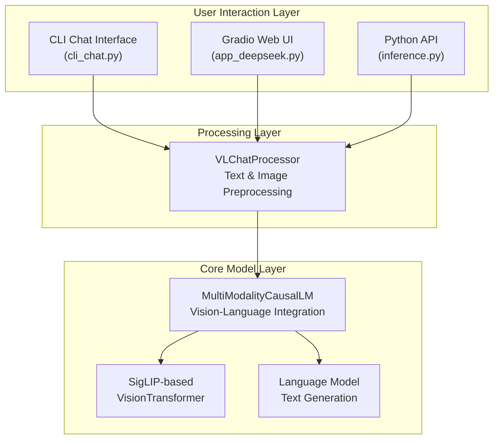
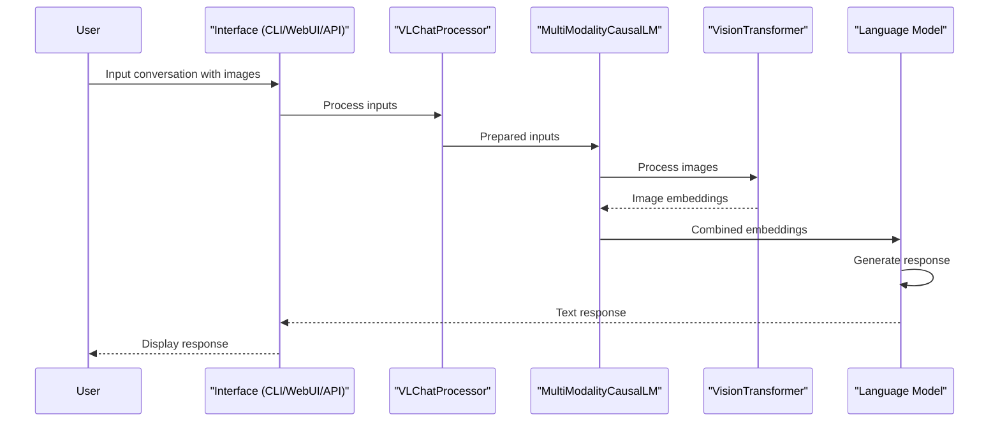
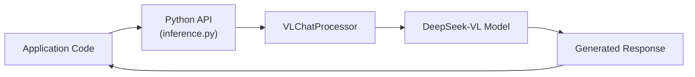
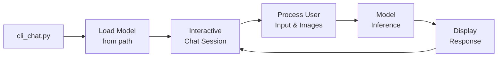

<!-- source: DeepWiki mcp.deepwiki.com · repo deepseek-ai/DeepSeek-VL · page 1 Overview · fetched 2026-10-30 -->

# Overview

Relevant source files

The following files were used as context for generating this wiki page:

- [README.md](README.md)
- [pyproject.toml](pyproject.toml)

DeepSeek-VL is an open-source Vision-Language (VL) model designed for real-world vision and language understanding applications. This document provides a high-level summary of the DeepSeek-VL repository, explaining its architecture, components, and capabilities.

For detailed model architecture specifics, see [Model Architecture](#1.1). For information about different model variants, see [Model Variants](#1.2). For a guide on getting started with DeepSeek-VL, see [Getting Started](#2).

## Purpose and Capabilities

DeepSeek-VL is a multimodal AI system capable of understanding and processing both visual and textual information. The model possesses general multimodal understanding capabilities, able to process:

- Logical diagrams
- Web pages
- Mathematical formulas
- Scientific literature
- Natural images
- Embodied intelligence scenarios

The system is designed to bridge the gap between vision and language understanding, allowing for sophisticated analysis and response generation based on both image and text inputs.

Sources: [README.md:60-62]()

## Model Family

DeepSeek-VL is available in multiple variants to accommodate different deployment scenarios and computational requirements:

| Model | Parameters | Sequence Length | Purpose |
|-------|------------|-----------------|---------|
| DeepSeek-VL-1.3B-base | 1.3 billion | 4096 tokens | Foundation model for fine-tuning |
| DeepSeek-VL-1.3B-chat | 1.3 billion | 4096 tokens | Optimized for conversational use |
| DeepSeek-VL-7B-base | 7 billion | 4096 tokens | More capable foundation model |
| DeepSeek-VL-7B-chat | 7 billion | 4096 tokens | More capable conversational model |

Sources: [README.md:90-103]()

## System Architecture

The DeepSeek-VL system integrates vision and language processing capabilities through a carefully designed architecture:

### High-Level Architecture Diagram

Sources: [README.md:119-126]()

### Information Flow Diagram

Sources: [README.md:119-187]()

## Core Components

### 1. VLChatProcessor

The `VLChatProcessor` handles preprocessing of both text and images, preparing them for input to the model. It transforms raw user inputs into a format suitable for the multimodal model.

Key responsibilities:
- Processing conversation history
- Handling image placeholders in text
- Preparing images for the vision encoder
- Formatting inputs for the model

Sources: [README.md:129-169]()

### 2. MultiModalityCausalLM

This component serves as the integration point between vision and language processing. It:
- Takes processed inputs from the `VLChatProcessor`
- Incorporates image embeddings from the vision encoder
- Combines them with text embeddings
- Prepares the unified representation for the language model

Sources: [README.md:132-172]()

### 3. Vision Encoder

DeepSeek-VL uses a SigLIP-based Vision Transformer to encode images into embeddings that can be processed alongside text. This component extracts visual features that are then integrated with the language understanding components.

Sources: [README.md:172]()

### 4. Language Model

The language model component handles text generation based on the combined vision and language inputs. It:
- Takes the combined embeddings from the `MultiModalityCausalLM`
- Generates contextually appropriate responses
- Handles token prediction and sequence generation

Sources: [README.md:175-184]()

## User Interfaces

DeepSeek-VL provides multiple ways to interact with the model:

### 1. Python API

For programmatic access and integration into applications, DeepSeek-VL offers a Python API that allows direct interaction with the model.

Sources: [README.md:118-187]()

### 2. Command-Line Interface

For quick testing and direct interaction, a command-line chat interface is provided.

Sources: [README.md:190-196]()

### 3. Gradio Web UI

For a graphical user interface, DeepSeek-VL provides a Gradio-based web UI that allows for easy interaction with the model through a browser.

Sources: [README.md:198-204](), [pyproject.toml:25-36]()

## Dependencies

DeepSeek-VL relies on several key libraries and frameworks:

- **Core Dependencies**:
  - torch (≥2.0.1)
  - transformers (≥4.38.2)
  - timm (≥0.9.16)
  - accelerate
  - sentencepiece
  - attrdict
  - einops

- **Gradio Interface Dependencies** (optional):
  - gradio (3.48.0)
  - gradio-client (0.6.1)
  - mdtex2html
  - pypinyin
  - tiktoken
  - and others for UI rendering

Sources: [pyproject.toml:14-36]()

## Licensing

DeepSeek-VL is distributed under dual licensing:

- **Code Repository**: Licensed under the MIT License
- **Model Weights**: Subject to the DeepSeek Model License

The models support commercial use under these license terms. For more detailed information about licensing, see [Licensing](#6).

Sources: [README.md:208-210]()

---

