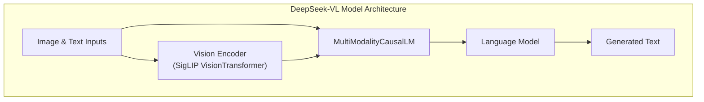
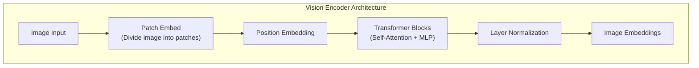
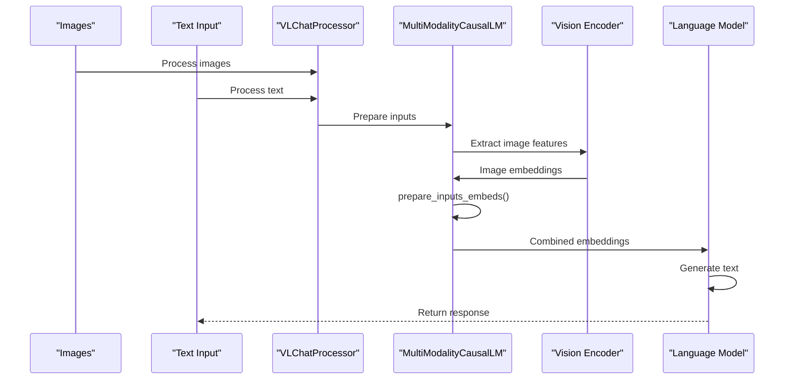
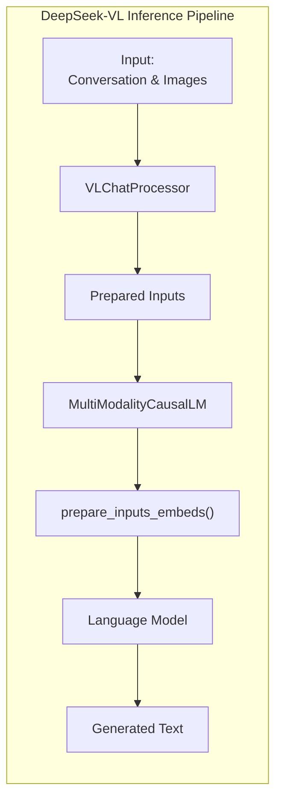
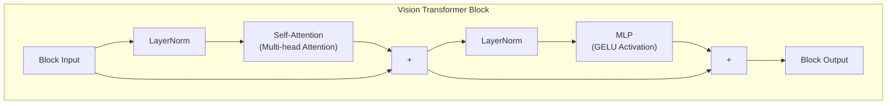
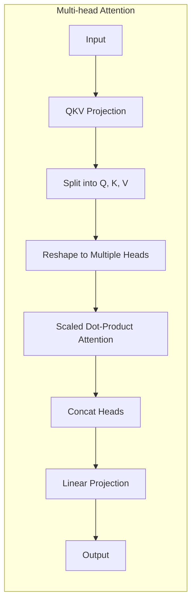
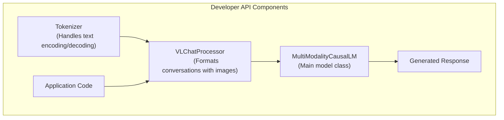

<!-- source: DeepWiki mcp.deepwiki.com · repo deepseek-ai/DeepSeek-VL · page 1.1 Model Architecture · fetched 2026-10-30 -->

# Model Architecture

<details>
<summary>Relevant source files</summary>

The following files were used as context for generating this wiki page:

- [README.md](README.md)
- [deepseek_vl/__init__.py](deepseek_vl/__init__.py)
- [deepseek_vl/models/siglip_vit.py](deepseek_vl/models/siglip_vit.py)
- [inference.py](inference.py)

</details>


This page documents the core architecture of the DeepSeek-VL model, explaining how the vision and language components are integrated to enable multimodal understanding. For information about specific model variants, see [Model Variants](#1.2).

## Overall Architecture

DeepSeek-VL follows a vision-language architecture that processes both images and text inputs to generate coherent natural language responses. The model consists of three primary components:



Sources: [README.md:60-62](), [inference.py:20-34]()

1. **Vision Encoder**: A SigLIP-based Vision Transformer that processes and encodes images into a representation that can be understood by the language model.

2. **MultiModalityCausalLM**: The integration layer that combines image embeddings and text tokens to create a unified representation for the language model.

3. **Language Model**: A causal language model that generates coherent text responses based on the multimodal inputs.

## Vision Encoder Component

The vision encoder in DeepSeek-VL is based on the SigLIP Vision Transformer (ViT) architecture. It processes images by dividing them into patches and applying a series of transformer blocks.



Sources: [deepseek_vl/models/siglip_vit.py:258-589]()

Key components of the Vision Transformer:

- **Patch Embedding**: Divides input images into fixed-size patches and projects them into the embedding space.
- **Position Embedding**: Adds positional information to the patch embeddings.
- **Transformer Blocks**: A series of self-attention and MLP blocks that process the patch embeddings.
- **Normalization**: Layer normalization applied after the transformer blocks.

DeepSeek-VL uses a configurable SigLIP Vision Transformer with various parameter settings depending on the model variant:

| Configuration | Image Size | Patch Size | Width | Layers | Heads | MLP Ratio |
|---------------|------------|------------|-------|--------|-------|-----------|
| siglip_so400m_patch14_384 | 336 | 14 | 1152 | 27 | 16 | 3.7362 |
| siglip_so400m_patch14_224 | 224 | 14 | 1152 | 27 | 16 | 3.7362 |
| siglip_large_patch16_384 | 384 | 16 | 1024 | 24 | 16 | 4.0 |

Sources: [deepseek_vl/models/siglip_vit.py:606-637]()

## Multimodal Integration

The MultiModalityCausalLM component is central to DeepSeek-VL's architecture, serving as the integration point between vision and language modalities.



Sources: [inference.py:64-76]()

The integration process involves:

1. **Input Preparation**: The `VLChatProcessor` handles preprocessing of both image and text inputs.
2. **Feature Extraction**: Images are processed through the Vision Encoder to extract embeddings.
3. **Embedding Combination**: The `prepare_inputs_embeds` method in `MultiModalityCausalLM` combines image embeddings with text tokens into a single representation.
4. **Language Generation**: The unified representation is passed to the language model for response generation.

## Inference Pipeline

The inference process in DeepSeek-VL follows a specific pipeline that transforms raw inputs into generated text:



Sources: [inference.py:64-86]()

This pipeline involves several key steps:

1. **Input Processing**: Conversation history and images are processed by the `VLChatProcessor`.
   ```python
   pil_images = load_pil_images(conversation)
   prepare_inputs = vl_chat_processor(
       conversations=conversation, images=pil_images, force_batchify=True
   ).to(vl_gpt.device)
   ```

2. **Embedding Preparation**: The `MultiModalityCausalLM` prepares input embeddings by combining vision and text features.
   ```python
   inputs_embeds = vl_gpt.prepare_inputs_embeds(**prepare_inputs)
   ```

3. **Text Generation**: The language model generates a response based on the input embeddings.
   ```python
   outputs = vl_gpt.language_model.generate(
       inputs_embeds=inputs_embeds,
       attention_mask=prepare_inputs.attention_mask,
       pad_token_id=tokenizer.eos_token_id,
       bos_token_id=tokenizer.bos_token_id,
       eos_token_id=tokenizer.eos_token_id,
       max_new_tokens=512,
       do_sample=False,
       use_cache=True
   )
   ```

Sources: [inference.py:64-86]()

## Vision Transformer Details

The Vision Transformer (ViT) component is built with a series of attention blocks that process image patches:



Sources: [deepseek_vl/models/siglip_vit.py:209-256]()

Each block contains:

1. **Layer Normalization**: Applied before both attention and MLP layers.
2. **Multi-head Self-Attention**: Processes relationships between image patches.
3. **MLP**: A feed-forward network with GELU activation.
4. **Skip Connections**: Residual connections around both attention and MLP layers.

The attention mechanism is defined as:



Sources: [deepseek_vl/models/siglip_vit.py:136-191]()

For efficient implementation, DeepSeek-VL uses PyTorch's `F.scaled_dot_product_attention` when available, falling back to manual implementation otherwise.

## Integration with User Code

When using DeepSeek-VL in applications, the main components that developers interact with are:



Sources: [inference.py:20-34](), [README.md:119-187]()

The typical usage pattern involves:

1. Loading the model and processor:
   ```python
   model_path = "deepseek-ai/deepseek-vl-7b-chat"
   vl_chat_processor = VLChatProcessor.from_pretrained(model_path)
   tokenizer = vl_chat_processor.tokenizer
   vl_gpt = AutoModelForCausalLM.from_pretrained(model_path, trust_remote_code=True)
   ```

2. Preparing the conversation with images:
   ```python
   conversation = [
       {
           "role": "User",
           "content": "<image_placeholder>Describe this image.",
           "images": ["path/to/image.jpg"],
       },
       {"role": "Assistant", "content": ""},
   ]
   ```

3. Processing inputs and generating responses using the pipeline described earlier.

Sources: [README.md:119-187](), [inference.py:36-86]()

This architecture enables DeepSeek-VL to effectively process and understand both visual and textual information, making it suitable for a wide range of multimodal tasks.

---

