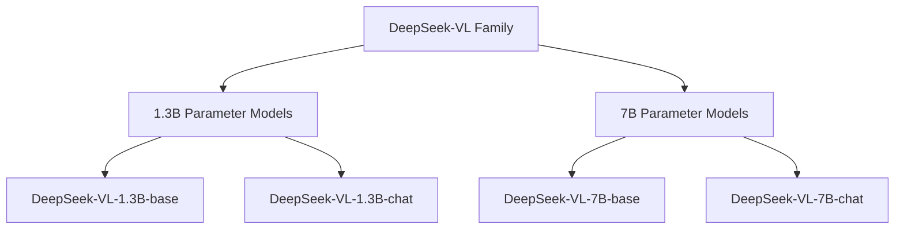
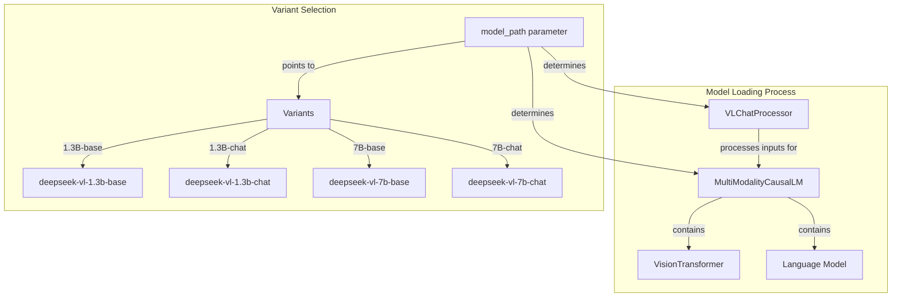
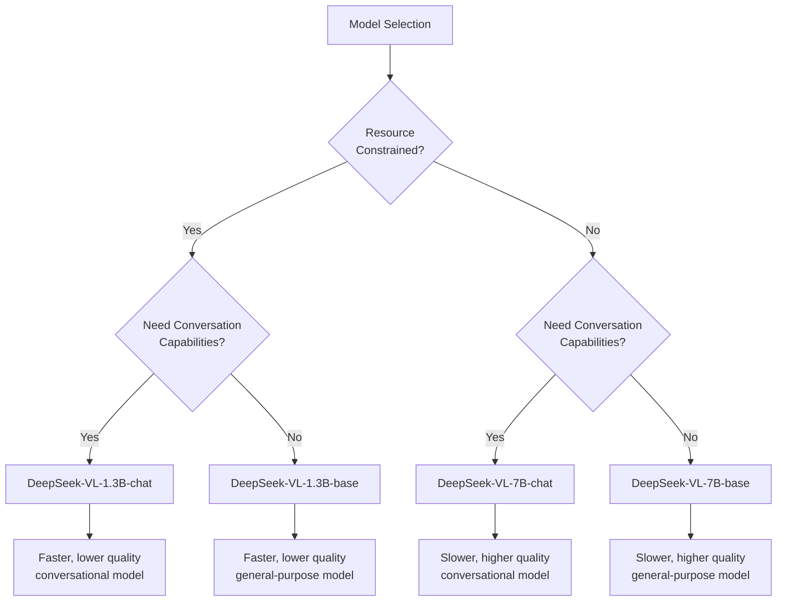

<!-- source: DeepWiki mcp.deepwiki.com · repo deepseek-ai/DeepSeek-VL · page 1.2 Model Variants · fetched 2026-10-30 -->

# Model Variants

<details>
<summary>Relevant source files</summary>

The following files were used as context for generating this wiki page:

- [README.md](README.md)
- [pyproject.toml](pyproject.toml)

</details>


This document provides detailed information about the different DeepSeek-VL model variants, explaining the parameter sizes (1.3B and 7B) and model types (base and chat) available in the DeepSeek-VL family. It covers the characteristics, use cases, and selection criteria for each variant. For information about the overall model architecture, see [Model Architecture](#1.1), and for details about model capabilities, see [Capabilities](#1.3).

## Model Family Overview

DeepSeek-VL is released as a family of models with varying parameter sizes and training objectives. All variants share the same fundamental architecture, combining vision and language understanding capabilities, but differ in their size and optimization targets.

### DeepSeek-VL Variant Hierarchy



Sources: [README.md:91-103]()

## Parameter Size Variations

DeepSeek-VL is available in two different parameter sizes, each offering different trade-offs between performance and resource requirements.

### 1.3B Parameter Models

The 1.3B parameter models represent the smaller variants in the DeepSeek-VL family:

- **Model Size**: ~1.3 billion parameters
- **Memory Requirements**: Lower memory footprint
- **Inference Speed**: Faster inference
- **Deployment**: Suitable for resource-constrained environments
- **Context Length**: 4096 tokens

### 7B Parameter Models

The 7B parameter models are the larger variants:

- **Model Size**: ~7 billion parameters
- **Memory Requirements**: Higher memory footprint
- **Inference Speed**: Slower compared to 1.3B models
- **Performance**: Generally higher quality outputs and better comprehension
- **Context Length**: 4096 tokens

Sources: [README.md:98-103]()

## Model Types

Each parameter size comes in two different variants optimized for different use cases.

### Base Models

The base models (`DeepSeek-VL-1.3B-base` and `DeepSeek-VL-7B-base`) are general-purpose vision-language models:

- **Training**: Pretrained on a diverse dataset of vision-language data
- **Usage**: Ideal for customization, fine-tuning, and general-purpose tasks
- **Integration**: Can be adapted for specialized applications through additional fine-tuning
- **Flexibility**: More versatile for research and development of new applications

### Chat Models

The chat models (`DeepSeek-VL-1.3B-chat` and `DeepSeek-VL-7B-chat`) are optimized for conversational interactions:

- **Training**: Base models further fine-tuned on conversation data
- **Usage**: Ready-to-use for interactive dialogue applications
- **User Experience**: Designed to provide helpful, coherent responses in a conversational format
- **Integration**: Ideal for chatbots, virtual assistants, and interactive applications

Sources: [README.md:91-94](), [README.md:98-103]()

## Model Implementation and Loading

The DeepSeek-VL models are implemented through a combination of specialized components. The code structure reflects how the different model variants are instantiated and used.



Sources: [README.md:126-134]()

## Model Variant Selection Guide

When choosing between model variants, consider the following factors:

### Resource vs. Performance Trade-off



### Selection Criteria Table

| Consideration | Recommended Variant |
|---------------|---------------------|
| Mobile or edge deployment | DeepSeek-VL-1.3B-chat or DeepSeek-VL-1.3B-base |
| Interactive chat applications | DeepSeek-VL-7B-chat (if resources permit) or DeepSeek-VL-1.3B-chat |
| Research and fine-tuning | DeepSeek-VL-7B-base or DeepSeek-VL-1.3B-base |
| Best performance regardless of resources | DeepSeek-VL-7B-chat or DeepSeek-VL-7B-base |
| Balanced performance and speed | DeepSeek-VL-1.3B-chat or DeepSeek-VL-1.3B-base |

Sources: [README.md:91-103](), [README.md:126-134]()

## Model Loading Examples

### Loading a Chat Model

```python
from transformers import AutoModelForCausalLM
from deepseek_vl.models import VLChatProcessor, MultiModalityCausalLM

# For the 7B chat model
model_path = "deepseek-ai/deepseek-vl-7b-chat"

# For the 1.3B chat model
# model_path = "deepseek-ai/deepseek-vl-1.3b-chat"

vl_chat_processor = VLChatProcessor.from_pretrained(model_path)
vl_gpt = AutoModelForCausalLM.from_pretrained(model_path, trust_remote_code=True)
```

### Loading a Base Model

```python
from transformers import AutoModelForCausalLM
from deepseek_vl.models import VLChatProcessor, MultiModalityCausalLM

# For the 7B base model
model_path = "deepseek-ai/deepseek-vl-7b-base"

# For the 1.3B base model
# model_path = "deepseek-ai/deepseek-vl-1.3b-base"

vl_chat_processor = VLChatProcessor.from_pretrained(model_path)
vl_gpt = AutoModelForCausalLM.from_pretrained(model_path, trust_remote_code=True)
```

Sources: [README.md:126-134]()

## Model Availability and Access

All DeepSeek-VL variants are available on Hugging Face and can be accessed using the following model paths:

| Model Variant | Hugging Face Repository |
|---------------|-------------------------|
| DeepSeek-VL-1.3B-base | deepseek-ai/deepseek-vl-1.3b-base |
| DeepSeek-VL-1.3B-chat | deepseek-ai/deepseek-vl-1.3b-chat |
| DeepSeek-VL-7B-base | deepseek-ai/deepseek-vl-7b-base |
| DeepSeek-VL-7B-chat | deepseek-ai/deepseek-vl-7b-chat |

The models are provided under the DeepSeek Model License, which permits commercial use.

Sources: [README.md:98-103](), [README.md:209-210]()

---

