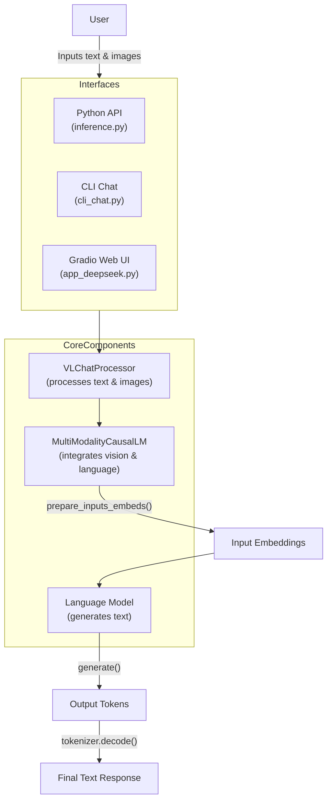
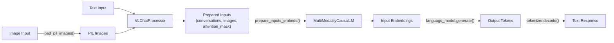
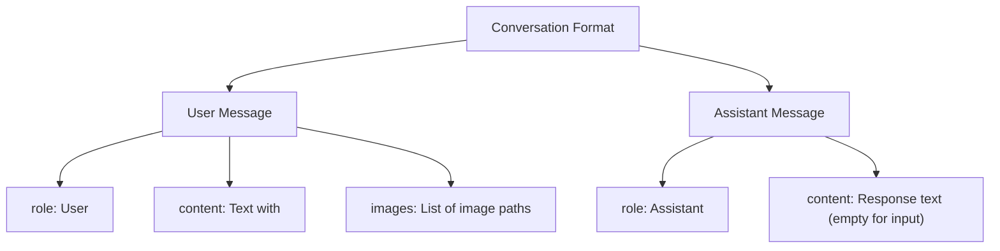

<!-- source: DeepWiki mcp.deepwiki.com · repo deepseek-ai/DeepSeek-VL · page 2 Getting Started · fetched 2026-10-30 -->

# Getting Started

<details>
<summary>Relevant source files</summary>

The following files were used as context for generating this wiki page:

- [README.md](README.md)
- [pyproject.toml](pyproject.toml)
- [requirements.txt](requirements.txt)

</details>


This guide provides instructions for setting up and using DeepSeek-VL, a vision-language model for processing and understanding both visual and textual information. It covers installation requirements, basic usage patterns, and how to interact with the model through different interfaces. For detailed information about the model architecture and capabilities, see [Overview](#1). For comprehensive installation steps, see [Installation](#2.1).

## Prerequisites

Before installing DeepSeek-VL, ensure your system meets the following requirements:

- Python 3.8 or higher
- PyTorch 2.0.1 or higher
- CUDA-compatible GPU (recommended for inference)
- Sufficient disk space for model weights (7B models require approximately 14GB)

## Installation

DeepSeek-VL can be installed directly from the repository:

```bash
# Clone the repository
git clone https://github.com/deepseek-ai/DeepSeek-VL.git
cd DeepSeek-VL

# Install the basic package
pip install -e .

# For Gradio web UI support, install additional dependencies
pip install -e .[gradio]
```

The installation process sets up all necessary dependencies, including:
- `transformers` (version 4.38.2 or higher)
- `timm` (version 0.9.16 or higher)
- `accelerate`
- `sentencepiece`
- `attrdict`
- `einops`

Sources:
- [README.md:109-115]()
- [pyproject.toml:14-22]()
- [requirements.txt:1-7]()

## Available Models

DeepSeek-VL offers several model variants to suit different needs and computational resources:

| Model | Parameters | Context Length | Purpose |
|-------|------------|----------------|---------|
| DeepSeek-VL-1.3B-base | 1.3 billion | 4096 tokens | Base model for fine-tuning |
| DeepSeek-VL-1.3B-chat | 1.3 billion | 4096 tokens | Optimized for chat/dialogue |
| DeepSeek-VL-7B-base | 7 billion | 4096 tokens | Larger base model |
| DeepSeek-VL-7B-chat | 7 billion | 4096 tokens | Larger chat-optimized model |

All models can be loaded directly from Hugging Face using the model IDs (e.g., `deepseek-ai/deepseek-vl-7b-chat`) or used locally after downloading.

Sources:
- [README.md:89-104]()

## System Architecture Overview

The following diagram shows the high-level architecture of DeepSeek-VL and how components interact:



Sources:
- [README.md:119-187]()

## Data Flow in DeepSeek-VL

The following diagram illustrates how data flows through the system when processing a multimodal input:



Sources:
- [README.md:119-187]()

## Python API Example

Here's a basic example of using DeepSeek-VL with the Python API:

```python
import torch
from transformers import AutoModelForCausalLM
from deepseek_vl.models import VLChatProcessor, MultiModalityCausalLM
from deepseek_vl.utils.io import load_pil_images

# Specify the model path
model_path = "deepseek-ai/deepseek-vl-7b-chat"

# Load the processor and tokenizer
vl_chat_processor = VLChatProcessor.from_pretrained(model_path)
tokenizer = vl_chat_processor.tokenizer

# Load the model
vl_gpt = AutoModelForCausalLM.from_pretrained(model_path, trust_remote_code=True)
vl_gpt = vl_gpt.to(torch.bfloat16).cuda().eval()

# Create a conversation with an image
conversation = [
    {
        "role": "User",
        "content": "<image_placeholder>Describe this image.",
        "images": ["path/to/your/image.jpg"],
    },
    {"role": "Assistant", "content": ""},
]

# Load images and prepare for inputs
pil_images = load_pil_images(conversation)
prepare_inputs = vl_chat_processor(
    conversations=conversation,
    images=pil_images,
    force_batchify=True
).to(vl_gpt.device)

# Run image encoder to get the image embeddings
inputs_embeds = vl_gpt.prepare_inputs_embeds(**prepare_inputs)

# Generate the response
outputs = vl_gpt.language_model.generate(
    inputs_embeds=inputs_embeds,
    attention_mask=prepare_inputs.attention_mask,
    pad_token_id=tokenizer.eos_token_id,
    bos_token_id=tokenizer.bos_token_id,
    eos_token_id=tokenizer.eos_token_id,
    max_new_tokens=512,
    do_sample=False,
    use_cache=True
)

# Decode the response
answer = tokenizer.decode(outputs[0].cpu().tolist(), skip_special_tokens=True)
print(answer)
```

Sources:
- [README.md:119-187]()

## Conversation Format

DeepSeek-VL uses a structured format for conversations with images:



Example structure:
```python
conversation = [
    {
        "role": "User",
        "content": "<image_placeholder>Describe this image.",
        "images": ["path/to/image.jpg"],
    },
    {"role": "Assistant", "content": ""},  # Empty for input, filled after generation
]
```

Sources:
- [README.md:135-143]()

## Command Line Interface

For interactive chat via command line:

```bash
python cli_chat.py --model_path "deepseek-ai/deepseek-vl-7b-chat"

# Or with a local model path
python cli_chat.py --model_path "/path/to/local/model"
```

Sources:
- [README.md:190-196]()

## Gradio Web Interface

To launch the web interface:

```bash
# First install gradio dependencies if not already done
pip install -e .[gradio]

# Then run the Gradio app
python deepseek_vl/serve/app_deepseek.py
```

The Gradio interface provides a user-friendly way to interact with DeepSeek-VL, allowing you to upload images and chat with the model.

Sources:
- [README.md:198-204]()
- [pyproject.toml:24-36]()
- [requirements.txt:9-19]()

## Next Steps

- Explore detailed [Installation](#2.1) instructions
- Try [Quick Usage Examples](#2.2)
- Learn about the [Model Architecture](#1.1) and [Capabilities](#1.3)
- Explore different [Interfaces](#4) for interacting with DeepSeek-VL

---

