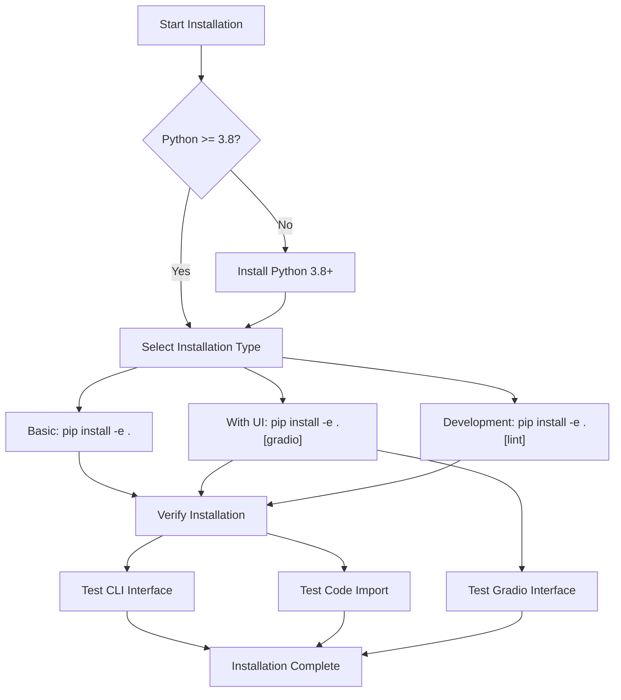
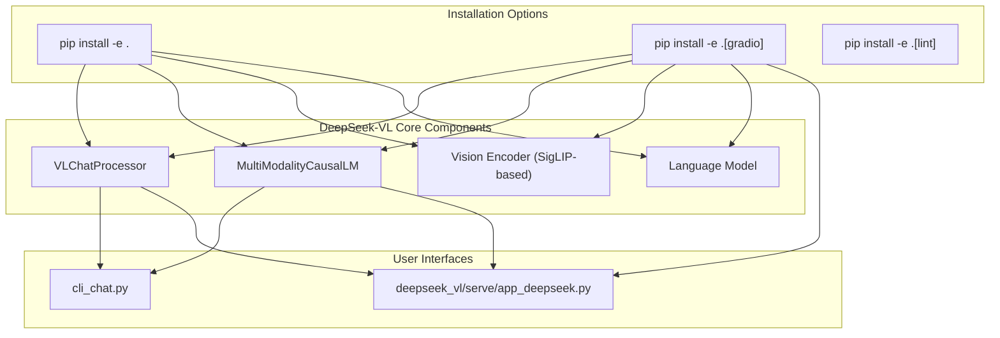

<!-- source: DeepWiki mcp.deepwiki.com · repo deepseek-ai/DeepSeek-VL · page 2.1 Installation · fetched 2026-10-30 -->

# Installation

<details>
<summary>Relevant source files</summary>

The following files were used as context for generating this wiki page:

- [Makefile](Makefile)
- [README.md](README.md)
- [pyproject.toml](pyproject.toml)
- [requirements.txt](requirements.txt)

</details>


This page provides detailed instructions for installing DeepSeek-VL and its dependencies. For information about using DeepSeek-VL after installation, see [Quick Usage Examples](#2.2).

## System Requirements

DeepSeek-VL requires the following:

- Python >= 3.8
- For optimal performance: CUDA-compatible GPU
- Sufficient disk space for model weights (several GB depending on model variant)

## Installation Methods

### Basic Installation

The standard way to install DeepSeek-VL with all core dependencies:

```bash
pip install -e .
```

Sources: [README.md:111-114](), [pyproject.toml:6-22]()

### Installation with Optional Features

#### Gradio Web UI

To install DeepSeek-VL with Gradio web interface support:

```bash
pip install -e .[gradio]
```

This installs additional UI-related dependencies required for the web interface.

#### Development Tools

For development and contribution to the codebase:

```bash
pip install -e .[lint]
```

This installs code formatting, linting, and testing tools.

Sources: [README.md:200-201](), [pyproject.toml:24-50]()

## Installation Process Diagram



Sources: [README.md:109-115](), [pyproject.toml:13-50]()

## Dependencies

### Core Dependencies

DeepSeek-VL relies on the following primary dependencies:

| Dependency | Version | Purpose |
|------------|---------|---------|
| torch | >=2.0.1 | Deep learning framework |
| transformers | >=4.38.2 | Transformer model implementation |
| timm | >=0.9.16 | PyTorch Image Models |
| accelerate | - | Hardware acceleration utilities |
| sentencepiece | - | Tokenization |
| attrdict | - | Attribute dictionary functionality |
| einops | - | Tensor operations |

### Optional Dependencies

When installing with `[gradio]`, these additional dependencies are included:

| Dependency | Version | Purpose |
|------------|---------|---------|
| gradio | 3.48.0 | Web UI framework |
| gradio-client | 0.6.1 | Client for Gradio |
| mdtex2html | 1.3.0 | Markdown/LaTeX to HTML conversion |
| pypinyin | 0.50.0 | Chinese pinyin conversion |
| tiktoken | 0.5.2 | Tokenizer |
| tqdm | 4.64.0 | Progress bars |
| colorama | 0.4.5 | Terminal color output |
| Pygments | 2.12.0 | Code syntax highlighting |
| markdown | 3.4.1 | Markdown processing |

Sources: [pyproject.toml:14-36](), [requirements.txt:1-19]()

## Component Architecture



Sources: [README.md:118-187]()

## Verifying Installation

### Basic Verification

To verify that DeepSeek-VL has been installed correctly, run a simple Python script:

```python
from deepseek_vl.models import VLChatProcessor, MultiModalityCausalLM
print("DeepSeek-VL successfully imported!")
```

If no errors occur, the installation was successful.

### Testing the CLI Interface

Test the command-line interface with:

```bash
python cli_chat.py --model_path "deepseek-ai/deepseek-vl-7b-chat"
```

This will download the model (if not cached locally) and start an interactive chat session.

### Testing the Gradio Web Interface

If you installed with Gradio support:

```bash
python deepseek_vl/serve/app_deepseek.py
```

This starts a local web server with the DeepSeek-VL chat interface.

Sources: [README.md:191-204]()

## Troubleshooting

### Common Issues

#### CUDA/GPU Issues

If you encounter CUDA-related errors:
- Ensure your PyTorch installation matches your CUDA version
- Check that GPU drivers are up-to-date
- Verify CUDA toolkit compatibility

#### Dependency Conflicts

If you encounter dependency conflicts:
- Create a fresh virtual environment:
  ```bash
  python -m venv venv
  source venv/bin/activate  # On Windows: venv\Scripts\activate
  ```
- Then reinstall DeepSeek-VL in the isolated environment

#### Model Download Issues

If model downloading fails:
- Check your internet connection
- Ensure you have sufficient disk space
- Try specifying a local Hugging Face cache directory:
  ```bash
  export TRANSFORMERS_CACHE="/path/to/cache"
  ```

## Next Steps

After successful installation, proceed to [Quick Usage Examples](#2.2) to learn how to use DeepSeek-VL for vision-language tasks.

Sources: [README.md:107-204]()

---

